# 01 语言基础与对象模型

> 语言层的每一个"坑"背后都是 JVM 规范或编译器的实现选择 ｜ 面试权重 ★★★★★ ｜ 建议复习 60 分钟

本章讨论的不是"什么是多态"，而是：`Integer` 缓存池的边界值为什么是 -128~127、`String` 在 JDK 9 为什么把 `char[]` 换成 `byte[]`、重载为什么在编译期就定死了、`finally` 里的 `return` 为什么能吃掉异常。版本基线：**JDK 8 / JDK 11 / JDK 17 三代对照**，HotSpot 虚拟机，javac 行为以 JDK 8 与 JDK 17 为准。

## 本章大纲

- [一、基本类型与包装类](#一基本类型与包装类)
- [二、String 的不可变设计与常量池](#二string-的不可变设计与常量池)
- [三、equals 与 hashCode 契约](#三equals-与-hashcode-契约)
- [四、== 与 equals 的语义边界](#四-与-equals-的语义边界)
- [五、浅拷贝、深拷贝与 Cloneable](#五浅拷贝深拷贝与-cloneable)
- [六、重载与重写：静态分派与动态分派](#六重载与重写静态分派与动态分派)
- [七、异常体系与 finally 的字节码语义](#七异常体系与-finally-的字节码语义)
- [八、final、static 与初始化顺序](#八finalstatic-与初始化顺序)
- [九、面向对象设计原则与接口默认方法](#九面向对象设计原则与接口默认方法)
- [十、反射、封装破坏与 JPMS 模块化](#十反射封装破坏与-jpms-模块化)
- [十一、高级岗三问：设计动机、线上定位、规模放大](#十一高级岗三问设计动机线上定位规模放大)
- [高频面试题](#高频面试题)
- [易错点与踩坑](#易错点与踩坑)
- [一句话速记](#一句话速记)

## 一、基本类型与包装类

### 1.1 基本类型的宽度、默认值与内存布局

JVM 规范（JVMS §2.3）只规定了基本类型的**取值范围**，没有规定内存占用；HotSpot 在 64 位平台上采用下表布局。

| 类型 | 位数 | 取值范围 | 字段默认值 | 局部变量默认值 | HotSpot 栈上槽宽 |
| --- | --- | --- | --- | --- | --- |
| `boolean` | 规范未定义 | `true` / `false` | `false` | 无（编译期报错） | 1 字节（数组元素）/ 4 字节（栈槽） |
| `byte` | 8 | -128 ~ 127 | `(byte)0` | 无 | 4 字节栈槽 |
| `char` | 16 | `\u0000` ~ `\uffff` | `'\u0000'` | 无 | 4 字节栈槽 |
| `short` | 16 | -32768 ~ 32767 | `(short)0` | 无 | 4 字节栈槽 |
| `int` | 32 | -2^31 ~ 2^31-1 | `0` | 无 | 4 字节 |
| `long` | 64 | -2^63 ~ 2^63-1 | `0L` | 无 | 8 字节 |
| `float` | 32 | IEEE 754 单精度 | `0.0f` | 无 | 4 字节 |
| `double` | 64 | IEEE 754 双精度 | `0.0d` | 无 | 8 字节 |

几个必须在面试里说清的细节：

1. **字段有默认值，局部变量没有**。对象被 `new` 出来时，实例字段先被 JVM 清零（`<init>` 里的赋值语句在 `super()` 之后执行），所以 `int` 字段是 `0`；而局部变量在字节码里靠 `istore` 写入，javac 会做**确定性赋值分析**（JLS 16），未赋值就使用直接编译失败，而不是"读到垃圾值"。
2. **`boolean` 在 JVM 中是 `int`**。`boolean` 数组用 `baload`/`bastore` 且元素占 1 字节，但单个 `boolean` 变量/参数在操作数栈与局部变量表里按 `int` 处理（`iconst_1`、`ireturn`）。这也是"`boolean` 只有 1 bit 是误解"的根源。
3. **精度陷阱**：`float` 只有 24 位有效二进制位，`int` 超过 2^24 转 `float` 会丢精度。

```java
// JDK 8 ~ JDK 21 行为一致
float f = 16_777_217;      // int 值 2^24 + 1
System.out.println((int) f);   // 输出 16777216，最低位丢失
System.out.println(0.1f + 0.2f == 0.3f);  // false
System.out.println(1.0 - 0.9 == 0.1);     // false
```

**金额计算**：一律 `BigDecimal`，且用 `BigDecimal.valueOf(double)`（内部走 `Double.toString`）或字符串构造器，**不要** `new BigDecimal(0.1)`（会把二进制误差原样带进来，得到 `0.1000000000000000055511151231257827021181583404541015625`）。`BigDecimal#equals` 比较的是"值 + scale"，所以 `new BigDecimal("1.0").equals(new BigDecimal("1.00"))` 是 `false`，而 `compareTo` 返回 `0`。做 `Set` 去重或 `equals` 判断必须用 `stripTrailingZeros()` 或 `compareTo`。

除法必须给 `RoundingMode`，否则无限循环小数直接抛异常：

```java
new BigDecimal("1").divide(new BigDecimal("3"), 2, RoundingMode.HALF_UP); // 0.33
new BigDecimal("1").divide(new BigDecimal("3")); // ArithmeticException: Non-terminating decimal expansion
```

### 1.2 装箱拆箱与缓存池

自动装箱/拆箱是**编译器语法糖**，javac 插入的调用是固定的：

| 源码写法 | 编译后等价于 | 反编译可见的字节码指令 |
| --- | --- | --- |
| `Integer i = 1;` | `Integer.valueOf(1)` | `invokestatic Integer.valueOf:(I)Ljava/lang/Integer;` |
| `int x = i;` | `i.intValue()` | `invokevirtual Integer.intValue:()I` |
| `i++`（`Integer`） | `i = Integer.valueOf(i.intValue() + 1)` | 三步：`intValue` → 加一 → `valueOf` |
| `Long l = 1L;` | `Long.valueOf(1L)` | `invokestatic Long.valueOf:(J)Ljava/lang/Long;` |

各包装类的缓存策略（JDK 8 ~ JDK 21 一致）：

| 包装类 | 缓存范围 | 是否可配置 | 实现位置 |
| --- | --- | --- | --- |
| `Boolean` | `TRUE` / `FALSE` 两个静态实例 | 否 | `Boolean.TRUE` / `Boolean.FALSE` |
| `Byte` | 全部 256 个值 -128 ~ 127 | 否 | `Byte.ByteCache.cache` |
| `Short` | -128 ~ 127 | 否 | `Short.ShortCache.cache` |
| `Character` | 0 ~ 127 | 否 | `Character.CharacterCache.cache` |
| `Integer` | -128 ~ 127 | **是** | `Integer.IntegerCache`，上限由 `java.lang.Integer.IntegerCache.high` 决定 |
| `Long` | -128 ~ 127 | 否 | `Long.LongCache.cache` |
| `Float` | 无缓存 | - | `Float.valueOf` 返回 `new Float(f)`（JDK 8，JDK 9 起标记 deprecated for removal） |
| `Double` | 无缓存 | - | `Double.valueOf` 返回 `new Double(d)` |

`IntegerCache` 是 `Integer` 的私有静态嵌套类，在**第一次调用 `Integer.valueOf` 时**触发类初始化并一次性建满数组：

```java
// JDK 8: sun.misc.VM.getSavedProperty；JDK 9+: jdk.internal.misc.VM.getSavedProperty
private static class IntegerCache {
    static final int low = -128;
    static final int high;
    static final Integer cache[];
    static {
        int h = 127;
        String integerCacheHighPropValue =
            sun.misc.VM.getSavedProperty("java.lang.Integer.IntegerCache.high");
        if (integerCacheHighPropValue != null) {
            int i = parseInt(integerCacheHighPropValue);
            i = Math.max(i, 127);                       // 不能低于 127
            h = Math.min(i, Integer.MAX_VALUE - (-low) - 1); // 防止数组越界
        }
        high = h;
        cache = new Integer[(high - low) + 1];          // 默认 256 个元素
        int j = low;
        for (int k = 0; k < cache.length; k++) cache[k] = new Integer(j++);
    }
}
```

开启方式：`-Djava.lang.Integer.IntegerCache.high=1000`。注意 JDK 5 用的是 `-XX:AutoBoxCacheMax=<size>`，两者不要混。调大缓存能减少小整数装箱对象，但会**延长缓存存活时间**（这些对象常驻），在极端内存敏感场景要评估。

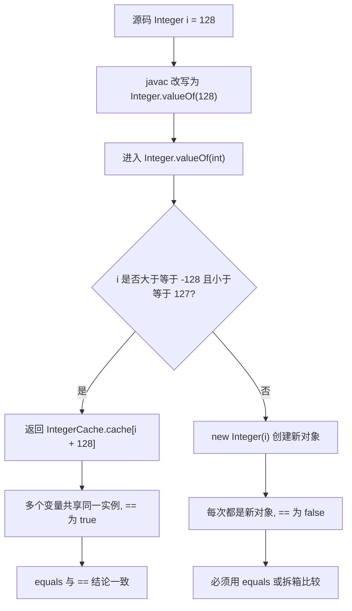

### 1.3 包装类比较的四种陷阱

**陷阱一：缓存边界外的 `==`。**

```java
Integer a = 127, b = 127;
System.out.println(a == b);        // true
Integer c = 128, d = 128;
System.out.println(c == d);        // false
System.out.println(c.equals(d));   // true
Integer e = new Integer(100);
Integer f = new Integer(100);
System.out.println(e == f);        // false，new 不走缓存（JDK 9 起构造器 deprecated）
```

**陷阱二：混类型比较直接编译失败或语义错位。**

```java
Integer i = 1; Long l = 1L;
// System.out.println(i == l);   // 编译错误: incomparable types
System.out.println(i.equals(l));  // false，Integer.equals 先做 instanceof Integer 判断
System.out.println(i.longValue() == l); // true
```

**陷阱三：三目运算符的自动拆箱 NPE。** 这是线上最常见的包装类事故：

```java
Map<String, Integer> map = new HashMap<>();
Integer value = map.get("missing");          // null
// boolean ok = value > 0;                   // NPE: 拆箱 null.intValue()
// int r = flag ? 0 : value;                 // NPE: 三目表达式被提升为 int
// Integer sum = value + 1;                  // NPE
Integer safe = Objects.requireNonNullElse(value, 0);
```

根因在 JLS 15.25 的**二元数值提升**：三目表达式两个分支一个是 `int` 一个是 `Integer` 时，结果类型被提升为 `int`，`Integer` 分支会被无条件拆箱。JDK 8 到 JDK 21 都是这个规则。

**陷阱四：`Objects.equals` 与 `Integer.compare`。**

```java
Objects.equals(a, b);            // 先比引用再 equals，天然 null 安全
Integer.compare(a, b);           // 推荐，避免 a - b 的 int 溢出
CompletableFuture<Integer> x = null;
// Integer.compare(x.get(), 0)   // NPE
```

`Integer.compare` 的实现是 `(x < y) ? -1 : ((x == y) ? 0 : 1)`，**不用减法**，因此没有下溢问题；而 `a - b` 作为比较器返回值在 `a = Integer.MIN_VALUE, b = 1` 时溢出为负数，会导致排序结果错乱——`Comparator` 契约要求"符号正确"，`Collections.sort` 在 JDK 7+ 的 TimSort 会抛 `IllegalArgumentException: Comparison method violates its general contract!`。

### 1.4 装箱的性能代价与规模放大

在 100 万次循环里 `Integer sum = 0; sum += i;` 会产生 100 万个临时 `Integer` 对象（超出缓存范围的部分）。实测热点在**分配速率**而非单次耗时：Eden 区快速被填满 → Young GC 频率上升 → 晋升压力变大。

规避手段，按优先级：

1. **循环内一律用基本类型**，只在必要时装箱。
2. **集合 API 选型**：小整数 ID 场景可用 `int[]` + 紧凑编码，或 Eclipse Collections / fastutil 的 `IntArrayList`。
3. **避免 `Map<Long, X>` 做热点计数器**，改 `LongAdder`（JDK 8+，`cells` 数组分散竞争）或基本类型并行数组。
4. **判空**：`map.get(key)` 返回 `null` 与"值为 null"不可区分，热点路径用 `getOrDefault`（JDK 8+）或 `containsKey`。

线上定位手段：`jcmd <pid> GC.class_histogram`（JDK 9+）/ `jmap -histo:live <pid>` 看 `java.lang.Integer` 实例数，若与业务对象数量同量级，基本可以确认装箱放大；`-XX:+HeapDumpOnOutOfMemoryError` + MAT 的 dominator tree 能定位到具体集合。

## 二、String 的不可变设计与常量池

### 2.1 为什么 String 是 final + 不可变

`String` 类在 JDK 8 的声明是 `public final class String implements java.io.Serializable, Comparable<String>, CharSequence`，核心字段：

```java
// JDK 8
public final class String {
    private final char value[];   // 私有 + final，无 setter
    private int hash;             // 懒计算缓存，默认 0 表示未计算
}
// JDK 9+
public final class String {
    private final byte[] value;   // JDK 9 起 char[] -> byte[]
    private final byte coder;     // LATIN1 = 0, UTF16 = 1
    private int hash;
    private static final boolean COMPACT_STRINGS = true; // -XX:-CompactStrings 可关闭
}
```

不可变带来五个收益，每一个都能展开成面试答案：

| 收益 | 机制 | 反例（如果可变会怎样） |
| --- | --- | --- |
| 线程安全 | 状态只读，天然可安全发布 | 需要一个字符一个字符加锁 |
| 可缓存 `hashCode` | `hash` 字段懒计算后永不变 | HashMap 的 key 变化后查不到 |
| 常量池共享 | 同一字面量可安全复用同一实例 | 修改一处影响所有引用者 |
| 安全边界 | 类名、文件路径、SQL、URL 传给底层 API 后不会被改 | 校验后字符串被篡改，TOCTOU 攻击 |
| 支持字符串拼接折叠 | 编译期常量传播 | 无法在 javac 阶段做常量折叠 |

**反射仍能改**：`Field` 拿到 `value` 字段后 `setAccessible(true)` + `set` 可以改写（`final` 实例字段在 HotSpot 上允许），但这会破坏 `hash` 缓存和常量池一致性，属于禁止操作。JDK 17 起对 record 组件的 final 字段调用 `Field#set` 会抛 `IllegalAccessException`。

### 2.2 三个"常量池"必须分清

这是面试区分度最高的一组概念，很多候选人会把它们混成一个：

| 名称 | 位置 | 生命周期 | 内容 | 对应 JVM 结构 |
| --- | --- | --- | --- | --- |
| class 文件常量池 | `.class` 文件内 | 文件级 | `CONSTANT_Utf8`/`CONSTANT_String`/`CONSTANT_Class` 等 | 静态字节序列 |
| 运行时常量池（Run-Time Constant Pool） | 方法区（JDK 8 起 Metaspace） | 随 `Class` 对象 | 由 class 文件常量池**加载后**形成的符号表，含 `CONSTANT_String_info` 等 | `ConstantPool`（HotSpot `InstanceKlass` 持有） |
| 字符串常量池（String Table / interned strings） | JDK 6 在 PermGen，**JDK 7 起移到 Java 堆** | 随 GC，可回收 | 已 intern 的 `String` 对象的引用 | HotSpot `StringTable`（哈希表） |

关键事实：

1. **字符串常量池移动过**。JDK 6 在永久代，`-XX:MaxPermSize` 打满会 `OutOfMemoryError: PermGen space`；JDK 7 起移到堆中，JDK 8 移除永久代改用 Metaspace。这解释了"为什么同样的 intern 代码在 JDK 7 之后不再 OOM PermGen，而是可能撑大堆"。
2. **StringTable 大小**：JDK 7 默认 1009 个桶，JDK 8 起默认 **60013**（HotSpot `-XX:StringTableSize`，非质数取邻近质数）。大量 `intern()` 或者大量字符串驻留时桶链过长会导致 `String.intern` 变慢，可调大到 1000003 之类并配合 `-XX:+PrintStringTableStatistics`（JDK 8+）观察 `Number of buckets` / `Number of entries` / `Maximum bucket size`；JDK 9+ 还可用 `jcmd <pid> VM.stringtable -verbose`。
3. **StringTable 的条目可被回收**。JDK 8 起 HotSpot 在 GC 时对 StringTable 执行 `unlink_or_oops_do`，弱化/清理已不可达条目（`-XX:+StringTableWeakReferences` 相关行为在后续版本演进），所以 intern 不是永久驻留；但**只要有强引用就在**。
4. **字符串去重**：G1 自 JDK 8u20 起支持 `-XX:+UseStringDeduplication`，在 Young GC 时对 `String` 的 `byte[]` 做去重（要求 `-XX:+UseG1GC`，只去重底层数组，不动 `String` 对象本身），适合"大量内容重复的长字符串"场景，代价是额外 CPU 与去重队列内存。

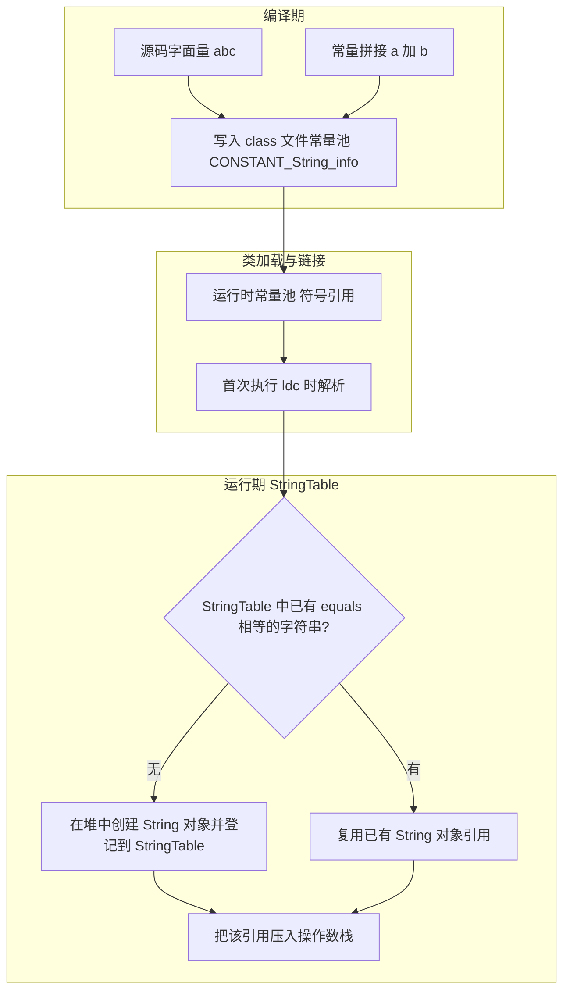

### 2.3 字符串拼接：编译期折叠 vs 运行期拼接

**编译期折叠**（JLS 15.28 constant expression）：只有**基本类型与 `String` 的编译期常量**参与时，javac 直接算出结果并只留下一个 `ldc`。

```java
String s1 = "he" + "llo";                     // 折叠成 "hello" 一个 ldc
final String BASE = "he";
String s2 = BASE + "llo";                     // 仍折叠，BASE 是 constant variable
String s3 = new String("he") + "llo";         // 不折叠，运行期拼接
System.out.println(s1 == "hello");            // true
System.out.println(s2 == "hello");            // true
System.out.println(s3 == "hello");            // false
System.out.println(s3.intern() == "hello");   // true
```

注意 `final` + 编译期常量才折叠：`static final String` 若不是字面量（如 `UUID.randomUUID().toString()`），不参与折叠，也不会被内联到调用方。

**运行期拼接的两代实现**：

| 维度 | JDK 8 | JDK 9+ |
| --- | --- | --- |
| 字节码 | `new StringBuilder` + `append` + `toString` | `invokedynamic` 调用 `StringConcatFactory` |
| bootstrap 方法 | 无 | `makeConcatWithConstants` / `makeConcat` |
| 优化点 | 无 | 生成专用 `MethodHandle`，用 `@Stable` 数组缓存，避免中间 `StringBuilder` 对象 |
| 编译产物 | 每个拼接点 3~N 条指令 | 一条 `invokedynamic` + Recipe 常量 |
| 关闭方式 | - | `-XDstringConcat=inline`（编译期选项）、`-Djava.lang.invoke.stringConcat=BC_SB`（JDK 9+ 运行期） |

JEP 280 的收益在热路径上很直观：`"a" + a + "b" + b` 从"分配 1 个 StringBuilder + 1 个 String"变成"直接按最终长度分配 1 个 byte[] 并填充"。

**循环内拼接是 O(n²)**：JDK 8 每次迭代 `new StringBuilder()` 默认容量 16，随着内容增长反复 `Arrays.copyOf`；JDK 9+ 的 indy 版本仍然是每次迭代一次分配 + 一次复制。正确写法是循环外建 `StringBuilder` 并预估容量：

```java
StringBuilder sb = new StringBuilder(64 * data.size()); // 预估容量，避免多次扩容
for (Data d : data) sb.append(d.getId()).append(',');
```

### 2.4 String / StringBuilder / StringBuffer / StringJoiner 对比

`StringBuilder` 与 `StringBuffer` 在 JDK 8 都继承 `AbstractStringBuilder`（字段 `char[] value; int count;`；JDK 9 起改为 `byte[] value; byte coder; int count;`），区别只在同步。

| 维度 | `String` | `StringBuilder` | `StringBuffer` | `StringJoiner` |
| --- | --- | --- | --- | --- |
| 可变性 | 不可变 | 可变 | 可变 | 可变 |
| 线程安全 | 安全（不可变） | 不安全 | 安全（`synchronized` 方法，锁 `this`） | 不安全 |
| 引入版本 | 1.0 | 1.5 | 1.0 | **JDK 8** |
| 默认容量 | - | 16（`new StringBuilder()` 调 `super(16)`） | 16 | - |
| 扩容公式 | - | `newCapacity = (oldCapacity << 1) + 2` | 同左 | 无容量概念 |
| 上限 | - | `MAX_ARRAY_SIZE = Integer.MAX_VALUE - 8` | 同左 | - |
| 适用场景 | 常量、key、不可变模型 | 单线程拼接（首选） | 极少（老代码、需要共享可变缓冲） | 带分隔符/前缀/后缀的拼接 |
| 转 `String` | - | `toString()` 做一次拷贝 | 同左 | 同左 |

扩容细节（`AbstractStringBuilder#newCapacity`）：

```java
private int newCapacity(int minCapacity) {
    int newCapacity = (value.length << 1) + 2;   // 2 倍 + 2
    if (newCapacity - minCapacity < 0) newCapacity = minCapacity;
    return (newCapacity <= 0 || MAX_ARRAY_SIZE - newCapacity < 0)
        ? hugeCapacity(minCapacity) : newCapacity;
}
```

**为什么是 2 倍 + 2**：保证在 `oldCapacity` 很大时也不会溢出为负（`(oldCapacity << 1) + 2` 的溢出点比 `oldCapacity * 2` 更晚一步触发 `hugeCapacity`），同时让平均追加成本保持 O(1) 摊销。`hugeCapacity` 在 `minCapacity > MAX_ARRAY_SIZE` 时返回负值（溢出）并抛 `OutOfMemoryError`。

**为什么现代 Java 里 `StringBuffer` 基本不用**：单线程下 `synchronized` 会阻止逃逸分析后的锁消除以外的一切优化，且 JDK 8 之后 `StringBuilder` 已经成为 `String.concat`、`String.join`、`Collectors.joining` 的统一后端。若真需要线程安全拼接，用 `ThreadLocal<StringBuilder>` 或每线程局部变量。

`StringJoiner` 与 `String.join`（同为 JDK 8 新增）：

```java
String.join(",", list);                                  // 内部走 StringJoiner
new StringJoiner(", ", "[", "]").add("a").add("b").toString(); // "[a, b]"
Collectors.joining(",", "[", "]");                       // Stream 场景
```

### 2.5 intern 的正确用法与风险

`public native String intern()`：JNI 实现 `JVM_InternString`，语义是"若 StringTable 中存在 `equals` 相等的字符串则返回它，否则把**当前对象的引用**加入 StringTable 并返回 `this`"。

JDK 6 与 JDK 7+ 的关键差异：

| 维度 | JDK 6 | JDK 7+ |
| --- | --- | --- |
| intern 时的动作 | 在 PermGen 的 StringTable 中**新建/复制**一个 String（堆对象副本） | 直接把**堆中已有对象的引用**登记进 StringTable |
| 内存影响 | 常量池里的副本不受堆 GC 直接管理，易 `PermGen space` | 对象本体在堆中，可被 GC 回收 |
| 典型事故 | 大批量 `intern()` 撑爆永久代 | 大批量 `intern()` 撑大老年代，Full GC 后不降 |

线上常见反模式：用 `intern()` 当本地缓存去重（例如对每次请求的 URL 调 `intern()`）。后果是 **StringTable 变成一个无上限的全局强引用表**，对象被反复提升到老年代，Full GC 也回收不掉，最终 `OutOfMemoryError: Java heap space`。

排查路径：

1. `jstat -gc <pid> 1000` 看老年代是否持续上涨且 Full GC 后不回落。
2. `jcmd <pid> VM.stringtable -verbose`（JDK 9+）看 `Number of entries` 与 `Maximum bucket size`。
3. `jcmd <pid> GC.class_histogram` 看 `[B`（byte 数组）与 `java.lang.String` 的数量和占用。
4. `jmap -dump:live,format=b,file=heap.hprof <pid>` + MAT 看 `String` 的 incoming references 是否有 `StringTable`/`Hashtable$Entry` 根路径。

**正确替代**：应用层做有界缓存（Caffeine / `ConcurrentHashMap` + 容量上限 + 淘汰），只在**枚举式、有限集合、高频比较**的字符串上使用 `intern()`（如状态码、协议名），这类场景字符串种类固定（几百到几万），intern 收益明显且不会无界增长。

### 2.6 JDK 9 Compact Strings：char[] 到 byte[]

JEP 254（JDK 9 落地）动机：绝大多数 Java 堆上的字符串内容只落在 Latin-1（每字符 1 字节可表示）范围内，而 `char[]` 每个字符固定占 2 字节，浪费约 50% 的字符串内存。

实现方式：

- `byte[] value` 存放真实编码字节，`byte coder` 表示编码：`String.LATIN1 = 0`、`String.UTF16 = 1`。
- 新增静态方法 `String#coder()`、`String#isLatin1()`、私有 `String#compress`/`decompress`。
- 字符串操作的判断落在 `coder` 上：所有追加/取字符操作先看 `isLatin1()`，Latin-1 分支用 `byte` 直接处理。
- 开关：`-XX:+CompactStrings` 是**默认开启**（`String.COMPACT_STRINGS` 常量），`-XX:-CompactStrings` 可关闭并退化为 UTF-16。

收益与代价：

| 项 | 说明 |
| --- | --- |
| 内存 | Latin-1 字符串的底层数组减半，典型业务堆字符串内存降 20%~40% |
| CPU | 每次操作多一次 `coder` 分支；`charAt` 需要对 Latin-1 做 `(char)(value[i] & 0xff)` |
| 兼容性 | `String` 的公开 API 语义不变；但依赖反射读 `value` 字段类型为 `char[]` 的库会直接崩（很多老版本序列化/ORM/字节码库遇到过） |
| 观测 | `jcmd <pid> GC.class_histogram` 中 `[B` 与 `[C` 的占比变化可验证 |

配套的还有 **JDK 11 的 `String` 新 API**：`isBlank()`、`strip()`/`stripLeading()`/`stripTrailing()`（按 `Character.isWhitespace`，区别于只处理 `<= ' '` 的 `trim()`）、`lines()`、`repeat(int)`、`indent(int)`。JDK 15 增加 `formatted(Object...)` 与文本块（`"""`），JDK 21 增加 `String#indexOf(int, int, int)` 等重载。

**JDK 6 的 substring 内存泄漏**是另一个历史高频考点：JDK 6 的 `substring` 返回的 `String` 与源共享同一个 `char[]`（只改 `offset`/`count`），一个 `"长日志".substring(0, 5)` 会强引用整个大数组。**JDK 7u6 起改为 `Arrays.copyOfRange` 复制**（同时移除了 `offset`/`count` 字段），泄漏消失，代价是 substring 从 O(1) 变 O(n)。

## 三、equals 与 hashCode 契约

### 3.1 契约原文与破坏后果

`Object#equals` 的 Javadoc 规定五条：自反性、对称性、传递性、一致性、`x.equals(null)` 必须为 `false`。`Object#hashCode` 规定三条：一致（同一对象在未被修改时多次调用返回同值）、`equals` 相等则 `hashCode` 必须相等、`equals` 不等不要求 `hashCode` 不同。

**只重写 `equals` 不重写 `hashCode`** 的后果（`HashMap` 层）：

```java
class User {
    String id;
    User(String id) { this.id = id; }
    @Override public boolean equals(Object o) {
        return o instanceof User && Objects.equals(id, ((User) o).id);
    }
    // 故意不写 hashCode
}
Map<User, String> map = new HashMap<>();
map.put(new User("1"), "A");
System.out.println(map.get(new User("1")));  // null
```

原因链条：`HashMap#hash(Object key)` 先算 `(h = key.hashCode()) ^ (h >>> 16)`，两个"逻辑相等"的对象因为 `Object#hashCode` 是身份哈希（默认与对象地址相关、由 `-XX:hashCode` 策略决定），落到**不同桶**，`HashMap` 根本走不到 `equals` 那一步。

**只重写 `hashCode` 不重写 `equals`** 的后果：两个对象哈希相同，落到同一桶，但 `HashMap#putVal` 的判定是 `p.hash == hash && ((k = p.key) == key || (key != null && key.equals(k)))`，`equals` 仍是身份比较 → 视为不同 key，桶内出现重复条目，`get` 永远只能命中其中一个。

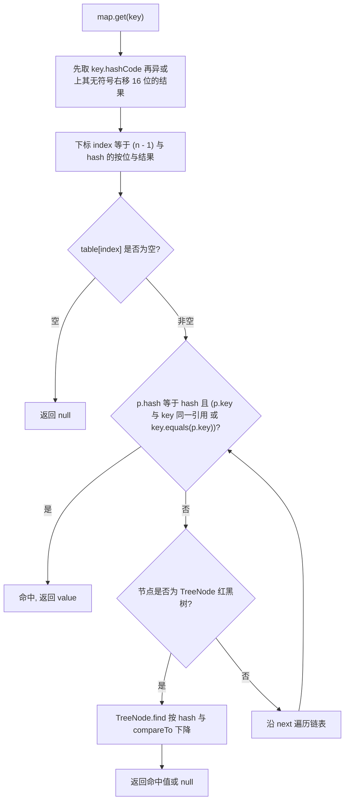

### 3.2 hashCode 的写法与 31 的由来

`String#hashCode`（JDK 8/JDK 9+ 逻辑一致，只是取字符方式随 coder 变化）：

```java
public int hashCode() {
    int h = hash;                       // 缓存字段
    if (h == 0 && value.length > 0) {   // 0 视为未计算
        for (int i = 0; i < value.length; i++) h = 31 * h + charAt(i);
        hash = h;
    }
    return h;
}
```

**为什么选 31**（JLS/实现层面的经验值）：

1. 31 是奇质数，`31 * h` 与 `h << 5` 有固定关系：`31 * i == (i << 5) - i`，HotSpot 的 JIT（C2）会把乘法强度削减为移位加减法。
2. 31 不大，中间结果不容易过早溢出（虽然溢出在 `int` 语义下是良定义的，但分布会变差）。
3. 经验上产生的碰撞率低于 33、37、17 等候选值，且字符串哈希分布均匀（这是 Kuhn & anderen 在 JDK 早期实测后定下来的）。

代价：**可预测**。攻击者可以构造大量 `hashCode` 相同的字符串（HashDoS，2011 年针对哈希表的风波）。JDK 8 的缓解手段是链表长度到 `TREEIFY_THRESHOLD = 8` 且表容量 `>= MIN_TREEIFY_CAPACITY = 64` 时把桶转成红黑树（`HashMap#treeifyBin`），把最坏查找从 O(n) 降到 O(log n)；当两个 key 的 `hash` 与 `compareTo` 都无法区分时，`HashMap#tieBreakOrder` 用 `System.identityHashCode` 兜底。

`Objects.hash(Object...)` 的实现是 `Arrays.hashCode(Object[])`，起始值 1、乘子 31。它有两个代价：**变长参数会创建数组**、**每个元素装箱**，热路径不要用。

推荐的等价写法（无分配、与 `Objects.hash` 结果一致）：

```java
@Override public int hashCode() {
    int result = Integer.hashCode(id);
    result = 31 * result + Integer.hashCode(age);
    result = 31 * result + Objects.hashCode(name);  // null 安全，null 记为 0
    return result;
}
```

Lombok 的 `@EqualsAndHashCode` 默认 `callSuper = false`，子类字段参与但父类字段不参与——只要父类有状态就必须显式写 `@EqualsAndHashCode(callSuper = true)`，否则"两个所有字段都相同的子类对象"会被判等，反过来又破坏 `equals` 的对称性（父类 `equals` 认为不等）。

### 3.3 `getClass()` 还是 `instanceof`：一个真权衡

```java
@Override public boolean equals(Object o) {
    if (this == o) return true;
    if (!(o instanceof User)) return false;     // 方案 A：允许子类
    User u = (User) o;
    return Objects.equals(id, u.id);
}
@Override public boolean equals(Object o) {
    if (this == o) return true;
    if (o == null || getClass() != o.getClass()) return false;  // 方案 B：严格同类
    ...
}
```

| 方案 | 优点 | 缺点 | 适用 |
| --- | --- | --- | --- |
| `instanceof` | 支持父类引用与子类互相比较，符合多态直觉 | 子类**新增状态**时违反对称性：`parent.equals(child)` 为 `true` 而 `child.equals(parent)` 为 `false` | 父类不可变、子类不新增状态（如 Hibernate 代理场景） |
| `getClass()` | 严格对称、传递，无隐藏陷阱 | 违反里氏替换（LSP），代理子类/增强子类无法与原始类型相等 | 大多数值对象、DTO、Entity |

**Hibernate/MyBatis 代理的经典事故**：懒加载代理类是实体的子类，用 `getClass()` 比较会导致 `entity.equals(proxy)` 为 `false`，`Set<Entity>` 去重失效。解决方案是 `instanceof` + 用 `Hibernate.getClass(o)`（老 API `HibernateProxyHelper.getClassWithoutInitializingProxy`）取真实类型，或统一用业务主键做 `equals`（并且 `hashCode` 必须只依赖不变的 ID）。

**可变对象做 HashMap key 是另一个必考点**：`id` 字段参与 `hashCode`，对象放进 `HashMap` 后修改 `id`，`hashCode` 变化 → 落在不同桶 → `get` 不到，同时也从 `HashSet` 里"消失"。唯一安全做法是**用不可变对象（`record`/`String`/`Integer`/自定义不可变类）做 key**，或者 `hashCode` 只依赖创建后不变的字段。

JDK 16+ 的 `record` 自动生成 `equals`/`hashCode`/`toString`：由 `invokedynamic` 绑定到 `java.lang.runtime.ObjectMethods#bootstrap`，基于全部组件、`record` 隐式 `final` 且不能继承其他类，因此不存在 `callSuper` 问题。

## 四、== 与 equals 的语义边界

| 场景 | `==` 的语义 | `equals` 的语义 | 注意 |
| --- | --- | --- | --- |
| 两个基本类型 | 值比较，先做二元数值提升 | 不适用（不能对 int 调方法） | `long` 与 `float` 比较会把 `long` 提升为 `float`，超 2^24 精度丢失 |
| 引用类型 | 引用/地址同一性 | 由 `equals` 实现决定 | 默认与 `==` 等价，除非重写 |
| `String` | 是否同一对象/同一常量池条目 | 逐字符比较 | 字面量 `==` 常常为 `true`，运行期拼接为 `false` |
| 包装类 | 是否同一实例（受缓存池影响） | 值比较（且要求同类） | 见 1.3 节 |
| 枚举 | 天然可靠（同 ClassLoader 下实例唯一） | 默认身份比较 | 枚举比较一律用 `==` |
| 数组 | 引用比较 | 默认身份比较 | 内容比较用 `Arrays.equals`/`Arrays.deepEquals` |
| 浮点数 | `==` 遵循 IEEE 754：`NaN != NaN`，`-0.0 == 0.0` | `Double.equals` 把 `NaN` 视为相等、把 `-0.0` 与 `0.0` 视为**不等** | `Double.compare(-0.0, 0.0)` 返回 -1 |

```java
Double a = Double.NaN, b = Double.NaN;
System.out.println(a == b);        // false
System.out.println(a.equals(b));   // true   与 == 语义不同
System.out.println(Double.valueOf(-0.0).equals(Double.valueOf(0.0))); // false
```

**集合类型的 `contains`**：`ArrayList.contains` 走 `o.equals(elementData[i])`，注意是**参数 equals 元素**（如果元素是 `String` 而参数是自定义对象，可能走不到你期望的重写版本）。`HashSet.contains` 先 `hash` 再 `equals`，两个契约缺一不可。`List.remove(Object)` 与 `List.remove(int)` 在 `List<Integer>` 上是重载歧义重灾区：

```java
List<Integer> list = new ArrayList<>(List.of(1, 2, 3));
list.remove(1);                        // 按下标删，移除元素 2
list.remove(Integer.valueOf(1));       // 按对象删，移除元素 1
```

`list.remove(1)` 在 `List<Integer>` 上选 `remove(int)` 而不是 `remove(Object)`，因为 JLS 15.12 阶段一（严格调用，不允许装箱）就命中了 `remove(int)`。

## 五、浅拷贝、深拷贝与 Cloneable

### 5.1 `Object#clone` 的机制

`protected native Object clone() throws CloneNotSupportedException`，语义：

1. 检查 `this instanceof Cloneable`，否则抛 `CloneNotSupportedException`（**运行期**检查，编译器不拦）。
2. 分配与运行时类相同大小的内存，**按位复制**所有实例字段（包括 `final` 字段、`transient` 字段），**不调用任何构造器**。
3. 返回新对象；引用类型字段仍然指向原对象 → 这就是"浅拷贝"。

`Cloneable` 是**标记接口**（marker interface，没有任何方法），它只改变 `clone` 的行为。Effective Java Item 13 的建议是：不要实现 `Cloneable`，改用**拷贝构造器或静态工厂**，理由是 `clone` 与 `final` 字段、构造器逻辑、异常处理都配合得不好。

标准写法（含深拷贝）：

```java
public class Order implements Cloneable {
    private String id;                 // 不可变，浅拷贝安全
    private long[] amounts;            // 可变数组，必须复制
    private List<Item> items;          // 可变集合，必须复制

    @Override public Order clone() {
        try {
            Order copy = (Order) super.clone();     // 第一步：按位复制
            copy.amounts = this.amounts.clone();    // 数组 clone 是浅拷贝但元素是基本类型
            copy.items = new ArrayList<>(this.items.size());
            for (Item it : this.items) copy.items.add(it.clone()); // 递归深拷贝
            return copy;
        } catch (CloneNotSupportedException e) {
            throw new AssertionError(e);            // 不可能发生，因为我们实现了 Cloneable
        }
    }
}
```

注意点：

- 重写的 `clone()` 应把返回类型收窄为具体类型（协变返回，JDK 5+），并把可见性提升为 `public`（`Object#clone` 是 `protected`）。
- 若父类实现了 `Cloneable`，子类 `super.clone()` 会正确返回子类实例——因为分配用的是 `this.getClass()`。
- **`final` 可变字段无法在 `clone` 里重设**（`copy.field = ...` 编译不过），只能反射或改成非 `final`。

### 5.2 深拷贝的五种实现与对比

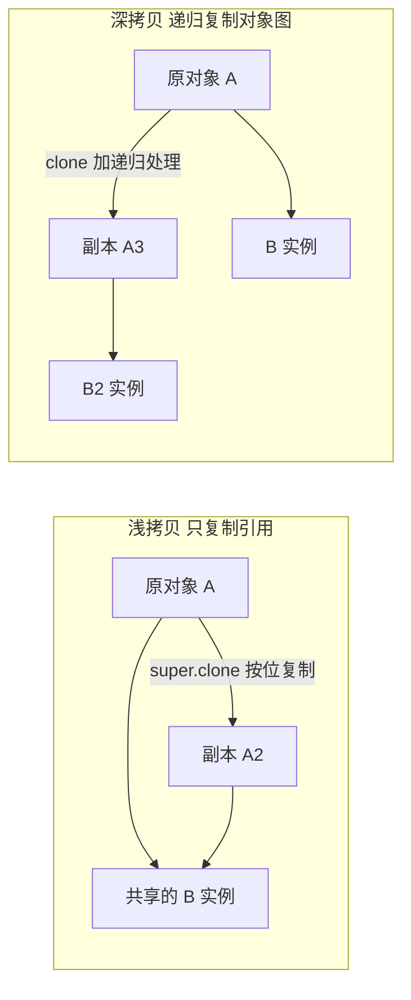

| 方案 | 代表 API | 是否真深拷贝 | 性能 | 约束 |
| --- | --- | --- | --- | --- |
| 逐字段手工复制 | 拷贝构造器 | 是（需人工保证） | 最快 | 字段新增易漏 |
| `clone` 递归 | `Object#clone` | 是（需人工保证） | 快 | 类型层次都要正确实现 |
| 序列化往返 | `ObjectOutputStream`/`ObjectInputStream`、Spring `org.springframework.util.SerializationUtils#clone`（新版 Spring 已标记为废弃，建议改用具名拷贝构造器） | 是 | **慢 10~100 倍** | 全部对象需 `Serializable`，`transient` 字段丢失 |
| JSON 往返 | Jackson `ObjectMapper#convertValue`、`readValue(writeValueAsString(o))` | 是（按 JSON 语义） | 慢 | 丢失类型信息、`LocalDateTime` 需模块、循环引用报错 |
| 字节码工具 | `MapStruct`（编译期生成）、`CGLIB BeanCopier`、Spring `BeanUtils.copyProperties` | **浅** | 快 | `BeanUtils.copyProperties` 是浅拷贝，嵌套对象共享 |

**序列化深拷贝的坑**：`Serializable` 是可继承的，一个 `ArrayList` 会带着整个元素图序列化，图大时 CPU/GC 压力明显；`transient` 字段的反序列化初值为默认值（`0`/`null`）而不是构造器里的赋值（因为反序列化不走构造器，只走第一个非 `Serializable` 父类的无参构造器）。若类实现了 `Externalizable`，则需要 public 无参构造器且 `readExternal` 必须完整恢复状态。

### 5.3 生产场景：为什么拷贝问题总是出现在缓存和并发里

- **缓存返回可变对象**：本地缓存（Caffeine/`ConcurrentHashMap`）如果直接返回缓存内对象的引用，调用方一次 `setXxx` 就污染了所有后续读取者。要么深拷贝，要么让缓存值为不可变对象（推荐，零拷贝成本）。
- **`ThreadLocal` + 可变对象**：线程池复用线程时若没清理，下个任务读到上个任务的脏数据；`ThreadLocal.remove()` 必须放在 `finally` 里（`ThreadLocal` 有内存泄漏与脏数据两个问题）。
- **跨线程传递**：`CompletableFuture`、`ForkJoinTask` 共享同一可变对象时必须拷贝或改为不可变，否则出现"偶发错数据"，因为 happens-before 只保证可见性，不保证互斥。

线上定位这类问题的特征：异常数据**与并发量相关、单线程复现不了**；日志里同一对象 ID 的字段在不同请求中"串台"。手段是把对象 `toString` 打全（`@Data`/`record` 自带），在关键路径前后各打一次，用 `traceId` 对齐。

## 六、重载与重写：静态分派与动态分派

### 6.1 静态分派（重载）发生在编译期

JLS 15.12 的方法调用分三步走，重载解析也按三个阶段依次尝试，一旦某阶段找到"适用的方法"就停止：

| 阶段 | 名称 | 允许的转换 | 说明 |
| --- | --- | --- | --- |
| 阶段 1 | 严格调用（strict invocation） | 子类型化、基本类型宽化 | **不允许装箱、不允许拆箱、不允许可变参数** |
| 阶段 2 | 宽松调用（loose invocation） | 阶段 1 + 装箱/拆箱 | 仍不允许可变参数 |
| 阶段 3 | 可变参数调用 | 阶段 2 + 可变参数 | 最后兜底 |

三个阶段内部还要选"最具体方法"（most specific method）。经典题目：

```java
static void f(Object o) { System.out.println("Object"); }
static void f(String s) { System.out.println("String"); }
f(null);              // 输出 String，因为 String 比 Object 更具体

static void g(int i) { System.out.println("int"); }
static void g(Integer i) { System.out.println("Integer"); }
g(1);                 // 阶段 1 命中 g(int)，输出 int
g(Integer.valueOf(1));// 阶段 1 命中 g(Integer)，输出 Integer
```

**"编译期定型"的后果**：方法版本由**形参的静态类型**决定，与运行期实际类型无关：

```java
class Parent {} class Child extends Parent {}
static void h(Parent p) { System.out.println("Parent"); }
static void h(Child c)  { System.out.println("Child");  }
Parent p = new Child();
h(p);   // 输出 Parent —— javac 只看 p 的静态类型 Parent
```

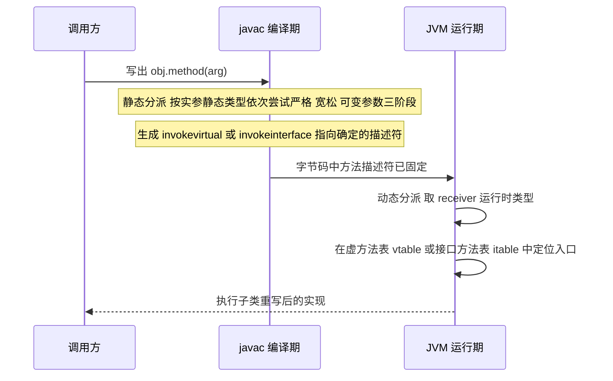

### 6.2 动态分派（重写）与 vtable/itable

字节码指令与分派方式的对应关系：

| 指令 | 分派方式 | 触发场景 | 目标解析时机 |
| --- | --- | --- | --- |
| `invokestatic` | 静态 | 静态方法、类初始化方法 | 解析期确定 |
| `invokespecial` | 静态 | 私有方法、构造器、`super.xxx()` | 解析期确定 |
| `invokevirtual` | 动态 | 普通实例方法 | 运行期按 receiver 的实际类型查 vtable |
| `invokeinterface` | 动态 | 接口方法 | 运行期按 receiver 查 itable |
| `invokedynamic` | 动态 | Lambda、字符串拼接（JDK 9+）、`record` 的 `equals` | 首次执行时由 bootstrap 方法决定 |

HotSpot 的优化阶梯：vtable/itable 查找 → **内联缓存（inline cache）** 单态/多态 → C2 的**类型去优化与内联**。单态（只有一个实现类）的虚调用会被完全内联，这就是"多态不慢"的底层原因；一旦出现两种以上接收者类型，调用点变为多态（megamorphic 超过 2 种），退化为查找，这是框架代码常见的性能拐点。

**不能被重写的三种情况**：`final` 方法、`private` 方法（不参与继承，只是同名）、`static` 方法（隐藏而非重写）。

```java
class A { static void s() { System.out.println("A"); }
          private void p() { System.out.println("A.p"); } }
class B extends A { static void s() { System.out.println("B"); }
                    void p() { System.out.println("B.p"); } }
A a = new B();
a.s();   // 输出 A，静态方法按静态类型分派（invokestatic）
// a.p(); // 编译错误，private 方法不可见
```

### 6.3 桥接方法：类型擦除的必然产物

泛型在 JDK 5 用**类型擦除**实现，编译后 `Comparable<T>` 的 `compareTo(T)` 擦除为 `compareTo(Object)`。若子类写 `compareTo(String)`，它只是重载，不是重写。为保持多态语义，javac 生成**桥接方法**（`ACC_BRIDGE | ACC_SYNTHETIC`）：

```java
class Name implements Comparable<Name> {
    private final String v;
    Name(String v) { this.v = v; }
    @Override public int compareTo(Name o) { return v.compareTo(o.v); }
}
// 编译后实际包含两个方法
// public int compareTo(Name)            真实实现
// public int compareTo(Object)          桥接方法 = checkcast Name + 调用上一个方法
```

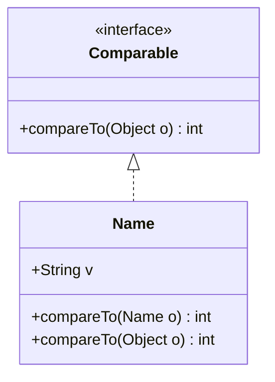

实践影响：

1. **反射遍历要过滤桥接方法**：`Class#getDeclaredMethods()` 会返回两个 `compareTo`，判断重写关系必须用 `Method#isBridge()` 排除，否则 AOP/序列化/校验框架会把同一个方法处理两遍或抛"重复方法"异常。
2. **`@Override` 的判定用的是擦除后签名**：`class Foo implements Comparable<Foo>` 写 `compareTo(Foo)` 是合法重写（有 `@Override` 通过）；写 `compareTo(String)` 会报"method does not override or implement a method from a supertype"。
3. **协变返回类型（JDK 5+）也生成桥接**：`Object clone()` 与 `Order clone()` 同时存在，反射时同样要处理。

## 七、异常体系与 finally 的字节码语义

### 7.1 体系结构与分类

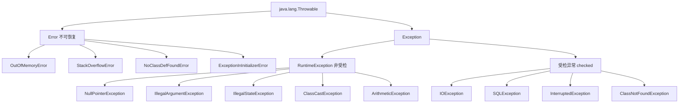

判定规则（JLS 11.2）：`RuntimeException` 及其子类、`Error` 及其子类是**非受检异常**，编译器不强制 `throws`/`catch`；其余 `Exception` 的子类是**受检异常**。

| 异常 | 触发时机 | 是否受检 | 恢复策略 |
| --- | --- | --- | --- |
| `ClassNotFoundException` | `Class#forName`、`ClassLoader#loadClass` 找不到类 | 受检 | 通常不可恢复，转为启动失败 |
| `NoClassDefFoundError` | 编译期存在而运行期缺失，或该类静态初始化**曾经失败** | 非受检 | 依赖打包问题，或前次初始化失败 |
| `ExceptionInInitializerError` | `<clinit>`（静态块/静态字段初始化）抛异常 | 非受检 | 该类的首次失败原因，后续访问变成 `NoClassDefFoundError` |
| `StackOverflowError` | 栈深度超限 | 非受检 | 检查递归、`-Xss`（默认 1MB，HotSpot 64 位 Linux） |
| `OutOfMemoryError` | 堆/Metaspace/直接内存/GC 开销超限 | 非受检 | 有 `-XX:+HeapDumpOnOutOfMemoryError` 才可分析 |
| `InterruptedException` | `Thread#sleep`/`wait`/`join` 被中断 | 受检 | **必须恢复中断标志** `Thread.currentThread().interrupt()` |

**`InterruptedException` 的正确处理**是并发代码的高频扣分项：

```java
try {
    Thread.sleep(100);
} catch (InterruptedException e) {
    Thread.currentThread().interrupt();   // 恢复中断状态，交由上层决定
    throw new RuntimeException("任务被中断", e);
}
```

**为什么 `OutOfMemoryError` 有时不该 catch**：JVM 抛出后堆已经不可用，catch 里再分配对象可能再次 OOM，甚至造成 `OutOfMemoryError` 循环。只有在"释放资源后立刻退出"的收尾场景（如关闭连接、写盘日志）才允许捕获并 `finally` 释放，且此后应让进程退出，让编排系统重启。

### 7.2 try-with-resources 的展开与 suppressed

`try-with-resources` 是 JDK 7 引入的语法糖，要求资源类型实现 `AutoCloseable`（`Closeable` 是其子接口，把 `close()` 的异常收窄为 `IOException`）。JDK 9 起可以在 `try` 里引用**已声明的 effectively final 变量**：`try (resource)`。

javac 的展开（JDK 8 形态）：

```java
try (Resource r = new Resource()) {
    r.use();                     // 若这里抛 E
}                                // 若 r.close() 抛 C
// 等价于
Resource r = new Resource();
Throwable primary = null;
try {
    r.use();
} catch (Throwable t) {
    primary = t; throw t;
} finally {
    if (r != null) {
        if (primary != null) {
            try { r.close(); } catch (Throwable x) { primary.addSuppressed(x); }  // C 被压制
        } else {
            r.close();           // 此时 C 就是主异常，正常抛出
        }
    }
}
```

**JDK 9+ 的 javac 改为生成一个私有静态方法** `private static void $closeResource(Throwable x0, AutoCloseable x1)`（在 `java.lang.Throwable` 相关包下由 javac 合成），把重复的压制逻辑收敛为一次方法调用（`try (x0)`），显著减小字节码体积。这类合成方法的栈帧会在异常栈里显示为 `$closeResource`，排查时不要误判。

多个资源时**关闭顺序与声明顺序相反**（后声明的先关），这是栈式语义的必然结果，与 C++ 析构顺序一致。

### 7.3 finally 与 return 的字节码顺序

这是"背结论"和"真懂"的分水岭。规则：**`return` 表达式的值先求值、存入局部变量槽（或操作数栈），再执行 `finally`，最后从槽里加载并返回**。

```java
static int f() {
    int x = 1;
    try {
        return x;          // 先把 x=1 存到临时槽
    } finally {
        x = 100;           // 改的是局部变量，修改不影响已保存的返回值
    }
}
// f() 返回 1
```

对应的 javac 字节码（JDK 8/17 结构一致）：

```text
0: iconst_1
1: istore_1              // x = 1
2: iload_1
3: istore_2              // 保存返回值到槽 2（临时变量）
4: bipush 100
6: istore_1              // finally 中的 x = 100
7: iload_2               // 重新加载已保存的返回值
8: ireturn
```

由此推出四条必须记住的结论：

| 写法 | 结果 | 原因 |
| --- | --- | --- |
| `try { return x; } finally { x = 100; }` | 返回原值 | 返回值已复制到独立槽 |
| `try { return x; } finally { return 100; }` | 返回 100 | `finally` 的 `ireturn` 直接结束方法，**try 的返回值被丢弃** |
| `try { throw e; } finally { return 1; }` | **异常被吞掉**，返回 1 | `finally` 中的 `return` 使控制流正常返回，异常表不再匹配 |
| `try { return a; } finally { throw b; }` | 抛 b，a 丢失，原异常成为 suppressed 或消失 | `finally` 抛出覆盖主异常（非 try-with-resources 时 b 不会绑定为 a 的 suppressed） |

因此 Effective Java Item 9 的结论是：**绝不在 `finally` 里 `return`/`break`/`continue`/`throw`**，只用它释放资源。Sonar 规则 `squid:S1143`（Return in finally）就是强制这一条。

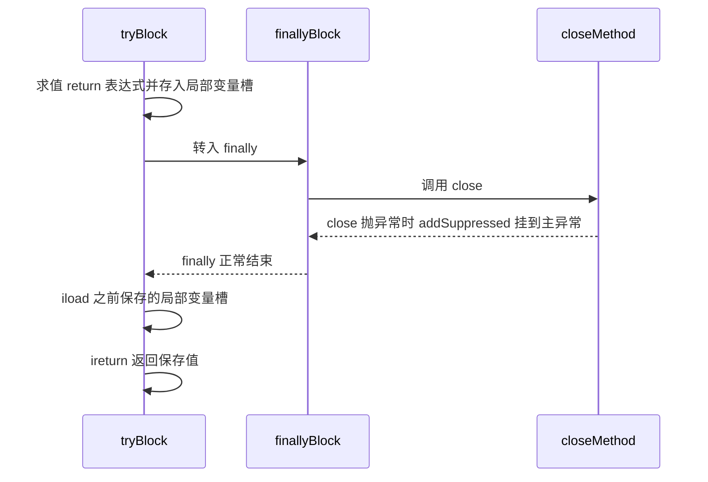

### 7.4 异常的使用准则与生产代价

1. **异常构造的代价在 `fillInStackTrace`**：`Throwable#fillInStackTrace` 是 native 方法，遍历栈帧。热点路径用异常做控制流会导致 CPU 飙高。若确实需要（如状态机），可重写 `fillInStackTrace()` 返回 `this`，或用 JDK 8+ 的 `-XX:-OmitStackTraceInFastThrow` 反向控制 JIT 的快速抛出优化（JIT 对反复抛出的隐式异常会替换为无栈异常的 `NullPointerException`，导致日志里看到"没有堆栈的 NPE"，此时加 `-XX:-OmitStackTraceInFastThrow` 可恢复堆栈）。
2. **不要用异常做业务分支**：`NumberFormatException`、`ArrayIndexOutOfBoundsException` 在压测下会成为火焰图热点。
3. **`catch (Exception e)` 后什么都不做**是线上最贵的 bug 源。至少 `log.error("...", e)`，并把上下文（traceId、参数）打进日志。
4. **受检异常在框架边界的处理**：Spring 的 `@Transactional` 默认只在 `RuntimeException` 和 `Error` 上回滚（`DefaultTransactionAttribute#rollbackOn`），受检异常默认**不回滚**，需要显式 `@Transactional(rollbackFor = Exception.class)`。

## 八、final、static 与初始化顺序

### 8.1 final 的四种含义与内存语义

| 场景 | 含义 | 编译期约束 |
| --- | --- | --- |
| `final` 局部变量 | 只能赋值一次 | 未赋值使用报错；匿名内部类/`lambda` 捕获要求 effectively final |
| `final` 实例字段 | 只能赋值一次（声明处、实例初始化块、构造器） | 必须在构造器返回前完成赋值 |
| `final` 静态字段 | 只能赋值一次（声明处、静态块） | 编译期常量会内联 |
| `final` 类 / 方法 | 不可继承 / 不可重写 | 极端情况下帮助 JIT 去虚化（devirtualization） |

**JLS 17.5 的 final 字段语义**是并发面试的核心考点：如果一个对象被**正确构造**（构造期间 `this` 未逸出），那么所有线程都能看到 final 字段被赋的初值，**无需任何同步**。这包括"通过 final 字段可达的对象"（如 `final Map<String, Object> cache` 里的内容，在 final 字段赋值之后写入的部分才有保证）。`final` 字段写与后续读之间存在 happens-before 边（由 freeze action 提供）。

破坏条件：**`this` 在构造器中逸出**——把 `this` 注册到监听器、放进静态容器、启动线程、调用可被子类重写的方法（构造器里调虚方法）都会破坏该保证，`final` 字段可能被其他线程读到默认值。

```java
public class UnsafePublish {
    final int x;                       // 有 JLS 17.5 保证
    static UnsafePublish INSTANCE;
    UnsafePublish() {
        INSTANCE = this;               // 逸出：其他线程可能看到 x = 0
        x = 42;
    }
}
```

### 8.2 static：编译期常量内联与静态方法隐藏

`static final` 字段如果满足"constant variable"（类型是基本类型或 `String`，且初始化表达式是编译期常量），**会被内联到使用方**：调用方 class 文件里根本不存在对该字段的 `getstatic`，只有一个 `ldc`/`iconst`。

```java
// 模块 A
public class Config { public static final int TIMEOUT = 100; }
// 模块 B
int t = Config.TIMEOUT;   // 编译进 B：iconst_3 之前的 ldc 100，改 A 后必须重新编译 B
```

生产事故形态：发了新版本 `Config`（`TIMEOUT = 200`），但只替换了 A 的 jar，B 仍然用旧值。规避方式：

1. 需要动态可改的配置一律不用编译期常量，改为 `static final Integer`（非编译期常量，不内联）或配置中心。
2. 构建系统做全量重编译（Maven 的 `clean`，或 `mvn -U`）。
3. 用 `public static final String` 时警惕同样问题（`String` 也是编译期常量类型）。

`static` 方法/字段**不能被重写，只能被隐藏**（hide）。通过 `实例.staticMethod()` 调用虽然编译通过，但字节码仍是 `invokestatic`，按静态类型解析，是明确的坏味道（IDEA/Sonar 会警告）。

### 8.3 类初始化的时机：主动使用 vs 被动使用

JLS 12.4.1 规定**主动使用**才触发初始化，六种触发方式：

1. `new` 指令创建实例。
2. 读取/写入**非编译期常量**的静态字段（`getstatic`/`putstatic`）。
3. 调用静态方法（`invokestatic`）。
4. `java.lang.reflect` 触发（`Class#forName(String)`、`Method#invoke` 等）。
5. 初始化子类时先初始化其父类。
6. 作为 `java.util.ServiceLoader` 提供者被发现，或 `MethodHandle` 首次链接（`invokestatic`/`getstatic` 的 MH 类型）时。

**不触发**初始化的典型情形：

```java
System.out.println(Sub.VALUE);   // 若 VALUE 是 Sub 的编译期常量，连 Sub 都不加载
Sub[] arr = new Sub[10];         // 只加载 Sub 类型，不初始化
Super.staticMethod();            // 只初始化静态方法的声明类 Super
Class.forName("X", false, cl);   // 显式传 initialize = false
```

用 `-verbose:class` 或 `-XX:+TraceClassLoading`（JDK 9+ 用 `-Xlog:class+load=info`）可以验证。

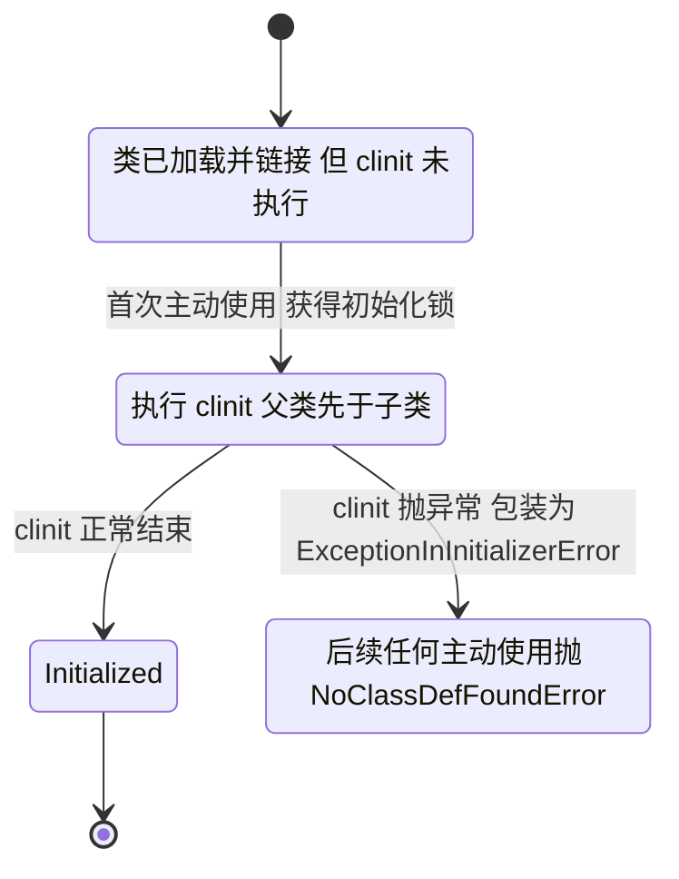

### 8.4 初始化顺序的完整链条

顺序规则（务必按这个顺序背）：

1. 父类静态字段 + 父类静态块（**按源码出现顺序**）。
2. 子类静态字段 + 子类静态块（按源码顺序）。
3. 父类实例字段 + 父类实例块（按源码顺序）。
4. 父类构造器。
5. 子类实例字段 + 子类实例块（按源码顺序）。
6. 子类构造器。

注意 javac 会把实例字段的初始化表达式和实例初始化块**按源码顺序插到每个构造器的 `super()` 调用之后**，所以有多个构造器时这些代码会重复出现。

```java
class Parent {
    static { System.out.print("1 父静态 "); }
    { System.out.print("3 父实例块 "); }
    Parent() { System.out.print("4 父构造 "); }
}
class Child extends Parent {
    static { System.out.print("2 子静态 "); }
    { System.out.print("5 子实例块 "); }
    Child() { System.out.print("6 子构造 "); }
}
new Child();  // 1 父静态 2 子静态 3 父实例块 4 父构造 5 子实例块 6 子构造
```

**类初始化的线程安全**：JVM 保证 `<clinit>` 只被执行一次，且执行期间其他线程阻塞等待（HotSpot 实现为 `Class` 对象上的初始化锁 `_init_lock`）。这是所有"静态单例天然线程安全"的基础。

代价与风险：

1. **类初始化死锁**：两个类在各自静态块中互相触发初始化，两个线程分别持有不同的初始化锁并互相等待。JVM 规范允许这种死锁，HotSpot 会打印 `Found one Java-level deadlock` 或让其中一个线程看到"部分初始化"的对象（JLS 12.4.2 允许递归初始化时直接返回，导致读到 `null`）。
2. **静态块中抛异常**：后续访问该类抛 `NoClassDefFoundError: Could not initialize class X`，真正原因在第一次的 `ExceptionInInitializerError` 里，日志容易被淹没。
3. **静态单例 vs 枚举单例 vs 静态内部类**：

| 实现 | 线程安全 | 防反射 | 防反序列化 | 懒加载 |
| --- | --- | --- | --- | --- |
| `static final INSTANCE = new X()` | 安全（`clinit` 加锁） | 否 | 否 | 否 |
| 静态内部类 holder（`Initialization-on-demand holder`） | 安全 | 否 | 否 | **是**（首次 `getInstance` 才初始化 holder 类） |
| `enum`（Effective Java 推荐） | 安全 | **是**（`Constructor#newInstance` 对 enum 抛 `IllegalArgumentException`） | **是**（`readResolve` 由 JVM 处理） | 否 |
| 双重检查 `volatile` | 安全（`volatile` 禁止重排序） | 否 | 否 | 是 |

双重检查锁定必须加 `volatile`（JDK 5 起才有正确的 `volatile` 语义，JSR-133）：没有 `volatile` 时，`instance = new Singleton()` 的"分配内存 → 写字段 → 赋值引用"可能被重排序为"分配内存 → 赋值引用 → 写字段"，另一个线程看到非 null 但字段还没写好的对象。JDK 5 之前这个写法是错的，网上流传的"`volatile` 可选"只适用于 JDK 5 之后的修正版本。

## 九、面向对象设计原则与接口默认方法

### 9.1 SOLID 在 Java 里的具体落点

| 原则 | 中文 | 违反的典型气味 | Java 具体手段 |
| --- | --- | --- | --- |
| SRP | 单一职责 | 一个类既做参数校验又做持久化又发 MQ | 按"变化原因"拆类，而非按代码行数 |
| OCP | 开闭 | 每加一种渠道就改 `if/else` 链 | 策略 + 工厂 + `ServiceLoader`/Spring `@ConditionalOnProperty` |
| LSP | 里氏替换 | `Square extends Rectangle`；子类抛父类没有的受检异常；子类加强前置条件 | 组合优先；用接口契约（前置条件不能加强、后置条件不能减弱） |
| ISP | 接口隔离 | 一个 20 方法的 `UserService` 接口 | 按调用方拆小接口，`default` 方法兜底兼容 |
| DIP | 依赖倒置 | 业务类 `new MySQLUserDao()` | 面向接口 + 构造器注入（Spring 推荐构造器注入，字段注入难测） |

里氏替换的经典反例与修法：

```java
class Rectangle { void setW(int w); void setH(int h); int area(); }
class Square extends Rectangle {   // 违反 LSP：两个 setter 互相影响
    @Override void setW(int w) { this.w = w; this.h = w; }
    @Override void setH(int h) { this.h = h; this.w = h; }
}
// 客户端 assert area == 2 * 3 会失败
```

真正的修法是**不建立继承关系**，让 `Square` 与 `Rectangle` 各自实现 `Shape#area()`。

其他高频原则：

- **组合优于继承**（Effective Java Item 18）：继承打破封装，父类新增方法可能被子类意外"继承"出错误语义。用装饰器（`java.io` 的 `BufferedInputStream(new FileInputStream(...))` 就是典范）或转发。
- **迪米特法则**（最少知识）：只和直接朋友说话，避免 `a.getB().getC().doX()` 的火车残骸。
- **共同关闭原则 / 共同复用原则**（包设计）：一起变化的类放一个包，一起复用的类放一个包。

### 9.2 接口默认方法（JDK 8）与冲突裁决

`default` 方法让接口可以演进而不用改所有实现类（典型如 JDK 8 给 `Collection` 加了 `stream()`、`forEach()`、`removeIf()`）。三个解析规则，按优先级：

1. **类的方法（含父类具体方法）优先于接口的 `default` 方法**。
2. **更具体的接口优先**：若 `interface B extends A`，B 的 `default` 覆盖 A 的同签名方法。
3. **仍然冲突则编译失败**，必须显式重写并用 `接口名.super.方法名()` 指定。

```java
interface A { default String hello() { return "A"; } }
interface B { default String hello() { return "B"; } }
class C implements A, B {
    @Override public String hello() { return A.super.hello() + B.super.hello(); } // 必须显式
}
```

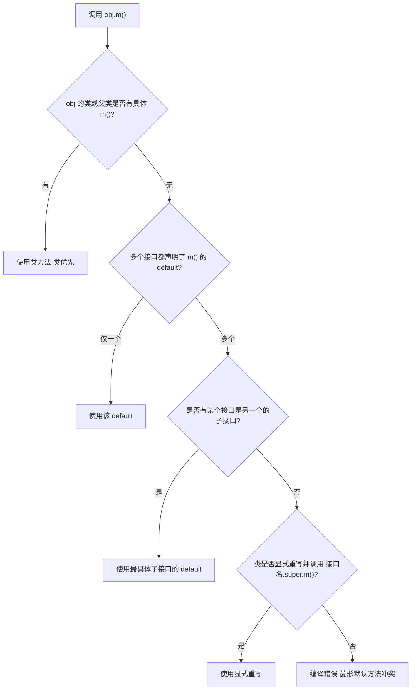

必须知道的限制：

- **`default` 方法不能是 `final`、`static`、`synchronized`、`native`**（`default` 与 `static` 互斥）。
- **`default` 方法不能覆盖 `Object` 的方法**：`default boolean equals(Object)` 编译错误（"default method equals in interface X overrides a member of java.lang.Object"）。`hashCode`/`toString` 同理。接口里**声明**抽象的 `boolean equals(Object)` 是允许的（冗余但合法），因为它只是重新声明 `Object` 的方法。
- **接口的 `static` 方法不被继承**，必须用 `接口名.方法名()` 调用（这也是 JDK 8 给接口加工具方法的官方姿势，如 `Comparator.comparing`）。
- **接口字段隐式 `public static final`**，方法隐式 `public abstract`，不能有实例字段（JDK 9 前不能有私有方法；JDK 9 起允许 `private` 与 `private static` 方法，用于在 `default` 方法间复用代码）。
- **`default` 方法破坏"接口无状态"的纯净性**：如果 `default` 方法依赖接口的其他方法，实现类必须保证那些方法语义正确（契约式设计）。JDK 8 的 `Collection#removeIf` 默认实现直接抛 `UnsupportedOperationException` 就是这种"可选方法"模式。

### 9.3 抽象类与接口的选择

| 维度 | 抽象类 | 接口 |
| --- | --- | --- |
| 继承数量 | 单继承 | 多实现 |
| 状态（实例字段） | 可以有 | 不能有实例字段（只能常量） |
| 构造器 | 有 | 无 |
| 方法实现 | 任意（含 `protected`/包私有） | `default`/`static`/`private`（JDK 9+），且隐式 public |
| 可见性修饰 | 全谱 | 方法隐式 public |
| 演进成本 | 加方法破坏子类（除非给默认实现） | JDK 8 前不可加方法，之后加 `default` 兼容 |
| 语义 | "is-a" + 复用实现 | "can-do" 能力契约 |
| 典型用法 | 模板方法、骨架实现（`AbstractList`） | 能力标记、SPI、回调 |

**选择准则**：既要契约又要复用实现时，用"接口 + 抽象骨架实现"（Effective Java Item 20，如 `List` + `AbstractList`）。只有确实需要共享状态或非 public 方法时才用抽象类。

## 十、反射、封装破坏与 JPMS 模块化

### 10.1 反射的基本操作与初始化语义

```java
Class<?> c1 = Class.forName("com.x.User");        // 触发类初始化（initialize 默认 true）
Class<?> c2 = cl.loadClass("com.x.User");          // 只加载，不初始化
Class<?> c3 = User.class;                          // 不触发初始化（ldc）
Class<?> c4 = new User().getClass();               // 已初始化

Field f = c1.getDeclaredField("id");               // 含 private
f.setAccessible(true);                             // 突破访问控制
Object v = f.get(user);
f.set(user, "1001");

Constructor<?> ctor = c1.getDeclaredConstructor(String.class);
ctor.setAccessible(true);
User u = (User) ctor.newInstance("1001");

Method m = c1.getMethod("doWork", int.class);      // 只返回 public（含继承）
Object r = m.invoke(u, 1);
```

必知细节：

- `getDeclaredXxx` 只返回本类声明的成员（含 private），`getXxx` 返回 public 成员**包含继承**。
- `getDeclaredFields()` 的**顺序在 JVM 规范里未定义**；HotSpot 实践中按声明顺序返回，但不要依赖（JDK 18 之后 `Class` 的实现有调整）。
- `invoke` 抛出的异常被包装为 `InvocationTargetException`，真实异常在 `getCause()`。这是最容易被吞掉的异常路径。
- `newInstance` 抛的异常被包装为 `InvocationTargetException`；`Class#newInstance` 传播原始异常（且只支持无参构造，JDK 9 起 deprecated）。
- **`setAccessible` 的边界**：JDK 9 起受模块系统约束，可能抛 `InaccessibleObjectException`（`RuntimeException` 子类）。

### 10.2 反射的性能与膨胀机制

`Method#invoke` 的调用路径（JDK 8）：

```text
Method.invoke
  -> MethodAccessor.acquire()
     -> DelegatingMethodAccessorImpl
        -> NativeMethodAccessorImpl（前 N 次）
           触发膨胀 -> 生成字节码的 GeneratedMethodAccessor<N>
```

- 膨胀阈值由 `-Dsun.reflect.inflationThreshold=15` 控制（默认 **15** 次）。
- `-Dsun.reflect.noInflation=true` 可跳过 native 阶段直接生成字节码（启动变慢，稳态更快）。
- 生成的 `GeneratedMethodAccessor` 类会被一个 `WeakClassKey` 弱引用字典缓存，加载它的类加载器卸载时一起回收。

性能量级（相对直接调用）：反射 `invoke` 约为直接调用的 2~10 倍耗时；`setAccessible(true)` 后（可跳过访问检查）明显更快；`MethodHandle` 通常优于反射；JDK 18 的 JEP 416 用方法句柄重写了核心反射，进一步降低了开销。

**生产建议**：反射只用在校验、序列化、ORM、AOP 等框架路径；业务热路径用**启动时一次性解析 + 缓存**（缓存 `Field`/`Method` 对象，甚至用 `LambdaMetafactory` 生成访问器），避免每次 `getDeclaredField`（每次调用都会做字符串匹配与拷贝，且会创建新的 `Field` 副本对象——`Field#copy()`）。

### 10.3 反射破坏封装的四类事故

1. **破坏单例**：`setAccessible(true)` 调私有构造器生成第二个实例。防法：枚举单例（`Constructor#newInstance` 检测 `Modifier.ENUM` 抛 `IllegalArgumentException`），或构造器加"已创建则抛异常"的守卫。
2. **修改 `final` 字段**：非静态 final 实例字段在 JDK 17 仍可被 `set`（`setAccessible` 通过时），但 `static final` 编译期常量已被内联到调用点，改了也观察不到（例如 `Integer.MAX_VALUE` 改了无效）。record 组件的 final 字段会被 JVM 拒绝。
3. **调用私有方法绕过校验**：安全漏洞的常见来源，如通过反射调用 `Runtime` 的方法。JDK 17 的强封装默认拒绝此类跨模块深反射。
4. **反射与泛型擦除结合导致的 `ClassCastException`**：`List<String>` 和 `List<Integer>` 的 `getClass()` 都是 `java.util.ArrayList`，运行期无法通过反射区分，抛 `ClassCastException` 的位置往往离真正出错点很远。

### 10.4 JPMS 与反射的可见性规则

JDK 9 引入 JPMS（JSR 376），`module-info.java` 的四个关键指令：

```java
module com.example.order {
    requires java.sql;                       // 编译期与运行期的读依赖
    requires transitive com.example.core;    // 传递给依赖本模块的模块（相当于 re-export）
    requires static lombok;                  // 编译期需要，运行期可选
    exports com.example.order.api;            // 允许其他模块在编译期/运行期访问该包
    exports com.example.order.spi to com.example.plugin;  // 限定导出（qualified export）
    opens com.example.order.entity;          // 允许反射深访问（运行期）
    opens com.example.order.entity to org.hibernate.orm;  // 限定 opens
    uses com.example.order.spi.PaymentProvider;
    provides com.example.order.spi.PaymentProvider with com.example.order.impl.AlipayProvider;
}
```

关键概念对应关系：

| 概念 | 与反射的关系 |
| --- | --- |
| `exports` | 允许**编译期与运行期**访问 public 成员（等价于浅反射可访问 public） |
| `opens` | 允许**运行期深反射**（`setAccessible(true)` 访问非 public 成员），不影响编译期可见性 |
| **unnamed module** | classpath 上的所有代码，可读所有模块，但只有被 `exports`/`opens` 的包可用 |
| **automatic module** | 放在 module path 上但没有 `module-info.class` 的 jar，导出自己的全部包，可读所有模块 |
| **split package** | 两个模块包含同一个包 → 启动报错（module path 上不允许拆分包） |

`setAccessible` 在 JDK 9+ 的判定流程：

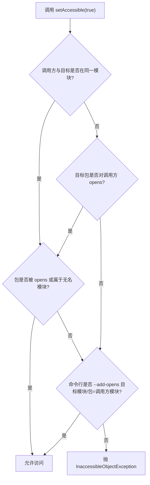

**版本演进必须记牢（面试常问"JDK 17 后 `--illegal-access=permit` 还能用吗"）**：

| JDK 版本 | 默认行为 | 相关开关 |
| --- | --- | --- |
| JDK 8 | 无模块系统，`setAccessible` 只要不是 SecurityManager 拦就行 | `-Djava.security.manager` |
| JDK 9 ~ JDK 15 | `--illegal-access=permit` 默认，首次非法深反射打印警告，之后静默允许 | `--illegal-access=deny/warn/permit` |
| JDK 16 | 默认改为 `--illegal-access=deny` | 同上（warn 仍可用） |
| JDK 17 | **移除 `--illegal-access` 选项**，只允许 `--add-opens` / `--add-exports` | `--add-opens java.base/java.lang=ALL-UNNAMED` |

Spring Boot 3.x 要求 JDK 17+，其文档明确列出了启动参数 `--add-opens java.base/java.lang=ALL-UNNAMED` 等；老版本 Hibernate/CGLIB/Jackson 在 JDK 17 上报 `InaccessibleObjectException` 的根因就在这里。定位手段：看异常信息里的模块名与包名，加对应 `--add-opens`；或先加 `--illegal-access=warn`（仅 JDK 9~16）找出**所有**需要打开的包，再改成精确的 `--add-opens`，避免长期依赖全局放开。

### 10.5 反射的合法使用边界与替代方案

| 需求 | 反射 | 更优替代 |
| --- | --- | --- |
| 属性拷贝 | `Field#get/set` | `MapStruct`（编译期生成）、`record` 的规范构造器 |
| 依赖注入 | `Constructor#newInstance` | Spring 容器（内部也用反射，但缓存在 `BeanDefinition`） |
| 动态代理 | `Proxy` + `InvocationHandler` | JDK 动态代理需接口；无接口用 CGLIB（ASM 生成子类，`spring.aop.proxy-target-class=true` 是 Spring Boot 默认） |
| 高性能访问 | `Method#invoke` | `LambdaMetafactory` / `MethodHandle` / `VarHandle`（JDK 9+） |
| 深反射访问 JDK 内部 | `setAccessible` + `--add-opens` | `VarHandle`（JPMS 友好，如 `MethodHandles.privateLookupIn`） |

**动态代理的两代实现对比**：

| 维度 | JDK 动态代理 | CGLIB |
| --- | --- | --- |
| 原理 | 运行期生成实现指定接口的类（`ProxyGenerator` / JDK 16+ 用 `ClassFile` API） | ASM 生成目标类的子类，重写非 final 方法 |
| 前置条件 | 目标必须有接口 | 类不能是 final，方法不能是 final/private/static |
| 粒度 | 接口方法级 | 方法级（含 protected） |
| 性能 | JDK 8 生成字节码后接近直接调用；JDK 16+ 用 `invokedynamic` 进一步优化 | 早期略快，JDK 8 后差异不大 |
| 局限 | 只能代理接口方法，`this` 内部调用不走代理 | 无法代理 final 方法；Spring 4.3+ 默认改用 Objenesis 避免调构造器 |

## 十一、高级岗三问：设计动机、线上定位、规模放大

### 11.1 为什么这么设计（替代方案与代价）

| 设计选择 | 替代方案 | 选了它的原因 | 付出的代价 |
| --- | --- | --- | --- |
| `String` 不可变 | 可变字符串 | 可安全共享、缓存 hash、作为 key 安全 | 每次修改都新建对象；拼接成本高 |
| JDK 9 用 `byte[]` + coder | 继续 `char[]` | Latin-1 场景省一半内存 | 每次操作多一次 coder 分支；反射读 `value` 的老库崩 |
| `Integer` 缓存 -128~127 | 全量缓存/不缓存 | 覆盖绝大多数循环计数与小 ID，收益/内存比最高 | 边界处 `==` 反直觉，成为经典陷阱 |
| `clone` 是浅拷贝 | 默认深拷贝 | 深拷贝需要图遍历，语义不确定（循环引用） | 使用方必须显式处理可变字段 |
| 重载编译期定死 | 运行期按实参类型选择 | 编译期可确定、静态类型可校验、无运行期开销 | `Parent p = new Child()` 时行为与直觉不符 |
| 受检异常 | 全部非受检 | 强制调用方处理可恢复错误 | 污染 API 签名，`lambda`/`Stream` 里难用 |
| JPMS 强封装 | 保持 JDK 8 的开放 | 保护 JDK 内部结构，允许演进 | 框架需要一堆 `--add-opens` |

### 11.2 线上出问题怎么定位（命令与日志特征）

**场景一：CPU 飙高且可疑在字符串处理**

```bash
jcmd <pid> Thread.print > threads.txt        # JDK 8+：抓线程栈
# 连续抓 3~5 次，间隔 5 秒，看哪些栈反复出现（火焰图的土办法）
jcmd <pid> VM.stringtable -verbose           # JDK 9+：StringTable 条目与最长桶
jcmd <pid> GC.class_histogram                # JDK 9+：字符串与 byte 数组占比
```

若 `Maximum bucket size` 达几万，说明 intern 或字符串驻留过重，考虑调 `-XX:StringTableSize` 或去掉 `intern`。

**场景二：OOM 但堆 dump 里看不到大对象**

```bash
jcmd <pid> VM.native_memory summary scale=MB   # 需要 -XX:NativeMemoryTracking=summary
jmap -dump:live,format=b,file=heap.hprof <pid> # JDK 8 及以前常用；JDK 9+ 用 jcmd GC.heap_dump
```

优先级：直接内存（`-XX:MaxDirectMemorySize`，默认等于 `-Xmx`）、Metaspace（`-XX:MaxMetaspaceSize`，默认无限，靠 `-XX:MetaspaceSize` 触发首次 GC）、线程栈（`-Xss` × 线程数）、JNI。MAT 里看 `java.nio.DirectByteBuffer` 的 cleaner 队列。

**场景三：异常日志里找不到有用的堆栈**

JIT 的 fast-throw 优化会把重复抛出的隐式异常替换成无栈异常，日志出现"没有堆栈的 NPE"。定位手段：加 `-XX:-OmitStackTraceInFastThrow` 复现（有性能代价，只能在预发开）。

**场景四：HashMap 的 key 找不到**

排查顺序：`equals`/`hashCode` 是否成对重写 → 对象在作为 key 后是否被修改 → 是否用 `getClass()` 比较而实际是代理类。用 `-agentlib:jdwp` 或加日志打印 `System.identityHashCode(key)` 与 `key.hashCode()` 即可确认。

### 11.3 规模变大后会怎样（失效模式）

| 规模变化 | 语言层失效模式 | 缓解 |
| --- | --- | --- |
| 对象数量 × 10 | 装箱放大导致 Young GC 频率上升、晋升加速 | 基本类型优先、避免 `Objects.hash` 热路径、扁平化数据结构 |
| 字符串数量 × 100 | `intern` 表无界增长，老年代膨胀，Full GC 后不降 | 去掉 `intern`，改有界缓存（Caffeine `maximumSize`） |
| 字符串平均长度增大 | Latin-1 优势消失，`byte[]` 与 UTF-16 双倍内存 | 限制字段长度、压缩存储、`-XX:+UseStringDeduplication`（G1，JDK 8u20+） |
| 类数量 × 10（大量动态代理） | Metaspace 增长、类加载器泄漏（`GeneratedMethodAccessor` 与 `Proxy` 类堆积） | 固定代理生成、避免每次请求新建 `ClassLoader` |
| 反射调用频率 × 1000 | `Method#invoke` 成为火焰图热点 | 缓存 `Method`/`Field`，用 `LambdaMetafactory` 生成访问器 |
| 继承层次变深 × 5 | 虚调用从单态变多态（megamorphic），内联失效 | 减少接收者类型分支，避免在热循环里对多种子类调同一虚方法 |
| 规则分支数 × 100（`if/else` 链） | 方法字节码超 8000 字节无法 JIT 内联（`-XX:MaxInlineSize` 默认 35 字节 `-XX:FreqInlineSize` 默认 325） | 改成策略表 `Map<Type, Handler>` 或状态机 |

### 11.4 面试答题的通用骨架（语言层）

遇到"XX 为什么不安全/为什么这样设计"时，按四段答：

1. **结论**一句话（例如："`Integer` 的 `==` 在 128 以上比较的是引用，因为缓存池只覆盖 -128~127"）。
2. **机制**：给出类名/方法名/字节码指令/字段名/默认值（`Integer.valueOf`、`IntegerCache.high`、`invokestatic`）。
3. **反例或线上现象**：给出一段能跑出错误的代码或一条日志/命令（`jcmd VM.stringtable`、`InaccessibleObjectException`）。
4. **权衡与替代**：什么场景该用 A，什么场景改用 B（`intern` 只用于枚举式字符串）。

## 高频面试题

### Q1. `Integer a = 128; Integer b = 128; a == b` 为什么是 `false`？缓存池的边界和实现细节？

**答题框架（30 秒版）**：`Integer` 赋值走 `Integer.valueOf`，该方法命中 `IntegerCache.cache` 时返回缓存实例，否则 `new Integer(i)`；默认缓存范围 -128~127，所以 128 是两个不同对象，`==` 为 `false`，`equals` 为 `true`。

**展开（2 分钟版）**：
1. `IntegerCache` 是 `Integer` 的私有静态嵌套类，首次 `valueOf` 时初始化，数组长度默认 256，下标 `i + 128`。
2. 上限可通过 `-Djava.lang.Integer.IntegerCache.high=1000` 提高（`Math.max(i, 127)` 兜底），JDK 5 时代是 `-XX:AutoBoxCacheMax`。
3. `Byte`/`Short`/`Long`/`Character` 也有缓存：`Byte` 覆盖全部 256 个值，`Character` 是 0~127，`Long`/`Short` 是 -128~127 且**不可配置**；`Float`/`Double` 无缓存。
4. `new Integer(100)` 不查缓存，依然 `==` 为 `false`。

**追问**：`Integer` 与 `Long` 混用比较？答：`i == l` 编译不通过（incomparable types），`i.equals(l)` 一定为 `false`，因为 `Integer#equals` 先做 `instanceof Integer`。

### Q2. 三目运算符 `boolean ok = flag ? 0 : integerValue;` 为什么会 NPE？

**答题框架**：JLS 15.25 的二元数值提升规则：一个分支是 `int`、另一个是 `Integer` 时，表达式类型提升为 `int`，`Integer` 分支被无条件拆箱，`null.intValue()` 直接 NPE。

**展开**：
1. 同类问题还有 `Integer sum = a + b;`（`a`/`b` 为 `Integer` 时先拆箱相加再装箱）、`value > 0`、`switch (integerValue)`（JDK 8 起支持，但拆箱 NPE）。
2. 根源是"混合类型表达式会提升为基本类型"，而不是"三目有 bug"。
3. 修法：`Objects.requireNonNullElse(value, 0)`（JDK 9+，JDK 8 用 `value == null ? 0 : value` 并保证两个分支同类型）；或全程用 `int` + `OptionalInt`/哨兵值。

**追问**：那 `Integer i = 1; Long l = 2L;` 之后 `i + l` 呢？答：`i` 和 `l` 都拆箱为 `int`/`long`，`int` 提升为 `long`，结果是 `long`，然后装箱成 `Long`；`Long a = ...; Integer b = ...; a.equals(b)` 为 `false`。

### Q3. `String s = new String("abc")` 创建了几个对象？字符串常量池在哪个版本做了什么迁移？

**答题框架**：字面量 `"abc"` 若不在 StringTable 中则创建 1 个（在堆中并登记到 StringTable），`new String(...)` 一定再创建 1 个，所以是 1 个或 2 个。

**展开**：
1. 类加载时 `CONSTANT_String_info` 进入运行时常量池；首次执行 `ldc` 时解析：StringTable 有则复用，无则新建并登记。
2. **JDK 6**：字符串常量池在 PermGen，`-XX:MaxPermSize` 打满抛 `OutOfMemoryError: PermGen space`；**JDK 7** 起移到 Java 堆；**JDK 8** 用 Metaspace 取代 PermGen。
3. StringTable 默认桶数：JDK 7 为 1009，JDK 8 起 **60013**，`-XX:StringTableSize` 可调，`-XX:+PrintStringTableStatistics`（JDK 8+）/`jcmd VM.stringtable`（JDK 9+）可观测。
4. `intern()` 在 JDK 6 会复制到 PermGen，JDK 7+ 只登记堆对象引用，因此行为与内存表现完全不同。

**追问**：`"ja" + "va" == "java"` 为 `true` 吗？答：为 `true`，编译期常量折叠成一个字面量。

### Q4. JDK 9 为什么把 `String` 的 `char[] value` 改成 `byte[] value` 加 `coder`？

**答题框架**：JEP 254 Compact Strings。大多数字符串是 Latin-1，`char[]` 每字符固定 2 字节造成约 50% 浪费；改为按内容选择 LATIN1（1 字节/字符）或 UTF16（2 字节/字符），用 `coder` 字段记录编码，Latin-1 场景底层数组内存减半。

**展开**：
1. 字段：`private final byte[] value; private final byte coder;`，常量 `LATIN1 = 0`、`UTF16 = 1`，开关 `-XX:+CompactStrings`（默认开，`-XX:-CompactStrings` 关闭）。
2. 所有操作先判 `isLatin1()`，Latin-1 分支用 `byte` 处理，`charAt` 需要 `(char)(value[i] & 0xff)`。
3. 兼容性代价：反射读 `value` 期望 `char[]` 的库会 `ClassCastException`/`IllegalArgumentException`，这是很多老框架升级 JDK 9 的踩坑点。
4. 配套收益：`jcmd GC.class_histogram` 里 `[B` 数量上升、`[C` 下降，总体字符串内存降 20%~40%。

**追问**：`substring` 有没有内存泄漏？答：JDK 6 有（共享底层 `char[]`，只改 `offset`/`count`），**JDK 7u6 起改成 `Arrays.copyOfRange` 复制**，泄漏消失，代价是 O(n) 复制。

### Q5. `equals` 与 `hashCode` 的契约是什么？只重写一个会发生什么？

**答题框架**：`equals` 五条（自反、对称、传递、一致、对 null 返回 false），`hashCode` 三条（一致、equals 相等则 hashCode 必须相等、不要求不等则不同）。只重写 `equals` → 相等对象落入不同桶，`HashMap.get` 返回 `null`；只重写 `hashCode` → 同桶但 `equals` 身份比较为 false，出现重复 key。

**展开**：
1. `HashMap#hash` 是 `(h = key.hashCode()) ^ (h >>> 16)`（高位参与运算，减少低位碰撞）；下标 `(n - 1) & hash`。
2. 命中判定 `p.hash == hash && ((k = p.key) == key || (key != null && key.equals(k)))`——先比引用，再比 `equals`。
3. `String#hashCode` 是 `31 * h + charAt(i)`，31 是奇质数且 `31 * i == (i << 5) - i` 可被 JIT 强度削减为移位。
4. 用 `Objects.hash` 会创建数组并装箱，热路径手写 `31 *` 累乘。

**追问**：为什么用 `getClass()` 而不用 `instanceof`？答：`instanceof` 在子类新增状态时破坏对称性，`getClass()` 破坏里氏替换且与 Hibernate 代理不兼容；值对象用 `getClass()`，需要兼容代理时用 `instanceof` + `Hibernate.getClass`。

### Q6. 浅拷贝和深拷贝的区别？`Cloneable` 为什么被 Effective Java 批评？

**答题框架**：浅拷贝只复制字段值（引用类型共享对象），`Object#clone` 是 native 的按位复制；深拷贝要递归复制整个对象图。`Cloneable` 是标记接口、不提供 `clone` 方法、`CloneNotSupportedException` 是受检异常、不能处理 `final` 可变字段，因此推荐拷贝构造器或静态工厂。

**展开**：
1. 机制：`clone` 检查 `instanceof Cloneable`，按运行时类分配内存，**不调用构造器**，`final`/`transient` 字段也照抄。
2. 深拷贝实现：递归 `clone`、拷贝构造器、序列化往返（慢 10~100 倍且要求 `Serializable`）、JSON 往返、`MapStruct`（编译期生成）。
3. 常见误区：`BeanUtils.copyProperties`（Spring）是**浅拷贝**；`Arrays.copyOf` 对 `T[]` 也是浅拷贝；`record` 的自动 `equals`/`hashCode` 不解决可变组件共享问题。

**追问**：序列化深拷贝有什么坑？答：`transient` 字段反序列化后是默认值而非构造器赋值，因为反序列化不走构造器（只走第一个非 `Serializable` 父类的无参构造器）；`Serializable` 可继承，会带上整个对象图。

### Q7. 重载和重写的区别？为什么说重载是编译期分派？

**答题框架**：重载是同一个类中方法名相同、参数列表不同，javac 按 JLS 15.12 的三阶段（严格/宽松/可变参数）在编译期选定方法描述符，字节码写死；重写是子类覆盖父类方法，运行期按 receiver 实际类型在 vtable/itable 中查表（`invokevirtual`/`invokeinterface`）。

**展开**：
1. `Parent p = new Child(); h(p)` 输出 `h(Parent)`，因为是静态分派。
2. `f(null)` 在有 `f(Object)` 与 `f(String)` 时选 `f(String)`（最具体方法）。
3. 静态方法、`private` 方法、`final` 方法是静态绑定（`invokestatic`/`invokespecial`）。
4. 返回值类型不参与重载决议；泛型擦除后签名相同的方法视为重复定义（桥接方法例外）。

**追问**：桥接方法是什么？答：类型擦除导致子类的 `compareTo(Name)` 与接口的 `compareTo(Object)` 描述符不同，javac 生成 `ACC_BRIDGE|ACC_SYNTHETIC` 的 `compareTo(Object)` 做 `checkcast` 后转发；反射时要 `Method#isBridge()` 过滤，`@Override` 的合法性判断用的是擦除后签名。

### Q8. 【场景设计】设计一个"对象比较与集合去重"的基础设施，要求支持可变实体、代理对象、缓存 key 安全。

**答题框架**：从"契约"出发给三层规则：值对象不可变 + `equals`/`hashCode` 基于业务主键；实体用业务主键（如 `orderNo`）；代理场景避免 `getClass()`。缓存 key 一律用 `String` 或不可变值对象。

**展开**：
1. **值对象**：`final class` + 全参构造 + `equals` 用 `getClass()` + `hashCode` 手写 `31 *` 累乘；JDK 16+ 直接用 `record`，JVM 通过 `ObjectMethods#bootstrap` 生成 `equals`/`hashCode`。
2. **实体**：`equals` 基于业务唯一键（`id` 或 `orderNo`），且 `hashCode` 只依赖该字段；未持久化（id 为 null）时用 `System.identityHashCode` 或直接返回固定值（同批次对象少，碰撞可接受）。Hibernate 场景用 `instanceof` + `Hibernate.getClass`。
3. **集合与缓存**：`HashSet`/`HashMap` 的 key 必须不可变；需要可变对象时用 `List` + `stream().distinct()` 或 `TreeSet` + `Comparator`（注意 `Comparator` 必须与 `equals` 一致，否则 `TreeSet` 会"吃掉"元素）。
4. **风险控制**：用 ArchUnit/自定义注解加 CI 检查——标了 `@ValueObject` 的类必须有 `equals`/`hashCode`、字段必须 `final`；Lombok 用 `@EqualsAndHashCode(onlyExplicitlyIncluded = true)` 避免误加字段。
5. **线上验证**：单测覆盖"存入后修改字段再 `get`"的负向用例；压测观察 `HashSet` 大小与预期数量是否一致（不一致说明 `hashCode` 变了）。

**追问**：`TreeSet` 用 `Comparator` 时 `compare` 返回 0 会怎样？答：视为同一元素，`add` 返回 `false`，元素"丢失"；`Comparator` 必须与 `equals` 保持一致（Effective Java Item 14）。

### Q9. 【场景设计】一个服务频繁 `OutOfMemoryError: Java heap space`，Full GC 后老年代不降，堆 dump 里 `String` 与 `[B` 占 60%，如何定位并修复？

**答题框架**：先确认是"对象泄漏"而不是"参数太小"（Full GC 后不降是关键判据），再定位根的持有路径，最后按数据规模选方案。

**展开**：
1. **取现场**：`jcmd <pid> GC.heap_dump /tmp/h.hprof`（或 `-XX:+HeapDumpOnOutOfMemoryError -XX:HeapDumpPath=/data/dump`），同时记录 `jstat -gc <pid> 1000` 的 `OU`（老年代使用量）曲线与 `FGCT`。
2. **看直方图**：`jcmd <pid> GC.class_histogram | head -30`，确认 `java.lang.String`、`[B`、`java.util.HashMap$Node` 的实例数与占用。
3. **查根路径**：MAT 的 "Path to GC Roots（exclude weak/soft references）"，重点看两类根——`java.lang.Class` 的静态字段、`StringTable`/`Hashtable` 条目。
4. **定位代码**：若根是 `StringTable`，说明业务大量 `intern()`；若是某个静态 `Map`/`ConcurrentHashMap`，说明无界缓存；若是 `ThreadLocal`，说明线程池线程未 `remove()`。
5. **修复**：
   - 去掉 `intern()`，改为有界缓存（Caffeine `maximumSize(100_000)` + `expireAfterAccess`）。
   - 静态缓存加容量上限，或换成 `WeakHashMap`/`SoftReference`（谨慎：`SoftReference` 在内存压力下被清，行为不可预期，JDK 建议优先用有界缓存）。
   - `ThreadLocal` 用 `try/finally` + `remove()`。
   - 若确为业务对象过大，做字段裁剪、分页、流式处理，避免一次性 `findAll()`。
6. **验收**：压测后 `jstat` 看老年代在 Full GC 后可回落到基线；`GC.heap_dump` 对比两次直方图。

**追问**：为什么不能简单加大 `-Xmx`？答：泄漏场景下只是延后 OOM，同时延长 Full GC 时间（STW 与堆大小正相关），最终雪崩；加大堆只适用于"数据量确实增长且无根可达泄漏"的场景。

### Q10. 【场景设计/线上排查】JDK 17 升级后启动报 `InaccessibleObjectException`，如何在一小时内定位并给出修复方案？

**答题框架**：这是 JPMS 强封装导致的深反射被拒。读异常里的"module/package/class"三元组，用 `--add-opens` 精确放开，或升级依赖版本。注意 JDK 17 已移除 `--illegal-access`。

**展开**：
1. **读异常**：`Unable to make field private final java.lang.String java.lang.Class.name accessible: module java.base does not "opens java.lang" to unnamed module @...`，关键信息是"哪个模块的哪个包"对"哪个调用方模块"没 opens。
2. **临时恢复**（预发验证）：`--add-opens java.base/java.lang=ALL-UNNAMED`，`unnamed module` 表示你的 classpath 应用。
3. **全量发现**：JDK 9~16 可用 `--illegal-access=warn` 一次性打印所有非法深反射的调用点（栈里能看到是哪个框架）；JDK 17 上没有这个开关，只能按异常逐个加，或者用 `jdeps --jdk-internals`（会列出用到的 JDK 内部 API）先做静态盘点。
4. **根治**：升级触发深反射的组件（老版本 CGLIB/Hibernate/Jackson/Kryo/反射型 JSON 库）；Spring Boot 3.x 官方文档给出了必需的 `--add-opens` 列表；自己写的不再用 `setAccessible`，改用 `MethodHandles.privateLookupIn`（JDK 9+）或 `VarHandle`。
5. **长期治理**：把 JVM 参数收敛到 Dockerfile/启动脚本模板里统一维护，CI 里加 `jdeps --jdk-internals` 检查，避免每个环境各写一套。
6. **回归验证**：启动 + 关键链路冒烟（序列化、代理、ORM 元数据解析最容易踩）；观察启动日志里是否还有 `WARNING: An illegal reflective access operation has occurred`。

**追问**：`exports` 和 `opens` 有什么区别？答：`exports` 允许编译期与运行期访问 public 成员；`opens` 只允许运行期**深反射**（`setAccessible`）访问非 public 成员，不参与编译期可见性。反射读 private 字段只需要 `opens`。

### Q11. `try { return x; } finally { x = 100; }` 为什么返回原值？`finally` 里 `return` 有什么危害？

**答题框架**：`return` 表达式先求值并保存到独立的局部变量槽，然后执行 `finally`，最后从槽里 `iload` 回去 `ireturn`，因此 `finally` 里改的是局部变量本身而不是已保存的返回值。

**展开**：
1. 字节码顺序：`iload_1; istore_2`（保存）→ 执行 finally → `iload_2; ireturn`。
2. `finally` 里 `return` 会直接结束方法，**try 的返回值丢弃**；`finally` 里 `throw` 会覆盖主异常（不是 suppressed）。
3. `finally` 里 `return` 对抛异常路径是致命的：`try` 抛异常 + `finally` 返回 → 异常被静默吞掉，线上表现为"错误日志消失、接口返回了默认值"。
4. `try-with-resources` 用 `Throwable#addSuppressed` 解决"关闭异常覆盖主异常"，JDK 9+ 的 javac 合成 `$closeResource(Throwable, AutoCloseable)` 收敛代码。

**追问**：`System.exit(0)` 放在 `finally` 里会执行吗？答：会执行，`System.exit` 直接终止 JVM，后续 `finally` 与 `return` 都不会再走（`Runtime#halt` 不触发 shutdown hook，注意区分）。

### Q12. 类初始化顺序、`final` 的可见性保证、静态单例为什么线程安全？有死锁风险吗？

**答题框架**：顺序是"父静态 → 子静态 → 父实例 → 父构造 → 子实例 → 子构造"；JLS 17.5 保证正确构造下 `final` 字段对其他线程可见（freeze 语义）；`<clinit>` 由 JVM 加锁只执行一次，因此静态单例天然线程安全，但两个类互相触发初始化会死锁。

**展开**：
1. `static final` 编译期常量会被内联到使用方，改常量值必须重新编译依赖方（生产事故常见）。
2. `final` 可见性被破坏的条件是 `this` 在构造器中逸出（注册监听器、启动线程、调虚方法）。
3. 单例四种实现的对比见 8.4 节；双重检查必须 `volatile`（JDK 5 起语义正确）。
4. 死锁排查：`jcmd <pid> Thread.print` 会打印 `Found one Java-level deadlock`，线程状态为 `BLOCKED` 且等待的是 `Class initialization` 相关的锁；`jstack` 里会显示 `waiting to lock ... (a java.lang.Class for X)`。

**追问**：反射能破坏单例吗？答：能，`setAccessible(true)` + `Constructor#newInstance` 可以创建新实例；枚举单例由 `Constructor#newInstance` 的 `Modifier.ENUM` 检查保护，抛 `IllegalArgumentException`。

### Q13. 【排查类】线上偶发"数据串台"——不同请求看到彼此的数据，如何定位？

**答题框架**：并发共享可变状态问题。按"共享范围"从大到小排查：静态可变字段 → 单例 Bean 的实例字段 → `ThreadLocal` 未清理 → 缓存返回了可变对象引用。

**展开**：
1. **特征识别**：单线程压测不复现、并发下概率出现、数据 A 出现在 B 的响应里。先排除日志上下文混用（traceId 打错）这种假象。
2. **静态可变字段**：`static SimpleDateFormat`、`static Map` 缓存、`static` 可变列表是头号嫌疑。`SimpleDateFormat` 应换成 `DateTimeFormatter`（JDK 8+ 不可变）或用 `ThreadLocal`。
3. **单例 Bean 的实例字段**：Spring 默认单例，Service 里写 `private List<String> tmp;` 就是经典事故。定位手段：IDEA 的字段状态检查或 Sonar `S2222`/`Instance state` 规则；代码扫描"单例类中的非 final 可变实例字段"。
4. **`ThreadLocal` 脏数据**：线程池复用线程，任务结束必须 `remove()`；`InheritableThreadLocal` 在线程池 `new Thread` 场景下不会传递（要用 `TransmittableThreadLocal`）。
5. **缓存/对象池返回可变引用**：`ConcurrentHashMap` 里存 DTO 直接返回，调用方改字段污染缓存。修法：返回不可变对象（`record`、`Collections.unmodifiableList`、`List.copyOf`——JDK 10+）或做拷贝。
6. **验证手段**：加"请求开始/结束各打印一次对象快照 + traceId"，用 `-XX:+HeapDumpOnOutOfMemoryError` 未必有用，重点是**复现脚本**：高并发下固定线程名，观察同一线程连续处理两个请求时的字段变化。

**追问**：`List.copyOf` 与 `Collections.unmodifiableList` 的区别？答：`List.copyOf`（JDK 10+）返回**不可变副本**，与原列表解耦；`Collections.unmodifiableList` 是**视图**，原列表变化会穿透，且不是真正的不可变（仍可通过原引用修改）。

## 易错点与踩坑

| 易错点 | 正确理解 |
| --- | --- |
| `Integer` 的 `==` 在 128 就"不可靠" | 准确说法是：缓存范围可配置，默认 -128~127；所有包装类比较都应使用 `equals` 或先拆箱转基本类型 |
| `Objects.hash(a, b)` 等于手写 `31 * a + b` | 起始值是 1 而不是 0：`result = 1; result = 31 * result + a; ...`；且它会产生 varargs 数组与装箱 |
| `BigDecimal` 用 `equals` 判等即可 | `equals` 比较值 + scale，`1.0` 与 `1.00` 不等；判等应用 `compareTo == 0` |
| `String` 拼接一律慢 | 编译期常量折叠不慢；JDK 9+ 的 `invokedynamic` 也比 JDK 8 的 `StringBuilder` 快；只有循环内拼接是 O(n²) |
| `intern()` 可以省内存 | 它把字符串注册到全局 StringTable，无界场景会造成老年代泄漏；只在有限集合上使用 |
| `substring` 在 JDK 7 之后还会内存泄漏 | JDK 7u6 起改为复制底层数组，泄漏已修复；代价是 O(n) |
| `StringBuffer` 比 `StringBuilder` 更"安全"所以更好 | 只有跨线程共享同一个 builder 时才需要 `StringBuffer`；绝大多数场景 `StringBuilder` 是正解，`synchronized` 只会带来开销 |
| 只重写 `equals` 就够了 | `HashMap`/`HashSet` 依赖 `hashCode` 先分桶，必须成对重写 |
| `getClass()` 判等最严格所以最好 | 它会与 Hibernate 等代理子类不兼容，破坏 LSP；值对象用 `getClass()`，代理场景用 `instanceof` |
| `Cloneable` 是深拷贝 | `Object#clone` 是按位浅拷贝，可变字段必须手动复制 |
| `BeanUtils.copyProperties` 是深拷贝 | Spring 的实现是浅拷贝，嵌套对象仍是共享引用 |
| 受检异常一定比非受检异常好 | `Stream`/`lambda` 里使用受检异常会非常别扭；Effective Java 的结论是"能用非受检就用非受检，受检异常只用于可恢复且调用方必须处理的场景" |
| `finally` 里 `return` 只是"不优雅" | 它会丢弃 try 的返回值、吞掉异常，是明确的行为错误 |
| `catch (Exception e)` 能捕获所有问题 | 捕获不到 `Error`（`OutOfMemoryError`/`StackOverflowError`）与 `Throwable`；且吞异常比不捕获更糟 |
| `OutOfMemoryError` 不能捕获 | 能捕获，但不可恢复；只在收尾释放资源时捕获，随后应让进程退出 |
| `static final` 常量改了重新部署就行 | 编译期常量被内联到调用方，必须**重新编译所有依赖方** |
| `final` 字段不再需要同步 | 只有"正确构造且 `this` 未逸出"时才有 JLS 17.5 的可见性保证 |
| 反射 `setAccessible(true)` 永远有效 | JDK 9+ 受 JPMS 约束，可能抛 `InaccessibleObjectException`；JDK 17 移除了 `--illegal-access` |
| `getDeclaredFields()` 顺序与声明一致 | JVM 规范未定义顺序，HotSpot 恰好按声明顺序，不要依赖 |
| `Method#invoke` 抛的异常就是原始异常 | 一定被包装为 `InvocationTargetException`，真实异常在 `getCause()` |
| `Map.get(k)` 返回 null 就等于不存在 | 键可能存在而值为 `null`，用 `containsKey` 区分；`HashMap` 允许一个 null key |
| `HashSet.add` 返回 true 表示真的加进去了 | 返回 `false` 说明 `equals` 判定已存在；若 `hashCode` 不稳定，会出现"加进去了但查不到" |
| 枚举比较用 `equals` 更规范 | 枚举实例唯一，用 `==` 更快更安全（还避免了 NPE） |
| `String.trim()` 和 `strip()` 等价 | `trim()` 只处理 `<= '\u0020'`，`strip()`（JDK 11+）按 `Character.isWhitespace` 处理，能去掉全角空格等 |
| 接口里不能有方法实现 | JDK 8 起有 `default`/`static`，JDK 9 起有 `private`（含 `private static`） |
| `default` 方法可以覆盖 `equals` | 编译错误：`default boolean equals(Object)` 不允许（会与 `Object` 成员冲突） |

## 一句话速记

- 包装类比较永远用 `equals` 或先转基本类型；`Integer` 缓存 -128~127 且上限可用 `java.lang.Integer.IntegerCache.high` 调整。
- 三目、`+`、`switch` 遇到 `Integer` 会拆箱，`null` 直接 NPE，这是线上最常见的包装类事故。
- `BigDecimal` 判等用 `compareTo`，除法必须给 `RoundingMode`；金额永远不要经过 `double`。
- `String` 不可变的四大收益：线程安全、缓存 hash、常量池共享、安全边界。
- 字符串常量池 JDK 6 在 PermGen、JDK 7 起在堆；StringTable 默认桶数 JDK 7 是 1009、JDK 8 起是 60013。
- JDK 9 起 `String` 是 `byte[] value + byte coder`（Latin-1/UTF-16），`-XX:+CompactStrings` 默认开。
- `intern()` 是全局强引用表，只能用于有限的枚举式字符串集合。
- 运行期拼接 JDK 8 用 `StringBuilder`、JDK 9+ 用 `invokedynamic` + `StringConcatFactory`，循环内拼接仍是 O(n²)。
- `StringBuilder` 默认容量 16，扩容 `(oldCapacity << 1) + 2`，上限 `Integer.MAX_VALUE - 8`。
- `equals`/`hashCode` 必须成对重写；`HashMap` 先比 hash 再比引用再比 `equals`。
- `String.hashCode` 的 31 来源于"奇质数 + 可强度削减为 `(i << 5) - i` + 碰撞率低"。
- 可变对象不要做 `HashMap` 的 key；`record`（JDK 16+）是天然的值对象。
- `==` 比地址、`equals` 比语义；浮点数的 `==` 与 `equals` 语义不同（NaN、-0.0）。
- `Object#clone` 是按位浅拷贝且不走构造器；深拷贝优先用拷贝构造器或 `MapStruct`。
- 重载是编译期静态分派（JLS 15.12 三阶段），重写是运行期 vtable/itable 动态分派。
- 泛型擦除导致桥接方法（`ACC_BRIDGE|ACC_SYNTHETIC`），反射遍历要 `Method#isBridge()` 过滤。
- `try-with-resources` 用 `Throwable#addSuppressed` 保住主异常，多个资源按声明逆序关闭。
- `finally` 中的 `return` 会丢返回值、吞异常，属于禁止写法。
- JIT 的 fast-throw 会去掉热点异常堆栈，排查时用 `-XX:-OmitStackTraceInFastThrow`。
- 初始化顺序：父静态、子静态、父实例块、父构造、子实例块、子构造。
- `static final` 编译期常量会被内联，改常量必须全量重编译。
- JLS 17.5 保证正确构造的对象的 `final` 字段可见，前提是 `this` 未逸出。
- `<clinit>` 由 JVM 加锁只执行一次，静态单例天然线程安全；类之间互相初始化会死锁。
- 枚举单例是唯一能同时防反射与反序列化的写法。
- `default` 方法冲突的裁决顺序：类方法优先、最具体接口优先、否则必须显式 `Interface.super.m()`。
- JDK 9+ 的 `setAccessible` 受 JPMS 约束，JDK 17 移除了 `--illegal-access`，只能用 `--add-opens`。
- `exports` 管编译期可见性，`opens` 管运行期深反射，两者都要才叫"完全开放"。
- 反射调用前 15 次走 native（`-Dsun.reflect.inflationThreshold=15`），之后膨胀为生成字节码；JDK 18 起核心反射改由方法句柄实现。
- 语言层的排查三板斧：`jcmd GC.class_histogram` 看对象分布、`jcmd Thread.print` 看栈、`-XX:+HeapDumpOnOutOfMemoryError` + MAT 看根路径。
