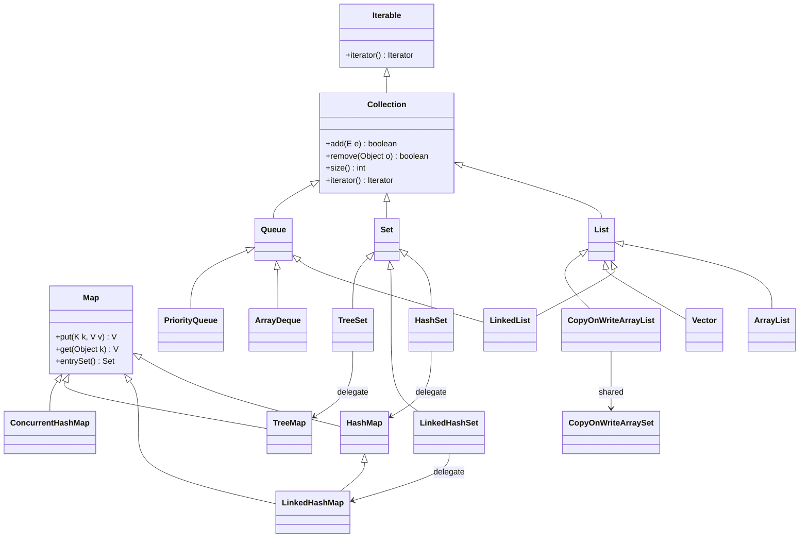
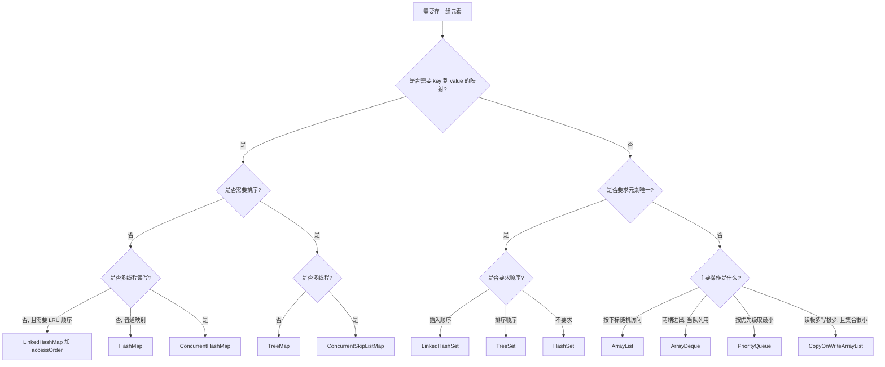
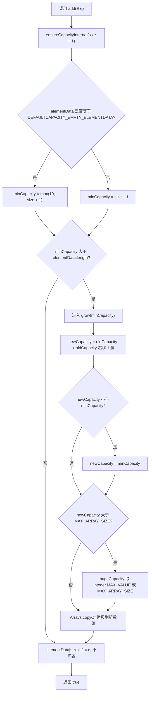
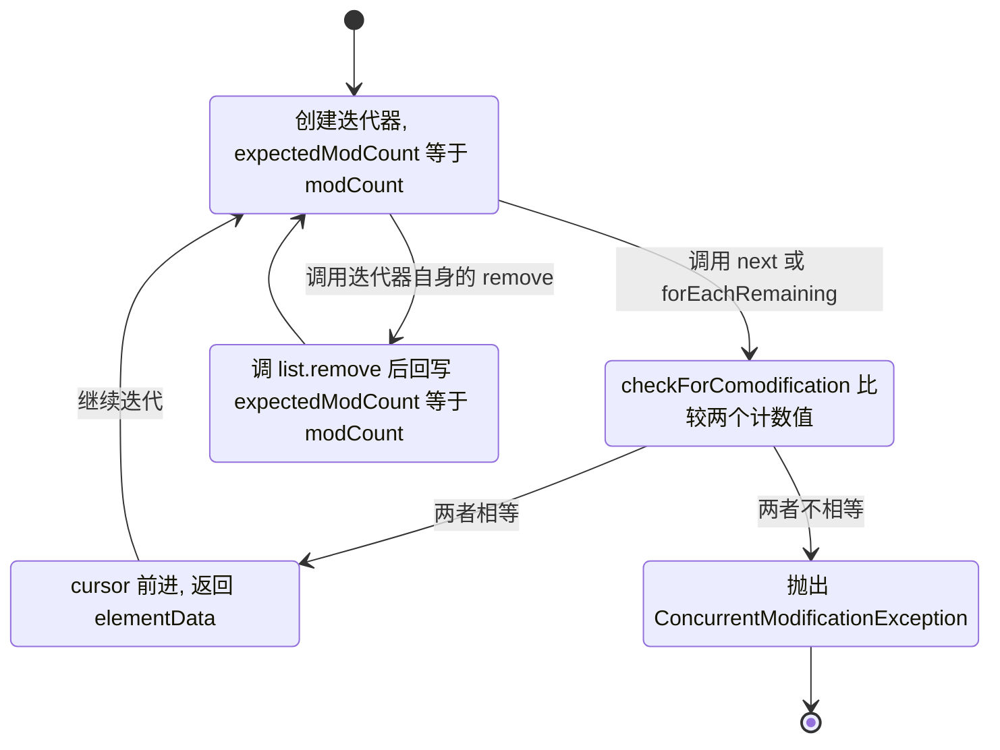
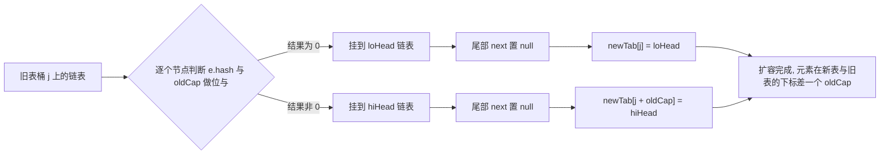
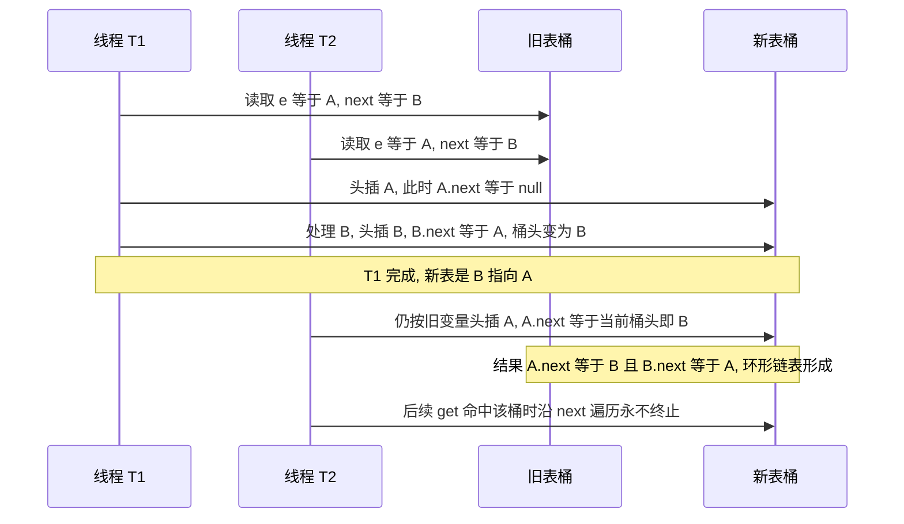
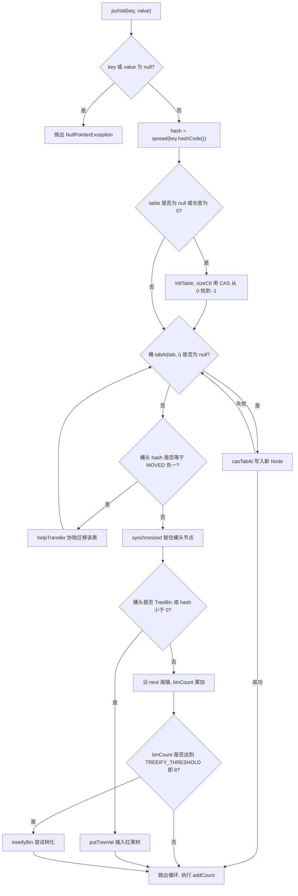
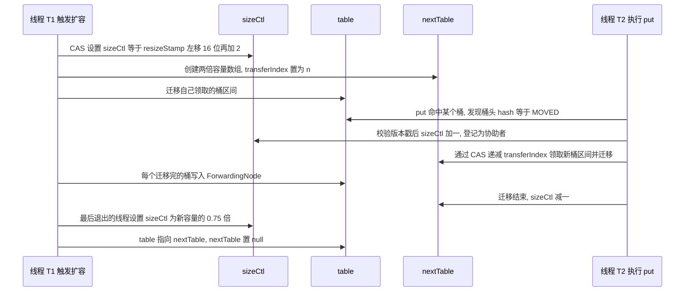
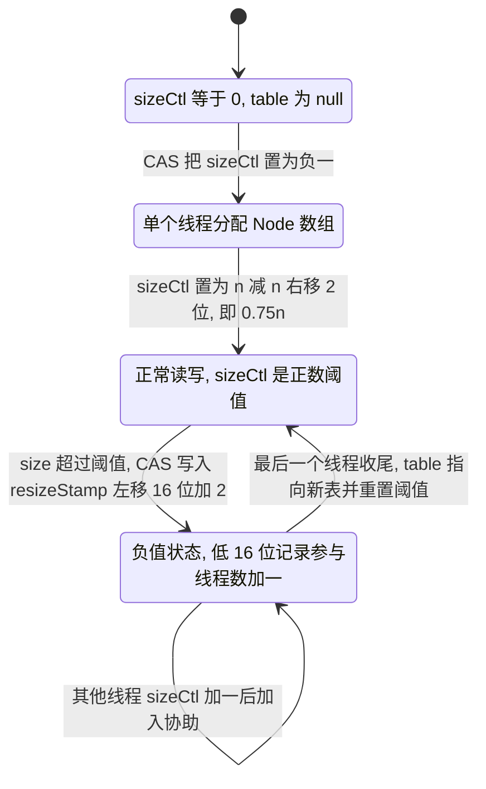

# 02 集合框架

> 一句话定位：集合是 Java 面试里唯一能把「数据结构 + 源码细节 + 并发 + 线上事故」一次性问穿的模块 ｜ 面试权重 ★★★★★ ｜ 建议复习 60 分钟

## 本章大纲

- [一、集合继承体系与选型地图](#一集合继承体系与选型地图)
- [二、ArrayList：扩容、modCount 与 fail-fast](#二arraylist扩容modcount-与-fail-fast)
- [三、LinkedList 与 ArrayList 对比](#三linkedlist-与-arraylist-对比)
- [四、HashMap：从哈希扰动到扩容成环](#四hashmap从哈希扰动到扩容成环)
- [五、ConcurrentHashMap：分段锁到 CAS 加 synchronized](#五concurrenthashmap分段锁到-cas-加-synchronized)
- [六、LinkedHashMap 与 LRU 实现](#六linkedhashmap-与-lru-实现)
- [七、TreeMap 与红黑树](#七treemap-与红黑树)
- [八、HashSet 及家族原理](#八hashset-及家族原理)
- [九、CopyOnWriteArrayList 的适用场景与内存代价](#九copyonwritearraylist-的适用场景与内存代价)
- [十、Arrays.asList 与 List.of 的坑](#十arraysaslist-与-listof-的坑)
- [十一、迭代器与 for-each 原理](#十一迭代器与-for-each-原理)
- [十二、集合工具类与 Stream 对比](#十二集合工具类与-stream-对比)
- [十三、线上排查手册](#十三线上排查手册)
- [十四、高级岗三问](#十四高级岗三问)
- [高频面试题](#高频面试题)
- [易错点与踩坑](#易错点与踩坑)
- [一句话速记](#一句话速记)

## 一、集合继承体系与选型地图

### 1.1 顶层体系

Java 集合分两条线，这是所有后续问题的坐标系：

- `Collection`：单元素容器，JDK 1.2 引入，继承 `Iterable`（`Iterable` 是 JDK 5 引入的，`Collection extends Iterable`）。
- `Map`：键值容器，**不继承 `Collection`，也不继承 `Iterable`**，所以 `for (Map.Entry<K,V> e : map)` 编译不过，必须写 `map.entrySet()`。

`Collection` 下面三大分支：

下表 `null` 那一列是把每个实现类都跑了一遍得到的（JDK 8 与 JDK 17 行为一致）：

| 分支 | 语义 | 典型实现 | 是否允许 null 元素 |
| --- | --- | --- | --- |
| `List` | 有序、可重复、带下标 | `ArrayList`、`LinkedList`、`Vector`、`CopyOnWriteArrayList` | 四者**都允许**（`Arrays.asList` 的 `set` 也允许）；但 JDK 9+ 的 `List.of(...)` 在构造时就禁 null |
| `Set` | 不重复 | `HashSet`、`LinkedHashSet`、`TreeSet`、`CopyOnWriteArraySet` | `HashSet`/`LinkedHashSet`/`CopyOnWriteArraySet` 允许**一个** null；`TreeSet` 自然排序时 NPE（给 `Comparator.nullsFirst(...)` 才允许）；`ConcurrentSkipListSet` 不允许 |
| `Queue`/`Deque` | 队列/双端队列 | `ArrayDeque`、`LinkedList`、`PriorityQueue`、`ConcurrentLinkedQueue` | **只有 `LinkedList` 允许**；`ArrayDeque`、`PriorityQueue`、`ConcurrentLinkedQueue` 以及所有 `BlockingQueue` 一律 NPE |

关于 `null`，有两个容易答错的点：

1. **队列集体"排 null"是设计选择，不是实现偷懒**。`Queue` 用 `poll()`/`peek()` 返回 `null` 表示"队列为空"，若允许存 `null`，这两个方法的返回值就有二义性。源码层面：`ArrayDeque#addFirst`/`addLast` 的第一行就是 `if (e == null) throw new NullPointerException();`（`push` 委托给 `addFirst`，所以三个入口都拦）；`ConcurrentLinkedQueue#offer` 是 `new Node<>(Objects.requireNonNull(e))`。
2. **`TreeSet` 与 `PriorityQueue` 在 null 上不对称**（这一点面试很爱问，实测结论）：

   | 容器 | 排序方式 | 传了 `Comparator.nullsFirst(...)` 后能否存 null | 原因 |
   | --- | --- | --- | --- |
   | `TreeSet` | 底层 `TreeMap` | **能** | `TreeMap#put` 不显式校验 key，直接交给比较器判断 |
   | `PriorityQueue` | 二叉堆 | **不能，照样 NPE** | `offer` 里硬编码了 `if (e == null) throw new NullPointerException();`，**在比较器之前**就拦掉了 |



这张图要记住三个「代理关系」：`HashSet` 内部就是一个 `HashMap`、`LinkedHashSet` 内部是 `LinkedHashMap`、`TreeSet` 内部是 `TreeMap`。面试问「HashSet 怎么去重」，答案就是「它自己不做去重，`HashMap` 的 key 做去重」。

### 1.2 选型决策



选型三条硬规则（可以直接背）：

1. **默认用 `ArrayList`**，除非你确实需要「队列语义」，那就用 `ArrayDeque`，而不是 `LinkedList`。
2. **默认用 `HashMap`**，需要并发就用 `ConcurrentHashMap`，需要有序就用 `TreeMap`，需要 LRU 就用 `LinkedHashMap(accessOrder=true)`。
3. **`Vector`、`Hashtable`、`Stack` 是遗留类（JDK 1.0）**，新代码不要用。`Stack` 继承 `Vector`，所有方法 `synchronized`，且是「继承 `Vector` 来获得 `List` 能力」的错误设计；要栈用 `ArrayDeque`。

### 1.3 各实现的内存与复杂度基线

| 实现（JDK 8 为基线） | 底层结构 | 随机访问 | 头插 | 尾插 | 删除中间 | 每元素额外开销 |
| --- | --- | --- | --- | --- | --- | --- |
| `ArrayList` | `Object[] elementData` | O(1) | O(n) | 均摊 O(1) | O(n) | 4 字节引用（压缩指针下） |
| `LinkedList` | 双向链表 `Node` | O(n) | O(1) | O(1) | O(n) 定位 + O(1) 断开 | 一个 `Node` 对象，压缩指针下 24 字节 |
| `HashMap` | `Node[] table` + 链表/红黑树 | — | — | 均摊 O(1) | 均摊 O(1) | 一个 `Node`，压缩指针下 32 字节 |
| `ConcurrentHashMap` | `Node[] table` | — | — | 均摊 O(1) | 均摊 O(1) | 同上 |
| `TreeMap` | 红黑树 `Entry` | — | — | O(log n) | O(log n) | `Entry` 含 parent/left/right/color |
| `ArrayDeque` | 环形 `Object[] elements` | — | 均摊 O(1) | 均摊 O(1) | — | 4 字节引用 |
| `PriorityQueue` | 二叉堆 `Object[] queue` | — | — | O(log n) | 取堆顶 O(log n) | 4 字节引用 |

`LinkedList` 的 `Node` 在 64 位 HotSpot、开启压缩指针（默认堆小于 32GB 时 `-XX:+UseCompressedOops`）下的对象大小：对象头 12 字节（8 字节 mark word + 4 字节 klass pointer）+ 3 个引用字段 `item`/`next`/`prev` 共 12 字节 = 24 字节，正好 8 字节对齐，不需要填充。关闭压缩指针后是 16 + 24 = 40 字节。这是「10 万个元素要不要用 LinkedList」这类问题的量化依据，注意字段重排与对齐由具体 JVM 实现决定。

## 二、ArrayList：扩容、modCount 与 fail-fast

### 2.1 字段与惰性初始化

JDK 8 的 `java.util.ArrayList` 关键字段：

```java
public class ArrayList<E> extends AbstractList<E>
        implements List<E>, RandomAccess, Cloneable, java.io.Serializable {
    private static final int DEFAULT_CAPACITY = 10;
    private static final Object[] EMPTY_ELEMENTDATA = {};
    private static final Object[] DEFAULTCAPACITY_EMPTY_ELEMENTDATA = {};
    private static final int MAX_ARRAY_SIZE = Integer.MAX_VALUE - 8;

    transient Object[] elementData;   // 注意是 transient, 由 writeObject 手工序列化有效长度
    private int size;                 // elementData.length 是容量, size 是实际元素个数
    protected transient int modCount = 0;   // 来自 AbstractList
}
```

两个空数组常量长得一样但用途不同，这是惰性初始化的关键：

- `new ArrayList<>()` → `elementData = DEFAULTCAPACITY_EMPTY_ELEMENTDATA`。首次 `add` 时扩容到 `DEFAULT_CAPACITY = 10`。
- `new ArrayList<>(0)` → `elementData = EMPTY_ELEMENTDATA`。首次 `add` 时 `oldCapacity = 0`，`newCapacity = 0 + (0 >> 1) = 0`，小于 `minCapacity = 1`，所以取 `minCapacity`，**只扩到 1**（不是 10）；后续走 1 → 2 → 3 → 4 → 6 的正常 1.5 倍序列。
- `new ArrayList<>(n)` → `elementData = new Object[n]`，立即分配。

JDK 6 及以前 `ArrayList` 在构造器里就 `new Object[10]`，JDK 7 开始改成惰性。这个差异会体现在「`new ArrayList<>()` 到底占多大内存」的面试题上。

`elementData` 是 `transient` 的，`size` 不是。序列化走 `writeObject`/`readObject`，只写 `size` 个有效元素；反序列化时把 `elementData` 改成有效长度，所以序列化一个容量 1000、元素 3 个的 `ArrayList` 只传输 3 个元素。

### 2.2 扩容：为什么是 1.5 倍

`add(E e)` 的调用链：`add` → `ensureCapacityInternal(size + 1)` → `ensureExplicitCapacity` → `grow`。

```java
private void ensureCapacityInternal(int minCapacity) {
    if (elementData == DEFAULTCAPACITY_EMPTY_ELEMENTDATA) {
        minCapacity = Math.max(DEFAULT_CAPACITY, minCapacity);
    }
    ensureExplicitCapacity(minCapacity);
}

private void ensureExplicitCapacity(int minCapacity) {
    modCount++;                                   // 结构性修改计数, 注意在扩容判断之前就加了
    if (minCapacity - elementData.length > 0)
        grow(minCapacity);
}

private void grow(int minCapacity) {
    int oldCapacity = elementData.length;
    int newCapacity = oldCapacity + (oldCapacity >> 1);   // 1.5 倍, 位移比乘除快
    if (newCapacity - minCapacity < 0)
        newCapacity = minCapacity;                        // 首次从 0 扩到 10 走这一支
    if (newCapacity - MAX_ARRAY_SIZE > 0)
        newCapacity = hugeCapacity(minCapacity);
    elementData = Arrays.copyOf(elementData, newCapacity);
}

private static int hugeCapacity(int minCapacity) {
    if (minCapacity < 0) throw new OutOfMemoryError();
    return (minCapacity > MAX_ARRAY_SIZE) ? Integer.MAX_VALUE : MAX_ARRAY_SIZE;
}
```

关键数字与结论：

- 扩容倍数是 **1.5 倍**，即 `newCapacity = oldCapacity + (oldCapacity >> 1)`。默认容量 10，扩容序列是 10 → 15 → 22 → 33 → 49 → 73。注意是**按容量**涨，不是按 `size` 涨，所以会溢出浪费。
- 容量上限：`MAX_ARRAY_SIZE = Integer.MAX_VALUE - 8`。之所以减 8，是因为某些 JVM 的数组对象头需要存长度信息，`Integer.MAX_VALUE` 会让 `OutOfMemoryError: Requested array size exceeds VM limit` 更容易触发。超过这个值走 `hugeCapacity`。
- `grow` 用 `Arrays.copyOf` → `System.arraycopy`，是内存拷贝，成本 O(n)。所以 `ArrayList` 的尾插是**均摊 O(1)**，前提是扩容次数是对数级的。
- 想避免反复扩容：预估规模后用 `new ArrayList<>(expectedSize)`，或 `ensureCapacity(n)`。**注意 `new ArrayList<>(1000)` 里的 1000 是容量不是长度**，`size()` 仍然是 0。



### 2.3 modCount 与 ConcurrentModificationException

`modCount` 定义在 `AbstractList`：`protected transient int modCount = 0;`，每次**结构性修改**（`add`、`add(int,E)`、`remove(int)`、`remove(Object)`、`clear`、`trimToSize`、`ensureExplicitCapacity`）都会自增。

`ArrayList.Itr` 是私有内部类：

```java
private class Itr implements Iterator<E> {
    int cursor;              // 下一个要返回的下标
    int lastRet = -1;        // 上一个返回的下标, 没有则 -1
    int expectedModCount = modCount;

    public boolean hasNext() { return cursor != size; }

    public E next() {
        checkForComodification();
        int i = cursor;
        if (i >= size) throw new NoSuchElementException();
        Object[] elementData = ArrayList.this.elementData;
        if (i >= elementData.length) throw new ConcurrentModificationException();
        cursor = i + 1;
        return (E) elementData[lastRet = i];
    }

    final void checkForComodification() {
        if (modCount != expectedModCount)
            throw new ConcurrentModificationException();
    }

    public void remove() {
        if (lastRet < 0) throw new IllegalStateException();
        checkForComodification();
        try {
            ArrayList.this.remove(lastRet);
            cursor = lastRet;
            lastRet = -1;
            expectedModCount = modCount;   // 迭代器自己删, 同步 expectedModCount
        } catch (IndexOutOfBoundsException ex) {
            throw new ConcurrentModificationException();
        }
    }
}
```

必须背下来的四点：

1. **CME 不是在 `coll.remove()` 那一刻抛的，而是在下一次 `it.next()`（或 `forEachRemaining`）时抛的**。所以要看清堆栈里抛异常的位置是 `ArrayList$Itr.next` 而不是 `remove`。
2. `for (String s : list) { list.remove(s); }` 必炸；改用 `Iterator.remove()` 或者 JDK 8 的 `list.removeIf(s -> ...)`。
3. **`Itr` 是快速失败的（fail-fast），但它不是并发安全机制**。`modCount` 不是 `volatile`，多线程场景下可能读不到最新值，所以「没抛 CME」不等于「安全」。fail-fast 只用于尽早暴露 bug，不能用来做正确性保证。
4. `add` 时即使不需要真正扩容，`ensureExplicitCapacity` 也已经 `modCount++`。所以 `ArrayList#ensureCapacity`（`ensureCapacityInternal` 的重载）在某些路径上也会改变 `modCount`。**注意它的分支**：`ensureCapacity(100)` 直接调 `ensureExplicitCapacity(100)`，无条件 `modCount++`；但**用默认构造器 `new ArrayList<>()` 创建、且传的值 ≤ 10 时，`minExpand` 就是 `DEFAULT_CAPACITY = 10`，条件不成立，不会走进去、`modCount` 不变**。反过来说，只要 `ensureCapacity` 真的触发了 `modCount++`，**在迭代中调用它也可能触发 CME**。



### 2.4 fail-fast 与 fail-safe

| 维度 | fail-fast（快速失败） | fail-safe（安全失败） |
| --- | --- | --- |
| 代表实现 | `ArrayList`、`HashMap`、`TreeMap`、`LinkedList` 的迭代器 | `CopyOnWriteArrayList`、`ConcurrentHashMap`、`CopyOnWriteArraySet` |
| 是否抛 CME | 单线程结构性修改必抛 | 永不抛 `ConcurrentModificationException` |
| 实现方式 | `modCount` 与 `expectedModCount` 比对 | COW 迭代器持有数组快照；CHM 迭代器遍历 `Node.next` 且不校验版本 |
| 一致性 | 强一致（快照点） | 弱一致：迭代期间新增/删除可能看见也可能看不见，但不会重复或崩溃 |
| 内存代价 | 无额外 | COW 每次写复制整个数组 |
| 能否 `iterator.remove()` | 能 | 不能，抛 `UnsupportedOperationException`（COW） |
| 性能 | 读快写快 | 读免锁，写 O(n) |

CHM 的迭代器属于「弱一致」（weakly consistent）：`HashIterator` 遍历 `table`，遇到 `ForwardingNode`（`hash == MOVED`）或 `TreeBin` 会做特殊处理，且**不维护 `expectedModCount`**。`ConcurrentHashMap` 内部也有 `modCount` 风格的字段吗？它没有 `AbstractMap` 的 `modCount` 校验，取而代之的是 `Traverser` 类。

## 三、LinkedList 与 ArrayList 对比

JDK 8 的 `LinkedList` 是**双向链表**，`Node` 定义：

```java
private static class Node<E> {
    E item;
    Node<E> next;
    Node<E> prev;
    Node(Node<E> prev, E element, Node<E> next) {
        this.item = element;
        this.next = next;
        this.prev = prev;
    }
}
transient Node<E> first;
transient Node<E> last;
transient int size = 0;
```

`get(int index)` 走 `node(index)`，做了个「折半」优化：

```java
Node<E> node(int index) {
    if (index < (size >> 1)) {
        Node<E> x = first;
        for (int i = 0; i < index; i++) x = x.next;
        return x;
    } else {
        Node<E> x = last;
        for (int i = size - 1; i > index; i--) x = x.prev;
        return x;
    }
}
```

所以 `LinkedList.get(i)` 是 O(n)，但**平均只要遍历 n/4**。注意 `LinkedList` **没有实现 `RandomAccess`**，所以 `Collections.binarySearch(list, key)` 会走 `iteratorBinarySearch`：`Collections` 里有 `private static final int BINARYSEARCH_THRESHOLD = 5000;`，`size < 5000` 时反而走 `indexedBinarySearch`（用 `get(mid)`），大列表才用迭代器定位。对 `LinkedList` 做二分查找总体仍是 O(n log n) 级别的遍历成本。

| 维度 | `ArrayList`（JDK 8） | `LinkedList`（JDK 8） |
| --- | --- | --- |
| 底层结构 | 动态 `Object[]` | 双向链表 `Node` |
| `RandomAccess` 标记 | 实现 | 不实现 |
| `get(i)` | O(1) | O(n)，平均 n/4 次指针跳转 |
| 头部插入 | O(n)，要整体 `arraycopy` | O(1)，`linkFirst` |
| 尾部插入 | 均摊 O(1)，可能触发 1.5 倍扩容拷贝 | O(1)，`linkLast` |
| 中间插入 | O(n) 拷贝 | O(n) 定位 + O(1) 改指针 |
| 每元素内存 | 4 字节（压缩指针） | 一个 `Node`，压缩指针下 24 字节 |
| 缓存友好度 | 高（连续内存，CPU 预取友好） | 低（指针跳跃，cache miss 高） |
| 迭代器 fail-fast | 是 | 是 |
| 是否实现 `Deque` | 否 | 是 |
| 允许 null | 是 | 是 |
| 适合场景 | 90% 的列表场景、随机访问、遍历 | 频繁头插、做栈/队列（但更推荐 `ArrayDeque`） |

实测经验：**即使是在头部频繁插入的场景，`ArrayList` 在中等规模（几万以内）下也经常比 `LinkedList` 快**，因为 `System.arraycopy` 是内存带宽级的操作，而链表每插入一个节点要分配对象、触发 GC。JDK 作者 Joshua Bloch 也公开说过他从不使用 `LinkedList`。

队列场景推荐 `ArrayDeque`：

- 内部是环形数组 `transient Object[] elements; transient int head; transient int tail;`，默认容量 16（`new ArrayDeque<>()` 分配 16），`doubleCapacity()` 每次翻倍。
- **不允许 null**（因为 `null` 被用作 `poll` 的「空」返回值；这是**整个 `Queue` 家族的共同约定**，`PriorityQueue`/`ConcurrentLinkedQueue`/`BlockingQueue` 同样禁止，只有 `LinkedList` 这个"顺手实现了 `Deque` 的 List"例外——见 1.1 节的实测表）。
- 无锁、无节点分配，做栈比 `Stack` 快，做队列比 `LinkedList` 快。
- 线程安全队列用 `ConcurrentLinkedQueue`（Michael-Scott 无锁队列，`CAS` 改 `head`/`tail`）或 `LinkedBlockingQueue`（默认容量 `Integer.MAX_VALUE`）。

## 四、HashMap：从哈希扰动到扩容成环

本节以 **JDK 8 的 `java.util.HashMap`** 为基线，涉及 JDK 7 的地方会单独标注。

### 4.1 关键常量与字段

```java
public class HashMap<K,V> extends AbstractMap<K,V>
        implements Map<K,V>, Cloneable, Serializable {
    static final int DEFAULT_INITIAL_CAPACITY = 1 << 4;   // 16
    static final int MAXIMUM_CAPACITY = 1 << 30;          // 1073741824
    static final float DEFAULT_LOAD_FACTOR = 0.75f;
    static final int TREEIFY_THRESHOLD = 8;               // 链表转红黑树
    static final int UNTREEIFY_THRESHOLD = 6;             // 红黑树退化为链表
    static final int MIN_TREEIFY_CAPACITY = 64;           // 树化的最小表容量

    transient Node<K,V>[] table;      // 懒初始化, 长度永远是 2 的幂
    transient Set<Map.Entry<K,V>> entrySet;
    transient int size;               // 实际键值对个数
    transient int modCount;           // 结构性修改次数
    int threshold;                    // 扩容阈值 = capacity * loadFactor
    final float loadFactor;

    static class Node<K,V> implements Map.Entry<K,V> {
        final int hash;
        final K key;
        V value;
        Node<K,V> next;
    }
}
```

必须记住的默认值链条：**初始容量 16 → 阈值 16 × 0.75 = 12 → 放入第 13 个元素时扩容为 32 → 阈值 24 → 第 25 个元素扩容为 64**。

`threshold` 在表未初始化时有特殊语义：`new HashMap<>(initialCapacity)` 会把 `threshold = tableSizeFor(initialCapacity)`，用阈值字段暂存容量，等第一次 `resize()` 时再取出当作容量用。

`tableSizeFor` 的作用是把任意数向上取整到 2 的幂：

```java
static final int tableSizeFor(int cap) {
    int n = cap - 1;
    n |= n >>> 1;
    n |= n >>> 2;
    n |= n >>> 4;
    n |= n >>> 8;
    n |= n >>> 16;
    return (n < 0) ? 1 : (n >= MAXIMUM_CAPACITY) ? MAXIMUM_CAPACITY : n + 1;
}
```

验证一下：`new HashMap<>(17)` → `tableSizeFor(17)` → 32。`new HashMap<>(16)` → 16。所以**容量永远是 2 的幂**。

顺带把 `DEFAULT_LOAD_FACTOR = 0.75f` 的出处补上（源码类注释，不是拍脑袋）：`loadFactor` 是「表允许装多满才开始扩容」的度量，超过 `loadFactor × capacity` 就 rehash 成约两倍桶数；注释原话是「As a general rule, the default load factor (.75) offers a good tradeoff between time and space costs. Higher values decrease the space overhead but increase the lookup cost」——**0.75 是时间与空间的折中，调大省空间但 `get`/`put` 变慢，调小则相反**。同一个注释还给了估算公式：`initialCapacity > 最大元素数 / loadFactor` 时**一次 rehash 都不会发生**，这就是 4.3 结尾那段容量计算的来源。

### 4.2 哈希扰动函数

```java
static final int hash(Object key) {
    int h;
    return (key == null) ? 0 : (h = key.hashCode()) ^ (h >>> 16);
}
```

三点要讲清楚：

1. `HashMap` **允许 null 作为 key**（`Hashtable`、`ConcurrentHashMap` 都明确不允许），实现上是在 `hash()` 里特判 `key == null` 返回 0，于是它永远落在下标 0 的桶（`(n-1) & 0 = 0`，扩容后仍是 0）。注意因果方向：是「允许 null」这个**设计决策**决定了 `hash(null) = 0`，不是反过来——`Hashtable` 不允许 null，并不是因为它「hash 不为 0」。
2. `>>> 16` 是**无符号右移 16 位**，把高 16 位搬到低 16 位，再和原值异或。这叫「扰动函数」，目的是**让高位参与下标计算**。
3. 为什么需要它：下标计算是 `(n - 1) & hash`，当 `n = 16` 时 `n-1 = 15 = 0b1111`，**只有 hash 的低 4 位参与运算，高 28 位完全不参与**。所以如果一批 key 的 `hashCode()` **只在高位有差异、低位相同**，它们算出的下标会完全相同，碰撞全部集中——扰动把高位异或进低位之后，下标才散得开。
   反过来，如果 hashCode 是**低位有差异**，那 `(n-1) & hash` 本来就能把它们区分开，压根不需要扰动。这个方向不要记反。

   JDK 源码注释的原话是「sets of hashes that **vary only in bits above the current mask** will always collide」（只在掩码之上的位有差异的 hash 集合**总是**碰撞），点名的例子是**小表里连续整数的 `Float` key**：`1.0f`/`2.0f`/`3.0f` 的位模式是 `0x3F800000`/`0x40000000`/`0x40400000`，低 16 位全是 0，差异全在高位。

   实测对照（`n = 16`，下标 = `(n-1) & hash`，扰动 = `h ^ (h >>> 16)`）：

   | hashCode | 低位有差异（不需要扰动） | 高位有差异（必须扰动） |
   | --- | --- | --- |
   | `0x00000001` / `0x00010000` | 下标 1，扰动后仍 1 | 下标 **0** → 扰动后 1 |
   | `0x00000002` / `0x00020000` | 下标 2，扰动后仍 2 | 下标 **0** → 扰动后 2 |
   | `0x00000003` / `0x00030000` | 下标 3，扰动后仍 3 | 下标 **0** → 扰动后 3 |

   左半边本来就分散，扰动没有任何作用；右半边不加扰动全部挤在 0 号桶，这才是扰动函数存在的理由。

对照 JDK 7 的扰动函数，它做了更多次移位异或：

```java
// JDK 7 HashMap
final int hash(Object k) {
    int h = hashSeed;
    if (0 != h && k instanceof String) return sun.misc.Hashing.stringHash32((String) k);
    h ^= k.hashCode();
    h ^= (h >>> 20) ^ (h >>> 12);
    return h ^ (h >>> 7) ^ (h >>> 4);
}
static int indexFor(int h, int length) {
    return h & (length - 1);
}
```

JDK 8 简化为一次 `^ (h >>> 16)`。JDK 源码注释把原因写得很清楚，是**两条**而不是一条：「many common sets of hashes are already reasonably distributed」（常见 hash 本身已经够散，扰动收益有限）＋「because we use trees to handle large sets of collisions in bins」（红黑树兜底长冲突链），所以只保留**最廉价**的一次异或。注意单靠红黑树兜不住：树化要求桶内冲突 ≥ 8 **且**容量 ≥ 64，小表里的碰撞它管不到，所以「常见 hash 已够散」这条同样重要。JDK 8 里 `indexFor` 被内联成了 `(n - 1) & hash`，方法已删除。另外 JDK 7 的 `hashSeed`（`sun.misc.Hashing`）是为防哈希碰撞 DoS 攻击引入的随机种子，JDK 8 移除了 `hashSeed`。

### 4.3 容量为什么必须是 2 的幂

三个理由，按面试价值排序：

**理由一：取模变成位与。** 当 `n` 是 2 的幂时，`hash % n` 等于 `hash & (n - 1)`。位与是一个 CPU 周期，取模是几十个周期。JDK 8 里没有任何 `%` 运算。

**理由二：扩容拆分只需判断一位。** 扩容时 `newCap = oldCap << 1`，元素的新下标要么是原下标 `j`，要么是 `j + oldCap`，取决于 `hash & oldCap` 这一位是 0 还是 1。不需要重新计算 `hash % newCap`。这也是 JDK 8 `resize` 的关键优化（见 4.6）。

**理由三：低位全 1，保证散列均匀。** `n - 1` 在 2 的幂时是形如 `0b111...1` 的掩码，`&` 结果落在 `[0, n-1]` 内且能取到所有值。如果 `n` 不是 2 的幂（比如 15），`n-1 = 14 = 0b1110`，最低位永远取不到，下标只能落在偶数上，一半的桶永远空着——这是 JDK 7 之前 `Hashtable` 相关讨论里的经典例子。顺带说明：`Hashtable` 的初始容量是 11，它用 `(hash & 0x7FFFFFFF) % tab.length` 做真正的取模，因为它不要求 2 的幂。

**所以指定初始容量时应该给 2 的幂**，例如预计存 1000 个元素：需要 `1000 / 0.75 = 1334`，向上取 2 的幂是 2048。用 `new HashMap<>(2048)` 一次到位，避免扩容拷贝。`guava` 的 `Maps.newHashMapWithExpectedSize` 内部就是 `capacity(expectedSize)` 用 `expectedSize / 0.75F + 1.0F` 再 `tableSizeFor` 的逻辑。

### 4.4 put 流程（JDK 8）

```java
final V putVal(int hash, K key, V value, boolean onlyIfAbsent, boolean evict) {
    Node<K,V>[] tab; Node<K,V> p; int n, i;
    if ((tab = table) == null || (n = tab.length) == 0)
        n = (tab = resize()).length;                       // 1. 懒初始化
    if ((p = tab[i = (n - 1) & hash]) == null)
        tab[i] = newNode(hash, key, value, null);          // 2. 桶为空, 直接放
    else {
        Node<K,V> e; K k;
        if (p.hash == hash && ((k = p.key) == key || (key != null && key.equals(k))))
            e = p;                                         // 3. 头节点就命中
        else if (p instanceof TreeNode)
            e = ((TreeNode<K,V>)p).putTreeVal(this, tab, hash, key, value);  // 4. 红黑树
        else {
            for (int binCount = 0; ; ++binCount) {
                if ((e = p.next) == null) {
                    p.next = newNode(hash, key, value, null);   // 5. 尾插
                    if (binCount >= TREEIFY_THRESHOLD - 1)
                        treeifyBin(tab, hash);
                    break;
                }
                if (e.hash == hash && ((k = e.key) == key || (key != null && key.equals(k))))
                    break;
                p = e;
            }
        }
        if (e != null) {                                   // 6. key 已存在, 覆盖 value
            V oldValue = e.value;
            if (!onlyIfAbsent || oldValue == null)
                e.value = value;
            afterNodeAccess(e);                            // 留给 LinkedHashMap 的钩子
            return oldValue;                               // 覆盖不算结构性修改
        }
    }
    ++modCount;                                            // 7. 只有新增才计入
    if (++size > threshold)
        resize();
    afterNodeInsertion(evict);                             // 留给 LinkedHashMap 的钩子
    return null;
}
```

几个高频细节：

- **key 比较的顺序是 `p.hash == hash && (k == key || key.equals(k))`**，先比 hash 再比引用再比 `equals`。引用相等（`==`）优先，省掉一次 `equals` 调用。这也解释了为什么**重写 `equals` 必须重写 `hashCode`**：如果两个对象 `equals` 相等但 `hashCode` 不同，它们会落到不同的桶，`HashMap` 永远不会去比较它们的 `equals`，就会存成两个 key。
- **`binCount >= TREEIFY_THRESHOLD - 1`，即 `binCount >= 7` 的精确语义**：`binCount` 是当前节点 `p` 在桶内的下标（首个节点为 0），而检查发生在**新节点已经挂到尾部之后**。所以 `binCount == 7` 表示新节点是桶内第 9 个节点，即**链表长度从 8 涨到 9 时调用 `treeifyBin`**。等价说法是「链表长度**超过** `TREEIFY_THRESHOLD`(8) 才树化」。
  这个细节很容易答错，实测验证（JDK 8，容量 64，所有 key 同 hash）：第 8 个元素入桶后桶头仍是 `java.util.HashMap$Node`，第 9 个元素入桶后桶头变成 `java.util.HashMap$TreeNode`。
- 覆盖已有 key 时**不增加 `size`、不增加 `modCount`**。所以「`put` 一万次同一个 key」不会导致扩容。
- 树化不是无条件发生的，见 4.5。

### 4.5 树化阈值 8、退化阈值 6、最小树化容量 64

```java
final void treeifyBin(Node<K,V>[] tab, int hash) {
    int n, index; Node<K,V> e;
    if (tab == null || (n = tab.length) < MIN_TREEIFY_CAPACITY)
        resize();                                   // 表太小, 先扩容而不是树化
    else if ((e = tab[index = (n - 1) & hash]) != null) {
        // 先把 Node 链表转成 TreeNode 双向链表, 再 hd.treeify(tab)
    }
}
```

所以**树化的完整条件是：某个桶的链表长度超过 `TREEIFY_THRESHOLD`（达到 9 个节点），且 `table.length >= MIN_TREEIFY_CAPACITY`（64）**。如果表长度只有 16、32，就优先 `resize()` 扩容来打散。这是「阈值是 8 却要求容量 64 才树化」的答案。

为什么阈值是 8？`HashMap` 源码注释给了泊松分布推导：在随机哈希、`loadFactor = 0.75` 的前提下，桶内节点数服从参数 `λ ≈ 0.5` 的泊松分布，期望出现次数为 `exp(-0.5) * pow(0.5, k) / factorial(k)`，注释里列出的前几个值是：

| 桶内节点数 k | 出现概率 |
| --- | --- |
| 0 | 0.60653066 |
| 1 | 0.30326533 |
| 2 | 0.07581633 |
| 3 | 0.01263606 |
| 4 | 0.00157952 |
| 5 | 0.00015795 |
| 6 | 0.00001316 |
| 7 | 0.00000094 |
| 8 | 0.00000006 |

也就是链表到 8 的概率约六千万分之一。源码注释原话是 `TreeNode` 占用空间约是普通 `Node` 的两倍，所以只在链表足够长时才值得转树。

为什么退化阈值是 6（不是 7）？**留出缓冲带，避免在 7～8 之间反复树化/退化（抖动）**。另外要注意，`remove` 触发的退化**不是按节点数判断的**，而是 `removeNode` 里这个启发式检查：

```java
if (root == null || root.right == null ||
    (rl = root.left) == null || rl.left == null) {
    tab[index] = first.untreeify(this);   // 树太小或结构太简单, 直接退化
}
```

真正按数量判断退化的是 `resize()` 里的 `TreeNode.split`：`if (lc <= UNTREEIFY_THRESHOLD) tab[index] = loHead.untreeify(map);`，即拆分后某一侧 ≤ 6 个节点就退化为链表。

为什么用红黑树而不用 AVL 树？红黑树的平衡不如 AVL 严格（最长路径不超过最短路径的 2 倍），但**插入删除的旋转次数更少**。原文注释给出的结论是红黑树的查找删除综合表现更好。为什么不用跳表？跳表需要多层索引，内存开销大，而且这里只需要单桶内的有序小结构，红黑树的常数因子更优。

### 4.6 resize 与 rehash 优化

JDK 8 的 `resize()` 是 HashMap 里最值得读的方法：

```java
final Node<K,V>[] resize() {
    Node<K,V>[] oldTab = table;
    int oldCap = (oldTab == null) ? 0 : oldTab.length;
    int oldThr = threshold;
    int newCap, newThr = 0;
    if (oldCap > 0) {
        if (oldCap >= MAXIMUM_CAPACITY) {
            threshold = Integer.MAX_VALUE;        // 容量封顶, 不再扩容
            return oldTab;
        }
        else if ((newCap = oldCap << 1) < MAXIMUM_CAPACITY &&
                 oldCap >= DEFAULT_INITIAL_CAPACITY)
            newThr = oldThr << 1;                 // 阈值也是翻倍
    }
    else if (oldThr > 0)                          // 构造器给了 initialCapacity
        newCap = oldThr;
    else {                                        // 默认构造器
        newCap = DEFAULT_INITIAL_CAPACITY;        // 16
        newThr = (int)(DEFAULT_LOAD_FACTOR * DEFAULT_INITIAL_CAPACITY);  // 12
    }
    if (newThr == 0) {
        float ft = (float)newCap * loadFactor;
        newThr = (newCap < MAXIMUM_CAPACITY && ft < (float)MAXIMUM_CAPACITY ?
                  (int)ft : Integer.MAX_VALUE);
    }
    threshold = newThr;
    Node<K,V>[] newTab = (Node<K,V>[])new Node[newCap];
    table = newTab;
    if (oldTab != null) {
        for (int j = 0; j < oldCap; ++j) {
            Node<K,V> e;
            if ((e = oldTab[j]) != null) {
                oldTab[j] = null;
                if (e.next == null)
                    newTab[e.hash & (newCap - 1)] = e;              // 单节点, 直接算新下标
                else if (e instanceof TreeNode)
                    ((TreeNode<K,V>)e).split(this, newTab, j, oldCap);
                else {                                              // 链表拆分, 保持相对顺序
                    Node<K,V> loHead = null, loTail = null;
                    Node<K,V> hiHead = null, hiTail = null;
                    Node<K,V> next;
                    do {
                        next = e.next;
                        if ((e.hash & oldCap) == 0) {               // 关键: 只看这一位
                            if (loTail == null) loHead = e;
                            else loTail.next = e;
                            loTail = e;
                        } else {
                            if (hiTail == null) hiHead = e;
                            else hiTail.next = e;
                            hiTail = e;
                        }
                    } while ((e = next) != null);
                    if (loTail != null) { loTail.next = null; newTab[j] = loHead; }
                    if (hiTail != null) { hiTail.next = null; newTab[j + oldCap] = hiHead; }
                }
            }
        }
    }
    return newTab;
}
```

核心优化是 **`(e.hash & oldCap) == 0`**：

- 旧容量 `oldCap = 16`，`oldCap - 1 = 15 = 0b01111`；新容量 `newCap = 32`，`newCap - 1 = 31 = 0b11111`。
- 新下标只比旧下标多用了第 5 位（`16` 这一位）。
- `hash & 16 == 0` → 第 5 位是 0 → 新下标 = 旧下标 `j`。
- `hash & 16 != 0` → 第 5 位是 1 → 新下标 = `j + 16` = `j + oldCap`。

所以**不需要重新计算 hash，也不需要用 `%`**，一次位与 + 两条链表拼接就完事。这比 JDK 7 对每个 entry 重新算 `indexFor(e.hash, newCapacity)` 快得多。

同时注意 `loTail.next = null` / `hiTail.next = null`：**尾节点必须断开**，否则可能让新链表尾指向旧链表的其他节点，产生环或丢数据。这是个经典面试追问点。



### 4.7 JDK 7 头插成环 与 JDK 8 尾插

**JDK 7 的 `transfer` 是头插**：

```java
// JDK 7 HashMap
void transfer(Entry[] newTable, boolean rehash) {
    int newCapacity = newTable.length;
    for (Entry<K,V> e : table) {
        while (null != e) {
            Entry<K,V> next = e.next;
            if (rehash) e.hash = null == e.key ? 0 : hash(e.key);
            int i = indexFor(e.hash, newCapacity);
            e.next = newTable[i];       // 头插: 新节点指向当前桶头
            newTable[i] = e;            // 然后自己成为桶头
            e = next;
        }
    }
}
```

头插会把链表**顺序反转**。成环的具体步骤（这是必须能画出来的）：

假设桶里是 `A -> B`，`A.next = B`。两个线程 T1、T2 同时触发扩容，都读到 `e = A`、`next = B`。



环形成后，只要有一个请求的 key 落到这个桶，`getEntry` 里的 `do { ... } while (e != null)` 就永远走不出来，表现为**该线程 CPU 100% 且不返回**。这是 JDK 7 时代最著名的线上事故之一。

**JDK 8 改成尾插**：`p.next = newNode(hash, key, value, null)`，新节点追加到链表尾部。为什么这样就不会成环？

- 尾插**不改变原有节点的相对顺序**，扩容拆分时 `lo`/`hi` 两条链表的相对顺序与原链表一致（因为也是按遍历顺序 `loTail.next = e` 追加）。
- 即使两个线程并发 `resize`，最坏结果是**某个节点的 `next` 被覆盖导致部分数据丢失**，但不会出现「互相指向」的环。

**但 JDK 8 的 HashMap 依然线程不安全**，这点必须说清（见 4.8）。

### 4.8 为什么 HashMap 线程不安全（JDK 8 版）

| 问题 | 具体机制 | 后果 |
| --- | --- | --- |
| 同桶覆盖 | 两个线程同时 `put` 到同一个空桶，都执行 `if ((p = tab[i]) == null)` 判断为真 | 一个线程的键值对被另一个覆盖，**数据丢失** |
| 尾插丢失 | 两个线程都走到链表尾，都读到 `p.next == null`，都执行 `p.next = newNode(...)` | 只剩后写入的那个节点，**数据丢失** |
| `size` 少算 | `++size` 是「读-改-写」，不是原子操作 | `size` 偏小，**提前扩容或延迟扩容** |
| `modCount` 非 volatile | 迭代器读不到最新值 | 「没抛 CME」不代表安全，遍历结果不可信 |
| 并发 `resize` | 两个线程各自 `new` 一个 `newTab` 并赋值给 `table`，后写的覆盖先写的 | 先完成的迁移结果丢失，部分桶为 null |
| `table` 非 volatile | 另一个线程可能读到部分构造的数组（可见性问题） | 读到旧的或半成品 `table` |

结论口径：**JDK 8 的 `HashMap` 不再会出现 JDK 7 那种死循环，但仍然会丢数据、`size` 不准、遍历结果不可信。要并发就用 `ConcurrentHashMap`。**

如果面试官追问「既然 JDK 8 不成环了，那 `HashMap` 能用在只有读的多线程场景吗」，标准回答：**读多写零可以**（发布安全 `safe publication` 之后并发 `get` 是安全的，因为 `Node` 的 `hash`/`key` 是 `final`，`value`/`next` 虽非 `final` 但只读不写不改变可见性问题；不过严格来说 `table` 字段非 `volatile`，跨线程发布仍需靠 `final` 字段或同步手段建立 happens-before）。**只要有任何写，就必须用 `ConcurrentHashMap` 或加锁。**

## 五、ConcurrentHashMap：分段锁到 CAS 加 synchronized

### 5.1 JDK 7：分段锁 Segment

JDK 7 的 `ConcurrentHashMap` 结构是 `Segment` 数组，每个 `Segment` 是一个继承 `ReentrantLock` 的小 `HashMap`：

```java
// JDK 7 ConcurrentHashMap
static final int DEFAULT_INITIAL_CAPACITY = 16;
static final float DEFAULT_LOAD_FACTOR = 0.75f;
static final int DEFAULT_CONCURRENCY_LEVEL = 16;
static final int MAXIMUM_CAPACITY = 1 << 30;
static final int MIN_SEGMENT_TABLE_CAPACITY = 2;

final Segment<K,V>[] segments;
final int segmentShift;
final int segmentMask;

static final class Segment<K,V> extends ReentrantLock implements Serializable {
    transient volatile HashEntry<K,V>[] table;
    transient int count;
    transient int modCount;
    transient int threshold;
    final float loadFactor;
}
```

定位 Segment：

```java
final Segment<K,V> segmentFor(int hash) {
    return segments[(hash >>> segmentShift) & segmentMask];
}
```

- 默认 `DEFAULT_CONCURRENCY_LEVEL = 16`，即 16 个段，**理论并发度 16**。
- `Segment` 扩容只扩自己内部的 `table`，最小容量 `MIN_SEGMENT_TABLE_CAPACITY = 2`。
- `get` **不加锁**：`HashEntry` 的 `value` 是 `volatile`，`next` 是 `final`，所以读到的链表结构是安全的。
- `size()` 的实现很特别：先无锁累加所有 `Segment` 的 `count` 和 `modCount`，如果前后两次 `modCount` 一致就返回；否则重试，最多 `RETRIES_BEFORE_LOCK = 2` 次，还不一致就 `lock()` 所有段再统计。所以 **JDK 7 的 `size()` 可能引起全表锁**。
- 缺点：并发度被段数写死（默认 16），内存开销大（每个 `Segment` 就是一个 `ReentrantLock` + `HashEntry[]`），扩容只扩段内。

### 5.2 JDK 8：CAS 加 synchronized 加 sizeCtl

JDK 8 彻底放弃 `Segment`（保留类仅为序列化兼容），改成和 `HashMap` 同构的 `Node[] table`，锁粒度下降到**单个桶的头节点**。

```java
public class ConcurrentHashMap<K,V> extends AbstractMap<K,V>
        implements ConcurrentMap<K,V>, Serializable {
    static final int MAXIMUM_CAPACITY = 1 << 30;
    static final int DEFAULT_CAPACITY = 16;
    static final int DEFAULT_CONCURRENCY_LEVEL = 16;
    static final float LOAD_FACTOR = 0.75f;
    static final int TREEIFY_THRESHOLD = 8;
    static final int UNTREEIFY_THRESHOLD = 6;
    static final int MIN_TREEIFY_CAPACITY = 64;
    static final int MIN_TRANSFER_STRIDE = 16;
    static final int RESIZE_STAMP_BITS = 16;
    static final int MAX_RESIZERS = (1 << (32 - RESIZE_STAMP_BITS)) - 1;   // 65535
    static final int RESIZE_STAMP_SHIFT = 32 - RESIZE_STAMP_BITS;          // 16
    static final int MOVED     = -1;   // 转发节点的 hash
    static final int TREEBIN   = -2;   // 树根节点的 hash
    static final int RESERVED  = -3;   // 临时保留节点的 hash
    static final int HASH_BITS = 0x7fffffff;

    transient volatile Node<K,V>[] table;
    private transient volatile Node<K,V>[] nextTable;
    private transient volatile long baseCount;
    private transient volatile int sizeCtl;
    private transient volatile int transferIndex;
    private transient volatile CounterCell[] counterCells;
}
```

`sizeCtl` 是理解 JDK 8 CHM 的钥匙，它有四种含义：

| `sizeCtl` 取值 | 含义 |
| --- | --- |
| `0` | 默认值，`table` 尚未初始化 |
| `-1` | 有线程正在执行 `initTable()`（CAS 抢占成功） |
| 负数且高位是 `resizeStamp(n)` | 正在扩容。低 16 位 = 参与扩容的线程数 + 1；`sc == rs + 1` 表示只剩收尾，`sc == rs + MAX_RESIZERS` 表示协助线程已满，不再接受新协助者 |
| 正数 | 下次触发扩容的元素个数阈值，等于 `n - (n >>> 2)`（即 0.75n） |

`initTable` 与构造函数：

```java
public ConcurrentHashMap(int initialCapacity) {
    if (initialCapacity < 0) throw new IllegalArgumentException();
    int cap = ((initialCapacity >= (MAXIMUM_CAPACITY >>> 1)) ?
               MAXIMUM_CAPACITY :
               tableSizeFor(initialCapacity + (initialCapacity >>> 1) + 1));  // 1.5 倍 + 1
    this.sizeCtl = cap;          // 暂时用 sizeCtl 存容量
}

private final Node<K,V>[] initTable() {
    Node<K,V>[] tab; int sc;
    while ((tab = table) == null || tab.length == 0) {
        if ((sc = sizeCtl) < 0)
            Thread.yield();                              // 让出 CPU, 不自旋抢锁
        else if (U.compareAndSwapInt(this, SIZECTL, sc, -1)) {
            try {
                if ((tab = table) == null || tab.length == 0) {
                    int n = (sc > 0) ? sc : DEFAULT_CAPACITY;   // 默认 16
                    Node<K,V>[] nt = (Node<K,V>[])new Node<?,?>[n];
                    table = tab = nt;
                    sc = n - (n >>> 2);                  // 16 - 4 = 12
                }
            } finally {
                sizeCtl = sc;
            }
            break;
        }
    }
    return tab;
}
```

`putVal` 主流程：

```java
final V putVal(K key, V value, boolean onlyIfAbsent) {
    if (key == null || value == null) throw new NullPointerException();
    int hash = spread(key.hashCode());          // (h ^ (h >>> 16)) & HASH_BITS
    int binCount = 0;
    for (Node<K,V>[] tab = table;;) {
        Node<K,V> f; int n, i, fh; K fk; V fv;
        if (tab == null || (n = tab.length) == 0)
            tab = initTable();
        else if ((f = tabAt(tab, i = (n - 1) & hash)) == null) {
            if (casTabAt(tab, i, null, new Node<K,V>(hash, key, value)))
                break;                          // 空桶: CAS 写入, 无锁
        }
        else if ((fh = f.hash) == MOVED)
            tab = helpTransfer(tab, f);         // 正在扩容: 帮忙迁移
        else {
            V oldVal = null;
            synchronized (f) {                  // 只锁桶头节点
                if (tabAt(tab, i) == f) {
                    if (fh >= 0) {              // 普通链表, 尾插
                        binCount = 1;
                        for (Node<K,V> e = f;; ++binCount) {
                            if (e.hash == hash && ((fk = e.key) == key ||
                                (fk != null && key.equals(fk)))) {
                                oldVal = e.val;
                                if (!onlyIfAbsent) e.val = value;
                                break;
                            }
                            Node<K,V> pred = e;
                            if ((e = e.next) == null) {
                                pred.next = new Node<K,V>(hash, key, value);
                                break;
                            }
                        }
                    }
                    else if (f instanceof TreeBin) {
                        // putTreeVal ...
                    }
                }
            }
            if (binCount != 0) {
                if (binCount >= TREEIFY_THRESHOLD)
                    treeifyBin(tab, i);         // CHM 的 binCount 从 1 开始计头节点, 桶内达到 9 个时才树化
                if (oldVal != null) return oldVal;
                break;
            }
        }
    }
    addCount(1L, binCount);
    return null;
}
```

对比 `HashMap` 的四点差异：

1. **key/value 都不允许 null**，直接 `throw new NullPointerException()`。
2. `spread` 多了一步 `& HASH_BITS`：`static final int spread(int h) { return (h ^ (h >>> 16)) & HASH_BITS; }`，`HASH_BITS = 0x7fffffff` 把符号位抹掉，因为负 hash 被用作特殊标记（`MOVED = -1`、`TREEBIN = -2`、`RESERVED = -3`）。
3. 桶为空用 `casTabAt`（`Unsafe.compareAndSwapObject`），**无锁**；桶非空才 `synchronized (f)` 锁桶头。
4. 遇到 `f.hash == MOVED` 说明该桶已迁移，转而 `helpTransfer` 协助扩容。
5. 树化计数起点不同：`HashMap` 的 `binCount` 从 0 开始（首个节点的下标），`ConcurrentHashMap` 的 `binCount` 从 1 开始（首个节点就计 1），所以 CHM 写的是 `binCount >= TREEIFY_THRESHOLD`。两者**最终都是在桶内节点数达到 9 时树化**，这点容易看代码时误判。



### 5.3 多线程协助 transfer

`transfer` 是 JDK 8 CHM 最复杂的方法，核心思想是**把整张表的迁移工作切成若干「步幅」（stride），由多个线程分工完成**。

```java
private final void transfer(Node<K,V>[] tab, Node<K,V>[] nextTab) {
    int n = tab.length, stride;
    if ((stride = (NCPU > 1) ? (n >>> 3) / NCPU : n) < MIN_TRANSFER_STRIDE)
        stride = MIN_TRANSFER_STRIDE;                 // 最小 16, 避免步幅过碎
    if (nextTab == null) {
        Node<K,V>[] nt = (Node<K,V>[])new Node<?,?>[n << 1];
        nextTab = nt;
        nextTable = nextTab;
        transferIndex = n;                            // 从右往左领取
    }
    int nextn = nextTab.length;
    ForwardingNode<K,V> fwd = new ForwardingNode<K,V>(nextTab);
    boolean advance = true, finishing = false;
    for (int i = 0, bound = 0;;) {
        // 通过 CAS 递减 transferIndex 领取 [bound, i] 区间的桶
        // ...
        for (int j = 0; j < i; ++j) {
            Node<K,V> f; int fh;
            if ((f = tabAt(tab, j)) == null)
                advance = casTabAt(tab, j, null, fwd);     // 空桶直接放转发节点
            else if ((fh = f.hash) == MOVED)
                advance = true;                            // 别人已处理
            else if (fh >= 0) { /* 链表拆分, 见下文 */ }
            else if (f instanceof TreeBin) { /* 树拆分 */ }
        }
        if (finishing) { nextTable = null; table = nextTab; sizeCtl = (n << 1) - (n >>> 1); return; }
        if (U.compareAndSwapInt(this, SIZECTL, sc = sizeCtl, sc - 1)) {
            if ((sc - 2) != resizeStamp(n) << RESIZE_STAMP_SHIFT) return;
            finishing = advance = true;
            i = n;
        }
    }
}
```

链表拆分的 `lastRun` 优化（CHM 独有的技巧）：

```java
Node<K,V> ln, hn;
if (fh >= 0) {
    int runBit = fh & n;
    Node<K,V> lastRun = f;
    for (Node<K,V> p = f.next; p != null; p = p.next) {
        int b = p.hash & n;
        if (b != runBit) { runBit = b; lastRun = p; }
    }
    if (runBit == 0) { ln = lastRun; hn = null; }
    else { hn = lastRun; ln = null; }
    for (Node<K,V> p = f; p != lastRun; p = p.next) {
        int ph = p.hash; K pk = p.key; V pv = p.val;
        if ((ph & n) == 0) ln = new Node<K,V>(ph, pk, pv, ln);   // 头插, 会逆序
        else hn = new Node<K,V>(ph, pk, pv, hn);
    }
    setTabAt(nextTab, i, ln);
    setTabAt(nextTab, i + n, hn);
    setTabAt(tab, i, fwd);
    advance = true;
}
else if (f instanceof TreeBin) { /* 拆成 lo/hi 两棵树, 节点数 <= UNTREEIFY_THRESHOLD 则 untreeify */ }
```

要点：

- `lastRun` 是「从某个位置开始，后面所有节点的 `runBit` 都相同」的那一段尾巴。这段可以**整段复用，不用重建对象**，是纯粹的分配优化。
- 前缀部分用**头插**重建（`ln = new Node<>(ph, pk, pv, ln)`），所以 CHM 扩容后桶内顺序可能反转。**CHM 不承诺任何顺序**，这与 `LinkedHashMap` 不同。
- 迁移完成的桶被替换成 `ForwardingNode`（`hash == MOVED == -1`），它持有 `nextTable` 引用；其他线程 `get` 到这里会走 `ForwardingNode.find(h, key)` 转到新表查。
- **协助扩容的入口是 `helpTransfer`**：线程在 `putVal` 中发现桶头是 `MOVED`，或 `addCount` 里发现 `sizeCtl < 0` 且版本戳匹配，就会 `sizeCtl + 1`（登记一个协助者）后调用 `transfer`。
- 每个线程领取的桶区间由 `transferIndex` 的 CAS 递减决定，**最小步幅 `MIN_TRANSFER_STRIDE = 16`**，避免线程抢得太碎。

`resizeStamp`：

```java
static final int resizeStamp(int n) {
    return Integer.numberOfLeadingZeros(n) | (1 << (RESIZE_STAMP_BITS - 1));
}
```

它的作用是把「容量」编码成一个唯一戳记，放进 `sizeCtl` 的高 16 位，这样其他线程能识别「当前扩容针对的是哪个容量的表」，避免在旧一轮扩容结束后误把新扩容当成同一轮。





### 5.4 size 与 CounterCell

`ConcurrentHashMap.size()` 返回的是**估算值**：

```java
public int size() { long n = sumCount(); return ((n < 0L) ? 0 : (n > (long)Integer.MAX_VALUE) ? Integer.MAX_VALUE : (int)n); }
public long mappingCount() { long n = sumCount(); return (n < 0L) ? 0L : n; }
final long sumCount() {
    CounterCell[] as = counterCells; CounterCell a;
    long sum = baseCount;
    if (as != null) for (int i = 0; i < as.length; ++i) if ((a = as[i]) != null) sum += a.value;
    return sum;
}
```

这是 **LongAdder 的思想**（`Striped64`）：

- `baseCount` 是基础计数，无竞争时直接 CAS 自增。
- 一旦 CAS 失败（有竞争），就退化为**分段累加**：把增量写进 `counterCells` 数组里某个 `CounterCell`，每个 cell 的 `value` 是 `@sun.misc.Contended` 填充的伪共享隔离对象，长度通常是 CPU 核数的 2 的幂。
- 读的时候把所有 cell 加起来。**所以 `size()` 是弱一致的近似值**，并发写入期间可能偏小。
- 对比 JDK 7 的 `size()`：JDK 7 要遍历 16 个 `Segment`，可能还要锁全表；JDK 8 是无锁求和，**性能提升明显**。
- 需要精确计数时不要依赖 `size()`，用 `mappingCount()` 拿 `long`，或者自己在业务侧做原子计数。

`addCount(1L, binCount)` 同时承担两个职责：更新计数 + **检查是否需要扩容**：

```java
private final void addCount(long x, int check) {
    CounterCell[] as; long b, s;
    if ((as = counterCells) != null || !U.compareAndSwapLong(this, BASECOUNT, b = baseCount, s = b + x)) {
        CounterCell a; long v; int m;
        boolean uncontended = true;
        if (as == null || (m = as.length - 1) < 0 ||
            (a = as[ThreadLocalRandom.getProbe() & m]) == null ||
            !(uncontended = U.compareAndSwapLong(a, CELLVALUE, v = a.value, v + x))) {
            fullAddCount(x, uncontended);
            return;
        }
        if (check <= 1) return;
        s = sumCount();
    }
    if (check >= 0) {
        Node<K,V>[] tab, nt; int n, sc;
        while (s >= (long)(sc = sizeCtl) && (tab = table) != null &&
               (n = tab.length) < MAXIMUM_CAPACITY) {
            int rs = resizeStamp(n);
            if (sc < 0) {
                if ((sc >>> RESIZE_STAMP_SHIFT) != rs || sc == rs + 1 ||
                    sc == rs + MAX_RESIZERS || (nt = nextTable) == null ||
                    transferIndex <= 0) break;
                if (U.compareAndSwapInt(this, SIZECTL, sc, sc + 1)) transfer(tab, nt);
            }
            else if (U.compareAndSwapInt(this, SIZECTL, sc, (rs << RESIZE_STAMP_SHIFT) + 2))
                transfer(tab, null);
            s = sumCount();
        }
    }
}
```

`(rs << RESIZE_STAMP_SHIFT) + 2` 里的 `+2`：低 16 位同时记录「扩容进行中」和「参与者数量 = 1」，后面的协助者每次 `+1`，收尾线程读到 `sc == rs + 1` 时就知道自己是最后一个。

### 5.5 并发度与横向对比

| 维度 | JDK 7 CHM | JDK 8 CHM | `Hashtable` | `Collections.synchronizedMap` |
| --- | --- | --- | --- | --- |
| 数据结构 | `Segment[]` + `HashEntry[]` | `Node[]` + 链表/红黑树 | `Entry[]` + 链表 | 委托给被包装的 `Map` |
| 锁粒度 | 段（默认 16 段） | 单个桶头节点 | 整个表（`synchronized` 方法） | 整个表（`synchronized(mutex)`） |
| 读操作 | 无锁，`value` 是 `volatile` | 无锁，`tabAt` 用 `Unsafe` 的 `volatile` 读 | 加锁 | 加锁 |
| 写操作 | 锁段 | 空桶 CAS，冲突桶 `synchronized` | 锁全表 | 锁全表 |
| 并发度 | 默认 16，受段数限制 | 理论上等于表长度，上限 `1 << 30` | 1 | 1 |
| 扩容 | 段内独立扩容 | 多线程协助 `transfer`，迁移不阻塞读 | 单线程 `rehash`，阻塞全表 | 同左 |
| 计数 | 遍历 16 段，可能全表加锁 | `baseCount` + `CounterCell[]` 无锁求和 | 单个 `count` | 委托 |
| 迭代器 | 弱一致 | 弱一致 | `Enumeration` 不 fail-fast | fail-fast，需手动加锁 |
| 是否允许 null | 不允许 | 不允许 | 不允许 | 取决于被包装实现 |
| 树化 | 无 | 有（阈值 8，容量 64） | 无 | 无 |
| 引入版本 | JDK 5 | JDK 8 | JDK 1.0 | JDK 1.2 |

关于「并发度到底是多少」：

- JDK 7：等于 `DEFAULT_CONCURRENCY_LEVEL`（构造参数 `concurrencyLevel`），最终被规整为**大于等于它的最小 2 的幂**，默认 16。
- JDK 8：**没有显式的并发度上限**，锁是加在单个桶上的，理论上同一时刻可以有 `table.length` 个线程同时写不同的桶。`concurrencyLevel` 参数只在构造时用于估算初始容量（`sizeCtl = tableSizeFor(initialCapacity + (initialCapacity >>> 1) + 1)` 那套逻辑），不再决定锁的数量。
- 但**扩容期间并发写会降级**：`sizeCtl < 0` 时，写线程要么去 `helpTransfer`，要么在 `synchronized` 前等待迁移完成，吞吐会下降。所以「CHM 不会因为扩容而卡顿」是错的，只是不会像 `Hashtable` 那样全表阻塞。

### 5.6 为什么 ConcurrentHashMap 不允许 null

这是必问题。四个层次：

1. **二义性**：`map.get(key)` 返回 `null` 时，无法区分「key 不存在」和「key 存在但 value 是 null」。`HashMap` 里可以用 `containsKey` 二次确认，因为单线程下两次调用之间没有别人改。
2. **并发下无法补救**：CHM 里 `get` 和 `containsKey` 之间可能有别的线程写入或删除，`get` 返回 null 后再 `containsKey`，结论可能已经过时。要让二者原子，就得对整个桶加锁，推翻「读免锁」的设计前提。
3. **`computeIfAbsent` 系列语义会崩**：`computeIfAbsent`、`merge`、`replace` 都依赖「`null` 表示不存在」这一约定，允许 null value 会让这些默认方法的语义不可定义。
4. **Doug Lea 的设计取舍**：牺牲「允许 null」这个几乎没人真正需要的便利，换来无锁读、语义确定。事实上有 null 需求时正确做法是用一个哨兵对象 `NULL_OBJECT` 代替。

相关对比：`HashMap` 允许 1 个 null key（hash 固定为 0）和任意多个 null value；`Hashtable`、`ConcurrentHashMap` 都不允许 null key，`TreeMap` 只在**自然排序**时不允许（`getEntry` 里有显式判空 `if (key == null) throw new NullPointerException();`，JDK 17 改写为 `Objects.requireNonNull(key)`；自然排序下 `put` 走 `compare`→`compareTo`，没有显式判空但一样 NPE。传了能处理 null 的比较器就允许）。

### 5.7 computeIfAbsent 的并发陷阱

JDK 8 的 `ConcurrentHashMap#computeIfAbsent` 会**在持有 `synchronized (f)` 的情况下执行 `mappingFunction`**。如果这个函数内部又去修改同一个 `ConcurrentHashMap` 的**同一个桶**（递归更新），JDK 8 会**无限自旋，CPU 100%**。

具体机制（JDK 8u421 源码，`ConcurrentHashMap.java:1653` 起）：

1. 目标桶为空时，`computeIfAbsent` 先 `new ReservationNode<>()`（`super(RESERVED, null, null, null)`，`RESERVED = -3`），用 `casTabAt` 把占位节点放进桶里，**然后**才在 `synchronized (r)` 里调用 `mappingFunction`。
2. 如果 `mappingFunction` 里调用了 `map.put(k2, v2)` 且 `k2` 落到同一个桶，`putVal` 读到 `f = tabAt(tab, i)` 就是那个 `ReservationNode`，它非 null，所以不走 CAS 分支；它的 `hash == RESERVED (-3)`，既不等于 `MOVED (-1)`，也不是 `TreeBin`。
3. JDK 8 的 `putVal` **没有 `ReservationNode` 分支**（`synchronized (f)` 块里只有 `if (fh >= 0)` 和 `else if (f instanceof TreeBin)`），于是 `for (;;)` 循环原样再转一圈，永远走不到 `break`。

实测结论（1.8.0_421）：

```text
"main" #1 prio=5 os_prio=31 tid=0x000000014400e800 nid=0x1003 runnable
   java.lang.Thread.State: RUNNABLE
	at java.util.concurrent.ConcurrentHashMap.putVal(ConcurrentHashMap.java:1027)
```

线程状态是 **RUNNABLE 而不是 BLOCKED**，因为它在一个不带出口的 `for (;;)` 里空转——这一点对线上排查很关键：`jstack` 看到 RUNNABLE 卡在 `putVal` 就是它，而不是锁竞争。

JDK 9 起（JDK-8062841）修复：`putVal` / `computeIfAbsent` / `compute` 里都加了

```java
else if (f instanceof ReservationNode)
    throw new IllegalStateException("Recursive update");
```

实测 JDK 11.0.24 与 JDK 17.0.12 的行为：

```text
THREW java.lang.IllegalStateException: Recursive update
size=0 hasA=false hasQ=false
```

即**立刻抛异常且整个更新都不生效**（外层 `computeIfAbsent` 的 `finally` 把桶还原成 null）。

行动项：

- **JDK 8 上绝对不要在 `computeIfAbsent` 的 lambda 里操作同一个 map**，哪怕写的是不同的 key——只要落到同一个桶就会自旋。
- 升级到 JDK 9+ 后，同样的代码会快速失败并给出明确异常，这是「JDK 8 升 11/17」时常见的行为差异点。JDK 8 上编译器不会提示，静态检查工具也难发现，需要 code review 兜住。
- 正确写法：先在 lambda 里只做纯计算，`return` 之后再由外层统一写回；或者改用 `putIfAbsent` + 显式 `if (v == null) { ... }`。

## 六、LinkedHashMap 与 LRU 实现

`LinkedHashMap` 继承 `HashMap`，只加了三个字段：

```java
public class LinkedHashMap<K,V> extends HashMap<K,V> implements Map<K,V> {
    static class Entry<K,V> extends HashMap.Node<K,V> {
        Entry<K,V> before, after;          // 额外的双向链指针
        Entry(int hash, K key, V value, Node<K,V> next) { super(hash, key, value, next); }
    }
    transient LinkedHashMap.Entry<K,V> head;
    transient LinkedHashMap.Entry<K,V> tail;
    final boolean accessOrder;             // false = 插入顺序, true = 访问顺序
}
```

它的实现方式很优雅：**同时挂在两张结构上**——`HashMap` 的 `table` 哈希桶负责 O(1) 查找，额外的 `head`/`tail` 双向链表负责维护顺序。所以它是「哈希表 + 双向链表」。

`LinkedHashMap` 重写了 `HashMap` 预留的三个钩子（`afterNodeAccess`、`afterNodeInsertion`、`afterNodeRemoval`）：

```java
void afterNodeAccess(Node<K,V> e) {           // 被 get / getOrDefault / put 覆盖时调用
    LinkedHashMap.Entry<K,V> last;
    if (accessOrder && (last = tail) != e) {
        LinkedHashMap.Entry<K,V> p = (LinkedHashMap.Entry<K,V>)e, b = p.before, a = p.after;
        p.after = null;
        if (b == null) head = a; else b.after = a;
        if (a != null) a.before = b; else last = b;
        if (last == null) head = p; else { p.before = last; last.after = p; }
        tail = p;
        ++modCount;                            // 注意: 这里改了 modCount
    }
}

void afterNodeInsertion(boolean evict) {        // 插入后调用
    LinkedHashMap.Entry<K,V> first;
    if (evict && (first = head) != null && removeEldestEntry(first)) {
        K key = first.key;
        removeNode(hash(key), key, null, false, true);
    }
}

protected boolean removeEldestEntry(Map.Entry<K,V> eldest) {
    return false;                              // 默认不淘汰
}
```

LRU 的标准写法：

```java
public class LruCache<K, V> extends LinkedHashMap<K, V> {
    private final int capacity;

    public LruCache(int capacity) {
        super(capacity, 0.75f, true);          // 第三参 accessOrder = true
        this.capacity = capacity;
    }

    @Override
    protected boolean removeEldestEntry(Map.Entry<K, V> eldest) {
        return size() > capacity;              // 超容量淘汰最久未访问的
    }
}
```

四个必须讲清的点：

1. **`accessOrder = true` 时，`get` 会移动链表节点并 `++modCount`**。这意味着**在遍历 `accessOrder = true` 的 `LinkedHashMap` 时调用 `get`，会抛 `ConcurrentModificationException`**。这是极高频的坑：很多人写「遍历 LRU 缓存打印」，结果一 `get` 就炸。
2. **`get` 是有副作用的写操作**，所以 `accessOrder = true` 的 `LinkedHashMap` **不是线程安全的读操作**。多线程并发 `get` 会破坏 `before`/`after` 指针，甚至形成环导致 `get` 死循环（和 JDK 7 `HashMap` 扩容成环的表现一样：CPU 100%）。这是「本地 LRU 缓存把服务搞挂」的经典案发现场。
3. `removeEldestEntry` 是 `protected`，默认返回 `false`，所以**默认的 `LinkedHashMap` 永远不淘汰**。要淘汰必须子类化重写，用 `Map` 接口引用拿不到这个方法。
4. 并发安全的本地缓存方案，按推荐度排序：
   - Caffeine（W-TinyLFU，`maximumSize`、`expireAfterWrite`、`recordStats`），生产环境首选。
   - Guava `CacheBuilder`。
   - `Collections.synchronizedMap(new LruCache<>(cap))`：能保证单次操作原子，但**迭代时必须手动 `synchronized (map)`**，且并发度高时锁竞争严重。
   - `ConcurrentHashMap` + 手写近似 LRU（分段 + 时间戳），复杂且难正确。

**规模变大后会怎样**：`LinkedHashMap` 的 `get` 是 O(1)，但它每次 `get` 都要改两个指针（4 次写），在有并发读的场景下这 4 次写会造成缓存行在 CPU 之间来回弹（cache line ping-pong），吞吐上不去。所以 LRU 缓存在多核下的标准解法是 Caffeine 的「读缓冲（ring buffer）+ 异步维护频率」——把 `get` 变成对线程本地环形缓冲的追加，避免共享写。

## 七、TreeMap 与红黑树

`TreeMap` 是**基于红黑树（Red-Black Tree）实现的有序 `NavigableMap`**：

```java
public class TreeMap<K,V> extends AbstractMap<K,V>
        implements NavigableMap<K,V>, Cloneable, java.io.Serializable {
    private final Comparator<? super K> comparator;
    private transient Entry<K,V> root;
    private transient int size = 0;
    private transient int modCount = 0;

    static final class Entry<K,V> implements Map.Entry<K,V> {
        K key; V value;
        Entry<K,V> left, right, parent;
        boolean color = BLACK;
    }
}
```

红黑树五条性质（面试要能背）：

1. 每个节点是红色或黑色。
2. 根节点是黑色。
3. 每个叶子节点（`TreeMap` 里用 `null` 表示 NIL）是黑色。
4. 红色节点的两个子节点都是黑色（不存在两个连续的红色节点）。
5. 从任一节点到其所有后代叶子节点的路径上，黑色节点数量相同（黑高一致）。

核心方法：

| 方法 | 作用 | 复杂度 |
| --- | --- | --- |
| `getEntry(Object key)` | 从 `root` 开始 `compareTo`/`compare` 二分下降 | O(log n) |
| `put(K, V)` | 插入后调 `fixAfterInsertion(e)` 恢复平衡 | O(log n) |
| `deleteEntry(Entry)` | 删除后调 `fixAfterDeletion(p)` | O(log n) |
| `rotateLeft(Entry)` / `rotateRight(Entry)` | 旋转 | O(1) |
| `firstEntry()` / `lastEntry()` | 树最左/最右 | O(log n) |
| `floorEntry(K)` / `ceilingEntry(K)` | 小于等于 / 大于等于 key 的最大 / 最小项 | O(log n) |
| `higherEntry(K)` / `lowerEntry(K)` | 严格大于 / 严格小于 | O(log n) |
| `descendingMap()` | 反转视图 | O(1) 构造视图 |
| `subMap` / `headMap` / `tailMap` | 范围视图（`NavigableMap` 版本带 `inclusive` 布尔参数） | O(log n) 定位 |

关键坑点：

- **`TreeMap` 用比较结果判等，不用 `equals`**。`getEntry` 里 `cmp == 0` 就认为 key 相等。所以如果 `Comparator` 与 `equals` 不一致（比如按 `id` 排序但业务认为 `name` 相同才算相等），`TreeMap` 会把它当成同一个 key 覆盖掉。这也是 `TreeMap` 文档明确说的 `Map` 契约偏离。
- **自然排序时不允许 null key**：`put(null, v)` 会走到 `key.compareTo(p.key)`，直接 NPE。用 `Comparator` 时如果 comparator 能处理 null 则技术上可行，但不要这么干。
- **`TreeSet` 同理由**：`TreeSet` 基于 `TreeMap`，判重依据是 `compare` 返回 0，不是 `equals`。
- `TreeMap` 的 `EntrySet` 迭代器是**中序遍历**，所以迭代顺序就是 key 的升序，这是「用 `TreeMap` 做有序遍历」的价值。
- **`TreeMap` 线程不安全**。并发有序映射用 `ConcurrentSkipListMap`（跳表，JDK 6 引入），`get`/`put` 期望 O(log n)，读操作无锁，`size()` 不是常量时间（要沿最底层链表计数）。

红黑树 vs 跳表 vs AVL 的选型对比：

| 维度 | 红黑树 | AVL 树 | 跳表 |
| --- | --- | --- | --- |
| 平衡严格度 | 较松，最长路径 ≤ 2 倍最短 | 严格（左右子树高度差 ≤ 1） | 概率平衡 |
| 查找 | O(log n)，略慢于 AVL | O(log n)，最快 | 期望 O(log n) |
| 插入/删除旋转 | 少（插入最多 2 次旋转） | 多 | 无旋转，改指针 |
| 内存开销 | 每节点 1 bit 颜色 + 3 指针 | 每节点高度字段 + 2 指针 | 平均每元素约 1.33 个额外指针 |
| 实现复杂度 | 中高 | 高 | 中 |
| 典型使用者 | `TreeMap`、`HashMap` 树化桶 | 极少（`Windows` 内核部分场景） | `ConcurrentSkipListMap`、`Redis` zset |
| 并发友好性 | 差（旋转影响面大） | 差 | 好（天然可用 CAS 实现） |

**为什么 `ConcurrentSkipListMap` 用跳表不用红黑树？** 因为红黑树的旋转会改动多个节点及其指针，很难用 CAS 实现无锁版本；跳表的插入删除只影响本层相邻指针，可以自然地做无锁化。

**为什么 `HashMap` 的树化桶用红黑树？** 桶内元素规模小（通常 ≤ 8），红黑树与 AVL 的查找差异可忽略，但红黑树插入删除的旋转次数更少，综合成本更低。

## 八、HashSet 及家族原理

`HashSet` 的实现只有一句话：**它就是一个 `HashMap`，value 是一个固定的哨兵对象**。

```java
public class HashSet<E> extends AbstractSet<E>
        implements Set<E>, Cloneable, java.io.Serializable {
    private transient HashMap<E,Object> map;
    private static final Object PRESENT = new Object();

    public HashSet() { map = new HashMap<>(); }
    public HashSet(int initialCapacity, float loadFactor) { map = new HashMap<>(initialCapacity, loadFactor); }
    public HashSet(int initialCapacity) { map = new HashMap<>(initialCapacity); }

    public boolean add(E e) { return map.put(e, PRESENT) == null; }
    public boolean remove(Object o) { return map.remove(o) == PRESENT; }
    public boolean contains(Object o) { return map.containsKey(o); }
    public int size() { return map.size(); }
    public Iterator<E> iterator() { return map.keySet().iterator(); }
}
```

要点：

- `add` 返回 `map.put(...) == null`：`put` 返回旧值，返回 `null` 说明原来没有这个 key，即**新增成功**。这就是 `HashSet.add` 返回 `boolean` 的实现。
- **`HashSet` 的迭代顺序就是 `HashMap` 的桶顺序**，没有保证，且扩容后会变。
- **`HashSet` 的 `add`/`contains` 依赖元素的 `hashCode` 和 `equals`**。存可变对象时，如果对象入集合后修改了参与 `hashCode` 计算的字段，就再也删不掉、查不到了（内存泄漏的隐形来源）。
- `HashSet` 允许 **1 个 `null` 元素**（因为 `HashMap` 允许 1 个 null key）。

`LinkedHashSet` 用一个「哑参数」构造器：

```java
// LinkedHashSet
public LinkedHashSet(int initialCapacity, float loadFactor) {
    super(initialCapacity, loadFactor, true);
}
// HashSet 里这个包级私有构造器专门给 LinkedHashSet 用
HashSet(int initialCapacity, float loadFactor, boolean dummy) {
    map = new LinkedHashMap<>(initialCapacity, loadFactor);
}
```

所以 `LinkedHashSet` = `LinkedHashMap` + `accessOrder = false`，**保持插入顺序**。做「保序去重」用它最合适：`new LinkedHashSet<>(list)`。

`TreeSet` 内部是 `NavigableMap<E,Object> m`（实际是 `TreeMap`）：

```java
public class TreeSet<E> extends AbstractSet<E>
        implements NavigableSet<E>, Cloneable, java.io.Serializable {
    private transient NavigableMap<E,Object> m;
    private static final Object PRESENT = new Object();
    TreeSet(NavigableMap<E,Object> m) { this.m = m; }
    public TreeSet() { this(new TreeMap<E,Object>()); }
    public boolean add(E e) { return m.put(e, PRESENT) == null; }
}
```

三者对比：

| 维度 | `HashSet` | `LinkedHashSet` | `TreeSet` |
| --- | --- | --- | --- |
| 底层 | `HashMap` | `LinkedHashMap` | `TreeMap` |
| 迭代顺序 | 无序（桶序） | 插入顺序 | 排序顺序（`compare` 顺序） |
| 时间复杂度 | 均摊 O(1) | 均摊 O(1) | O(log n) |
| 判重依据 | `hashCode` + `equals` | `hashCode` + `equals` | `compareTo` / `compare` |
| 允许 null | 允许 1 个 | 允许 1 个 | 自然排序不允许 |
| 额外内存 | 无 | 每 entry 两个指针 | 每 entry 三个指针 + 颜色位 |
| 典型用途 | 普通去重、成员判断 | 保序去重、LRU 的 key 视图 | 排序去重、范围查询 |

其余小众成员（面试加分项）：

- `EnumSet`：位向量实现（`RegularEnumSet` 用一个 `long` 存 64 个枚举，`JumboEnumSet` 用 `long[]`），最省内存、最快；枚举常量数 ≤ 64 时用 `Long` 位图。
- `IdentityHashMap`：用 `==` 和 `System.identityHashCode` 判等，开放地址法线性探测，数组长度是 `2 * expectedMaxSize`。
- `WeakHashMap`：`Entry extends WeakReference<Object>`，key 被 GC 后可自动回收，`get`/`put`/`size` 会触发 `expungeStaleEntries()` 清理。适合做元数据缓存，同时要配 `ReferenceQueue`。
- `ConcurrentSkipListSet`：基于 `ConcurrentSkipListMap` 的并发有序集合。

## 九、CopyOnWriteArrayList 的适用场景与内存代价

`CopyOnWriteArrayList`（JDK 5 引入）的写操作是「加锁 + 复制整个数组 + 替换引用」：

```java
// JDK 8 实现: 用 ReentrantLock
public class CopyOnWriteArrayList<E> implements List<E>, RandomAccess, Cloneable, java.io.Serializable {
    final transient ReentrantLock lock = new ReentrantLock();
    private transient volatile Object[] array;
    final Object[] getArray() { return array; }
    final void setArray(Object[] a) { array = a; }

    public boolean add(E e) {
        final ReentrantLock lock = this.lock;
        lock.lock();
        try {
            Object[] elements = getArray();
            int len = elements.length;
            Object[] newElements = Arrays.copyOf(elements, len + 1);
            newElements[len] = e;
            setArray(newElements);          // volatile 写, 发布新数组
            return true;
        } finally {
            lock.unlock();
        }
    }

    public E get(int index) { return elementAt(getArray(), index); }   // 完全无锁
}
```

JDK 9 起把 `ReentrantLock` 换成了内置锁：`final transient Object lock = new Object();`，写操作改成 `synchronized (lock) { ... }`。源码注释解释了原因：`The lock protecting all mutators. (We have a mild preference for builtin monitors over ReentrantLock when either will do.)`

版本核对（本轮在本地 `src.zip` 中逐一确认）：

| JDK | `lock` 字段声明 | 版本标识 |
| --- | --- | --- |
| 1.8.0_421 | `final transient ReentrantLock lock = new ReentrantLock();` | `CopyOnWriteArrayList.java:98` |
| 11.0.24 | `final transient Object lock = new Object();` | `CopyOnWriteArrayList.java:102` |
| 17.0.12 | `final transient Object lock = new Object();` | 同 JDK 11 |

所以**升级 JDK 会让 `CopyOnWriteArrayList` 的锁实现变化**：JDK 8 上是 `ReentrantLock`（`AbstractQueuedSynchronizer` 实现，栈上多几层调用，`jstack` 里能看到 `ReentrantLock$NonfairSync`），JDK 9+ 是内置 monitor（`jstack` 里对应 `synchronized` 的 `BLOCKED on` 或 `locked <0x...>` 行）。这个差异会影响 `jstack` 火焰图的读法。

`COWIterator` 是快照迭代器：

```java
static final class COWIterator<E> implements ListIterator<E> {
    private final Object[] snapshot;      // 创建迭代器时的数组引用
    private int cursor;
    private COWIterator(Object[] elements, int initialCursor) { cursor = initialCursor; snapshot = elements; }
    public E next() {
        if (!hasNext()) throw new NoSuchElementException();
        return (E) snapshot[cursor++];
    }
    public void remove() { throw new UnsupportedOperationException(); }
    public void set(E e) { throw new UnsupportedOperationException(); }
    ...
}
```

适用与不适用：

| 场景 | 是否合适 | 原因 |
| --- | --- | --- |
| 事件监听器列表、回调注册表 | 合适 | 读（遍历触发）远多于写（注册/注销），元素通常几十个 |
| 黑白名单、配置快照 | 合适 | 变更极少，读极频繁，要求遍历期间不被中断 |
| 作为普通业务 List 存几万条数据 | 不合适 | 一次 `add` 复制整个数组，O(n) 写放大 |
| 高频写（每秒上千次修改） | 不合适 | 写锁串行 + 每次全量拷贝，吞吐坍塌 |
| 需要 `iterator().remove()` | 不合适 | 抛 `UnsupportedOperationException` |
| 数据量大（十万级以上） | 不合适 | 每次写产生一个同等大小的新数组，老数组要等 GC |

**内存代价的具体表现**（这是排查题的关键）：

1. **写放大 O(n)**：容量 n 的 `COWArrayList`，一次 `add` 分配一个新 `Object[n+1]`，拷贝 n 个引用。n = 100 万时，压缩指针下一次 `add` 要拷贝 4MB。
2. **瞬时内存翻倍到三倍**：新老数组同时存活。JDK 9+ 在 `add`/`addAll`/`remove` 里用 `Arrays.copyOf`，老数组在下一次 GC 前一直可达（`COWIterator` 可能还持有它）。
3. **G1/ParNew 下的 Humongous 分配**：G1 里超过 `G1HeapRegionSize` 一半的对象走 Humongous 分配路径（Region 大小默认 `max(1MB, 堆大小 / 2048)`，最大 32MB）。百万级 `Object[]` 会触发 Humongous Allocation，可能直接触发 Concurrent Cycle，表现为 **GC 次数变多但每次回收不多**。
4. **`remove(int)` 也是全量拷贝**，且 `remove(Object)` 要先 `indexOf` 再拷贝，整体 O(n)。

使用建议：

- 数据量控制在**几百到几千**，并明确「读多写极少」。
- 需要高频写 + 无锁读，用 `ConcurrentLinkedQueue`、`ConcurrentHashMap`、或 `ConcurrentHashMap.newKeySet()`。
- 需要「读多写少但写不算极少」，用 `ReentrantReadWriteLock` 包装的 `ArrayList`，或 `StampedLock` 乐观读。

## 十、Arrays.asList 与 List.of 的坑

### 10.1 Arrays.asList

```java
// java.util.Arrays
public static <T> List<T> asList(T... a) { return new ArrayList<>(a); }

private static class ArrayList<E> extends AbstractList<E>
        implements RandomAccess, java.io.Serializable {
    private final E[] a;                      // 直接持有原数组引用, 没有拷贝
    ArrayList(E[] array) { a = Objects.requireNonNull(array); }
    public E get(int index) { return a[index]; }
    public E set(int index, E element) { E old = a[index]; a[index] = element; return old; }
    public int size() { return a.length; }
    // 没有重写 add / remove
}
```

四个坑，每个都能出事故：

1. **固定长度**：`add`/`remove`/`clear` 继承自 `AbstractList`，统一抛 `UnsupportedOperationException`。因为 `Arrays$ArrayList` 只是原数组的**视图**，不支持改变长度。
2. **`set` 会写穿到原数组**：`list.set(0, "x")` 会修改你传进去的那个数组。反向亦然——改原数组，`list` 里的值也变。这是个「双向共享」的隐藏耦合。
3. **`Arrays.asList(intArray)` 只有一个元素**：`asList(T... a)` 的 `T` 必须是引用类型，`int[]` 会被当成**一个** `T`（即 `T = int[]`），返回 `List<int[]>`，`size()` 是 1 而不是数组长度。正确做法是用 `Arrays.stream(arr).boxed().collect(...)` 或 `IntStream.of(arr).boxed()`。
4. **想得到可变 List 必须复制**：`new ArrayList<>(Arrays.asList(arr))`，此时 `set` 不再影响原数组。

### 10.2 List.of

JDK 9 引入的 `List.of` / `Set.of` / `Map.of` 是**真正不可变**的：

```java
// JDK 9+ java.util.ImmutableCollections
static final class List12<E> extends AbstractImmutableList<E> { E e0; E e1; ... }
static final class ListN<E> extends AbstractImmutableList<E> { private final E[] elements; ... }
```

行为差异：

- `add`/`remove`/`set`/`clear` **全部抛 `UnsupportedOperationException`**（连 `set` 都不支持，这是与 `Arrays.asList` 最大的差别）。
- **不允许 null 元素**：`List.of("a", null)` 在**构造时**就抛 `NullPointerException`。而且 `contains(null)` / `indexOf(null)` 也会抛 NPE（`ImmutableCollections` 内部对参数做了非空校验）。实测 JDK 17：`List.of("a", null)`、`List.of("a","b").contains(null)`、`Map.of("a", 1, null, 2)` 全部抛 `NullPointerException`；`List.of("a","b")` 的运行时类是 `java.util.ImmutableCollections$List12`，元素更多时是 `ListN`。
- `Set.of` / `Map.of` 在**重复元素**时抛 `IllegalArgumentException`，实测 JDK 17 的消息是 `duplicate element: a`，与 `HashSet` 静默去重完全不同。`Map.of` 的 key 或 value 为 null 也抛 `NullPointerException`。
- `List.of()` 返回单例，`List.of(a)` → `List12`，`List.of(a, b)` → `List12`，`List.of(a,b,c,...)` → `ListN`。`Set.of` 没有顺序保证，其迭代顺序在 JVM 单次运行内可能因为 hash 种子而变。
- JDK 10 补了 `Collectors.toUnmodifiableList()` / `toUnmodifiableSet()` / `toUnmodifiableMap()`；JDK 16 补了 `Stream.toList()`（不可变、**允许 null 元素**）。

### 10.3 对比表

| 维度 | `Arrays.asList(arr)` | `List.of(...)`（JDK 9+） | `new ArrayList<>(...)` | `Collections.unmodifiableList(list)` |
| --- | --- | --- | --- | --- |
| 是否复制数据 | 否，持有原数组 | 是（`ListN` 内部拷贝到 `elements`） | 是 | 否，是视图 |
| 长度可变 | 否 | 否 | 是 | 否 |
| `set` 是否可用 | 可用，且写穿原数组 | 不可用，抛 UOE | 可用 | 不可用，抛 UOE |
| 允许 null 元素 | 允许 | 不允许（构造即 NPE） | 允许 | 允许 |
| 外部修改是否可见 | 可见 | 不可见 | 不可见 | **可见** |
| 重复元素（Set/Map） | 不适用 | `Set.of` 抛 `IllegalArgumentException` | 静默去重 | 不适用 |
| 序列化 | 可序列化 | 可序列化 | 可序列化 | 取决于底层 |
| 典型用途 | 临时只读视图、传参 | 常量列表、返回值 | 需要可变集合 | 只读视图（防误改，不防外部改） |

**生产建议**：

- **不要用 `Arrays.asList` 作为 API 返回值**，调用方一旦 `add` 就炸，且 `set` 会污染你的内部数组。
- **不要用 `Collections.unmodifiableList` 当「不可变」**，它只是视图，底层列表被别人改了它也跟着变；真正的防御性拷贝是 `List.copyOf(list)`（JDK 10+）或 `new ArrayList<>(list)` 后再包一层。
- `List.of` 是「返回值常量」的最佳选择：既不可变，也没有外部数组引用。

## 十一、迭代器与 for-each 原理

`for-each` 是**编译期语法糖**，javac 会按下面的规则改写：

| 被遍历对象类型 | 改写后的代码 |
| --- | --- |
| 数组 `T[]` | `for (int i = 0; i < arr.length; i++) { T t = arr[i]; ... }`，无 `Iterator` |
| `Iterable<T>` | `for (Iterator<T> it = coll.iterator(); it.hasNext(); ) { T t = it.next(); ... }` |
| `Map` | 编译不过，必须 `map.entrySet()` / `keySet()` / `values()` |

所以「`for-each` 能不能删元素」的答案就是「取决于底层 `Iterator` 是否支持 `remove`」，而 `for-each` 拿不到那个 `Iterator` 引用，所以**做不到**——只能显式写 `Iterator` 循环或 `removeIf`。

`Iterable` 接口三个方法（JDK 8 后）：

```java
public interface Iterable<T> {
    Iterator<T> iterator();
    default void forEach(Consumer<? super T> action) { Objects.requireNonNull(action); for (T t : this) action.accept(t); }
    default Spliterator<T> spliterator() { return Spliterators.spliteratorUnknownSize(iterator(), 0); }
}
```

`Iterator` 接口：

```java
public interface Iterator<E> {
    boolean hasNext();
    E next();
    default void remove() { throw new UnsupportedOperationException("remove"); }   // JDK 8 起有默认实现
    default void forEachRemaining(Consumer<? super E> action) { ... }
}
```

各实现的迭代器行为对照：

| 集合 | 迭代器类 | fail-fast | `iterator.remove()` | 备注 |
| --- | --- | --- | --- | --- |
| `ArrayList` | `ArrayList$Itr` | 是 | 支持 | `next` 里 `checkForComodification` |
| `LinkedList` | `LinkedList$ListItr` | 是 | 支持 | 维护 `lastReturned`/`next`/`nextIndex` |
| `HashMap` | `HashMap$HashIterator` | 是 | 支持 | `nextNode` 里校验 `modCount` |
| `TreeMap` | `TreeMap$EntryIterator` | 是 | 支持 | 基于 `getSuccessor` 中序遍历 |
| `LinkedHashMap` | 同 `HashMap` | 是 | 支持 | `accessOrder=true` 时 `get` 也会改 `modCount` |
| `ConcurrentHashMap` | `Traverser` 系列 | **否（弱一致）** | 不支持 | 遇到 `ForwardingNode` 会转到新表继续 |
| `CopyOnWriteArrayList` | `COWIterator` | **否（快照）** | 不支持，抛 UOE | `set` 也抛 UOE |
| `Vector` 的 `elements()` | `Enumeration` | 否 | 无此方法 | 遗留 API |

`Spliterator`（JDK 8）是给并行流用的迭代器，特征值 `characteristics()` 很关键：

- `ArrayList` 的 `ArrayListSpliterator.characteristics()` 返回 `ORDERED | SIZED | SUBSIZED`。`SIZED` 意味着可以在遍历前知道元素个数，`SUBSIZED` 意味着拆分后的子 Spliterator 也是 `SIZED`——这两个特征让 `ArrayList` 的 `parallelStream()` 能高效地二分拆分。
- `HashSet` 的 spliterator 没有 `ORDERED`，有 `DISTINCT`。
- `TreeSet` 有 `ORDERED` 和 `SORTED`。
- 想自己实现并行友好的结构，必须正确实现 `trySplit()`，否则并行流会退化成单线程。

## 十二、集合工具类与 Stream 对比

### 12.1 Collections 常用方法

| 方法 | 说明 | 注意点 |
| --- | --- | --- |
| `sort(List)` / `sort(List, Comparator)` | JDK 8 起 `sort` 委托给 `List.sort` | `List.sort` 默认实现是 `toArray` → `Arrays.sort` → 用 `ListIterator.set` 回写 |
| `binarySearch(List, key)` | 二分查找 | 必须**已排序**；`BINARYSEARCH_THRESHOLD = 5000`，小于它走 `indexedBinarySearch`（用 `get`），否则走 `iteratorBinarySearch` |
| `unmodifiableList/Set/Map` | 只读视图 | 不是拷贝；底层被改它也变 |
| `synchronizedList/Map/Set` | 装饰器，锁 `mutex` | `synchronizedList` 若底层实现 `RandomAccess` 则返回 `SynchronizedRandomAccessList`；**迭代必须手动 `synchronized`** |
| `emptyList()` / `singletonList(e)` | 不可变空/单元素 | 零分配，比 `new ArrayList<>()` 好 |
| `nCopies(n, o)` / `fill(list, o)` | 重复元素 | `nCopies` 返回不可变视图，**只存一个引用**，不占 n 份内存 |
| `reverse` / `shuffle` / `rotate` / `swap` | 原地修改 | `shuffle` 默认用的不是 `ThreadLocalRandom`，而是一个懒加载的私有静态 `Random` 实例（JDK 8/11/17 都是 `private static Random r;` 复用），高并发下会争抢同一个 `Random` 的 CAS 种子；要低竞争就自己传 `ThreadLocalRandom.current()` |
| `max` / `min` / `frequency` / `disjoint` | 聚合 | `frequency` 是 O(n) 遍历 |
| `newSetFromMap(map)` | 用 `Map` 造 `Set` | 例如 `Collections.newSetFromMap(new ConcurrentHashMap<>())` 得到并发 Set |
| `list.subList(from, to)` | 范围**视图**，不是拷贝 | `subList(from, to).clear()` 是删一段的标准写法；但它没有独立结构，源码注释写得很直白：**原列表除了经由这个子列表之外被结构性修改，子列表的语义就是 undefined**（典型表现是 `ConcurrentModificationException`）；需要独立副本就 `new ArrayList<>(list.subList(from, to))` |

`Arrays.sort(Object[])` 从 **JDK 7** 起改用 **TimSort**（之前的 legacy merge sort 仍保留但默认不启用）：

- 稳定排序，最好情况（部分有序）O(n)，最坏 O(n log n)，额外空间 O(n)。
- **会校验 `Comparator` 的一致性**。如果比较函数不满足「传递性/自反性」等契约，会抛 `IllegalArgumentException: Comparison method violates its general contract!`。这是 JDK 7 之后从线上才暴露的一类 bug：`Comparator` 里写了类似 `return a.age - b.age` 的写法，遇到 `Integer` 溢出，或者用了不一致的字段。
- `Arrays.sort(int[])` 等基本类型数组用的是 **DualPivotQuicksort**（JDK 7 引入的双轴快排），**不稳定**，因为基本类型没有对象语义。

修复 `Comparator` 违规的标准手法：用 `Comparator.comparingInt(...).thenComparing(...)` 组合，避免手写减法和不一致分支。

### 12.2 Stream 与集合的分工

| 维度 | 集合（Collection） | Stream |
| --- | --- | --- |
| 定位 | 存储数据 | 描述计算 |
| 是否持有数据 | 是 | 否，只是视图/管道 |
| 求值时机 | 立即 | 惰性，遇到终止操作才执行 |
| 可否重复使用 | 可反复遍历 | **只能消费一次**，再次使用抛 `IllegalStateException: stream has already been operated upon or closed` |
| 是否可修改源 | 可 | 不应修改源（`Collectors` 会抛 CME） |
| 并行 | 需自行实现 | `.parallel()`，用 `ForkJoinPool.commonPool()` |
| 外部迭代 vs 内部迭代 | 外部（`for`/`Iterator`） | 内部（`forEach`/`collect`） |
| 是否有 `size()` | 有 | 有 `count()`，但 `SIZED` 特征下才 O(1) |

必须知道的坑：

1. **`Collectors.toMap` 的两个异常**：
   - 重复 key → `IllegalStateException`，实测 JDK 17 的完整消息是 `Duplicate key a (attempted merging values a and a)`，必须传第三个参数 `(a, b) -> b` 做合并。
   - **value 为 `null` → `NullPointerException`**，因为底层用 `map.merge(k, v, f)`，而 `HashMap.merge` 对 null value 直接 NPE。这是生产里最常见的 Stream 事故。解决：先过滤 `Objects::nonNull`，或改用 `Collectors.groupingBy` + `Collectors.mapping`。
2. **`Collectors.groupingBy` 的 classifier 返回 null → NPE**，异常信息是 `element cannot be mapped to a null key`。要么 `filter` 掉，要么在 classifier 里给个默认值。
3. **`Collectors.toList()` 返回 `ArrayList`**（可变，允许 null）；**`Stream.toList()`（JDK 16+）返回不可变 List**（允许 null）；**`Collectors.toUnmodifiableList()`（JDK 10+）返回不可变 List 且不允许 null 元素**。三者语义不同，返回给外部 API 时优先不可变版本。
4. **`parallelStream()` 默认用 `ForkJoinPool.commonPool()`**，`commonPool` 默认并行度是 `Runtime.getRuntime().availableProcessors() - 1`，可通过 `-Djava.util.concurrent.ForkJoinPool.common.parallelism=N` 调整。**在 Web 容器里用 `parallelStream` 做阻塞 IO 是灾难**：会占满公共池，影响整个 JVM 里其他用它的人。
5. **Stream 不要更新外部可变状态**：`stream().forEach(list::add)` 或者 lambda 里 `count++` 都是错误用法（并行时结果不确定，串行时也可能因为惰性求值顺序而出错）。用 `collect`。

### 12.3 集合选择的性能对照表

| 操作 | `ArrayList` | `LinkedList` | `ArrayDeque` | `HashSet` | `TreeSet` |
| --- | --- | --- | --- | --- | --- |
| 尾部/头部追加 | 均摊 O(1) / O(n) | O(1) / O(1) | 均摊 O(1) / 均摊 O(1) | O(1) | O(log n) |
| 按下标随机访问 | O(1) | O(n) | 不支持 | 不支持 | 不支持 |
| 包含判断 | O(n) | O(n) | O(n) | O(1) | O(log n) |
| 删除任意元素（已有引用） | O(n) | O(1)（若已有 `Node`，但需 O(n) 定位） | O(1)（两端） | O(1) | O(log n) |
| 有序遍历 | 需自己排序 O(n log n) | 需自己排序 | 无 | 无 | 天然升序 |
| 内存效率 | 最高 | 最低 | 高 | 中 | 中低 |

## 十三、线上排查手册

### 13.1 症状一：CPU 100%，线程卡在 HashMap

**特征**：单核或数核 100%，接口超时；`top -Hp <pid>` 能看到具体线程；`jstack <pid>` 里堆栈包含：

```text
"http-nio-8080-exec-12" #42 daemon prio=5 os_prio=0 tid=0x00007f... nid=0x5f2a runnable
   at java.util.HashMap.getNode(HashMap.java:572)
   at java.util.HashMap.get(HashMap.java:556)
   at com.xxx.CacheService.lookup(CacheService.java:88)
```

**排查步骤**：

1. `top -Hp <pid>` 找出 CPU 最高的线程，得到十进制 tid。
2. `printf "%x\n" <tid>` 转十六进制，在 `jstack -l <pid>` 输出里搜 `nid=0x...`。
3. 若多次 `jstack` 都停在 `HashMap.getNode`/`HashMap.get`，且 `HashMap` 非空、key 存在，则**链表成环**的概率极高。
4. 确认 JDK 版本：JDK 7 及以前是「扩容头插成环」；JDK 8 正常不会成环，如果真成环要怀疑自定义 `hashCode` 抛出异常破坏了结构，或者用了 `LinkedHashMap(accessOrder=true)` 并发 `get`。
5. 用 `jmap -dump:format=b,file=/tmp/heap.hprof <pid>` 导出堆，用 MAT（Memory Analyzer）打开，看 `java.util.HashMap$Node` 的引用链，MAT 的 `Path to GC Roots` 能直接看出环。
6. 修复：把共享的 `HashMap` 换成 `ConcurrentHashMap`，或用 `synchronized`/`ReentrantLock` 保护。

**注意**：如果环已经形成，**重启是最好的止损**（进程内的环无法通过任何配置消除），修复要靠改代码。

### 13.2 症状二：偶发 ConcurrentModificationException

**特征**：日志里出现 `java.util.ConcurrentModificationException`，堆栈里是 `ArrayList$Itr.checkForComodification` / `ArrayList$Itr.next`，频率不高。

**排查步骤**：

1. 看堆栈中 `checkForComodification` **上一帧**的业务代码，定位是哪个集合在遍历。
2. 判断是「单线程遍历中修改」还是「多线程共享修改」：
   - 单线程：代码里有 `for (X x : list) { list.remove(x); }` 或 `for (X x : map.keySet()) { map.put(...); }`。
   - 多线程：找到集合的发布点，看是否被多个线程共享（常见于 `static` 字段、`@Component` 里的成员变量、缓存 Map）。
3. 用 `jstack` 抓不到（CME 是瞬时的），要靠代码审查 + 复现。可以在集合的修改点加日志，或者用 `Collections.synchronizedList` 包装后观察是否消失（消失说明是并发写）。
4. 修复：
   - 单线程遍历中删除 → `it.remove()` 或 `list.removeIf(...)`。
   - 并发共享 → 换 `ConcurrentHashMap` / `CopyOnWriteArrayList`，或对集合整体加锁。
   - **特别提醒**：`ConcurrentHashMap` 的 `keySet()` 遍历时删除是安全的（弱一致），但如果业务需要「遍历中修改后立即看到」就是语义错误。

### 13.3 症状三：`LinkedHashMap` LRU 缓存把 CPU 打满

**特征**：接口 RT 抖动，`jstack` 里多个线程在 `LinkedHashMap.get` / `LinkedHashMap.afterNodeAccess` / `LinkedHashMap$Entry` 的指针操作上长时间 runnable，或者 `HashMap.getNode` 死循环。

**成因**：`accessOrder = true` 的 `LinkedHashMap` 在 `get` 时会执行 `afterNodeAccess`，修改 `before`/`after` 四个指针。多个线程并发 `get` 会互相踩指针，轻则链表结构错乱（`size` 和实际不符、迭代漏元素），重则形成环导致某个线程的遍历永不结束。

**排查与修复**：

1. 搜索代码里所有 `new LinkedHashMap(...)` 带三个参数且第三参为 `true` 的地方，确认是否被多线程共享。
2. 如果是 `static` 字段或被 Spring 单例持有，几乎必然有问题。
3. 低并发量：用 `Collections.synchronizedMap(...)` 包装，**注意迭代时要手动 `synchronized`**。
4. 高并发量：改用 Caffeine（`Caffeine.newBuilder().maximumSize(10_000).build()`），它的读操作通过 ring buffer 异步维护访问频率，不需要在 `get` 里改共享链表。

### 13.4 症状四：内存持续上涨，怀疑集合泄漏

**排查命令链**：

```bash
jmap -histo:live <pid> | head -30           # 看对象实例数排名
jmap -dump:format=b,file=/tmp/h.hprof <pid> # 导出堆
jstat -gcutil <pid> 1000 20                 # 看各代使用率与 GC 频率
```

**常见根因**：

| 现象 | 根因 | 特征 |
| --- | --- | --- |
| `java.util.HashMap$Node` 数量远超业务量 | key 的 `hashCode` 变了，旧 entry 永远删不掉 | `HashMap` 实例数不多但单个极大 |
| `java.lang.Object[]` 数量异常多且很大 | `CopyOnWriteArrayList` 写放大 | 每次写都留一个旧数组，见 9.4 |
| `java.lang.ref.WeakReference` 堆积 | `WeakHashMap` 未触发 `expungeStaleEntries` | 只在 `get`/`put`/`size` 时清理，长期不访问就一直留 |
| `TreeMap$Entry` 巨大 | `TreeMap` 存了几十万个元素 | 每 entry 4 个引用，比 `HashMap` 更费内存 |
| `ConcurrentHashMap$Node` 巨大 | 缓存没有淘汰策略 | 检查是否漏了 `maximumSize` |

**针对可变对象 key 的专项检查**：找出所有自定义的 `hashCode`/`equals`，确认字段是否是 `final` 或不可变的。用 `StringBuilder`、可变 `Date`、可变实体作为 key 是经典错误。

### 13.5 症状五：GC 压力大，怀疑集合容量规划

**特征**：Young GC 频繁、晋升快、老年代增长快。

**排查**：

1. `jmap -histo:live` 看 `java.util.HashMap$Node` 和 `java.util.ArrayList` 的 live 数量是否远大于预期。
2. 如果是「少量大对象」，看是否有 `ArrayList` 反复扩容。实测（JDK 8，`new ArrayList<>()` 从空涨到 10 万）：**扩容 24 次**（0→10 是第一次），容量序列 0→10→15→22→33→49→73→109→163…→106710，**累计拷贝 213413 个引用**。这些拷贝全是 `System.arraycopy`，直接产生 CPU 与内存带宽消耗。
3. 如果是「百万级 `Object[]`」，G1 下会走 Humongous 分配。用 `-XX:+PrintAdaptiveSizePolicy` 或 `-Xlog:gc+ihop`（JDK 9+）观察；用 `-XX:G1HeapRegionSize=32m` 让大数组回到普通 Region，可以显著减少 Humongous Allocation。
4. 修复：所有能预估规模的集合都在构造时给容量，例如 `new HashMap<>((int)(expectedSize / 0.75f) + 1)`、`new ArrayList<>(expectedSize)`。

### 13.6 症状六：JDK 8 上 CPU 100% 且 jstack 显示卡在 ConcurrentHashMap.putVal

**特征**：JDK 8（含 8u 各更新版本），CPU 打满；`jstack` 里线程状态是 **RUNNABLE**（不是 BLOCKED、不是 WAITING），栈顶固定为：

```text
"http-nio-8080-exec-3" #30 daemon prio=5 os_prio=0 tid=0x00007f... nid=0x4f21 runnable
   java.lang.Thread.State: RUNNABLE
	at java.util.concurrent.ConcurrentHashMap.putVal(ConcurrentHashMap.java:1027)
	at java.util.concurrent.ConcurrentHashMap.put(ConcurrentHashMap.java:1006)
	at com.xxx.ConfigCache.lambda$load$0(ConfigCache.java:57)
	at java.util.concurrent.ConcurrentHashMap.computeIfAbsent(ConcurrentHashMap.java:1660)
```

**根因**：`ConcurrentHashMap#computeIfAbsent` 的 `mappingFunction` 里对同一个 map 做了写操作，且新 key 落在同一个桶。空桶时 `computeIfAbsent` 已用 `ReservationNode`（`RESERVED = -3`）占位，而 JDK 8 的 `putVal` 分支只处理 `fh >= 0` 和 `TreeBin`，遇到 `ReservationNode` 就无限重试 `for (;;)`。详见 5.7。

**排查步骤**：

1. `top -Hp` + `jstack`，确认栈顶是 `ConcurrentHashMap.putVal` 且状态 RUNNABLE。RUNNABLE + 固定不变 = 自旋，不是锁竞争。
2. 往堆栈下面看一帧，找 `computeIfAbsent` 的调用点，再往上找业务 lambda。这是唯一能定位到那行代码的线索。
3. 检查 lambda 里是否有 `map.put` / `map.computeIfAbsent` / `map.merge` / `map.compute` 回写同一个 map。
4. 如果 JDK 8 无法立刻升级，**临时修复**是把 `computeIfAbsent` 改成显式两段式：

```java
V v = map.get(key);
if (v == null) {
    V nv = compute(key);            // 纯计算, 不碰 map
    V prev = map.putIfAbsent(key, nv);
    v = (prev != null) ? prev : nv;
}
```

**为什么 JDK 9+ 就没事**：`putVal` 里新增了 `else if (f instanceof ReservationNode) throw new IllegalStateException("Recursive update")`，把静默自旋变成快速失败。所以升级 JDK 之后这段代码会**立刻报错**而不是偶发 CPU 高——这也是升级前必须做代码扫描的原因。

## 十四、高级岗三问

### 14.1 为什么这么设计

| 设计决策 | 替代方案 | 为什么选它 | 代价是什么 |
| --- | --- | --- | --- |
| `HashMap` 容量取 2 的幂 | 素数容量 + 取模（`Hashtable` 用 11） | 位与替代取模，扩容可用一位判断 | 容量必须向上取整，浪费一部分空间 |
| 扰动函数 `h ^ (h >>> 16)` | 多次移位异或（JDK 7） | 常见 hash 分布已够好，且红黑树能兜底长冲突链，所以只保留最廉价的一次异或（JDK 源码注释给的是这两条理由） | 高位混合不如 JDK 7 彻底 |
| 链表阈值 8 / 退化 6 | 单一阈值 | 留缓冲带避免抖动 | 内存略增 |
| JDK 8 尾插 | JDK 7 头插 | 不反转顺序，消除扩容成环 | 插入需遍历到尾部 |
| CHM 放弃 `Segment` | 保持分段锁 | 锁粒度从 1/16 降到 1/n，无锁读，支持协助扩容 | 实现复杂度剧增（`sizeCtl` 位运算、`ForwardingNode`） |
| CHM 禁止 null | 允许 null（`HashMap` 做法） | 消除并发下 `get` 的二义性 | 业务需要显式哨兵对象 |
| COW 写时复制 | 读写锁 | 读完全无锁，遍历不会被中断 | 写 O(n)，内存翻倍 |
| 红黑树而非 AVL | AVL | 插入删除旋转少，桶内规模小不需要极致查找 | 查找略慢 |

### 14.2 线上出问题怎么定位

统一的「集合类故障五步法」：

1. **看 CPU 还是看内存**：CPU 高先 `top -Hp` + `jstack`；内存高先 `jmap -histo:live` + `jstat -gcutil`。
2. **jstack 连抓三次**（间隔 5 秒），看同一线程是否停在同一个集合方法上。固定不动 = 死循环（成环）；每次不同 = 竞争或正常。
3. **定位集合的发布点**：是 `static` / 单例成员 / 线程池任务共享？这是所有并发集合 bug 的根因分类起点。
4. **看 `modCount` 类异常堆栈的上一帧**：`ConcurrentModificationException` 一定会打印 `checkForComodification`，往上找一帧就是肇事代码。
5. **堆转储验证**：MAT 打开 hprof，对 `HashMap$Node` / `Object[]` / `TreeMap$Entry` 做 `Retained Size` 排序，用 `Path to GC Roots` 找泄漏链。

### 14.3 规模变大后会怎样

| 规模维度 | 变化 | 失效模式 | 应对 |
| --- | --- | --- | --- |
| 元素数从 1 万到 1000 万 | 哈希冲突概率上升 | 桶内链表变长，`get` 从 O(1) 退化 | 加大初始容量、换 `hashCode` 更均匀的 key、考虑分片 |
| 元素数到 2 的 30 次方 | 触及 `MAXIMUM_CAPACITY` | `threshold` 被设为 `Integer.MAX_VALUE`，不再扩容，桶内链表无限增长 | 拆成多个 Map 或引入外部缓存 |
| 并发线程数上升 | CHM 写冲突加剧 | 扩容期间写线程 `helpTransfer` 抢占 CPU，吞吐下降 | 预分配足够容量避免运行时扩容 |
| 写比例上升 | COW 写放大 | 每次写复制整表，CPU 与 GC 双高 | 换 `ConcurrentHashMap` / `ConcurrentLinkedQueue` |
| 对象变大 | G1 Humongous | 大数组走连续 Region，触发 Concurrent Cycle | 调大 `-XX:G1HeapRegionSize` |
| 缓存条目变多 | LRU 淘汰频繁 | 淘汰锁 + 链表操作成为热点 | 换 Caffeine / 分段缓存 |

## 高频面试题

### Q1. HashMap 的 put 流程讲一下，为什么线程不安全？

**答题框架（30 秒版）**：`putVal` 五步——懒初始化 `resize`、空桶直接放、头节点命中就覆盖、树节点走 `putTreeVal`、否则尾插并在 `binCount >= 7` 时 `treeifyBin`；`++size > threshold` 时扩容。不安全是因为「判断空桶」和「赋值」不是原子的，`size` 自增不是原子的，`resize` 的 `table` 赋值会互相覆盖。

**展开（2 分钟版）**：
1. 定位桶：`i = (n - 1) & hash`，`hash = h ^ (h >>> 16)`。
2. 空桶：`tab[i] = newNode(...)`，两个线程同时判断为 null 会互相覆盖，**丢数据**。
3. 非空：先比头节点 `p.hash == hash && (k == key || key.equals(k))`，命中就覆盖 value（不加 `size`、不加 `modCount`）。
4. 树节点：`((TreeNode)p).putTreeVal(...)`；否则尾插，`binCount >= TREEIFY_THRESHOLD - 1` 调 `treeifyBin`（表长度 < 64 时只扩容）。
5. 收尾：`++modCount; if (++size > threshold) resize();`。`++size` 是读-改-写，并发下少算。

**追问**：JDK 7 会死循环，JDK 8 为什么不会？答：JDK 7 的 `transfer` 是头插，扩容会反转链表顺序，两个线程交错执行时能让 `A.next = B` 与 `B.next = A` 同时成立，形成环，`getNode` 的 `do-while` 永不结束；JDK 8 改成尾插，且 `resize` 用 `(e.hash & oldCap) == 0` 拆成 `lo`/`hi` 两条链表分别挂到 `newTab[j]` 和 `newTab[j + oldCap]`，不改变相对顺序，最坏是丢数据而不是成环。

### Q2. 为什么 HashMap 容量必须是 2 的幂？扩容怎么优化？

**答题框架（30 秒版）**：位与替代取模、扩容只需判断 `hash & oldCap` 一位、`n-1` 全 1 保证散列均匀。

**展开（2 分钟版）**：
1. `n` 为 2 的幂时 `hash % n == hash & (n - 1)`，取模几十个周期，位与 1 个周期。
2. 扩容 `newCap = oldCap << 1`，新下标只多用了第 log2(oldCap) 位，所以 `(e.hash & oldCap) == 0` → 留在 `j`，否则到 `j + oldCap`。不需要重新算 hash，也不需要 `%`。
3. `n - 1` 在 2 的幂时是全 1 掩码，能覆盖 `[0, n-1]` 的所有值；`n = 15` 时 `n-1 = 14 = 0b1110`，最低位恒为 0，一半桶永远空着。
4. 由 `tableSizeFor` 保证：`new HashMap<>(17)` 的实际容量是 32。

**追问**：`HashMap` 的 `threshold` 在表未初始化时是什么？答：是容量。`new HashMap<>(16)` 会把 `threshold` 设为 `tableSizeFor(16) = 16`，第一次 `resize()` 时 `oldThr > 0` 分支取出作为 `newCap`，然后才用 `newCap * loadFactor` 算真正的阈值。

### Q3. 树化阈值为什么是 8，退化为什么是 6，为什么要 64？

**答题框架（30 秒版）**：8 来自泊松分布（λ≈0.5）下概率 0.00000006；6 是留缓冲带防抖动；64 是 `MIN_TREEIFY_CAPACITY`，表太小时先扩容打散而不是树化。

**展开（2 分钟版）**：
1. `TREEIFY_THRESHOLD = 8`，源码注释给出 `exp(-0.5) * pow(0.5, k) / factorial(k)`，k=8 时约 0.00000006。`TreeNode` 大小约是 `Node` 的 2 倍，所以只在极罕见时才付这个成本。
2. `UNTREEIFY_THRESHOLD = 6`，比 8 小 2，避免在 7/8 边界反复树化退化。注意 `remove` 触发的退化是结构启发式判断（`root.right == null || rl.left == null`），不是单纯数节点；按数量退化发生在 `resize` 的 `TreeNode.split` 里（`lc <= UNTREEIFY_THRESHOLD`）。
3. `MIN_TREEIFY_CAPACITY = 64`：`treeifyBin` 里如果 `tab.length < 64` 就执行 `resize()`。因为表小的时候链表长多半是容量不足导致的，扩容成本远低于树化。
4. 树化的真正条件是：`putVal` 中 `binCount >= TREEIFY_THRESHOLD - 1` 触发 `treeifyBin`，且表长 ≥ 64。注意 `binCount` 是下标语义，所以**链表长度要超过 8（达到 9 个节点）才真正树化**，实测第 9 个元素入桶后桶头才变成 `TreeNode`。

**追问**：为什么不用 AVL 或跳表？答：红黑树插入删除旋转次数少，桶内元素少时查找差异可忽略；跳表内存开销大且这里不需要范围查询。

### Q4. ConcurrentHashMap JDK 7 和 JDK 8 的区别？并发度是多少？

**答题框架（30 秒版）**：JDK 7 是 `Segment[]` 分段锁，默认 16 段，并发度写死 16；JDK 8 放弃 Segment，用「空桶 CAS + 非空桶 `synchronized` 锁头节点」，并发度等于表长度（上限 `1 << 30`），并支持多线程协助 `transfer`。

**展开（2 分钟版）**：
1. 数据结构：`Segment<K,V>[] segments` + `HashEntry` vs `Node[] table` + 链表/红黑树（阈值同 `HashMap`：8/6/64）。
2. 锁：JDK 7 锁段（`Segment extends ReentrantLock`）；JDK 8 只锁桶头，空桶用 `casTabAt` 无锁。
3. 读：JDK 7 靠 `HashEntry.value` 的 `volatile`；JDK 8 靠 `tabAt` 的 `Unsafe` volatile 读，桶头是 `MOVED` 时转 `ForwardingNode.find`。
4. 计数：JDK 7 遍历 16 段（可能锁全表）；JDK 8 用 `baseCount + CounterCell[]`（LongAdder 思想），`size()` 是近似值。
5. 扩容：JDK 7 段内扩容；JDK 8 多线程协助扩容，`stride = max((n >>> 3) / NCPU, MIN_TRANSFER_STRIDE = 16)`。
6. 并发度：JDK 7 = `concurrencyLevel` 规整到 2 的幂（默认 16）；JDK 8 无固定上限，理论上等于表长度。

**追问**：JDK 8 CHM 扩容时会阻塞写吗？答：不阻塞写，但会降级——`putVal` 遇到 `MOVED` 会去 `helpTransfer` 帮忙；`addCount` 里如果 `sizeCtl < 0` 且版本戳匹配也会协助。所以扩容期间写线程可能在帮忙搬数据，吞吐下降但不会全表阻塞。

### Q5.（场景设计）设计一个线程安全的本地 LRU 缓存，容量 1 万，读 QPS 5 万，写 QPS 500，怎么选？

**答题框架（30 秒版）**：不要用 `LinkedHashMap(accessOrder=true)`，它的 `get` 会改指针；低并发用 `Collections.synchronizedMap`，高并发直接用 Caffeine。

**展开（2 分钟版）**：
1. 需求拆解：读写比 100:1，命中率高，容量固定 1 万，RT 敏感。
2. 反例一：`new LinkedHashMap<>(cap, 0.75f, true) { removeEldestEntry }` ——`get` 会走 `afterNodeAccess`，改 4 个指针并 `++modCount`，并发 `get` 会破坏链表甚至成环，`jstack` 里表现为 CPU 100%。
3. 反例二：`Collections.synchronizedMap(LruCache)` —— 单次操作原子，但 `get` 也走同一个 `mutex`，5 万 QPS 会锁竞争；而且迭代必须手动 `synchronized (map)`，否则抛 CME。
4. 推荐：Caffeine `Caffeine.newBuilder().maximumSize(10_000).expireAfterWrite(Duration.ofMinutes(10)).recordStats().build()`。它用 W-TinyLFU 淘汰（比 LRU 命中率高），读路径通过 ring buffer 异步维护频率，避免共享写。
5. 如果必须手写：用 `ConcurrentHashMap` 分片（比如 16 个分片，每片 625 个），配合时间戳做近似 LRU，代价是命中率下降且实现容易出错。

**追问**：如果业务要求「严格 LRU 且强一致淘汰」怎么办？答：那就必须串行化访问，用 `synchronized` 或单线程缓存服务；或者接受弱一致，用 Caffeine 的 `evictionListener` 观察淘汰行为。

### Q6.（场景排查）线上 CPU 100%，jstack 显示卡在 HashMap.get，怎么定位？

**答题框架（30 秒版）**：`top -Hp` 找线程 → `jstack -l` 比对 `nid` → 连抓三次确认固定 → 判断 JDK 版本（7 成环 / 8 一般不会）→ `jmap -dump` 用 MAT 看引用链 → 重启止损 + 换 `ConcurrentHashMap`。

**展开（2 分钟版）**：
1. `top -Hp <pid>` 拿到 CPU 最高的十进制 tid，`printf "%x\n" <tid>` 转十六进制。
2. `jstack -l <pid> | grep -A 30 "nid=0x<hex>"`，确认堆栈在 `java.util.HashMap.getNode` / `get`。
3. 间隔 5 秒再抓两次，如果同一个线程始终停在同一行，基本可以确认是链表遍历死循环。
4. 区分版本：JDK 7 及以前是 `transfer` 头插成环；JDK 8 正常不会，若出现要查是不是 `LinkedHashMap(accessOrder=true)` 被并发 `get`，或者自定义 `hashCode` 抛异常破坏了结构。
5. `jmap -dump:format=b,file=/tmp/heap.hprof <pid>`，MAT 里搜 `HashMap$Node`，用 `Path to GC Roots` 看环。
6. 止损：重启（环在堆里无法消除）。根治：`ConcurrentHashMap` 或加锁。

**追问**：如果是 JDK 8 且确认没有 `LinkedHashMap`，还可能是什么？答：检查 key 的 `hashCode` 是否不稳定/抛异常，检查是否有反射或 `Unsafe` 直接改了内部结构，检查是否有人继承了 `HashMap` 并破坏契约（比如 `get` 里又 `put`）。

### Q7.（场景排查）日志偶发 ConcurrentModificationException，怎么定位和修复？

**答题框架（30 秒版）**：看堆栈里 `checkForComodification` 的上一帧定位集合和代码行；区分单线程遍历中修改 vs 多线程共享；单线程用 `iterator.remove()`/`removeIf`，多线程换并发集合并检查语义。

**展开（2 分钟版）**：
1. 堆栈形如：`ArrayList$Itr.checkForComodification` → `ArrayList$Itr.next` → `com.xxx.Service.list(Service.java:120)`。第 120 行就是肇事代码。
2. 单线程嫌疑：`for (X x : list) { list.remove(x); }`、`for (K k : map.keySet()) { map.put(...); }`、或者「Stream 遍历中修改源」。
3. 多线程嫌疑：集合是 `static` 字段、Spring 单例的成员变量、或被线程池任务共享。**注意 `ArrayList` 在并发下的 CME 是概率性的**，因为 `modCount` 非 `volatile`，可能读不到最新值。
4. 验证手段：给集合的修改点打日志记录线程名；或者临时换成 `Collections.synchronizedList`，如果异常消失说明是并发写。
5. 修复清单：单线程 → `it.remove()` / `removeIf`；并发 → `ConcurrentHashMap`、`CopyOnWriteArrayList`、`ConcurrentLinkedQueue`；遍历快照 → `new ArrayList<>(list)` 遍历。
6. **易错**：`LinkedHashMap(accessOrder=true)` 的 `get` 也会让 `modCount++`，所以「遍历中只读用 `get`」也会抛 CME。

### Q8.（场景排查）服务内存持续上涨，怀疑集合泄漏，怎么查？

**答题框架（30 秒版）**：`jmap -histo:live` 看对象排名 → `jstat -gcutil` 看 GC → `jmap -dump` + MAT 看 `Retained Size` 与 `Path to GC Roots`；高频根因是可变 key、COW 写放大、缓存无淘汰。

**展开（2 分钟版）**：
1. `jmap -histo:live <pid> | head -30`，看 `java.util.HashMap$Node`、`java.lang.Object[]`、`java.util.TreeMap$Entry` 的实例数和字节数。
2. `jstat -gcutil <pid> 1000 20` 看 `O`（老年代使用率）是否单调上涨且 Full GC 后不降。
3. `jmap -dump` 后用 MAT 的 Dominator Tree 找最大的 retained 对象，再用 `Path to GC Roots`（排除弱引用）找强引用链。
4. 三大高频根因：
   - **可变对象当 key**：入 `HashMap` 后改了参与 `hashCode` 的字段，`remove` 找不到，entry 永久驻留。
   - **`CopyOnWriteArrayList` 写放大**：每次写留一个旧数组，`Object[]` 实例数和大小双高。
   - **缓存无淘汰**：`ConcurrentHashMap` 当缓存用但没有 `maximumSize`，长期增长。
5. 修复：key 改为不可变或 `String`；COW 改 `ConcurrentHashMap`；缓存加容量与过期策略。

**追问**：`WeakHashMap` 会不会泄漏？答：key 是弱引用会被 GC 回收，但清理只发生在 `get`/`put`/`size` 等操作里调用的 `expungeStaleEntries()`。如果这个 map 长期不再被访问，陈旧 entry 会一直占着内存。要精确控制就用 `ReferenceQueue` 手动清理。

### Q9. Arrays.asList 和 List.of 有什么区别？踩过什么坑？

**答题框架（30 秒版）**：`Arrays.asList` 是**定长视图**（`set` 可用且写穿原数组，`add`/`remove` 抛 UOE）；`List.of`（JDK 9+）是**真不可变**（`set` 也抛 UOE，不允许 null，`Set.of`/`Map.of` 不允许重复）。

**展开（2 分钟版）**：
1. `Arrays.asList` 返回 `java.util.Arrays$ArrayList`，内部 `private final E[] a` 直接持有入参数组，所以是视图不是拷贝。
2. `Arrays.asList(intArray)` 返回 `List<int[]>`，`size()` 是 1 不是数组长度，因为 `int[]` 被当成单个 `T`。
3. `List.of(null)` 直接 NPE；`List.of(...)` 的 `add` 和 `set` 都抛 UOE；`Set.of("a","a")` 抛 `IllegalArgumentException`（JDK 17 消息为 `duplicate element: a`）；`List.of("a","b")` 的类是 `ImmutableCollections$List12`，而 `Collectors.toList()` 返回的是 `java.util.ArrayList`。
4. `Collections.unmodifiableList` 只是视图，底层被改它也变，不是真正的不可变。
5. 最佳实践：需要可变 → `new ArrayList<>(Arrays.asList(arr))`；需要不可变返回 → `List.copyOf(list)`（JDK 10+）或 `List.of(...)`；绝不把 `Arrays.asList` 作为 API 返回值。

**追问**：`Collectors.toList()`、`Stream.toList()`、`Collectors.toUnmodifiableList()` 三者区别？答：`toList()` 返回可变的 `ArrayList`（允许 null）；`Stream.toList()`（JDK 16+）返回不可变 List（允许 null）；`toUnmodifiableList()`（JDK 10+）返回不可变 List 且不允许 null。

### Q10. CopyOnWriteArrayList 适合什么场景？内存代价是什么？

**答题框架（30 秒版）**：适合读极多写极少、元素少（几十到几千）的场景，比如监听器列表、配置快照。代价是写操作 O(n) 拷贝整个数组、瞬时内存翻倍、G1 下触发 Humongous 分配，迭代器不支持 `remove`/`set`。

**展开（2 分钟版）**：
1. 写路径：`ReentrantLock`（JDK 8）或 `synchronized (lock)`（JDK 9+）串行化，`Arrays.copyOf` 到新数组，`setArray` 做 volatile 发布。
2. 读路径：`get(index)` 直接 `elementAt(getArray(), index)`，**完全无锁**，迭代器拿快照，永不抛 CME。
3. 代价量化：n = 100 万时，压缩指针下一次 `add` 拷贝 4MB；新旧数组同时存活，内存峰值可达 2 到 3 倍；G1 里超过 `G1HeapRegionSize / 2` 的数组走 Humongous Allocation，可能触发 Concurrent Cycle。
4. 禁止用法：`iterator().remove()` 抛 `UnsupportedOperationException`；`set` 在迭代器上也抛 UOE。
5. 替代：并发写多 → `ConcurrentLinkedQueue` / `ConcurrentHashMap.newKeySet()`；读多写不算少 → `ReentrantReadWriteLock` + `ArrayList`。

**追问**：COW 能保证强一致吗？答：不能。它只保证「迭代期间看到的是一份稳定快照」，写之后的可见性取决于你什么时候拿的迭代器。这属于弱一致。

### Q11. 说说 fail-fast 和 fail-safe 的区别，为什么说 HashMap 的迭代器不能当并发安全手段？

**答题框架（30 秒版）**：fail-fast 靠 `modCount != expectedModCount` 抛 CME，只在单线程下可靠，因为 `modCount` 不是 `volatile`；fail-safe 用快照或弱一致遍历，永不抛 CME 但可能看不到最新数据。

**展开（2 分钟版）**：
1. `ArrayList$Itr.next()` → `checkForComodification()`，抛的都是 `ConcurrentModificationException`。
2. `modCount` 是 `AbstractList` 的 `protected transient int modCount`，**非 volatile**，多线程下可能读到过期值，所以「没抛异常」不代表没并发问题。
3. `CopyOnWriteArrayList` 用快照数组，`ConcurrentHashMap` 用 `Traverser` 弱一致遍历，都不抛 CME。
4. fail-fast 的正确理解是「**尽早暴露 bug 的调试辅助**」，不是同步机制。要用它做并发控制是设计错误。

**追问**：`ConcurrentHashMap` 迭代时删除元素安全吗？答：安全，不会抛 CME，也不会崩溃；但遍历可能看不到删除（弱一致），也可能看到新增。如果需要强一致视图，必须先停下来加锁或做一次快照。

### Q12. LinkedHashMap 怎么实现 LRU？有什么坑？

**答题框架（30 秒版）**：构造参数 `accessOrder = true`，重写 `removeEldestEntry` 返回 `size() > capacity`；坑是 `get` 会改 `modCount` 和链表指针，所以遍历中 `get` 会抛 CME，并发 `get` 会破坏结构。

**展开（2 分钟版）**：
1. `LinkedHashMap` 在 `HashMap` 的 `Entry` 上加了 `before`/`after`，维护 `head`/`tail` 双向链表。
2. `accessOrder = true` 时 `get` → `afterNodeAccess` 把节点移到 `tail`，同时 `++modCount`。
3. `put` 后调 `afterNodeInsertion`，如果 `removeEldestEntry(head)` 返回 `true` 就 `removeNode` 掉 `head`（最久未访问的）。
4. `removeEldestEntry` 默认返回 `false`，必须子类化重写。
5. 三个坑：遍历中 `get` 抛 CME；并发 `get` 破坏链表甚至成环导致 CPU 100%；效率上每次 `get` 写 4 个指针，多核下 cache line 乒乓。

**追问**：生产环境怎么做本地缓存？答：Caffeine。W-TinyLFU 淘汰算法命中率高于 LRU，读路径用 ring buffer 异步维护频率避免共享写，支持 `maximumSize`、`expireAfterWrite`、`refreshAfterWrite`、`recordStats`。

### Q13. TreeMap 和 HashMap 的区别？什么时候必须用 TreeMap？

**答题框架（30 秒版）**：`TreeMap` 基于红黑树，O(log n)，有序，支持 `floorKey`/`ceilingKey`/`subMap` 等范围查询；`HashMap` 基于哈希表，均摊 O(1)，无序。需要「有序遍历或范围查询」时用 `TreeMap`。

**展开（2 分钟版）**：
1. 结构：红黑树 `Entry{key, value, left, right, parent, color}` vs `Node{hash, key, value, next}`。
2. 判等：`TreeMap` 用 `compareTo`/`compare` 返回 0 判等，**与 `equals` 无关**，这是对 `Map` 契约的偏离；`HashMap` 用 `hashCode` + `equals`。
3. 复杂度：`TreeMap` 全部 O(log n)；`HashMap` 均摊 O(1)，最坏 O(log n)（树化后）。
4. `TreeMap` 支持 `NavigableMap`：`floorKey`、`ceilingKey`、`higherKey`、`lowerKey`、`firstKey`、`lastKey`、`subMap(from, fromInclusive, to, toInclusive)`、`descendingMap()`、`pollFirstEntry()`。
5. null：自然排序时 `TreeMap` 不允许 null key（`compareTo` 会 NPE）；`HashMap` 允许 1 个。
6. 并发有序 → `ConcurrentSkipListMap`（跳表，读无锁，`size()` 非 O(1)）。

**追问**：`TreeMap` 的 `Comparator` 与 `equals` 不一致会怎样？答：会误判为同一个 key，`put` 覆盖而不是新增；`TreeSet` 同理，会静默去重。这是 `TreeMap` 文档承认的契约偏离，必须保证比较器与 `equals` 一致。

### Q14. 遍历中删除元素有几种正确姿势？各自适用什么场景？

**答题框架（30 秒版）**：四种——`Iterator.remove()`、`removeIf`、倒序下标删除、或收集后统一删。并发场景必须换并发集合。

**展开（2 分钟版）**：

| 方式 | 代码 | 适用 | 注意 |
| --- | --- | --- | --- |
| `Iterator.remove()` | `while (it.hasNext()) { if (cond) it.remove(); }` | 需要条件判断，`List`/`Map` 通用 | `next()` 之后才能 `remove()`，连删两次抛 `IllegalStateException` |
| `removeIf` | `list.removeIf(x -> cond)` | JDK 8+，条件简单 | 内部用 `BitSet` 记录待删下标再统一处理，效率高 |
| 倒序下标 | `for (int i = size - 1; i >= 0; i--) list.remove(i);` | `List`，需要按下标控制 | 正向遍历会漏元素（下标前移） |
| 收集后删 | `toRemove.add(x)` 再 `list.removeAll(toRemove)` | 复杂判断，或需要跨集合 | 多一次内存开销 |
| 遍历快照 | `for (X x : new ArrayList<>(list))` | 允许「删除不影响本轮遍历」 | 语义上可能不符合预期 |
| 并发集合 | `ConcurrentHashMap` / `CopyOnWriteArrayList` | 多线程共享 | 弱一致，看不到即时修改 |

**追问**：`for (int i = 0; i < list.size(); i++) list.remove(i);` 会怎样？答：会漏删一半元素。每次 `remove(i)` 后后面的元素前移，`i++` 又跳过一个。这是最经典的集合 bug 之一。

## 易错点与踩坑

| 易错点 | 正确理解 |
| --- | --- |
| `new ArrayList<>(1000)` 是 1000 个元素 | 是**容量** 1000，`size()` 仍是 0 |
| `ArrayList` 扩容 2 倍 | JDK 8 是 **1.5 倍**：`oldCapacity + (oldCapacity >> 1)` |
| `HashMap` 扩容 2 倍容量但阈值按 `size * 0.75` 算 | 阈值也翻倍：`newThr = oldThr << 1` |
| 「没抛 CME 就说明并发安全」 | `modCount` 非 `volatile`，多线程下 CME 是概率性的；fail-fast 不是同步机制 |
| `Collections.unmodifiableList` 是不可变的 | 只是**视图**，底层列表被改它也跟着变 |
| `Arrays.asList` 返回的 List 可以 `add` | 抛 `UnsupportedOperationException`；`set` 可用但会写穿原数组 |
| `Arrays.asList(intArray)` 是 int 列表 | 返回 `List<int[]>`，`size() == 1` |
| `List.of()` 和 `Arrays.asList()` 一样 | `List.of` 的 `set` 也抛 UOE，且不允许 null 元素；`contains(null)` 还会抛 NPE |
| `LinkedHashMap` 默认会做 LRU 淘汰 | `removeEldestEntry` 默认返回 `false`，必须重写 |
| `LinkedHashMap(accessOrder=true)` 的 `get` 是只读 | `get` 会走 `afterNodeAccess`，改指针并 `++modCount` |
| 遍历 `accessOrder=true` 的 map 时调用 `get` 是安全的 | 会抛 `ConcurrentModificationException` |
| 链表长度到 8 就树化 | 源码是 `binCount >= TREEIFY_THRESHOLD - 1`，而 `binCount` 是下标，所以**桶内到 9 个节点**才调 `treeifyBin`；且表长 < 64 时只扩容不树化 |
| 树化后退化阈值 6 靠计数触发 | `remove` 触发的退化是结构启发式（实测桶内从 4 降到 3 个节点时就退化为链表）；按数量判断只发生在 `resize` 的 `TreeNode.split`（`lc <= UNTREEIFY_THRESHOLD`） |
| JDK 8 的 `HashMap` 并发会死循环 | JDK 8 尾插不成环，但仍会**丢数据**、`size` 不准 |
| `ConcurrentHashMap` 的 `size()` 精确 | 是估算值（`baseCount` + `CounterCell[]` 求和）；需要精确用 `mappingCount()`，也不精确 |
| `ConcurrentHashMap` 允许 null value | key 和 value 都为 null 直接抛 `NullPointerException` |
| JDK 8 `CHM#computeIfAbsent` 里可以递归更新同一个 map | JDK 8 的 `putVal` 没有 `ReservationNode` 分支，会 `for (;;)` 空转（实测线程 RUNNABLE 卡在 `ConcurrentHashMap.putVal`，CPU 100%）；JDK 9+ 抛 `IllegalStateException: Recursive update` |
| `Hashtable` 初始容量是 16 | 是 **11**，它用真正的取模 `(hash & 0x7FFFFFFF) % tab.length` |
| `CopyOnWriteArrayList` 迭代器能删元素 | `remove`/`set` 都抛 `UnsupportedOperationException` |
| `CopyOnWriteArrayList` 读也需要加锁 | 读完全无锁，写才加锁 |
| `TreeMap` 用 `equals` 判等 | 用 `compareTo`/`compare` 返回 0 判等，与 `equals` 无关 |
| `TreeMap` 可以放 null key | 自然排序时抛 NPE |
| `Collectors.toMap` 只会在 key 重复时报错 | value 为 `null` 也会抛 `NullPointerException`（`HashMap.merge`） |
| `Collectors.toList()` 和 `Stream.toList()` 一样 | 前者可变、允许 null；后者不可变（JDK 16+）；`toUnmodifiableList()` 不可变且不允许 null |
| `parallelStream()` 用独立的线程池 | 用 `ForkJoinPool.commonPool()`，并行度默认 `availableProcessors() - 1`，会与其他使用者互相影响 |
| `Arrays.sort(Object[])` 是快排 | JDK 7 起是 **TimSort**（稳定，最好 O(n)），并对 `Comparator` 做契约校验 |
| `Comparator` 写 `a.age - b.age` 没问题 | `int` 溢出会导致契约违规，抛 `IllegalArgumentException: Comparison method violates its general contract!` |
| `LinkedList` 头插比 `ArrayList` 快所以优先用 | 中等规模下 `ArrayList` 通常更快（连续内存 + 无节点分配）；队列场景用 `ArrayDeque` |
| `Vector` 是线程安全的所以能替代并发集合 | 全表 `synchronized`，并发度 1；且迭代需手动加锁 |
| `HashSet` 有独立的去重逻辑 | 内部就是 `HashMap`，value 是 `PRESENT` 哨兵 |

## 一句话速记

- `ArrayList`：`DEFAULT_CAPACITY = 10`，惰性初始化，扩容 **1.5 倍**，上限 `Integer.MAX_VALUE - 8`，`modCount` 驱动 fail-fast。
- **CME 在 `next()` 抛，不在 `remove()` 抛**；单线程改 `Iterator.remove()`，并发改集合类型。
- `HashMap`：容量 2 的幂、`hash = h ^ (h >>> 16)`、`LOAD_FACTOR = 0.75`、`TREEIFY_THRESHOLD = 8`、`UNTREEIFY_THRESHOLD = 6`、`MIN_TREEIFY_CAPACITY = 64`；**桶内到 9 个节点才真正树化**。
- 扩容不用重算 hash，只看 `(e.hash & oldCap)`：0 留 `j`，非 0 去 `j + oldCap`；**别忘了尾节点 `next = null`**。
- **JDK 7 头插成环（CPU 100%，`jstack` 卡在 `HashMap.get`），JDK 8 尾插不成环但仍丢数据**。
- `ConcurrentHashMap` JDK 7 分段锁（并发度 16），JDK 8 空桶 CAS + 冲突桶 `synchronized` + `sizeCtl` + `helpTransfer`。
- `sizeCtl`：0 未初始化、-1 初始化中、负数高位 `resizeStamp` 表示扩容中（低 16 位是线程数 + 1）、正数是阈值 `0.75n`。
- CHM 计数是 `baseCount + CounterCell[]`，`size()` 是估算；CHM 不允许 null 是为了消除并发二义性。
- **JDK 8 在 `computeIfAbsent` 的 lambda 里写同一个 CHM 会让 `putVal` 无限自旋（RUNNABLE + CPU 100%）；JDK 9+ 抛 `IllegalStateException: Recursive update`**。
- `LinkedHashMap` LRU：`accessOrder = true` + 重写 `removeEldestEntry`；**`get` 会改 `modCount`，迭代中 `get` 会抛 CME，并发 `get` 会成环**。
- `TreeMap`：红黑树，O(log n)，用 `compare` 判等，自然排序不允许 null key；并发有序用 `ConcurrentSkipListMap`。
- `HashSet` 就是 `HashMap` 加 `PRESENT` 哨兵；`LinkedHashSet` 保插入顺序，`TreeSet` 保排序顺序。
- `CopyOnWriteArrayList`：写加锁复制整个数组（O(n)），读无锁拿快照；适合读极多写极少且元素少。
- `Arrays.asList` 是定长视图且 `set` 写穿原数组；`List.of` 真不可变且拒绝 null；`Collections.unmodifiableList` 只是视图。
- `Collectors.toMap` 有两个坑：重复 key 抛 `IllegalStateException`，null value 抛 `NullPointerException`。
- `parallelStream()` 用的是 `ForkJoinPool.commonPool()`，不要在 Web 容器里拿它做阻塞 IO。
