# 03 泛型与反射

> 编译期擦除的类型系统与运行期突破封装的最后一公里 ｜ 面试权重 ★★★★★ ｜ 建议复习 90 分钟

## 本章大纲

- [一、泛型：编译期的类型检查，运行期的擦除](#一泛型编译期的类型检查运行期的擦除)
- [二、泛型的高级用法与 PECS 原则](#二泛型的高级用法与-pecs-原则)
- [三、擦除带来的三个后遗症](#三擦除带来的三个后遗症)
- [四、在运行期拿回泛型信息](#四在运行期拿回泛型信息)
- [五、反射：三大入口与核心 API](#五反射三大入口与核心-api)
- [六、setAccessible 与模块化封装](#六setaccessible-与模块化封装)
- [七、反射性能与 MethodHandle/VarHandle](#七反射性能与-methodhandlevarhandle)
- [八、动态代理：JDK Proxy 与 CGLIB](#八动态代理jdk-proxy-与-cglib)
- [九、反射在 Spring / MyBatis 中的应用](#九反射在-spring-mybatis-中的应用)
- [十、注解、元注解与 APT](#十注解元注解与-apt)
- [十一、高级岗三问](#十一高级岗三问)
- [高频面试题](#高频面试题)
- [易错点与踩坑](#易错点与踩坑)
- [一句话速记](#一句话速记)

---

## 一、泛型：编译期的类型检查，运行期的擦除

### 1.1 版本与定位

泛型由 **JDK 5（2004，代号 Tiger）** 引入，规范来自 JSR 14。它是一套**编译期的类型检查机制**，不是运行期的类型系统。这句话是理解后续所有限制的总纲。

- 编译期：`javac` 通过类型推断、类型检查保证 `List<String>` 里只放 `String`。
- 运行期：`List<String>`、`List<Integer>`、`List` 是**同一个类对象**。下面的断言在 JDK 8 到 JDK 21 上恒为 `true`：

```java
List<String> a = new ArrayList<>();
List<Integer> b = new ArrayList<>();
System.out.println(a.getClass() == b.getClass()); // true
System.out.println(a.getClass().getName());        // java.util.ArrayList
```

### 1.2 擦除的具体规则

擦除（Erasure）不是"把泛型删掉"，而是**按规则替换为上界**：

| 声明形式 | 擦除后的签名 | 说明 |
| --- | --- | --- |
| `List<String>` | `List` | 类型实参被丢弃 |
| `T`（无界） | `Object` | 隐式上界是 `Object` |
| `T extends Number` | `Number` | 显式上界 |
| `T extends Comparable<? super T>` | `Comparable` | 取最左边界（leftmost bound） |
| `List<T>[]` | `List[]` | 数组元素类型被擦除 |
| `Map.Entry<K, V>` | `Map.Entry` | 嵌套类型同样擦除 |

关键点：**擦除只发生在方法签名与字段描述符层面**。字节码里额外保留了 `Signature` 属性（JVM 规范 4.7.9），它是**可选的、给反射和调试用的**，不参与类型检查和链接。

```java
public class Erasure {
    private List<String> names;                       // 字段描述符 Ljava/util/List; Signature Ljava/util/List<Ljava/lang/String;>;
    public <T extends Number> T pick(T a, T b) { return a; } // 描述符 (Ljava/lang/Number;Ljava/lang/Number;)Ljava/lang/Number;
}
```

用 `javap -v -p Erasure.class` 可以直接看到 `Signature: #xx` 这一行，这是回答"擦除到底擦了什么、留了什么"最硬的证据。

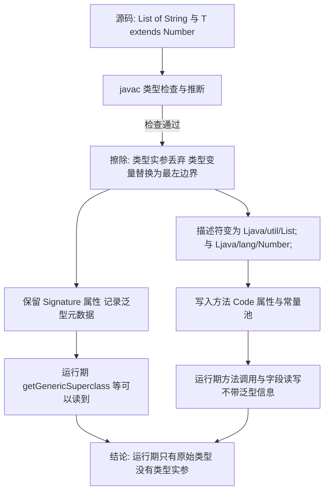

### 1.3 为什么选择擦除

这是高级岗必答题，答"为了兼容"只对一半，要把替代方案和代价讲清楚。

| 方案 | 代表语言 | 优势 | 代价 |
| --- | --- | --- | --- |
| 擦除式泛型 | Java 5+、Kotlin（JVM 侧） | 老字节码零改动、`List` 与 `List<String>` 二进制兼容、无运行期膨胀 | 不能 `new T[]`、不能 `instanceof List<String>`、不能按实参重载、反射拿不到实参 |
| 具化式泛型（reified） | C# 2.0+ | 运行期保留实参、可反射、可 `new T` | 值类型会为每组实参生成独立代码，泛型实例化代码膨胀；运行期需要 CLR 支持；.NET 1.x 与 2.0 的兼容靠泛型类型独立命名解决 |
| 模板/单态化 | C++ template、Rust generics | 零抽象开销、可内联 | 编译期代码膨胀、错误信息晦涩、无统一运行期表示 |

Java 选择擦除的**核心约束是二进制兼容**：JDK 5 之前全世界已有海量编译好的 `List` 调用方（`invokeinterface java/util/List.add:(Ljava/lang/Object;)Z`）。擦除让 `ArrayList` 不必为每个实参生成新类，`.class` 文件不会爆炸，也不会出现"泛型类无法跨版本链接"的问题。**代价是类型实参在运行期不可见**，于是有了本节的后续所有补丁：桥接方法、`TypeToken`、`ResolvableType`、`Signature` 属性。

顺带一个常被追问的点：**局部变量的泛型信息是真的拿不到**。虽然 `javac -g` 会在 `LocalVariableTypeTable` 里写局部变量的泛型签名，但 `java.lang.reflect` 没有公开 API 读取它，只能在调试器/字节码工具里看到。

---

## 二、泛型的高级用法与 PECS 原则

### 2.1 四种声明位置

```java
// 1. 泛型类
public class Box<T> { private T value; }

// 2. 泛型接口
public interface Mapper<S, T> { T map(S source); }

// 3. 泛型方法（类型参数写在修饰符之后、返回值之前）
public static <T extends Comparable<? super T>> T max(List<? extends T> list) { /* ... */ }

// 4. 泛型构造器
public class Holder<T> { public <U extends T> Holder(U first) { /* ... */ } }
```

命名约定（JLS 与社区惯例）：`T` 类型、`E` 集合元素、`K`/`V` 键值、`N` 数字、`R` 返回值、`S`/`U`/`V` 第二三四个类型，`?` 通配符。

自限定类型（CRTP）在 JDK 里就有，典型两个：

```java
public abstract class Enum<E extends Enum<E>> implements Comparable<E>, Serializable
public final class Integer extends Number implements Comparable<Integer>
```

`Enum<E extends Enum<E>>` 的作用是让 `compareTo` 只接受同类型的枚举，同时让 `getDeclaringClass` 返回值类型精确——子类 `class Color extends Enum<Color>` 里的 `E` 被固定为 `Color`。

### 2.2 通配符的三种形态

| 写法 | 名字 | 能读 | 能写 | 典型入参 |
| --- | --- | --- | --- | --- |
| `List<? extends Number>` | 上界通配符 | 读出 `Number` | 只能写 `null` | **生产者** |
| `List<? super Integer>` | 下界通配符 | 只能读出 `Object` | 可写 `Integer` 及其子类 | **消费者** |
| `List<?>` | 无界通配符 | 读出 `Object` | 只能写 `null` | 与 `List<Object>` 不同：`List<Object>` 可写任意对象 |

`List<?>`、`List<? extends Object>`、`List<Object>` 三者不等价：

```java
void f1(List<Object> l) { }   // 只接受 List<Object>
void f2(List<?> l) { }        // 接受 List<String>、List<Integer>，但只能 add(null)
void f3(List<? extends Object> l) { } // 与 f2 语义等价
```

`f2`/`f3` 里可以调 `size()`、`isEmpty()`、`clear()`、`remove(int)`、`iterator()`（迭代器返回 `Object`），但 `add(E)` 因为 `E` 是捕获类型（capture）而编译失败。

### 2.3 PECS 原则

PECS = **Producer Extends, Consumer Super**，出自 Joshua Bloch《Effective Java》第 2 版 Item 28 / 第 3 版 Item 31。

判断方法只有一句话：**这个参数在这个方法里主要做"输入数据源"还是"输出落点"**。

JDK 里的标准范例，可以背下来当证据：

| 方法 | 签名片段 | 这里是 P 还是 C |
| --- | --- | --- |
| `Collections.copy` | `copy(List<? super T> dest, List<? extends T> src)` | 一个 C 一个 P，教科书级 |
| `Collections.max` | `max(Collection<? extends T> coll, Comparator<? super T> comp)` | 集合是 P，比较器是 C |
| `Collection#addAll` | `addAll(Collection<? extends E> c)` | P |
| `List#sort` | `sort(Comparator<? super E> c)` | C |
| `Stream#forEach` | `forEach(Consumer<? super T> action)` | C，`Consumer` 是消费者 |
| `Stream#map` | `map(Function<? super T, ? extends R> mapper)` | 入参 C、返回值 P |
| `Optional#orElseGet` | `orElseGet(Supplier<? extends T> supplier)` | P |
| `Iterable#forEach` | `forEach(Consumer<? super T> action)` | C |

注意 `Comparable<? super T>` 的写法：`public static <T extends Comparable<? super T>> T max(Collection<? extends T> c)`。为什么是 `super` 而不是 `Comparable<T>`？因为如果 `T` 是子类 `Dog`，而 `Dog` 继承的 `Comparable` 实现在父类 `Animal implements Comparable<Animal>` 上，写成 `Comparable<T>` 就无法接受 `Animal implements Comparable<Animal>` 了。`? super T` 放宽了这一限制——这是"下界通配符作为消费者"的经典体现。

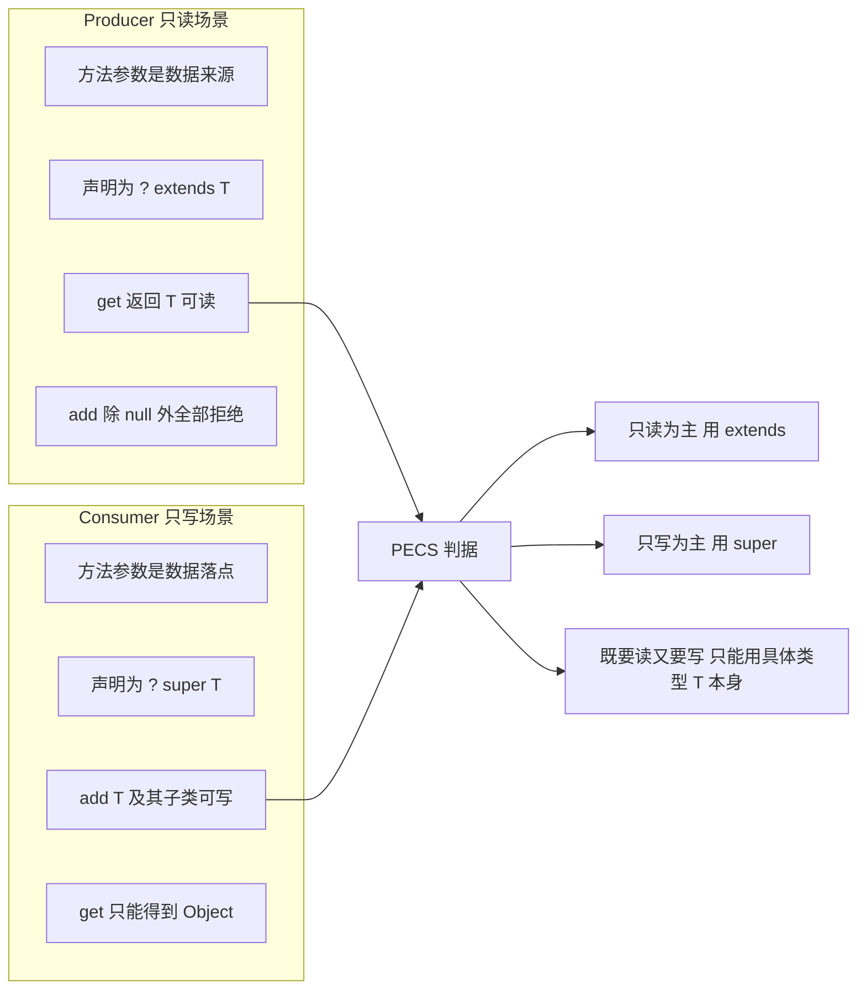

### 2.4 通配符捕获与辅助方法

编译器把 `List<?>` 里的 `?` 建模成一个"捕获变量"（capture of `?`），在方法体内它是**未知具体类型**，两次调用的捕获类型不保证相同，所以下面的代码编译不过：

```java
// 编译错误：<T> reverse(List<T>) 无法接受 List<?>
static void swap(List<?> list, int i, int j) {
    list.set(i, list.get(j)); // 错误: set(int, capture#1 of ?) 不能应用
}
```

标准解法是**捕获辅助方法（capture helper）**，用泛型方法把捕获变量"提升"为具名类型参数：

```java
public static void swap(List<?> list, int i, int j) {
    swapHelper(list, i, j);
}
private static <E> void swapHelper(List<E> list, int i, int j) {
    list.set(i, list.get(j)); // 合法: E 与 get 的返回类型匹配
}
```

JDK 内部同样用这个手法，例如 `Collections#swap(List<?> list, int i, int j)`（JDK 8 源码里没有写捕获辅助方法，而是直接退化成原始类型：`final List l = list; l.set(i, l.set(j, l.get(i)));`，注释里写明捕获通配符需要一个额外的私有辅助方法，本质上也是承认"协变位置不安全，只能约定"）。

### 2.5 什么时候不该用泛型

- **要拿运行期类型**：需要 `instanceof` 判断、要 `new T[]`、要按实参分派，直接把 `Class<T>` 作为参数传进来，别硬拗泛型。
- **类型参数只在方法体内出现一次**：`<T> void log(T msg)` 没有意义，等价于 `Object`。
- **会破坏封装**：把内部数组 `T[]` 直接返回给调用方，泛型也救不了堆污染。

---

## 三、擦除带来的三个后遗症

### 3.1 后遗症一：不能按类型实参重载，不能 `instanceof`

```java
// 编译错误: name clash —— 两个方法的擦除签名相同
void handle(List<String> list) { }
void handle(List<Integer> list) { }

// 编译错误: 无法对参数化类型执行 instanceof
if (obj instanceof List<String>) { }
```

`instanceof List<?>` 是合法的（JDK 5+），因为它等价于 `instanceof List`，只检查原始类型。

### 3.2 后遗症二：泛型数组创建被禁止

```java
// 编译错误: generic array creation
List<String>[] arr = new List<String>[10];
```

禁止的根本原因是**数组是协变的、会做运行期元素类型检查，而泛型不是**。把两者结合会直接击穿类型安全：

```java
// 假设第一行合法（实际编译不过），后面的过程演示了为什么会击穿
List<String>[] lsa = new List<String>[10]; // 假想
Object[] oa = lsa;                          // 数组协变，合法
List<Integer> li = new ArrayList<>();
li.add(42);
oa[1] = li;                                 // 编译期合法（运行时数组检查只看原始类型 List）
String s = lsa[1].get(0);                   // 运行期从 List 里取出 Integer 赋给 String -> ClassCastException 发生在很远的地方
```

这种"编译期没问题、运行期在毫不相干的位置抛 `ClassCastException`"的现象叫**堆污染（heap pollution）**（JLS 4.12.2 的精确定义）。

可用的绕过手段，按推荐度排序：

| 手段 | 写法 | 代价 |
| --- | --- | --- |
| 用集合代替数组 | `List<List<String>>` | 轻微内存/性能开销，最推荐 |
| 反射创建 | `(T[]) Array.newInstance(componentType, n)` | 需要显式传 `Class<T>` |
| 强转 `Object[]` | `(T[]) new Object[n]` | 有 `unchecked` 警告，且 `T` 若是具体类型，运行期 `Object[]` 赋给 `String[]` 变量会 `ClassCastException` |
| 加 `@SafeVarargs` | 仅用于 `static`/`final`/`private` 方法与构造器 | 必须自己保证安全，一旦写错是静默污染 |

`@SafeVarargs` 的版本约束要记准：**JDK 7 引入**，当时只能标注 `static` 与 `final` 方法、构造器；**JDK 9 起**允许标注 `private` 实例方法。

```java
@SafeVarargs
public static <T> List<T> of(T... elements) { return new ArrayList<>(Arrays.asList(elements)); }
```

反面教材是 `List.of(...)`（JDK 9+）与 `Arrays.asList`（JDK 1.2+）的区别：`Arrays.asList` 返回的是 `Arrays.ArrayList` 这个**固定长度的视图**，`add`/`remove` 会抛 `UnsupportedOperationException`，只有 `set` 可用；`List.of` 返回**完全不可变**的列表，任何修改方法都抛 `UnsupportedOperationException`，并且不接受 `null` 元素（抛 `NullPointerException`）。

### 3.3 后遗症三：桥接方法

这是"擦除最硬核的后果"，也是面试的高区分度题。

场景：父类是泛型类，子类给了具体实参。

```java
public class Box<T> {
    private T value;
    public void set(T value) { this.value = value; }
    public T get() { return value; }
}
public class StringBox extends Box<String> {
    @Override public void set(String value) { super.set(value); }
    @Override public String get() { return super.get(); }
}
```

擦除后父类只有 `set(Object)` 和 `get()Object`。如果子类只有 `set(String)` 和 `get()String`，那么通过父类引用调用 `set(Object)` 时，`invokevirtual java/lang/Box.set:(Ljava/lang/Object;)V` 就找不到重写实现——多态失效。`get()` 同理：`invokevirtual java/lang/Box.get:()Ljava/lang/Object;` 也需要子类里有一个返回 `Object` 的同签名方法来承接。

`javac` 的解决办法是在 `StringBox` 里**合成桥接方法**：

```java
// javac 自动生成的两个桥接方法，等价于
public void set(Object value) {
    this.set((String) value); // checkcast 后转调真实方法 set(String)
}
public Object get() {
    return this.get();        // 返回类型协变（String -> Object）同样要生成桥接方法
}
```

桥接方法带 `ACC_BRIDGE | ACC_SYNTHETIC` 标志（JVM 规范 4.6），反射里能看到：

```java
for (Method m : StringBox.class.getDeclaredMethods()) {
    System.out.println(m + " bridge=" + m.isBridge() + " synthetic=" + m.isSynthetic());
}
// public java.lang.Object StringBox.get() bridge=true synthetic=true
// public java.lang.String StringBox.get() bridge=false synthetic=false
// public void StringBox.set(java.lang.Object) bridge=true synthetic=true
// public void StringBox.set(java.lang.String) bridge=false synthetic=false
```

**桥接方法带来的四个真实坑**：

1. **反射遍历方法数量翻倍**：`getDeclaredMethods()` 会同时返回真实方法和桥接方法。Spring 的 `ReflectionUtils#getUniqueDeclaredMethods`、Jackson 的序列化器扫描都要显式过滤 `isBridge() || isSynthetic()`，否则会出现"方法被处理两次"。
2. **注解会"看起来重复"**：桥接方法会复制部分注解，导致 `getDeclaredAnnotations()` 出现重复。
3. **AOP 切点匹配意外命中**：基于方法签名的切点可能同时匹配到 `set(Object)` 和 `set(String)`。
4. **Lambda / 方法引用报错难读**：`Ambiguous method reference` 或 `ClassCastException: java.lang.Object cannot be cast to ...` 常常就是桥接方法里的 `checkcast` 失败。

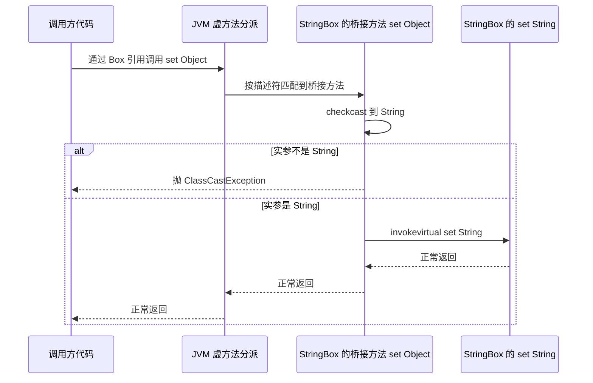

### 3.4 附带陷阱：`getClass()` 与 `equals`

```java
List<String> a = new ArrayList<>();
List<Integer> b = new ArrayList<>();
a.equals(b); // true —— ArrayList.equals 只看元素，两侧都是空列表
```

泛型无法约束 `equals`/`hashCode` 的语义。写 `equals` 时若用 `instanceof List` 判断，`List<String>` 与 `List<Integer>` 会被判成"可能是同类"，运行期擦除让编译器无法救你。**结论：不要在泛型容器上做依赖类型实参的相等判断。**

---

## 四、在运行期拿回泛型信息

### 4.1 哪些位置保留、哪些位置丢失

| 位置 | 运行期能否拿到实参 | 反射 API |
| --- | --- | --- |
| 类的父类 | 能 | `Class#getGenericSuperclass` |
| 类实现的接口 | 能 | `Class#getGenericInterfaces` |
| 字段 | 能 | `Field#getGenericType` |
| 方法参数 | 能 | `Executable#getGenericParameterTypes` |
| 方法返回值 | 能 | `Method#getGenericReturnType` |
| 方法类型参数声明 | 只能拿到名字与上界 | `Method#getTypeParameters` |
| 方法内局部变量 | 拿不到（只有在 `LocalVariableTypeTable` 里给调试器看） | 无公开 API |
| 对象实例本身 | 拿不到 | `getClass()` 只有原始类型 |
| 类型实参的"实际值" | 拿不到 | `TypeVariable#getBounds` 只给上界 |

关键结论：**泛型信息只能从"声明处"读到，读不到"使用处的实参"**。所以 `new ArrayList<String>()` 之后你无法从对象反推 `String`，只能从 `class Dao extends BaseDao<User>` 这样的子类声明或字段/方法签名反推。

### 4.2 `java.lang.reflect.Type` 体系

`Type`（JDK 5 起，`java.lang.reflect.Type`）是**泛型信息在运行期的载体**：擦除把"类型实参"从字节码的指令里拿掉了，但把"类型声明"以签名属性的形式留在了 class 文件里，反射读出来就是一棵 `Type` 树。

它有四个子接口，加上直接实现它的 `Class`，一共**五种形态**。这五种不是"并列的五个类"，而是**同一棵类型树上的五种节点**：`ParameterizedType` 里面装着 `Class`/`TypeVariable`/`WildcardType`，`GenericArrayType` 里面装着任意 `Type`。

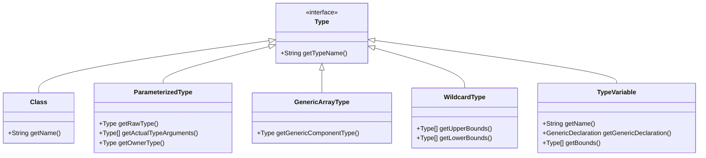

#### 4.2.1 先记这张总表

| 形态 | 长什么样 | 从哪个 API 拿到 | 典型场景 | 关键方法 |
| --- | --- | --- | --- | --- |
| `Class` | `String`、`int`、`String[]`、`List`（裸类型） | 一切**没有泛型信息**的声明：`Field#getType()`、`obj.getClass()`、`Method#getReturnType()` | 反序列化时 `newInstance`、反射调用、判断类型 | `getName()` / `getComponentType()` |
| `ParameterizedType` | `List<String>`、`Map<String, List<User>>`、`Comparable<User>` | `getGenericSuperclass()`、`getGenericInterfaces()`、`getGenericType()`、`getGenericReturnType()`、`getGenericParameterTypes()` | **框架里 99% 的泛型解析**：`TypeReference`、`ParameterizedTypeReference`、通用 DAO、`ResolvableType` | `getRawType()` / `getActualTypeArguments()` / `getOwnerType()` |
| `GenericArrayType` | `T[]`、`List<String>[]` | 同上，但**组件的类型是泛型**（不是具体类） | 反序列化数组/集合字段、`Array.newInstance` 造数组 | `getGenericComponentType()` |
| `TypeVariable` | `T`、`E`、`K`、`V` | `Class#getTypeParameters()`、`Method#getTypeParameters()`、字段/返回值的 `genericType` | 通用基类解析实体类型（Spring Data、MyBatis-Plus 的 `BaseMapper<T>`） | `getName()` / `getGenericDeclaration()` / `getBounds()` |
| `WildcardType` | `?`、`? extends Number`、`? super Integer` | **只能作为类型实参出现**（如 `List<? extends X>` 的实参）或类型变量的上界里 | Jackson 反序列化 `List<? extends X>`、Spring 泛型匹配 | `getUpperBounds()` / `getLowerBounds()` |

一句话记忆方式：**`Class` 是"没有泛型的类型"，`ParameterizedType` 是"带尖括号的类型"，`GenericArrayType` 是"带尖括号的数组"，`TypeVariable` 是"还没填的占位符"，`WildcardType` 是"问号"。**

#### 4.2.2 `Class`：最常遇到，但"什么时候它是 Class"很容易判断错

先看一组实测（`Box<T extends Number>` 里的 12 个字段，JDK 8 与 JDK 17 输出完全一致）：

| 字段声明 | `getGenericType()` 的实际类型 | `getTypeName()` |
| --- | --- | --- |
| `T value;` | `TypeVariableImpl` | `T` |
| `T[] items;` | **`GenericArrayTypeImpl`** | `T[]` |
| `List<T> list;` | `ParameterizedTypeImpl` | `java.util.List<T>` |
| `List<?> any;` | `ParameterizedTypeImpl` | `java.util.List<?>` |
| `Map<String, List<User>> nested;` | `ParameterizedTypeImpl` | `java.util.Map<java.lang.String, java.util.List<User>>` |
| `List<String>[] genericArray;` | **`GenericArrayTypeImpl`** | `java.util.List<java.lang.String>[]` |
| `String[] plainArray;` | **`Class`** | `java.lang.String[]` |
| `int primitive;` | **`Class`** | `int` |
| `List raw;` | **`Class`** | `java.util.List` |

带 `Impl` 后缀的 реализации都在 `sun.reflect.generics.reflectiveObjects` 包下（`ParameterizedTypeImpl`、`GenericArrayTypeImpl`、`WildcardTypeImpl`、`TypeVariableImpl`），JDK 8 与 JDK 17 实测类名一致。

**第一个必须记住的坑：数组是不是 `GenericArrayType`，取决于组件的类型**。

- `String[]` 的组件是具体类 → `getGenericType()` 返回 `Class`（就是 `String[].class`）；
- `T[]`、`List<String>[]` 的组件含泛型 → 返回 `GenericArrayType`。

所以"看到数组就当 `Class[]` 处理"会漏掉泛型数组。

**第二个坑：`getType()` 与 `getGenericType()` 的区别**（实测）：

| 字段 | `getType()`（擦除后） | `getGenericType()`（带泛型） |
| --- | --- | --- |
| `List<T> list` | `List` | `java.util.List<T>` |
| `T[] items` | `Number[]`（T 的上界） | `T[]` |
| `String[] plainArray` | `String[]` | `java.lang.String[]` |

`getType()` 返回擦除后的 `Class`，**信息已经丢了**；需要泛型信息就必须用 `getGenericXxx` 系列。

`Class` 形态的典型用法很直接：需要**实例化**或**反射调用**时，最终一定落到 `Class`。所以框架里的通用逻辑都是"先递归把任意 `Type` 归一成 `Class`（拿 rawType / 上界），再用它反射"——这就是 4.2.7 那个 `rawOf` 的作用。

#### 4.2.3 `ParameterizedType`：框架 99% 的泛型解析都在处理它

三个方法对应尖括号的三个部分：

```java
// Map<String, List<User>>  这棵树的三个部分
getRawType()              // Map        —— 尖括号外面的裸类型（永远是一个 Class）
getActualTypeArguments()  // [String, List<User>] —— 尖括号里每一项，注意每一项又是 Type
getOwnerType()            // null       —— 只有内部类才有值
```

实测（`Field f = Box.class.getDeclaredField("nested")`）：

```text
nested.getRawType()             = interface java.util.Map
nested.getActualTypeArguments() = [class java.lang.String, java.util.List<User>]
  第 2 个实参再拆一层           = class User
nested.getOwnerType()           = null
```

**`getOwnerType()` 什么时候不是 null**：只有"内部类被参数化"时才有值。实测 `Outer<String>.Inner<Integer>` 字段：

```text
inner.getTypeName()   = Outer<java.lang.String>$Inner<java.lang.Integer>
inner.getRawType()    = class Outer$Inner
inner.getOwnerType()  = Outer<java.lang.String>     <- 非 null，而且本身又是一个 ParameterizedType
```

**真实应用场景**（这块是面试最常问的"你在哪用过"）：

| 场景 | 代码形态 | 它用 `ParameterizedType` 干什么 |
| --- | --- | --- |
| Jackson 反序列化泛型 | `mapper.readValue(json, new TypeReference<List<User>>() {})` | 匿名子类的 `getGenericSuperclass()` 是一个 `ParameterizedType`，从中取出 `User`，才能把 JSON 数组转成 `List<User>` 而不是 `List<LinkedHashMap>`（这个坑见 4.3 节） |
| Spring `RestTemplate` 收泛型响应 | `restTemplate.exchange(url, GET, null, new ParameterizedTypeReference<Result<List<User>>>() {})` | 同上，Spring 版的 `TypeReference` |
| Spring `ResolvableType` | `ResolvableType.forClass(Dao.class).getSuperType(BaseDao.class).getGeneric(0).resolve()` | 把 `ParameterizedType` 包成更易用的 API，并沿继承链解析类型变量 |
| 通用 DAO / Repository | `class UserDao extends BaseDao<User>` | 从 `getGenericSuperclass()` 取出 `User`，反射调用 `User.class.newInstance()` 或拼 SQL 的表名 |
| MyBatis `TypeHandler<T>` | `class JsonHandler<T> implements TypeHandler<T>` | 从接口的 `ParameterizedType` 里取出实际类型，决定用哪个 JSON 库反序列化 |
| 参数校验 / 序列化框架 | `Field#getGenericType()` | 判断 `List<User>` 的元素类型，做级联校验 |

**两个坑**：

1. **实参本身可能还是 `ParameterizedType`**，必须递归。`Map<String, List<User>>` 的第 2 个实参是 `List<User>`，不递归就只能拿到 `List`，`User` 丢了。
2. **`getActualTypeArguments()` 里可能是 `TypeVariable`**。比如字段声明 `List<T> list`（在 `class Box<T>` 里），实参就是 `T` 这个 `TypeVariable`，不是 `Class`——直接强转 `(Class<?>)` 会 `ClassCastException`。

#### 4.2.4 `GenericArrayType`：只在"组件是泛型"时出现

```java
class Box<T> { T[] items; }
```

```text
items.getTypeName()                = T[]
items.getGenericComponentType()    = T (TypeVariableImpl)
```

如果组件是带参数的泛型，也是一样：

```java
List<String>[] genericArray;
```

```text
genericArray.getTypeName()              = java.util.List<java.lang.String>[]
genericArray.getGenericComponentType()  = java.util.List<java.lang.String> (ParameterizedTypeImpl)
```

**应用场景**：需要"按组件类型造数组"时。因为泛型数组不能直接 `new T[]`，正确姿势是：

```java
// 把 T[] 变成真正的数组对象：先拿组件类型，再 Array.newInstance
Type component = ((GenericArrayType) type).getGenericComponentType();
Class<?> componentClass = rawOf(component);              // 见 4.2.7
Object array = Array.newInstance(componentClass, 10);    // 等价于 new User[10]
```

这也是 JSON 库反序列化 `Order[]` / `List<Order>[]` 字段的必经步骤。

**坑**：`GenericArrayType` 与 `Class` 的数组要分开处理。`String[].class` 是 `Class`，可以直接 `getComponentType()`；`T[]` 是 `GenericArrayType`，只有 `getGenericComponentType()`。写工具方法时两个分支都要有。

#### 4.2.5 `TypeVariable`：它本身没有类型，必须结合"声明者 + 继承链"才能解析

`T`、`E`、`K`、`V` 在运行期就是 `TypeVariable`，它只记录三件事：

```java
TypeVariable<?> tv = (TypeVariable<?>) Box.class.getDeclaredField("value").getGenericType();
tv.getName()                  // T
tv.getGenericDeclaration()    // class Box —— 是哪个类/方法声明的这个 T
tv.getBounds()                // [class java.lang.Number] —— 上界，没写 extends 就是 [Object]
```

**关键认知：`TypeVariable` 里没有"实际类型"。** 想把它变成 `User`，必须回答两个问题：

1. **是谁声明了这个变量**（`getGenericDeclaration()`）；
2. **在哪一层继承/实现里它被填成了什么**（沿 `getGenericSuperclass()` / `getGenericInterfaces()` 往上找）。

这就是通用 DAO 的经典实现。完整可运行案例：

```java
class BaseDao<T> { T findById(int id) { return null; } }
class User {}
class UserDao extends BaseDao<User> {}

/** 沿继承链向上找：谁把 BaseDao<T> 的 T 填成了具体类 */
static Class<?> resolveEntity(Class<?> daoClass) {
    Class<?> cur = daoClass;
    while (cur != null && cur != Object.class) {
        Type sup = cur.getGenericSuperclass();
        if (sup instanceof ParameterizedType) {
            ParameterizedType pt = (ParameterizedType) sup;
            if (pt.getRawType() == BaseDao.class) {
                return (Class<?>) pt.getActualTypeArguments()[0];   // 这里就是 User
            }
        }
        cur = cur.getSuperclass();
    }
    return null;
}
```

实测：

```text
resolveEntity(UserDao.class)  = class User
resolveEntity(BaseDao.class)  = null      <- 裸类型，T 没有被填，解析不出来
```

**这就是 Spring Data JPA 的 `SimpleJpaRepository<T, ID>`、MyBatis-Plus 的 `BaseMapper<T>`、以及各种 `AbstractJsonConverter<T>` 能"自动知道你操作的是哪张表/哪个类"的原理。**

三个坑：

1. **裸类型解析不出来**。`class UserDao extends BaseDao { }`（没写尖括号）→ `getGenericSuperclass()` 直接返回 `Class`（`BaseDao.class`），拿不到 `User`。框架遇到这种情况通常会退回"上界"或直接报错让你补泛型。
2. **同名的 `T` 不是同一个变量**。`class A<T>` 和 `class B<T>` 里的 `T` 是两个不同的 `TypeVariable`（`getGenericDeclaration` 不同），但 `equals` 会按"声明者 + 名字"比较。
3. **上界默认是 `Object`**。没写 `extends` 时 `getBounds()` 返回 `[Object]`，所以"取上界当实际类型"在没填泛型时会得到 `Object`，而不是报错——这类 bug 表现为"反序列化出来是 `LinkedHashMap` 而不是实体类"。

#### 4.2.6 `WildcardType`：只出现在"类型实参"位置，而且没法实例化

**最容易踩的一点：字段类型本身永远不是 `WildcardType`。** 实测：

```java
List<? extends Number> up;
```

```text
Box.up 的 genericType 本身 = ParameterizedTypeImpl -> java.util.List<? extends Number>
```

也就是说，`?` 藏在 `List` 的类型实参里，必须再下一层才能拿到：

```java
WildcardType w = (WildcardType) ((ParameterizedType) field.getGenericType()).getActualTypeArguments()[0];
```

上界/下界的取值规则（实测）：

| 声明 | `getUpperBounds()` | `getLowerBounds()` |
| --- | --- | --- |
| `List<?>` | `[Object]` | `[]` |
| `List<? extends Number>` | `[Number]` | `[]` |
| `List<? super Integer>` | `[Object]` | `[Integer]` |

注意 `? super Integer` 的**上界仍是 `Object`**——上界永远有值，下界只在下界通配符时才有值。

**应用场景**：

- **Jackson 反序列化 `List<? extends X>`**：只能按上界 `X` 实例化，`? super X` 的下界在反序列化里没有意义（你没法"凭空造一个父类"）。
- **Spring 的泛型匹配**：`ResolvableType.isAssignableFrom` 需要判断 `List<Integer>` 能否赋给 `List<? extends Number>`，靠的就是上下界。
- **类型变量上界里的通配符**：JDK 自己的 `Collections.max` 签名是 `<T extends Object & Comparable<? super T>>`，`getBounds()[0]` 是一个 `ParameterizedType`，它的实参就是 `WildcardType`。这也是为什么"写泛型方法时 `? super T` 很常见"。

**坑**：`WildcardType` 无法实例化，也无法直接 `newInstance`。要造对象只能退到上界（或用 `rawType`）。另外 `getUpperBounds()` 返回的是数组（Java 不支持多上界通配符，但接口设计沿用了数组）。

#### 4.2.7 把五种拼起来：一个递归解析器

框架里的"泛型工具"本质都是这个结构：**按 `instanceof` 分派，对子节点递归**。

```java
public static Class<?> rawOf(Type type) {
    if (type instanceof Class) {
        return (Class<?>) type;
    }
    if (type instanceof ParameterizedType) {
        return (Class<?>) ((ParameterizedType) type).getRawType();
    }
    if (type instanceof GenericArrayType) {                    // T[] / List<String>[]
        Class<?> component = rawOf(((GenericArrayType) type).getGenericComponentType());
        return Array.newInstance(component, 0).getClass();     // 造一个 0 长度数组拿 Class
    }
    if (type instanceof WildcardType) {                        // ? extends X -> 取上界
        Type[] up = ((WildcardType) type).getUpperBounds();
        return up.length > 0 ? rawOf(up[0]) : Object.class;
    }
    if (type instanceof TypeVariable) {                        // T -> 取上界（通常是 Object）
        Type[] bounds = ((TypeVariable<?>) type).getBounds();
        return bounds.length > 0 ? rawOf(bounds[0]) : Object.class;
    }
    throw new IllegalArgumentException("Unknown type: " + type);
}
```

把分派顺序画出来就是：

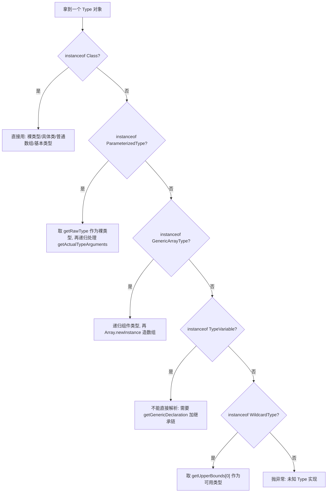

**再进一步：把整棵树打印出来**（调试泛型问题的神器，也是理解五种形态最快的方式）：

```java
static void describe(Type t, int indent) {
    String pad = "  ".repeat(indent);
    if (t instanceof Class) {
        System.out.println(pad + "Class           " + ((Class<?>) t).getSimpleName());
    } else if (t instanceof ParameterizedType) {
        ParameterizedType p = (ParameterizedType) t;
        System.out.println(pad + "ParameterizedType " + p.getTypeName());
        System.out.println(pad + "  raw=" + p.getRawType() + " owner=" + p.getOwnerType());
        for (Type arg : p.getActualTypeArguments()) describe(arg, indent + 1);
    } else if (t instanceof GenericArrayType) {
        GenericArrayType g = (GenericArrayType) t;
        System.out.println(pad + "GenericArrayType " + g.getTypeName());
        describe(g.getGenericComponentType(), indent + 1);
    } else if (t instanceof TypeVariable) {
        TypeVariable<?> v = (TypeVariable<?>) t;
        System.out.println(pad + "TypeVariable    " + v.getName()
                + "  声明者=" + v.getGenericDeclaration() + " 上界=" + Arrays.toString(v.getBounds()));
    } else if (t instanceof WildcardType) {
        WildcardType w = (WildcardType) t;
        System.out.println(pad + "WildcardType    " + w.getTypeName()
                + " upper=" + Arrays.toString(w.getUpperBounds()) + " lower=" + Arrays.toString(w.getLowerBounds()));
    }
}
```

对四种典型声明跑出来的真实输出：

```text
# ① Map<String, List<? extends Number>> deep;
ParameterizedType java.util.Map<java.lang.String, java.util.List<? extends java.lang.Number>>
  raw=interface java.util.Map owner=null
  Class           String
  ParameterizedType java.util.List<? extends java.lang.Number>
    raw=interface java.util.List owner=null
    WildcardType    ? extends java.lang.Number upper=[class java.lang.Number] lower=[]

# ② T[] items;   （在 class Box<T extends Number> 里）
GenericArrayType T[]
  TypeVariable    T  声明者=class Box 上界=[class java.lang.Number]

# ③ List<String>[] arr;
GenericArrayType java.util.List<java.lang.String>[]
  ParameterizedType java.util.List<java.lang.String>
    raw=interface java.util.List owner=null
    Class           String

# ④ Outer<String>.Inner<Integer> inner;
ParameterizedType Outer<java.lang.String>$Inner<java.lang.Integer>
  raw=class Outer$Inner owner=Outer<java.lang.String>
  Class           Integer
```

**这张"树形输出"建议背下来**：面试时被问"反射怎么拿 `Map<String, List<User>>` 里的 `User`"，你按这棵树描述"`Map` → 第 2 个实参是 `List<User>` → 再拆一层是 `User`"，比背结论有说服力得多。

#### 4.2.8 常见错误速查

| 错误写法 | 后果 | 正确做法 |
| --- | --- | --- |
| 拿到 `Type` 直接 `(Class<?>) type` | `ClassCastException`（大多数情况是 `ParameterizedTypeImpl`） | 先 `instanceof` 分派，或用 `rawOf` |
| 只处理一层，不递归 | `Map<String, List<User>>` 只拿到 `List`，`User` 丢失 | `getActualTypeArguments()` 逐个递归 |
| 用 `getType()` 取泛型 | 拿到擦除后的 `Class`，泛型信息全丢 | 用 `getGenericType()` / `getGenericReturnType()` / `getGenericParameterTypes()` |
| 认为 `String[]` 是 `GenericArrayType` | 类型判断失败 | 只有组件含泛型（`T[]`、`List<String>[]`）才是 |
| 认为字段 `List<?>` 的类型是 `WildcardType` | 强转 CCE | 通配符在类型实参里，要再拆一层 |
| 遇到 `TypeVariable` 就取上界当实际类型 | 没填泛型时得到 `Object`，反序列化成 `LinkedHashMap` | 沿继承链解析（`4.2.5` 的 `resolveEntity`） |
| 把 `Type` 当字符串 key 缓存 | 不同实现类、不同类加载器下字符串相同但语义不同 | `Type` 的 `equals`/`hashCode` 是**结构化**的（实测两次取同一个字段的 `Type`，`equals` 为 `true`），可以直接当 `Map` key —— 这正是 `TypeToken` / `ResolvableType` 缓存的基础 |

### 4.3 TypeToken：用匿名子类把泛型"钉"在类声明上

因为类型实参只存在于**声明处**，所以技巧就是：人为造一个类声明去承载它。

```java
// Gson 2.x
Type type = new TypeToken<List<User>>() {}.getType();
List<User> users = new Gson().fromJson(json, type);
```

原理：`new TypeToken<List<User>>() {}` 创建的是 `TypeToken` 的**匿名子类**，它的 `getGenericSuperclass()` 返回 `ParameterizedType`，实参里带着 `List<User>`，于是从"子类声明处"读到了实参。

**这个技巧有一个必须警惕的失效条件**：类型实参必须是编译期可确定的字面量。

```java
static <T> TypeToken<List<T>> broken() {
    return new TypeToken<List<T>>() {}; // 拿到的是 List<T>，T 是 TypeVariable 而不是具体类型
}
// 正确写法（Gson 2.8.0+ 提供）：
static <T> TypeToken<List<T>> ok(TypeToken<T> element) {
    return (TypeToken<List<T>>) TypeToken.getParameterized(List.class, element.getType());
}
```

Gson 的 `TypeToken#getParameterized(Type rawType, Type... typeArguments)`、`TypeToken#getArray(Type componentType)` 就是为此引入的（**Gson 2.8.0 起**）。

Jackson 的对应物是 `com.fasterxml.jackson.core.type.TypeReference`，用法一致：

```java
TypeReference<List<User>> ref = new TypeReference<List<User>>() {};
List<User> list = objectMapper.readValue(json, ref);
```

也可以用编程方式构造 `JavaType`（适合类型参数是变量的场景）：

```java
JavaType listOfUser = objectMapper.getTypeFactory()
        .constructCollectionType(List.class, User.class);          // List<User>
JavaType mapOfStringToUser = objectMapper.getTypeFactory()
        .constructMapType(Map.class, String.class, User.class);     // Map<String, User>
JavaType parametric = objectMapper.getTypeFactory()
        .constructParametricType(Result.class, listOfUser);          // Result<List<User>>
```

Spring 的对应物是 `org.springframework.core.ParameterizedTypeReference<T>`（**Spring 3.2 起**），`RestTemplate` 用它收泛型响应：

```java
ResponseEntity<List<User>> resp = restTemplate.exchange(
        url, HttpMethod.GET, null, new ParameterizedTypeReference<List<User>>() {});
```

Spring 4.0 起更进一步提供了 `ResolvableType`，它是泛型解析的统一门面，能力比 `TypeToken` 强得多：

```java
ResolvableType t = ResolvableType.forMethodReturnType(method, TargetClass.class);
Class<?> raw = t.resolve();                    // 解析出原始类
ResolvableType elem = t.getGeneric(0);         // 第一个类型实参
ResolvableType asColl = t.asCollection();      // 当作集合看待
boolean hasGen = t.hasGenerics();
ResolvableType built = ResolvableType.forClassWithGenerics(Result.class, User.class);
```

`ResolvableType` 会自动向上追溯类层次、解析 `TypeVariable` 到具体实参、处理通配符，这比自己写递归分发可靠得多。**Spring 内部凡是需要泛型的地方基本都走它**（`GenericTypeResolver` 是更早的、能力较弱的版本，Spring 4.0 之后逐步被 `ResolvableType` 取代）。

多层继承是 `TypeToken` 和手写递归最容易翻车的地方：`class SubDao extends UserDao`、`UserDao extends BaseDao<User>` 时，`SubDao.class.getGenericSuperclass()` 只返回 `UserDao`（一个原始 `Class`），实参 `User` 在上一层，必须沿继承链解析类型变量才能拿到：

```java
ResolvableType rt = ResolvableType.forClass(SubDao.class).as(BaseDao.class); // 递归搜父类与接口层次，边走边解析变量
Class<?> arg = rt.getGeneric(0).resolve();                                   // User
// 等价的老 API：GenericTypeResolver.resolveTypeArgument 内部就是上面两行
Class<?> arg2 = GenericTypeResolver.resolveTypeArgument(SubDao.class, BaseDao.class);
```

`as(Class)` 是整个泛型工具链里最有用的一个方法——泛型基类（`BaseDao<T>`、`AbstractService<T>`）能在运行期推断出自己的实参，靠的就是它。

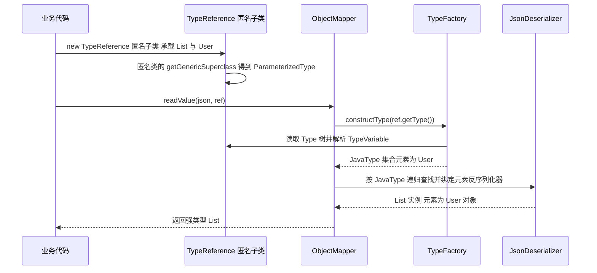

---

## 五、反射：三大入口与核心 API

### 5.1 拿到 `Class` 对象的三种方式，以及初始化语义差异

| 方式 | 时机 | 是否触发类初始化 | 是否抛受检异常 | 典型用途 |
| --- | --- | --- | --- | --- |
| `Xxx.class` | 编译期已确定 | 否（只加载） | 否 | 编译期已知类型 |
| `obj.getClass()` | 运行期 | 否（对象已存在） | 否 | 已知实例 |
| `Class.forName(String)` | 运行期字符串 | **是** | 是，`ClassNotFoundException` | JDBC 驱动、配置化加载 |
| `Class.forName(String, false, loader)` | 运行期字符串 | 否 | 是 | 只探测是否存在 |
| `classLoader.loadClass(String)` | 运行期字符串 | 否 | 是 | 框架自定义类加载 |

最经典的对比就是 JDBC：

```java
Class.forName("com.mysql.cj.jdbc.Driver"); // 触发静态块 DriverManager.registerDriver(new Driver())
```

MySQL Connector/J 8.x 的驱动类全名是 `com.mysql.cj.jdbc.Driver`（5.x 是 `com.mysql.jdbc.Driver`）；从 JDBC 4.0 起（Java 6+）有 SPI 机制，`META-INF/services/java.sql.Driver` 会自动被发现，`Class.forName` 已非必需——但讲清楚它**为什么会触发注册**依然是标准考点。

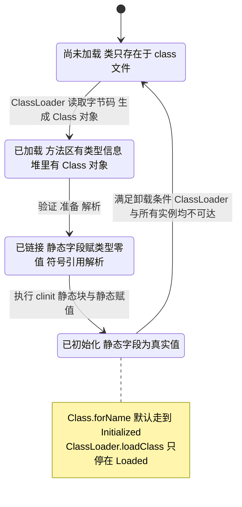

补充一个高频细节：`Class.forName` 使用**调用者的类加载器**（`Reflection.getCallerClass()`），而 `Class.forName(String, boolean, ClassLoader)` 可以显式指定。这正是"同一个类被两个 ClassLoader 加载后 `Class` 对象不相等、`ClassCastException` 满天飞"的根源。

### 5.2 `Class` 的高频 API

```java
Class<?> c = User.class;
c.getName();                       // com.demo.User（数组是 [Lcom.demo.User;）
c.getSimpleName();                 // User
c.getCanonicalName();              // com.demo.User
c.getPackageName();                // JDK 9+，com.demo
c.getSuperclass();                 // 父类，Object 返回 null，接口返回 null
c.getInterfaces();                 // 直接实现的接口（不含父类继承来的）
c.getDeclaredFields();             // 本类声明的字段，含 private，不含继承
c.getFields();                     // public 字段，含继承
c.getDeclaredMethods();            // 本类声明的方法，含 private 与桥接方法
c.getMethods();                    // public 方法，含继承与接口默认方法
c.getDeclaredConstructors();       // 本类构造器
c.getDeclaredClasses();            // 内部类
c.isInterface(); c.isEnum(); c.isArray(); c.isPrimitive(); c.isAnnotation();
c.isRecord();                      // JDK 16+
c.getRecordComponents();           // JDK 16+，RecordComponent[]
c.getModifiers();                  // int 位掩码，配合 java.lang.reflect.Modifier
c.getAnnotations();                // 含 @Inherited 继承来的
c.getDeclaredAnnotations();        // 只含本类声明的
c.isAssignableFrom(Other.class);   // 等价于 Other instanceof 本类
c.getAnnotatedSuperclass();        // JDK 8+，带类型注解的父类
c.getEnclosingClass();             // 外部类
c.getDeclaringClass();             // 被声明在哪个类里（成员类）
```

三个必须记住的差异：

1. **`getDeclaredXxx` 不含继承，`getXxx` 只含 public。** 想要"本类 + 所有父类的全部成员"，必须自己向上遍历。
2. **`getDeclaredMethods` 的返回顺序是不确定的。** JVM 规范没有定义顺序，JDK 实现里与 `ReflectionData` 的构建顺序有关，不能依赖。
3. **`getDeclaredMethods` 每次调用都会复制数组。** 底层 `Class#privateGetDeclaredMethods` 的结果被缓存在 `Class` 的 `ReflectionData` 里（通过 `SoftReference` 持有），但公开 API 会 `copyMethods` 返回新数组。**高频路径上必须自己缓存 `Method`/`Field`/`Constructor` 对象**——这是反射优化的第一条军规。

### 5.3 `Field`、`Method`、`Constructor` 与 `Executable`

```java
Field f = User.class.getDeclaredField("name");
f.setAccessible(true);
Object v = f.get(user);      // 读，基本类型会自动装箱
f.set(user, "tom");          // 写，基本类型需要传包装类型
f.getName(); f.getType();    // name / class java.lang.String
f.getGenericType();          // 泛型版本，可能是 ParameterizedType
f.getModifiers();            // Modifier.PRIVATE 等
f.getAnnotation(NotNull.class);
f.isSynthetic(); f.isEnumConstant();

Method m = User.class.getDeclaredMethod("setName", String.class);
m.setAccessible(true);
Object r = m.invoke(user, "tom");   // 可变参数形式，参数类型不匹配抛 IllegalArgumentException

Constructor<?> ctor = User.class.getDeclaredConstructor(String.class);
User u = (User) ctor.newInstance("tom"); // 内部异常被包进 InvocationTargetException
```

`Method.invoke` 的异常语义必须背准：

| 情况 | 抛出的异常 |
| --- | --- |
| 参数个数不对 | `IllegalArgumentException` |
| 参数类型不对 | `IllegalArgumentException` |
| 目标方法是 static，第一个参数传了非 null | 不报错：`obj` 参数被忽略（javadoc 原文 "It may be null"） |
| 目标对象是 null 且目标是实例方法 | `NullPointerException` |
| 目标方法抛异常 | `InvocationTargetException`，真实异常在 `getCause()` / `getTargetException()` |
| 访问权限不足 | `IllegalAccessException` |
| 目标对象类型不对 | `IllegalArgumentException` |

```java
try {
    m.invoke(target, args);
} catch (InvocationTargetException e) {
    throw new BizException("调用失败", e.getTargetException()); // 一定要剥掉这层包装
} catch (ReflectiveOperationException e) {
    throw new BizException("反射调用失败", e);
}
```

`getParameterCount()`、`getParameterTypes()`、`getGenericParameterTypes()`、`isVarArgs()`、`isSynthetic()` 声明在 `java.lang.reflect.Executable`（JDK 8 新增的 `Method`/`Constructor` 公共父类）上，`Method` 与 `Constructor` 都能用；而 `getReturnType()`、`getGenericReturnType()`、`isBridge()` 是 `Method` 自己的方法，`isDefault()`（JDK 8+ 判断接口默认方法，MyBatis 处理 `default` 方法就靠它）也是 `Method` 独有。

`java.lang.reflect.Modifier` 提供了 `isPublic`、`isStatic`、`isFinal`、`isAbstract`、`toString(int)` 等静态方法，比手写位运算可读性好得多。

### 5.4 `Class#newInstance` 已被废弃

```java
User u = User.class.newInstance(); // JDK 9 起 @Deprecated：会抛出 undeclared 的受检异常
User u2 = User.class.getDeclaredConstructor().newInstance(); // 推荐
```

废弃原因是它把构造器抛出的受检异常"偷渡"出来，绕过了编译期异常检查。**JDK 9 起标 `@Deprecated`，不要在代码里再用。**

### 5.5 `Method.invoke` 内部：inflation 机制

`Method.invoke` 不是每次都走 JNI。JDK 的实现里有一套"**先解释、后编译**"的自适应机制，这是回答"反射到底慢在哪"的关键证据。

```java
// JDK 8 在 sun.reflect.MethodAccessor 体系；JDK 9+ 迁移到 jdk.internal.reflect
// 关键类：DelegatingMethodAccessorImpl / NativeMethodAccessorImpl / GeneratedMethodAccessorXXX
```

流程：第一次调用走 `NativeMethodAccessorImpl`（JNI 调用，慢）；累计调用次数达到阈值后，用 `MethodAccessorGenerator` 生成一个名为 `GeneratedMethodAccessor1`、`GeneratedMethodAccessor2` 的类（**JDK 8** 在 `sun.reflect` 包，类名形如 `sun.reflect.GeneratedMethodAccessor1`；**JDK 9+** 迁移到 `jdk.internal.reflect`），后续调用通过这个生成类直接 `invokevirtual`，从而可被 JIT 内联。

| 控制参数 | 默认值 | 作用 |
| --- | --- | --- |
| `sun.reflect.inflationThreshold` | **15** | 第 15 次调用后从 native 切换到生成的 accessor |
| `sun.reflect.noInflation` | `false` | 设为 `true` 则一开始就用生成 accessor（首次调用变慢） |
| `jdk.proxy.ProxyGenerator.saveGeneratedFiles` | `false` | JDK 9+ 保存动态代理类字节码到磁盘（JDK 8 是 `sun.misc.ProxyGenerator.saveGeneratedFiles`） |

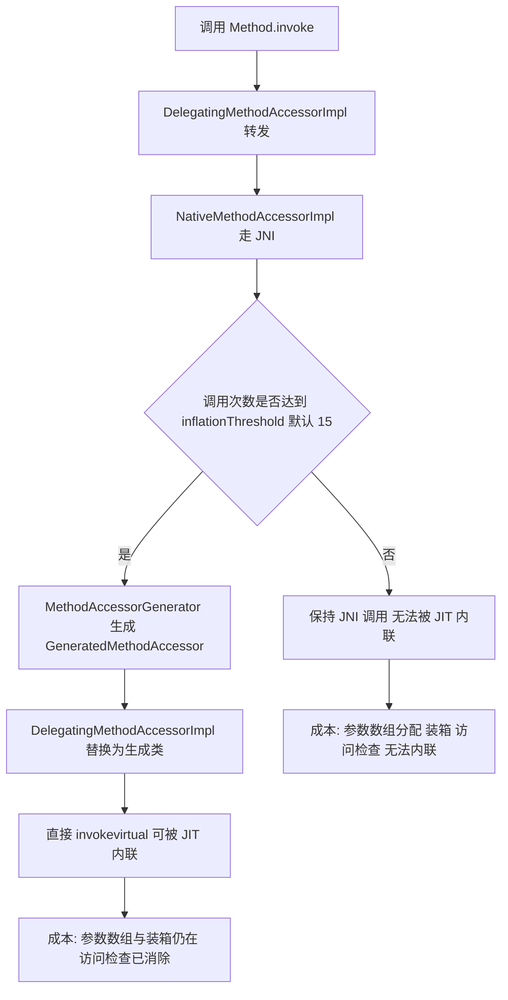

注意：**即使生成 accessor，`Object[]` 参数数组的分配和基本类型装箱依然存在**。这是 `Method.invoke` 相对直接调用残留的主要开销。只有当调用点类型信息是编译期常量时，JIT 才可能把 `invoke` 内联到消除装箱——这也是 `MethodHandle` 存在的意义。

### 5.6 泛型与反射的交汇点

`Class#getDeclaredMethods` 返回桥接方法、`Field#getGenericType` 返回 `ParameterizedType`——泛型和反射的交叉是框架代码最容易出错的地方。写通用框架时的标准动作：

```java
for (Method m : clazz.getDeclaredMethods()) {
    if (m.isBridge() || m.isSynthetic()) continue; // 跳过桥接与合成方法
    Type gt = m.getGenericReturnType();            // 用泛型版本而不是 getReturnType
    // ...
}
```

---

## 六、setAccessible 与模块化封装

### 6.1 `AccessibleObject#setAccessible` 到底做了什么

`AccessibleObject` 是 `Field`、`Method`、`Constructor`、`Executable` 的公共父类。

```java
field.setAccessible(true);   // 关闭 Java 语言层面的访问检查
field.isAccessible();        // 读标志位（JDK 8 有，JDK 9+ 仍然存在但语义弱化）
field.canAccess(obj);        // JDK 9+ 推荐：判断当前调用方能否访问
field.trySetAccessible();    // JDK 9+：失败返回 false 而不抛异常
```

要点：

- `setAccessible(true)` **不会改变字段/方法的 `Modifier`**，只是让反射调用跳过语言级访问检查。
- `setAccessible(true)` 也不等于允许访问：**JDK 9 起还受模块系统约束**，跨模块访问非 `open` 的包会抛 `InaccessibleObjectException`。
- **对 `final` 字段不要抱有幻想**：JDK 8 时代流传的"反射修改 `Field.modifiers` 再去 `set`"的 hack，在 **JDK 12 起已失效**（`java.lang.reflect.Field` 的字段已进入 `jdk.internal.reflect.Reflection` 的字段过滤表，JDK 17 里 `Field.class` 被映射为 `ALL_MEMBERS`，`getDeclaredField("modifiers")` 直接抛 `NoSuchFieldException`，加 `--add-opens` 也没用）。`static final` 常量在编译期还可能被 `javac` 直接内联到调用方常量池，改都不改不动。
- **但要区分实例字段与静态常量**：`Field#set` 的 javadoc 写明，final 字段有 write access 的条件是 `setAccessible(true)` 成功、字段**非 static**、声明类不是 hidden class 也不是 record class（JDK 17 javadoc 的四个条件）。所以 final **实例**字段直接 `set` 是允许的（JDK 8/11/17 实测都成功），只有 `static final` 才必然抛 `IllegalAccessException`。

### 6.2 模块系统对反射的三次收紧

JDK 9 引入 JPMS（JEP 261），之后的每次收紧都有明确 JEP，面试要能报出编号。

| JDK 版本 | 相关 JEP | 行为 |
| --- | --- | --- |
| 9 ~ 15 | JEP 261 | 默认 `--illegal-access=permit`：允许对 JDK 内部 API 的深层反射，**首次访问打印一次警告**到 stderr |
| 16 | JEP 396 | 默认改为 `--illegal-access=deny`，强封装除关键内部 API（`sun.misc.Unsafe` 等被 `jdk.internal.reflect.Reflection` 白名单放行的部分）外的所有内部元素 |
| 17 | JEP 403 | **彻底强封装**，`--illegal-access` 选项被移除（写了会被忽略并告警） |

在 JDK 9~15 上可以用这个参数把所有非法访问的位置打到日志里，是排查这类问题的第一手段：

```bash
java --illegal-access=warn -jar app.jar 2>&1 | grep -i "illegal reflective access"
```

JDK 16 之后只能靠 `InaccessibleObjectException` 的堆栈定位，或者用 `--add-opens` 逐个放行。

### 6.3 典型报错与定位

```
java.lang.reflect.InaccessibleObjectException: Unable to make field private final
java.lang.String java.lang.String.value accessible: module java.base does not
"opens java.lang" to unnamed module @1b6d3586
```

报错信息里三个关键信息：**目标成员**（`String.value`）、**所属模块**（`java.base`）、**访问方模块**（`unnamed module`，即 classpath 上的普通 jar）。定位路径：

1. 看堆栈里第一个属于自己或某个第三方库的帧，确定是谁在反射。
2. 判断是"框架版本太旧"还是"业务代码直接反射 JDK 内部类"。
3. 优先升级框架（Spring、Jackson、CGLIB、Lombok、Groovy 在 JDK 17 上都有专门适配版本）。
4. 短期用启动参数放行。

### 6.4 `--add-opens` 与 `--add-exports` 的区别

这是高频细节题：

| 参数 | 放开什么 | 是否包含反射 | 典型写法 |
| --- | --- | --- | --- |
| `--add-exports m/p=target` | 编译期与运行期的**静态引用**（能 `import` 并使用） | 否 | `--add-exports java.base/sun.nio.ch=ALL-UNNAMED` |
| `--add-opens m/p=target` | 在 `--add-exports` 基础上再开放**深层反射**（`setAccessible`） | 是 | `--add-opens java.base/java.lang=ALL-UNNAMED` |

所以遇到 `setAccessible` 失败，加 `--add-exports` 是没用的，必须 `--add-opens`。

Maven 里的做法（`maven-surefire-plugin` 的 `argLine`）与 Spring Boot 的 `JAVA_TOOL_OPTIONS` 都常用这套参数。JDK 17 上跑老 Spring 应用的常见放行清单：

```bash
--add-opens java.base/java.lang=ALL-UNNAMED
--add-opens java.base/java.lang.reflect=ALL-UNNAMED
--add-opens java.base/java.util=ALL-UNNAMED
--add-opens java.base/java.math=ALL-UNNAMED
--add-opens java.base/java.text=ALL-UNNAMED
--add-opens java.desktop/java.awt.font=ALL-UNNAMED
```

### 6.5 `MethodHandles.privateLookupIn`

框架（CGLIB 3.3+、ByteBuddy、Objenesis、Spring 6）在 JDK 9+ 上的标准做法是绕过 `setAccessible`，改用 `MethodHandles`：

```java
MethodHandles.Lookup lookup = MethodHandles.privateLookupIn(Target.class, MethodHandles.lookup());
Method readName = lookup.findGetter(Target.class, "name", String.class);
```

`privateLookupIn`（JDK 9+）要求**目标类所在模块把该包 open 给调用方模块**，否则同样抛 `IllegalAccessException`。它的优势是拿到的 `Lookup` 权限足够时，后续调用走 `MethodHandle`，性能远好于 `Method.invoke`。

---

## 七、反射性能与 MethodHandle/VarHandle

### 7.1 反射的开销分解

| 开销来源 | 说明 | 消除手段 |
| --- | --- | --- |
| 成员查找 | `getDeclaredMethod`/`getDeclaredField` 遍历并比较名字、参数类型，还要复制数组 | 缓存 `Method`/`Field` |
| 访问检查 | 每次 `invoke` 检查调用方与目标类的访问权限 | `setAccessible(true)` 或 `trySetAccessible()` |
| 参数包装 | 可变参数生成的 `Object[]` 分配 | 无法完全消除，用固定参数签名或 MethodHandle |
| 基本类型装箱 | `int` 参数被装箱成 `Integer` | 用 `MethodHandle`/`VarHandle` 或生成的 accessor |
| 无法内联 | JIT 对 `Method.invoke` 的内联比直接调用困难得多 | inflation 后的生成 accessor、`MethodHandle`、`LambdaMetafactory` |

粗糙的量级感受（**务必按"数量级"回答，不要报精确数字**，实际取决于 JDK 版本、JIT 状态、方法复杂度）：

- 未缓存的 `getDeclaredMethod` + `invoke`：比直接调用慢**一到两个数量级**。
- 缓存 `Method` 并 `setAccessible(true)`：慢**个位数倍数**。
- `MethodHandle` 稳定调用：接近直接调用，视具体类型（`invokeExact` 优于 `invoke`）。
- `VarHandle` 字段读写：接近直接字段访问。
- 生成的 accessor / 直接字节码调用（`ASM`、`ByteBuddy`、`LambdaMetafactory`）：与直接调用基本一致。

### 7.2 优化手段对照

| 手段 | 写法 | 适用 | 限制 |
| --- | --- | --- | --- |
| 缓存元数据 | `private static final Map<Class<?>, Field[]> CACHE` | 所有场景 | 注意类卸载与内存泄漏，用 `ClassValue` 或弱引用 |
| 关闭访问检查 | `field.setAccessible(true)` | 非 public 成员 | JDK 9+ 受模块限制 |
| `ClassValue` 缓存 | `class MethodCache extends ClassValue<Method[]>` | 按 Class 缓存 | JDK 7+，随类卸载自动清理 |
| `MethodHandle` | `lookup.findVirtual(...)` | 高频调用点 | 需要 `Lookup` 权限，API 略繁琐 |
| `LambdaMetafactory` | 生成 `FunctionalInterface` 实现 | 把反射调用替换为接口调用 | 只适用于能表达为函数式接口的调用 |
| 字节码生成 | ASM / ByteBuddy / CGLIB | 框架级、超高频 | 复杂度高，需处理类加载与 `defineClass` |
| `VarHandle` | `MethodHandles.lookup().findVarHandle(...)` | 字段高频读写 | JDK 9+，同样需要权限 |

`ClassValue` 是"按 `Class` 做缓存"的正确姿势（JDK 7 引入），它把缓存挂在 `Class` 对象上，随类卸载一起回收，避免了 `ConcurrentHashMap<Class<?>, X>` 造成的 `ClassLoader` 泄漏：

```java
private static final ClassValue<Field[]> FIELDS = new ClassValue<Field[]>() {
    @Override protected Field[] computeValue(Class<?> type) {
        Field[] fs = type.getDeclaredFields();
        for (Field f : fs) f.setAccessible(true);
        return fs;
    }
};
```

### 7.3 `MethodHandle` 对比反射

```java
MethodHandles.Lookup lookup = MethodHandles.lookup();
MethodType mt = MethodType.methodType(void.class, String.class);      // 返回值类型 + 参数类型
MethodHandle mh = lookup.findVirtual(User.class, "setName", mt);
mh.invokeExact(user, "tom");   // 调用点的描述符在编译期由静态类型确定，运行期不匹配抛 WrongMethodTypeException
mh.invoke(user, "tom");        // 会做 asType 适配，可以有装箱/拆箱
// 静态方法: lookup.findStatic；构造器: lookup.findConstructor；私有方法: lookup.findSpecial 或 unreflect
// 反射对象转 MethodHandle: lookup.unreflect(method)
```

| 维度 | `java.lang.reflect` | `java.lang.invoke.MethodHandle` |
| --- | --- | --- |
| 引入版本 | JDK 1.1 | JDK 7（JSR 292） |
| 类型检查时机 | 运行期，参数不匹配抛 `IllegalArgumentException` | 调用点描述符由静态类型决定，与句柄类型不一致时抛 `WrongMethodTypeException`（也是运行期）；`invoke` 会先做 `asType` 适配 |
| 调用方式 | `invoke(Object, Object...)` | `invokeExact` / `invoke` |
| 访问权限 | `setAccessible(true)`，JDK 9+ 受模块限制 | 由创建它的 `Lookup` 决定；`privateLookupIn` 是正规入口 |
| 性能 | 需 inflation 后接近直接调用 | 可直接内联，与直接调用相当 |
| 可组合性 | 无 | 支持 `asType`、`bindTo`、`filterArguments`、`insertArguments`、`guardWithTest` 等变换 |
| 典型使用者 | Spring、MyBatis、Jackson 的历史代码 | `invokedynamic`、Lambda、VarHandle、新版本框架 |

`Lookup` 的权限是核心设计：**`Lookup` 对象在哪个类里创建，就带着那个类的访问权限**。这样"谁能反射访问谁"变成了一个可以在编译期和运行期都清晰界定的问题，而不是靠 `setAccessible` 的全局开关。

### 7.4 `VarHandle`：字段访问的正规替代

JDK 9 引入（JEP 193），用于替代 `sun.misc.Unsafe` 的字段偏移量操作。

```java
public class Counter {
    private volatile int value;
    private static final VarHandle VALUE;
    static {
        try {
            VALUE = MethodHandles.lookup().findVarHandle(Counter.class, "value", int.class);
        } catch (ReflectiveOperationException e) { throw new ExceptionInInitializerError(e); }
    }
    public void inc() { VALUE.getAndAdd(this, 1); }
    public boolean cas(int expect, int update) { return VALUE.compareAndSet(this, expect, update); }
}
```

内存语义模式（这是 `VarHandle` 相对 `Unsafe` 的最大优势——**语义显式、分档**）：

| 模式 | 方法 | 语义 |
| --- | --- | --- |
| plain | `get`/`set` | 普通读写，无内存屏障 |
| opaque | `getOpaque`/`setOpaque` | 保证不被优化掉，但不保证可见性顺序 |
| acquire/release | `getAcquire`/`setRelease` | 单向屏障，性能优于 volatile |
| volatile | `getVolatile`/`setVolatile` | 全屏障，与 `volatile` 字段一致 |
| atomic | `compareAndSet`/`getAndAdd`/`getAndSet` | CAS 与原子读改写 |

`VarHandle` 还支持数组元素访问（`MethodHandles.arrayElementVarHandle(int[].class)`）和 `@Stable` 场景下的字段偏移，是 JDK 内部（`ConcurrentHashMap`、`AtomicInteger` 等）在 JDK 9+ 的新写法基础。

### 7.5 线上排查：反射成为热点

现象：某个接口 QPS 上去后 CPU 使用率飙高，火焰图顶部出现 `java.lang.reflect.Method.invoke` → `jdk.internal.reflect.GeneratedMethodAccessorN.invoke` 或 `NativeMethodAccessorImpl.invoke0`。

排查步骤：

1. `jcmd <pid> JFR.start duration=60s filename=/tmp/rec.jfr` 或 async-profiler：
   `./profiler.sh -d 30 -e cpu -f /tmp/flame.html <pid>`。
2. 看火焰图里反射帧的**调用方**，确定是框架（Spring `BeanUtils`、Jackson `BeanDeserializer`、MyBatis `MetaObject`）还是业务代码直接反射。
3. 若是业务代码：加缓存 + `setAccessible(true)`，或改 `MethodHandle`、改接口调用。
4. 若是框架：优先检查"是否每次都重新构建了反射调用链"。典型反模式是每次请求都 `Class.forName` + `getDeclaredMethod`（比如某些自研 RPC 的序列化层、某些动态 SQL 拼接）。
5. 若是类加载/代理生成问题：`jcmd <pid> VM.class_hierarchy` 与 `-XX:+TraceClassLoading` 观察是否有代理类被反复生成。注意 `GeneratedMethodAccessor` 序号一直涨，说明反射命中的 root `Method` 在增多（新代理类、新加载的类都会带来新的 `Class` 与成员），**不是** inflation 重来——inflation 计数由 root 共享（见 Q7 追问）；没缓存 `Method` 的代价是重复的成员查找与 `Method` 副本分配，而不是同一个方法反复 inflation。

**规模变大后的失效模式**：反射把"编译期错误"推迟到运行期。低并发时问题暴露为偶发异常，高并发时表现为 CPU 打满、元空间（Metaspace）膨胀（生成 accessor 类与代理类）、以及 JIT 去优化。所以**在核心链路（QPS 上万）上，反射只应该出现在初始化阶段，不应出现在每次请求的路径上**。

---

## 八、动态代理：JDK Proxy 与 CGLIB

动态代理解决的问题是：**在不修改目标类的前提下，给方法调用套一层统一的增强逻辑**。框架里的声明式事务、缓存、异步、日志、RPC、Mock、懒加载全部建立在它之上。

本节所有代码都在本机 **JDK 8（1.8.0_421）与 JDK 17（17.0.12）** 上编译运行过，输出为真实结果；CGLIB 用的是 `spring-core` 内置的 repackage 版本（`org.springframework.cglib`），Spring AOP 用的是 spring-context 5.3.25。

### 8.1 为什么需要动态代理：静态代理的三个痛点

先看不用动态代理时怎么写。假设要给 `OrderService` 加事务：

```java
interface OrderService { void create(String no); }

class OrderServiceImpl implements OrderService {
    public void create(String no) { System.out.println("insert " + no); }
}

// 静态代理：手写一个包装类
class OrderServiceTxProxy implements OrderService {
    private final OrderService target;
    OrderServiceTxProxy(OrderService target) { this.target = target; }
    public void create(String no) {
        System.out.println("begin tx");
        try { target.create(no); System.out.println("commit"); }
        catch (RuntimeException e) { System.out.println("rollback"); throw e; }
    }
}
```

痛点非常明确：

1. **类爆炸**：每个业务接口都要写一个代理类，100 个 Service 就是 100 个 `XxxTxProxy`。
2. **改接口要改所有代理**：`OrderService` 加一个方法，所有代理类都要跟着实现一遍（哪怕只是转发）。
3. **逻辑重复**：事务、日志的开销代码在每个代理类里复制粘贴。

动态代理把"写代理类"这件事从**编码期**挪到**运行期**：给一个 `InvocationHandler`，由 JDK/CGLIB 在运行期生成字节码，所有方法调用都收敛到一个 `invoke` 方法里。上面三个痛点一次性解决。

### 8.2 JDK 动态代理：完整可运行案例

#### 8.2.1 案例一：方法耗时统计代理

```java
import java.lang.reflect.*;

public class CostDemo {
    interface UserService {
        String findById(int id);
        void save(String name);
    }
    static class UserServiceImpl implements UserService {
        public String findById(int id) { sleep(30); return "user-" + id; }
        public void save(String name) { sleep(10); }
        private static void sleep(long ms) {
            try { Thread.sleep(ms); } catch (InterruptedException e) { Thread.currentThread().interrupt(); }
        }
    }
    /** 可复用的耗时统计 handler */
    static class CostHandler implements InvocationHandler {
        private final Object target;                       // 持有的是目标对象，不是代理对象！
        CostHandler(Object target) { this.target = target; }

        @Override public Object invoke(Object proxy, Method method, Object[] args) throws Throwable {
            if (method.getDeclaringClass() == Object.class) return method.invoke(target, args);  // 见 8.3 坑 3
            long start = System.nanoTime();
            try {
                return method.invoke(target, args);         // 对 target 调用，而不是对 proxy
            } finally {
                System.out.printf("  [cost] %s -> %.2f ms%n", method.getName(), (System.nanoTime() - start) / 1e6);
            }
        }
    }
    public static void main(String[] a) throws Exception {
        UserService target = new UserServiceImpl();
        UserService proxy = (UserService) Proxy.newProxyInstance(
                CostDemo.class.getClassLoader(),
                new Class<?>[]{ UserService.class },       // 代理哪些接口
                new CostHandler(target));                  // 增强逻辑
        System.out.println("调用 findById: " + proxy.findById(7));
        proxy.save("tom");
    }
}
```

实测输出（JDK 17）：

```text
  [cost] findById -> 38.09 ms
调用 findById: user-7
  [cost] save -> 12.55 ms
```

注意输出顺序：`System.out.println("调用 findById: " + proxy.findById(7))` 会**先**执行 `proxy.findById(7)`（打印 cost），再拼接打印结果。

#### 8.2.2 核心 API 只有三个

```java
// 1. InvocationHandler：把方法调用收敛到一个 invoke 方法
public interface InvocationHandler {
    Object invoke(Object proxy, Method method, Object[] args) throws Throwable;
}

// 2. Proxy：创建代理实例（三个参数：类加载器、接口数组、handler）
Object proxy = Proxy.newProxyInstance(loader, new Class<?>[]{ UserService.class }, handler);

// 3. Proxy 的静态工具方法
Proxy.isProxyClass(obj.getClass());      // 是否 JDK 代理类
Proxy.getInvocationHandler(obj);         // 取出 handler
Proxy.getProxyClass(loader, interfaces); // 只要 Class 不要实例（JDK 9+ 慎用，构造器可能不可访问）
```

`invoke` 的三个参数含义，以及**最容易写错的一点**：

| 参数 | 是什么 | 常见误用 |
| --- | --- | --- |
| `proxy` | **代理对象自己**（`$Proxy0` 实例） | 对它调用 `method.invoke(proxy, args)` → 无限递归（见 8.3 坑 1） |
| `method` | 被调用的方法。**调接口方法时它是接口方法**，不是实现类方法 | 用它 `getAnnotation` 拿不到实现类上的注解（见 8.4 案例） |
| `args` | 参数数组；**无参方法是 `null` 而不是空数组** | 直接 `args.length` 会 NPE，必须先判空 |

#### 8.2.3 生成的代理类到底长什么样

用参数把字节码 dump 出来自己看（JDK 9+ 是 `jdk.proxy.ProxyGenerator.saveGeneratedFiles`，JDK 8 是 `sun.misc.ProxyGenerator.saveGeneratedFiles`）：

```bash
java -Djdk.proxy.ProxyGenerator.saveGeneratedFiles=true -cp . Demo
javap -p -c '$Proxy0.class'
```

真实产物（JDK 17，代理一个 `Svc` 接口）：

```java
final class $Proxy0 extends java.lang.reflect.Proxy implements CostDemo$UserService {
    private static final Method m0;   // Object.hashCode
    private static final Method m1;   // Object.equals
    private static final Method m2;   // Object.toString
    private static final Method m3;   // UserService.findById
    // ... 每个接口方法一个静态 Method 字段

    public $Proxy0(InvocationHandler h) { super(h); }

    public final String findById(int id) {
        // 核心就是这一句，前面是把参数装箱进 Object[]
        return (String) super.h.invoke(this, m3, new Object[]{ id });
    }
    public final int hashCode() { /* h.invoke(this, m0, null) -> checkcast Integer -> intValue */ }
    public final boolean equals(Object o) { /* h.invoke(this, m1, new Object[]{o}) -> checkcast Boolean */ }
    public final String toString() { /* h.invoke(this, m2, null) -> checkcast String */ }

    static {   // 静态块里用 Class.forName + getMethod 把 m0..m3 初始化好
        m0 = Class.forName("java.lang.Object").getMethod("hashCode");
        ...
    }
}
```

从这份字节码里能读出四个结论：

1. **代理类 `extends Proxy` 且是 `final`**，因此 **JDK 代理只能实现接口，不能继承类**（Java 单继承）。这也是"无接口的类必须用 CGLIB"的根本原因。
2. **`equals`/`hashCode`/`toString` 也被重写并路由到 handler**（`Method#getDeclaringClass()` 是 `java.lang.Object`）。
3. **参数被装箱塞进 `Object[]`，返回值要 `checkcast` + 拆箱**——这就是 JDK 代理的固定开销来源。
4. 每个方法都带一张异常表，内容取决于接口方法声明了哪些受检异常（下面是接口方法没有 `throws` 的情况）：

```text
Exception table:
   from    to  target type
      0    25      25   Class java/lang/Error            <- Error 原样抛出
      0    25      25   Class java/lang/RuntimeException <- 非受检异常原样抛出
      0    25      26   Class java/lang/Throwable        <- 未声明的受检异常在这里被包装
```

第 4 条是关键：**handler 抛出接口方法上未声明的受检异常时，会被包装成 `UndeclaredThrowableException`**。代理方法并不是"签名上没有 `throws`"——`ProxyGenerator` 会把接口方法的 `throws` 原样复制进代理方法的 `Exceptions` 属性（`declaredExceptions`），并给每个已声明的受检异常在异常表里加一条原样重抛的 catch，只有"多抛"的那些才落到 `Throwable` 分支（见 8.3 坑 5）。

#### 8.2.4 代理类的包名与模块：网上流传的说法是错的

很多资料（包括一些面试题）写"**JDK 9 起代理类叫 `jdk.proxy1.$Proxy0`，每 257 个类换一个模块**"。这句话两处都不准确：JDK 11 的 classpath 场景其实是 `com.sun.proxy.$Proxy0`，而"每 257 个"完全不存在。JDK 17 `java.lang.reflect.Proxy` 的 javadoc 给出了确切规则：

| 代理接口所在包 | 接口可见性 | 代理类的位置（规范原文） | 实测结果 |
| --- | --- | --- | --- |
| 全部在 **exported / open** 包 | 全部 public | public，位于一个**无条件导出但非 open 的包**；**包名与模块名未指定** | JDK 17：classpath 接口 → `jdk.proxy1.$Proxy0`，`getModule()` 是命名动态模块 `jdk.proxy1`，`getPackageName()` 为 `jdk.proxy1`；JDK 11 同场景是 `com.sun.proxy.$Proxy0` + unnamed module |
| 全部在 exported / open 包 | 有非 public | 非 public，位于**那个非 public 接口的包与模块** | 包私有接口 → 代理类同在接口所在的包（本节示例的接口都是默认包里的包私有接口，所以名字是 `$ProxyN`、模块是 unnamed module、`getPackageName()` 为空） |
| 至少一个在 **non-exported / non-open** 包 | 全部 public | public，位于**动态模块**的未导出未开放包 | 命名模块里未导出的 public 接口 → `com.sun.proxy.jdk.proxy1.$Proxy0`，模块 `jdk.proxy1` |

实测命令（第三种情况）是把接口放在一个 `module-info.java` 里**不 exports** 的包中，再调用 `Proxy.newProxyInstance`：

```text
代理类 getName()  = com.sun.proxy.jdk.proxy1.$Proxy0
代理类 getModule = jdk.proxy1 (isNamed=true)
```

第一种情况（接口在 classpath 上且都是 public）在同一台机器上的两个版本差别很大：

```text
JDK 17：getName() = jdk.proxy1.$Proxy0   getModule() = module jdk.proxy1 (isNamed=true)   getPackageName() = jdk.proxy1
JDK 11：getName() = com.sun.proxy.$Proxy0   getModule() = unnamed module   getPackageName() = com.sun.proxy
```

**"包名与模块名未指定"就是这个意思：同一个程序换一个 JDK 大版本，名字就可能不一样，不要背具体值。**

**"每 257 个类换一个模块"也是错的**。JDK 17 源码 `Proxy.getDynamicModule` 写得很清楚：

```java
private static final ClassLoaderValue<Module> dynProxyModules = new ClassLoaderValue<>();
private static final AtomicInteger counter = new AtomicInteger();

private static Module getDynamicModule(ClassLoader loader) {
    return dynProxyModules.computeIfAbsent(loader, (ld, clv) -> {
        String mn = "jdk.proxy" + counter.incrementAndGet();   // 全局计数器，不是"每 257 个"
        ...
    });
}
// 注释原文：Each class loader will have one dynamic module.
```

即：**每个类加载器最多一个动态模块**，模块名由全局计数器递增生成。面试时答"包名与模块名是规范未指定的实现细节，只要知道代理类被放在能匹配接口可见性的位置即可"最稳，不要把某个版本的具体名字当固定值背。

### 8.3 JDK 代理的五个坑（都有实测复现）

#### 坑 1：在 handler 里对 `proxy` 调用同一个方法 → 无限递归

```java
Svc bad = (Svc) Proxy.newProxyInstance(loader, new Class<?>[]{Svc.class},
        (p, m, args) -> m.invoke(p, args));   // 错：p 是代理自己，不是 target
bad.hello("x");
```

实测抛出的异常链是**一层套一层的包装**，真正的 `StackOverflowError` 埋在最深处：

```text
[0] java.lang.reflect.UndeclaredThrowableException
  [1] java.lang.reflect.InvocationTargetException
    [2] java.lang.reflect.UndeclaredThrowableException
      [3] java.lang.reflect.InvocationTargetException
        [4] java.lang.reflect.UndeclaredThrowableException
          ...（递归多深就套多少层）
```

**排查启示**：线上看到 `UndeclaredThrowableException` 且 `getCause()` 又是一层 `InvocationTargetException`，先怀疑"代理里又调回了代理"。正确写法永远是 `method.invoke(target, args)`。

#### 坑 2：代理对象不是目标类型

```text
proxy instanceof UserServiceImpl ? false
(Impl) proxy -> ClassCastException: class $Proxy0 cannot be cast to class UserServiceImpl
```

JDK 代理是接口的**兄弟类**（`$Proxy0 implements UserService`），跟 `UserServiceImpl` 没有继承关系。这直接导致：

- `@Autowired private UserServiceImpl svc;` 在 JDK 代理下会启动失败（这是 Spring 里最常见的代理类报错）；
- `Map<Class<?>, Object>` 按实现类型当 key 会取不到；
- Spring 里要拿目标对象用 `AopProxyUtils.getSingletonTarget(bean)` 或 `AopUtils.getTargetClass(bean)`。

#### 坑 3：`equals`/`hashCode` 漂移，代理对象在集合里行为异常

handler 里简单写 `method.invoke(target, args)` 时，`proxy.equals(proxy)` 会变成 `target.equals(proxy)` → `false`。实测：

```text
p1.equals(p1)                 = false    <- 自己和自己不相等！
p1.hashCode()==p2.hashCode()  = true
set.add(p1); set.contains(p1) = true     <- HashMap 先比引用 ==，侥幸命中
set.contains(p2)              = false    <- 换一个等价代理就查不到
```

最后两行是 HashMap 的查找判定 `(k = e.key) == key || key.equals(k)` 造成的假象：**同一个引用能命中，不同引用立刻暴露 equals 已坏**。

正确做法是在 handler 里显式处理这三个方法（让它表现得像一个普通对象）：

```java
class FixHandler implements InvocationHandler {
    private Object self;                          // 保存代理自身，用于身份判断
    private final Object target;
    FixHandler(Object target) { this.target = target; }

    @Override public Object invoke(Object proxy, Method m, Object[] args) throws Throwable {
        if (self == null) self = proxy;
        switch (m.getName()) {
            case "equals":   return self == args[0];
            case "hashCode": return System.identityHashCode(self);
            case "toString": return "Proxy[" + target + "]";
            default:         return m.invoke(target, args);
        }
    }
}
```

实测修正后：`p1.equals(p1) = true`，两个不同代理之间仍为 `false`（符合"代理对象是不同实例"的直觉）。

#### 坑 4：接口返回基本类型，handler 返回 `null` → NPE

代理类对返回值做 `checkcast Integer` + `intValue()`，`null` 一拆箱就炸：

```text
接口 int count() 返回值 handler 给 null   -> NullPointerException
接口 String hello() 返回值 handler 给 null -> 正常返回 null
```

**修法**：向接口契约对齐——基本类型返回值必须给默认值（`0`/`false`），或者把接口改成包装类型/`Optional`。

#### 坑 5：受检异常被包装成 `UndeclaredThrowableException`

```java
Svc s = proxy((p, m, args) -> { throw new java.io.IOException("磁盘炸了"); });
s.hello("x");
```

```text
抛出的异常  -> java.lang.reflect.UndeclaredThrowableException
getCause() -> java.io.IOException: 磁盘炸了
```

原因就是 8.2.3 里那张异常表：`Svc#hello` 没有声明任何受检异常，代理方法的 `Exceptions` 属性里也就没有 `IOException`，异常表里只剩 `Error`/`RuntimeException`/`Throwable` 三条，未声明的受检异常只能被包一层。**修法**：接口上声明 `throws`（`ProxyGenerator` 会把接口方法的 `throws` 复制到代理方法，并给该受检异常加一条原样重抛的 catch，异常就原样抛出），或在 handler 里把受检异常转成自定义运行时异常。

### 8.4 案例：用 JDK 代理手写一个"声明式事务"

这是把 8.2、8.3 的知识串起来的最小完整案例，逻辑与 Spring 的 `TransactionInterceptor` 一致。

```java
@Retention(RetentionPolicy.RUNTIME) @Target(ElementType.METHOD)
@interface Tx { boolean rollbackOnChecked() default false; }

interface OrderService { void create(String no); }

class OrderServiceImpl implements OrderService {
    public final List<String> db = new ArrayList<>();
    @Tx public void create(String no) {                 // 注解打在【实现类】方法上
        System.out.println("      [业务] insert " + no);
        db.add(no);
        if (no.startsWith("BAD")) throw new IllegalStateException("模拟业务异常");
    }
}

static OrderService txProxy(final OrderServiceImpl target) {
    return (OrderService) Proxy.newProxyInstance(
        App.class.getClassLoader(), new Class<?>[]{OrderService.class},
        (proxy, method, args) -> {
            if (method.getDeclaringClass() == Object.class) return method.invoke(target, args);

            // 关键一步：把【接口方法】解析到【最具体实现方法】，否则拿不到注解
            Method impl = target.getClass().getMethod(method.getName(), method.getParameterTypes());
            Tx tx = impl.getAnnotation(Tx.class);
            if (tx == null) return method.invoke(target, args);        // 无注解 = 不增强

            System.out.println("      [代理] BEGIN " + method.getName());
            List<String> snapshot = new ArrayList<>(target.db);        // 模拟数据库快照
            try {
                Object r = method.invoke(target, args);
                System.out.println("      [代理] COMMIT " + method.getName());
                return r;
            } catch (InvocationTargetException e) {
                Throwable cause = e.getCause();
                boolean rollback = cause instanceof RuntimeException || cause instanceof Error
                        || (tx.rollbackOnChecked() && cause instanceof Exception);
                System.out.println("      [代理] " + (rollback ? "ROLLBACK" : "COMMIT(不回滚)")
                        + " 因为 " + cause.getClass().getSimpleName());
                if (rollback) { target.db.clear(); target.db.addAll(snapshot); }   // 模拟回滚
                if (rollback) throw cause;
                return null;
            }
        });
}
```

实测输出：

```text
① 正常：
      [代理] BEGIN create（注解来自 public void OrderServiceImpl.create(java.lang.String)）
      [业务] insert A001
      [代理] COMMIT create
② 运行时异常 -> 回滚：
      [代理] BEGIN create
      [业务] insert BAD-002
      [代理] ROLLBACK 因为 IllegalStateException
      上层收到 IllegalStateException: 模拟业务异常
      db = [A001]（② 被真回滚了，只剩 ①）
```

#### 这个案例里最值钱的一个坑：注解拿不到

如果你省掉"解析到最具体方法"这一步，直接写 `method.getAnnotation(Tx.class)`，结果是：

```text
handler 收到的 Method = public abstract void OrderService.create(java.lang.String)
method.getAnnotation(Tx) = null   <-- 找不到！
db = [A001]（事务没生效，也没回滚）
```

**原因**：`invoke` 收到的 `method` 是**接口方法** `OrderService.create`，而 `@Tx` 打在实现类方法 `OrderServiceImpl.create` 上。接口方法上自然没有这个注解。

这正是 Spring 必须提供 `AopUtils.getMostSpecificMethod()` / `AnnotationUtils.findAnnotation()` 的原因——**"注解在实现类上"是常态，而 AOP 拿到的是接口方法**。面试里能说出这一点，说明你真的写过 AOP 而不是只背过概念。

同源的坑还有两个：

- **接口方法上没有 `@Transactional(class-level)`**：类级别注解要沿继承链找，用 `AnnotationUtils.findAnnotation(method, Tx.class)`（它会向上找桥接方法、接口、父类）。
- **父类方法 / 桥接方法**：泛型接口的实现类会生成桥接方法（见 3.3 节），`getDeclaredMethods` 会返回两个同名方法，扫描时要用 `Method#isBridge()` 过滤。

### 8.5 CGLIB：完整可运行案例

CGLIB 用 ASM 在运行期**生成目标类的子类**并覆写非 `final` 方法。下面的代码用 `spring-core` 内置的 repackage 版本（独立使用原生 CGLIB 只需换包名 `org.springframework.cglib` → `net.sf.cglib`）。

```java
import org.springframework.cglib.proxy.*;

public class CglibDemo {
    public static class OrderService {                       // 无接口的普通类
        public String create(String no)  { return "created:" + no; }
        public final String audit(String no) { return "audit:" + no; }   // final 方法
        public static String version()   { return "v1"; }                // static 方法
    }
    public static void main(String[] a) {
        Enhancer enhancer = new Enhancer();
        enhancer.setSuperclass(OrderService.class);
        enhancer.setCallback(new MethodInterceptor() {
            public Object intercept(Object obj, Method method, Object[] args, MethodProxy proxy) throws Throwable {
                System.out.println("      拦截 " + method.getName());
                try {
                    return proxy.invokeSuper(obj, args);     // FastClass 索引调用，不是反射
                } finally {
                    System.out.println("      -> 结束 " + method.getName());
                }
            }
        });
        OrderService svc = (OrderService) enhancer.create();
        System.out.println("代理类   = " + svc.getClass().getName());
        System.out.println("父类     = " + svc.getClass().getSuperclass().getName());
        System.out.println("实现接口 = " + java.util.Arrays.toString(svc.getClass().getInterfaces()));
        System.out.println("create() = " + svc.create("A001"));
        System.out.println("audit()  = " + svc.audit("A002"));    // final 方法：没有拦截日志
    }
}
```

实测输出（JDK 17 + spring-core 6.2.14）：

```text
代理类   = CglibDemo$OrderService$$EnhancerByCGLIB$$48b323ce
父类     = CglibDemo$OrderService
实现接口 = [interface org.springframework.cglib.proxy.Factory]
      拦截 create([A001])
      -> 结束 create
create() = created:A001
audit()  = audit:A002          <- 注意：上面没有"拦截 audit"，final 方法被静默跳过
```

三个必须记住的限制，全部实测：

| 限制 | 实测结果 | 说明 |
| --- | --- | --- |
| `final` 方法 | 不拦截、**不报错**（静默失效） | 子类无法覆写 final 方法，最容易埋雷 |
| `static` 方法 | 不过代理 | `invokestatic` 按类调用，与实例无关 |
| `private` 方法 | 不过代理 | 子类里只是"同名新方法"，不是重写 |
| `final` 类 | `IllegalArgumentException: Cannot subclass final class ...` | 启动期就能发现，比 final 方法安全 |

生成的代理类会实现 `org.springframework.cglib.proxy.Factory` 接口（可以 `getCallback(0)` 取回拦截器），这也是 Spring 判断"是不是 CGLIB 代理"的依据之一。

#### CallbackFilter：给不同方法用不同增强

对应 Spring 里"只有匹配切点的方法才被增强"：

```java
Enhancer e = new Enhancer();
e.setSuperclass(OrderService.class);
e.setCallbacks(new Callback[]{ logInterceptor, NoOp.INSTANCE });          // 回调数组
e.setCallbackFilter(method -> method.getName().equals("create") ? 0 : 1); // 按方法选回调下标
OrderService svc = (OrderService) e.create();
// create() -> 走 logInterceptor；audit() -> NoOp，完全不增强（也就不用走代理逻辑）
```

#### FastClass 与 Objenesis

- **FastClass**：`MethodProxy#invokeSuper` 不反射。CGLIB 在生成代理类的同时为**目标类**和**代理类**各生成一个 `FastClass` 辅助类，里面是 `switch (methodIndex)` 的直调代码，把"按方法名/签名查找"变成"按下标跳转"。
- **Objenesis**：`Enhancer#create()` 会调用父类构造器；Spring 为了不给业务类强加无参构造要求，用 `Objenesis`（`ObjenesisStd`）**绕过构造器**直接分配实例。代价是字段初始化块不会执行，所以"在构造器/初始化块里注册监听器"的类被代理后行为会不同——这是排查"代理对象状态不对"的一个隐蔽方向。

### 8.6 对比表

| 维度 | JDK 动态代理 | CGLIB |
| --- | --- | --- |
| 字节码生成 | JDK 内置 `ProxyGenerator` 直接拼字节码 | ASM（Spring 已 repackage 进 `spring-core`） |
| 代理方式 | 生成**实现同一组接口的兄弟类**，`extends Proxy` | 生成**目标类的子类** |
| 前提 | 必须有接口 | 目标类不能是 `final`，方法不能是 `final`/`private`/`static` |
| 代理对象与目标的关系 | `instanceof 实现类` 为 `false` | 是目标类的子类，`instanceof 实现类` 为 `true` |
| 生成类名 | 名字是实现细节：`$ProxyN`（有非 public 接口，落在接口所在包）、`com.sun.proxy.$ProxyN`（JDK 11 的 classpath 接口）、`jdk.proxyN.$ProxyM`（JDK 17 的 classpath 接口）、`com.sun.proxy.jdk.proxyN.$ProxyM`（接口在命名模块的未导出包） | `Xxx$$EnhancerByCGLIB$$<hex>`（Spring 为 `$$EnhancerBySpringCGLIB$$`） |
| 调用开销 | 装箱参数 + `Method.invoke` 反射 | `MethodProxy` 经 FastClass 索引直调 |
| 首次创建开销 | 低（拼字节码很快） | 较高（ASM 生成 + 定义类 + FastClass） |
| 生成类缓存 | `Proxy` 内 `WeakCache`，key 为 `(ClassLoader, Class<?>[])` | Spring `CglibAopProxy` 有缓存；裸 `Enhancer` 每次新建 |
| `this` 自调用 | 不经过代理 | 不经过代理（同样失效） |
| 额外依赖 | 无 | CGLIB + ASM（Spring 已内置） |
| Spring 中的开关 | `proxyTargetClass=false` | `proxyTargetClass=true` |
| 典型使用方 | Spring AOP（有接口时）、MyBatis Mapper、Dubbo、Feign | Spring AOP（无接口或强制时）、Hibernate 懒加载、Mockito（部分） |

选择路径可以画成一张决策图：

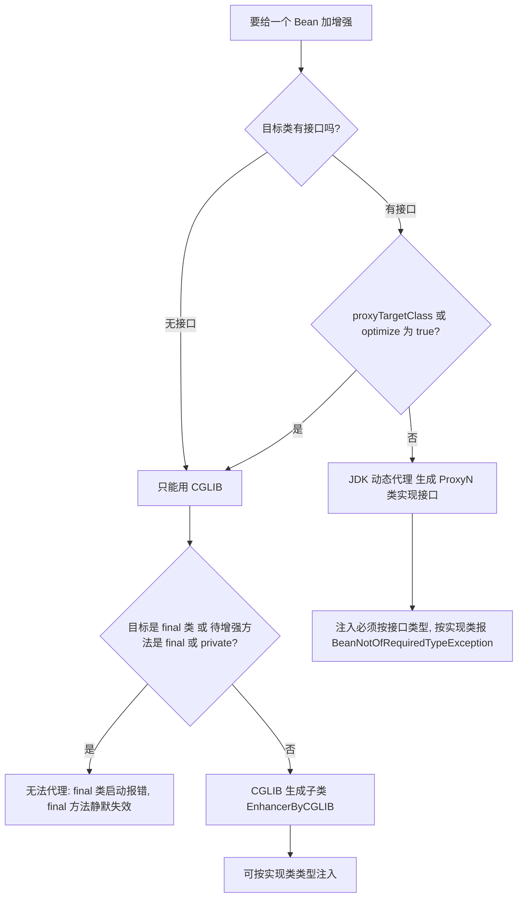

### 8.7 性能：别背"谁更快"的结论

下面这份基准在本机跑了多次，结果稳定，但结论可能会让你意外。测试用的是最简单的调用（`add(int,int)`），拦截器/handler 里只做一次转发：

| 调用方式 | JDK 8（ns/op） | JDK 17（ns/op） |
| --- | --- | --- |
| 虚方法调用（3 种实现，megamorphic，不可内联） | 3.14 | 2.97 |
| 直接调用（单态，被 JIT 完全内联） | 0.24 | 0.24 |
| **JDK 动态代理** | **2.61 ~ 2.71** | **5.98 ~ 6.19** |
| **CGLIB 子类代理** | **6.71 ~ 6.78** | **4.61 ~ 4.80** |
| `MethodHandle`（已绑定） | 1.89 ~ 2.10 | 1.57 |
| `Method.invoke` 反射（`setAccessible(true)`） | 1.95 ~ 1.97 | 4.77 ~ 4.83 |

三个值得注意的结论：

1. **JDK 代理与 CGLIB 的快慢在 JDK 8 与 JDK 17 上是反的**。JDK 8 上 JDK 代理（2.7）比 CGLIB（6.8）快 2.5 倍；JDK 17 上反过来（6.0 vs 4.7）。所以"**CGLIB 一定比 JDK 代理快**"是个错误结论——它高度依赖 JDK 版本、调用点是否单态、以及拦截器里做了多少事。
2. **两者都比一次无法内联的虚方法调用（约 3ns）慢**，但比很多人想象的"反射慢几十倍"要好得多。真正拖慢业务的是**在拦截器里做重活**（查库、拼字符串、`Class.getMethod`、日志格式化），而不是代理本身。
3. `MethodHandle`（已绑定）在两个版本上都是最快的，这也是 JDK 18 用方法句柄重写核心反射（JEP 416）的原因。

**这份基准要怎么用**：上面的数字是"最有利于代理"的场景（拦截器几乎不干活、调用点单态）。真实业务里，代理开销通常不是瓶颈；只有当火焰图上出现 `Proxy$0.xxx` / `EnhancerByCGLIB` 帧时，才值得针对性优化。要得到可信结论必须用 **JMH**（本节是手写循环 + 预热 + 取最优值，只能看量级和相对关系，绝对值不可跨机器引用）。

### 8.8 真实框架里的动态代理（案例盘点）

这是面试最常追问的一段："你项目里哪儿用了动态代理？"

| 框架 / 场景 | 代理的是什么 | 用哪种 | 拦截后做什么 | 代理对象长什么样 |
| --- | --- | --- | --- | --- |
| Spring AOP（`@Transactional`/`@Async`/`@Cacheable`） | 业务 Bean | 有接口→JDK；无接口或 `proxyTargetClass=true`→CGLIB（Spring Boot 2.0+ 默认 CGLIB） | 开启/提交/回滚事务、丢线程池、读写缓存 | `$ProxyN` 或 `Xxx$$EnhancerBySpringCGLIB$$hex` |
| MyBatis `Mapper` 接口 | 没有实现类的 Mapper 接口 | JDK | 把方法名/注解/XML 拼成 SQL，走 `SqlSession` 执行 | `$ProxyN`（`MapperProxy` 在 handler 里） |
| Dubbo / Feign / Retrofit | 远程服务接口 | JDK | 把方法调用翻译成网络请求，做负载均衡与序列化 | `$ProxyN` |
| Hibernate / JPA 懒加载 | 实体类 | CGLIB（或字节码增强） | 访问未加载属性时触发 SQL | `Entity$$EnhancerByCGLIB$$hex`（**不是**实体本身） |
| Mockito 单元测试 | 被 mock 的类/接口 | ByteBuddy 生成（早期用 CGLIB） | 返回预设值、记录调用 | `Xxx$MockitoMock$hex` |
| Spring `@Configuration` | 配置类 | CGLIB | 保证 `@Bean` 方法返回单例（`BeanMethodInterceptor`） | `Config$$EnhancerBySpringCGLIB$$hex` |
| RPC 框架的泛化调用 / 服务端导出 | 服务实现 | JDK/CGLIB | 反序列化入参、反射调用真实实现 | 与业务代理类似 |

一条实用判据：**看到 `$Proxy` 前缀就是 JDK 代理（只能按接口注入），看到 `$$EnhancerByCGLIB$$` / `$$EnhancerBySpringCGLIB$$` 就是 CGLIB（可以按实现类注入）**。

### 8.9 案例：Spring AOP 的代理选择与自调用（实测）

环境：spring-context 5.3.25 + aspectjweaver，JDK 17。一个接口 + 实现类，一个 `@Around` 切面，三种配置：

**① 默认 `@EnableAspectJAutoProxy`（`proxyTargetClass=false`）**

```text
orderService 类型 = $Proxy17
  isAopProxy=true isJdkDynamicProxy=true isCglibProxy=false
noIfaceService 类型 = NoIfaceService$$EnhancerBySpringCGLIB$$d3055a81  isCglibProxy=true
调用 create: （切面日志 before/after 各一次）created:A001
调用 createAndLog（内部 this.create 自调用）: outer(created:A002)   <- 内层没有切面日志
getBean("orderService", OrderServiceImpl.class) 失败 -> BeanNotOfRequiredTypeException
    原文: Bean named 'orderService' is expected to be of type 'OrderServiceImpl' but was actually of type '$Proxy17'
getBean(OrderServiceImpl.class) 失败 -> NoSuchBeanDefinitionException
```

**② `proxyTargetClass = true`（Spring Boot 2.0+ 的默认）**

```text
orderService 类型 = OrderServiceImpl$$EnhancerBySpringCGLIB$$7f13b5e6
  isAopProxy=true isJdkDynamicProxy=false isCglibProxy=true
getBean("orderService", OrderServiceImpl.class) 成功
调用 createAndLog（自调用）: outer(created:A002)   <- 内层依然没有切面日志
```

**③ `@EnableAspectJAutoProxy(exposeProxy = true)` + `AopContext.currentProxy()`**

```text
调用 createViaAopContext:
      [切面] before createViaAopContext
      [切面] before create          <- 内层这次有切面了
      [切面] after  create
      [切面] after  createViaAopContext
```

从这三组输出能一次说清四个高频问题：

1. **有接口走 JDK 代理，无接口自动降级为 CGLIB**（同一个容器里两种代理可以共存，③ 里的 `noIfaceService` 一直是 CGLIB）。
2. **"Bean named X is expected to be of type Y but was actually of type $Proxy17" 的根因就是 JDK 代理不是实现类的子类**。修法：按接口注入、`@EnableAspectJAutoProxy(proxyTargetClass = true)`、或 `AopUtils.getTargetClass()`。
3. **自调用在两种代理下都失效**：`this.create()` 走的是 `invokevirtual` 直接调用本类方法，压根不经过代理对象。三种修法：
   - `AopContext.currentProxy()`（需 `exposeProxy = true`，见 ③）；
   - 把 `create()` 拆到另一个 Bean，用依赖注入调用；
   - 注入自身（`@Autowired private OrderService self;`，注意 Spring 4.3+ 才支持自注入）。
4. **`getBean(Class)` 与 `getBean(String, Class)` 报的异常不同**：前者是 `NoSuchBeanDefinitionException`（按类型找定义时就不匹配），后者是 `BeanNotOfRequiredTypeException`（拿到了 Bean 但类型校验失败）。排查时别被异常类型带偏。

### 8.10 线上排查清单

| 现象 | 根因方向 | 抓手 |
| --- | --- | --- |
| `BeanNotOfRequiredTypeException: ... but was actually of type '$ProxyN'` | JDK 代理不是实现类子类，按实现类注入了 | 改按接口注入，或开 `proxyTargetClass=true`；`AopUtils.isJdkDynamicProxy(bean)` 确认 |
| `ClassCastException: class $Proxy0 cannot be cast to class Xxx` | 同上（JDK 代理转型） | 用 `AopUtils.getTargetClass()` / `AopProxyUtils.getSingletonTarget()` 取真实类型 |
| `@Transactional`/`@Async`/自定义注解"没生效" | ① 自调用 ② 方法非 public ③ 注解在实现类而 AOP 拿到接口方法 ④ 目标类 final / 方法 final | 先打印 `bean.getClass().getName()` 确认有没有代理；再用 `AopUtils.isAopProxy()`、`AopUtils.getMostSpecificMethod()` 排查 |
| Metaspace 持续增长、`jcmd VM.class_hierarchy` 里 `$Proxy` / `$$EnhancerByCGLIB` 类数量一直涨 | 每次请求新建 `ClassLoader` 或反复 `Enhancer.create()`（未复用） | `jcmd <pid> VM.classloader_stats`、`-Xlog:class+load=info`（JDK 9+）/ `-XX:+TraceClassLoading`；确认代理是否被缓存 |
| 代理对象字段是 0/null、构造器里的注册逻辑没执行 | CGLIB + Objenesis 绕过了构造器/初始化块 | 检查是否有无参构造；把初始化逻辑挪到 `@PostConstruct` |
| 切面执行顺序与预期不符 | 多个 Advisor 的 `@Order` / `Ordered` 未定义，或多层代理叠加 | 打印 `bean.getClass()` 看代理层数（Spring 会尽量合并为单个代理，但 `@Async` + `@Transactional` 等组合可能多层）；`AopUtils.getAdvisors` |

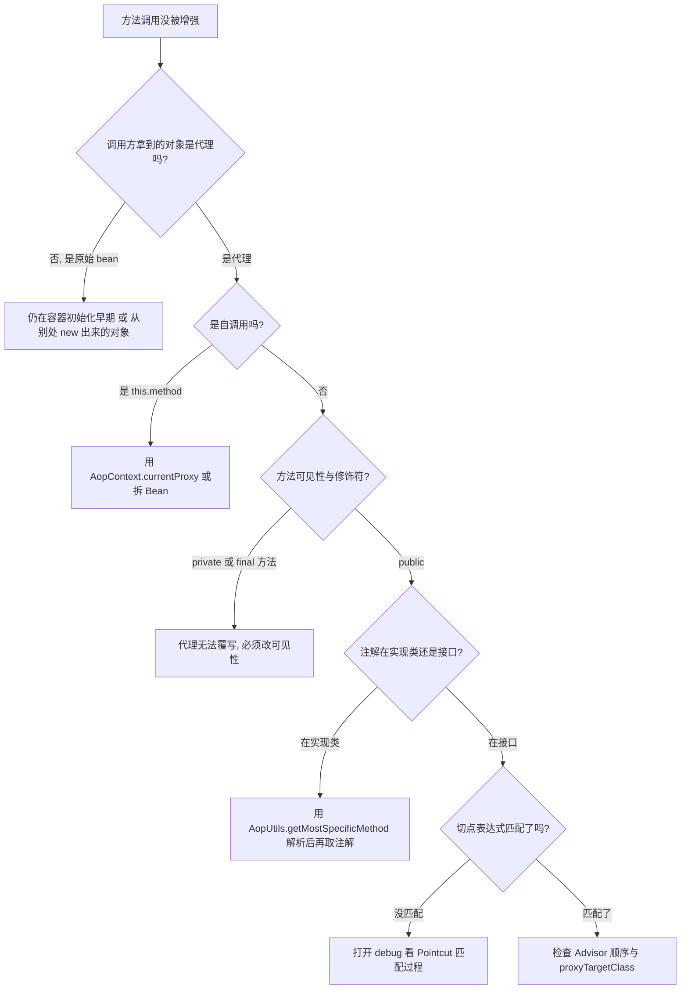

## 九、反射在 Spring / MyBatis 中的应用

### 9.1 Spring 的实例化与依赖注入

Spring 5.3.x 的实例化主链路（对着源码能背下来最好）：

```
AbstractApplicationContext#refresh
  -> finishBeanFactoryInitialization
    -> DefaultListableBeanFactory#preInstantiateSingletons
      -> AbstractBeanFactory#getBean / doGetBean
        -> AbstractAutowireCapableBeanFactory#createBean
          -> doCreateBean
            -> createBeanInstance(beanName, mbd, args)
               -> determineConstructorsFromBeanPostProcessors
                    -> AutowiredAnnotationBeanPostProcessor#determineCandidateConstructors
               -> autowireConstructor(...)      // 有参构造器
                    -> ConstructorResolver#autowireConstructor
                        -> SimpleInstantiationStrategy#instantiate(...)
                            -> BeanUtils#instantiateClass(ctor, args)
                                -> ctor.newInstance(args)   // 最终就是反射
               -> instantiateBean(...)          // 无参构造器
            -> populateBean -> applyPropertyValues / autowireByName / autowireByType
            -> initializeBean -> applyBeanPostProcessorsBeforeInitialization ...
```

几个关键点：

- **`createBeanInstance` 的返回值可能是 CGLIB 子类**。`CglibSubclassingInstantiationStrategy`（`SimpleInstantiationStrategy` 的子类）在遇到 `lookup-method` / `replace-method`（以及对应的 `@Lookup` 注解）时，会用 CGLIB 生成一个子类来覆写这些方法——这是"`@Lookup` 解决单例 Bean 依赖原型 Bean"的底层机制。JDK 9+ 上 Spring 用 `MethodHandles.Lookup` 定义这个子类。
- **构造器选择**：Spring 4.3 起，只有一个构造器时不需要 `@Autowired`；有多个构造器时必须用 `@Autowired` 标注至少一个。`AutowiredAnnotationBeanPostProcessor#determineCandidateConstructors` 内部的 `candidates` 集合不适合做"必需"判定，最终由 `ConstructorResolver` 排序决定。
- **`@Autowired` 的泛型匹配**走 `ResolvableType`：`DefaultListableBeanFactory#doResolveDependency` → `findAutowireCandidates` → `isAutowireCandidate(BeanDefinitionHolder, DependencyDescriptor)` → `GenericTypeAwareAutowireCandidateResolver#checkGenericTypeMatch`。所以下面这种注入是能工作的：

```java
public interface Repository<T, ID> { }
@Component class UserRepository implements Repository<User, Long> { }
@Component class OrderRepository implements Repository<Order, Long> { }

@Component
class Service {
    @Autowired private Repository<User, Long> userRepo; // 按泛型参数精确匹配到 UserRepository
}
```

**这也是一个高频线上问题**：`Repository<User, Long>` 匹配不到时会抛 `NoUniqueBeanDefinitionException` 或 `NoSuchBeanDefinitionException`，排查要打印 `beanFactory.getBeanNamesForType(ResolvableType.forClassWithGenerics(Repository.class, User.class, Long.class))` 看候选。

- **`@Autowired` 注入 `List<T>` / `Map<String, T>` / `T[]`**：由 `resolveMultipleBeans` 处理，`Map` 的 key 是 Bean 名字，`List`/数组按 `@Order`、`Ordered`、`@Priority` 排序。

### 9.2 Spring 为什么不全用反射：ASM 读元数据

`ClassPathScanningCandidateComponentProvider` 扫描 `@Component` 时**不加载类**，而是用 `SimpleMetadataReader` + 内置 ASM（`org.springframework.asm`）直接读 `.class` 文件的常量池与注解，配合 `CachingMetadataReaderFactory` 缓存。

原因：

1. 加载类会触发静态初始化与依赖解析，扫描阶段很容易因为缺少依赖而 `NoClassDefFoundError`。
2. 扫描大量候选类时（大项目动辄数千个类），ASM 只读元数据比完整加载快得多，也省 Metaspace。
3. 避免了"类初始化副作用"在容器未就绪时就发生。

这体现了反射的**分层使用原则**：**元数据读取用 ASM，对象创建与方法调用才用反射**，并且调用结果要缓存。

### 9.3 MyBatis 的 Mapper 接口为什么不用写实现类

核心链路（MyBatis 3.5.x）：

```
SqlSession#getMapper(Class<T>)
  -> Configuration#getMapper
    -> MapperRegistry#getMapper
      -> MapperProxyFactory#newInstance(sqlSession)
        -> Proxy.newProxyInstance(...)   // JDK 动态代理
```

关键类：

| 类 | 作用 |
| --- | --- |
| `org.apache.ibatis.binding.MapperRegistry` | `knownMappers` 保存 `Class` 到 `MapperProxyFactory` 的映射 |
| `org.apache.ibatis.binding.MapperProxyFactory` | 用 `Proxy.newProxyInstance` 生成代理 |
| `org.apache.ibatis.binding.MapperProxy` | 实现 `InvocationHandler`，`cachedInvoker(Method)` 把方法包装成 `MapperMethodInvoker` 并缓存在 `ConcurrentHashMap<Method, MapperMethodInvoker> methodCache` |
| `org.apache.ibatis.binding.MapperMethod` | 解析 `SqlCommand`（statement id + 类型）与 `MethodSignature`（返回值、参数、是否返回多行） |
| `org.apache.ibatis.builder.annotation.MapperAnnotationBuilder` | 解析 `@Select`/`@Update`/`@Results` 等注解，注册 `MappedStatement` |

代理方法体逻辑（简化）：

```java
@Override
public Object invoke(Object proxy, Method method, Object[] args) throws Throwable {
    if (Object.class.equals(method.getDeclaringClass())) {
        return method.invoke(this, args);        // toString/hashCode/equals 走本地
    }
    return cachedInvoker(method).invoke(proxy, method, args, sqlSession);
}
```

`MapperProxy` 对 `Method#isDefault()` 有专门处理（MyBatis 3.4.2+ 的 `MapperMethodInvoker` 体系，3.5.x 用 `DefaultMethodInvoker`），所以**接口默认方法可以直接在 Mapper 里写业务逻辑**。

MyBatis 自己的反射层也值得提：

- `org.apache.ibatis.reflection.Reflector`：解析一个类的所有 getter/setter/字段，缓存 `getMethods`、`setMethods`、`setTypes`、`getTypes`、`caseInsensitivePropertyMap`。
- `ReflectorFactory` / `DefaultReflectorFactory`：`cacheEnabled` **默认 true**，把 `Class` 到 `Reflector` 的映射缓存在 `ConcurrentHashMap` 里。
- `MetaObject` / `MetaClass` / `SystemMetaObject`：在 `Reflector` 之上提供 `getValue("user.name")` 这种嵌套属性访问与 `BeanWrapper`/`MapWrapper`/`CollectionWrapper` 三种策略。
- `TypeHandlerRegistry`：`JdbcType` 与 Java 类型的双向映射，`ResultSetHandler` 通过它把结果集反射写进对象。

**这就是 MyBatis 相对"手写 JDBC + 反射"快得多的原因**：所有 `Method` 对象、属性描述、类型处理器都在初始化阶段解析并缓存，运行期只剩"取缓存 + invoke"。

### 9.4 Jackson 的反射使用

`BeanDeserializerFactory` 在构建 `BeanDeserializer` 时会：
- 用 `AnnotatedClass`/`AnnotatedMethod` 扫描属性；
- 过滤 `isBridge()`/`isSynthetic()` 方法（否则每个泛型属性都会被处理两次）；
- 把 `Method`/`Field`/`Constructor` 包装成 `AnnotatedMember`，运行时通过 `AnnotatedMethod#callOn` 调用；
- Jackson 2.12+ 对 `Method` 调用有优化（`ReflectionUtils` 里 `setAccessible` 的集中处理）。

对泛型的处理就是第 4 节讲过的 `TypeReference` + `TypeFactory` + `JavaType`。

---

## 十、注解、元注解与 APT

### 10.1 元注解与默认值

`java.lang.annotation` 包下的元注解：

| 元注解 | 作用 | 默认值 / 注意事项 |
| --- | --- | --- |
| `@Retention` | 保留到哪个阶段 | **默认 `RetentionPolicy.CLASS`**，即反射看不到 |
| `@Target` | 可标注的位置 | 无默认，不写则可用于任何声明 |
| `@Documented` | 是否进 Javadoc | 无 |
| `@Inherited` | 子类是否继承 | **只对类注解有效，且不适用于接口实现** |
| `@Repeatable` | 是否可重复 | JDK 8+，需同时提供容器注解 |
| `@Native` | 修饰常量字段 | JDK 8+ |

`RetentionPolicy` 三档：

| 值 | 保留到 | 反射可见 | 典型用途 |
| --- | --- | --- | --- |
| `SOURCE` | 编译期丢弃 | 否 | `@Override`、Lombok 的 `@Data`、`@SuppressWarnings` |
| `CLASS` | 保留在 `.class`，但 VM 运行期不保留 | 否 | 默认值；部分字节码增强工具读取 |
| `RUNTIME` | 加载进 JVM | **是** | Spring `@Component`、`@Transactional` |

**这是"注解不生效"类问题的第一嫌疑**：忘了写 `@Retention(RetentionPolicy.RUNTIME)`，运行时 `getAnnotation` 永远返回 `null`。

一个自定义注解的完整写法：

```java
@Target({ElementType.METHOD, ElementType.TYPE})
@Retention(RetentionPolicy.RUNTIME)
@Documented
@Inherited
public @interface RateLimit {
    String key() default "";
    int permits() default 100;      // 注解元素不能为 null，默认值必须是编译期常量
    TimeUnit unit() default TimeUnit.SECONDS;
}
```

注解元素的规则：只能是基本类型、`String`、`Class`、枚举、注解、以及它们的数组；**不能有 `null` 默认值**；不能有参数；不能有 `throws`。

### 10.2 `@Inherited` 的坑

```java
@Inherited @Retention(RUNTIME) @interface Marker { }

@Marker class Parent { }
class Child extends Parent { }

Child.class.getAnnotation(Marker.class);         // 能拿到（@Inherited 生效）
Child.class.getDeclaredAnnotation(Marker.class); // null（不是本类声明的）
```

两条容易错的：

- `@Inherited` **对接口无效**：`interface A` 上的注解不会被实现类继承。
- `@Inherited` **不适用于方法**：父类方法上的注解不会出现在子类覆写方法上。Spring 因此在 `AnnotatedElementUtils#findMergedAnnotation` 里显式沿继承链查找（`searchStrategy` 支持 `TYPE_HIERARCHY`、`TYPE_HIERARCHY_AND_ENCLOSING_CLASSES`）。

### 10.3 运行期读注解的三种 API

| API | 来源 | 能力 |
| --- | --- | --- |
| `Class#getAnnotation` / `getDeclaredAnnotations` | JDK 原生 | 不支持元注解组合、不支持 `@AliasFor`、不支持接口继承的搜索 |
| `AnnotationUtils#findAnnotation` | Spring 3.0+ | 支持元注解、支持沿继承链查找 |
| `AnnotatedElementUtils#findMergedAnnotation` / `getMergedAnnotationAttributes` | Spring 4.2+ | 支持 `@AliasFor` 属性覆盖、支持"注解 + 元注解"合并 |
| `MergedAnnotations` | Spring 5.2+ | 当前推荐 API，`MergedAnnotations.from(element, SearchStrategy.TYPE_HIERARCHY)` |

`@AliasFor`（Spring 4.2+）让组合注解可以覆盖元注解属性，这是 Spring Boot 里 `@SpringBootApplication` = `@SpringBootConfiguration` + `@EnableAutoConfiguration` + `@ComponentScan` 能工作的基础：

```java
@Target(ElementType.TYPE) @Retention(RetentionPolicy.RUNTIME)
@MyComponent
public @interface MyService {
    @AliasFor(annotation = MyComponent.class, attribute = "value")
    String name() default "";
}
```

用 JDK 原生 `getAnnotation(MyComponent.class)` 是拿不到 `MyService` 上的 `name` 的，必须用 `MergedAnnotations`。

### 10.4 重复注解

```java
@Repeatable(Schedules.class)
@Retention(RetentionPolicy.RUNTIME)
public @interface Schedule { String cron(); }

@Retention(RetentionPolicy.RUNTIME)
public @interface Schedules { Schedule[] value(); }   // 容器注解的 value 必须命名为 value，类型是数组

@Schedule(cron = "0 0 1 * * ?")
@Schedule(cron = "0 0 2 * * ?")
public class Job { }
```

运行期两种读取方式：

```java
Schedule[] arr = Job.class.getAnnotationsByType(Schedule.class);     // JDK 8+，推荐
Schedules box = Job.class.getAnnotation(Schedules.class);            // 拿到容器
```

### 10.5 APT：编译期注解处理器

注解处理（Annotation Processing）是 `javac` 的编译期插件机制，API 在 `javax.annotation.processing`（JDK 9 模块化后包名仍是 `javax.annotation.processing`，属于 `java.compiler` 模块）。

```java
@SupportedAnnotationTypes("com.demo.BindView")
@SupportedSourceVersion(SourceVersion.RELEASE_17)
public class BindViewProcessor extends AbstractProcessor {
    @Override
    public boolean process(Set<? extends TypeElement> annotations, RoundEnvironment roundEnv) {
        Filer filer = processingEnv.getFiler();           // 生成源文件或资源
        Messager messager = processingEnv.getMessager();  // 报错/警告
        Elements elements = processingEnv.getElementUtils();
        Types types = processingEnv.getTypeUtils();
        for (Element e : roundEnv.getElementsAnnotatedWith(BindView.class)) {
            // 读注解 -> 生成 $ViewBinding 辅助类源码
        }
        return true; // 表示这些注解已被处理，不再交给其他处理器
    }
}
```

注册方式：在 `META-INF/services/javax.annotation.processing.Processor` 里写处理器全限定名（或用 `@AutoService(Processor.class)` 生成）。`roundEnv.processingOver()` 为 true 时是最后一轮，适合做汇总输出。

关键机制点：

- **多轮处理**：`javac` 会反复调用处理器，直到没有新文件生成。生成的文件会进入下一轮。
- **`RoundEnvironment#getElementsAnnotatedWith`** 返回的是 `Element`，不是 `Class`——**还没加载类，不能 `getClass()`**。要用 `TypeElement`、`VariableElement`、`ExecutableElement`、`AnnotationMirror` 读元数据。
- **不能在处理器里反射目标类**，因为此时它可能还没编译完成。
- **JDK 9+ 模块化**：`AbstractProcessor#getSupportedAnnotationTypes` 会被 `@SupportedAnnotationTypes` 提供，但处理器所在的 jar 需要通过 `--processor-module-path` 或放在 classpath 上。

### 10.6 Lombok 的非常规路线

Lombok 也是"注解处理器"，但它走的是**非公开路径**：通过 `--add-exports`/反射拿 `com.sun.tools.javac` 内部 API，在处理器里直接修改 `javac` 的 AST（`JavacTrees`、`TreeMaker`、`JCTree`），因此能凭空"插入" getter/setter/构造器——而标准 APT 只能在 `Filer` 里生成**新文件**。

代价：

- 强绑定编译器内部实现，每个 JDK 大版本都可能不兼容（JDK 16/17 强封装后必须用新版 Lombok）。
- `--add-opens jdk.compiler/com.sun.tools.javac.*` 之类的参数在部分环境下必须显式配置。
- IDE 需要插件支持。

### 10.7 四种"改代码"手段的对比

| 手段 | 时机 | 能力 | 典型使用者 | 代价 |
| --- | --- | --- | --- | --- |
| 运行期反射 | 运行期 | 读写成员、调用方法 | Spring DI、MyBatis | 性能、编译期不可见 |
| 运行期注解 | 运行期 | 读配置元数据 | Spring `@Transactional` | 需 `RUNTIME` 保留 |
| APT | 编译期 | 生成新源文件/资源 | MapStruct、Dagger、Room | 不能改已有类 |
| 字节码增强 | 编译后 / 类加载 / 运行期 | 改已有字节码 | Lombok、Spring AOP、ASM、ByteBuddy、JVM-Sandbox | 复杂度、JDK 版本适配 |

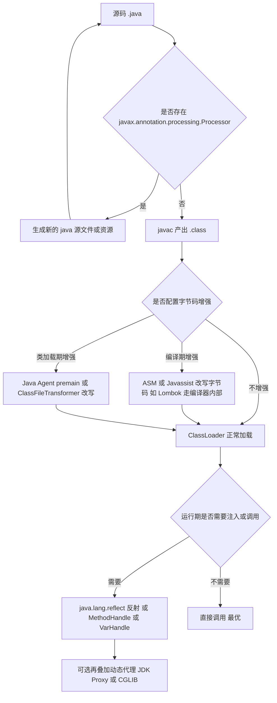

---

## 十一、高级岗三问

### 11.1 为什么这么设计

- **泛型为什么擦除**：二进制兼容优先，代价是运行期类型实参不可见，由此派生出桥接方法、`Signature` 属性、`TypeToken` 这一整套补丁。
- **反射为什么慢**：它不是"慢在查找"，而是慢在**无法内联、参数装箱、访问检查**。inflation 机制、`MethodHandle`、`VarHandle` 分别对应这三层的逐步消除。
- **为什么需要模块化（JDK 9）**：JDK 内部 API 被滥用（`Unsafe`、`sun.misc.*`）导致 JDK 无法演进；用 `--add-opens` 显式授权把"隐性依赖"变成"显式契约"。
- **为什么 JDK 代理和 CGLIB 并存**：接口代理最干净但要求有接口；子类代理能覆盖无接口场景但有 `final` 限制。Spring 的默认值从 JDK 代理切到 CGLIB（Boot 2.0）是为了消除"有没有接口导致行为不一致"这一运维噪声。

### 11.2 线上出问题怎么定位

| 现象 | 定位手段 |
| --- | --- |
| `InaccessibleObjectException` | 看堆栈第一个非 JDK 帧；JDK 9~15 加 `--illegal-access=warn` 打出所有非法访问；升级框架或加 `--add-opens` |
| `ClassCastException` 位置诡异 | 怀疑桥接方法 `checkcast` 或堆污染，检查 `@SafeVarargs` 与 `(T[])` 强转 |
| `Method.invoke` 出现在火焰图顶部 | async-profiler 看调用方；缓存 `Method` + `setAccessible`；改 `MethodHandle` 或接口调用 |
| `@Transactional`/AOP 不生效 | 检查是否为自调用（`this.xxx()`）、方法是否 `private`/`final`、是否为 `final` 类、是否走了 `proxyTargetClass` 之外的路径 |
| `@Autowired` 泛型注入失败 | `getBeanNamesForType(ResolvableType...)` 打印候选；检查 `@Qualifier` 与 `@Primary` |
| 注解读不到 | 检查 `@Retention` 是否 `RUNTIME`、是否被 `@Inherited` 影响、是否该用 `MergedAnnotations` |
| Metaspace 持续增长 | 检查是否有反复生成代理类/accessor 类：`-XX:+TraceClassLoading`、`jcmd VM.class_hierarchy` |

### 11.3 规模变大后会怎样

- **反射热点会随 QPS 线性放大**：单次几微秒的差距，在 1 万 QPS 下就是数十个核的差别。原则是"反射只出现在启动/初始化阶段"。
- **CGLIB 代理类数量随 Bean 数增长**：代理类是一个独立的 `Class`，占用 Metaspace。代理数量上万、且每个类都很大时，Metaspace 会明显上涨，需要评估 `-XX:MaxMetaspaceSize`。
- **`getDeclaredMethods` 无缓存遍历会成为 O(N) 热点**：属性数量多的实体（几百个字段）在序列化/ORM 场景会放大，必须用 `ClassValue`/`Reflector` 这类按类缓存。
- **`GraalVM Native Image` 场景下反射必须在构建期声明**：`reflect-config.json`、`@RegisterReflectionForBinding`、Spring Boot 3 的 `RuntimeHintsRegistrar`。运行期凭空反射的代码在 native image 上会直接失败——这是"反射滥用"在新一代运行时上的最终暴露。

---

## 高频面试题

### Q1. 什么是泛型擦除？为什么 Java 要用擦除？

**答题框架（30 秒版）**：泛型只在编译期做类型检查，字节码里类型实参被丢弃、类型变量被替换为最左边界（无界替换为 `Object`）。选择擦除是为了**二进制兼容**：JDK 5 之前的 `List` 字节码不用改，`List` 与 `List<String>` 链接到同一个类，避免 .class 膨胀和运行期泛型实例化。代价是运行期拿不到实参，于是有了桥接方法和 `Signature` 属性这些补丁。

**展开（2 分钟版）**：

1. 规则：`List<String>` 擦成 `List`；`T extends Number` 擦成 `Number`；`T` 擦成 `Object`。
2. 保留：类/字段/方法签名上的泛型信息保留在 `Signature` 属性里，`getGenericSuperclass`、`Field#getGenericType` 能读到；局部变量上的泛型信息只在 `LocalVariableTypeTable`，反射无公开 API。
3. 替代方案对比：C# 的具化泛型（reified）运行期保留实参、可以 `new T()`，代价是值类型代码膨胀和 CLR 深度支持；C++ 模板是单态化，代价是编译期膨胀与报错晦涩。
4. 迁移约束是关键论据：`invokeinterface java/util/List.add:(Ljava/lang/Object;)Z` 这个描述符在 JDK 5 前后没有变过。

**追问**：`List<String>` 和 `List<Integer>` 是同一个类吗？答：是，`getClass()` 相等；但 `ParameterizedType` 层面上 `equals` 为 false，因为 `ParameterizedTypeImpl` 按结构实现了 `equals`。

### Q2. PECS 原则怎么用？什么时候必须用 `super`？

**答题框架（30 秒版）**：Producer Extends, Consumer Super。参数是数据来源用 `? extends T`，是数据落点用 `? super T`。典型证据是 `Collections.copy(List<? super T> dest, List<? extends T> src)`。必须用 `super` 的场景是"要把 T 写进容器，同时希望接受更宽的类型"，比如 `Comparator<? super T>`——否则子类的比较器实现无法使用。

**展开（2 分钟版）**：

1. `List<? extends Number>` 能 `get` 出 `Number`，但 `add` 除 `null` 外全拒绝，因为编译器不知道实际是 `List<Integer>` 还是 `List<Double>`。
2. `List<? super Integer>` 能 `add(Integer)`，但 `get` 只能得到 `Object`。
3. 判据只有一条：**方法体内对这个参数是"从里面读"还是"往里面写"**。
4. `Comparable<? super T>`、`Comparator<? super T>` 的写法要能解释：如果 `T` 是子类而比较能力定义在父类上，`Comparable<T>` 就不匹配。

**追问**：`List<Object>` 与 `List<?>` 的区别？答：前者可 `add` 任意对象，后者只能 `add(null)`；两者 `get` 都返回 `Object`。`List<?>` 是"我不知道元素类型，我什么都不写"，泛型里推荐用它而不是原始类型 `List`。

### Q3. 桥接方法是什么？什么时候生成？带来什么麻烦？

**答题框架（30 秒版）**：泛型父类擦除后签名变成 `set(Object)`，子类给了实参后只有 `set(String)`，为了让多态仍然成立，`javac` 在子类合成一个 `set(Object)` 桥接方法，内部 `checkcast` 后转调 `set(String)`。标志位是 `ACC_BRIDGE | ACC_SYNTHETIC`。麻烦在于反射遍历方法数量翻倍、注解可能重复、切点匹配重复命中。

**展开（2 分钟版）**：

1. 生成条件：涉及泛型父类/接口的**方法覆写**或**返回类型协变**，且擦除后描述符与父类不一致。
2. 验证方式：`javap -v` 看 `ACC_BRIDGE`；或用 `Method#isBridge()` 打印。
3. 框架里的处理：`ReflectionUtils#getUniqueDeclaredMethods` 会过滤；Jackson 扫描属性时也要过滤，否则属性被注册两次。
4. 相关运行期报错：`ClassCastException: java.lang.Object cannot be cast to ...`、方法引用歧义。

**追问**：`@Override` 的桥接方法上有注解吗？答：`javac` 会部分复制注解，表现为"同一个方法的注解出现两次"，所以框架里读注解要按 `Method` 去重（Spring 用 `BridgeMethodResolver` 找被桥接的真实方法）。

### Q4. 为什么不能 `new T[]` / `new List<String>[10]`？怎么绕？

**答题框架（30 秒版）**：数组是协变的且会做运行期元素类型检查，泛型是不变的且擦除后检查退化到原始类型，两者结合会让非法元素从任意位置进入数组（堆污染），`ClassCastException` 被推迟到很远的地方。绕过手段按推荐度是：用集合代替数组、`Array.newInstance(componentType, n)` 反射创建、`(T[]) new Object[n]` 加强转、`@SafeVarargs`（JDK 7+，JDK 9+ 可用于 private 方法）。

**展开（2 分钟版）**：

1. 完整推导见 3.2 节：`Object[] oa = lsa; oa[1] = li; String s = lsa[1].get(0);`。
2. `@SafeVarargs` 是"我保证不往 varargs 数组里写"的承诺，编译器不再告警，但承诺错了就是静默污染。
3. 需要 `Class<T>` 做 `Array.newInstance` 时，说明这个 API 的设计该改：**传 `Class<T>` 而不是靠泛型反射**。

**追问**：`Arrays.asList` 返回的 List 能 `add` 吗？答：不能，返回的是 `Arrays.ArrayList` 固定长度视图，`add`/`remove` 抛 `UnsupportedOperationException`，只有 `set` 可用。`List.of`（JDK 9+）是完全不可变的。

### Q5. 运行期怎么拿到 `List<User>` 的泛型？为什么局部变量拿不到？

**答题框架（30 秒版）**：泛型信息只保留在**声明处**。`new TypeToken<List<User>>(){}` 造一个匿名子类，通过 `getGenericSuperclass()` 读到 `ParameterizedType`；Gson 用 `TypeToken`，Jackson 用 `TypeReference`，Spring 用 `ParameterizedTypeReference` 和 `ResolvableType`。局部变量只有 `LocalVariableTypeTable`，`java.lang.reflect` 没有公开 API 读它，所以拿不到。

**展开（2 分钟版）**：

1. `Type` 的四个子接口（加 `Class` 共五种形态）与递归分发写法（4.2 节）。
2. `ResolvableType.forMethodReturnType(method, clazz)`、`getGeneric(0)`、`asCollection()`、`resolve()`。
3. 类型实参是变量的场景：`TypeToken.getParameterized(List.class, elementType)`（Gson 2.8.0+）、`TypeFactory.constructCollectionType`、`ResolvableType.forClassWithGenerics`。
4. `new TypeToken<List<T>>(){}` 在泛型方法里拿到的是 `TypeVariable` 而不是具体类型，这是最常见的误用。

**追问**：`ParameterizedType` 能当 `Map` 的 key 吗？答：可以，JDK 的实现类 `ParameterizedTypeImpl` 按结构实现了 `equals`/`hashCode`，`ResolvableType` 内部就用它做缓存 key。

### Q6. `setAccessible(true)` 在 JDK 9/16/17 上的行为有什么变化？

**答题框架（30 秒版）**：JDK 9 引入模块系统后，`setAccessible` 不再只是"关掉语言级检查"，还要通过模块的 open 校验，不通过抛 `InaccessibleObjectException`。JDK 9~15 默认 `--illegal-access=permit`（首次访问打一次警告），JDK 16（JEP 396）默认 deny，JDK 17（JEP 403）彻底强封装并移除该参数。解决要么升级框架，要么 `--add-opens`。

**展开（2 分钟版）**：

1. `setAccessible` 不改变 `Modifier`，`canAccess`/`trySetAccessible` 是 JDK 9+ 推荐 API。
2. `--add-exports` 与 `--add-opens` 的区别：后者才允许深层反射。
3. `MethodHandles.privateLookupIn` 是 JDK 9+ 框架的正规入口，CGLIB 3.3+、ByteBuddy 都改了实现。
4. 老应用上 JDK 17 的放行清单（6.4 节）。

**追问**：能反射修改 `static final` 常量吗？答：不要依赖。JDK 8 时代靠 `Field.modifiers` 的 hack，JDK 12 起该字段被过滤，且编译期常量会被 `javac` 内联到调用方常量池，改了也不生效。

### Q7. 反射到底慢多少？怎么优化？

**答题框架（30 秒版）**：慢在四处——成员查找、访问检查、参数数组与装箱、无法被 JIT 内联。未缓存时比直接调用慢一到两个数量级，缓存 `Method` 并 `setAccessible(true)` 后降到个位数倍数。优化顺序：缓存元数据（`ClassValue`）→ `setAccessible` → 高频点改 `MethodHandle`/`LambdaMetafactory`/字节码生成 → 能改成接口调用就改成接口调用。

**展开（2 分钟版）**：

1. inflation 机制：`sun.reflect.inflationThreshold` 默认 15，超过后生成 `GeneratedMethodAccessorN`。
2. 但生成 accessor 不消除 `Object[]` 和装箱，所以 `MethodHandle.invokeExact` 才是彻底方案。
3. `ClassValue` 相对 `ConcurrentHashMap<Class,?>` 的优势：随类卸载自动清理，避免 ClassLoader 泄漏。
4. 用 JMH 测，不要用 `System.nanoTime()` 手搓循环——JIT 会把循环优化掉。

**追问**：不缓存 `Method` 会让 inflation 重新来过吗？答：不会。`Method.copy()` 的注释写明它的目的就是"让指向同一个 VM 方法的 `Method` 对象共享 `MethodAccessor`"：副本会继承 root 上的 accessor，`setMethodAccessor` 还会把新 accessor 向上传播给 root，所以计数是共享的，不会从零开始。不缓存 `Method` 的真正代价是每次都要在成员数组里按名字和参数类型线性比较、并新建一个 `Method` 副本。

### Q8. JDK 动态代理和 CGLIB 有什么区别？Spring 怎么选？

**答题框架（30 秒版）**：JDK 代理用 `Proxy.newProxyInstance` 生成实现同一组接口的类，必须传接口数组，内部通过 `InvocationHandler` + `Method.invoke` 转发；CGLIB 用 ASM 生成目标类的子类，覆写非 `final` 方法，通过 `MethodInterceptor` + `MethodProxy` 的 FastClass 索引调用，不走反射。Spring 在 `proxyTargetClass=false` 时有接口走 JDK、无接口走 CGLIB；Spring Boot 2.0 起默认 `spring.aop.proxy-target-class=true`，全部走 CGLIB。

**展开（2 分钟版）**：

1. JDK 代理类 `extends Proxy implements 接口`，`final` 类；类名与所在模块是规范未指定的实现细节（JDK 8/11 的 classpath 接口叫 `com.sun.proxy.$Proxy0`，JDK 17 叫 `jdk.proxy1.$Proxy0`），只有存在非 public 接口时才落回接口所在的包（8.2.4 节）。
2. `equals`/`hashCode`/`toString` 也会进 handler，必须处理，否则 `equals`/`hashCode` 会漂移到 target 上（误写成对 `proxy` 调用就变成无限递归 `StackOverflowError`，见 8.3 坑 1、坑 3）。
3. CGLIB 限制：`final` 类、`final` 方法、`private` 方法不能代理；构造器不拦截（`Objenesis`）。
4. 自调用问题：内部 `this.b()` 不走代理，`@Transactional` 失效；解法是 `AopContext.currentProxy()`（需 `exposeProxy=true`）、自注入、拆 Bean。

**追问**：为什么 Boot 2.0 改成默认 CGLIB？答：消除"有没有接口导致代理方式不同、进而 `@Autowired` 按类类型注入失败/行为不一致"的问题——JDK 代理生成的类不实现目标类，无法按目标类类型注入。代价是 `final` 方法不能增强。

### Q9. 【线上排查】升级到 JDK 17 后应用启动报 `InaccessibleObjectException`，你怎么办？

**答题框架（30 秒版）**：先读异常信息定位"谁反射访问了哪个模块的哪个包"，再从堆栈里找出触发方的框架，优先升级该框架，最后才用 `--add-opens` 兜底。这个异常是 JDK 17（JEP 403）彻底强封装后的必然结果，不是 bug。

**展开（2 分钟版）**：

1. 报错样例与三个关键字段：目标成员、所属模块（`java.base`）、访问方模块（`unnamed module`）。
2. 定位：堆栈第一个非 JDK 帧；如果是 Tomcat/Jackson/Lombok/CGLIB/Objenesis，先去查它们的 JDK 17 兼容版本。
3. 兜底：按报错逐个加 `--add-opens`，写成同一行的启动参数；容器环境用 `JAVA_TOOL_OPTIONS`。
4. 注意 `--add-exports` 不解决反射问题，只解决编译/静态引用问题。
5. 回归验证：启动日志里 grep `WARNING: Illegal reflective access`（JDK 9~15）或 `InaccessibleObjectException`，确认清零。

**追问**：如果项目用了 JDK 9~15 想提前发现问题？答：加 `--illegal-access=warn`，所有非法深层反射都会打一行警告，可以在测试环境跑全量用例把问题一次抓出来。

### Q10. 【线上排查】接口 QPS 上来后 CPU 飙升，火焰图顶部是 `Method.invoke`，怎么定位优化？

**答题框架（30 秒版）**：先用 async-profiler 或 JFR 抓火焰图，看反射帧的**调用方**。分三类处理：业务代码反射（缓存 `Method` + `setAccessible`，或改 `MethodHandle`/接口调用）、框架反射热点（检查是否有每次请求重新构建调用链的反模式）、代理类反复生成（`GeneratedMethodAccessor` 序号持续增长说明反射命中的 root `Method` 在增多；`Method` 没被缓存的代价是重复的成员查找与副本分配，而不是重新 inflation——inflation 计数由 root 共享）。

**展开（2 分钟版）**：

1. `./profiler.sh -d 30 -e cpu -f /tmp/flame.html <pid>`，或 `jcmd <pid> JFR.start duration=60s filename=/tmp/rec.jfr`。
2. 判定"是否每次重新查找成员"：看火焰图里 `Class#getDeclaredMethod`、`Class#getDeclaredFields` 是否也占用可观比例——它们是反射热点的典型伴随帧。
3. 修复模式：`ClassValue` 缓存字段数组；初始化阶段预解析并缓存 `Method`；`setAccessible(true)`；把反射调用封装成函数式接口实现。
4. 观察 Metaspace：`jcmd <pid> VM.metaspace`、`-XX:+TraceClassLoading`；accessor 类数量异常多说明反射命中的 root `Method` 在增多（常见于按请求新建代理类这类动态类生成），而“缓存没生效”的信号是火焰图里 `getDeclaredMethod` 占比高（第 2 步）。
5. 压测回归对比，确认火焰图里反射帧下降。

**追问**：为什么加了缓存还是慢？答：缓存只解决了"查找"，没解决"调用"。`Method.invoke` 的参数数组分配与装箱仍在。需要用 `MethodHandle.invokeExact` 或 `LambdaMetafactory` 把调用点变成直接调用（JIT 可内联）。

### Q11. 【场景设计】设计一个支持 `Result<Page<User>>` 嵌套泛型的通用 JSON 反序列化工具。

**答题框架（30 秒版）**：用 `TypeReference`/`ParameterizedTypeReference` 承载最外层泛型，用 `TypeFactory`/`ResolvableType` 编程式构造内层 `JavaType`，缓存 `JavaType` 避免重复解析，对外只暴露 `T read(String json, TypeReference<T> ref)` 与 `T read(String json, Type type)` 两个入口。

**展开（2 分钟版）**：

1. API 设计：字面量场景给 `TypeReference`，动态场景给 `Type`；两者最终都走 `objectMapper.readValue(String, JavaType)`。
2. 递归构造：

```java
JavaType userType = typeFactory.constructType(User.class);
JavaType listType = typeFactory.constructCollectionType(List.class, userType);
JavaType pageType = typeFactory.constructParametricType(Page.class, listType);
JavaType resultType = typeFactory.constructParametricType(Result.class, pageType);
Result<Page<List<User>>> v = objectMapper.readValue(json, resultType);
```

3. 缓存：`ConcurrentHashMap<Type, JavaType>`，key 用 `Type`（`ParameterizedTypeImpl` 已实现结构化 `equals`）。
4. 防御：`TypeReference` 必须是匿名子类直接 `new`，不能来自泛型方法；构造出的 `Type` 要校验 `rawType` 是期望类型，避免 `Map` 被反序列化成 `List`。
5. 失败处理：`JsonProcessingException` 要包装成业务异常并保留原始 `json` 片段（截断到 512 字符）便于定位。
6. 扩展：需要"按泛型选不同反序列化器"时，用 `SimpleModule#addDeserializer` 或自定义 `TypeAdapterFactory`。

**追问**：如果类型参数要在运行期才决定？答：`ResolvableType.forClassWithGenerics(Result.class, pageType)` 或 `TypeFactory.constructParametricType`，不要用 `new TypeReference<...>(){}` 的泛型方法包装。

### Q12. 【场景设计】基于反射和注解实现一个轻量 ORM 映射层，要求 QPS 上万。

**答题框架（30 秒版）**：初始化阶段解析并缓存元数据，运行期只做"缓存查表 + 直接赋值"。类上用 `@Table`，字段上用 `@Column`/`@Id`；用 `Reflector` 式的按类缓存保存 `Field`、`Method`、列名映射；运行期用 `MetaObject` 风格的 setter 调用；超过阈值的场景再降级到字节码生成 accessor。

**展开（2 分钟版）**：

1. 元数据模型：`Class -> TableMeta{ tableName, List<FieldMeta{ column, javaType, jdbcType, Field, setter, getter }> }`。
2. 缓存实现：`ClassValue<TableMeta>` 或 `ConcurrentHashMap<Class<?>, TableMeta>`；字段 `setAccessible(true)` 一次，之后复用。
3. 运行期路径：`ResultSet` 遍历 → `ResultSetMetaData` 拿列名 → 查 `Map<String, FieldMeta>` → `field.set(entity, value)`。`Map` 用 `HashMap` 预容量，避免装箱 key（列名 `String` 直接哈希）。
4. 性能保障：**所有 `getDeclaredField`、`getDeclaredMethod` 都只在初始化跑**；运行期不出现 `Class#getDeclared*`。单次映射目标控制在微秒级。
5. 反例：如果运行期还有 `getDeclaredField("name")`，QPS 上万时 CPU 会被"查找 + 复制数组"吃掉——这正是 `Class#getDeclaredFields` 返回新数组的代价。
6. 进阶：属性多（几百个字段）的实体，反射访问仍然占比明显时，用 `LambdaMetafactory` 把 setter 转成 `BiConsumer`，或按字节码模板生成 accessor 类；MyBatis 的 `Reflector`、Spring 的 `CachedIntrospectionResults` 都是"缓存 + 内省"的组合。

**追问**：`newInstance` 怎么创建实体？答：不要用 `Class#newInstance`（JDK 9 废弃）。用 `clazz.getDeclaredConstructor().newInstance()`；如果是无默认构造器的类，走 `Objenesis`，或者干脆要求实体必须有 public 无参构造器（MyBatis 就是这样要求的）。

### Q13. MyBatis 的 Mapper 接口没有实现类，为什么能调用？

**答题框架（30 秒版）**：`Configuration#getMapper` → `MapperRegistry#getMapper` → `MapperProxyFactory#newInstance` 用 `Proxy.newProxyInstance` 生成 JDK 动态代理，`MapperProxy` 实现 `InvocationHandler`，把方法调用解析成 `MapperMethod` 并缓存到 `methodCache`，最终委托给 `SqlSession`。接口上的 `@Select` 等注解由 `MapperAnnotationBuilder` 在解析阶段注册成 `MappedStatement`。

**展开（2 分钟版）**：

1. 关键类：`MapperRegistry`（`knownMappers`）、`MapperProxyFactory`、`MapperProxy`（`cachedInvoker`）、`MapperMethod`（`SqlCommand` + `MethodSignature`）。
2. `Object` 方法（`toString`/`hashCode`/`equals`）直接本地处理，不走 SQL。
3. 接口 `default` 方法由 `Method#isDefault()` 判定，用 `DefaultMethodInvoker` 走 `MethodHandles` 调用。
4. 返回值形态决定 `MethodSignature`：返回 `List` 调 `selectList`，返回 `Map` 加 `@MapKey` 调 `selectMap`，返回 `Optional`（MyBatis 3.5+）会包一层。

**追问**：为什么 Mapper 接口不能被继承实现类覆盖？答：其实可以，但 JDK 代理只代理接口方法；如果你自己写了实现类并注册为 Bean，MyBatis 的代理就被绕过了。另外 Mapper 接口不能被 CGLIB 代理（Spring 里 Mapper 是接口，`MapperFactoryBean` 返回的就是 JDK 代理对象）。

### Q14. 注解的 `@Retention` 默认值是什么？注解不生效怎么排查？

**答题框架（30 秒版）**：默认是 `RetentionPolicy.CLASS`，也就是写进了 `.class` 但 VM 运行期不保留，**反射读不到**。要反射必须写 `RUNTIME`。排查顺序：`@Retention` 是否 `RUNTIME` → 是不是 `@Inherited` 场景（对接口、对方法无效）→ 是不是组合注解需要用 `MergedAnnotations` 合并 → 是不是被动态代理/桥接方法导致注解读不到。

**展开（2 分钟版）**：

1. 三档保留策略的对照表（10.1 节）。
2. `@Inherited` 的两个不适用场景：接口不被实现类继承、方法不会被覆写方法继承。
3. Spring 场景优先用 `MergedAnnotations.from(element, TYPE_HIERARCHY)` 或 `AnnotatedElementUtils#findMergedAnnotation`，它支持 `@AliasFor` 和元注解搜索。
4. 代理场景下，注解在目标类上但代理类上没有：要用 `AopUtils.getTargetClass(bean)` 或 `AnnotationUtils.findAnnotation(targetClass, X.class)`。
5. 写单测验证：直接 `assertNotNull(Xxx.class.getAnnotation(MyAnno.class))`，比启动整个容器快得多。

**追问**：`@Transactional` 为什么在 `private` 方法上不生效？答：`@Transactional` 依赖 Spring AOP 代理，`private` 方法不能被覆写（CGLIB）也不在接口中（JDK 代理），所以增强代码不会被执行。同理 `final` 方法、`static` 方法、自调用都不生效。

### Q15. APT 和运行期反射有什么区别？Lombok 属于哪一种？

**答题框架（30 秒版）**：APT 是 `javac` 的编译期插件（`javax.annotation.processing.Processor`/`AbstractProcessor`），只能**生成新文件**，不能修改已有类，零运行期开销。运行期反射在运行期读写成员，灵活但有性能代价、错误推迟到运行期。Lombok 严格说也是注解处理器，但它通过 `com.sun.tools.javac` 内部 API 直接改 AST，能往已有类里插方法，属于"越界的 APT"，因此强绑定 JDK 版本。

**展开（2 分钟版）**：

1. `AbstractProcessor` 的核心字段：`processingEnv`（`Filer`、`Messager`、`Elements`、`Types`）。
2. 多轮处理：`RoundEnvironment` 每轮都调用处理器，生成的文件进入下一轮；`processingOver()` 时收尾。
3. 注册：`META-INF/services/javax.annotation.processing.Processor` 或 `@AutoService`。
4. Lombok 的代价：JDK 大版本升级必须同步升级 Lombok；JDK 16/17 强封装后需要新版；某些工具链（部分 IDE 分析器、静态扫描）会误报。
5. 选型建议：能编译期解决的（DTO 映射、Builder、路由表）优先 APT（MapStruct、Dagger）；只有真正运行期才知道的（配置化、插件化、ORM 动态映射）才用反射。

**追问**：APT 能读到注解的属性值吗？答：能，通过 `Element#getAnnotationMirrors()` → `AnnotationMirror#getElementValues()` 读 `ExecutableElement` 与 `AnnotationValue`，注意此时类还没加载，不能 `getClass()`。

### Q16. 【线上排查】生产环境疑似"泛型导致的 `ClassCastException`"，怎么定位？

**答题框架（30 秒版）**：先看异常位置——如果 `ClassCastException` 出现在一个你没有显式强转的地方（比如方法入口、迭代取出元素时），优先怀疑**桥接方法的 `checkcast`** 与**堆污染**。定位手段是 `javap -v` 看桥接方法、检查是否存在 `(T[]) new Object[]` 强转、检查 `@SafeVarargs` 标注的方法是否真的安全。

**展开（2 分钟版）**：

1. 桥接方法的 `checkcast` 失败：调用方通过父类引用传入错误类型，擦除后父类 `set(Object)` 接受一切，桥接方法才检查。堆栈会指向子类的桥接方法（类名与方法名正常，但方法在源码里看不到强转）。
2. 堆污染：`static <T> T[] toArray(List<T> list)` 里写了 `return (T[]) list.toArray()`，调用方把它赋给 `String[]`，此时 `T` 擦成 `Object`，`Object[]` 与 `String[]` 的运行期检查在下游某处才爆。
3. 排查命令：`javap -v -p TargetClass.class | grep -A3 -i bridge`；`-XX:+TraceClassResolution` 观察类型解析。
4. 修复：去掉裸的 `(T[])` 强转，改成显式传 `Class<T>` + `Array.newInstance`，或者返回 `List<T>` 让类型安全由容器保证。

**追问**：为什么异常堆栈的行号指向一个看起来没有问题的地方？答：合成方法（`ACC_SYNTHETIC`）的 `LineNumberTable` 可能映射到源码中的调用点，而不是桥接方法体，因此行号有误导性，要看方法名与调用链。

---

## 易错点与踩坑

| 易错点 | 正确理解 |
| --- | --- |
| "泛型在运行期完全没有了" | 类型实参没了，但声明处的泛型信息保留在 `Signature` 属性里，`getGenericSuperclass`、`Field#getGenericType` 能读到 |
| "`List<?>` 和 `List<Object>` 一样" | 不同：`List<Object>` 可以 `add` 任意对象，`List<?>` 只能 `add(null)` |
| "`instanceof List<String>` 只是警告" | 是**编译错误**；`instanceof List<?>` 合法，等价于 `instanceof List` |
| "`@SafeVarargs` 可以标在任意方法上" | 只能标 `static`、`final`、构造器（JDK 7+）和 `private` 实例方法（JDK 9+） |
| "注解不写 `@Retention` 也能反射读到" | 默认 `RetentionPolicy.CLASS`，反射读不到，必须显式 `RUNTIME` |
| "`@Inherited` 能让接口实现类继承注解" | 不能，`@Inherited` 只对类的继承有效，对接口无效，对方法无效 |
| "`Class#newInstance` 和 `getDeclaredConstructor().newInstance()` 等价" | 语义接近，但前者 JDK 9 起已废弃，会抛出未声明的受检异常 |
| "`getDeclaredFields` 和 `getFields` 只是可见性差异" | 还有继承差异：`getDeclaredXxx` 不含继承，`getXxx` 只含 public（方法还含接口默认方法） |
| "`setAccessible(true)` 之后就一定能访问" | JDK 9+ 还要过模块的 open 校验，否则 `InaccessibleObjectException` |
| "`--add-exports` 能解决 `setAccessible` 失败" | 不能，必须 `--add-opens` |
| "`Method.invoke` 抛出目标方法的异常" | 目标异常被包在 `InvocationTargetException` 里，`getTargetException()` 才是真实异常 |
| "反射慢是因为查找方法慢" | 查找只是其一，主要成本是参数数组、装箱、访问检查和无法内联；缓存后仍要解决后三项 |
| "`getDeclaredMethods` 返回数组可以直接缓存并修改" | 每次调用返回的是新副本，可以缓存但要意识到有复制开销；更要小心顺序不保证 |
| "JDK 代理可以代理任意类" | JDK 代理只能代理接口，生成类 `extends Proxy`；无接口或需要类类型注入时要用 CGLIB |
| "CGLIB 能增强所有方法" | `final` 类、`final` 方法、`private` 方法、`static` 方法都不能增强 |
| "`@Transactional` 加在方法上就一定生效" | 自调用、`private`、`final` 方法、`final` 类都不生效 |
| "Spring 默认用 JDK 动态代理" | Spring Framework 默认 `proxyTargetClass=false`，但 Spring Boot 2.0 起默认 `spring.aop.proxy-target-class=true`，即 CGLIB |
| "反射遍历方法一次就够" | 桥接方法与合成方法会让同一逻辑方法出现两次，必须过滤 `isBridge()/isSynthetic()` |
| "能否用反射改 `static final` 常量" | 不要依赖；JDK 12 起 `Field.modifiers` 的 hack 途径被封，编译期常量还会被 `javac` 内联 |
| "`Class.forName` 和 `ClassLoader.loadClass` 一样" | 前者默认触发类初始化（执行静态块），后者不会 |
| "Lambda 和反射一样慢" | Lambda 走 `invokedynamic` + `LambdaMetafactory`，稳定后接近直接调用，与 `Method.invoke` 不是一个量级 |

---

## 一句话速记

- 泛型是**编译期**的类型系统，擦除后只剩原始类型；类型实参只在**声明处**保留在 `Signature` 属性里。
- 擦除的三条硬规则：类型实参替换为最左边界（无界为 `Object`）、不能 `new T[]`、不能按实参重载。
- PECS：**生产者 extends，消费者 super**，`Collections.copy(List<? super T>, List<? extends T>)` 是标准答案。
- 桥接方法带 `ACC_BRIDGE | ACC_SYNTHETIC`，用 `Method#isBridge()` 过滤，否则框架里方法会被处理两次。
- 堆污染的根源是**数组协变 + 泛型擦除**，`@SafeVarargs` 只是承诺不是保证。
- 运行期拿泛型靠**匿名子类**：`TypeToken`（Gson）、`TypeReference`（Jackson）、`ParameterizedTypeReference` + `ResolvableType`（Spring）。
- `Class.forName` 触发初始化，`ClassLoader.loadClass` 不触发；`Class#newInstance` 在 JDK 9 已废弃。
- `Method.invoke` 的 inflation 阈值是 `sun.reflect.inflationThreshold`，**默认 15**（JDK 17 上仍是这个名字）；`Method` 副本通过 root 共享同一个 `MethodAccessor`，所以不缓存 `Method` 慢在"每次查找 + 复制副本"，不是 inflation 重来。
- 反射四大成本：查找、访问检查、参数数组与装箱、无法内联；对应四招：`ClassValue` 缓存、`setAccessible`、`MethodHandle.invokeExact`、字节码生成。
- `MethodHandle` 用 `Lookup` 表达权限，`VarHandle`（JDK 9，JEP 193）用 `getAcquire`/`setRelease`/`getVolatile` 显式表达内存语义，替代 `Unsafe`。
- 模块化三次收紧：JDK 9 `permit`（JEP 261）→ JDK 16 `deny`（JEP 396）→ JDK 17 彻底强封装（JEP 403）；`setAccessible` 失败要 `--add-opens`。
- JDK 代理靠接口 + `InvocationHandler` + 反射转发；CGLIB 靠 ASM 生成子类 + `MethodInterceptor` + FastClass；`final` 是 CGLIB 的死穴。
- Spring Boot 2.0 起 AOP 默认走 CGLIB，这是与 Spring Framework 默认值最容易混淆的一点。
- MyBatis 的 Mapper 是 JDK 动态代理 + `MapperProxy` + `MapperMethod`，所有方法与 `Reflector` 元数据在初始化阶段解析并缓存。
- 注解默认 `RetentionPolicy.CLASS`，反射要读到必须写 `RUNTIME`；组合注解要用 `MergedAnnotations`/`AnnotatedElementUtils`。
- APT 只能生成新文件，Lombok 靠 `com.sun.tools.javac` 内部 API 改 AST 才能往已有类插方法，因此强绑定 JDK 版本。
- 反射的使用原则：**元数据在初始化阶段解析并缓存，运行期只做查表调用**；核心链路 QPS 上万时，反射不应出现在每次请求的路径上。
