# 04 IO 与 NIO：从一行 read 到 Netty

> 这一章按"**先跑通 → 再懂原理 → 最后选型**"的顺序写，第一次学也能顺着读下来；面试前可以直接跳到第五节（epoll）、第六节（零拷贝）和文末的高频题。
>
> 建议复习 150 分钟：第一、二节动手（约 40 分钟）→ 第三节内核（30 分钟）→ 第四节 NIO 三大件（40 分钟）→ 第五、六、七节（40 分钟）。

## 本章大纲

- [一、先跑起来：从 0 写两个 echo 服务器](#一先跑起来从-0-写两个-echo-服务器)
- [二、BIO 的三条升级路线](#二bio-的三条升级路线)
- [三、一次 read 到底发生了什么](#三一次-read-到底发生了什么)
- [四、NIO 三大组件](#四nio-三大组件)
- [五、内核怎么同时盯一万个连接：select poll epoll](#五内核怎么同时盯一万个连接select-poll-epoll)
- [六、零拷贝](#六零拷贝)
- [七、Netty](#七netty)
- [八、应用场景：什么场景该用什么](#八应用场景什么场景该用什么)
- [九、补充：IO 装饰器与序列化](#九补充io-装饰器与序列化)
- [高级岗三问](#高级岗三问)
- [高频面试题](#高频面试题)
- [易错点与踩坑](#易错点与踩坑)
- [一句话速记](#一句话速记)

## 一、先跑起来：从 0 写两个 echo 服务器

> **这一节不讲原理，只做一件事**：让你亲眼看到 BIO 和 NIO 的差别到底在哪。看完再读后面的原理章节，会顺很多。

### 1.1 需求和第一版：BIO，一个连接一个线程

需求很简单：写一个 echo 服务器——客户端发一行，服务端原样回一行。

用 `java.net` 写出来是这样的：

```java
public class BioEchoServer {
    public static void main(String[] args) throws IOException {
        try (ServerSocket server = new ServerSocket(8080)) {
            System.out.println("listening 8080");
            while (true) {
                Socket socket = server.accept();               // ① 没连接来就一直阻塞
                System.out.println("accept, 线程数=" + threads());
                new Thread(() -> handle(socket)).start();      // ② 一个连接一个线程
            }
        }
    }
    static void handle(Socket socket) {
        try (socket;
             BufferedReader in = new BufferedReader(new InputStreamReader(socket.getInputStream()));
             PrintWriter out = new PrintWriter(socket.getOutputStream(), true)) {
            String line;
            while ((line = in.readLine()) != null) {           // ③ 没数据就一直阻塞
                out.println("echo:" + line);
            }
        } catch (IOException ignored) {
        }
    }
    static int threads() { return ManagementFactory.getThreadMXBean().getThreadCount(); }
}
```

测试（两个终端）：

```bash
javac BioEchoServer.java && java BioEchoServer
# 另一个终端
printf 'hello\n' | nc 127.0.0.1 8080      # 输出 echo:hello
```

功能没问题。问题出在**②和③**这两行：每个连接占一个线程，而这个线程在 `readLine()` 上**99% 的时间在睡觉**。

### 1.2 第一版为什么会崩：实测线程数

用 200 个空闲连接压一下（连接建立后只发一句、然后保持不断开），服务端打印的线程数：

| 连接数 | BIO 服务端线程数 | NIO 服务端线程数 |
| --- | --- | --- |
| 200 | **206** | **7** |
| 1000 | **1006** | **7** |

1000 个连接就是 1000 个线程。按默认 `-Xss=1MB` 算，光线程栈的**虚拟内存**就 1GB；线程一多，CPU 的时间大量花在**上下文切换**上而不是业务上——现象是"QPS 很低但 CPU 不低、`pidstat -w` 的 `cswch/s` 很高"。继续加压就是 `java.lang.OutOfMemoryError: unable to create new native thread`。

根本矛盾：**BIO 的成本是"每连接一个线程"，而连接数会随用户数线性增长。**

### 1.3 第二版：NIO，一个线程管所有连接

同一个需求，换成 NIO：

```java
public class NioEchoServer {
    public static void main(String[] args) throws IOException {
        Selector selector = Selector.open();                       // 多路复用器
        ServerSocketChannel server = ServerSocketChannel.open();
        server.bind(new InetSocketAddress(8080), 1024);
        server.configureBlocking(false);                           // ① 必须非阻塞才能注册
        server.register(selector, SelectionKey.OP_ACCEPT);

        ByteBuffer buf = ByteBuffer.allocateDirect(1024);
        while (true) {
            selector.select();                                     // ② 阻塞在"事件"上，而不是阻塞在某个连接上
            Iterator<SelectionKey> it = selector.selectedKeys().iterator();
            while (it.hasNext()) {
                SelectionKey key = it.next();
                it.remove();                                       // ③ 必须移除，否则下一轮重复处理
                if (!key.isValid()) continue;
                if (key.isAcceptable()) {                          // 有新连接
                    SocketChannel ch = ((ServerSocketChannel) key.channel()).accept();
                    ch.configureBlocking(false);
                    ch.register(selector, SelectionKey.OP_READ);
                } else if (key.isReadable()) {                      // 有数据可读
                    SocketChannel ch = (SocketChannel) key.channel();
                    buf.clear();                                    // ④ 回到写模式
                    int n = ch.read(buf);
                    if (n < 0) { key.cancel(); ch.close(); continue; }  // 对端关闭
                    if (n == 0) continue;                           // 暂时没数据，等下次事件
                    buf.flip();                                     // ⑤ 写模式 -> 读模式
                    ch.write(buf);                                  // 教学版：忽略半包与写不全
                }
            }
        }
    }
}
```

同样的 200 / 1000 个连接，服务端线程数**始终是 7**（主线程 + GC 线程等，与连接数无关）。

两版并排看，差别只有一句话：

| | BIO | NIO |
| --- | --- | --- |
| 阻塞在哪 | **每个连接**的 `read` 上 | **一个 Selector** 的 `select()` 上 |
| 谁在等 | 每个连接各占一个线程等 | 一个线程同时等一批连接 |
| 线程数与连接数 | 1 : 1 | 1 : N |
| 代码复杂度 | 极简 | 需要自己管 key、buffer、半包 |

> `selector.select()` 这一行就是"多路复用"：**一个线程同时盯着成千上万个 fd，哪个有数据就返回哪个**。至于内核里怎么做到"盯着"，是第五章的内容。

### 1.4 本章地图：接下来该读哪一节

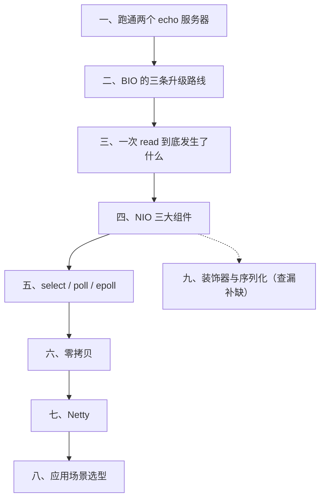

| 你的问题 | 直接看 |
| --- | --- |
| `flip`/`clear` 总搞混、Buffer 读到脏数据 | 四、4.2 |
| `Selector` 的循环怎么写、key 为什么要 remove | 四、4.4 |
| 半包/粘包怎么处理 | 四、4.5 |
| 面试问"epoll 为什么快" | 五、5.1 ~ 5.2 |
| 线上 `CLOSE_WAIT` 上万、`Too many open files` | 三、3.2 + 高频题 Q7 |
| 为什么 Kafka 发消息这么快 | 六、零拷贝 |
| 要手写 RPC / 网关 | 七、Netty + 高频题 Q9 |
| Java 到底有几种 IO 模型 | 三、3.4 |


## 二、BIO 的三条升级路线

### 2.1 升级一：线程池（伪异步）

"伪异步"指的是 `ServerSocket#accept` 后把 `Socket` 丢给线程池，避免一线程一连接：

```java
ServerSocket server = new ServerSocket(8080, 1024); // backlog=1024
ThreadPoolExecutor pool = new ThreadPoolExecutor(
        8, 64, 60L, TimeUnit.SECONDS,
        new LinkedBlockingQueue<>()); // 注意：无界队列
while (true) {
    Socket socket = server.accept();      // 仍然阻塞
    pool.execute(() -> handle(socket));   // 队列无界 -> 压力转成堆内存压力
}
```

它解决了"线程数无限增长"，但没解决三个根本问题：

1. `accept` 是阻塞的，只能一个线程收连接。
2. `LinkedBlockingQueue` 无界，连接堆积时任务对象与 socket 缓冲一起把堆吃满，最终 `OutOfMemoryError`，比直接拒绝连接更糟。正确做法是**有界队列 + `AbortPolicy`/`CallerRunsPolicy` + 快速失败**。
3. 真正的问题是线程模型本身：C10K（1999 年 Dan Kegel 提出，单机 1 万并发连接）要求 **每连接成本与线程无关**，只有事件驱动能做到。C10K 之后还有 C10M，思路是内核旁路（DPDK、XDP）。

生产现象：BIO 服务在连接数上升时表现为 `java.lang.OutOfMemoryError: unable to create new native thread`、`pthread_create failed`、负载不高但 RT 飙高（线程上下文切换），`pidstat -w 1` 的 `cswch/s` 会非常高。

### 2.2 升级二：从"线程复用"到"事件驱动"（C10K 的答案）

线程池解决了"线程无限增长"，但没解决根本矛盾：**线程是"等"的载体**。一个连接没数据时，它占的线程什么都干不了，只能阻塞在 `read` 上。

1999 年 Dan Kegel 提出 **C10K 问题**：单机 1 万并发连接怎么扛？答案不是"加线程"，而是**把"等"这件事交出去**：

- 传统模型：`read(fd1)` 阻塞 → 醒来 → `read(fd2)` 阻塞 → ……，线程被一个个 fd 绑死。
- 事件驱动：把所有 fd 交给内核，问一句"**哪些准备好了**"，只处理返回的那几个——`等待` 由内核一次性完成，线程不再被单个连接占用。

这就是 `Selector` 和 epoll 存在的全部理由。理解这一点，后面所有名词（多路复用、LT/ET、Reactor）都只是它的实现细节。

C10K 之后还有 C10M（千万连接），思路进一步下沉到内核旁路（DPDK、XDP），但对 Java 后端来说，**C10K 就是 Netty 解决的问题域**。

### 2.3 升级三：虚拟线程（JDK 21+），BIO 的"复活"

```java
try (var executor = Executors.newVirtualThreadPerTaskExecutor()) {
    while (true) {
        Socket socket = server.accept();
        executor.submit(() -> handle(socket));   // 每个连接仍是一个"线程"，但只是虚拟线程
    }
}
```

虚拟线程把"线程"从 1MB 的栈变成几 KB 的对象，阻塞时自动让出载体线程（`ForkJoinPool` 的 worker）。于是 **BIO 的代码 + NIO 的并发能力**，这是 JDK 21 之后很现实的一条路。

三个必须知道的边界：

| 项 | 说明 |
| --- | --- |
| 适用 | 连接数几千到几万、每个连接阻塞时间短（数据库查询、RPC 调用） |
| 不适用 | 需要精确控制内存与背压的超大连接数（几十万），仍是 Netty 的主场 |
| 坑 | `synchronized` 块内阻塞会 **pin 住载体线程**（JDK 21~23），JDK 24 的 JEP 491 才解决；用 `ReentrantLock` 替代可以规避 |

> 面试里被问"有了虚拟线程还要 Netty 吗"：**短连接、阻塞式业务代码 → 虚拟线程更省事；长连接、自定义协议、内存敏感 → Netty 仍在**。这不是替代关系，是分工。

## 三、一次 read 到底发生了什么

第一节里 `readLine()` 会"卡住"，第四节里 `Selector` 能"知道谁有数据"。这两件事的答案都在内核里。这一节只讲**最必要的内核知识**，够你理解后面的所有结论即可。

### 3.1 为什么必须懂一点内核：三个现象

如果不懂内核，下面三个现象只能靠背：

1. 为什么 `FileChannel` **不能**注册到 `Selector`？（因为普通文件"永远就绪"，`epoll` 对普通文件直接返回 `EPERM`）
2. 为什么 `BIO` 的线程数是连接的 1:1，而线程大部分时间在睡觉？（因为 `read` 分两阶段，第一阶段在内核里等数据）
3. 为什么 `sendfile` 能少两次拷贝，却**不能**给数据加密？（因为数据不再经过用户态）

答案都指向同一件事：**一次 IO = 两阶段 + 若干次拷贝 + 用户态/内核态切换**。

### 3.2 文件描述符：所有 IO 的账本

Linux 下 socket、文件、管道、epoll 实例都是文件描述符（fd），是**进程级的整数索引**。

| 概念 | 说明 | 查看方式 |
| --- | --- | --- |
| 单进程 fd 上限 | 默认软限制 1024，硬限制可达 1048576 | `ulimit -n`、`cat /proc/<pid>/limits` |
| 系统级 fd 上限 | `fs.file-max`，通常几十万 | `cat /proc/sys/fs/file-max`、`cat /proc/sys/fs/file-nr` |
| 当前已用 fd | 每个 socket、每个打开文件、每个 epoll 实例各占 1 个 | `ls /proc/<pid>/fd` 数条目、`lsof -p <pid>` |
| 线程数也占资源 | 每个线程 1 个栈映射 + 可能的 fd | `ls /proc/<pid>/task` |

几个容易踩的点：

- 一个 `Selector.open()` 就占一个 fd（`epoll_create1`），`Selector` 忘了 `close()` 也是 fd 泄漏。
- classpath 上的 JAR 在 JDK 8 及更早由 `sun.misc.URLClassPath` 缓存的 `JarFile` 持有 fd；微服务依赖上千个 JAR 时，这部分 fd 不可忽略。
- `Too many open files` 是 `IOException`，不是 OOM，但会导致新连接直接被拒。
- 排队连接数由两处决定：内核 `net.core.somaxconn`（Linux 4.x 之前默认 128，5.4 起默认 4096）与 `ServerSocket`/`bind` 的 backlog 参数，取二者较小值。`ss -lnt` 的 `Send-Q` 就是实际生效的 accept 队列长度。

排查命令组合：

```bash
ls /proc/<pid>/fd | wc -l                       # 当前 fd 数
ls -l /proc/<pid>/fd | awk '{print $NF}' | sort | uniq -c | sort -rn | head
ss -s                                            # socket 汇总
ss -tan state close-wait | wc -l                 # CLOSE_WAIT 数量
ss -tan state time-wait | wc -l                  # TIME_WAIT 数量
cat /proc/net/sockstat                           # sockets: used TCP inuse ...
```

### 3.3 用户态与内核态的切换代价

每次 syscall 都要经历：保存用户态上下文 → 切到内核态 → 执行 → 切回用户态。一次 `read` 是 1 次 syscall、2 次模式切换；`read + write` 是 2 次 syscall、4 次模式切换。

切换本身在 x86-64 上是百纳秒级（含 Spectre/Meltdown 缓解后更贵，`KPTI` 使成本上升），但在高 QPS 下会累积成可观的内核态 CPU：

- `vmstat 1`：`sy` 列是内核态 CPU 占比，`cs` 是上下文切换数。
- `pidstat -w -p <pid> 1`：看自愿/非自愿上下文切换。
- `strace -c -f -p <pid>`：统计各 syscall 次数与耗时占比（会显著拖慢进程，只用于诊断）。
- `perf top -p <pid>`：看内核态热函数（常见 `__x64_sys_read`、`tcp_sendmsg`、`copy_user_enhanced_fast_string`）。

**零拷贝的价值就在这里**：不只是省内存带宽，更是省掉整个"用户态缓冲区"往返，把小包高频 IO 的内核态开销压下去。

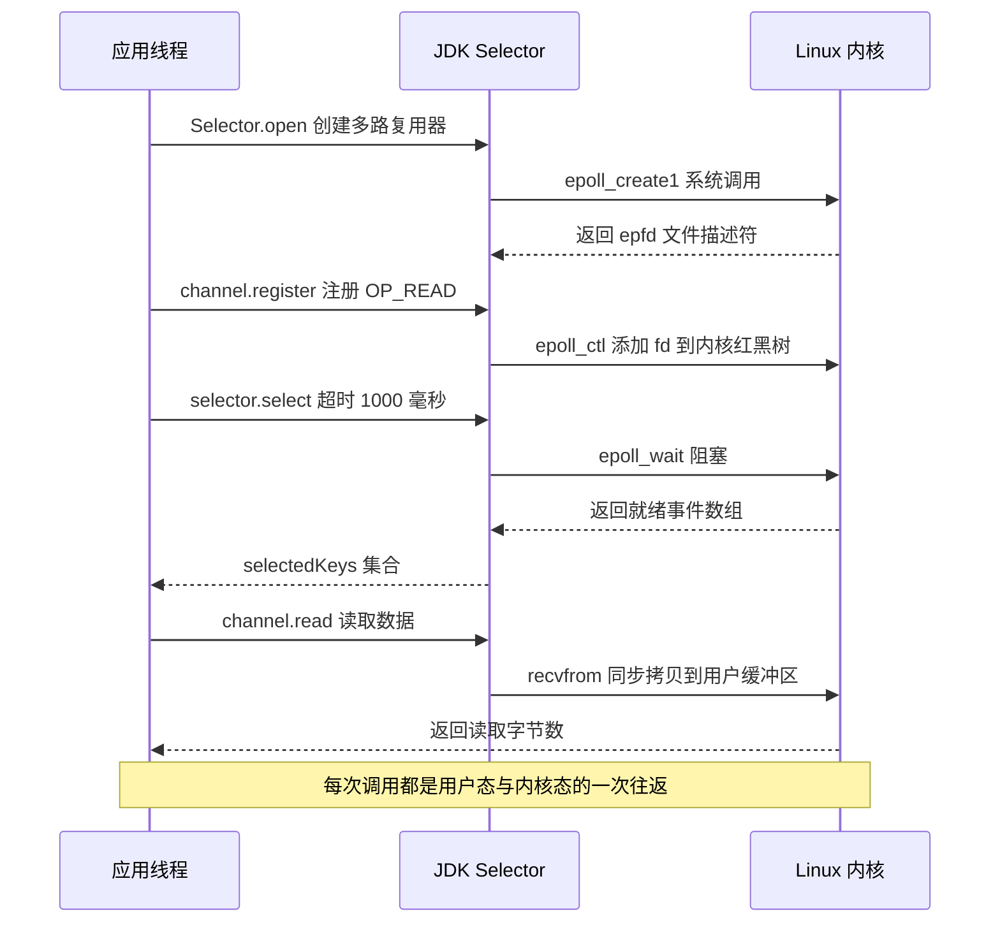

### 3.4 两阶段模型与五种 IO 模型

两阶段是所有 IO 讨论的地基：**第一阶段等待数据到达内核缓冲区，第二阶段把数据从内核缓冲区拷贝到用户缓冲区**。

| 模型 | 第一阶段 | 第二阶段 | 系统调用 | Java 对应 |
| --- | --- | --- | --- | --- |
| 阻塞 IO | 阻塞 | 阻塞 | `recvfrom` | `InputStream#read`、`Socket#getInputStream` |
| 非阻塞 IO | 立即返回 `EAGAIN` | 阻塞 | `recvfrom` 轮询 | `SocketChannel#configureBlocking(false)` |
| IO 多路复用 | `select`/`epoll_wait` 阻塞 | 阻塞 | `select`/`epoll_wait` + `recvfrom` | `Selector` |
| 信号驱动 IO | 立即返回，`SIGIO` 通知 | 阻塞 | `sigaction` + `recvfrom` | Java 无原生支持 |
| 异步 IO | 不阻塞 | 不阻塞（内核完成拷贝后通知） | `io_submit`/`aio_read` | JDK 7 `AsynchronousSocketChannel` |

结论先行：

1. **Java NIO 不是"异步 IO"，它是"同步非阻塞 + 多路复用"**。`Selector` 只是告诉你"哪个 fd 可读"，真正的 `read` 仍由你调用并阻塞在数据拷贝上。
2. 只有第五种是真正的异步 IO。Linux 原生 AIO（`io_submit`）只对 `O_DIRECT` 的文件 IO 有效，对 socket 无效；JDK 的 `AsynchronousSocketChannel` 在 Linux 上是 **epoll + 线程池模拟**（`sun.nio.ch.EPollPort` + `ThreadPool`），并不是内核异步。
3. 所以面试里说"Java AIO 性能比 NIO 好"是错的。AIO 在 Linux 上没有性能优势，工程里几乎不用。


### 3.5 回到 Java：BIO / NIO / AIO 的准确表述

| 维度 | BIO | NIO | AIO |
| --- | --- | --- | --- |
| 编程模型 | 流，`read`/`write` 阻塞 | 缓冲区 + 事件，`Channel`/`Buffer`/`Selector` | 回调 / `Future` |
| 是否阻塞 | 读写均阻塞 | 读写不阻塞，事件等待阻塞 | 全异步 |
| 线程与连接 | 1:1 | M:N（1 个 `Selector` 管 N 个连接） | M:N，回调由线程池执行 |
| 触发方式 | 无 | `select`/`poll`/`epoll` | 完成端口 / epoll 模拟 |
| 核心 API | `InputStream`/`OutputStream` | `SocketChannel`/`ByteBuffer`/`Selector` | `AsynchronousSocketChannel` |
| Linux 实现 | `read`/`write` syscall | `epoll` + LT | `EPollPort` + 线程池 |
| 吞吐（连接多、报文小） | 差（线程切换成本高） | 好 | 与 NIO 持平甚至更差 |
| 吞吐（连接少、数据大） | 好（代码最简单） | 一般 | 一般 |
| 典型场景 | 内网低并发、管理接口、批处理 | 网关、RPC、MQ、IM | 少量长连接 + 大文件，生态少 |
| 主要风险 | 线程耗尽、栈内存耗尽 | 编程复杂、空轮询、直接内存泄漏 | 平台差异、调试困难 |

选择建议：

- 连接数 < 几百且交互简单：**BIO 更划算**，别为了炫技上 Netty。
- 连接数上千、长连接、消息型：**NIO / Netty**。
- 团队没有 Netty 经验、Java 21 可用：**虚拟线程 + BIO** 是 2024 年后非常现实的一条路。

### 3.6 版本与实现地图（查表用）

> 这张表是**查表用**的，第一次读只需要记住三件事：JDK 1.4 有了 NIO、JDK 7 有了 AIO 和 Linux 上默认 epoll、JDK 21 有了虚拟线程。

| 时间点 | 事件 | 影响 |
| --- | --- | --- |
| JDK 1.0 | `java.io` 包，`InputStream`/`OutputStream`/`Reader`/`Writer` | 阻塞式、流式、装饰器模式 |
| JDK 1.4 (2002) | JSR 51 引入 `java.nio`，`Channel`/`Buffer`/`Selector` | 非阻塞 IO、多路复用，Linux 底层 `poll` |
| JDK 6 及更早 | Linux 上 `Selector` 基于 `poll` | `sun.nio.ch.PollSelectorImpl`，fd 多时性能差 |
| JDK 7 (2011) | JSR 203 `java.nio.file`，`AsynchronousChannel`/`Files`/`Path`/`WatchService`；Linux 上 `SelectorProvider` 默认切到 epoll | AIO、文件属性、目录监听（Linux inotify）、多路复用性能台阶 |
| JDK 8 | `AsynchronousFileChannel` 常用于大文件；`sun.misc.Unsafe` 仍可释放直接内存 | `-XX:MaxDirectMemorySize` 语义成熟 |
| JDK 9 (2017) | `ByteBuffer`/`CharBuffer` 等**子类**为 `flip`/`clear`/`rewind`/`position`/`limit` 增加返回子类型的覆盖方法（`Buffer` 上的同名方法同时去掉 `final`） | `ByteBuffer b = buf.flip()` 可链式调用，不再需要强转；注意 `Buffer` 自带的这些方法返回的仍是 `Buffer` |
| JDK 9 | `InputStream#readAllBytes`/`readNBytes`/`transferTo` | 小文件一次读完、流对拷不再需要第三方 `IOUtils` |
| JDK 9 | `jdk.internal.ref.Cleaner` 取代 `sun.misc.Cleaner`；`Unsafe.invokeCleaner` 公开 | 直接内存释放方式变化，旧反射代码失效 |
| JDK 9 | JEP 290 序列化过滤（backport 到 8u121） | `ObjectInputFilter`、`jdk.serialFilter` |
| JDK 16 起 | JEP 396 默认强封装 JDK 内部 API | 反射替换 `selectedKeys` 一类的优化受限，老版本 Netty 升级要验证 |
| JDK 21 | JEP 444 虚拟线程正式 | `Executors.newVirtualThreadPerTaskExecutor()`，BIO 模型重新可用 |
| JDK 24 | JEP 491 移除 `synchronized` 对虚拟线程的 pinning | 需 JDK 24 才彻底解决载体线程被占用 |

## 四、NIO 三大组件

### 4.1 Channel

| 实现类 | 是否可非阻塞 | 可否注册 Selector | 关键方法 |
| --- | --- | --- | --- |
| `FileChannel` | 否（`configureBlocking` 不存在） | 否（不是 `SelectableChannel`） | `read`/`write`/`transferTo`/`transferFrom`/`map`/`force`/`lock` |
| `SocketChannel` | 是 | 是（`OP_READ`/`OP_WRITE`/`OP_CONNECT`） | `read`/`write`/`connect`/`finishConnect`/`shutdownOutput` |
| `ServerSocketChannel` | 是 | 是（`OP_ACCEPT`） | `bind`/`accept` |
| `DatagramChannel` | 是 | 是（`OP_READ`） | `send`/`receive` |
| `AsynchronousSocketChannel` | 异步 | 否 | `read(ByteBuffer, A, CompletionHandler)` |

必须记住的一条：**文件 IO 在 Linux 上无法用 `select`/`epoll` 做"非阻塞"**。普通文件永远"就绪"（`epoll` 对普通文件返回 `EPERM`），所以 `FileChannel` 不在 `SelectableChannel` 体系里。想异步读文件只能用 `AsynchronousFileChannel`（底层是线程池），或者依赖 page cache 让 `read` 足够快。

标准读循环（判断退出条件的正确写法）：

```java
SocketChannel ch = SocketChannel.open();
ch.configureBlocking(false);
ch.connect(new InetSocketAddress("127.0.0.1", 8080));

ByteBuffer buf = ByteBuffer.allocateDirect(16 * 1024);
while (true) {
    int n = ch.read(buf);       // 可能返回 0 大于 0 或 -1
    if (n > 0) {
        buf.flip();             // 切到读模式
        while (buf.hasRemaining()) {
            handle(buf.get());
        }
        buf.clear();            // 切回写模式
    } else if (n == 0) {
        // 非阻塞下无数据，交给 Selector 唤醒，不要忙等
        break;
    } else {
        ch.close();             // -1 表示对端关闭
        break;
    }
}
```

### 4.2 Buffer 与 ByteBuffer 的四个索引

`Buffer` 的四个状态变量与不变式：`0 <= mark <= position <= limit <= capacity`。

| 方法 | position | limit | mark | 语义 |
| --- | --- | --- | --- | --- |
| `flip()` | 0 | 原 position | 丢弃 | 写模式切读模式 |
| `clear()` | 0 | capacity | 丢弃 | 读模式切写模式，**不擦数据** |
| `compact()` | `remaining()` | capacity | 丢弃 | 保留未读数据并前移，继续写 |
| `rewind()` | 0 | 不变 | 丢弃 | 重读一遍 |
| `mark()` | 不变 | 不变 | position | 打标记 |
| `reset()` | mark | 不变 | 不变 | 回到标记 |

`remaining() = limit - position`，`hasRemaining() = position < limit`。

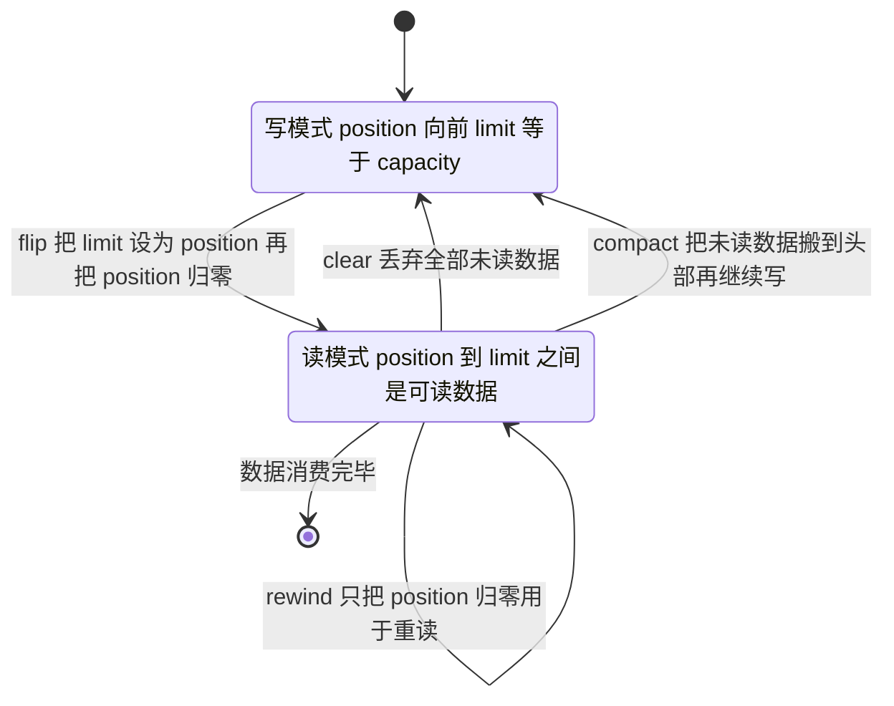

一段真实的状态走查（`ByteBuffer.allocate(10)`，每步打印四个数字，JDK 17 实测）：

```java
ByteBuffer b = ByteBuffer.allocate(10);
b.put("abc".getBytes());   // 写 3 字节
b.flip();                  // 切读模式
b.get(); b.get();          // 读 2 字节
b.compact();               // 保留未读的 1 字节，回到写模式
b.put("de".getBytes());
b.flip();
```

```text
allocate(10)                     position=0 limit=10 capacity=10 remaining=10
put("abc") 写 3 字节              position=3 limit=10 capacity=10 remaining=7
flip() 切读模式                    position=0 limit=3  capacity=10 remaining=3
get() 两次，读了 2 字节             position=2 limit=3  capacity=10 remaining=1
compact() 保留未读并回到写模式       position=1 limit=10 capacity=10 remaining=9
再 put("de")                     position=3 limit=10 capacity=10 remaining=7
flip() 再读                       position=0 limit=3  capacity=10 remaining=3
读出的内容 = cde                  ← compact 之后那个没读的 'c' 被搬到开头了
```

三句话记住这张表：**`flip` 是"把写到的位置变成读的上限"**（所以 `limit=3`、`position=0`）；**`compact` 是"把没读完的搬到开头，再接着写"**（所以 `position=1`，`c` 保住了）；**`clear` 干脆什么都不搬**，直接把 `position=0`、`limit=capacity`，旧数据还躺在数组里，只是被当作"无效区"。

四个高频踩坑：

1. **`flip` 写成了 `clear`**：写完立刻 `clear()`，`position` 归零、`limit=capacity`，读出来的是一堆 0 字节或上次残留的数据。
2. **`clear()` 不等于清空内容**：它只重置指针。旧数据仍在数组里，靠 `limit` 界定有效范围。用 `buffer.array()` 直接当"数据"用是典型的越界读取。
3. **`compact()` 用错方向**：`compact` 是把"未读部分"搬到头部，用于"数据没读完又来了新数据"的追加写场景。读完了就该用 `clear()`。
4. **`ByteBuffer#equals`/`hashCode` 只比较 `position..limit` 之间的剩余内容**，且 `heap` 与 `direct` 的 `ByteBuffer` 不相等。把 `ByteBuffer` 当 Map 的 key 一定出问题。

补充 API 语义：

- `slice()`：从当前 position 到 limit 切一段**共享底层内存**的视图（新 buffer 的 position 归零、limit 等于剩余量，改一处另一处可见），但 position/limit/mark 各自独立——`java.nio` 的 `ByteBuffer` 没有引用计数，别和 Netty `ByteBuf` 的 `retain()` 混在一起。
- `duplicate()`：复制索引状态，共享内容。
- `asReadOnlyBuffer()`：只读视图。
- `order(ByteOrder)`：字节序，网络协议固定用 `ByteOrder.BIG_ENDIAN`（大端）。
- `ByteBuffer.allocate(cap)` 默认初始 position=0、limit=capacity；`ByteBuffer.allocateDirect(cap)` 同理。

### 4.3 堆内内存 vs 直接内存

| 维度 | `HeapByteBuffer` | `DirectByteBuffer` |
| --- | --- | --- |
| 分配位置 | JVM 堆（受 `-Xmx` 约束） | 堆外（受 `-XX:MaxDirectMemorySize` 约束） |
| 分配成本 | 低，走 TLAB | 高，`Unsafe.allocateMemory` + `Cleaner` 注册 + `Bits` 记账 |
| 回收 | 由 GC 自动完成 | 堆内对象不可达后由 `Cleaner` 释放，存在延迟 |
| 做 IO 是否额外拷贝 | 是，`FileChannelImpl#read` 会先 `Util.getTemporaryDirectBuffer` 再回填 | 否，直接传给 syscall |
| 适用 | 少量、短生命周期、纯计算 | 长生命周期缓冲、Socket IO、Netty |
| 典型异常 | `OutOfMemoryError: Java heap space` | `OutOfMemoryError: Direct buffer memory` |

关键数字与机制：

- `-XX:MaxDirectMemorySize` 默认为 0，含义是"不单独限制，等同于 `Runtime.getRuntime().maxMemory()`"，即最多可占用与 `-Xmx` 相当的堆外内存。所以**大堆 + 大量 Netty 直接内存的进程，实际 RSS 可能是 `Xmx` 的两倍**，容器里极易被 OOMKilled。
- JDK 8 的 `DirectByteBuffer` 构造器里 `Bits.reserveMemory(size, cap)` 记账，超限时先 `System.gc()` 并短暂重试，仍不足才抛 `OutOfMemoryError: Direct buffer memory`。如果启动了 `-XX:+DisableExplicitGC`，这条自救路径被切断，压力会直接变成硬 OOM。
- JDK 9 起释放由 `jdk.internal.ref.Cleaner` 完成（`DirectByteBuffer` 构造器里是 `Cleaner.create(this, new Deallocator(...))`，`CleanerFactory.cleaner()` 是 `FileChannelImpl`、`ZipFile` 等内部类在用的形式）；手动释放走 `sun.misc.Unsafe#invokeCleaner(ByteBuffer)`（JDK 9+ 公开该 API）；JDK 8 只能反射 `sun.misc.Cleaner`，而该类在 JDK 9 已被移除，所以升级后是**运行时**才失败（类不存在，或深反射被模块系统拒绝时抛 `InaccessibleObjectException`），不会是编译期报错。
- 观测手段：`ManagementFactory.getPlatformMXBeans(BufferPoolMXBean.class)` 对应 JMX 的 `java.nio:type=BufferPool,name=direct`，可拿到 `getCount()`、`getMemoryUsed()`、`getTotalCapacity()`；NMT（`-XX:NativeMemoryTracking=detail` + `jcmd <pid> VM.native_memory summary`）用于核对堆外内存总量是否与直接内存账目吻合。

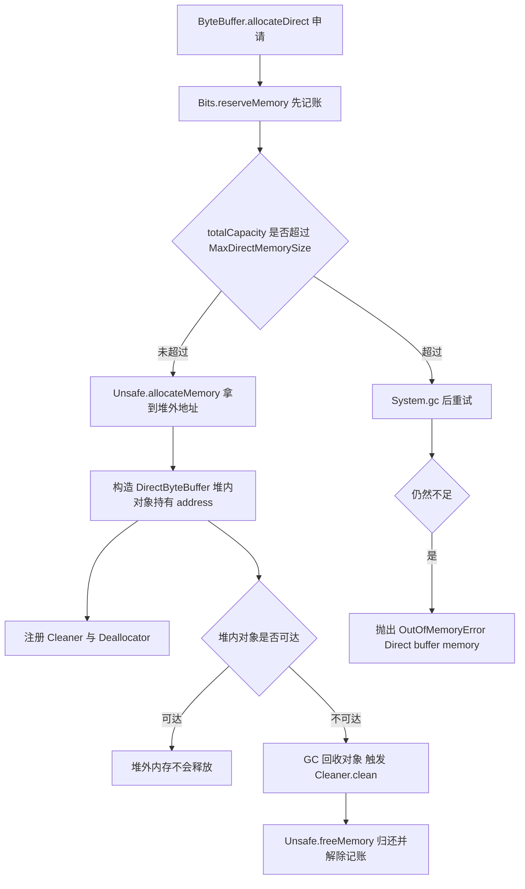

### 4.4 Selector

核心 API 与语义：

| 项 | 值 / 说明 |
| --- | --- |
| `SelectionKey.OP_READ` | 1 |
| `SelectionKey.OP_WRITE` | 4 |
| `SelectionKey.OP_CONNECT` | 8 |
| `SelectionKey.OP_ACCEPT` | 16 |
| `interestOps()` | 关心的操作集（自己维护） |
| `readyOps()` | 就绪的操作集（内核置位） |
| `attachment()` | 绑定业务对象（会话、连接上下文） |
| `selector.selectedKeys()` | 返回**内部集合的直接引用**，不是副本 |
| `select()` / `selectNow()` / `select(timeout)` | 阻塞 / 立即返回 / 超时 |
| `wakeup()` | 唤醒阻塞中的 select |
| `keys()` | 全部注册的 key，包含已取消的 |

必背规则：

1. **`selectedKeys()` 迭代时必须 `iterator.remove()`**，否则该 key 会**一直留在集合里**（Javadoc 明确：除了显式 `remove`，selection 操作不会清理 selected-key set），下一轮被当成就绪 key 重复处理；严重时集合只增不减，业务逻辑空转。
2. **`OP_WRITE` 不要长期注册**。socket 发送缓冲区有空间时 `OP_WRITE` 恒为就绪，`select` 会立刻返回，线程 100% 空转。正确做法：写不出去时注册 `OP_WRITE`，写完立刻取消。
3. **`key.cancel()` 只是标记**，真正的注销发生在下一次 `select()`，所以要保证 `select` 会被调用（用 `wakeup()`）。
4. 通道被关闭、key 失效后调用 `key.interestOps()` 会抛 `CancelledKeyException`，处理事件前先 `key.isValid()`。
5. 一个 `Selector` 注册的 `Channel` 必须来自同一个 `SelectorProvider`，否则 `register` 抛 `IllegalSelectorException`。
6. `Selector` 本身不是线程安全的。多个线程共享一个 `Selector` 时，`register` 与 `select` 并发需要自己加锁或通过队列交给 `EventLoop` 线程。

### 4.5 实战：把 echo 改成"能处理半包"的版本

第一节的 NIO echo 有个隐含 bug：它假设"一次 `read` 就是一条完整消息"。真实网络里 TCP 是**字节流，没有消息边界**，一次 `read` 可能读到半条、也可能读到三条。直接用 `buf.get()` 当字符串解析，必然出现"数据错位/截断"。

标准解法是**长度字段 + 累积缓冲区**：

```java
class LengthFrameDecoder {
    private ByteBuffer acc = ByteBuffer.allocate(64);           // 累积缓冲区
    final List<String> frames = new ArrayList<>();

    void feed(byte[] chunk) {
        if (acc.remaining() < chunk.length) acc = grow(acc, chunk.length);
        acc.put(chunk);                                          // ① 追加到累积缓冲区
        acc.flip();                                              // ② 切读模式
        while (acc.remaining() >= 4) {                           // ③ 至少够读长度字段
            acc.mark();
            int len = acc.getInt();
            if (acc.remaining() < len) { acc.reset(); break; }    // ④ 不够一帧 -> 回退，等下次
            byte[] body = new byte[len];
            acc.get(body);
            frames.add(new String(body, StandardCharsets.UTF_8));
        }
        acc.compact();                                           // ⑤ 没读完的搬到头部，继续写
    }
    static ByteBuffer grow(ByteBuffer b, int add) {
        if (b.remaining() >= add) return b;
        ByteBuffer n = ByteBuffer.allocate(Math.max(b.capacity() * 2, b.position() + add));
        b.flip(); n.put(b); return n;
    }
}
```

把两条消息（"hello"、"world!"）拼起来，再故意切成"2 字节 / 10 字节 / 剩余"三段喂进去，实测输出：

```text
喂入 2 字节后，已解出 = []            ← 长度字段都没凑齐，一个字都不消费
喂入到 12 字节后，已解出 = [hello]     ← 第一帧完整，第二帧只到了一半
全部喂完后，已解出 = [hello, world!]
```

三行输出对应三个关键心法：

1. **`mark()` / `reset()`**：解析失败要能"退货"，把 position 退回包头，等下一批数据。
2. **`compact()`**：把没消费完的字节搬到缓冲区头部（第一节 Buffer 那一节的 `compact` 就是为这个场景设计的）。
3. **必须循环 `while`**：一次 `read` 可能带来多帧，不循环就会"漏处理"，表现为"消息延迟到下一次请求才被处理"。

> 生产上不需要自己写这段。Netty 的 `LengthFieldBasedFrameDecoder` 就是它的工业级版本（多了最大帧长保护、粘包合并、半包标记位），7.5 节会讲它的五个参数。

## 五、内核怎么同时盯一万个连接：select / poll / epoll

先把这三者想成一家餐厅的服务员：

- **select / poll**：服务员**挨个桌子问**"要加菜吗"。桌子越多，问一圈越慢——而且每问一轮都要把"所有桌号"重新抄一遍交给后厨（每次调用全量拷贝 fd 集合）。
- **epoll**：每桌装一个**呼叫铃**，客人按铃（数据到达）服务员才知道，而且只处理**响铃的桌**。桌数再多，服务员的工作量只跟"这一轮有几桌按铃"有关。

这个类比的三个关键词，正好对应 epoll 的三个设计：**红黑树**（记住哪些桌装了铃）、**就绪链表**（这一轮响铃的桌）、**回调**（按铃的动作）。

### 5.1 三者差异

| 维度 | select | poll | epoll |
| --- | --- | --- | --- |
| 数据结构 | `fd_set` 位图 | `struct pollfd` 数组 | 红黑树 + 就绪链表（`eventpoll`） |
| 单进程 fd 上限 | `FD_SETSIZE`，Linux 上 1024 | 无硬上限，受 `ulimit -n` 限制 | 无硬上限，受 `ulimit -n` 限制 |
| 每次调用是否传 fd 集合 | 是，全量拷贝进内核 | 是，全量拷贝进内核 | 否，`epoll_ctl` 时维护一次 |
| 内核复杂度 | `O(n)` 轮询 | `O(n)` 轮询 | 回调 `O(1)`，`epoll_wait` `O(就绪数)` |
| 返回后定位就绪 fd | 遍历全部，`O(n)` | 遍历全部，`O(n)` | 直接遍历就绪链表 |
| 是否要重置参数 | 是（`fd_set` 是值-结果参数） | `revents` 由内核置位，需自行清零 | 否 |
| 触发模式 | 只有 LT | 只有 LT | LT + ET |
| 内核版本 | 很早 | 2.1.23 | 2.5.44 起 |
| 典型使用 | 老代码、跨平台 | 少量 fd 的跨平台场景 | Nginx、Redis、Netty、Tomcat NIO |

关键差异一句话：**select/poll 的瓶颈是"每次调用都要把 fd 集合拷进内核并线性扫描"，epoll 把这两件事都消掉了**。

### 5.2 epoll 的内核结构

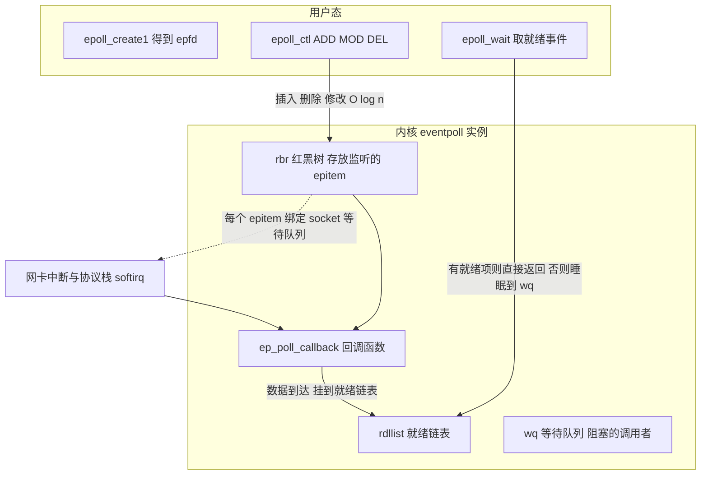

要点：

1. `epoll_create1` 创建 `eventpoll` 对象，内含红黑树 `rbr` 与就绪链表 `rdllist`。红黑树解决的是"海量 fd 的增删改查"，不是"查找就绪"。
2. 注册时在 socket 的等待队列上挂 `ep_poll_callback`。数据到达触发协议栈 `softirq`，回调把 `epitem` 挂到 `rdllist`，因此**就绪发现是事件驱动的，不需要轮询**。
3. `epoll_wait` 检查 `rdllist`：非空则直接返回并拷贝就绪事件到用户数组；为空则把当前线程挂到 `wq` 睡眠，被回调唤醒。
4. 所以 epoll 的复杂度是 `O(活跃 fd)`，而 select/poll 是 `O(监听 fd)`。10 万连接里只有 100 个活跃时，差距是千倍级。

### 5.3 LT 与 ET

| 维度 | 水平触发 LT（默认） | 边缘触发 ET（`EPOLLET`） |
| --- | --- | --- |
| 通知条件 | 只要缓冲区还有数据，每次 `epoll_wait` 都通知 | 只在状态变化时通知一次 |
| fd 是否必须非阻塞 | 不强制 | **必须非阻塞**，否则最后一次 `read` 会永久阻塞 |
| 读取要求 | 读一次也行，下次还会通知 | 必须循环 `read` 直到 `EAGAIN` |
| `accept` 要求 | 一次 accept 一个也行 | 必须循环 accept 直到 `EAGAIN`，否则丢连接 |
| 编程复杂度 | 低 | 高，任何一处偷懒都会导致连接假死 |
| 事件次数 | 多，`epoll_wait` 返回次数多 | 少，减少 syscall 次数 |
| 适用 | JDK NIO、Netty 默认（`EpollMode.LEVEL_TRIGGERED`） | Nginx、追求极致 syscall 数的场景 |

**LT 的内核实现（"水平触发"到底怎么做到反复通知）**：

1. `epoll_wait` 进入内核后调用 `ep_poll`，把 `rdllist` 上的就绪 `epitem` 通过 `ep_send_events` 拷贝到用户态事件数组。
2. 拷贝时按触发模式分支：**ET 模式的 `epitem` 处理完就被移出 `rdllist`，不再检查**；**LT 模式的 `epitem` 会被再次调用 `ep_item_poll` 检查底层 fd 当前是否仍然就绪**。
3. 如果仍然就绪（比如接收缓冲区里还有没读完的数据），就把它重新挂回 `rdllist` 尾部，于是下一次 `epoll_wait` 依然会返回它——这就是"水平"二字的来源：只要处在"可读水位"之上，就一直报。
4. 推论：LT 下**忘记读或只读一半不会丢事件**，代价是 `epoll_wait` 被反复唤醒；ET 下漏读就是永久丢事件，所以 ET 必须配合"读到 `EAGAIN`"的循环。

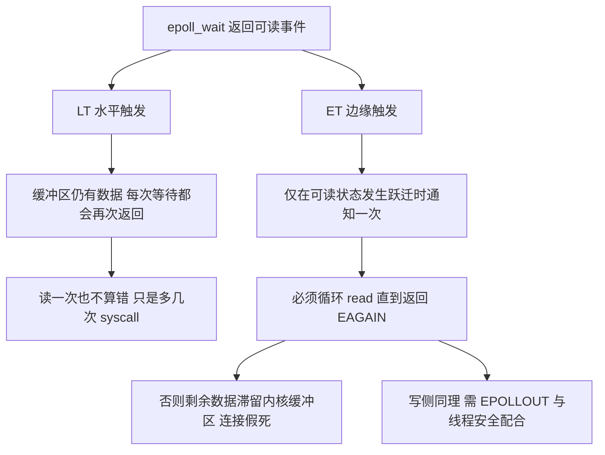

ET 的三个具体陷阱：

1. **`EAGAIN` 判断**：Java 里 `SocketChannel#read` 返回 0 表示暂无数据，`-1` 表示 EOF；native epoll 里返回 `-1` 且 `errno == EAGAIN/EWOULDBLOCK` 才是"读完了"。两者语义不同，写 native 代码时不能混。
2. **`EPOLLOUT` 在 ET 下几乎不可用**：可写状态长期为真，ET 只通知一次，所以必须先尝试写、写满（返回部分写）后才注册 `EPOLLOUT`。Netty 用 `ChannelOutboundBuffer#isWritable` 与 `OP_WRITE` 动态注册解决了这个问题。
3. **`EPOLLONESHOT`**：为了多线程读同一个 fd 不互相打断，可以一次性注册，事件处理完再 `epoll_ctl MOD` 重新武装。

### 5.4 惊群与多 Reactor

- **accept 惊群**：多进程/多线程同时阻塞在同一个 listen fd 的 `accept`，新连接到来全部被唤醒，只有一个成功。Linux 2.6 内核已让 `accept` 只唤醒一个（`WQ_FLAG_EXCLUSIVE`）。
- **epoll_wait 惊群**：多个线程各自 `epoll_wait` 同一个 `epfd`（或多进程 fork 继承）时仍可能全部唤醒。Linux 4.5 引入 `EPOLLEXCLUSIVE` 解决；Nginx 老版本用 `accept_mutex` 应用层互斥。
- **`SO_REUSEPORT`**：Linux 3.9 起，多个进程/线程各自 bind 同一端口，内核按四元组哈希分流，避免单 accept 队列争抢。Nginx、Envoy 的高性能配置常用。
- **Netty 的做法**：boss 组通常只放 1 个 `NioEventLoop`，accept 无竞争；worker 组每个 `EventLoop` 持有独立 `Selector`，连接按 round-robin 注册，天然无锁。

### 5.5 JDK Selector 的实现细节与历史坑

- Linux 上 `SelectorProvider#provider()` 返回 `EPollSelectorProvider`，`openSelector()` 得到 `sun.nio.ch.EPollSelectorImpl`（JDK 7 起；JDK 6 及更早是 `PollSelectorImpl`，Solaris 用 `DevPollSelectorImpl`）。
- JDK 的 epoll 使用 **LT 模式**，没有对外暴露 `EPOLLET`；要 ET 必须用 Netty 的 native transport（`io.netty:netty-transport-native-epoll` + `EpollEventLoopGroup`）。
- **空轮询 bug**：部分内核版本下 `epoll_wait` 返回 0 但 `selectedKeys` 非空（或 select 提前返回），会把阻塞式 `select` 变成忙循环，CPU 打到 100%。这个坑 JDK 6/7 时代就存在，Netty 4.1 至今仍保留兜底：`NioEventLoop#select` 用 `selectCnt` 计数，连续超过 `SELECTOR_AUTO_REBUILD_THRESHOLD`（默认 512）就重建 `Selector`，阈值可用 `io.netty.selectorAutoRebuildThreshold` 覆盖，设为 0 表示关闭该保护。
- 在 JDK 9+ 模块化下，Netty 反射替换 `sun.nio.ch.SelectorImpl#selectedKeys` 为 `SelectedSelectionKeySet`（数组实现）的优化可能受强封装限制；失败只影响性能，不影响功能，需要时用 `--add-opens java.base/sun.nio.ch=ALL-UNNAMED`。
- `Selector#select()` 返回的是**本次 selection 中就绪操作集被更新的 key 数量**（Javadoc 原文 "whose ready-operation sets were updated"），不等于 `selectedKeys.size()`；`selectNow()` 不阻塞，`select(timeout)` 返回 0 也可能是超时。
- `wakeup()` 让阻塞中的 `select` 立即返回，语义是"下一次 `select` 立即返回、不再阻塞"。并发场景下有经典竞态：调用方先 `wakeup()` 再提交任务，任务提交时目标线程可能刚刚判断完队列为空并即将进入 `select`，于是这次唤醒被"吃掉"，任务要等到下一次超时或事件才执行。Netty 用一个唤醒标记（早期 4.1.x 是 `AtomicBoolean wakenUp`，较新的 4.1.x 换成了 `AtomicLong nextWakeupNanos`）配合 `selectNow()` 兜底解决。

## 六、零拷贝

### 6.1 传统 read + write 的四次拷贝

一次"把磁盘文件发给网络"的经典实现：

```java
FileInputStream in = new FileInputStream("a.dat");
Socket socket = new Socket("host", 80);
byte[] buf = new byte[8192];
int n;
while ((n = in.read(buf)) > 0) {
    socket.getOutputStream().write(buf, 0, n);
}
```

代价：4 次上下文切换（`read` + `write` 各 2 次）与 4 次数据拷贝（2 次 DMA、2 次 CPU）。

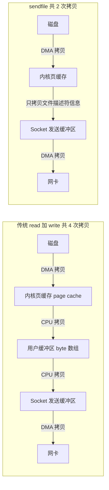

### 6.2 三大零拷贝技术

| 技术 | 系统调用 | 拷贝次数 | 上下文切换 | 限制 |
| --- | --- | --- | --- | --- |
| `mmap` + `write` | `mmap` + `write` | 3（页缓存→socket 缓冲区仍是 CPU 拷贝） | 4 | 大文件映射引发大量缺页中断与内存压力 |
| `sendfile` | `sendfile` | 2（支持 SG-DMA 时全 DMA） | 2 | 输入必须是文件，无法在途中修改数据 |
| `splice` | `splice` | 2（经管道，无需硬件 SG-DMA） | 2 | 需要一个管道 fd，Linux 2.6.17 起；**Java 层没有对应 API**，只能靠 JNI |
| `MSG_ZEROCOPY` | `send` + `MSG_ZEROCOPY` | 1 | 2 | 需要网卡与内核支持，通知机制复杂 |

补充两个硬限制：

- **`sendfile` 无法用于 TLS**。数据不经过用户态就没法加密，所以 HTTPS 场景下零拷贝失效，必须回落到"读进堆缓冲 → 加密 → 写"。
- **`sendfile` 不能改数据**。想给文件加个协议头，要么先把头部单独 `write` 再 `transferTo`（两次写可能引发 TCP 小包），要么放弃零拷贝。这是"静态资源服务器 + 中间件"里最常见的取舍点。

### 6.3 Java 侧的 API

```java
FileChannel src = FileChannel.open(Paths.get("big.dat"), StandardOpenOption.READ);
SocketChannel dst = SocketChannel.open(new InetSocketAddress("host", 80));
long position = 0;
long size = src.size();
while (position < size) {
    long n = src.transferTo(position, size - position, dst); // 内部走 sendfile
    if (n <= 0) {                                            // 可能返回 0，必须防止死循环
        break;
    }
    position += n;
}
```

- `FileChannel#transferTo(long position, long count, WritableByteChannel target)`：Linux 下走 `sendfile`，Windows 走 `TransmitFile`。
- `FileChannel#transferFrom(ReadableByteChannel src, long position, long count)`：源必须是 `FileChannel` 才可能零拷贝。
- 单次内核 `sendfile` 有上限（Linux 上约 2GB），`FileChannelImpl#transferTo` 也把单次 `count` 截断到 `Integer.MAX_VALUE` 且**不做内部循环重试**（JDK 8 源码里 sendfile 路径 `transferToDirectly` 只有 EINTR 重试、不做分片循环，分片循环出现在 mmap 兜底路径 `transferToTrustedChannel` 中），所以**返回值可能小于请求长度、甚至为 0**，调用方必须循环并处理 0 的情况。
- `FileChannel#map(MapMode, position, size)` 返回 `MappedByteBuffer`：单次映射大小不能超过 `Integer.MAX_VALUE`（约 2GB），本质是 `mmap`。
- `MappedByteBuffer#force()` 强制刷盘；**没有 `close()`**，解除映射只能等 GC 回收后由 `Cleaner` 调用 `munmap`，长生命周期场景累积映射会导致虚拟内存与 RSS 上涨。

### 6.4 中间件怎么用

| 组件 | 技术选择 | 关键点 |
| --- | --- | --- |
| Kafka | 日志文件读走 `FileChannel#transferTo` sendfile 路径（`FileRecords#writeTo` 对 `TransportLayer` 调用 `transferFrom`，`PlaintextTransportLayer#transferFrom` 内部就是 `FileChannel#transferTo`） | 顺序写 + page cache + sendfile；`SslTransportLayer#transferFrom` 必须读进堆缓冲加密，零拷贝失效 |
| Kafka | 索引文件 `.index`/`.timeindex` 用 `MappedByteBuffer` | 默认 `log.index.size.max.bytes=10485760`（10MB），`log.index.interval.bytes=4096` |
| Kafka | 生产者端 `RecordAccumulator` 批量 + `SocketChannel` | 批大小 `batch.size=16384`、`linger.ms=0`，靠批把 syscall 摊薄 |
| RocketMQ | CommitLog 用 `MappedByteBuffer`（`MappedFile`） | `mappedFileSizeCommitLog=1073741824`（1GB），写内存 + 定时刷盘（`flushIntervalCommitLog=500ms`，`FlushDiskType=ASYNC_FLUSH`） |
| RocketMQ | 读路径依赖 page cache | 消费是随机读 ConsumeQueue + CommitLog，命中页缓存时等价于内存读 |
| Netty | `FileRegion`（`transferTo`）+ `CompositeByteBuf` | 只在 SSL 关闭时走 `FileRegion`，否则必须走 `ChunkedWriteHandler` |
| MySQL | InnoDB 自己的 buffer pool，不依赖 OS 页缓存做零拷贝 | 客户端协议层无零拷贝 |
| Nginx | `sendfile on` 默认开启 | 静态文件 + `tcp_nopush on` 合并头部与小文件 |

**为什么 Kafka 用 sendfile，RocketMQ 用 mmap？**

- Kafka 的消费模型是"按 offset 顺序读日志段并发给消费者"，数据不需要修改，天然适合 `sendfile`：数据不进用户态，broker 进程不消耗 CPU 做拷贝，也不占用堆。
- RocketMQ 需要构建 ConsumeQueue 索引、需要随机读、需要对消息做过滤与重试处理，而且要求写入后立刻可读（依赖 page cache 而不是自己维护 buffer），因此选择 `mmap` 让文件"看着像内存"。
- 代价对比：`sendfile` 省 CPU 但不可改数据、对大文件更友好；`mmap` 灵活但缺页中断与刷盘不可控，文件很大时（几十 GB）映射管理复杂，这也是 RocketMQ 把单一 CommitLog 限制在 1GB 的原因之一。

## 七、Netty

### 7.0 为什么需要 Netty：原生 NIO 的五个坑

第四节的 `LengthFrameDecoder` 只有 20 行，但真实服务要处理的远不止这些。原生 NIO 写生产服务，通常会在这五件事上翻车：

| 坑 | 具体表现 | Netty 的解法 |
| --- | --- | --- |
| **半包/粘包** | 一次 `read` 拿到半条消息，解析错位 | `ByteToMessageDecoder` + 各类 `FrameDecoder` |
| **写半包** | `write()` 返回值小于请求，不处理就丢数据 | `ChannelOutboundBuffer` + `OP_WRITE` 自动注册 |
| **Selector 空轮询** | 某些内核下 `select` 立即返回 0，CPU 100% | `selectCnt` 计数，超过阈值重建 `Selector` |
| **直接内存泄漏** | `ByteBuffer` 没有释放机制，只能等 GC | 引用计数 `retain/release` + `ResourceLeakDetector` |
| **线程模型** | 业务阻塞在 IO 线程，吞吐雪崩 | 主从多 Reactor + 可插拔业务线程池 |

一句话：**Netty 不是"更好用的 NIO"，而是"把 NIO 在工程上会踩的坑全部填平"**。下面依次看它怎么填。

### 7.1 Reactor 三种模型

| 模型 | 结构 | 优点 | 缺点 | 代表 |
| --- | --- | --- | --- | --- |
| 单 Reactor 单线程 | 1 线程：accept + read + 业务 | 无锁、模型简单 | 业务耗时会阻塞所有连接，无法用多核 | Redis 6.0 之前的网络模型 |
| 单 Reactor 多线程 | 1 个 Reactor 线程 + 业务线程池 | 多核可用于业务 | 单 Reactor 仍是瓶颈，accept/read 串行 | 早期 Tomcat NIO |
| 主从多 Reactor | boss 组 accept，worker 组 read/write/业务 | 高并发、可扩展 | 结构复杂、跨 EventLoop 通信需异步 | Netty、Nginx、Envoy |

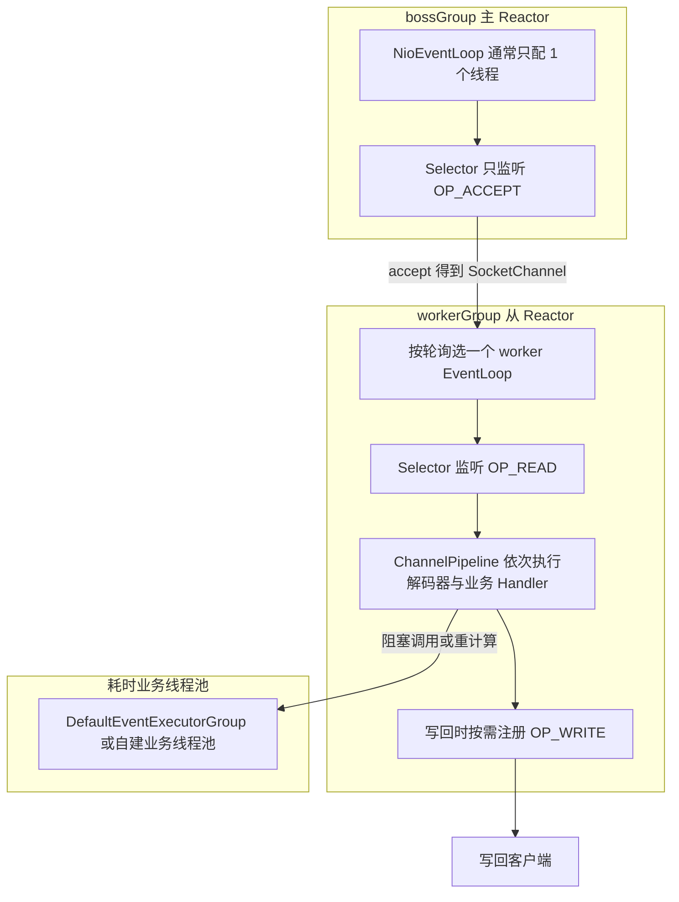

### 7.2 核心组件

| 组件 | 职责 | 关键实现类 |
| --- | --- | --- |
| `EventLoopGroup` | 线程组管理 | `NioEventLoopGroup`、`EpollEventLoopGroup`、`DefaultEventExecutorGroup` |
| `EventLoop` | 一个线程 + 一个 `Selector` + 任务队列 | `NioEventLoop`、`EpollEventLoop` |
| `Channel` | 连接抽象 | `NioSocketChannel`、`NioServerSocketChannel`、`EpollSocketChannel` |
| `ChannelPipeline` | Handler 双向链表 | `DefaultChannelPipeline` |
| `ChannelHandlerContext` | 链表节点，控制传播方向 | `AbstractChannelHandlerContext` |
| `ByteBuf` | 字节容器 | `PooledByteBufAllocator`、`Unpooled` |
| `ChannelFuture`/`Promise` | 异步结果 | `DefaultChannelPromise` |
| `AttributeKey` | Channel 级上下文数据 | `AttributeKey.valueOf("uid")` |

入站（inbound）事件沿 `head → tail` 传播（`ctx.fireChannelRead`），出站（outbound）沿 `tail → head` 传播（`ctx.write`）。`ChannelHandlerAdapter#isSharable` 决定一个 Handler 实例能否被多个 Channel 共享；带状态（如 `LengthFieldBasedFrameDecoder` 里的累积缓冲区）的 Handler **不能标注 `@Sharable`**，否则会串数据。

### 7.3 线程模型细节（面试高频数字）

| 参数 | 默认值 | 说明 |
| --- | --- | --- |
| worker 线程数 | `2 * CPU`（`MultithreadEventLoopGroup.DEFAULT_EVENT_LOOP_THREADS`，可用 `io.netty.eventLoopThreads` 覆盖） | 经验上 IO 密集可 2 倍核数，CPU 密集应回归核数 |
| boss 线程数 | 构造时显式给 1 | 只有一个 listen fd，多线程无益还有惊群风险 |
| `ioRatio` | 50 | `NioEventLoop#run` 中 IO 时间与任务时间的比例 |
| 单次 `select` 阻塞多久 | 由最近一个定时任务的到期时间决定；队列里有任务时先 `selectNow` 立即返回 | `NioEventLoop#select` 与 `DefaultSelectStrategy`，保证定时任务与提交任务不被饿死 |
| `SO_BACKLOG` | `NetUtil.SOMAXCONN`（优先读 `/proc/sys/net/core/somaxconn`，读不到时按平台回退：Linux 4096、macOS 128、Windows 200；实际生效值再与设置值取较小者） | 高并发时应显式设为 1024 以上并同步调内核参数 |
| `TCP_NODELAY` | `true`（Netty 对 `SocketChannel` 默认开启） | 关闭 Nagle 算法，降低小包延迟 |
| `SO_KEEPALIVE` | `false` | 靠 `IdleStateHandler` 做应用层心跳更可控 |
| `WRITE_BUFFER_WATER_MARK` | 低 32KB / 高 64KB（`WriteBufferWaterMark.DEFAULT`） | `isWritable()` 的判定依据，用于反压 |
| `RCVBUF_ALLOCATOR` | `AdaptiveRecvByteBufAllocator.DEFAULT`（最小 64、最大 65536，初始值较新的 4.1.x 是 2048、早期版本是 1024） | 自适应接收缓冲区，小包省内存大包少 syscall |
| `ResourceLeakDetector` 级别 | `SIMPLE` | 可调 `io.netty.leakDetection.level=paranoid` |

为什么 EventLoop 内部可以不用锁：一个 `Channel` 从注册那一刻起就绑定到唯一 `EventLoop`，其生命周期内所有事件都在同一个线程上串行执行，业务 Handler 因此天然是"单线程模型"，不需要加 `synchronized`。跨 `EventLoop` 提交任务时用 `channel.eventLoop().execute(task)`，返回 Promise 而不是直接阻塞等待。

### 7.4 ByteBuf

与 `ByteBuffer` 的最大差别是**读写索引分离**，不需要 `flip()`：

| 属性 | 含义 |
| --- | --- |
| `readerIndex` | 下一个读位置 |
| `writerIndex` | 下一个写位置 |
| `capacity` | 当前容量 |
| `maxCapacity` | 扩容上限，默认 `Integer.MAX_VALUE`（`AbstractByteBufAllocator.DEFAULT_MAX_CAPACITY`），初始容量默认 256 |
| `readableBytes()` | `writerIndex - readerIndex` |
| `writableBytes()` | `capacity - writerIndex` |

四种形态：

1. `UnpooledHeapByteBuf`：堆内数组，分配快，做 IO 多一次拷贝。
2. `UnpooledDirectByteBuf`：堆外内存，适合 IO。
3. `PooledByteBuf`（`PooledDirectByteBuf`/`PooledHeapByteBuf`）：`PooledByteBufAllocator` 默认分配器，jemalloc 风格，`PoolArena` → `PoolChunk`（`pageSize` 默认 8KB，`chunkSize = pageSize << maxOrder`）→ 完全二叉树位图分配，再配 `tinyCacheSize`/`smallCacheSize`/`normalCacheSize` 线程缓存减少锁竞争。**这几个默认值改过版本**：较新的 4.1.x（如 4.1.12x）是 `maxOrder=9`（chunk 4MB）+ `tinyCacheSize=0`（tiny 缓存默认关闭），早期 4.1.x（如 4.1.25）是 `maxOrder=11`（chunk 16MB）+ `tinyCacheSize=512`；`smallCacheSize=256`、`normalCacheSize=64` 两版一致，都可用 `io.netty.allocator.*` 覆盖。
4. `CompositeByteBuf`：把多个 `ByteBuf` 组合成一个逻辑视图，**不拷贝数据**，用于"头部 + body"场景。

其他要点：

- `slice()`/`duplicate()` 共享底层内存且**共享引用计数**，必须配合 `retain()`；`retainedSlice()` 是二者合一。
- `readRetainedSlice()` 与 `slice()` 的区别只在引用计数是否加 1，是内存泄漏的高发区。
- `ByteBufAllocator.DEFAULT` 在 4.1 中是池化分配器；可用 `-Dio.netty.allocator.type=unpooled` 切回非池化（排查问题时常用）。
- `Arena` 数量默认为 `min(2 × CPU 核数, 内存上限 / chunkSize / 2 / 3)`（即除以 6），其中堆 Arena 用 `Runtime.maxMemory()`、直接内存 Arena 用 `PlatformDependent.maxDirectMemory()`；可用 `io.netty.allocator.numDirectArenas` 与 `numHeapArenas` 覆盖。

### 7.5 粘包与拆包

TCP 是面向字节流的协议，没有消息边界。出现"粘包"的三种原因：应用写入大于 MSS 的消息被拆开；应用连续多次 write 被合并成一个 TCP 段（Nagle 算法）；接收方一次 `read` 读到多个消息（读循环里恰好凑齐）。

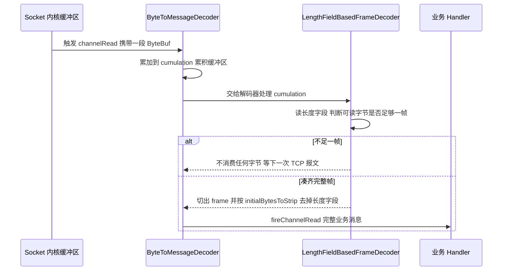

四种解法与对应解码器：

| 方案 | 解码器 | 适用 |
| --- | --- | --- |
| 固定长度 | `FixedLengthFrameDecoder` | 定长协议，简单但不灵活 |
| 分隔符 | `LineBasedFrameDecoder`、`DelimiterBasedFrameDecoder` | 文本协议、Redis 协议 |
| 长度字段 | `LengthFieldBasedFrameDecoder` | 二进制 RPC、自定义协议（主流） |
| 自定义状态机 | 继承 `ByteToMessageDecoder` | 复杂协议（HTTP/2、MQTT） |

`LengthFieldBasedFrameDecoder` 的五个参数必须背下来：

```java
// maxFrameLength, lengthFieldOffset, lengthFieldLength,
// lengthAdjustment, initialBytesToStrip
new LengthFieldBasedFrameDecoder(1024 * 1024, 0, 4, 0, 4);
// 含义：最大 1MB，长度字段在偏移 0，占 4 字节，长度值等于剩余报文长度，解析后去掉这 4 字节
```

- `lengthAdjustment`：当长度字段的值包含自身长度或包含头部其他字段时用于校正（可正可负）。
- `initialBytesToStrip`：剥离的头部长度，通常等于"长度字段偏移 + 长度字段长度"。
- 编码侧对应 `LengthFieldPrepender(4)`，或在自定义编码器里把长度写进头部。
- `ByteToMessageDecoder` 会循环调用 `decode` 直到 `cumulation` 读不出完整消息，并把剩余数据留到下次；这也是它不能加 `@Sharable` 的原因。

### 7.6 为什么 Netty 快

1. **主从多 Reactor + 单线程串行化**：一个连接只在一个 `EventLoop` 上处理，无锁化，避免伪共享与锁竞争。
2. **池化内存 + 自适应缓冲**：`PooledByteBufAllocator` 用 jemalloc 思路管理 `PoolChunk`，`AdaptiveRecvByteBufAllocator` 按历史请求量动态调整 `ByteBuf` 大小，减少分配次数与内存占用。
3. **减少拷贝**：`CompositeByteBuf` 组合、`slice` 视图、`FileRegion`（`transferTo`）、`ByteBuf` 直接内存，全链路尽量不拷贝。
4. **无锁队列与 `FastThreadLocal`**：任务队列用 JCTools 的 `MpscQueue`（`PlatformDependent.newMpscQueue`），`FastThreadLocal` 用数组下标代替 `ThreadLocalMap` 的哈希查找。
5. **Selector 优化**：用数组实现 `SelectedSelectionKeySet` 替代 `HashSet` 遍历，减少装箱与迭代开销。
6. **可插拔的 native transport**：`EpollEventLoopGroup` + `SO_REUSEPORT`、`edge-triggered`（`EpollMode.EDGE_TRIGGERED`）、`TCP_FASTOPEN` 等 Linux 特性，仅在 `Epoll.isAvailable()` 为 true 时启用。
7. **避免线程上下文切换**：业务耗时操作请交给 `DefaultEventExecutorGroup`，但**不要把 IO 也搬过去**，否则 Netty 的优势全丢。

### 7.7 Netty 语境下的"零拷贝"（四种含义）

很多候选人只答 `FileRegion`，其实 Netty 文档里的 zero-copy 有四层：

1. **堆外直接内存**：`ByteBuf` 分配在堆外，socket 读写不额外拷贝。
2. **组合缓冲区**：`CompositeByteBuf` 把协议头与消息体组合，不复制字节。
3. **视图切片**：`slice()`/`duplicate()`/`unwrap()` 返回共享内存的视图。
4. **文件传输**：`FileRegion` 内部 `FileChannel#transferTo`，走 `sendfile`；一旦 pipeline 里有 `SslHandler`，`FileRegion` 无法工作，必须用 `ChunkedWriteHandler` 或回落到普通写。

### 7.8 生产参数与故障模式速查

| 现象 | 可能原因 | 定位手段 |
| --- | --- | --- |
| `OutOfMemoryError: Direct buffer memory` | 直接内存泄漏或 `MaxDirectMemorySize` 太小 | 打开 paranoid 泄漏检测、看 `BufferPoolMXBean` 的 `memoryUsed` 曲线、NMT |
| 连接建立后立即被关闭 | `SO_BACKLOG` 太小、accept 队列溢出 | `ss -lnt` 看 `Send-Q`/`Recv-Q`、`netstat -s` 里的 listen 队列溢出计数 |
| RT 抖动、吞吐上不去 | 业务在 `EventLoop` 线程里做了阻塞调用 | `jstack` 看 `NioEventLoop` 线程栈、`WRITE_BUFFER_WATER_MARK` 触发 `isWritable=false` |
| 内存持续上涨且 GC 后不降 | `ByteBuf` 未 `release()` | `-Dio.netty.leakDetection.level=paranoid`，看 `LEAK: ByteBuf.release() was not called` 日志 |
| 客户端超时但服务端无日志 | 粘包导致解码器一直等数据 | 抓包看 `tcpdump -i any port 8080 -A`、打印 `cumulation.readableBytes()` |
| CPU 100% 且无业务量 | `Selector` 空轮询或 `OP_WRITE` 长期注册 | 火焰图定位到 `EPollSelectorImpl#doSelect`/`NioEventLoop#select` |

## 八、应用场景：什么场景该用什么

前面讲的是"是什么"，这一节回答"什么时候用什么"。

### 8.1 选型决策树

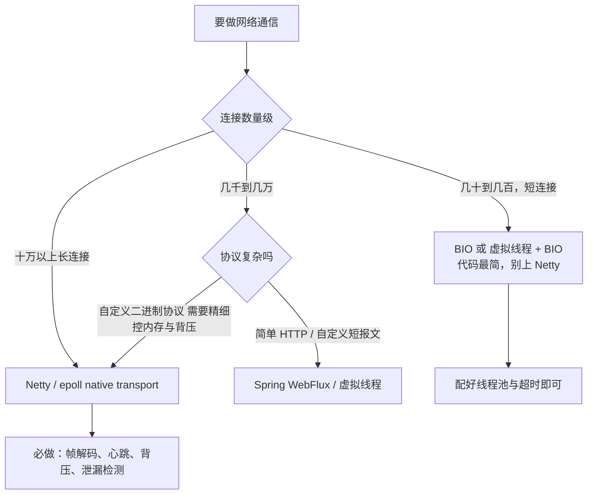

### 8.2 四个典型场景

| 场景 | 特征 | 选型 | 关键设计点 |
| --- | --- | --- | --- |
| **API 网关** | 高并发、短连接、需要转发与鉴权 | Netty（或 Reactor Netty） | 连接池复用后端连接、`SO_BACKLOG` 调大、限流与熔断放在 pipeline 前段 |
| **RPC 框架** | 长连接、自定义二进制协议、QPS 高 | Netty + 自定义编解码 | 长度字段避免粘包、`@Sharable` 只给无状态 Handler、业务丢到独立线程池 |
| **文件/静态资源服务** | 大文件、读多写少 | `FileChannel#transferTo`（sendfile）或 Nginx | 不要用"读进堆再写"；HTTPS 场景零拷贝失效，需权衡 |
| **IM / 推送** | 十万级长连接、低频小包 | Netty + epoll native | 心跳 `IdleStateHandler`、连接注册表、广播用 `ChannelGroup`、写缓冲水位做背压 |

### 8.3 虚拟线程之后怎么重选

JDK 21 之后多了一个选项，判断标准变成两点：**阻塞时间占比**与**连接数量级**：

- 连接几千、每个请求要等数据库/下游（阻塞时间长）→ **虚拟线程 + 同步代码**，可读性和可调试性最好；
- 连接十万级、每连接内存要精确控制、需要背压 → **Netty 仍然不可替代**；
- 两者混用也常见：**接入层用 Netty，业务处理丢给虚拟线程池**（相当于 Netty 的 `DefaultEventExecutorGroup` 换成了虚拟线程）。

> 面试里这样答最稳：**"虚拟线程降低的是'每连接一个线程'的成本，降低不了'每连接一份缓冲区 + 协议解析'的成本"**。前者是 BIO 的瓶颈，后者是 Netty 的价值。

## 九、补充：IO 装饰器与序列化

### 9.1 装饰器模式

`java.io` 是装饰器模式教科书级实现：`FilterInputStream` 持有 `InputStream` 并转发，具体装饰器叠加能力。

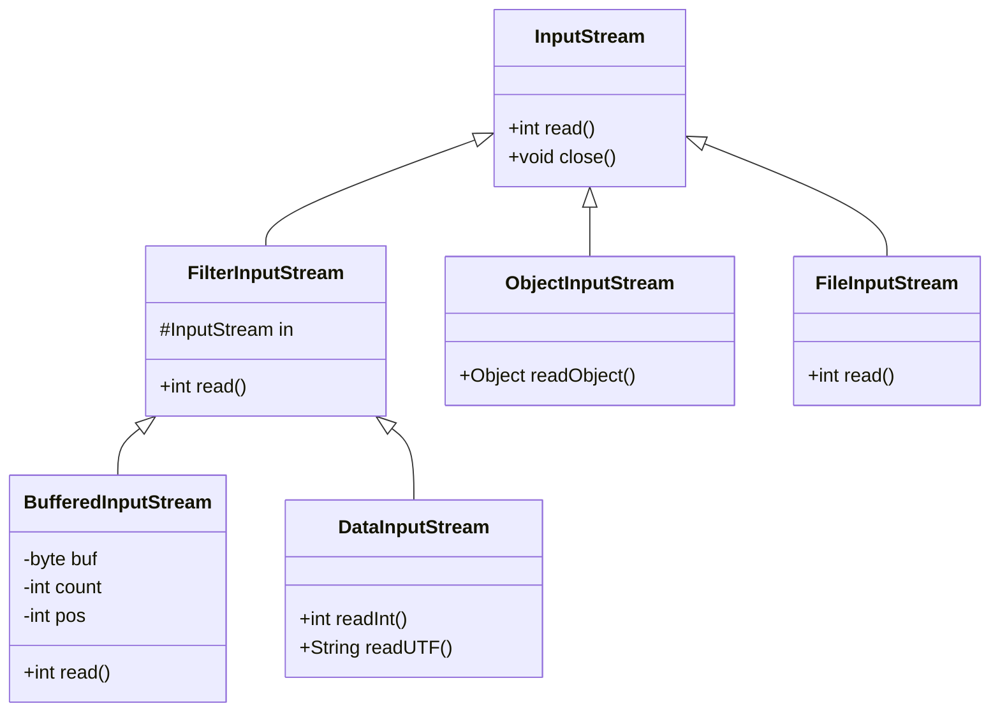

源码级要点：

- `FilterInputStream` 的 `in` 字段是 `protected volatile InputStream in`，所有方法默认直接委托，这正是"装饰"的钩子。
- `BufferedInputStream` 默认缓冲区 `DEFAULT_BUFFER_SIZE = 8192` 字节；`BufferedOutputStream` 同理。`FileInputStream#read()` 单字节读是一次 syscall，套上缓冲后 8KB 一次 syscall，吞吐差数十倍。
- `BufferedOutputStream#flush()` 必须显式调用或 `close()` 触发，否则最后一批数据留在缓冲区里。生产事故：写文件后没 flush 就被别的进程读取，内容缺失。
- `InputStreamReader`/`OutputStreamWriter` 是"装饰器 + 适配器"叠加，负责字节到字符的解码；`FileReader` 用平台默认字符集，**多环境部署必须显式指定 `StandardCharsets.UTF_8`**，否则 JDK 18 之前用默认字符集、JDK 18 起 `file.encoding` 默认 UTF-8。
- `ObjectInputStream` 直接继承 `InputStream` 而不是 `FilterInputStream`，因为它需要按自己的协议读取原始字节。

**Socket 上的坑**：先纠正一个流传很广的说法——`BufferedInputStream` **不会**为了填满 8KB 而阻塞：`fill()` 只调用一次底层 `read`（`getInIfOpen().read(buffer, pos, buffer.length - pos)`），而 socket 的 `read` 有数据就返回。真正的两个坑是：① `read(byte[])` 是**短读**，返回字节数可能小于请求长度，代码若按"循环读到 N 字节"来写协议，对端只发 10 字节就等应答时会死等；② **混用带缓冲与不带缓冲的读**——`BufferedInputStream` 会预读并把数据吞进自己的缓冲区，绕过它直接读底层 `Socket` 流的那次读就会丢数据。长连接协议要么自己按帧长读，要么统一用 `DataInputStream#readFully`。

### 9.2 Serializable 与 serialVersionUID

| 项 | 规则 |
| --- | --- |
| 标记接口 | `java.io.Serializable`，无方法，仅编译期/运行期判断 |
| `serialVersionUID` | 显式声明 `private static final long serialVersionUID = 1L;`，否则由 `ObjectStreamClass#computeDefaultSUID` 按类名/修饰符/接口/字段/静态初始化器/构造器/**方法**算 SHA-1 |
| 不匹配的后果 | `InvalidClassException: local class incompatible: stream classdesc serialVersionUID = x, local class serialVersionUID = y` |
| `transient` | 该字段不参与序列化，反序列化后为默认值（对象为 null，int 为 0） |
| `static` 字段 | 属于类不属于对象，不参与序列化 |
| 父类不可序列化 | 父类字段被初始化为默认值，且**父类的无参构造器会被调用**（子类反序列化时）；父类可序列化时构造器不调用 |
| 自定义钩子 | `writeObject`/`readObject`（必须成对，内部用 `defaultWriteObject`/`defaultReadObject`）、`writeReplace`/`readResolve`、`readObjectNoData` |
| `Externalizable` | 继承 `Serializable`，需 public 无参构造器 + `writeExternal`/`readExternal`，完全自控，性能优于默认反射式序列化 |
| 单例防护 | 实现 `readResolve()` 返回单例，否则反序列化会造出第二个实例 |

序列化流的格式细节：魔数 `0xACED`（`STREAM_MAGIC`）+ 版本 `0x0005`，随后是 `TC_OBJECT`、类描述符、字段值序列。`ObjectStreamClass` 在类描述符里写 `serialVersionUID`，这是跨版本兼容的抓手。

### 9.3 序列化安全：为什么它被业界放弃

JDK 序列化的设计缺陷是把"如何构造对象"的决策权交给了**流里的数据**：`ObjectInputStream#readObject` 会按流中声明的类去加载类、调用其 `readObject`，而 `readObject` 里的任意代码都会执行。

经典利用链（Apache Commons Collections 3.2.1，CVE-2015-4852）：

1. Gadget 入口：`AnnotationInvocationHandler#readObject`（JDK 自带，`sun.reflect.annotation`）在反序列化时对成员值做类型检查，会调用 map 的 `entrySet#iterator` 等方法。
2. 链中转：`TransformedMap`/`LazyMap` 的 `transform` 方法调用 `Transformer` 链。
3. 执行点：`InvokerTransformer#transform` 通过反射调用任意方法；配合 `ConstantTransformer` + `ChainedTransformer` 执行 `Runtime.getRuntime().exec(...)`。
4. 另一条路径：`TemplatesImpl`（`com.sun.org.apache.xalan.internal.xsltc.trax`）的 `newTransformer()` 会加载并执行字节码，配合 `TransformingComparator` 或 `PriorityQueue#readObject` 触发。

`ysoserial` 把这类链工程化，常见 payload 还有 `URLDNS`（仅发起 DNS 请求，用于检测反序列化点）、`JRMPClient`（配合 RMI 打 JNDI）。

防御手段（按有效性排序）：

| 手段 | 具体做法 | 局限 |
| --- | --- | --- |
| 不用 JDK 序列化 | 换 JSON（Jackson）、Protobuf、Thrift、Hessian2/自定义 | 存量系统改造成本 |
| JEP 290 过滤器 | `ObjectInputFilter`、`-Djdk.serialFilter=...`、`ObjectInputFilter.Config.createFilter` | 需要枚举白名单，维护成本高 |
| 黑名单库 | `SerialKiller`、commons-collections 升级到 3.2.2（`InvokerTransformer` 默认不可用） | 只挡已知 gadget |
| 关闭远程 codebase | `com.sun.jndi.rmi.object.trustURLCodebase` 自 8u121 起默认 false，`com.sun.jndi.ldap.object.trustURLCodebase` 自 8u191 起默认 false | 只防 JNDI 注入 |
| 网络隔离与鉴权 | 反序列化端点只对内网开放、加认证 | 不解决漏洞本身 |

`jdk.serialFilter` 的语法示例（模式用分号分隔，`**` 表示通配）：

```bash
# 只允许反序列化白名单内的类，并限制数组长度与深度
-Djdk.serialFilter="com.example.dto.*;java.base/*;!*;maxarray=100000;maxdepth=20"
```

程序内动态设置：

```java
ObjectInputFilter filter = ObjectInputFilter.Config.createFilter(
        "com.example.dto.*;java.base/*;!*;maxdepth=20");
ObjectInputFilter.Config.setSerialFilter(filter);
```

注意：`ObjectInputFilter.Config.setSerialFilter` 只能设置一次，第二次抛 `IllegalStateException`，这在"框架 + 业务都要设置过滤器"的场景是常见冲突源。JDK 17 起新增了 `ObjectInputFilter.Config.setSerialFilterFactory(BinaryOperator<ObjectInputFilter>)`：过滤器工厂会在每个 `ObjectInputStream` 创建（以及设置流级过滤器）时被调用，由它把"JVM 级静态过滤器 + 流级过滤器"合成，从根上解掉"只能设一次"的限制。

## 高级岗三问

**问 1：为什么这么设计？**
三次取舍值得记住：`epoll` 用红黑树 + 回调换掉了 select 的"全量拷贝 + 线性扫描"；Netty 用"一个连接绑定一个线程"换掉了锁，代价是业务不能阻塞；Kafka 用 `sendfile` 换掉了用户态拷贝，代价是不能改数据、不能用 TLS 加速。**任何"高性能"背后都有一份被放弃的灵活性**，答出代价比答出优点更像架构师。

**问 2：线上出问题怎么定位？**
固定五步：`ss -s` / `ss -tan state xxx` 看连接状态分布 → `ls /proc/<pid>/fd | wc -l` 看 fd 泄漏 → `pidstat -w 1 -p <pid>` 与 `vmstat 1` 看上下文切换与内核态 CPU → `strace -c -p <pid>` / `perf top -p <pid>` 定位 syscall 热点 → JVM 侧 `jstack`、NMT、`BufferPoolMXBean` 定位直接内存。这套顺序能覆盖 90% 的 IO 类故障。

**问 3：规模变大后会怎样？**
连接数从 1 万到 100 万：fd、`somaxconn`、`tcp_max_syn_backlog`、epoll 就绪事件数组大小、直接内存总量、心跳定时器数量都会成为瓶颈；再往上会遇到单机网卡软中断（`softirq`）单核打满，需要用 `SO_REUSEPORT`、多队列网卡 `RSS`、`XDP`/`DPDK`。数据量变大：Kafka 的 page cache 命中率下降、`sendfile` 收益不变但磁盘成为瓶颈；RocketMQ 的 1GB CommitLog 文件数变多，刷盘与索引重建成本上升。

## 高频面试题

### Q1. BIO、NIO、AIO 的本质区别是什么？为什么说 Java NIO 不是异步 IO？

**答题框架（30 秒版）**：区别在"两个阶段是否阻塞"——数据准备与数据拷贝。BIO 两阶段都阻塞；NIO 用 `Selector` 把数据准备阶段变成事件通知，但 `read` 拷贝阶段仍同步阻塞，所以是**同步非阻塞**；AIO 两阶段都不阻塞，由内核完成后回调。

**展开（2 分钟版）**：
1. 五种 Unix IO 模型里只有异步 IO 是第二阶段也不阻塞的。
2. Linux 上 JDK 的 `AsynchronousSocketChannel` 由 `sun.nio.ch.EPollPort` + 线程池实现，内核层面仍是同步 IO，所以性能不比 NIO 好。
3. 工程选型：连接少用 BIO；连接多用 NIO/Netty；Java 21 之后虚拟线程让 BIO 重新可用（`Executors.newVirtualThreadPerTaskExecutor()`），JEP 491 在 JDK 24 移除了 `synchronized` 的 pinning 限制。

**追问**：「虚拟线程能替代 Netty 吗？」答：批量长连接、需要精确控制内存与背压的场景 Netty 仍占优；虚拟线程的优势是让既有阻塞代码直接获得高并发能力，代价是每个连接仍有栈与调度开销，且需要 JDK 21+。

### Q2. select、poll、epoll 有什么区别？epoll 为什么高效？

**答题框架（30 秒版）**：三点差异——fd 上限（1024 对无上限）、是否每次全量拷贝 fd 集合（是/否）、内核查找就绪的复杂度（`O(n)` 对 `O(就绪数)`）。epoll 用红黑树管理监听集合、用 `ep_poll_callback` 回调把就绪 fd 挂到就绪链表，`epoll_wait` 只遍历就绪链表。

**展开（2 分钟版）**：
1. `epoll_create1` 返回 `epfd`，内核建 `eventpoll`，含 `rbr` 红黑树与 `rdllist` 就绪链表。
2. `epoll_ctl ADD` 把 fd 对应的 `epitem` 插入红黑树，并在 socket 等待队列注册回调。
3. 数据到达 → 协议栈 `softirq` → 回调把 `epitem` 挂到 `rdllist` → 唤醒 `epoll_wait`。
4. 复杂度：epoll 是 `O(活跃 fd)`，select/poll 是 `O(监听 fd)`；但有大量活跃连接时 epoll 优势会下降。

**追问**：「epoll 一定比 select 快吗？」答：不一定。fd 少且几乎全活跃时，epoll 的 `epoll_ctl` 维护成本与 `epoll_wait` 拷贝成本摊不薄，select 反而更轻；epoll 的杀手场景是"连接多、活跃少"。

### Q3. epoll 的 LT 与 ET 有什么区别？为什么 JDK 和 Netty 默认用 LT？

**答题框架（30 秒版）**：LT 只要缓冲区有数据就反复通知，编程简单；ET 只在状态跃迁时通知一次，必须循环读到 `EAGAIN`，且 fd 必须非阻塞。JDK 的 `EPollSelectorImpl` 没有暴露 `EPOLLET`，Netty 默认也是 `EpollMode.LEVEL_TRIGGERED`——因为 LT 的容错性好，漏读最多多几次 `epoll_wait`，不会连接假死。

**展开（2 分钟版）**：
1. ET 的三个硬要求：非阻塞 fd、`read` 循环到 `EAGAIN`、`accept` 循环到 `EAGAIN`。
2. ET 下 `EPOLLOUT` 的注册时机需要"先写满再注册"，否则永远收不到通知。
3. 想用 ET：Netty native transport + `EpollChannelConfig#setEpollMode(EpollMode.EDGE_TRIGGERED)`，或用 `EPOLLONESHOT` 做多线程分工。

**追问**：「Nginx 为什么用 ET？」答：Nginx 用少量 worker 进程处理海量连接，ET 能显著减少 `epoll_wait` 的返回次数与 syscall 开销，而 Nginx 自己保证每个可读 fd 被读到 `EAGAIN`，所以敢用。

### Q4. ByteBuffer 的 flip、clear、compact 有什么区别？你踩过什么坑？

**答题框架（30 秒版）**：`flip` 写转读（`limit=position; position=0`）；`clear` 读转写并**丢弃全部未读**；`compact` 读转写但**保留未读数据并搬到头部**。核心不变式 `mark <= position <= limit <= capacity`。

**展开（2 分钟版）**：
1. 写完忘了 `flip` 直接读，读到 0 字节；写完用了 `clear` 再读，读到脏数据。
2. `compact` 的典型场景是"半包"：数据没读完又来了新数据，先 `compact` 把未读部分前移，再继续 `write`。
3. `ByteBuffer#equals` 只比较剩余内容且不允许 heap 与 direct 互等，不能做 Map key。
4. 直接内存用 `allocateDirect`，长期持有要注意 `-XX:MaxDirectMemorySize` 与 `Cleaner` 的释放延迟。

**追问**：「`ByteBuffer` 线程安全吗？」答：不安全，`position`/`limit` 是普通字段，多线程共享必须自己同步或用 Netty 的 `ByteBuf`（也不安全，但提供了 `retainedSlice` 等引用计数工具）。

### Q5. 零拷贝有哪几种实现？Kafka 和 RocketMQ 各用哪种？为什么？

**答题框架（30 秒版）**：`mmap`+`write`、`sendfile`、`splice`、`MSG_ZEROCOPY`。Kafka 用 `sendfile`（`FileChannel#transferTo`）顺序读日志段；RocketMQ 用 `mmap`（`MappedByteBuffer`）承载 CommitLog 与索引，因为它需要随机读、构建 ConsumeQueue 索引并依赖 page cache 立即可读。

**展开（2 分钟版）**：
1. 传统 read+write：4 次拷贝 4 次切换；`mmap` 3 次拷贝；`sendfile` 2 次拷贝（SG-DMA 下全 DMA）。
2. `sendfile` 不能改数据、不能做 TLS；`mmap` 有缺页中断与卸载困难。
3. Netty 的"零拷贝"还有 `CompositeByteBuf`、`slice`、堆外内存三层含义。

**追问**：「HTTPS 场景零拷贝还有用吗？」答：`sendfile` 失效因为数据必须进用户态加密；可以退化到 `mmap` 减少一次拷贝，或者用支持内核 TLS（`kTLS`）的方案。

### Q6. 【场景设计】设计一个支撑 50 万长连接的推送网关，你怎么选型与拆分？

**答题框架（30 秒版）**：接入层用 Netty 主从多 Reactor，单机连接数按 5 万~10 万规划，水平扩 N 台；会话路由用 Redis 记录 `uid → 网关实例`；消息投递用 MQ 广播到各网关；心跳用 `IdleStateHandler` + 应用层 ping/pong。

**展开（2 分钟版）**：
1. 接入层：`bossGroup=1`、`workerGroup=2*CPU`；`SO_BACKLOG=2048`；`TCP_NODELAY=true`；`WRITE_BUFFER_WATER_MARK` 做反压；`SO_KEEPALIVE=false` 改用心跳。
2. 内存预算：每连接按 10KB 直接内存估算，5 万连接约 500MB 直接内存，`-XX:MaxDirectMemorySize` 必须显式设置，容器内存 = 堆 + 直接内存 + 栈 + 元空间 + 预留。
3. 系统参数：`ulimit -n 1000000`、`net.core.somaxconn=32768`、`net.ipv4.tcp_max_syn_backlog=32768`、`net.ipv4.ip_local_port_range`、`net.ipv4.tcp_rmem/tcp_wmem`、关闭 `tcp_tw_recycle`（4.12 内核已移除）。
4. 连接保活与摘除：心跳超时 3 个周期踢连接；实例下线先摘除路由再 `graceful shutdown`（`EventLoopGroup#shutdownGracefully`）。
5. 水平扩展的失效模式：连接数受单机 fd 与内存限制；广播类消息随网关数线性放大流量；跨实例投递需要处理"用户刚好重连到另一台"的竞态，用会话版本号或本地投递 + 一次重试兜底。

### Q7. 【线上排查】服务大量 `CLOSE_WAIT`、报 `Too many open files`，怎么定位？

**答题框架（30 秒版）**：`CLOSE_WAIT` 是**本端收到 FIN 但没有调用 `close()`**，属于应用 bug，不是内核参数问题。先量化、再定位、最后修复。

**展开（2 分钟版）**：
1. 量化：`ss -tan state close-wait | wc -l`、`ss -tan state close-wait | awk '{print $5}' | sort | uniq -c | sort -rn` 找出对端分布；`ls /proc/<pid>/fd | wc -l` 与 `cat /proc/<pid>/limits` 确认是否触及 `ulimit -n`。
2. 定位：`jstack <pid> | grep -A 20 "http-nio"` 看线程是否卡在 `SocketInputStream#read`；`lsof -p <pid> | grep -c socket` 看 socket 增长；结合 `fat jar` 里连接池配置检查是否有未关闭的 `Connection`/`InputStream`。
3. 三类根因：A) 忘记 `finally { close() }`；B) 读到 `read() == -1` 后没有关闭；C) 连接池归还逻辑异常（`abandoned` 未开）。
4. 修复与加固：`try-with-resources`、连接池开启泄漏检测（如 HikariCP `leakDetectionThreshold=20000`，Druid `removeAbandoned=true` + `removeAbandonedTimeout`）、临时把 `ulimit -n` 调大续命但不算修复。
5. 反向指标：大量 `TIME_WAIT` 通常是**本端主动关闭**，属于正常现象（2MSL 60 秒），可用连接池长连接 + `tcp_tw_reuse` 缓解，但不要用已废弃的 `tcp_tw_recycle`。

### Q8. 【线上排查】Netty 服务运行几天后直接内存被吃满，怎么定位与修复？

**答题框架（30 秒版）**：先确认是"真泄漏"还是"配额太小"，用泄漏检测 + `BufferPoolMXBean` 曲线 + NMT 三件套区分，再顺着 `ByteBuf` 的生命周期找漏掉 `release()` 的位置。

**展开（2 分钟版）**：
1. 量化：`jcmd <pid> VM.native_memory summary`（需 `-XX:NativeMemoryTracking=detail`）看 `Internal`/`Other`；JMX 取 `BufferPoolMXBean#getMemoryUsed` 打点到监控，观察是否只涨不落。
2. 打开检测：`-Dio.netty.leakDetection.level=paranoid`，日志里会出现 `LEAK: ByteBuf.release() was not called before it's garbage-collected` 并给出分配处的堆栈（`targetRecords=4` 决定记录数）。
3. 常见根因：`SimpleChannelInboundHandler` 会自动 release，而继承 `ChannelInboundHandlerAdapter` 时必须手动 `ReferenceCountUtil.release(msg)`；`readRetainedSlice` 后忘记 `release`；异常分支提前 return 导致漏 release；把 `ByteBuf` 交给业务线程池后没有 `retain()`/`release()` 配对。
4. 治本：所有 inbound 处理统一走 `SimpleChannelInboundHandler` 或 `finally` 中 release；跨线程传递必须 `retain()`；压测阶段就开 paranoid。
5. 不要只调大 `-XX:MaxDirectMemorySize`：那只是延后爆炸时间，且容器的内存上限不会因此变大。

### Q9. 【场景设计】让你设计一个 RPC 协议，怎么解决粘包拆包并兼顾扩展性？

**答题框架（30 秒版）**：用"定长头 + 变长体"，头部含魔数、版本、序列化类型、消息类型、请求 ID、body 长度；解码用 `LengthFieldBasedFrameDecoder`，编码用自定义 `MessageToByteEncoder`。

**展开（2 分钟版）**：
1. 头部定长：`magic(2) + version(1) + serializeType(1) + msgType(1) + status(1) + requestId(8) + bodyLength(4)` 一共 **18 字节**；想压到 16 字节，就把 `version`/`serializeType`/`msgType` 塞进同一个 flag 字节。定长才能用 `getInt`/`getLong` 直接定位字段，也便于 `initialBytesToStrip` 一次性剥离。
2. 解码链：`LengthFieldBasedFrameDecoder(maxFrameLength=1MB, 0, 4, 0, 0)` 拿到完整帧 → 自定义解码器读头部、校验魔数 → 按 `serializeType` 选反序列化器 → 交给业务 Handler。
3. `maxFrameLength` 必须设置，否则恶意长度字段会让对端申请巨大缓冲区（内存放大攻击）。
4. 扩展性：头部预留 `status`、`version` 支持灰度；序列化类型做成可插拔（Protobuf/Hessian2/JSON），新老版本靠 `version` 协商。
5. 配套：`IdleStateHandler` 做心跳，`LengthFieldPrepender` 或自定义编码器写长度，异常时回一条带 `status` 的错误响应而不是直接断连。

### Q10. 为什么生产环境不推荐 JDK 原生序列化？如果必须用怎么加固？

**答题框架（30 秒版）**：三个原因——安全问题（`readObject` 可被 gadget chain 利用执行任意代码）、性能问题（反射 + 类描述符元数据冗余，序列化后体积通常大于 Protobuf/JSON，且不支持跨语言）、兼容性问题（`serialVersionUID` 变更即报 `InvalidClassException`）。加固首选 JEP 290 白名单过滤器。

**展开（2 分钟版）**：
1. 经典链：`AnnotationInvocationHandler` + `TransformedMap` + `InvokerTransformer`（commons-collections 3.2.1，CVE-2015-4852）；`TemplatesImpl` 直接加载字节码；`ysoserial` 一键生成。
2. 加固：`-Djdk.serialFilter="com.example.dto.*;!*;maxdepth=20"` 或代码里 `ObjectInputFilter.Config.setSerialFilter`（只能设置一次）；升级 commons-collections 到 3.2.2；JNDI 侧 `com.sun.jndi.rmi.object.trustURLCodebase`（8u121 起默认 false）与 `com.sun.jndi.ldap.object.trustURLCodebase`（8u191 起默认 false）。
3. 长期方案：RPC 换 Protobuf/Thrift/JSON。
4. `serialVersionUID` 实践：**永远显式声明**，否则加一个字段就导致不兼容；`transient` 用于密码、连接、大缓存等不该上线的字段。

### Q11. 【线上排查】一个 HTTP 服务 QPS 不高但 `sy`（内核态 CPU）很高，方向在哪？

**答题框架（30 秒版）**：`sy` 高说明 syscall 或中断开销大，通常是**小包高频读写**、**大量短连接**、**日志同步刷盘**或**频繁 `System.gc`/线程创建**导致。用 `strace -c` 看 syscall 分布，用 `perf top` 看内核热函数。

**展开（2 分钟版）**：
1. 先分流：`vmstat 1` 看 `sy`、`cs`、`in`（中断）；`pidstat -w -p <pid> 1` 看上下文切换；`/proc/<pid>/status` 的 `voluntary_ctxt_switches`。
2. `strace -c -f -p <pid>`：若 `read`/`write`/`recvfrom` 次数远高于请求数，说明没有批量；若 `futex`/`epoll_wait` 极高，说明线程争用或空轮询。
3. 常见治理：开启 `TCP_NODELAY` 之外的批量（Kafka 的 `batch.size`/`linger.ms`）；把短连接改成 keep-alive；日志异步（`AsyncAppender`）或降级；把 `net.core.somaxconn` 与 accept 队列调大减少重传。
4. 别忘了应用层：`strace` 里 `openat` 次数过多往往是**每次请求都新建文件/连接**，改成池化即可。

### Q12. Netty 解决了什么问题？什么场景不该用 Netty？

**答题框架（30 秒版）**：Netty 用主从多 Reactor 把"高并发网络编程"变成"写 Handler"，同时提供成熟的编解码、心跳、背压、内存池。不该用的场景是：内部低并发短连接（HTTP 客户端足够）、团队没有 NIO 调试能力、连接数很少且延迟不敏感。

**展开（2 分钟版）**：
1. 相比裸 NIO，Netty 解决了：粘包拆包、`ByteBuffer` 指针管理、`Selector` 空轮询、半包读写、连接生命周期与优雅关闭、内存泄漏。
2. 常见的误用：在 `EventLoop` 里做阻塞 IO/DB 查询（应该丢到业务线程池）；Handler 标了 `@Sharable` 却持有状态；`ByteBuf` 忘记 release；`ChannelFuture` 用 `sync()` 在 IO 线程里阻塞。
3. 适合：RPC 框架、网关、MQ、IM、游戏长连接、自定义二进制协议。

## 易错点与踩坑

| 易错点 | 正确理解 |
| --- | --- |
| "Java NIO 是异步 IO" | NIO 是同步非阻塞，`read` 的数据拷贝阶段仍阻塞；只有 AIO/`AsynchronousSocketChannel` 是异步，且 Linux 上由线程池模拟 |
| "epoll 一定比 select 快" | 只在"连接多、活跃少"时优势明显；低延迟高频活跃场景两者差距小，epoll 还有 `epoll_ctl` 维护成本 |
| "ET 比 LT 高级所以必须用 ET" | ET 要求循环读到 `EAGAIN`、非阻塞 fd、`accept` 也要循环，一处偷懒就连接假死；JDK 与 Netty 默认都是 LT |
| "`clear()` 会清空数据" | 只重置 `position=0`、`limit=capacity`，旧数据仍在数组里 |
| "直接内存由 GC 回收所以不用管" | 堆外内存由 `Cleaner` 在堆内对象不可达后释放，存在延迟；`-XX:+DisableExplicitGC` 会切断 `Bits.reserveMemory` 的自救路径 |
| "`-XX:MaxDirectMemorySize` 默认是 64MB" | 默认 0，含义是等同于 `Runtime.maxMemory()`，即与 `-Xmx` 同量级 |
| "`transferTo` 一定把所有字节发完" | 返回值可能小于请求长度甚至为 0，必须循环并处理 0 |
| "`mmap` 对任何文件都更快" | 大文件映射引发缺页中断，且没有 `close()`，卸载依赖 `Cleaner`，长生命周期会累积映射 |
| "`SO_KEEPALIVE` 能替代心跳" | TCP keepalive 默认 2 小时才探测，必须用应用层心跳（`IdleStateHandler`） |
| "`OP_WRITE` 注册上更保险" | 可写恒为真会导致 `select` 立即返回、CPU 空转，应在写不出去时才注册 |
| "`selectedKeys` 遍历后不用 remove" | 不移除会重复处理同一个 key，且集合只增不减 |
| "`serialVersionUID` 不写也没关系" | 不写则由类结构算 SHA-1，加字段/改方法签名即不兼容，反序列化报 `InvalidClassException` |
| "Netty 的 `FileRegion` 可以配合 SSL 用" | 有 `SslHandler` 时数据必须进用户态加密，`FileRegion` 失效 |
| "`LinkedBlockingQueue` 无界更安全" | 无界队列把过载转成 OOM，应使用有界队列 + 拒绝策略 |
| "非阻塞 `read` 返回 0 表示连接关闭" | 0 表示暂无数据；`-1` 才是 EOF；native 层的 `EAGAIN` 与 Java 的 0 语义不同 |

## 一句话速记

- IO 两阶段：**等数据（内核缓冲区）** 与 **拷数据（内核到用户）**；谁阻塞这两阶段，决定了模型的名字。
- Java NIO = 多路复用 + 非阻塞，**同步非阻塞**；AIO 在 Linux 上是 epoll + 线程池模拟。
- select 病在"全量拷贝 + 线性扫描"；epoll 的药是**红黑树管注册 + 回调挂就绪链表**。
- LT 反复通知、容错好，是 JDK/Netty 默认；ET 只通知一次，必须**循环读到 EAGAIN**。
- `ByteBuffer`：`flip` 写转读、`clear` 全丢、`compact` 留未读；不变式 `mark <= position <= limit <= capacity`。
- 直接内存默认上限 = `Xmx`（`MaxDirectMemorySize=0`），由 `Cleaner` 释放，`-XX:+DisableExplicitGC` 会让它变成硬 OOM。
- 零拷贝三招：`sendfile` 省到极致但不可改数据、不可走 TLS；`mmap` 灵活但有缺页与卸载问题；`splice` 靠管道。
- Kafka 靠 `sendfile` + 顺序写 + page cache；RocketMQ 靠 `mmap` + 1GB CommitLog + 异步刷盘。
- 粘包拆包四解：定长、分隔符、长度字段（主流）、自定义状态机；五参数 `LengthFieldBasedFrameDecoder` 必须背。
- Netty 快的根因是**一个连接绑定一个 EventLoop、全程无锁**，加上池化内存与减少拷贝。
- 排查顺序：`ss -s` 看状态 → `/proc/<pid>/fd` 看 fd → `pidstat -w`/`vmstat` 看切换与 `sy` → `strace -c`/`perf` 看 syscall → JVM 侧 NMT 与泄漏检测。
- `CLOSE_WAIT` 多 = 应用没关连接（代码 bug）；`TIME_WAIT` 多 = 本端主动关闭（正常，2MSL 60 秒）。
- 扩容三件套：`ulimit -n`、`net.core.somaxconn`、`net.ipv4.tcp_max_syn_backlog`，再往上是 `SO_REUSEPORT` 与网卡多队列。
