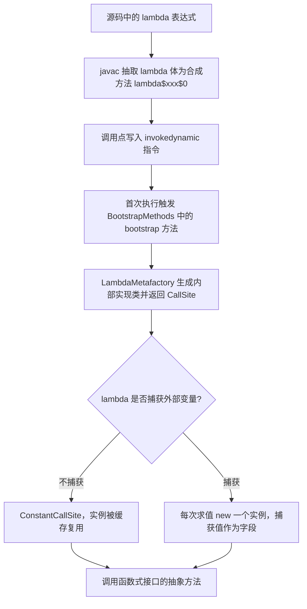
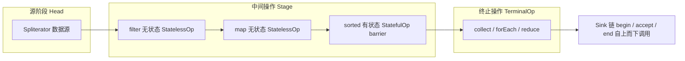
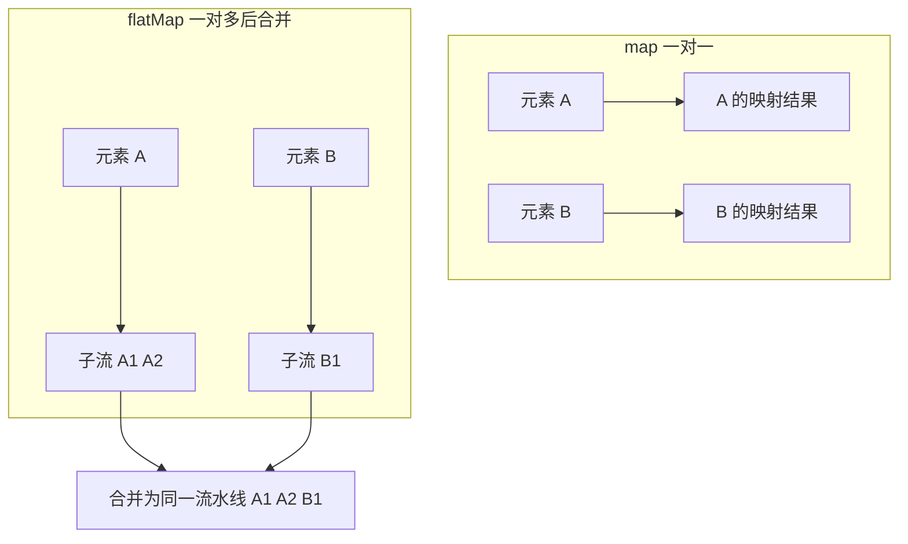
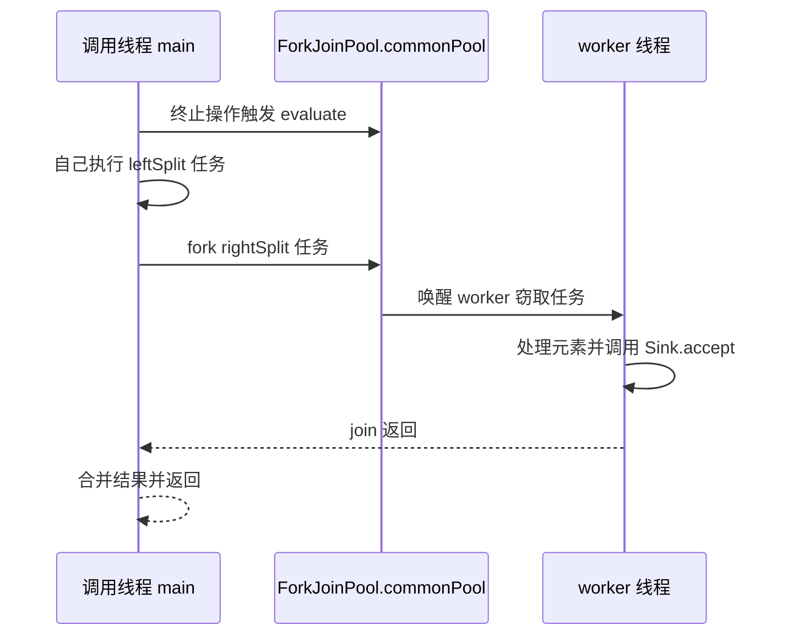
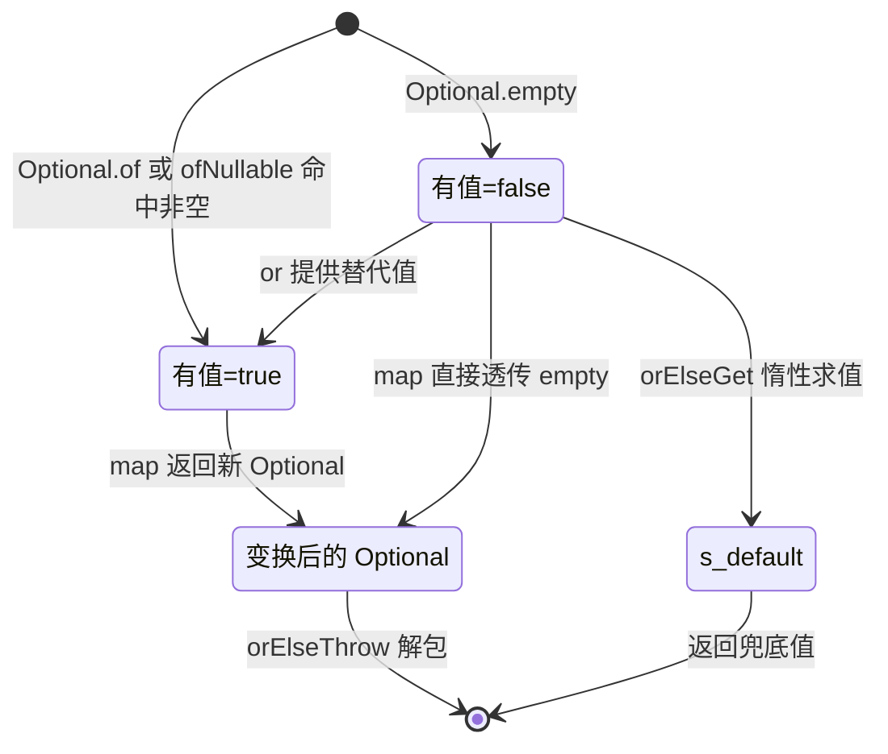
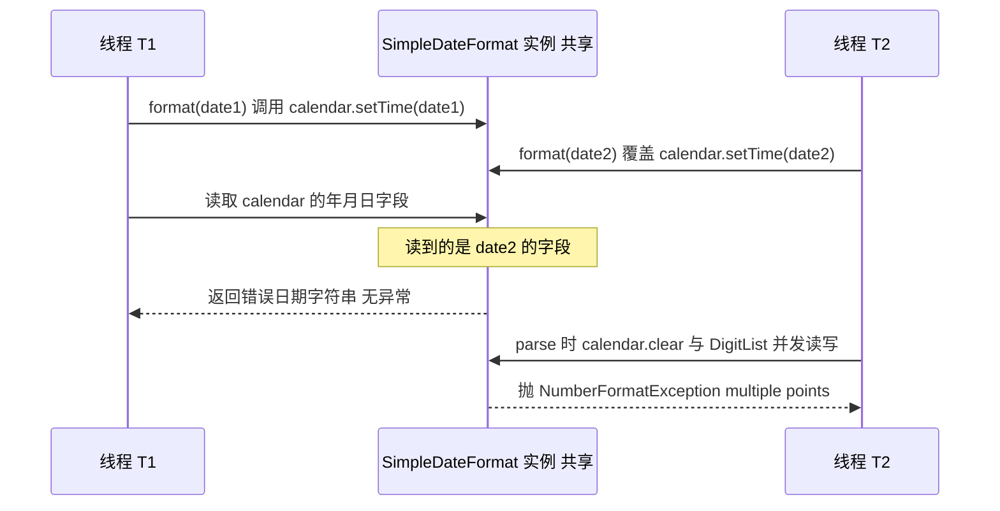
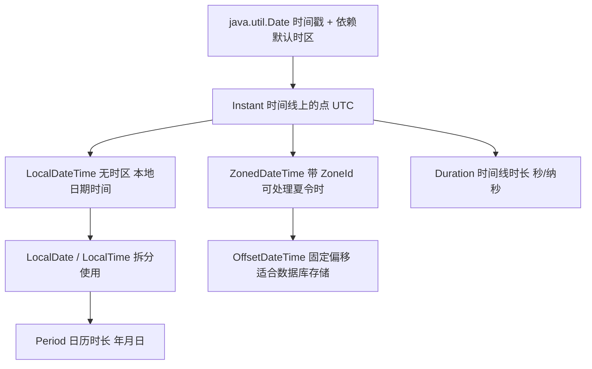
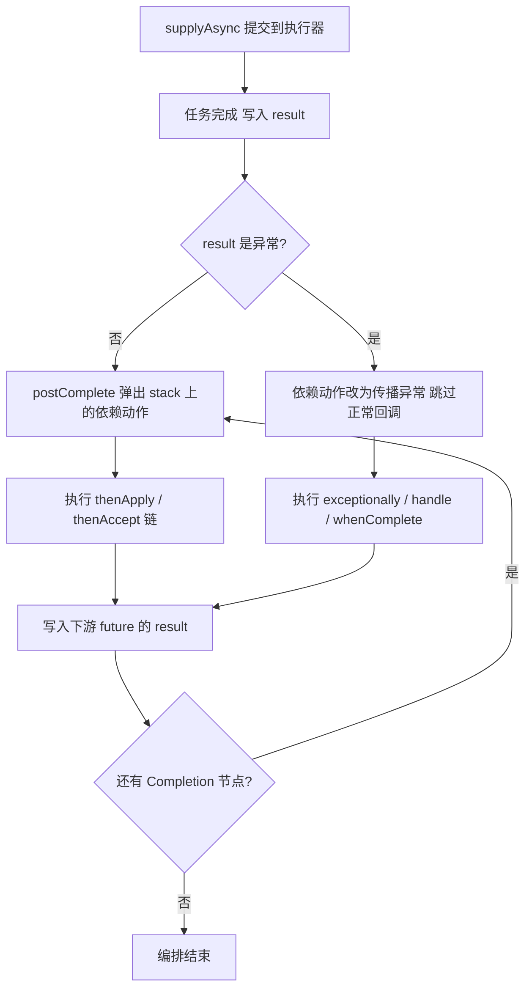
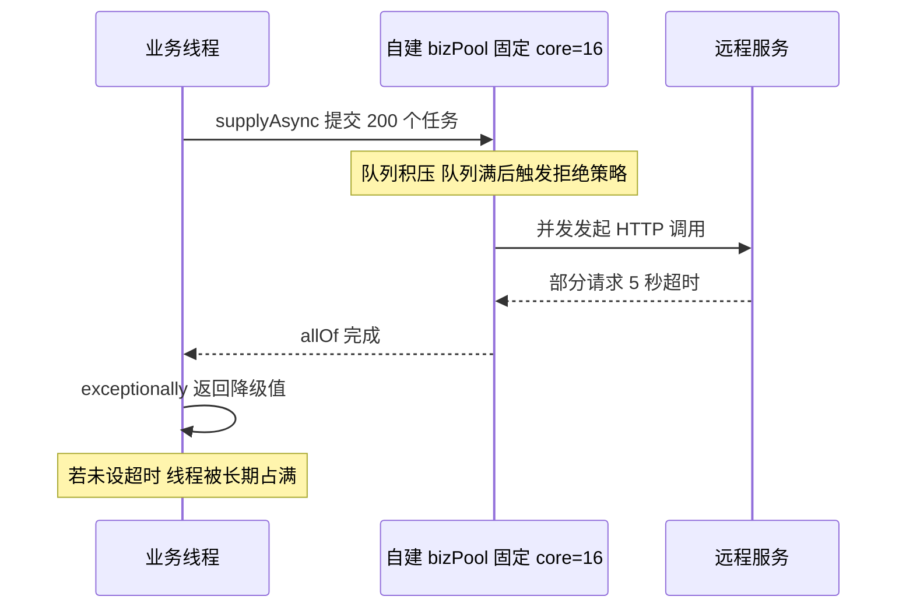
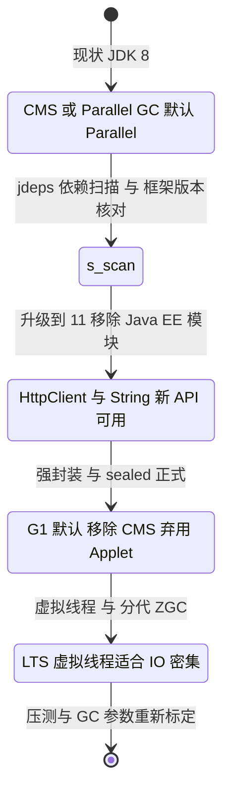

# 05 Java 8+ 新特性与函数式编程

> Lambda / Stream / Optional / CompletableFuture / 新日期 API / JDK 9-21 演进 ｜ 面试权重 ★★★★★ ｜ 建议复习 60 分钟

## 本章大纲

- [一、Lambda 与函数式接口](#一lambda-与函数式接口)
- [二、Stream：惰性求值、执行顺序与并行](#二stream惰性求值执行顺序与并行)
- [三、Optional：正确用法与反模式](#三optional正确用法与反模式)
- [四、默认方法与接口演化](#四默认方法与接口演化)
- [五、新日期时间 API 与 SimpleDateFormat 线程安全](#五新日期时间-api-与-simpledateformat-线程安全)
- [六、CompletableFuture 异步编排](#六completablefuture-异步编排)
- [七、JDK 9-21 重要特性速览](#七jdk-9-21-重要特性速览)
- [高频面试题](#高频面试题)
- [易错点与踩坑](#易错点与踩坑)
- [一句话速记](#一句话速记)

---

## 一、Lambda 与函数式接口

### 1.1 Lambda 的落点：invokedynamic 与 LambdaMetafactory

面试常问「Lambda 编译后是什么」。错误答案是「匿名内部类的语法糖」。准确说法：**Lambda 不生成独立的内部类文件，而是通过 `invokedynamic` 指令在运行时绑定一个函数式接口的实现**（JDK 8 起，JEP 126）。

编译期与运行期的分工：

| 阶段 | 产物 | 关键类/属性 |
| --- | --- | --- |
| javac 编译 | 方法体被抽取成 `private static` 合成方法 `lambda$main$0` | `MethodParameters`、合成方法名以 `lambda$` 开头 |
| javac 编译 | 调用点生成 `invokedynamic` 指令，签名为函数式接口的抽象方法 | class 文件 `BootstrapMethods` 属性 |
| 首次执行 | JVM 调用 bootstrap 方法，得到 `CallSite` | `java.lang.invoke.LambdaMetafactory#metafactory` |
| 后续执行 | 直接通过 `CallSite` 拿到接口实现实例并调用 | `ConstantCallSite` 或 `MutableCallSite` |

关键方法签名（JDK 8 起固定，9-21 未变）：

```java
// java.lang.invoke.LambdaMetafactory
public static CallSite metafactory(MethodHandles.Lookup caller,
                                   String invokedName,
                                   MethodType invokedType,
                                   MethodType samMethodType,
                                   MethodHandle implMethod,
                                   MethodType instantiatedMethodType)

// 方法引用（构造器/方法引用）走这个，多一个 altMetafactory 还能声明"可序列化"
public static CallSite altMetafactory(MethodHandles.Lookup caller,
                                      String invokedName,
                                      MethodType invokedType,
                                      Object... args)
```



必须记住的几个结论：

1. **无状态（不捕获变量）的 Lambda 只会创建一个实例**，由 `ConstantCallSite` 缓存；这也是「Lambda 比匿名内部类省内存」的底层原因。
2. **捕获变量的 Lambda 每次求值都会新建实例**，捕获的值会成为该实例的 `final` 字段。因此在热点路径里捕获大对象，会带来额外分配压力。
3. Lambda 的类名形如 `com.example.Demo$$Lambda$1/0x0000000800c00a40`（斜杠后是 JVM 分配的隐藏类地址）。想看真实字节码：JDK 8 用 `-Djdk.internal.lambda.dumpProxyClasses=<dir>`，JDK 9+ 同样支持该参数；还可以 `javap -c -p Demo.class` 看 `invokedynamic` 与 `lambda$` 方法。
4. **Lambda 不是 `Serializable`**，除非函数式接口显式继承 `Serializable`（此时走 `altMetafactory`，生成 `$deserializeLambda$` 方法）。这也是很多框架（如某些 RPC / 缓存注解）必须自定义 `Serializable` 函数式接口的原因。
5. Lambda 内 `this` 指向**外围实例**，匿名内部类的 `this` 指向匿名类自身。这是两者最容易踩的行为差异。

### 1.2 函数式接口的判定

函数式接口 = **有且仅有一个抽象方法**的接口（`@FunctionalInterface` 只是编译期校验，非必需）。判定细则：

- `default` 方法、`static` 方法不计入抽象方法。
- 覆盖 `java.lang.Object` 的 `public` 方法（`equals`、`hashCode`、`toString`）**不计入**。典型例子：`Comparator<T>` 既有 `int compare(T,T)` 抽象方法，又有 `boolean equals(Object)` 声明，它仍然是标准函数式接口。
- 接口若重新声明了父接口的方法但没有新抽象方法，仍可能是函数式接口。
- **抽象类即使只有一个抽象方法也不能用 Lambda**，Lambda 只能赋给函数式接口类型。

| 接口 | 抽象方法 | 入参 | 出参 | 典型用途 |
| --- | --- | --- | --- | --- |
| `Function<T,R>` | `R apply(T t)` | 1 | 1 | 转换、映射 |
| `Consumer<T>` | `void accept(T t)` | 1 | 0 | 遍历、副作用 |
| `Supplier<T>` | `T get()` | 0 | 1 | 延迟创建、工厂 |
| `Predicate<T>` | `boolean test(T t)` | 1 | 1(boolean) | 过滤 |
| `BiFunction<T,U,R>` | `R apply(T,U)` | 2 | 1 | 两参合并 |
| `UnaryOperator<T>` | `T apply(T)`（继承 `Function<T,T>`） | 1 | 1(同类型) | `list.replaceAll` |
| `BinaryOperator<T>` | `T apply(T,T)`（继承 `BiFunction<T,T,T>`） | 2 | 1(同类型) | `reduce`、`Collectors.toMap` 的 merge |
| `BiConsumer<T,U>` | `void accept(T,U)` | 2 | 0 | `Map.forEach` |
| `BiPredicate<T,U>` | `boolean test(T,U)` | 2 | 1 | 双条件 |
| `Runnable` / `Callable<V>` | `void run()` / `V call()` | 0 | 0 / 1 | 线程、异步任务 |

原始类型特化（避免装箱，JDK 8 起在 `java.util.function` 下）：

- 入参特化：`IntFunction<R>`、`IntPredicate`、`IntConsumer`、`IntSupplier`、`IntUnaryOperator`、`IntBinaryOperator`、`ToIntFunction<T>`、`ToIntBiFunction<T,U>`。
- 出入参都特化：`IntToLongFunction`、`IntToDoubleFunction`、`LongToIntFunction` 等组合。
- 为什么重要：`Stream<Integer>` 每个元素都是引用，`mapToInt`/`IntStream` 可以省掉 `Integer` 的装箱与缓存查找，在千万级数值计算里差几倍。

### 1.3 方法引用的 5 种形式

| 形式 | 写法 | 等价 Lambda | 说明 |
| --- | --- | --- | --- |
| 静态方法引用 | `Integer::parseInt` | `s -> Integer.parseInt(s)` | 最常见 |
| 绑定实例的方法引用 | `System.out::println` | `x -> System.out.println(x)` | 接收者固定 |
| 未绑定实例方法引用 | `String::length` | `s -> s.length()` | 第一个参数作为接收者 |
| 构造器引用 | `ArrayList::new` | `() -> new ArrayList<>()` | 按接口签名匹配重载 |
| 数组构造器引用 | `String[]::new` | `n -> new String[n]` | `Stream#toArray` 常用 |

未绑定引用在 `Stream` 里最常考：

```java
// 语义：对每个字符串调用 str.length()，而不是 String.length(str)
List<String> words = List.of("a", "bb", "ccc");
List<Integer> lens = words.stream().map(String::length).collect(Collectors.toList()); // [1,2,3]

// BiFunction 场景：第一个参数是接收者
BiFunction<String, String, Boolean> startsWith = String::startsWith; // (s, p) -> s.startsWith(p)
```

### 1.4 变量捕获与 effectively final

Lambda / 匿名内部类只能捕获 **final 或 effectively final** 的局部变量。原因不是语法洁癖，而是实现约束：Lambda 捕获的值是被**拷贝**到生成的实现类字段里的，若允许多次赋值，拷贝语义会与直觉不符（这也是它不能等价于闭包引用同一变量槽的原因）。

```java
int base = 10;
// base = 20; // 打开这行则下方编译失败：local variables referenced from a lambda expression must be final or effectively final
Function<Integer, Integer> f = x -> x + base;
```

对**实例字段、静态字段、数组元素**没有这个限制（它们通过 `this` 或类引用访问，不进入捕获列表）：

```java
int[] counter = {0};
List.of(1, 2, 3).forEach(x -> counter[0] += x); // 合法，但线上代码请改用原子类或 reduce
```

### 1.5 为什么不用匿名内部类：设计权衡

| 维度 | Lambda | 匿名内部类 |
| --- | --- | --- |
| 类文件数量 | 0（运行期生成隐藏类） | 每个一次编译产物 `Outer$1.class` |
| 无状态实例 | 复用单例 | 每次 `new` 一个新对象 |
| 启动成本 | 首次调用点需 bootstrap，冷启动首次略慢 | 类加载即完成 |
| 可读性 | 表达式级 | 语句级，容易堆成"回调地狱" |
| 能力 | 只能实现函数式接口，不能有字段、不能覆写 `Object` 方法 | 可以有字段、可以有多个方法 |
| `this` 语义 | 外围实例 | 内部类自身 |

**选择结论**：只要接口满足函数式接口且逻辑不超过 3~5 行，用 Lambda；需要局部状态、多方法、或需要 `this` 指向自身（如某些回调注册要求）时用匿名内部类或真正的类。

---

## 二、Stream：惰性求值、执行顺序与并行

### 2.1 Stream 的三段式结构与惰性求值

`java.util.stream.Stream` 的实现骨架在 `java.util.stream.AbstractPipeline`，分为三种节点：

- `Head`（`ReferencePipeline.Head` / `IntPipeline.Head`）：包装数据源 `Spliterator` 与源描述 `sourceStage`。
- `StatelessOp`：`filter`、`map`、`flatMap`、`peek` 等无状态中间操作。
- `StatefulOp`：`sorted`、`distinct`、`limit`、`skip`、`takeWhile`、`dropWhile` 等有状态中间操作。
- 终止操作由 `TerminalOp` 实现：`ForEachOps`、`ReduceOps`、`FindOps`、`MatchOps`、`Collectors` 驱动的 `ReduceOps.makeRef`。

**中间操作只是构造链表**，每个操作把自己包装成新的 `AbstractPipeline`，前一阶段通过 `previousStage` 反向引用，最终在终止操作里由 `AbstractPipeline#evaluate` 触发一次**从上到下的 `Sink` 链**（`Sink` 接口只有三个方法：`begin(long size)`、`accept(T)`、`end()`）。



惰性求值带来三条必须能背的结论：

1. **没有终止操作，中间操作一行都不会执行**（流水线只被构建，未被消费）。
2. **每个元素尽量一次走完整个链条**（loop fusion / 垂直执行），而不是「先全部 filter 完，再全部 map」。这也是 `filter(...).map(...).findFirst()` 中 `map` 调用次数可能远小于元素总数的原因。
3. **短路操作可以提前结束流水线**：`findFirst`、`findAny`、`anyMatch`、`allMatch`、`noneMatch`、`limit`。`Stream.iterate` 若不加限制，配合 `limit` 才能安全使用（JDK 9 起还有 `iterate(seed, hasNext, next)` 三参重载）。

```java
// 垂直执行验证：只打印 map 到的元素，filter 掉的不会进入 map
Stream.of("a", "bb", "ccc", "dddd")
      .filter(s -> s.length() > 2)
      .map(s -> { System.out.println("map:" + s); return s.toUpperCase(); })
      .findFirst();  // 只输出 map:ccc，findFirst 立刻短路
```

### 2.2 中间操作 / 终止操作全景与有状态性

| 操作 | 类型 | 有状态 | 短路 | 备注 |
| --- | --- | --- | --- | --- |
| `filter(Predicate)` | 中间 | 否 | 否 | 无状态 |
| `map(Function)` | 中间 | 否 | 否 | 一对一 |
| `flatMap(Function)` | 中间 | 否 | 否 | 一对多并扁平化 |
| `mapToInt/mapToLong/mapToDouble` | 中间 | 否 | 否 | 返回特化流，避免装箱 |
| `peek(Consumer)` | 中间 | 否 | 否 | 仅调试；JDK 9+ 在 `count()` 为终止操作时可能完全不执行 |
| `distinct()` | 中间 | **是** | 否 | 内部用 `LinkedHashSet` 保序去重 |
| `sorted()` | 中间 | **是** | 否 | 全量缓存到数组后 `Arrays.sort` |
| `limit(n)` / `skip(n)` | 中间 | **是** | 是 | 设置 barrier，与 `sorted` 组合时顺序敏感 |
| `takeWhile` / `dropWhile` | 中间 | **是** | 是 | JDK 9 起提供，需要记住"前面是否已判定失败" |
| `forEach(Consumer)` | 终止 | - | 否 | 并行时无序 |
| `forEachOrdered(Consumer)` | 终止 | - | 否 | 并行时保证遭遇顺序，代价是同步 |
| `collect(Collector)` | 终止 | - | 否 | 最常用 |
| `reduce(...)` | 终止 | - | 否 | 三参版本可并行归约 |
| `count()` | 终止 | - | 否 | 见 2.6 的 JDK 9 优化 |
| `min/max/count/sum/average` | 终止 | - | 否 | 特化流直接提供 |
| `findFirst/findAny` | 终止 | - | 是 | `findAny` 并行下更快 |
| `anyMatch/allMatch/noneMatch` | 终止 | - | 是 | 命中即停 |

**有状态操作是性能杀手**：`sorted` 必须消费完上游全部元素，遇到它的位置会把流水线切成两段，前面那段的惰性与短路能力全部失效。

### 2.3 map 与 flatMap 的区别

- `map(Function<T,R>)`：**一对一**，`n` 个元素进，`n` 个元素出，元素类型可以变。
- `flatMap(Function<T,Stream<R>>)`：**一对多**，每个元素展开成一个流，再把所有流**拼接扁平化**成一个流（实现上类似 `Stream.concat` 的惰性版本，用 `flatMap` 的 `Sink` 在 `accept` 内部再灌入子流）。

| 维度 | map | flatMap |
| --- | --- | --- |
| 基数关系 | 1:1 | 1:N（N 可为 0） |
| 函数返回类型 | 普通值 `R` | `Stream<R>`（JDK 16+ 也可用 `mapMulti` 避免建流） |
| 结果结构 | `Stream<R>` | 扁平后的 `Stream<R>`，不会出现嵌套 |
| 典型用途 | 字段提取、类型转换 | 拆词、展开子集合、`Optional` 序列扁平化 |
| 空集合语义 | 会保留一个元素（值可能是空集合） | 可直接"消失"该元素 |

```java
// 需求：List<Order> 展开所有商品名
List<String> names = orders.stream()
        .flatMap(o -> o.getItems().stream())   // Stream<Item>
        .map(Item::getName)
        .collect(Collectors.toList());

// 反例：map 会得到 Stream<Stream<Item>>，无法直接 collect 成 List<Item>
// List<Stream<Item>> wrong = orders.stream().map(Order::getItems).collect(toList());

// JDK 9 起 Optional 也能扁平化
List<String> v = list.stream().map(this::findName).flatMap(Optional::stream).collect(Collectors.toList());
```



### 2.4 parallelStream：ForkJoin、commonPool 与线程池陷阱

`parallelStream()` 等价于 `stream().parallel()`，它在 `Head` 阶段把 `sourceStage.parallel` 置为 `true`；终止操作执行时由 `ForkJoinTask` 把 `Sink` 包装成任务提交到 **`ForkJoinPool.commonPool()`**。

关键事实（JDK 8 起一致）：

- `commonPool` 是**全 JVM 共享**的静态池，线程为 **daemon**，名字形如 `ForkJoinPool.commonPool-worker-1`。
- 默认并行度 = `Math.max(1, Runtime.getRuntime().availableProcessors() - 1)`，可用系统属性 `java.util.concurrent.ForkJoinPool.common.parallelism` 覆盖（JDK 10 起 `availableProcessors` 具备容器感知，受 cgroup CPU quota 影响）。
- **调用线程也会参与干活**：`ForkJoinTask.invoke` 由外部线程调用时会自己 fork/join 并执行一部分任务，所以主线程栈里通常也能看到 `AbstractPipeline#evaluate`。
- 拆分能力取决于 `Spliterator#trySplit`：`ArrayList`、数组、`IntStream.range` 拆得好；`LinkedList`、`Stream.iterate`、`BufferedReader.lines` 几乎拆不动，并行退化为串行。



线上必须知道的 6 个坑：

1. **阻塞任务会拖垮全局**：`parallelStream` 里做 HTTP / DB 调用，会把 `commonPool` 的 worker 全部阻塞，导致其他业务（也包括 `CompletableFuture` 未指定 executor 的异步任务）排队。JDK 不提供官方 API 让 `parallelStream` 使用自定义池，只能靠 `CompletableFuture` + 自建 `ThreadPoolExecutor` 替代。
2. **`ThreadLocal` / MDC 丢失**：worker 线程复用的是池线程，`TraceId`、`SecurityContext` 不会跟随主线程，日志链路断掉，`SecurityContextHolder` 可能取到上一个请求的上下文（脏读）。
3. **有状态 Lambda 会丢数据**：`ArrayList.add` 在并行流下非线程安全，可能出现元素丢失或 `ArrayIndexOutOfBoundsException`。要并行收集就用 `collect(Collectors.toList())` 或 `Collectors.toConcurrentMap`。
4. **顺序不确定**：`forEach` 用 `forEachOrdered` 才保证遭遇顺序；`findFirst` 在并行流里代价高于 `findAny`。
5. **HashMap 不是并发安全的**：`Collectors.toMap` 的合并函数要到 `combiner` 阶段才触发，不要在 `accumulator` 里写共享可变状态。
6. **小数据量更慢**：任务拆分、`ForkJoinTask` 调度、结果合并都有固定成本。经验阈值：元素少于约 1 万、或单个元素处理耗时为纳秒级时，串行 `for` 通常更快；真正收益来自**数据量大 + 单元素计算重 + 无阻塞**。

### 2.5 Collectors 常用收集器

`java.util.Collectors` 是 `Collector` 的工厂类。`Collector<T,A,R>` 由 5 个部件组成：`supplier()`、`accumulator()`、`combiner()`、`finisher()`、`characteristics()`。

- `Characteristics.CONCURRENT`：累加器可被多线程同时调用（此时忽略 `combiner`）。
- `Characteristics.UNORDERED`：不保证遭遇顺序，允许优化。
- `Characteristics.IDENTITY_FINISH`：`finisher` 是恒等函数，避免最后的类型转换。

| 收集器 | 返回 | 关键点 |
| --- | --- | --- |
| `toList()` | `ArrayList` | 可变；JDK 16 起 `Stream#toList` 返回不可变列表，别混用 |
| `toSet()` | `HashSet` | 无序 |
| `toCollection(LinkedHashSet::new)` | 指定集合 | 需要保序时用 |
| `toMap(k, v)` | `HashMap` | **key 冲突抛 `IllegalStateException: Duplicate key`；value 为 null 抛 NPE** |
| `toMap(k, v, mergeFn)` | `HashMap` | 冲突时用 `mergeFn` 决定保留谁 |
| `toMap(k, v, mergeFn, LinkedHashMap::new)` | 指定 Map | 需要稳定顺序时 |
| `toUnmodifiableList/Set/Map` | 不可变集合 | JDK 10 起 |
| `groupingBy(classifier)` | `HashMap<K,List<T>>` | classifier 返回 **null 抛 NPE**，先 `filter(Objects::nonNull)` |
| `groupingBy(classifier, downstream)` | `HashMap<K, R>` | 下游 `counting/mapping/summingInt` |
| `groupingBy(classifier, mapFactory, downstream)` | 指定 Map | 需要 `TreeMap`/`LinkedHashMap` |
| `groupingByConcurrent(...)` | `ConcurrentHashMap` | 仅并行流有收益 |
| `partitioningBy(predicate)` | `Map<Boolean,List<T>>` | 一定有两个 key，`true` 与 `false` 都可能为空列表 |
| `counting()` | `Long` | 返回 `Long` 不是 `Integer` |
| `summingInt()` / `averagingInt()` | `Integer` / `Double` | `summingInt` 会**静默整型溢出**，大数用 `mapToLong().sum()` |
| `joining(delim, prefix, suffix)` | `String` | 内部 `StringBuilder`，非线程安全但每段独立 |
| `mapping(fn, downstream)` | 下游类型 | 分组后先映射再收集 |
| `reducing(...)` | 自定义 | 三参版本用于并行归约 |
| `collectingAndThen(downstream, fn)` | fn 返回值 | 例如收集后转不可变 |
| `teeing(c1, c2, merger)` | merger 返回值 | **JDK 12 起**，一趟流同时算两个收集器 |

```java
// 分组 + 二次统计：按状态分组后取金额总和（金额用 long 防溢出）
Map<Status, Long> amountByStatus = orders.stream()
        .collect(Collectors.groupingBy(Order::getStatus,
                 Collectors.summingLong(Order::getAmountCent)));

// key 冲突示例：同一 userId 多条记录，必须给 merge 函数
Map<Long, Order> latest = orders.stream().collect(Collectors.toMap(
        Order::getUserId,
        Function.identity(),
        (a, b) -> a.getCreateTime().isAfter(b.getCreateTime()) ? a : b));

// JDK 12 teeing：一次遍历同时求最大最小值，merger 返回 Map.Entry（JDK 9 起）
Map.Entry<Integer, Integer> mm = IntStream.of(3, 1, 9).boxed().collect(Collectors.teeing(
        Collectors.minBy(Integer::compareTo),
        Collectors.maxBy(Integer::compareTo),
        (lo, hi) -> Map.entry(lo.orElse(0), hi.orElse(0))));
```

自定义 `Collector` 时最容易忽略的是 `combiner`：**并行流分段收集后再合并，`combiner` 写错（例如直接返回 `a`）在串行下完全正常，上量后结果就错**。

### 2.6 Stream 的性能与适用边界

| 场景 | 建议 | 原因 |
| --- | --- | --- |
| 简单遍历累加、元素少 | 普通 `for` / `for-each` | 无流水线对象与 `Sink` 调用开销 |
| 多步转换 + 过滤（≥2 个中间操作） | `Stream` | 可读性提升明显，性能差异通常可忽略 |
| 数值密集计算 | `IntStream/LongStream` | 免装箱，`mapToInt` 后 `sum()` |
| 需要提前退出 | `findFirst/anyMatch` 或 `for` + `break` | `Stream` 需要一个短路终止操作才能提前结束 |
| 元素量 ≥ 十万且无阻塞 | `parallelStream` | 拆分收益超过调度成本 |
| 需要远程调用/DB | **禁用 parallelStream** | 污染 `commonPool` |
| 需要索引 | `IntStream.range(0, size)` | `Stream` 本身无下标 |
| 调试 | `peek` | 生产环境不要用 `peek` 承载业务逻辑 |

JDK 9 的一个行为变化必须记住：`Stream#count` 的实现允许在**流大小可静态推断**时跳过整个流水线。因此

```java
Stream.of(1, 2, 3).peek(System.out::println).count(); // JDK 9+ 可能什么都不打印
```

正确用法是把 `peek` 结果收集起来，或改用 `forEach`。反过来，`filter` 之后 `SIZED` 标志被清除，`count()` 就必然要真实执行。

另外，`Stream` 是**一次性**的：终止操作执行后，再调用任何方法都会抛 `IllegalStateException: stream has already been operated upon or closed`。需要复用就抽成 `Supplier<Stream<T>>`。

---

## 三、Optional：正确用法与反模式

### 3.1 设计意图

`java.util.Optional<T>`（JDK 8 起）是**返回值容器**，用来在**类型签名层面**表达「这个方法的返回值可能不存在」，把 `null` 检查从调用方的心智负担变成编译期可见的 API 契约。`java.util.Optional` 从 JDK 16 起被标注为值类型类（`@jdk.internal.ValueBased`）——**依赖对象标识的操作（`==` 比较、`System.identityHashCode`、`synchronized` 加锁）语义不可预测，必须避免**。

它不是「空的替代品」，也不是「所有 null 的解药」。设计者的本意（Brian Goetz 的表述）：Optional 主要用于**方法返回值**，其次可用于 `Stream` 的管道操作；作为字段、参数、集合元素都是误用。

### 3.2 正确用法

```java
// 创建
Optional<String> a = Optional.of("x");        // value 为 null 立即抛 NPE
Optional<String> b = Optional.ofNullable(x);  // 推荐：可能为 null 时用
Optional<String> c = Optional.empty();

// 取值
String v1 = opt.orElse("default");                 // 参数被立即求值
String v2 = opt.orElseGet(() -> slowDefault());    // 惰性，仅在 empty 时调用
String v3 = opt.orElseThrow(() -> new BizException("not found"));
String v4 = opt.orElseThrow();                     // JDK 10 起无参重载，抛 NoSuchElementException

// 变换
Optional<Integer> len = opt.map(String::length);          // 值为 null 时 map 返回 empty
Optional<String> flat = opt.flatMap(this::parseOpt);      // 函数本身返回 Optional 时用 flatMap
Optional<String> filtered = opt.filter(s -> s.length() > 3);

// 消费
opt.ifPresent(this::send);
opt.ifPresentOrElse(this::send, () -> log.warn("empty")); // JDK 9 起
Optional<String> alt = opt.or(() -> cached());            // JDK 9 起，empty 时换一个 Optional
Stream<String> s = opt.stream();                          // JDK 9 起，0 或 1 个元素的流
boolean empty = opt.isEmpty();                            // JDK 11 起
```

`Optional` 的核心不变式是：**永远不要用 `isPresent()` + `get()` 的组合**——它只是把 `x != null` 换了个写法，还多了一个对象分配。真正推荐的是 `map/flatMap/filter/orElseGet/ifPresentOrElse` 这类无分支风格。

### 3.3 反模式清单

| 反模式 | 问题 | 正确做法 |
| --- | --- | --- |
| 字段用 `Optional` | 每个对象多一个引用，序列化不友好（`Optional` **未实现 `Serializable`**，JDK 未提供序列化支持） | 字段直接留 `null`，用 `@Nullable` 注解 |
| 方法参数用 `Optional` | 调用方被迫包装，且无法重载区分 | 用重载，或明确文档化可为 null |
| 集合元素用 `Optional` | `List<Optional<T>>` 直接返回空集合更好 | 返回空集合 `Collections.emptyList()` |
| 返回 `Optional<List<T>>` | 语义重复：空列表已表达"没有" | 返回 `List<T>`，可为空列表 |
| `Optional.of(null)` | 直接 NPE，不是返回 empty | `Optional.ofNullable` |
| `opt.get()` 前只 `isPresent()` | 冗余分支，且并发下有竞态 | `orElseGet` / `ifPresentOrElse` |
| 在热点路径大量使用 | 每个返回值一次堆分配，年轻代压力上升 | 极致性能场景返回 null 并在文档上说明 |
| `Stream.map(Optional::get)` | 空 Optional 抛 `NoSuchElementException` | 用 `flatMap(Optional::stream)`（JDK 9+） |
| 用 `Optional` 做缓存值 | 空结果语义混乱，需要 `Optional<Optional<T>>` | 用 `LoadingCache` 或哨兵对象 |
| `synchronized (optional)` | 值类型类，对象标识不可依赖，加锁语义不可预测 | 用独立锁对象 |



### 3.4 与 `null` 的边界：什么时候仍然用 null

- **DTO / 实体字段**：JPA、MyBatis、Jackson 与 `Optional` 配合都很别扭，字段继续用 `null` 并用 `@Nullable` / `@NonNull` 表达。
- **私有方法内部**：调用链短、契约清楚时用 null 更快。
- **集合**：返回空集合，不要返回 null，也不要返回 `Optional`。
- **Map#get**：用 `getOrDefault`、`computeIfAbsent`、`putIfAbsent`（JDK 8 起），比 `Optional.ofNullable(map.get(k))` 更直接。

---

## 四、默认方法与接口演化

### 4.1 默认方法解决的真实问题

JDK 8 引入 `default` 方法（JEP 126 的配套能力），动机有两个：

1. **接口演化**：`Collection` 在 JDK 8 新增了 `stream()`、`parallelStream()`、`forEach()`、`removeIf()`、`spliterator()`。如果没有默认方法，所有第三方集合实现（Guava、Hibernate 的 `PersistentBag` 等）都要改代码，二进制兼容性被破坏。
2. **函数式组合**：让 `Comparator.thenComparing`、`Predicate.and/or/negate`、`Function.andThen/compose` 这类组合子可以不破坏现有实现地加进来。

二进制兼容性结论要背准：**向接口新增 `default` 方法，对已有实现类是二进制兼容的；新增抽象方法则不兼容（老实现类加载时 `AbstractMethodError`）**。

```java
public interface Cache<K, V> {
    V get(K key);
    void put(K key, V value);

    // JDK 8：默认方法可以调用抽象方法，也可以调用同类中的其他默认方法
    default V getOrDefault(K key, V fallback) {
        V v = get(key);
        return v != null ? v : fallback;
    }

    // JDK 8：接口可以有静态方法（不会被继承）
    static <K, V> Cache<K, V> noop() {
        return new Cache<K, V>() {
            @Override public V get(K key) { return null; }
            @Override public void put(K key, V value) { }
        };
    }

    // JDK 9：私有方法，供多个默认方法复用，不对外暴露
    private V loadIfAbsent(K key) {
        return get(key);
    }
}
```

接口成员的完整能力（JDK 8 起）：

| 成员 | JDK 8 | JDK 9+ |
| --- | --- | --- |
| `public static final` 常量 | 支持 | 支持 |
| 抽象实例方法 | 支持 | 支持 |
| `default` 实例方法 | 支持 | 支持 |
| `public static` 方法 | 支持（不被实现类继承） | 支持 |
| `private` 实例/静态方法 | **不支持** | 支持 |
| 实例字段 / 构造器 | 不支持 | 不支持 |

### 4.2 菱形冲突的三条解决规则

当一个类实现的多个接口（或父类与接口）提供了签名相同的默认方法时，编译期按以下优先级裁决：

1. **类优先**：父类中的**具体方法**（含抽象类的实现）永远胜出，接口默认方法被忽略。这样保证 JDK 7 的代码行为不因引入默认方法而改变。
2. **子接口优先**：若都是接口，取**最具体**的那个（子接口覆盖父接口）。
3. **显式声明**：若两条路径来自互不相关的接口，编译报错，必须在实现类中手动覆写，并用 `InterfaceName.super.method()` 选择。

```java
interface A { default String hello() { return "A"; } }
interface B { default String hello() { return "B"; } }

class C implements A, B {
    @Override
    public String hello() {
        return A.super.hello() + B.super.hello(); // 必须显式指定，否则编译失败
    }
}

class Base { public String hello() { return "Base"; } }
class D extends Base implements A { }  // D.hello() 返回 "Base"，类优先
```

注意：**接口不能用 `default` 覆写 `Object` 的方法**（`equals`、`hashCode`、`toString`），编译期报错 `default method overrides a member of java.lang.Object`。

### 4.3 接口 vs 抽象类的选型

| 维度 | 接口（含默认方法） | 抽象类 |
| --- | --- | --- |
| 多继承 | 可实现多个接口 | 只能继承一个类 |
| 状态 | 不能有实例字段 | 可以有实例字段 |
| 构造器 | 无 | 有 |
| 方法可见性 | 只能 `public`（JDK 9 起可有 `private`） | `protected` 等自由 |
| 演化 | 加 `default` 方法保持兼容 | 加具体方法天然兼容，加抽象方法不兼容 |
| 版本语义 | 能力契约（`Comparable`、`AutoCloseable`） | 模板方法、共享实现 |
| 与 Lambda 配合 | 单抽象方法即函数式接口 | 不能用 Lambda |

**选型结论**：领域「是什么」用抽象类，「能做什么」用接口；框架扩展点优先抽象类（可放状态与 `protected` 钩子），能力叠加用接口 + `default`。

---

## 五、新日期时间 API 与 SimpleDateFormat 线程安全

### 5.1 SimpleDateFormat 为什么线程不安全

`java.text.SimpleDateFormat` 继承 `java.text.DateFormat`。JDK 8 中真正导致线程不安全的是 `DateFormat` 上的两个 `protected` 可变字段，以及 `SimpleDateFormat` 自己的 `compiledPattern`/`formatData`：

```java
// java.text.DateFormat（JDK 8）—— 两个 protected 可变字段，所有实例共享的"状态坑"
protected Calendar calendar;          // 构造时通过 initializeCalendar(Locale) 创建
protected NumberFormat numberFormat;  // JDK 8 中是 DecimalFormat，内部持有可变 DigitList

// java.text.SimpleDateFormat（JDK 8）—— 与解析/格式化相关的可变状态
private String pattern;
private transient char[] compiledPattern;
private DateFormatSymbols formatData;
private Date defaultCenturyStart;     // 两位年份解析的基准（默认构造时间往前推 80 年）
private static final ConcurrentMap<Locale, NumberFormat> cachedNumberFormatData; // 静态缓存，容量 3
```

注意 JDK 8 里已经**没有** `parsedDate` 字段了（JDK 7 及以前有），`parse` 改用局部变量 + `CalendarBuilder`，但最终仍通过 `CalendarBuilder#establish` 写回共享的 `calendar`。

- `format(Date, StringBuffer, FieldPosition)` 内部执行 `calendar.setTime(date)`，然后按 `compiledPattern` 逐字段读取 `calendar`（字节码中可见 `Calendar.setTime` 与大量 `getfield calendar`）。
- `parse(String, ParsePosition)` 先用 `CalendarBuilder` 收集字段，最后 `establish(calendar)` 把结果写回**同一个** `calendar`，并借助共享的 `numberFormat`（`DecimalFormat` → 可变 `DigitList`）解析数字字段。
- `SimpleDateFormat#initialize(Locale)` 的行为（JDK 8 字节码）：先从静态缓存 `cachedNumberFormatData` 取 `NumberFormat`，取不到就 `NumberFormat.getIntegerInstance(locale)` + `setGroupingUsed(false)` 并 `putIfAbsent`；**最后一定调用 `numberFormat.clone()`**。`DecimalFormat#clone` 会显式克隆 `symbols` 与 `digitList`，因此**实例之间的 `NumberFormat` 是独立的** —— 不安全只发生在"同一个 `SimpleDateFormat` 实例被多线程共用"这一种情况下，这一点常被误传成"不同实例也会互相干扰"。

**同一个实例被多线程并发调用时**，两个线程会互相覆盖 `calendar` 与 `DigitList` 的内部状态，产生三类典型故障：

1. 格式化结果**串号**：A 请求的时间被 B 线程的时间覆盖，日志/落库出现别人的时间（最危险，静默错误，不抛异常）。
2. 抛 `java.lang.NumberFormatException: multiple points`：`DigitList#getDouble()` 用被并发破坏的 `digits[]`/`decimalAt` 拼出含多个小数点的字符串，再交给 `Double.parseDouble`，异常由 `sun.misc.FloatingDecimal`（JDK 8）抛出，消息就是 `multiple points`。
3. 抛 `java.lang.NumberFormatException: For input string: "..."`（来自 `DigitList#getLong()` 调用的 `Long.parseLong`）或 `java.lang.ArrayIndexOutOfBoundsException`，偶发、无法稳定复现。



### 5.2 四种解决方案对比

| 方案 | 线程安全 | 代价 | 适用 |
| --- | --- | --- | --- |
| 每次 `new SimpleDateFormat` | 安全 | 每次调用一次对象构造 + `Calendar` 初始化，QPS 高时 Young GC 上升 | 低 QPS 工具代码 |
| 方法上加 `synchronized` | 安全 | 同一实例串行化，成为吞吐瓶颈 | 不建议 |
| `ThreadLocal<SimpleDateFormat>` | 安全 | 每个线程一份实例；线程池场景注意内存占用；**必须 `remove()` 或用 `initialValue`** | 老代码改造 |
| 改用 `java.time.format.DateTimeFormatter` | 安全（不可变） | 需要改调用点，注意与 JDK 7 兼容性 | **新代码首选** |
| 引入 Joda-Time | 安全（不可变） | 额外依赖，JDK 8 后无必要 | JDK 7 时代产物 |

`ThreadLocal` 版本的写法要点：`ThreadLocal.withInitial(() -> new SimpleDateFormat("yyyy-MM-dd"))`。注意 `initialValue` 的实例随线程存活，线程池里的线程不会回收，所以**不要缓存超大 pattern 的实例**，并避免把 `ThreadLocal` 用在 `parallelStream` / `commonPool` 上（worker 线程的 ThreadLocal 会被长期保留）。

### 5.3 pattern 里的经典陷阱

| 写法 | 含义 | 陷阱 |
| --- | --- | --- |
| `yyyy` | year-of-era（公元纪年） | 在 `DateTimeFormatter` 中解析时需要 era，建议用 `uuuu` |
| `YYYY` | **week-based-year** | 每年 12 月底/1 月初会跳到下一年：`2019-12-30` 用 `YYYY-MM-dd` 得到 `2020-12-30` |
| `MM` / `mm` | 月 / 分 | 大小写写反是生产事故常客 |
| `dd` / `DD` | 月内日 / 年内日 | `DD` 在 12 月会得到 300 多的数字 |
| `hh` / `HH` | 12 小时制 / 24 小时制 | 上午 9 点用 `hh` 得到 `09`，下午得到 `09`（缺 AM/PM 就丢信息） |
| `SSS` | 毫秒 | 与 `ss`（秒）区分 |
| `Z` / `XXX` | 时区偏移 | `XXX` 输出 `+08:00`，`Z` 输出 `+0800` |

`DateTimeFormatter` 同理：解析年份请用 `uuuu`。

还有一个少见的坑：两位年份 `yy` 在解析时依赖 `SimpleDateFormat#defaultCenturyStart`（JDK 8 中为实例构造时间往前推 80 年，由 `initializeDefaultCentury` 里的 `Calendar.add(Calendar.YEAR, -80)` 设定，可用 `set2DigitYearStart` 调整），因此 `yy` 只适合展示，不适合跨世纪的日期解析。

```java
DateTimeFormatter f = DateTimeFormatter.ofPattern("uuuu-MM-dd HH:mm:ss");
LocalDateTime t = LocalDateTime.parse("2025-01-01 10:00:00", f);
```

### 5.4 java.time 的设计要点

JDK 8 起 `java.time`（JSR-310）替代 `Date`/`Calendar`，核心设计：

- **全部不可变**：`LocalDate`、`LocalTime`、`LocalDateTime`、`Instant`、`Duration`、`Period`、`ZonedDateTime`、`OffsetDateTime`、`ZoneId`、`ZoneOffset` 都是 `final` 且字段 `final`，因此天然线程安全，可作为常量复用。
- **时间线与日历分离**：`Instant`/`Duration` 表示**时间线上的点与量**（UTC，`Duration.between(a, b)` 得到精确时长）；`LocalDate`/`Period` 表示**日历语义**。`Period.between(LocalDate.of(2024,1,31), LocalDate.of(2024,2,29))` 返回 `P29D`（`months=0, days=29`）而不是 `P1M`，因为 2024-01-31 加 1 个月会越界。跨 DST 的"一天"用 `Duration` 是 23 或 25 小时，用 `Period` 才是 1 天。
- **时区必须显式**：`ZoneId.of("Asia/Shanghai")` 优于三位缩写 `CTT`/`PRC`（三位 id 是历史别名，语义模糊）。`ZoneId.systemDefault()` 依赖 `user.timezone` 与 `TZ`，容器里常为 UTC，**一定在应用启动时打印一次实际时区**。
- **精度**：`Instant`/`LocalTime` 支持到纳秒（`ChronoUnit.NANOS`），但 `System.currentTimeMillis()` 只有毫秒，`Instant.now()` 在 JDK 8 用 `Clock.systemUTC()` 也常为毫秒精度（JDK 9+ 平台上可能给到微秒）。做序列号/版本号时不要假设纳秒唯一。
- **计算 API**：`plusDays`、`minusMonths`、`with(TemporalAdjusters.lastDayOfMonth())`、`until`、`ChronoUnit.DAYS.between(a, b)`。
- **格式化**：`DateTimeFormatter.ISO_LOCAL_DATE_TIME`、`DateTimeFormatter.ofPattern(..., Locale.CHINA)`；`DateTimeFormatter` 不可变、线程安全，可以做成 `static final` 常量。



### 5.5 DST 与数据库协作的坑

夏令时（DST）会制造两类问题：

- **不存在的本地时间（gap）**：`America/New_York` 在 2023-03-12 02:00 跳到 03:00，`ZonedDateTime.of(2023,3,12,2,30,0,0,ny)` 会被**自动顺延**成 03:30，不报错。定时任务若按本地时间配置，当年会少执行一次。
- **重复的本地时间（overlap）**：2023-11-05 01:00~02:00 出现两次，`LocalDateTime.atZone(zone)` 默认取**较早**的偏移；要精确表达必须用 `ZonedDateTime.ofLocal(ldt, zone, preferredOffset)` 或直接存 `OffsetDateTime`。
- **结论**：跨时区/跨 DST 系统统一「**存储用 UTC（或 `Instant`），展示层再转本地时区**」。MySQL 中 `TIMESTAMP` 会按 `time_zone` 做转换，`DATETIME` 不做转换；选 `DATETIME` 存 UTC 更可控。

与 JDBC / Jackson 的对接：

- JDBC 4.2（Java 8）起支持 `PreparedStatement#setObject(int, LocalDateTime)` / `getObject(int, LocalDateTime.class)`；MySQL Connector/J 8.0 支持 `LocalDate`/`LocalDateTime`。
- Jackson 需要注册 `JavaTimeModule`（`jackson-datatype-jsr310`），并把 `SerializationFeature.WRITE_DATES_AS_TIMESTAMPS` 关闭（默认 `true` 会输出 `[2025,1,1,10,0,0]` 数组）；`LocalDateTime` 不携带时区，跨时区服务间传输建议统一用 `Instant` 或 `OffsetDateTime`。

---

## 六、CompletableFuture 异步编排

### 6.1 核心模型：result 与 Completion 栈

`java.util.concurrent.CompletableFuture`（JDK 8 起）同时实现 `Future` 与 `CompletionStage`。内部只有两个关键字段：

```java
// java.util.concurrent.CompletableFuture
volatile Object result;   // 正常结果是值，异常结果是 AltResult 包装
volatile Completion stack; // Treiber 栈，存放等待此 future 完成的后续动作
```

三条必须清楚的机制：

1. **每个非 Async 阶段默认不新建线程**：如果依赖的 future 已完成后注册回调，回调在**当前调用线程**执行；如果未完成，则由**完成该 future 的线程**执行。`Async` 后缀才提交到执行器。
2. **默认执行器**：无 executor 时使用 `ForkJoinPool.commonPool()`。JDK 8 中若 `ForkJoinPool.getCommonPoolParallelism() <= 1`，则改用 `ThreadPerTaskExecutor`（每任务一个线程）。JDK 9 起提供可覆写的 `defaultExecutor()` 方法。
3. **结果只写一次**：`complete(value)` / `completeExceptionally(t)` 只有第一次生效，返回 `boolean`。



### 6.2 thenApply / thenCompose / thenCombine 的语义区别

| 方法 | 入参函数 | 返回 | 语义 | 常见误用 |
| --- | --- | --- | --- | --- |
| `thenApply(fn)` | `Function<T,U>` | `CF<U>` | 同步转换结果 | 返回 `CompletableFuture<CF<U>>` 而不是平铺 |
| `thenApplyAsync(fn)` | 同上 | `CF<U>` | 用执行器跑 `fn` | 误以为能提升纯计算吞吐 |
| `thenCompose(fn)` | `Function<T,CompletionStage<U>>` | `CF<U>` | **扁平化**嵌套异步，串行依赖 | 需要串行时错用 `thenApply` |
| `thenCombine(other, fn)` | `BiFunction<T,U,V>` | `CF<V>` | 两个**独立** future 并行后合并 | 用 `thenCompose` 写成串行，白白串行化 |
| `thenAccept(fn)` | `Consumer<T>` | `CF<Void>` | 消费结果，无返回 | 在链尾忘记处理异常 |
| `runAsync(fn)` / `runAfterBoth` | `Runnable` | `CF<Void>` | 无返回值任务 | - |
| `thenAcceptBoth` | `BiConsumer<T,U>` | `CF<Void>` | 两结果都消费 | - |
| `applyToEither` | `Function<T,U>` | `CF<U>` | 谁先完成用谁 | 与 `anyOf` 混淆 |

```java
// 串行 RPC A -> B：必须 thenCompose，否则得到 CompletableFuture<CompletableFuture<B>>
CompletableFuture<Order> flow = rpc.order(id)
        .thenCompose(order -> rpc.user(order.getUserId())
                .thenApply(user -> order.withUser(user)));

// 并行 RPC A | B：thenCombine 让两者同时发出
CompletableFuture<Detail> detail = rpc.order(id)
        .thenCombine(rpc.stock(id), (o, s) -> new Detail(o, s));
```

`thenApply` 与 `thenCompose` 的区别可以用一句话收口：**函数返回的是普通值就用 `thenApply`，返回的是 `CompletionStage` 就用 `thenCompose`**（与 `map` / `flatMap` 的关系完全同构）。

### 6.3 allOf / anyOf 与结果收集

- `static CompletableFuture<Void> allOf(CompletableFuture<?>... cfs)`：全部完成才完成；**不携带结果**，必须自己 `join` 每个子任务。
- `static CompletableFuture<Object> anyOf(CompletableFuture<?>... cfs)`：任意一个完成即完成，结果是**第一个完成者的原始值**（用 `Object` 承载，JDK 8 无泛型支持）。
- **`allOf` 不会因为一个任务失败就取消其他任务**，且只要有一个失败，`allOf` 的结果就是失败（异常可能只是其中一个）。生产上要么全成功语义 + 失败快速返回，要么用 `exceptionally` 兜住每个子任务再聚合。

```java
// 标准收集写法：先拆分任务，再 allOf 阻塞，再逐个 join（join 不会真的阻塞，因为已全部完成）
List<CompletableFuture<Price>> tasks = skus.stream()
        .map(sku -> CompletableFuture.supplyAsync(() -> remotePrice(sku), bizPool))
        .collect(Collectors.toList());

List<Price> prices = CompletableFuture.allOf(tasks.toArray(new CompletableFuture[0]))
        .thenApply(v -> tasks.stream().map(CompletableFuture::join)
                             .collect(Collectors.toList()))
        .exceptionally(ex -> Collections.emptyList())
        .join();
```

### 6.4 异常处理与超时

| 方法 | 能否恢复 | 能否改类型 | 说明 |
| --- | --- | --- | --- |
| `exceptionally(fn)` | 是（返回同类型默认值） | 否 | 只在异常时执行，函数签名 `Function<Throwable,T>` |
| `handle(fn)` | 是 | 是 | 正常/异常都会执行，`BiFunction<T,Throwable,U>` |
| `whenComplete(fn)` | 否（除非函数内再抛） | 否 | 观察者语义，结果/异常原样传递，适合打日志与埋点 |
| `exceptionallyCompose(fn)` | 是 | 否 | **JDK 12 起**，异常时可返回另一个 `CompletionStage` 做降级 |
| `orTimeout(t, unit)` | - | - | **JDK 9 起**，超时后以 `TimeoutException` 完成 |
| `completeOnTimeout(v, t, unit)` | - | - | **JDK 9 起**，超时后用默认值完成 |

```java
// JDK 9+ 超时
CompletableFuture<String> cf = CompletableFuture.supplyAsync(this::slow, pool)
        .orTimeout(800, TimeUnit.MILLISECONDS)
        .exceptionally(ex -> "fallback");

// JDK 8：只能用调度线程池手工 completeExceptionally
ScheduledExecutorService scheduler = Executors.newSingleThreadScheduledExecutor();
CompletableFuture<String> f = new CompletableFuture<>();
scheduler.schedule(() -> f.completeExceptionally(new TimeoutException()), 800, TimeUnit.MILLISECONDS);
```

三个容易忽略的点：

1. **未处理的异常会被静默吞掉**。如果既不 `join/get`，也不注册 `exceptionally/handle/whenComplete`，异常只存在 `result` 字段里，日志里什么都看不到。
2. `join()` 抛的是 `CompletionException`（unchecked），`get()` 抛 `ExecutionException`（checked）并包装原始异常。二者都需要解包 `ex.getCause()`。
3. JDK 9+ 的 `orTimeout`/`completeOnTimeout` 内部使用一个名为 `CompletableFutureDelayScheduler` 的单例调度线程，大量使用不会有线程风暴，但**超时任务不会取消底层耗时调用**——真正的取消要靠连接池超时（如 HTTP client 的 `readTimeout`）。

`whenComplete` 与 `handle` 的差异要能说清：`whenComplete` 不会改变结果，若函数内抛异常则新异常覆盖原异常；`handle` 一定执行且其返回值就是下游结果，是最常用的"兜底 + 转换"。

### 6.5 生产事故模式

| 事故现象 | 根因 | 排查方法 |
| --- | --- | --- |
| 接口 P99 抖动，线程名大量 `ForkJoinPool.commonPool-worker-*` 阻塞在 socketRead | 用 `supplyAsync` 无 executor 重载做 IO | `jstack` 抓栈统计线程名与阻塞方法；`jcmd <pid> Thread.print` |
| 某个 Async 任务"偶发不执行" | `commonPool` 并行度=1 时退化为每任务一线程，或被上游长任务占满 | 打印 `ForkJoinPool.getCommonPoolParallelism()`；改自建池 |
| 依赖的下游超时后上游仍占线程 | `orTimeout` 只改变 future 状态，不中断任务 | 核对 HTTP/DB 客户端超时配置 |
| 内存持续上涨，堆里大量 `CompletableFuture$UniApply` | 链尾未消费（没有终止落点），`stack` 引用链长期存活 | `jmap -histo:live <pid>` 看类计数 |
| CPU 飙高但业务量没涨 | 在 `thenApply` 中做 CPU 密集计算，跑在了 IO 线程池 | 火焰图 `async-profiler -e cpu` 看调用栈归属线程池 |
| 上下游 TraceId 断链 | 切换线程后 `ThreadLocal`/MDC 未传递 | 用 `TransmittableThreadLocal` 或包装 executor 装饰器 |



### 6.6 线程池选择与常见死锁

- **必做**：所有涉及 IO、DB、RPC 的 `*Async` 都传自建 `ThreadPoolExecutor`，并按「每个下游一个池 + 池大小 = 目标 QPS × 平均 RT」估算；用有界队列（`ArrayBlockingQueue`）+ 明确拒绝策略（`CallerRunsPolicy` 会拖慢调用方，`AbortPolicy` 会抛 `RejectedExecutionException`）。
- **不要用 `Executors.newFixedThreadPool`**：无界队列 + `maximumPoolSize` 失效，任务堆积到 OOM（`LinkedBlockingQueue` 默认容量 `Integer.MAX_VALUE`）。
- **死锁场景 1**：`thenApply` 里 `join` 自己 —— `f.thenApply(x -> f.join())` 在 `f` 未完成时注册，回调由完成 `f` 的线程执行，此时 `f.join()` 永远阻塞。
- **死锁场景 2**：线程池 A 的任务等待提交给池 A 的任务（池内互相等待），池满即死锁。典型是「一个池同时承担编排与执行」。
- **上下文传递**：`CompletableFuture` 不传递 `ThreadLocal`。要传 MDC/TraceId，用阿里 `TransmittableThreadLocal` 配合 `TtlExecutors.getTtlExecutorService(pool)`，或在 lambda 入口手动 `MDC.put`。

---

## 七、JDK 9-21 重要特性速览

### 7.1 版本节奏与关键时间点

JDK 9 起改为 **6 个月一个特性版本**（每年 3 月、9 月），LTS 每 2 年一个：**8、11、17、21、25**。生产选型只在 LTS 里挑。

| 版本 | 发布时间 | 类型 | 一句话重点 |
| --- | --- | --- | --- |
| JDK 8 | 2014-03 | LTS | Lambda、Stream、`Optional`、`java.time`、Metaspace、G1（非默认） |
| JDK 9 | 2017-09 | 特性 | JPMS 模块化、`List.of`、G1 成为默认 GC、`Flow`、私有接口方法 |
| JDK 10 | 2018-03 | 特性 | `var`、`Collectors.toUnmodifiableList`、容器感知、AppCDS |
| JDK 11 | 2018-09 | **LTS** | `String.isBlank/lines/strip/repeat`、`HttpClient`、ZGC 实验、移除 Java EE 模块 |
| JDK 12 | 2019-03 | 特性 | `Collectors.teeing`、Shenandoah 实验、`String.indent/transform` |
| JDK 13 | 2019-09 | 特性 | 文本块预览、`switch` 表达式二次预览（引入 `yield`） |
| JDK 14 | 2020-03 | 特性 | `switch` 表达式正式、`record` 预览、`instanceof` 模式匹配预览、NPE 详细消息（JDK 15 起默认开启）、**移除 CMS** |
| JDK 15 | 2020-09 | 特性 | 文本块正式、`sealed` 预览、**ZGC/Shenandoah 转为生产可用**、移除 Nashorn |
| JDK 16 | 2021-03 | 特性 | `record` 正式、`instanceof` 模式匹配正式、默认强封装 JDK 内部 API、`Stream.toList` |
| JDK 17 | 2021-09 | **LTS** | `sealed` 正式、恢复严格浮点语义（JEP 306）、**弃用 Applet API**（JEP 398，尚未移除）、弃用 SecurityManager（JEP 411）、`switch` 模式匹配预览 |
| JDK 18 | 2022-03 | 特性 | **默认字符集 UTF-8**（JEP 400）、`jwebserver`、弃用 finalization |
| JDK 19 | 2022-09 | 特性 | **虚拟线程预览**、结构化并发孵化、Record Patterns 预览 |
| JDK 20 | 2023-03 | 特性 | 虚拟线程二次预览、作用域值孵化 |
| JDK 21 | 2023-09 | **LTS** | **虚拟线程正式**、`switch` 模式匹配正式、Record Patterns 正式、**分代 ZGC**、`SequencedCollection` |

### 7.2 JPMS 模块化（JDK 9）

- 模块描述符 `module-info.java`：`requires`、`requires transitive`、`exports`、`exports ... to`、`opens`、`uses`、`provides ... with`。
- 编译/运行期对 JDK 内部 API 的封装逐版本收紧：JDK 9~15 默认 `--illegal-access=permit`（首次反射访问打印告警），**JDK 16 起默认 `deny`**，JDK 17 起该参数被忽略并始终强封装。
- 老框架常见报错：`InaccessibleObjectException: Unable to make field ... accessible`（典型来自 Spring 4/5 早期版本、CGLIB、Jackson 对 JDK 内部类的反射）。过渡期加 `--add-opens java.base/java.lang=ALL-UNNAMED`，根治是升级框架。
- `jlink` 可生成裁剪运行时；`jdeps --jdk-internals` 可扫描依赖是否使用内部 API，是升级前必跑的一步。

### 7.3 var（JDK 10）

- 只适用于**局部变量**：方法体内的局部变量、`for`/增强 `for` 的循环变量、try-with-resources 的资源变量。不能用于字段、方法参数、方法返回类型、构造器参数。
- 必须有初始化器（`var x;` 非法），初始化器不能是 `null`（`var x = null;` 非法），不能用于多变量声明（`var a = 1, b = 2;` 非法）。
- Lambda 参数可以写 `var`（JDK 11 起），但**必须全部参数都带类型或全部用 `var`**：`(var a, var b) -> ...` 合法，`(var a, String b) -> ...` 非法；用处是给参数加注解。
- 类型仍是**静态推断**：`var list = new ArrayList<String>();` 推断为 `ArrayList<String>`，不是 `Object`。不要把 `var` 当动态类型。

### 7.4 record（JDK 14 预览 / JDK 16 正式）

```java
public record Point(int x, int y) {
    // 紧凑构造器（JDK 16 起）：只写校验与规整逻辑，字段赋值由编译器补
    public Point {
        if (x < 0 || y < 0) throw new IllegalArgumentException("negative");
    }
    public static Point origin() { return new Point(0, 0); }
}
```

语义要点：

- 隐式 `final`，隐式继承 `java.lang.Record`，**不能再继承其他类**，但可以实现接口。
- 组件（component）生成 `private final` 字段与同名访问器（`point.x()`，**没有 `getX()`**）。
- 自动生成 `equals`（逐组件比较，引用用 `Objects.equals`）、`hashCode`、`toString`（`Point[x=1, y=2]`）。
- 不能声明额外的实例字段；可以声明静态字段、静态方法、实例方法、重载构造器。
- 序列化走专门协议：只用组件名与值，反序列化必经规范构造器（因此紧凑构造器里的校验在反序列化时也生效）。这解决了普通 `Serializable` 类绕过构造器的问题。
- 适用：DTO、值对象、`Map` 的 key、多返回值、`switch` 模式匹配的载体。

### 7.5 sealed（JDK 15 预览 / JDK 17 正式）

```java
public sealed interface Shape permits Circle, Rect, Triangle { }

record Circle(double r) implements Shape { }
record Rect(double w, double h) implements Shape { }
final class Triangle implements Shape { }   // 子类必须是 final、sealed 或 non-sealed
```

- `permits` 列表可以省略：当所有子类型都定义在同一个编译单元（同一个源文件/模块）内时，由编译器推断许可的子类型。
- 子类型修饰符只能三选一：`final`（封闭）、`sealed`（继续受限）、`non-sealed`（重新开放继承）。
- 价值：让编译器知道**类型的全集**，从而 `switch` 表达式可以做穷尽性检查，不需要 `default` 分支。这是"代数数据类型"在 Java 里的落地方式。
- 反射 API：`Class#isSealed()`、`Class#getPermittedSubclasses()`（JDK 17 起）。

### 7.6 switch 表达式与文本块

`switch` 表达式（JDK 12 预览 / **JDK 14 正式**，JEP 361）：

```java
// 箭头形式：无 fall-through，多标签用逗号，块内用 yield 返回值
int days = switch (month) {
    case 1, 3, 5, 7, 8, 10, 12 -> 31;
    case 4, 6, 9, 11 -> 30;
    case 2 -> { yield isLeap(year) ? 29 : 28; }
    default -> throw new IllegalArgumentException("bad month: " + month);
};
```

- `case L ->` 之后是表达式或块，块中使用 `yield`（不再用 `break 值`）。
- `switch` 表达式必须穷尽：枚举需覆盖全部常量或给出 `default`；配合 `sealed` 接口可省略 `default`。

文本块（JDK 13 预览 / **JDK 15 正式**，JEP 378）：

```java
String json = """
        {"id": %d, "name": "%s"}
        """.formatted(id, name);

String sql = """
        SELECT id, name FROM t_order
        WHERE user_id = ?
        """;
```

- `"""` 后必须换行；内容中的换行是 `\n`（不随平台变化）。
- **附带缩进（incidental whitespace）会被剥离**：取所有非空行与结束定界符的最小公共缩进，逐行删除；需要保留行尾空格用转义 `\s`。
- `\` 放在行尾可以续行不产生换行。JDK 15 起 `String#formatted` 与文本块配合做模板替换。

### 7.7 虚拟线程（JDK 19/20 预览，JDK 21 正式，JEP 444）

模型：虚拟线程由 JVM 调度，**挂载（mount）**到 `ForkJoinPool` 的**载体线程（carrier thread）**上执行；遇到阻塞（绝大部分 `java.util.concurrent` 阻塞点、NIO、socket read）时**卸载（unmount）**，载体线程去跑别的虚拟线程。栈保存在堆上（`Continuation`），因此创建成本极低。

```java
// 方式一：每任务一个虚拟线程的执行器（推荐）
try (ExecutorService ex = Executors.newVirtualThreadPerTaskExecutor()) {
    IntStream.range(0, 10_000).forEach(i -> ex.submit(() -> remoteCall(i)));
}

// 方式二：直接创建
Thread t = Thread.ofVirtual().name("vt-", 0).start(() -> remoteCall(1));
Thread t2 = Thread.startVirtualThread(() -> remoteCall(2)); // 无名字
```

关键事实与调参：

- 载体线程池默认并行度 = `Runtime.getRuntime().availableProcessors()`；调参 `-Djdk.virtualThreadScheduler.parallelism`、`-Djdk.virtualThreadScheduler.maxPoolSize`（默认 256）、`-Djdk.virtualThreadScheduler.timedParking`。
- 副作用：虚拟线程默认是 **daemon**，`Thread#isVirtual()` 返回 `true`；`getId()` 在 JDK 19 起被弃用（它不是 final，可能被覆写），应改用 `threadId()`（同样返回 `long`）。
- **不要池化虚拟线程**：池化会把"便宜到可以每任务一个"的优势抹掉，还容易掩盖阻塞。CPU 密集任务仍用平台线程池。
- **`ThreadLocal` 慎用**：每个虚拟线程一份，百万级虚拟线程会放大内存（`-XX:+...` 无关，靠代码层收敛；JDK 21 同时提供作用域值 `ScopedValue` 预览作为替代）。
- **Pinning（钉住）**：在 `synchronized` 块内阻塞、或执行 native 方法/类初始化时，虚拟线程无法卸载，会一直占用载体线程。JDK 21 用 `-Djdk.tracePinnedThreads=full` 打印钉住的栈，判断依据是栈里出现 `"<native>"` 或 `synchronized` 帧。JDK 24（JEP 491）已消除 `synchronized` 导致的钉住。
- 与 `ThreadPoolTaskExecutor`/`ThreadPoolExecutor` 混用时注意：把虚拟线程工厂塞给 `ThreadPoolExecutor` 只是换了线程实现，池的限流仍在，通常不是想要的形态。

### 7.8 GC 与运行时演进

| GC | 引入/默认 | 关键参数与数字 |
| --- | --- | --- |
| Parallel（`UseParallelGC`） | JDK 8 服务端默认 | `-XX:ParallelGCThreads`、`MaxGCPauseMillis=200`（默认不保证） |
| G1（`UseG1GC`） | **JDK 9 起默认**（JEP 248） | `-XX:MaxGCPauseMillis=200`、`-XX:InitiatingHeapOccupancyPercent=45`、`-XX:G1HeapRegionSize`（1MB~32MB，默认按堆 /2048 推断） |
| CMS（`UseConcMarkSweepGC`） | JDK 9 弃用，**JDK 14 移除**（JEP 363） | 升级到 14+ 会直接报参数不支持 |
| ZGC（`UseZGC`） | JDK 11 实验 → **JDK 15 生产可用**（JEP 377）→ **JDK 21 分代**（JEP 439，`-XX:+ZGenerational`） | 目标暂停 <1ms（JDK 16 起亚毫秒），支持 TB 级堆；着色指针 + 读屏障；`-XX:SoftMaxHeapSize` |
| Shenandoah | JDK 12 实验 → JDK 15 生产可用 | 低延迟，与 ZGC 定位重叠 |
| Epsilon | JDK 11 | 只分配不回收，压测用 |

升级到 JDK 11/17 时的运行时变化：`-XX:+UseContainerSupport` 从 JDK 10 起默认开启（JDK 8u191+ 回移），JVM 会按 cgroup 限额设置 `MaxRAMPercentage`（默认 `-XX:MaxRAMPercentage=25.0`，堆上限约为容器内存 1/4）；JDK 17 恢复了 `strictfp` 之前的历史浮点语义（JEP 306，x87 相关）；JDK 18 起 `file.encoding` 默认 UTF-8，读写文件/`String` 与 byte 转换不再依赖平台默认编码——这会暴露历史遗留的 GBK 硬编码。

### 7.9 模式匹配（JDK 14 预览 → JDK 21 正式）

`instanceof` 模式匹配（JDK 16 正式，JEP 394）：

```java
if (obj instanceof Point p && p.x() > 0) {   // 作用域流（flow scoping），仅在确定匹配的分支内可见
    System.out.println(p.y());
}
```

`switch` 模式匹配 + Record Patterns（JDK 21 正式，JEP 441 / JEP 440）：

```java
sealed interface Shape permits Circle, Rect { }
record Circle(double r) implements Shape { }
record Rect(double w, double h) implements Shape { }

double area = switch (shape) {
    case Circle(double r) -> Math.PI * r * r;              // 记录模式解构
    case Rect(double w, double h) when w == h -> w * w;    // 守卫条件用 when（JDK 21）
    case Rect(double w, double h) -> w * h;
};   // sealed 保证穷尽，无需 default
```

- 守卫条件在 JDK 19/20 预览中写作 `&&`，JDK 21 正式版改为 `when`。
- `null` 可以显式匹配：`case null -> ...`；`case null, default -> ...` 可合并。
- 模式匹配的匹配顺序自上而下，因此**带守卫的窄分支必须写在前面**。
- 与枚举配合时，编译器对穷尽性做检查，新增枚举常量会直接编译失败——这是把运行期 `default` 兜底前移到编译期的关键收益。

### 7.10 集合与常用 API 增量

- `List.of` / `Set.of` / `Map.of` / `Map.ofEntries`（JDK 9）：**不可变**，`of` 拒绝 null 元素；`Set.of`/`Map.of` 重复元素/键抛 `IllegalArgumentException`。`List.of` 的迭代顺序是稳定的，`Set.of`/`Map.of` 不保证。
- `Stream.ofNullable`、`takeWhile`、`dropWhile`、`iterate(seed, hasNext, next)`（JDK 9）。
- `Collectors.toUnmodifiableList/Set/Map`、`List.copyOf`/`Set.copyOf`/`Map.copyOf`（JDK 10）。
- `String#isBlank`、`lines`、`strip`、`stripLeading`、`stripTrailing`、`repeat`（JDK 11）；`indent`、`transform`（JDK 12）；`formatted`（JDK 15）。注意 `strip` 按 `Character.isWhitespace` 处理，能去掉全角空格；`trim` 只去 `<= 0x20`。
- `java.net.http.HttpClient`（JDK 11 正式）：支持 HTTP/2、`sendAsync` 返回 `CompletableFuture`、`BodyHandlers`/`BodyPublishers`；比 `HttpURLConnection` 更适合现代客户端，但连接池与超时仍要显式配置（`connectTimeout` + `HttpRequest.timeout`）。
- `Files.readString` / `writeString`（JDK 11）、`Files.mismatch`（JDK 12）。
- `SequencedCollection` / `SequencedSet` / `SequencedMap`（JDK 21，JEP 431）：为 `List`、`Deque` 增加 `getFirst`、`getLast`、`addFirst`、`addLast`、`reversed()`；`LinkedHashMap` 获得 `putFirst`、`putLast`、`pollFirstEntry`、`sequencedKeySet`、`reversed`。

### 7.11 从 JDK 8 升级到 17/21 的工程问题

| 类别 | 具体问题 | 处理方式 |
| --- | --- | --- |
| 反射内部 API | `--illegal-access` 在 JDK 16 默认 deny，17 起强制 | `jdeps --jdk-internals` 扫描；升级 CGLIB/ASM/Spring 版本；临时 `--add-opens` |
| 移除的模块 | JDK 11 移除 `java.xml.ws`、`java.xml.bind`、`java.activation`、`java.corba`、`javax.annotation` | 引入 `jakarta.xml.bind-api` + `jaxb-runtime`、`jakarta.annotation-api` |
| 移除的引擎 | Nashorn 在 JDK 15 移除 | 换 GraalJS 或迁移逻辑 |
| GC 参数 | CMS 在 JDK 14 移除；`-XX:+UseConcMarkSweepGC` 启动即失败 | 切 G1 或 ZGC，重做停顿指标 |
| 默认字符集 | JDK 18 起 UTF-8，`file.encoding` 变化 | 显式在所有 IO 处指定 `StandardCharsets.UTF_8`；排查 GBK 硬编码 |
| 反射 `setAccessible` | `AccessibleObject#setAccessible` 语义收紧 | 升级序列化/克隆/ORM 框架版本 |
| 浮点 | JDK 17 恢复严格浮点（JEP 306） | 极少数依赖 x87 扩展精度的数值计算可能出现位级差异 |
| 依赖分析 | 大量依赖未适配模块化 | 用 `jdeps`、`--add-modules`、`--add-opens` 渐进迁移 |
| 性能基线 | G1 + 新版本 JIT（C2 改进） | 升级后必须重跑压测，重新标定 GC 参数与线程数 |
| 容器 | `MaxRAMPercentage` 默认 25% | 容器内存 4G 时堆约 1G，需显式设置 `-XX:MaxRAMPercentage=70` 等 |



---

## 高频面试题

### Q1. Lambda 编译后是什么？为什么说它不是匿名内部类的语法糖？

**答题框架（30 秒版）**：Lambda 通过 `invokedynamic` + `LambdaMetafactory` 在运行期生成函数式接口实现，不产生独立的 class 文件；无状态 lambda 会被 `ConstantCallSite` 缓存复用，捕获变量的每次求值新建实例。

**展开（2 分钟版）**：
1. javac 把 lambda 体抽成 `lambda$main$0` 合成方法，调用点是 `invokedynamic`，参数在 `BootstrapMethods` 属性里。
2. 首次执行触发 `LambdaMetafactory#metafactory`，返回 `CallSite`；无捕获时是 `ConstantCallSite`，实例复用；有捕获时每次 `getTarget` 生成新实例。
3. 匿名内部类编译期生成 `Outer$1.class`，每次 `new` 新实例，`this` 指向自身；Lambda 的 `this` 指向外围实例。
4. Lambda 默认不可序列化，需要时函数式接口要继承 `Serializable`，此时走 `altMetafactory` 并生成 `$deserializeLambda$`。

**追问**：怎么看生成的实现类？答：启动参数 `-Djdk.internal.lambda.dumpProxyClasses=<dir>`，再用 `javap -p -c` 反编译；JDK 9+ 还可以用 `MethodHandles.Lookup#revealDirect` 观察。

### Q2. 函数式接口的判定标准是什么？`Comparator` 为什么是函数式接口？

**答题框架（30 秒版）**：有且仅有一个抽象方法（SAM）；`default`/`static` 方法以及覆盖 `Object` 的 `public` 方法都不计入。

**展开（2 分钟版）**：
1. `@FunctionalInterface` 只是编译期校验，不是判定依据。
2. `Comparator` 有抽象方法 `compare(T,T)`，同时声明了 `boolean equals(Object)`，但后者覆盖 `Object` 方法，不计数，所以它是标准函数式接口。
3. 四大内置接口：`Function#apply`、`Consumer#accept`、`Supplier#get`、`Predicate#test`；扩展 `BiFunction`、`UnaryOperator`、`BinaryOperator`、`BiConsumer`、`BiPredicate`。
4. 原始类型特化 `IntPredicate`、`ToIntFunction` 等是为了避免装箱。

**追问**：抽象类能不能用 Lambda？答：不能，Lambda 的赋值目标必须是函数式接口。

### Q3. Stream 的惰性求值是怎么实现的？中间操作执行顺序是怎样的？

**答题框架（30 秒版）**：中间操作只是通过 `AbstractPipeline` 链式构建流水线，终止操作的 `evaluate` 才把各阶段包装成 `Sink` 链自上而下驱动；元素逐个走完整条链（垂直执行/loop fusion），短路操作可提前终止。

**展开（2 分钟版）**：
1. `Head` 持有 `Spliterator`，`StatelessOp`/`StatefulOp` 通过 `previousStage` 反向引用。
2. 终止操作创建 `TerminalOp`，`AbstractPipeline#evaluate` 触发 `sourceSpliterator` + `wrapSink` 组合，`Sink#begin/accept/end` 驱动。
3. 无终止操作则整条链不执行；`filter(...).map(...).findFirst()` 中 `map` 只被调用到第一个满足条件的元素。
4. `sorted`/`distinct` 是有状态操作，设 barrier，必须先消费完上游。

**追问**：`peek` 什么时候不执行？答：JDK 9 起 `count()` 若能从数据源直接得出大小会跳过整个流水线，`peek` 完全不执行。

### Q4. parallelStream 有哪些坑？底层用的是什么线程池？

**答题框架（30 秒版）**：底层是 `ForkJoinPool.commonPool()`，全 JVM 共享，默认并行度 `max(1, availableProcessors - 1)`；坑包括阻塞污染全局、`ThreadLocal` 丢失、有状态 lambda 丢数据、顺序不确定、小数据量更慢。

**展开（2 分钟版）**：
1. `commonPool` 线程是 daemon，名字 `ForkJoinPool.commonPool-worker-N`；调用线程也会参与执行。
2. 在并行流里做 HTTP/DB 调用会占满 worker，拖累同样使用 `commonPool` 的 `CompletableFuture`。
3. `ArrayList.add` 等非线程安全操作会丢元素；并行收集要用 `collect(toList())` 或 `toConcurrentMap`。
4. 拆分能力取决于 `Spliterator#trySplit`：`ArrayList`/数组好，`LinkedList`/`Stream.iterate` 差。
5. JDK 没有官方 API 换池；要自定义池就用 `CompletableFuture` + 自建 `ThreadPoolExecutor`。

**追问**：怎么在线上确认是并行流的问题？答：`jstack` 统计 `ForkJoinPool.commonPool-worker-*` 数量与栈帧（多为 socketRead/db 等待），结合 `-Djava.util.concurrent.ForkJoinPool.common.parallelism` 与容器 CPU 限额核对。

### Q5. map 与 flatMap 的区别？什么场景必须用 flatMap？

**答题框架（30 秒版）**：`map` 是 1:1 转换，`flatMap` 是 1:N 并把子流扁平化；函数返回集合或 `Optional` 时用 `flatMap`。

**展开（2 分钟版）**：
1. `flatMap` 的 `Sink#accept` 内部再次驱动子流，天然惰性。
2. 典型场景：`List<Order>` 展开所有明细；`Stream<Optional<T>>` 用 `Optional::stream`（JDK 9+）过滤空值；多行文本按空格分词。
3. 误用：`map(o -> o.getItems())` 得到 `Stream<Stream<Item>>`，无法直接收集。
4. 反例性能点：`flatMap` 中为每个元素 `stream()` 会创建大量小对象，JDK 16 起可用 `mapMulti` 避免。

**追问**：`flatMap` 能保证顺序吗？答：串行流保序；并行流保序性由流的 `ORDERED` 特性决定，`forEachOrdered` 可强制按遭遇顺序消费。

### Q6. `Collectors.toMap` 抛 `IllegalStateException: Duplicate key` 是什么原因？怎么定位和修复？

**答题框架（30 秒版）**：key 映射函数对两个元素产出了相同 key，而没有提供 merge 函数。修复是传入 `BinaryOperator` 合并函数，或先按 key 去重。

**展开（2 分钟版）**：
1. 源码路径：`Collectors.toMap` 最终调用 `map.merge(k, v, mergeFn)`；无 merge 函数时 `uniqKeysMapAccumulator` 直接 `putIfAbsent` 并在冲突时抛异常，异常消息只给一个 key（JDK 8 打印 `Duplicate key <key>`，JDK 9+ 附带已有值）。
2. 定位：看堆栈的 `Collectors.lambda$uniqKeysMapAccumulator`，再回查哪个字段做了 map 的 key。
3. 另外两个坑：`value` 为 null 会抛 NPE（`HashMap#merge` 的 `Objects.requireNonNull(value)`）；`toMap` 收集到的是 `HashMap`，key 类型必须实现 `hashCode/equals`。
4. 需要保序时用四参版本传 `LinkedHashMap::new`；需要并发时用 `toConcurrentMap`。

**追问**：`groupingBy` 的坑？答：classifier 返回 null 会抛 NPE，先 `filter(Objects::nonNull)`；`summingInt` 溢出是静默的，金额用 `summingLong`。

### Q7. Optional 有哪些反模式？如何正确使用？

**答题框架（30 秒版）**：Optional 只用于方法返回值；不要做字段/参数/集合元素；不要 `isPresent()` + `get()`；优先 `map/flatMap/orElseGet/ifPresentOrElse`。

**展开（2 分钟版）**：
1. `Optional` 未实现 `Serializable`，做字段会破坏序列化与 ORM 映射。
2. `orElse` 的参数会被立即求值，`orElseGet` 才是惰性；这是"每次调用都查一次库"的常见来源。
3. `Optional.of(null)` 直接 NPE；`Optional.ofNullable` 才是空安全。
4. 集合返回空集合而非 `Optional<List<T>>`。
5. JDK 9+ 有 `or`、`ifPresentOrElse`、`stream`、`Optional#orElseThrow()`（JDK 10 无参）等便利方法。

**追问**：性能上有代价吗？答：每个 `Optional` 是一个对象，热点路径上会带来额外的年轻代分配，JDK 16 起它被标注为值类型类，禁止对其加锁。

### Q8（场景设计）. 设计一个订单详情聚合接口：需并行调用「订单服务、用户服务、库存服务、优惠服务」四个下游，总耗时预算 300ms，任一失败需降级。

**答题框架（30 秒版）**：自建线程池 + `CompletableFuture.thenCombine/allOf` 并行、`orTimeout` 限时、`exceptionally/handle` 逐个降级，最后组装并返回部分数据。

**展开（2 分钟版）**：
1. 线程池：每个下游一个 `ThreadPoolExecutor` 或统一池，核心线程数按 `QPS × RT` 估算，有界队列 + `AbortPolicy`，独立于 `commonPool`。
2. 编排：无依赖的四个任务 `supplyAsync(..., pool)` 同时发出；用 `allOf` 等全部，或按 `thenCombine` 两两合并；核心字段（订单）用 `get` + 超时，非核心字段（优惠）用 `completeOnTimeout` 给默认值。
3. 超时：`orTimeout(200, MILLISECONDS)` 只是让 future 以 `TimeoutException` 完成，**底层 HTTP 调用要自己配连接/读取超时**，否则线程仍被占用。
4. 降级：每个子任务上挂 `exceptionally` 返回 `Optional.empty()` 或哨兵，保证 `allOf` 不整体失败；同时埋点记录降级次数。
5. 线程上下文：入口捕获 `TraceId`，在 lambda 里显式设置到 MDC，或用 `TtlExecutors` 装饰线程池。

**追问**：如果下游整体变慢到 2 秒？答：先看线程池队列长度与拒绝计数，再看 `orTimeout` 生效后是否仍有线程堆积在 socketRead——说明客户端超时没配，需要修连接池 `maxConnPerRoute` 与 `readTimeout`，并考虑对慢下游做熔断。

### Q9（线上排查）. 线上应用 CPU 使用率飙到 90%，线程栈里出现大量 `ForkJoinPool.commonPool-worker-*`，怎么定位？

**答题框架（30 秒版）**：先确认是计算型还是阻塞型；用 `jstack`/`jcmd Thread.print` 统计线程名与栈顶，用火焰图看热点，再回到代码定位 `parallelStream` 或未指定 executor 的 `CompletableFuture`。

**展开（2 分钟版）**：
1. `jcmd <pid> Thread.print > t.txt`，`grep -c "ForkJoinPool.commonPool-worker"` 计数；若栈顶是业务方法 → CPU 密集（如 `sorted` 大集合、正则回溯、`BigDecimal` 运算）；若是 `socketRead0`/`park` → 阻塞型，是「CPU 高」的错觉（通常伴随 RT 上升）。
2. `async-profiler -e cpu -d 30 -f f.html <pid>` 看火焰图，热点函数归属到具体业务类。
3. 检查代码：`parallelStream` 用在了 IO 调用上，或 `CompletableFuture.supplyAsync` 没传 executor。
4. 检查数据结构：`sorted`/`distinct` 对有状态操作做全量缓存，堆与 CPU 一起涨；大数据量可以分批 + 外部排序。
5. 处置：合并/下线该并行流，改串行或自建池；对 `commonPool` 设 `-Djava.util.concurrent.ForkJoinPool.common.parallelism` 只是止血，不是根治。

**追问**：为什么生产不建议调小 `common.parallelism`？答：它是全局的，会影响所有依赖 `commonPool` 的框架（例如某些 `CompletableFuture` 内部实现），把问题横向扩散。

### Q10（线上排查）. 报表服务偶发报 `NumberFormatException: multiple points`，另有一次导出文件的日期比真实时间早一天，如何排查？

**答题框架（30 秒版）**：典型 `SimpleDateFormat` 并发问题；先用代码扫描确认是否有静态共享实例，再改成 `DateTimeFormatter` 或 `ThreadLocal`，同时检查 pattern 是否误用 `YYYY`/`DD`。

**展开（2 分钟版）**：
1. 报错特征定位：`multiple points` 来自 `DigitList` 并发读写；日期串号来自 `DateFormat#calendar` 字段被覆盖。
2. 扫描代码：`static final SimpleDateFormat`、Spring 单例 Bean 里的成员变量、工具类常量。`grep -rn "SimpleDateFormat" src/` 是第一步。
3. 修复优先级：新代码统一 `DateTimeFormatter`（不可变，可做 `static final`）；存量代码用 `ThreadLocal.withInitial(...)` 并确保线程池场景下实例不会无限累积。
4. 日期偏差单独查 pattern：`YYYY` 是 week-based-year，跨年前后一周会偏一年；`DD` 是 day-of-year；`hh` 是 12 小时制。
5. 时区也要一起核对：服务容器默认 UTC 而数据库写入按本地时区解释，`DATETIME` 列会整体偏移 8 小时。

**追问**：为什么用 `ThreadLocal` 也要小心？答：线程池线程长期存活，`ThreadLocalMap` 的 value 不会被回收，大对象（如带复杂 pattern 的实例）会造成泄漏；用完 `remove()` 是硬性要求。

### Q11（场景设计）. 一个批处理任务要处理 200 万条记录，每条需要调用一次外部接口，要求 30 分钟内完成且不能打垮下游。

**答题框架（30 秒版）**：禁用 `parallelStream`；用固定并发度的生产者-消费者或 `CompletableFuture` + 显式 `Semaphore`/有界池限流，配合批量提交、失败重试与背压。

**展开（2 分钟版）**：
1. 并发度按下游能力反推：若下游限 200 QPS、单次 RT 50ms，则并发度 ≈ 10；线程池 core/max 都设为 10，队列有界（如 1000）并显式拒绝。
2. 数据来源分页流式读取（MyBatis `Cursor`、JDBC `setFetchSize`），避免一次性加载 200 万条 OOM。
3. 提交侧用 `Semaphore` 控制"在途任务数"，或 `ThreadPoolExecutor` 的有界队列天然背压；`CompletableFuture.allOf` 只用于**分批**（如每 1000 条一批），不要一次 200 万个 future。
4. 失败处理：`handle` 区分可重试异常（超时、5xx）与不可重试（参数错误），重试用指数退避；幂等键必须带上，避免重试造成重复写入。
5. 可观测：进度日志、成功/失败/降级计数、`long` 类型的耗时统计；用 `jstack` 确认线程都停在预期的 HTTP 客户端调用上。

**追问**：为什么不用 `parallelStream` 配一个自定义池？答：JDK 没有让 `parallelStream` 指定池的公开 API（依赖 `ForkJoinPool.commonPool`），只能通过 hack 或换 `CompletableFuture`，工程上不划算。

### Q12. 虚拟线程解决了什么问题？什么场景不该用？

**答题框架（30 秒版）**：解决高并发 IO 密集场景下平台线程数量与内存开销的限制（每线程约 1MB 栈、线程数受 OS 限制）；不适用于 CPU 密集任务、需要池化限流的场景，也要注意 `synchronized` 钉住与 `ThreadLocal` 膨胀。

**展开（2 分钟版）**：
1. 模型：虚拟线程挂载到 `ForkJoinPool` 的载体线程上，阻塞时卸载，栈存堆上；`Executors.newVirtualThreadPerTaskExecutor()` 每任务一个，不要池化。
2. 载体并行度默认 = `availableProcessors`，可用 `jdk.virtualThreadScheduler.parallelism` 调整；虚拟线程是 daemon。
3. 钉住：JDK 21 中 `synchronized` 块内阻塞或 native 调用会让载体线程被占用，用 `-Djdk.tracePinnedThreads=full` 定位，改成 `ReentrantLock`；JDK 24（JEP 491）已解决 `synchronized` 钉住。
4. 不该用：CPU 密集（用平台线程池 + 并行度 = 核数）、需要限制下游并发的场景（虚拟线程没有限流能力，要自己配 `Semaphore`）、依赖 `ThreadLocal` 缓存大对象的框架。
5. 吞吐上限仍由下游决定：虚拟线程让"等待"变便宜，不会让数据库变快，连接池大小依然要显式设置。

**追问**：虚拟线程下 `ThreadLocal` 会怎样？答：每个虚拟线程一份，百万级虚拟线程会把 `ThreadLocalMap` 放大成内存问题；JDK 21 提供作用域值 `ScopedValue`（预览）作为替代。

---

## 易错点与踩坑

| 易错点 | 正确理解 |
| --- | --- |
| 认为 Lambda 是匿名内部类语法糖 | 通过 `invokedynamic` + `LambdaMetafactory` 生成，不产生独立 class 文件 |
| 认为无状态 Lambda 每次都用新对象 | 无捕获时由 `ConstantCallSite` 缓存复用；有捕获才每次新建 |
| 在 Lambda 里修改局部变量 | 编译失败，只能捕获 final / effectively final 变量 |
| 认为 `Stream` 中间操作会立即执行 | 没有终止操作则一条都不执行；`peek` 在没有终止操作时不打印 |
| 用 `peek` 做业务逻辑 | `peek` 仅为调试；JDK 9+ `count()` 可能跳过整个流水线 |
| 重复使用同一个 Stream | Stream 一次性，二次操作抛 `IllegalStateException` |
| `sorted` 放在 `limit` 之前却以为能优化 | `sorted` 是有状态 barrier，必须消费完上游才能排序 |
| 用 `parallelStream` 做 RPC/DB 调用 | 阻塞 `commonPool` 全 JVM 共享的 worker，影响其他业务 |
| 并行流里 `ArrayList.add` | 非线程安全，会丢元素或抛异常；用 `collect` 收集 |
| 认为 `parallelStream` 一定更快 | 小数据量、拆分差的数据源（`LinkedList`、`Stream.iterate`）会更慢 |
| `Collectors.toMap` 不带 merge 函数 | key 冲突抛 `IllegalStateException: Duplicate key`；null value 抛 NPE |
| `Collectors.summingInt` 统计金额 | 会静默溢出，金额用 `summingLong` 或 `BigDecimal` + `reducing` |
| `Optional.of(mayBeNull)` | 直接 NPE，应使用 `ofNullable` |
| `orElse` 里做 RPC/查库 | 参数被立即求值，应改用 `orElseGet` |
| 把 `Optional` 当字段/参数 | 未实现 `Serializable`，破坏 ORM 与序列化；只用于返回值 |
| `Optional` 上 `synchronized` | JDK 16 起是值类型类，禁止用它加锁 |
| `supplyAsync` 不传 executor | 使用 `ForkJoinPool.commonPool()`，长阻塞任务会互相拖死 |
| 不注册 `exceptionally/handle` | 异常被静默吞掉，日志无痕 |
| 用 `get()` 解包异常 | 抛 `ExecutionException`，原始异常在 `getCause()`；`join()` 抛 unchecked 的 `CompletionException` |
| 认为 `orTimeout` 能取消任务 | 只改变 future 状态，底层调用仍要客户端超时兜底 |
| `allOf` 一个失败就以为全取消 | 其他任务继续跑，`allOf` 整体失败，需逐个降级 |
| `SimpleDateFormat` 做静态常量 | 内部 `Calendar`/`DigitList` 可变，并发下串号或抛 `multiple points` |
| pattern 用 `YYYY` | week-based-year，12 月底会得到下一年；解析年份用 `uuuu` |
| `Period` 当作精确时长 | `Period` 是日历语义，跨 DST 的精确时长用 `Duration` |
| `ZoneId.of("CTT")` | 三位缩写是历史别名，用 `Asia/Shanghai` 等区域 id |
| JDK 17 直接开 `-XX:+UseConcMarkSweepGC` | CMS 在 JDK 14 已移除，启动直接失败 |
| 认为 `var` 是动态类型 | 静态推断，且不能用于字段/参数/返回值，不能赋 null |
| 以为 `record` 能继承类 | `record` 隐式 final 且隐式继承 `java.lang.Record` |
| 在 `synchronized` 块里做虚拟线程阻塞 | JDK 21 会导致载体线程被钉住，改用 `ReentrantLock` 或升到 JDK 24 |
| 池化虚拟线程 | 违背设计意图，虚拟线程应每任务一个；限流靠信号量 |

---

## 一句话速记

- Lambda 走 `invokedynamic` + `LambdaMetafactory`；无捕获复用实例，有捕获每次新建；`this` 指向外围类。
- 函数式接口 = 一个抽象方法；`default`/`static`/`Object` 方法不计入；四大接口是 `Function`、`Consumer`、`Supplier`、`Predicate`。
- 方法引用五形式：静态、绑定实例、未绑定实例、构造器、数组构造器。
- Stream 三件套：源 `Head` + 中间 `StatelessOp`/`StatefulOp` + 终止 `TerminalOp`；惰性求值直到终止操作才跑 `Sink` 链。
- 垂直执行（loop fusion）：元素逐个穿过整条链；短路操作能提前结束。
- `map` 1:1，`flatMap` 1:N 扁平化；函数返回流就用 `flatMap`。
- `parallelStream` 用 `ForkJoinPool.commonPool()`，默认并行度 `max(1, availableProcessors - 1)`，全 JVM 共享，IO 阻塞是禁忌。
- `Collectors.toMap` 必须给 merge 函数；`groupingBy` 的 key 不能为 null；`summingInt` 会溢出。
- `Optional` 只做返回值；`orElseGet` 惰性；不要 `isPresent()` + `get()`；不实现 `Serializable`。
- 默认方法让接口可演化；菱形冲突规则是「类优先 → 子接口优先 → `X.super.m()` 显式指定」。
- `SimpleDateFormat` 线程不安全源于共享可变的 `Calendar`/`DigitList`；替代方案是 `DateTimeFormatter` 或 `ThreadLocal`。
- `java.time` 全部不可变；存储用 UTC（`Instant`/`OffsetDateTime`），展示再转 `ZoneId`。
- `CompletableFuture`：非 Async 阶段跟随完成线程；`thenCompose` 扁平化串行，`thenCombine` 并行合并，`allOf` 不带结果要自己 `join`。
- `supplyAsync` 一定要传自建池；异常必须显式处理，否则静默丢失；JDK 9+ 用 `orTimeout`/`completeOnTimeout`。
- JDK 9 模块化、JDK 10 `var`、JDK 11 `HttpClient` + ZGC 实验、JDK 16 `record`、JDK 17 `sealed` + 强封装、JDK 21 虚拟线程 + 分代 ZGC + 模式匹配正式 + `SequencedCollection`。
- 升级路线：`jdeps --jdk-internals` 先扫，移除的 Java EE 模块换 Jakarta 坐标，CMS 参数必须删，JDK 18 起默认 UTF-8 要显式声明编码。


