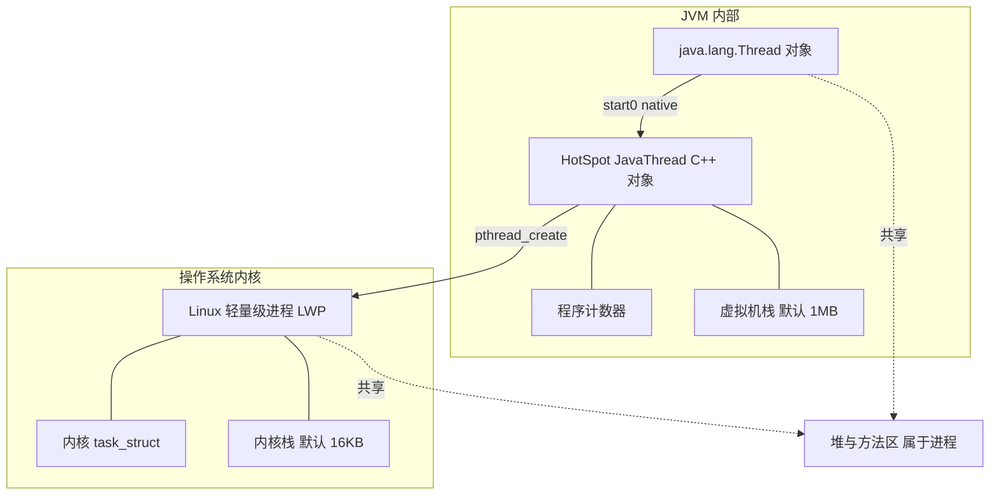
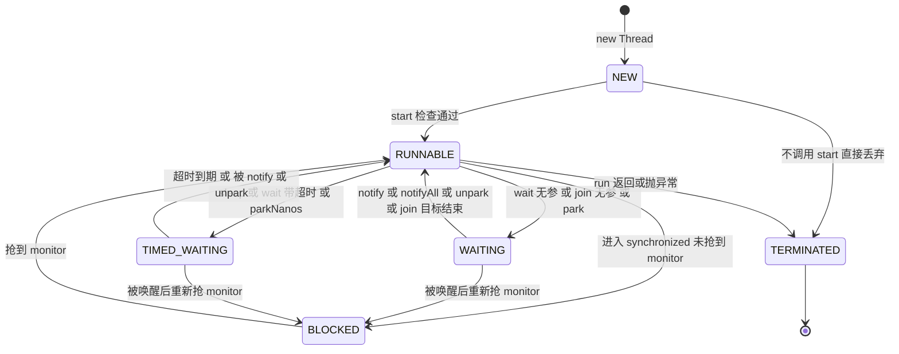
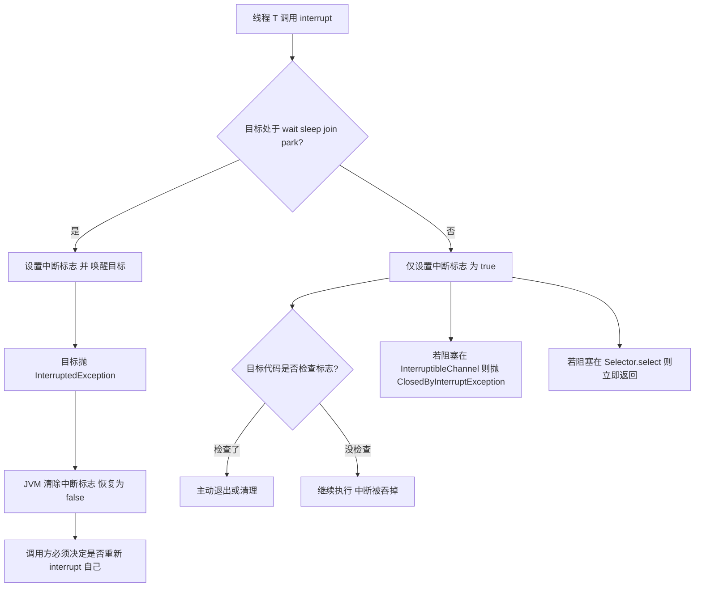
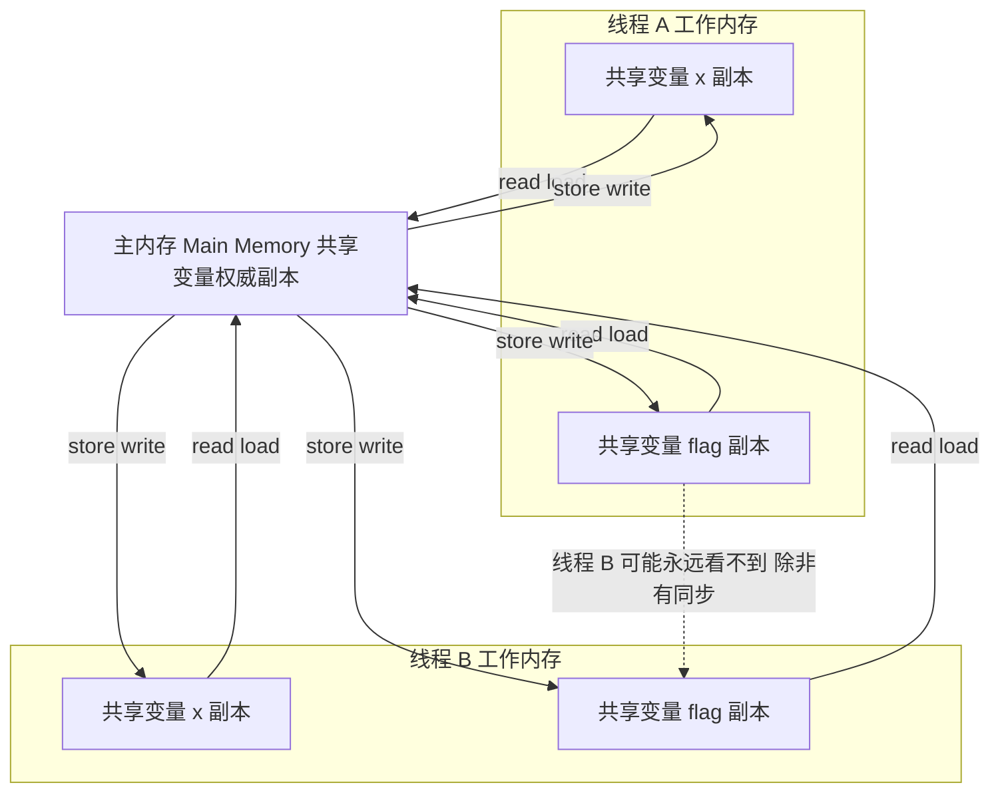
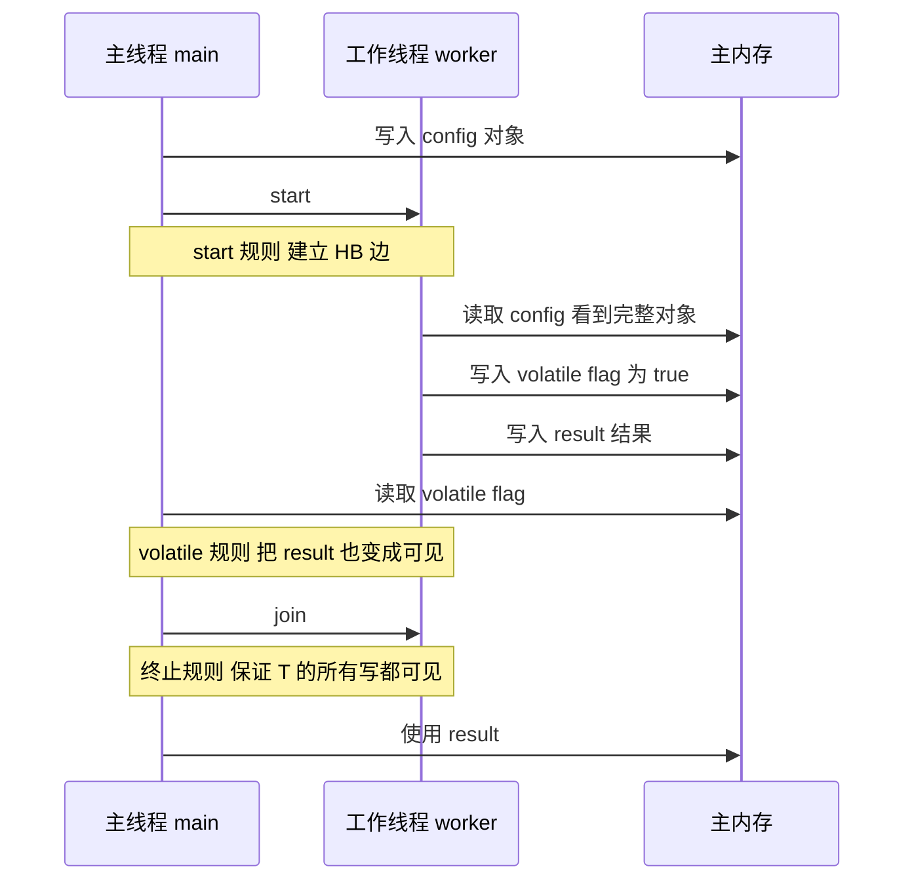
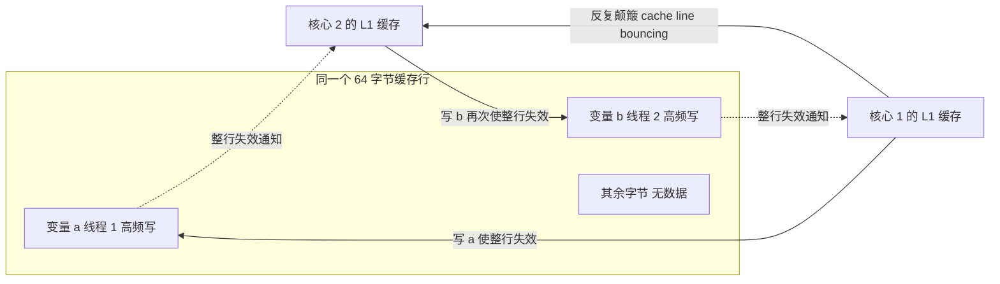
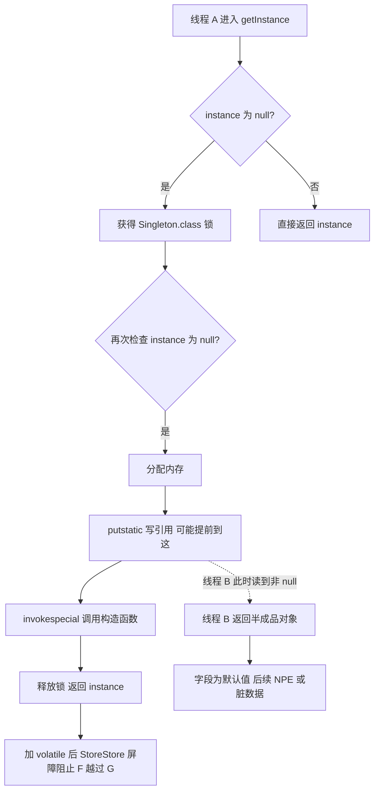
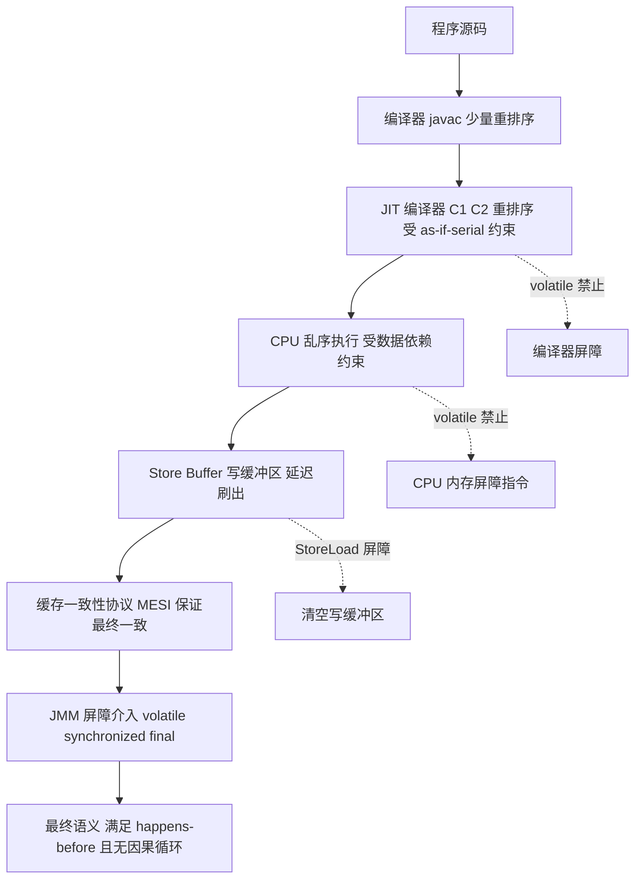

# 01 线程基础与 Java 内存模型

> 一句话定位：线程状态与 JMM 是并发的一切地基，`volatile` 只讲"可见性"不讲 happens-before 与内存屏障，高级岗一眼识破 ｜ 面试权重 ★★★★★ ｜ 建议复习 60 分钟

## 本章大纲

- [一、进程与线程](#一进程与线程)
- [二、线程状态机](#二线程状态机)
- [三、核心方法语义辨析](#三核心方法语义辨析)
- [四、JMM 抽象结构](#四jmm-抽象结构)
- [五、happens-before 八条规则](#五happens-before-八条规则)
- [六、volatile 的内存语义](#六volatile-的内存语义)
- [七、指令重排序与 DCL 单例](#七指令重排序与-dcl-单例)
- [八、final 的内存语义](#八final-的内存语义)
- [九、as-if-serial 与 JMM 的因果性要求](#九as-if-serial-与-jmm-的因果性要求)
- [十、生产实战：线程问题定位手册](#十生产实战线程问题定位手册)
- [高级岗三问](#高级岗三问)
- [高频面试题](#高频面试题)
- [易错点与踩坑](#易错点与踩坑)
- [一句话速记](#一句话速记)

## 一、进程与线程

### 1.1 本质区别：资源分配 vs CPU 调度

| 维度 | 进程（Process） | 线程（Thread） |
| --- | --- | --- |
| 定义 | 操作系统**资源分配**的基本单位 | CPU **调度**的基本单位 |
| 地址空间 | 独立虚拟地址空间，互不可见 | 共享所属进程的地址空间 |
| 私有资源 | 页表、文件描述符表、信号处理表、进程 ID | 程序计数器 PC、虚拟机栈、本地方法栈、线程 ID |
| 共享资源 | —— | 堆、方法区（JDK 8 起为元空间）、运行时常量池、静态变量、文件描述符 |
| 创建代价 | 高：复制页表、`fork` 写时复制、内核 `task_struct` | 低：仅分配栈（Linux x64 默认 1MB）与内核栈 |
| 切换代价 | 高：切换页表（CR3 寄存器）、TLB 失效 | 低：同进程内不换页表，TLB 不失效 |
| 通信方式 | 管道、消息队列、共享内存、Socket、信号 | 直接读写共享变量（因此必须同步） |
| 崩溃影响 | 独立，一般不影响其他进程 | 一个线程 `OutOfMemoryError` 或异常可能拖垮整个进程 |
| 隔离性 | 强 | 无，需靠同步机制自建 |

Java 启动一个 `main` 方法，JVM 会创建若干线程：`main`（用户线程）、`Reference Handler`、`Finalizer`（JDK 8，JDK 9+ 改为 `Cleaner` 机制但 `Finalizer` 线程仍存在）、`Signal Dispatcher`、`Attach Listener`、`Common-Cleaner`（JDK 9+）、`Notification Thread`。其中只有 `main` 是非守护线程。

### 1.2 HotSpot 的线程模型：1:1 内核线程

HotSpot（JDK 8 ~ JDK 21 的平台线程）采用 **1:1 线程模型**：一个 `java.lang.Thread` 对象对应一个 `JavaThread`（HotSpot C++ 对象），再对应一个 OS 内核线程（Linux 上即 `clone()` 出来的轻量级进程）。

- `Thread#start0()` 是 `native` 方法，落到 `JVM_StartThread`，最终调用 `os::create_thread`，Linux 上走 `pthread_create`。
- 线程栈大小由 `-Xss` 控制，HotSpot 在 Linux x64 上的 `ThreadStackSize` 默认为 **1024 KB**（1MB）。这意味着 1000 个线程约占用 1GB 虚拟地址空间（虚拟内存按需提交，但 `ulimit -s` 与物理提交仍受限）。
- 线程数上限受三方面约束：`-Xss` 决定的虚拟内存、`ulimit -u`（`max user processes`）、`/proc/sys/kernel/threads-max`、以及 `vm.max_map_count`。
- `java.lang.Thread` 中的 `threadStatus` 字段（`private volatile int`）保存 JVM 层线程状态，`Thread#getState()` 直接映射它；`start()` 首先校验 `threadStatus != 0`，不为 0 就抛 `IllegalThreadStateException`，这是"线程不能重启"的实现依据。

JDK 19（JEP 425）引入**虚拟线程**预览，JDK 21（JEP 444）正式转正。虚拟线程是 **M:N 调度**：大量 `VirtualThread` 被调度到少量 `ForkJoinPool` 的载体线程（carrier thread）上。JDK 21 ~ JDK 23 中，虚拟线程在 `synchronized` 块里会 **pin** 住载体线程，直到 JDK 24（JEP 491）才移除该限制。这是"能不能把 `synchronized` 换成 `ReentrantLock`"这一追问的由来。

### 1.3 创建线程的四种方式与代价

| 方式 | 写法 | 底层 | 评价 |
| --- | --- | --- | --- |
| 继承 `Thread` | `new MyThread().start()` | `Thread` 子类，`run` 被重写 | Java 单继承受限，不推荐 |
| 实现 `Runnable` | `new Thread(runnable).start()` | `Thread#run` 判断 `target != null` 后委托 | 推荐，解耦任务与执行 |
| 实现 `Callable` + `FutureTask` | `new FutureTask<>(callable)` | `FutureTask` 实现 `Runnable`，`run()` 里执行业务并把结果写入 `outcome` | 能拿返回值与异常 |
| 线程池 / `ExecutorService` | `Executors.newFixedThreadPool(n)` | `ThreadPoolExecutor` 复用线程 | **生产唯一推荐** |

代价量化：每次 `new Thread()` 都涉及一次内核 `clone`、一次 1MB 栈的虚拟内存映射、一次 TLAB 与线程本地缓存初始化。QPS 5000、每请求起一个线程的场景下，仅线程创建销毁就会吃掉 30% 以上的 CPU。**结论：线程是重资源，必须池化。**



## 二、线程状态机

### 2.1 六种状态的定义

`Thread.State` 是 `java.lang.Thread` 的嵌套枚举，JDK 5 引入（在此之前用已废弃的 `Thread#isAlive`、`suspend` 等）。六个值：

| 状态 | 含义 | 进入方式 | 与 OS 线程状态的关系 |
| --- | --- | --- | --- |
| `NEW` | 已创建未启动 | `new Thread()` 后 | 尚无内核线程 |
| `RUNNABLE` | 可运行 | `start()` 之后 | 覆盖 OS 的 ready 与 running，**也包含 IO 阻塞** |
| `BLOCKED` | 阻塞在 monitor 入口 | 等待进入 `synchronized` | 内核态通常也是可运行（自旋/挂起不定） |
| `WAITING` | 无限期等待 | `Object#wait()`、`Thread#join()`、`LockSupport#park()` | 内核态为睡眠 |
| `TIMED_WAITING` | 限期等待 | `Thread#sleep`、`Object#wait(long)`、`Thread#join(long)`、`LockSupport#parkNanos/parkUntil` | 内核态为定时睡眠 |
| `TERMINATED` | 已终止 | `run()` 正常或异常返回 | 内核线程已退出 |

**最容易答错的点**：`RUNNABLE` 包含了 IO 等待。一个阻塞在 `Socket#read` 上的线程，`jstack` 里显示 `java.lang.Thread.State: RUNNABLE`，栈顶是 `socketRead0`。原因是 HotSpot 没有为 IO 等待定义独立状态。面试里问"RUNNABLE 是不是一定在占 CPU"，答案是否定的。

**第二个易错点**：`BLOCKED` 只表示 **等待 monitor（`synchronized`）**。等待 `ReentrantLock`（AQS）的线程状态是 `WAITING`，因为 AQS 用的是 `LockSupport.park()`。这是区分 `synchronized` 与 `ReentrantLock` 的一个具体观测点。

### 2.2 状态流转



注意 `WAITING --> BLOCKED` 这条边：`wait()` 被 `notify` 唤醒后，线程并不是直接回到 `RUNNABLE`，而是要先重新竞争 monitor，此时状态是 `BLOCKED`。因此 `wait` 与 `notify` 用的必须是**同一个锁对象**，否则唤醒后依然可能饥饿。

### 2.3 状态观测手段

- `Thread#getState()`：读取 `threadStatus`（`private volatile int`，由 HotSpot 在状态切换时更新），**不参与任何业务锁**，只是一次 volatile 读，拿到的是瞬时快照，两次调用之间状态可能已经变化。
- `jstack <pid>` / `jcmd <pid> Thread.print`：会打印每个线程的状态与栈。
- `jstack` 中的常见状态文本：`java.lang.Thread.State: WAITING (on object monitor)`、`WAITING (parking)`、`TIMED_WAITING (sleeping)`、`BLOCKED (on object monitor)`。
- `-XX:+PrintConcurrentLocks` 或在 `jstack -l` 下打印 `Locked ownable synchronizers`，能看到 `ReentrantLock` 的持有者。

## 三、核心方法语义辨析

### 3.1 start 与 run

```java
public synchronized void start() { /* JDK 8 Thread#start */ }
```

- `start()` 被 `synchronized` 修饰，且内部先判断 `threadStatus != 0` 就抛 `IllegalThreadStateException`。因此**重复 `start()` 必抛异常**，这也是"线程不能重启"的根因。
- `start()` 真正做的是让 JVM 创建一个新的 OS 线程，新线程从头开始执行 `run()`。
- 直接调用 `run()` 只是普通方法调用，**在调用者线程的栈上同步执行**，没有任何并发效果，`getState()` 保持 `NEW`。

面试陷阱："调用 `run()` 会创建线程吗"——不会。第二个陷阱："线程执行完还能 `start()` 吗"——不能，抛 `IllegalThreadStateException`。

### 3.2 sleep 与 wait 的七维对照

| 维度 | `Thread.sleep(long)` | `Object.wait()` |
| --- | --- | --- |
| 所属 | `Thread` 静态方法 | `Object` 实例方法（`final native`） |
| 调用前提 | 任意位置 | **必须持有该对象的 monitor**，否则 `IllegalMonitorStateException` |
| 释放锁 | **不释放**任何锁 | **释放**该对象的 monitor |
| 唤醒条件 | 超时自动醒，或被 `interrupt` | 必须被 `notify`/`notifyAll`，或被 `interrupt`，或超时版本到期 |
| 线程状态 | `TIMED_WAITING` | 无参 `WAITING`，带超时 `TIMED_WAITING` |
| 中断行为 | 抛 `InterruptedException`，**清除**中断标志 | 同左 |
| 典型用途 | 轮询退避、限流等待 | 条件队列、生产者消费者 |

一个高频细节：`wait()` 返回后**并不代表条件已满足**，只是"有可能满足了"。所以标准写法必须是 `while` 循环：

```java
synchronized (lock) {
    while (!condition) {          // 不是 if
        lock.wait();
    }
    doSomething();
}
```

用 `if` 的两个致命问题：一是**虚假唤醒**（spurious wakeup，POSIX 允许 `pthread_cond_wait` 无故返回，JVM 沿用该语义）；二是 `notifyAll` 唤醒多个线程后，先抢到锁的线程可能已经把条件消费掉了。

### 3.3 join 与 yield

`Thread#join` 在 JDK 8 的实现（有省略）：

```java
public final synchronized void join(long millis) throws InterruptedException {
    long base = System.currentTimeMillis();
    long now = 0;
    if (millis < 0) throw new IllegalArgumentException("timeout value is negative");
    if (millis == 0) {
        while (isAlive()) { wait(0); }
    } else {
        while (isAlive()) {
            long delay = millis - now;
            if (delay <= 0) break;
            wait(delay);
            now = System.currentTimeMillis() - base;
        }
    }
}
```

关键点：

1. `join` 是 `synchronized` 方法，锁是**目标线程对象**（`this` 是那个 Thread 实例）。
2. 实现依赖 `wait/notifyAll`。当目标线程终止时，JVM 在 `JavaThread::exit` 中会对该线程对象执行 `notify_all`，唤醒所有 `join` 的线程。
3. 所以 `join` 也可能被 `interrupt`，抛 `InterruptedException`。
4. **绝不要在生产代码里对 Thread 对象调用 `wait/notify`**，会和 `join` 抢同一个 monitor，破坏语义。

`Thread#yield()` 是 `public static native void yield()`：

- 只是**提示**调度器"我愿意让出 CPU"，无任何保证，可能立即又被选中。
- 线程状态仍是 `RUNNABLE`。
- **不释放任何锁**。
- 生产上不要用 `yield` 做同步控制，它不可靠且增加上下文切换。

### 3.4 interrupt：协作式中断

`interrupt` 是 Java 唯一的"停止线程"官方手段，但它是**协作式**的，只设置标志位，是否响应由目标线程决定。

| 方法 | 语义 | 是否清除中断标志 |
| --- | --- | --- |
| `void interrupt()` | 设置目标线程中断标志；若目标处于 `wait/sleep/join`，则唤醒并抛 `InterruptedException` | 是（唤醒场景下清标志） |
| `boolean isInterrupted()` | 查询标志，实例方法 | 否 |
| `static boolean interrupted()` | 查询并**清除**标志 | 是 |



**中断的三个盲区**（面试高频）：

1. `synchronized` 等待 monitor 的线程**不可中断**，只能等锁。
2. `ReentrantLock#lock()` 不可中断，必须用 `lockInterruptibly()`。
3. 传统 `java.io` 的 `Socket#read`（阻塞在 `socketRead0`）**不响应中断**，只能用 `Socket#setSoTimeout(int)` 设读超时，或改用 NIO 的 `InterruptibleChannel`。

**被吞掉的中断**是线上事故常见根因，标准处理模板：

```java
try {
    queue.take();
} catch (InterruptedException e) {
    Thread.currentThread().interrupt();   // 恢复中断标志，交给上层决定
    return;                               // 或继续向上抛
}
```

绝对禁止 `catch (InterruptedException e) { }` 空实现或只打日志不恢复标志，这会让线程池的 `shutdownNow()` 无法停止任务。

### 3.5 为什么 wait 必须在 synchronized 内

三层原因，从浅到深：

**第一层：JVM 强制。**`Object#wait` 会校验当前线程是否持有该对象的 monitor，否则直接抛 `IllegalMonitorStateException`。这是 `ObjectMonitor` 的 `check_owner` 检查，属于硬约束。

**第二层：避免 lost wakeup（丢失唤醒）。** 假设允许不在同步块里 `wait`，下面的交错会让线程永久挂起：

| 时刻 | 线程 A（消费者） | 线程 B（生产者） |
| --- | --- | --- |
| t1 | 检查 `queue.isEmpty()` 为 true | |
| t2 | | 入队，`notify()`，此时无人在等，信号丢失 |
| t3 | 执行 `wait()`，永久阻塞 | |

把"检查条件"和"进入 wait"放进同一个同步块后，两者相对临界区的其他线程是原子的，`notify` 要么发生在 `wait` 之前（此时条件已被修改，`while` 循环会拦住），要么发生在 `wait` 之后（正常唤醒）。

**第三层：可见性。**`wait` 与 `notify` 都必须在 monitor 保护下，这样条件变量（如 `queue.size()`）的读写才具备 happens-before 保证。否则即便被唤醒，读到的也可能是陈旧值。

### 3.6 守护线程

```java
Thread t = new Thread(task);
t.setDaemon(true);   // 必须在 start() 之前
t.start();
```

| 维度 | 用户线程（User Thread） | 守护线程（Daemon Thread） |
| --- | --- | --- |
| 设置时机 | 默认值，或 `setDaemon(false)` | `setDaemon(true)`，**必须在 `start()` 前**，否则抛 `IllegalThreadStateException` |
| 对 JVM 退出的影响 | 只要还有一个存活，JVM 不退出 | 不阻止 JVM 退出 |
| 子线程继承 | 子线程默认继承父线程的 daemon 标志 | 同左，`Thread` 构造器中 `this.daemon = parent.isDaemon()` |
| `finally` 是否执行 | 是 | **不保证**，JVM 直接退出时不走 `finally` |
| 典型代表 | `main`、业务线程、线程池线程 | GC 线程、JIT 编译线程、`Reference Handler`、`Signal Dispatcher`、`Common-Cleaner` |
| 适用场景 | 业务逻辑、需要完整执行的任务 | 后台巡检、心跳、监控上报、缓存刷新 |

两个结论：

1. **`Executors.defaultThreadFactory()` 创建的是非守护线程**（JDK 8 源码 `t.setDaemon(false)`）。所以线程池不关闭会导致 JVM 无法退出，必须 `executor.shutdown()` 或在自定义 `ThreadFactory` 中显式设置。
2. **守护线程不能用于需要保证完成的写操作**（如刷盘、发 MQ 消息），JVM 退出会直接杀掉它。

## 四、JMM 抽象结构

### 4.1 主内存与工作内存

Java 内存模型（Java Memory Model，JMM）由 **JSR 133** 制定，从 JDK 5 起正式生效（`JSR-133` 修复了旧模型中 `final` 与 `volatile` 的语义漏洞）。它是一套**规范**，不是物理结构。

- **主内存（Main Memory）**：所有共享变量（实例字段、静态字段、数组元素）的"权威副本"所在地。对应物理上的堆与方法区，但只是一个抽象。
- **工作内存（Working Memory）**：每个线程私有的抽象缓存，保存该线程用到的共享变量的副本。对应 CPU 寄存器、L1/L2/L3 缓存、写缓冲区（Store Buffer）、无效化队列（Invalidation Queue）。

**关键认知**：JMM 不等于 CPU 缓存架构。JMM 的作用是屏蔽不同硬件（x86 TSO、ARM 弱内存模型）与不同编译器优化的差异，给出一份"在任何平台上都成立的语义契约"。这也是为什么同一段缺同步的代码在 x86 上"看起来能跑"，迁到 ARM（如 Apple Silicon、鲲鹏）就挂——x86 的 TSO 模型重排序约束更强。



### 4.2 八种原子操作

JMM 定义了 8 种作用于主内存与工作内存之间的原子操作（出自 JSR 133 与 JMM 草案，HotSpot 实际实现已不严格按此分层，但语义等价，面试必须能背出并解释）：

| 操作 | 作用对象 | 含义 |
| --- | --- | --- |
| `lock` | 主内存变量 | 把变量标识为一条线程独占 |
| `unlock` | 主内存变量 | 释放独占，释放后其他线程才能 `lock` |
| `read` | 主内存变量 | 把变量值从主内存传输到工作内存，供 `load` 使用 |
| `load` | 工作内存变量 | 把 `read` 得到的值放入工作内存的变量副本 |
| `use` | 工作内存变量 | 把变量值传给执行引擎（每遇字节码读该变量就执行一次） |
| `assign` | 工作内存变量 | 把执行引擎产生的值赋给工作内存变量（每遇赋值字节码执行一次） |
| `store` | 工作内存变量 | 把工作内存变量值传送到主内存，供 `write` 使用 |
| `write` | 主内存变量 | 把 `store` 传来的值写入主内存变量 |

配套的约束规则（高频追问点）：

1. `read` 与 `load` 必须成对出现，`store` 与 `write` 必须成对出现，**不允许单独出现**。
2. 不允许线程丢弃它最近的 `assign` 操作，即变量改变后必须同步回主内存。
3. 不允许线程无原因地（没有发生任何 `assign`）把数据从工作内存同步回主内存。
4. 一个新的变量只能在主内存中"诞生"，不允许在工作内存中直接使用一个未被初始化的变量。
5. 一个变量同一时刻只允许一条线程对其执行 `lock`，但 `lock` 可被同一条线程重复执行，执行多少次 `lock` 就必须执行多少次 `unlock`——**这正是 `synchronized` 可重入的语义来源**。
6. 对一个变量执行 `lock` 会清空工作内存中该变量的副本，执行引擎使用前必须重新 `load` 或 `assign`。
7. 对一个变量执行 `unlock` 前，必须先把该变量同步回主内存（`store` + `write`）。

### 4.3 三大特性：原子性、可见性、有序性

| 特性 | 定义 | 破坏它的原因 | Java 中的保障手段 |
| --- | --- | --- | --- |
| 原子性 | 一个或多个操作要么全部执行且不被中断，要么全不执行 | 线程切换；`i++` 这类 read-modify-write 被拆成多条字节码 | 基本类型的单次读写在 32 位平台外原子；`synchronized`、`Lock`、`AtomicInteger`（CAS） |
| 可见性 | 一个线程修改变量后，其他线程能立即看到 | CPU 缓存 + Store Buffer 导致写入未及时刷主内存；编译器把变量放进寄存器 | `volatile`、`synchronized`、`Lock`、`final` |
| 有序性 | 程序执行的顺序按代码先后进行 | 编译器重排序、指令级并行重排序、内存系统重排序 | `volatile`（禁止特定重排序）、`synchronized`、`happens-before` 规则 |

**"哪些操作天然原子"**的准确表述：

- `int`、`char`、`short`、`byte`、`boolean`、`float`、引用类型的**单个读写**是原子的（JLS 17.7）。
- `long` 与 `double` 的**非 volatile** 读写，JLS 明确允许拆成两次 32 位操作（32 位 JVM 上确实会发生"半个变量"的撕裂读）。HotSpot 在 64 位平台实现为原子，但**不能作为正确性依赖**；写了 `volatile` 就保证原子（JLS 17.7 规定 volatile long/double 读写原子）。
- `i++`、`i += 1`、`check-then-act`（`if (map.get(k) == null) map.put(k, v)`）**都不是原子的**。

## 五、happens-before 八条规则

happens-before（HB）是 JMM 的核心概念：如果 A happens-before B，那么 A 的执行结果对 B 可见，且 A 的执行顺序排在 B 之前。注意 HB 是**偏序**关系，不是时间先后，也不意味着一定不重排序——只要重排序后不违反 HB 的可见性承诺即可。

| 序号 | 规则名 | 内容 | 举例 |
| --- | --- | --- | --- |
| 1 | 程序次序规则 Program Order Rule | 一个线程内，按控制流顺序，前面的操作 HB 后面的操作 | `int a = 1; int b = 2;` 中 `a=1` HB `b=2` |
| 2 | 监视器锁规则 Monitor Lock Rule | 对同一个锁的 `unlock` HB 于后续对这个锁的 `lock` | 线程 A 释放锁后，线程 B 拿到锁能看到 A 的所有写入 |
| 3 | volatile 变量规则 Volatile Variable Rule | 对 volatile 字段的写 HB 于后续对该字段的读 | 写 `volatile flag = true` 后，读到 `flag == true` 的线程能看到之前的所有普通写 |
| 4 | 线程启动规则 Thread Start Rule | `Thread#start()` HB 于该线程中的每一个动作 | 主线程 `set` 的变量，新线程 `run` 里能读到 |
| 5 | 线程终止规则 Thread Termination Rule | 线程中的所有操作 HB 于其他线程检测到该线程终止 | `join()` 返回后能看到目标线程的所有写入；`isAlive()` 返回 false 同理 |
| 6 | 线程中断规则 Thread Interruption Rule | 对线程 `interrupt()` 的调用 HB 于被中断线程检测到中断事件 | 调用方在 `interrupt` 前写的变量，被中断线程在 `catch (InterruptedException)` 中可见 |
| 7 | 对象终结规则 Finalizer Rule | 一个对象的构造函数结束 HB 于该对象 `finalize()` 方法的开始 | 构造中赋值的字段，`finalize` 里一定能看到 |
| 8 | 传递性 Transitivity | A HB B 且 B HB C，则 A HB C | 把 1~7 串起来的胶水 |

**逐条举例说明（第 3 与第 4 条最容易答错）：**

第 3 条常被答成"volatile 写之后，所有线程都能看到"。准确表述是：**volatile 写 HB 后续对该 volatile 字段的读**。如果另一个线程根本没读这个 volatile 字段，就没有 HB 关系，也就没有任何保证。典型的"标志位 + 数据"模式：

```java
class Holder {
    int data = 0;                 // 普通字段
    volatile boolean ready = false; // volatile 标志

    void write() {
        data = 42;                // 1
        ready = true;             // 2  volatile 写
    }

    void read() {
        if (ready) {              // 3  volatile 读
            System.out.println(data); // 4  一定能看到 42
        }
    }
}
```

`1 HB 2`（程序次序），`2 HB 3`（volatile 规则），`3 HB 4`（程序次序），传递得 `1 HB 4`。所以 `data` 一定可见。**如果去掉 `volatile`，第 4 行可能打印 0**，因为 `2` 与 `1` 可能被重排序，或者 `data` 的写还在 Store Buffer 里。

第 4 条举例：主线程在 `start()` 之前设置的所有变量，新线程在 `run()` 里一定能看到。这是 `Thread` 构造函数传参与 `final` 字段安全发布的底层依据。

第 5 条举例：`join()` 返回后，目标线程写的所有变量都可见。这与"用 `volatile boolean finished` 标志做同步"是等价效果，但 `join` 更强（它同时保证线程已终止）。

第 6 条举例：`Thread#interrupt` 前的写入对 `InterruptedException` 处理代码可见。这解释了为什么用"中断标志 + 队列"做停止信号是安全的。



## 六、volatile 的内存语义

### 6.1 两条语义

**可见性语义**：写 volatile 字段时，JMM 会把该线程工作内存中**所有共享变量**（不只是 volatile 字段本身）刷新到主内存；读 volatile 字段时，JMM 会把该线程工作内存置为无效，强制从主内存重新读取。所以 volatile 的真正威力在于它是一个"同步点"，会顺带把普通变量的写也发布出去（这正是第 5 节例子的机制）。

**有序性语义**：禁止 volatile 字段与前后操作的特定重排序。

`volatile` **不提供**：原子性（复合操作）、互斥性、对临界区的保护。所以 `volatile int count` 配 `count++` 是错的。

### 6.2 内存屏障

JMM 为编译器定义了一套屏障（memory barrier / memory fence），共四种，两个维度（Load/Store 在前在后）：

| 屏障 | 作用 | 典型用途 |
| --- | --- | --- |
| `LoadLoad` | 禁止下面的读与上面的读重排序 | volatile 读之后插入 |
| `StoreStore` | 禁止下面的写与上面的写重排序 | volatile 写之前插入 |
| `LoadStore` | 禁止下面的写与上面的读重排序 | volatile 读之后插入 |
| `StoreLoad` | 禁止下面的读与上面的写重排序，开销最大 | volatile 写之后插入 |

JMM 的保守插入策略（`JMM` 实现层，见 `orderAccess.hpp` / `OrderAccess` 类）：

| 场景 | 插入的屏障 |
| --- | --- |
| volatile 写之前 | `StoreStore` |
| volatile 写之后 | `StoreLoad` |
| volatile 读之后 | `LoadLoad` + `LoadStore` |
| 普通读写 | 不加屏障 |

**为什么 x86 上只有一个屏障有成本**：x86 采用 TSO（Total Store Order）模型，硬件本身不允许 Load-Load、Load-Store、Store-Store 重排序，只有 Store-Load 可能重排序。因此 HotSpot 在 x86 上把其他三种屏障实现为编译器屏障（空操作），只有 `StoreLoad` 需要落到 `lock addl $0x0,(%rsp)` 这种带 `lock` 前缀的指令（`lock` 前缀自带全屏障效果，同时在 x86 上还有 `mfence` 指令可选，HotSpot 选前者因为它同时充当写缓冲区清空指令，性能更好）。

这也解释了为什么"volatile 在 x86 上比在 ARM 上便宜"——ARM 是弱内存模型，四种屏障都要真实指令（`dmb ish`、`ldar`、`stlr`）。

### 6.3 JDK 9 的 VarHandle 细粒度访问模式

`java.lang.invoke.VarHandle`（JDK 9 引入，替代 `sun.misc.Unsafe` 的 `getIntVolatile` 等）提供四种访问模式，粒度从松到紧：

| 模式 | 方法后缀 | 语义 | 对应屏障 |
| --- | --- | --- | --- |
| Plain | 无后缀（如 `get`/`set`） | 与普通字段访问相同，无任何内存语义 | 无 |
| Opaque | `getOpaque`/`setOpaque` | 保证按程序序执行、不被编译器优化掉，但无跨线程可见性承诺 | 无 |
| Acquire/Release | `getAcquire`/`setRelease` | 单向屏障，比 volatile 便宜 | `LoadLoad`+`LoadStore` / `StoreStore` |
| Volatile | `getVolatile`/`setVolatile` | 与 `volatile` 字段完全等价 | 全套 |

工程价值：`AtomicInteger` 的 `lazySet`（内部 `unsafe.putOrderedInt`）就是 Release 语义，Disruptor、Netty、JDK 自身的 `ConcurrentLinkedQueue` 大量使用，用于"我只需要保证别人最终看到，不需要每次刷新"的场景，能显著降低 `StoreLoad` 屏障带来的开销。

### 6.4 伪共享与 @Contended

**伪共享（False Sharing）**：CPU 缓存以缓存行为单位失效，x86 典型缓存行大小 **64 字节**。两个被不同线程高频写入的变量如果落在同一缓存行，会导致该行在两个核心的 L1/L2 之间反复失效与传输（cache line bouncing），性能可能下降一个数量级。



**解决方案与 JDK 支持**：

| 方案 | 做法 | 版本 | 代价 |
| --- | --- | --- | --- |
| 手工填充 | 在字段前后加 `long p1, p2, ..., p7` 各 8 字节 | 任意 | 代码丑陋，JVM 可能优化掉无用字段 |
| `@sun.misc.Contended` | 注解字段或类 | JDK 8 引入，**用户类需加 `-XX:-RestrictContended`** | 内存浪费 |
| `@jdk.internal.vm.annotation.Contended` | JDK 内部注解 | JDK 9+ | 用户类使用需 `--add-exports java.base/jdk.internal.vm.annotation=ALL-UNNAMED` |
| 数据分离 | 每个线程独立对象/数组槽位 | 任意 | 需要重构 |

关键默认值：`ContendedPaddingWidth` 默认为 **128 字节**（覆盖典型 x86 的 64 字节缓存行以及部分平台 128 字节行的双行预取）。JDK 自身的受益者：`Thread` 的 `threadLocalRandomSeed`、`ThreadLocalRandom` 的 `probe`、`ConcurrentHashMap` 的 `CounterCell`、`LongAdder`/`Striped64` 的 `Cell`、`Exchanger` 的 `Slot`、`ForkJoinPool` 的 `WorkQueue`。

### 6.5 volatile 不保证原子性

```java
public class VolatileCounter {
    private volatile int count = 0;

    public void increment() {
        count++;   // 不是原子操作
    }
}
```

`count++` 的字节码（javap -c）：

```
aload_0
dup
getfield      #2   // Field count:I     <-- read
iconst_1
iadd                                  <-- modify
putfield      #2   // Field count:I     <-- write
```

三步之间存在线程切换窗口，两个线程各自读到 5，各自加 1 写回 6，正确结果应该是 7。**volatile 只能保证每次读到的不是陈旧值，不能保证 read-modify-write 的原子性。**

正确做法对照：

| 方案 | 适用场景 | 原理 | 版本 |
| --- | --- | --- | --- |
| `synchronized` | 临界区大、逻辑复杂 | 悲观锁，互斥 | 任意 |
| `ReentrantLock` | 需要超时/可中断/条件队列 | AQS | JDK 5+ |
| `AtomicInteger` | 单个 int 计数 | `Unsafe#compareAndSwapInt` 硬件 CAS，自旋 | JDK 5+ |
| `LongAdder` | 高并发计数，读少写多 | `Striped64` 分片 Cell，分散 CAS 竞争，`sum()` 时汇总 | **JDK 8+** |
| `LongAccumulator` | 任意聚合函数 | 同 `LongAdder` | JDK 8+ |

`LongAdder` 是面试加分项：QPS 10 万+ 的计数场景，`AtomicLong` 会因为所有线程 CAS 同一个 `value` 而剧烈失败重试，`LongAdder` 把计数分散到 `base` + `Cell[]` 上，写性能提升数倍，代价是 `sum()` 只能得到弱一致的近似值（遍历时可能有并发写）。

## 七、指令重排序与 DCL 单例

### 7.1 三种重排序

| 类型 | 执行者 | 典型例子 | 禁止手段 |
| --- | --- | --- | --- |
| 编译器重排序 | `javac` 基本不做，**JIT（C1/C2）** 大量做 | 把循环内不变式提到循环外、消除冗余读 | `volatile`、`Unsafe`、屏障 |
| 指令级并行重排序 | CPU 乱序执行引擎 | 打乱无关指令的发射顺序 | 依赖数据流和屏障指令 |
| 内存系统重排序 | Store Buffer、无效化队列 | 写操作延迟刷出，读操作先于前面的写完成 | `StoreLoad` 屏障（`mfence`/`lock` 前缀） |

重排序遵守两条底线：**不改变单线程语义（as-if-serial）**，**不破坏 happens-before 承诺**。所以并发 bug 的本质是"数据竞争"——缺少 HB 关系却存在共享访问。

### 7.2 DCL 单例为什么必须加 volatile

不加 `volatile` 的版本：

```java
public class Singleton {
    private static Singleton instance;   // 缺少 volatile

    public static Singleton getInstance() {
        if (instance == null) {                 // 第一次检查，无锁
            synchronized (Singleton.class) {
                if (instance == null) {         // 第二次检查
                    instance = new Singleton(); // 问题所在
                }
            }
        }
        return instance;
    }
}
```

`instance = new Singleton()` 并不是原子的，字节码层面分三步：

1. `new`：分配内存
2. `invokespecial <init>`：调用构造函数初始化对象
3. `putstatic`：把引用赋给 `instance`

**2 与 3 之间可能重排序**（单线程语义不变，所以允许）。重排序后执行顺序变成 1 → 3 → 2。此时线程 B 在第一次检查处看到 `instance != null`，直接 `return instance`，拿到的是一个**未初始化完成的对象**——字段全是默认值，后续使用会 NPE 或读到错误数据。



加上 `volatile` 后，`putstatic` 之前的 `StoreStore` 屏障保证"构造函数执行完毕"先于"引用赋值对别人可见"，`StoreLoad` 屏障保证写完后立即可见。**所以 DCL 的正确写法只有一种：`private static volatile Singleton instance;`**

### 7.3 单例的其他写法与权衡

| 写法 | 线程安全 | 延迟加载 | 防反射 | 防反序列化 | 评价 |
| --- | --- | --- | --- | --- | --- |
| 饿汉式 `static final` | 是（类初始化） | 否 | 否 | 否 | 简单，无延迟收益时首选 |
| 懒汉式 `synchronized` 方法 | 是 | 是 | 否 | 否 | 每次调用都加锁，性能差 |
| DCL + volatile | 是 | 是 | 否 | 否 | 经典，但写法容易漏 volatile |
| 静态内部类 Holder | 是（`<clinit>` 由 JVM 加锁） | 是（首次调用才初始化 Holder） | 否 | 否 | **推荐**，无锁且延迟 |
| 枚举 `enum` | 是 | 否（类加载即初始化） | 是（反射创建枚举抛 `IllegalArgumentException`） | 是（`readResolve` 由 JVM 保证） | 《Effective Java》推荐，最安全 |
| 容器式 `ConcurrentHashMap` | 是 | 是 | 否 | 否 | 适合多例管理 |

静态内部类的原理：`Holder` 类只在首次访问 `Holder.INSTANCE` 时触发 `<clinit>`，类初始化由 JVM 保证线程安全（对应 JLS 12.4.2 的初始化锁 LC），且 happens-before 由类加载机制保证。这是"半个 JMM 规则"的实际应用。

## 八、final 的内存语义

JSR-133 为 `final` 增加了专门的内存语义（此前 `final` 只有编译期不可变约束，无可见性保证）：

**写 final 字段的重排序规则**：在构造函数内对一个 `final` 字段的写入，与随后把这个被构造对象的引用赋值给一个引用变量，**这两个操作之间不能重排序**。编译器会在 `final` 字段写之后、构造函数 `return` 之前插入 `StoreStore` 屏障。

**读 final 字段的重排序规则**：初次读一个包含 `final` 字段的对象引用，与随后初次读该 `final` 字段，**这两个操作之间不能重排序**。处理器会在读 `final` 字段前插入 `LoadLoad` 屏障（x86 上为编译器屏障）。

实际效果：**只要对象在构造期间没有逸出（`this` 引用没有泄漏），那么不需要任何同步，其他线程就能看到 `final` 字段的正确初始化值。**

```java
public class SafePublish {
    final int x;          // 安全
    int y;                // 不安全
    static SafePublish obj; // 危险：非 volatile 的静态发布

    public SafePublish() {
        x = 1;
        y = 2;
    }

    public static void writer() {
        obj = new SafePublish();   // 引用可能提前可见，但 x 一定是 1
    }

    public static void reader() {
        if (obj != null) {
            int a = obj.x;   // 一定能看到 1
            int b = obj.y;   // 可能看到 0
        }
    }
}
```

**final 语义失效的唯一条件：`this` 逸出（this escape）**。典型反例：

```java
public class Escape {
    final int x;
    public Escape(EventSource source) {
        source.registerListener(e -> System.out.println(x)); // 匿名类隐式持有 this
        x = 5;   // 可能在监听器被调用之后才执行
    }
}
```

构造函数中注册回调、启动线程、把 `this` 放入集合/静态字段，都会破坏 `final` 语义，也可能让其他线程看到未初始化完的对象。**这是"构造函数中不要启动线程"这条规范的内存模型依据。**

另外，`final static` 常量的"编译期常量"（`static final` 基本类型与 `String` 字面量）会被 `javac` 内联到调用方字节码，导致修改常量值后需要**重新编译所有调用方**，否则读到的还是旧值——这是 `final` 最容易被忽略的工程坑。

## 九、as-if-serial 与 JMM 的因果性要求

### 9.1 as-if-serial

**as-if-serial 语义**：不管怎么重排序，**单线程程序的执行结果不能被改变**。编译器、运行时、处理器都必须遵守。

```java
double pi = 3.14;        // 1
double r = 1.0;          // 2
double area = pi * r * r; // 3
```

`1` 与 `2` 可以重排序，因为它们没有数据依赖；但 `3` 依赖 `1` 和 `2`，所以 `3` 不能被排到前面。数据依赖是 as-if-serial 的物理基础。

**为什么 as-if-serial 不足以支撑并发**：多线程程序在各自线程内都满足 as-if-serial，线程间却没有约束。所以要引入 happens-before——as-if-serial 管线程内，happens-before 管线程间。

### 9.2 顺序一致性模型与 JMM 的差异

| 维度 | 顺序一致性模型（Sequential Consistency） | JMM |
| --- | --- | --- |
| 定义者 | Leslie Lamport，理论模型 | JSR 133 |
| 单线程内 | 按程序顺序执行 | 允许重排序（只要 as-if-serial） |
| 多线程间 | 所有操作存在一个全局全序，每个线程的操作在该全序中保持程序序 | 用 happens-before 偏序描述，不要求全局全序 |
| 同步开销 | 无（理论上） | 只在同步点插入屏障，性能好 |
| 结果 | 理论正确性基准 | 工程可实现，比 SC 弱但足够 |

“正确同步的程序”——JMM 保证：**如果程序是正确同步的（即所有共享变量的访问都由 happens-before 关系串起来，不存在数据竞争），那么程序的执行结果与在顺序一致性模型下相同。** 这是 JMM 给开发者的核心承诺，也是"不要写数据竞争代码"这条规范的价值所在。

### 9.3 因果性要求（Causality Requirements）

JMM 的正式定义是一套"良构执行（well-formed execution）"的公理系统，其中最微妙的是**因果性要求**：

- JMM 不允许出现**因果循环（causality loop）**。经典反例是一种"自证式"执行：

```
线程 1: r1 = x;  线程 2: r2 = y;
        y = 1;            x = 1;
```

在 JMM 下，`r1 == 1 && r2 == 1`（两个线程各自读到对方写的值）这种执行是**不被允许**的，因为它需要一个因果循环来解释（`x=1` 之所以发生，是因为 `r2=1`；而 `r2=1` 又是因为 `y=1`；`y=1` 又依赖于 `r1=1`）。

- JMM 允许的行为边界是：只要某个执行能被"提交序列（commit sequence）"逐步证明是良构的，且满足 happens-before 一致性、同步顺序一致性、以及不出现因果循环，那么这个执行就是合法的。
- 实践含义：JMM 比顺序一致性弱，但不是"任意乱来"。它精确地划定了"允许的宽松"与"绝对禁止的荒谬"之间的界限。

工程上你不需要记住公理细节，但要能说出三点：**允许重排序、保证 HB 可见性、禁止因果循环**。



## 十、生产实战：线程问题定位手册

### 10.1 CPU 100% 排查

标准六步（Linux + HotSpot JDK 8/11/17 通用）：

```bash
# 1. 找到 Java 进程
top -c                        # 或 jps -l

# 2. 找到该进程内 CPU 最高的线程（-H 显示线程，-p 指定进程）
top -Hp 12345

# 3. 记下线程 ID，比如 12377，转成十六进制
printf '%x\n' 12377            # 输出 3059

# 4. dump 线程栈
jstack 12345 > /tmp/stack.txt
# 或 jcmd 12345 Thread.print > /tmp/stack.txt

# 5. 在栈里定位该线程
grep -A 30 'nid=0x3059' /tmp/stack.txt

# 6. 连续 dump 三次，间隔 5 秒，看哪段栈顶反复出现
for i in 1 2 3; do jstack 12345 > /tmp/s$i.txt; sleep 5; done
```

**常见栈顶特征与结论对照：**

| 栈顶特征 | 含义 | 处理 |
| --- | --- | --- |
| `at com.xxx.Biz.calc(...)` 反复出现 | 业务死循环或复杂计算（正则回溯、大循环） | 检查 `while` 条件、正则表达式 `Pattern` 回溯 |
| `at java.util.HashMap.get` 配合大量 `RUNNABLE` | JDK 7 扩容成环（已死循环） | 升级 JDK 8 或改 `ConcurrentHashMap` |
| `at sun.misc.Unsafe.park` 数量极多 | 大量线程阻塞，不是 CPU 问题 | 看是否线程池过小或下游超时 |
| `at java.lang.Thread.yield` 或 `Mutex.spin` | 锁自旋，偏向锁撤销竞争 | 看锁竞争，考虑分段 |
| `at com.xxx.Json.parse` 深度递归 | 大 JSON 解析 | 限流或改流式解析 |
| GC 线程（`G1 Young RemSet Sampling`）占比高 | 不是业务线程，是 GC 频繁 | 看 GC 日志，查内存泄漏 |

**GC 导致的 CPU 高如何区分**：看 `jstat -gcutil 12345 1000`，若 `FGCT`/`GCT` 持续增长且 `OU`（老年代使用率）接近 100%，则 CPU 消耗在 GC 上；若 GC 正常而 CPU 仍高，则是业务线程。

### 10.2 线程死锁与卡死排查

```bash
jstack -l 12345 > /tmp/lock.txt
grep -A 40 'Found one Java-level deadlock' /tmp/lock.txt
```

JDK 的 `jstack` 会自动做死锁检测（基于 `ThreadMXBean#findDeadlockedThreads` 的能力），输出形如：

```
Found one Java-level deadlock:
=============================
"Thread-1":
  waiting to lock monitor 0x00007f8c... (object 0x000000076ab1f..., a java.lang.Object),
  which is held by "Thread-0"
"Thread-0":
  waiting to lock monitor 0x00007f8c... (object 0x000000076ab2a..., a java.lang.Object),
  which is held by "Thread-1"
```

注意：**`jstack` 的自动死锁检测只覆盖 `synchronized`（对象 monitor）与 `ReentrantLock`（`AbstractOwnableSynchronizer`）**。基于数据库行锁、分布式锁、`Semaphore` 与 `CountDownLatch` 的循环等待，`jstack` 检测不到，需要靠"线程全部停在 `park`/`await` 且业务日志无进展"推断。

### 10.3 线程泄漏排查

```bash
jstack 12345 | grep -c '^"'                         # 线程总数
jstack 12345 | grep '^"' | awk '{print $2}' | sort | uniq -c | sort -rn  # 按线程名分组 TOP
jcmd 12345 Thread.print | grep -c "pool-"           # 线程池线程数
cat /proc/12345/status | grep Threads               # 内核视角线程数
```

**典型泄漏模式：**

| 现象 | 根因 | 修复 |
| --- | --- | --- |
| `pool-1-thread-N` 的 N 持续增长 | 用了 `Executors.newCachedThreadPool()`，上游无超时导致任务堆积 | 换 `newFixedThreadPool` 或 `ThreadPoolExecutor` 显式指定 `maximumPoolSize` 与队列 |
| `http-nio-8080-exec-N` 上千 | Tomcat 线程池被慢下游拖死 | 加下游超时 + 熔断 |
| 线程数缓慢上涨永不回落 | `ThreadLocal` 未 `remove`，或定时任务 `scheduleAtFixedRate` 里起线程 | 定位 `ThreadFactory` 加线程名前缀，配合 `-XX:+PrintThreadsOnExit` |
| `Finalizer` 线程堆积 | 对象重写了 `finalize()` 且 `finalize` 阻塞 | 移除 `finalize`，改 `Cleaner`（JDK 9+） |

### 10.4 用 JOL 与压测验证内存布局

`org.openjdk.jol:jol-core` 可以打印字段偏移，验证伪共享填充是否生效：

```java
System.out.println(ClassLayout.parseClass(Counter.class).toPrintable());
```

输出的 `OFFSET` 列能确认两个热点字段是否落在不同的 64 字节缓存行。

### 10.5 排查 volatile/可见性问题的经验

可见性 bug 的特征：**压测时偶发、日志时间戳正常、重启后暂时消失、x86 测不出来但 ARM 稳定复现**。手段：

1. 用 `-XX:+UnlockDiagnosticVMOptions -XX:+PrintAssembly` 查看生成的汇编，确认是否有 `lock` 前缀指令。
2. 在 ARM（`aarch64`）环境跑同一份代码，弱内存模型更容易暴露。
3. 静态检查：所有跨线程共享的可变字段，必须要么 `volatile`，要么被锁保护，要么是 `final`，要么是 `AtomicXxx`。这条规则可以用 SpotBugs 的 `IS2_INCONSISTENT_SYNC` 与 `VO_VOLATILE_INCREMENT` 规则自动检出。

## 高级岗三问

**问题一：为什么这么设计？**

- 为什么 JMM 不直接用顺序一致性？因为顺序一致性要求全局全序，实现代价是每个写都要等所有核心确认（类似 `mfence` 全屏障），性能不可接受。JMM 用 happens-before 偏序 + 只在同步点插入屏障，是"可实现的正确性"与"性能"的折中。
- 为什么 `wait` 必须在 `synchronized` 内？并发正确的三要素：互斥（保护条件变量）、避免 lost wakeup（条件检查与等待的原子性）、可见性（条件变量读写有 HB）。三者都指向同一把锁。
- 为什么 `volatile` 不做成原子的？`volatile` 的定位是"轻量同步原语"，只解决可见性与有序性。做成原子要么退化成锁（性能没了），要么强制所有 `volatile` 复合操作用 CAS（语义变复杂）。JDK 的答案是把原子性交给 `AtomicXxx` 与 `VarHandle`。

**问题二：线上出问题怎么定位？**

- CPU 高：`top -Hp` → `printf %x` → `jstack | grep nid`，三次采样看复现栈顶；同时 `jstat -gcutil` 排除 GC 因素。
- 卡死/不响应：`jstack -l` 看死锁检测段、看线程是否全部 `park`、看是否有 `Object.wait` 无人 `notify`。
- 偶发数据错乱：先确认 ARM/x86 差异，再审查共享字段的同步方式，用 `-XX:+PrintAssembly` 验证屏障存在。
- 线程泄漏：`jstack | grep '^"' | awk '{print $2}' | sort | uniq -c | sort -rn` 找增长最快的线程名前缀，反查创建点。

**问题三：规模变大后会怎样？**

- 线程数从几百涨到几千：`-Xss` 1MB 默认值导致虚拟内存爆掉，`Thread` 对象本身也占堆；切换成本线性上涨；应转向虚拟线程或异步模型。JDK 21 的虚拟线程在 `synchronized` 中会 pin，需要用 `ReentrantLock` 替代。
- 竞争从无到有：单线程无竞争时偏向锁几乎零成本（JDK 8 中 `-XX:BiasedLockingStartupDelay` 默认 4000ms 后开启）；一旦出现两个线程交替访问，偏向锁撤销与 `synchronized` 升级到轻量级锁、重量级锁会带来毛刺。注意 **JDK 15 起 JEP 374 把偏向锁标记为废弃并默认禁用**，JDK 18 起 `-XX:+UseBiasedLocking` 已不再生效，所以这句话只对 JDK 8~14 成立。
- 计数器从 `AtomicLong` 到 `LongAdder`：CAS 竞争随核数上升急剧恶化，`LongAdder` 的 `Cell` 数量最多等于 CPU 核数（`Striped64` 中 `NCPU`），核数越多分片越多。
- 伪共享在核数少时无感，在 32 核以上会显著放大，`@Contended` 的内存开销（每字段 128 字节）也开始需要权衡。

## 高频面试题

### Q1. 线程有几种状态？`RUNNABLE` 是否代表正在占用 CPU？

**答题框架（30 秒版）**：`Thread.State` 六种——`NEW`、`RUNNABLE`、`BLOCKED`、`WAITING`、`TIMED_WAITING`、`TERMINATED`。`RUNNABLE` 不等于占 CPU，它同时覆盖操作系统的 ready 与 running，也包含阻塞在 IO 上的线程，所以 `jstack` 里阻塞在 `socketRead0` 的线程状态是 `RUNNABLE`。

**展开（2 分钟版）**：

1. 六状态的进入条件与对应的 `jstack` 文本。
2. `BLOCKED` 专指等待 `synchronized` 的 monitor；等 AQS 锁的线程是 `WAITING (parking)`，这是两类锁的一个观测差异。
3. `wait()` 被 `notify` 后先回到 `BLOCKED` 抢 monitor，再回 `RUNNABLE`，所以唤醒不等于立刻执行。

**追问**：`Thread#getState()` 读的是什么？答：`Thread` 内部的 `threadStatus` 字段（`private volatile int`），由 HotSpot 在状态切换时更新，读取只是一次 volatile 读，拿到的是快照，不能作为"状态从此不变"的依据。

### Q2. `sleep` 和 `wait` 的区别？为什么 `wait` 必须在 `synchronized` 里？

**答题框架（30 秒版）**：`sleep` 是 `Thread` 的静态方法，不释放锁，超时自醒，状态 `TIMED_WAITING`；`wait` 是 `Object` 的实例方法，必须持有该对象 monitor 否则抛 `IllegalMonitorStateException`，会释放 monitor，需要 `notify` 唤醒，无参时状态 `WAITING`。`wait` 必须在 `synchronized` 内的原因是防 lost wakeup、保证条件变量的可见性、以及 JVM 层面强制。

**展开（2 分钟版）**：用第 3.5 节的时序表讲清"notify 先于 wait 导致信号丢失"，并给出 `while` 而非 `if` 的理由（虚假唤醒 + `notifyAll` 后的竞争）。

**追问**：`wait(0)` 和 `wait()` 有区别吗？答：`wait()` 等价于 `wait(0)`，`0` 表示无限等待不超时；`wait(long)` 中传负数抛 `IllegalArgumentException`。

### Q3. `interrupt` 是怎么停线程的？哪些情况停不下来？

**答题框架（30 秒版）**：`interrupt` 不改线程状态，只设置中断标志。目标在 `wait/sleep/join/park` 时会被唤醒并抛 `InterruptedException`，同时 JVM 清除标志；否则目标必须自己检查 `isInterrupted()`。停不下来的三种情况：等 `synchronized` 锁、`ReentrantLock#lock()`、传统 `java.io` 的 `Socket#read`。

**展开（2 分钟版）**：补充 `interrupted()` 与 `isInterrupted()` 的区别（前者清除标志）；补充捕获 `InterruptedException` 后必须 `Thread.currentThread().interrupt()` 恢复标志，否则线程池 `shutdownNow()` 失效。

**追问**：`interrupt()` 与 `stop()` 的区别？答：`Thread#stop()` 在 JDK 1.2 起被废弃（`@Deprecated`，JDK 9 起 `forRemoval = true`），它会释放线程持有的所有 monitor 并以 `ThreadDeath` 异常终止，导致对象处于不一致状态。JDK 20 起 `Thread#stop`、`suspend`、`resume` 已从规范中移除，调用直接抛 `UnsupportedOperationException`。

### Q4. 守护线程是什么？线程池创建的线程是守护线程吗？

**答题框架（30 秒版）**：守护线程不阻止 JVM 退出，`setDaemon(true)` 必须在 `start()` 前，否则 `IllegalThreadStateException`。子线程继承父线程的 daemon 标志。`Executors.defaultThreadFactory()` 创建的是**非守护线程**，所以线程池不关闭会导致 JVM 不退出。

**展开（2 分钟版）**：说明 `finally` 不保证执行、不能用于刷盘/发消息；列举 GC 线程、JIT 编译线程、`Reference Handler`、`Common-Cleaner` 是守护线程。

**追问**：`main` 线程结束时，一个还在跑的守护线程会怎样？答：JVM 直接开始关闭流程，守护线程被中止，不走 `finally`。所以监控上报类任务必须在关闭钩子（`Runtime#addShutdownHook`）里兜底。

### Q5. JMM 是什么？和 CPU 缓存架构是一回事吗？

**答题框架（30 秒版）**：JMM 是 JSR 133 定义的一套规范（JDK 5 起生效），通过主内存与工作内存的抽象，规定了多线程下共享变量的可见性与有序性。它不是 CPU 缓存架构，而是把 x86 的 TSO 与 ARM 的弱内存模型统一起来，让代码在任何平台语义一致。

**展开（2 分钟版）**：讲 8 种原子操作、三大特性、happens-before。强调"同一段缺同步的代码在 x86 上能跑、在 ARM 上必挂"的原因及排查价值。

**追问**：`long` 的读写是原子的吗？答：非 `volatile` 的 `long`/`double` 在 JLS 17.7 下允许拆成两次 32 位操作，32 位 JVM 上可能撕裂；加 `volatile` 后保证原子。HotSpot 在 64 位平台实现为原子但不能依赖。

### Q6. happens-before 有哪几条规则？举一个用它分析可见性的例子。

**答题框架（30 秒版）**：八条——程序次序、监视器锁、volatile、线程启动、线程终止、线程中断、对象终结、传递性。用"`data` + `volatile ready` 标志位"的例子完整推导一遍。

**展开（2 分钟版）**：逐条举例，重点讲第 3 条容易被答错的地方——volatile 的 HB 关系只在"写 HB 后续读同一个字段"之间成立，如果对方根本不读，就没有保证。

**追问**：两个线程都写同一个 volatile 字段，谁赢？答：JMM 不定义竞争写的顺序，只保证 `volatile` 写不会被重排序到 `StoreStore` 之前、不会与后续读重排序。最后写出的值取决于执行时序，属于未定义行为，不应依赖。

### Q7. volatile 的底层实现是什么？为什么它在 x86 上很便宜？

**答题框架（30 秒版）**：volatile 写前插 `StoreStore`、写后插 `StoreLoad`；volatile 读后插 `LoadLoad + LoadStore`。x86 是 TSO 模型，只有 Store-Load 需要真实屏障，HotSpot 用带 `lock` 前缀的空操作指令（形如 `lock addl $0x0,(%rsp)`）实现，兼具清空 Store Buffer 的效果，比 `mfence` 更轻。

**展开（2 分钟版）**：展开四种屏障的含义，对比 ARM 的 `dmb ish`/`ldar`/`stlr`；补充 JDK 9 `VarHandle` 的 `getAcquire/setRelease/lazySet` 这些更细粒度的替代方案。

**追问**：`AtomicInteger#lazySet` 是什么语义？答：Release 语义（内部 `Unsafe#putOrderedInt`），不插入 `StoreLoad`，其他线程稍后才能看到，但同一个线程后续的 volatile 读/写能保证看到。适合"我自己关心顺序、别人最终看到就行"的场景。

### Q8. `i++` 用 volatile 修饰能保证线程安全吗？为什么？

**答题框架（30 秒版）**：不能。`i++` 是 read-modify-write 三步（`getfield`、`iadd`、`putfield`），volatile 只保证每次 `getfield` 读到的是最新的，不保证三步的原子性，两个线程可能都读到 5 再都写回 6。

**展开（2 分钟版）**：给出对照方案表（`synchronized`、`AtomicInteger`、`LongAdder`），说明 `AtomicInteger` 用 `Unsafe#compareAndSwapInt` 自旋，`LongAdder` 用 `Striped64` 分片减少 CAS 竞争，并指出 `LongAdder#sum()` 是弱一致的。

**追问**：`LongAdder` 的 `Cell` 数组最大长度？答：`Striped64` 中 `NCPU` = `Runtime.getRuntime().availableProcessors()`，`Cell` 数组长度上限为最接近且不大于 `NCPU` 的 2 的幂（`tableSizeFor` 逻辑），所以核数越多分片越多。JDK 8 引入。

### Q9. DCL 单例为什么要加 volatile？不加会出现什么现象？

**答题框架（30 秒版）**：因为 `instance = new Singleton()` 分"分配内存 / 调用构造 / 写引用"三步，第 2 步和第 3 步可能被重排序。其他线程在第一次检查处看到 `instance != null` 就会返回一个字段全为默认值的半成品对象。加 `volatile` 后 `StoreStore` 屏障阻止引用赋值越过构造函数。

**展开（2 分钟版）**：给出字节码步骤，画出重排序交错图，并说明这个 bug 极难复现（依赖 JIT 优化，可能在 C1 编译后突然出现）。

**追问**：还有更好的单例写法吗？答：静态内部类 Holder（靠 `<clinit>` 加锁，无锁延迟加载）或枚举（防反射、防反序列化，但无延迟加载）。反射可通过 `setAccessible(true)` 破坏前四种，但无法破坏枚举（`Constructor#newInstance` 对枚举类型抛 `IllegalArgumentException`）。

### Q10. `final` 的内存语义解决了什么问题？什么时候会失效？

**答题框架（30 秒版）**：JSR-133 规定：构造函数内对 `final` 字段的写，与随后的对象引用赋值之间不能重排序（写前插 `StoreStore`）；初次读对象引用与随后初次读该 `final` 字段之间不能重排序（读前插 `LoadLoad`）。效果是**只要构造期间 `this` 不逸出，无需同步就能看到 `final` 字段的正确值**。失效条件就是 `this` 逸出。

**展开（2 分钟版）**：举"构造函数中注册监听器/启动线程/把自己放进静态集合"的反例；补充 `static final` 编译期常量会被 `javac` 内联，改值需全量重编译。

**追问**：`final` 保证的是"可见性"还是"不变性"？答：保证的是"正确初始化值的可见性"，不保证对象内部引用的对象不可变。`final List` 只保证引用不变，`list.add()` 依然可以执行。

### Q11. 【场景设计】设计一个多线程安全的"配置热更新"组件：配置对象不可变，读多写极少，要求读路径零锁。你会怎么做？

**考察点**：`volatile` 的引用发布语义 + 不可变对象 + `final` 语义的组合使用。

**答题框架（30 秒版）**：把配置做成**不可变对象**（所有字段 `final`，`Collections.unmodifiableMap` 包裹），用一个 `volatile` 引用 `current` 指向当前快照。写路径用 `synchronized` 或 `AtomicReference#compareAndSet` 生成全新对象后整体替换；读路径只读 `volatile current`，零锁零屏障（除了 volatile 读本身的 `LoadLoad/LoadStore`）。

**展开（2 分钟版）**：

```java
public final class ConfigHolder {
    private static volatile Config current = Config.defaults();

    public static Config get() {          // 读路径：一次 volatile 读
        return current;
    }

    public static synchronized void refresh(Map<String, String> raw) {
        current = Config.of(raw);         // 写路径：全新不可变对象 + volatile 写
    }
}

public final class Config {               // 不可变
    private final Map<String, String> values;
    private final int timeoutMs;

    private Config(Map<String, String> values, int timeoutMs) {
        this.values = Collections.unmodifiableMap(new HashMap<>(values));
        this.timeoutMs = timeoutMs;
    }
    public int timeoutMs() { return timeoutMs; }
    public String get(String k) { return values.get(k); }
}
```

正确性论证：`Config` 全部字段 `final`，构造函数完成前 `this` 未逸出，因此 `final` 语义保证其他线程看到 `current != null` 时 `values`/`timeoutMs` 已是正确值；再叠加 `volatile` 的 `StoreLoad`（写后）保证新对象立即对其他线程可见。改动原子性由"整体替换引用"保证，不存在读到一半新一半旧的问题。

**代价与权衡**：每次刷新都新建对象，内存放大，适合配置体量小、刷新频率低的场景；配置项上千且每秒刷新的场景应改为"分段 volatile + 版本号"或使用 `StampedLock`。

**追问一**：为什么不用 `ConcurrentHashMap` 直接改？答：可以，但读路径会有 `Node` 的 `volatile` 读与可能的树化开销，且拿不到"整份配置的一致性快照"——并发修改时不同字段可能来自不同版本。不可变快照保证读到的是一致视图。

**追问二**：怎么保证刷新失败不影响线上？答：先构造并校验新对象（解析、必填项检查），全部通过后再赋值 `current`，即"不可变 + 校验前置 + 引用替换"；失败只记日志不动 `current`。

### Q12. 【线上排查】线上服务偶发"数据错乱"：同一个订单被重复扣款，日志时间戳正常，压测本地 100% 复现不了，生产环境是 ARM 服务器。你怀疑是哪类问题？怎么定位？

**考察点**：可见性/有序性 bug 的特征识别 + 内存模型 + 定位手段。

**答题框架（30 秒版）**：典型的**数据竞争（visibility/ordering bug）**。特征高度吻合：偶发、无异常栈、日志时间正常（说明不是逻辑分支问题）、x86 本地压测不复现而生产 ARM 复现——因为 ARM 是弱内存模型，缺少屏障时重排序会真实暴露，x86 的 TSO 把它们掩盖了。

**展开（2 分钟版）**：

定位步骤：

1. **代码审查共享状态**：搜出所有跨线程访问的可变字段，逐个确认是否有 `volatile`/锁/`AtomicXxx`/`final` 保护。重点看"检查-然后-执行"模式：
   ```java
   if (!processed.contains(orderId)) {   // 非线程安全 HashSet
       payService.pay(orderId);          // 竞态窗口
       processed.add(orderId);
   }
   ```
   这就是重复扣款的经典写法。两个线程同时通过 `contains` 检查，各自扣款。
2. **换用 `jol` 检查字段布局**，确认是否有伪共享导致的异常（一般不会引发正确性问题，但要排除）。
3. **开启汇编验证屏障**：`-XX:+UnlockDiagnosticVMOptions -XX:+PrintAssembly`，在 ARM 上确认 `volatile` 字段访问编译出 `ldar`/`stlr` 或 `dmb ish`。
4. **构造 ARM 复现**：在 `aarch64` 环境用压力工具并发跑，或加 `-XX:-UseCompressedOops` 等改变编译行为的参数放大窗口。
5. **加可观测性**：在关键路径打 MDC 追踪 ID + 线程名，事后能重建交错时序。

修复方案（按优先级）：

| 方案 | 实现 | 代价 |
| --- | --- | --- |
| 幂等键 + 唯一索引 | 数据库 `unique key (order_id, biz_type)` | 一次 DB 往返，最可靠 |
| 分布式锁 | Redis `SET key value NX PX 30000` | 引入外部依赖，需处理锁续期 |
| 本地 `ConcurrentHashMap#putIfAbsent` | 单机去重 | 多实例无效 |
| `synchronized`/`ReentrantLock` 包住整个检查-执行 | 单机有效 | 锁粒度大，吞吐下降 |

**推荐组合**：本地 `ConcurrentHashMap` 快筛 + 数据库唯一索引兜底，不依赖锁。

**追问一**：为什么"日志时间戳正常"是重要线索？答：说明不是时钟问题、不是日志乱序（日志框架一般 `synchronized` 输出），也不是任务调度延迟，而更可能是共享状态本身缺乏同步。

**追问二**：如果生产环境也是 x86，怎么排查？答：可见性 bug 在 x86 也可能出现（只是窗口小很多），可用 `-XX:+StressLCM`/`-XX:+StressGCM`（需要 debug 版 JVM）放大重排序窗口，或用 `jcstress`（OpenJDK 官方并发测试工具）编写最小化测试复现。另外还可考虑 JIT 相关的偶发性，用 `-Xint`（解释执行，无 JIT 重排序）与默认模式对比——如果 `-Xint` 下不复现，基本锁定重排序问题。

### Q13. 【场景设计】一个高频调用的计数器，QPS 20 万，QPS 峰值 32 核机器。用 `AtomicLong` 发现 CPU 花在 CAS 自旋上，怎么优化？

**考察点**：`LongAdder` 原理 + 伪共享 + 取舍。

**答题框架（30 秒版）**：换 `LongAdder`（JDK 8+）。它继承 `Striped64`，维护一个 `volatile long base` 和一个 `Cell[] cells`；低竞争时 CAS `base`，一旦 CAS 失败就把计数分散到 `cells` 的不同槽位，每个 `Cell` 用 `@Contended` 填充（默认 128 字节）避免伪共享；`sum()` 时遍历求和。

**展开（2 分钟版）**：

| 维度 | `AtomicLong` | `LongAdder` |
| --- | --- | --- |
| 存储 | 单个 `volatile long value` | `base` + `Cell[]`（每个 `Cell` 是 `@Contended` 的 `volatile long value`） |
| 写 | 所有线程 CAS 同一个地址，竞争剧烈时大量失败重试 | 先 CAS `base`，失败则哈希到某个 `Cell` CAS，失败再扩容或重哈希 |
| 读 `sum()` | `get()` 精确值 | 遍历 `base` + 所有 `Cell`，**弱一致**（遍历期间可能有并发写） |
| 高并发写吞吐 | 随核数上升急剧下降 | 随核数上升基本线性 |
| 内存 | 8 字节（+ 对象头） | `base` + 最多 NCPU 个 `Cell`，每个约 128+ 字节 |
| 适用 | 需要精确读、写竞争低 | 写多读少、能接受最终一致 |
| 引入版本 | JDK 5 | JDK 8 |

**注意点**：`sum()` 不是原子快照，不能用它做"精确限额"判断（如"库存只剩 1 个"）。需要精确值时用 `sumThenReset()` 配合外部同步，或仍用 `AtomicLong`。

**追问一**：`LongAdder` 的 `Cell` 什么时候扩容？答：`Striped64#longAccumulate` 中，当某个 `Cell` 的 CAS 失败且 `cells` 长度小于 `NCPU` 时，`casCellsBusy()` 成功后按 2 倍扩容，上限由 `NCPU` 决定。

**追问二**：为什么 `Cell` 要 `@Contended`？答：多个 `Cell` 的 `value` 若落在同一缓存行，不同核心写各自 `Cell` 会互相使缓存行失效，分片的意义就被抵消了。填充后每个 `Cell` 独占缓存行。

## 易错点与踩坑

| 易错点 | 正确理解 |
| --- | --- |
| `RUNNABLE` 就是正在占 CPU | `RUNNABLE` 还包含阻塞在 IO 上的线程，`jstack` 里 `socketRead0` 就是 `RUNNABLE` |
| 等 `ReentrantLock` 的线程是 `BLOCKED` | 是 `WAITING (parking)`，因为走的是 `LockSupport#park`；`BLOCKED` 专指等 monitor |
| `sleep` 会释放锁 | 不释放。只有 `wait`、`park`（不带锁语义）、`Condition#await` 会释放对应锁 |
| 用 `if` 而不是 `while` 包 `wait` | 必须 `while`，防虚假唤醒与 `notifyAll` 后的条件失效 |
| `wait` 和 `notify` 用不同对象 | 必须同一个 monitor，否则 `IllegalMonitorStateException` 或唤醒后饥饿 |
| `catch (InterruptedException e) {}` 空实现 | 必须恢复中断标志 `Thread.currentThread().interrupt()` 或向上抛 |
| `Thread#stop()` 可以停线程 | JDK 1.2 起废弃，JDK 20 起移除（`UnsupportedOperationException`）；破坏对象一致性 |
| 认为 `interrupt` 能停住所有线程 | 等 `synchronized`、`ReentrantLock#lock()`、传统 `Socket#read` 都不可中断 |
| `volatile` 保证 `i++` 安全 | 不保证。`volatile` 只有可见性与有序性，无原子性 |
| `volatile` 只在 x86 上测过就没问题 | x86 是 TSO，弱内存模型问题被掩盖；ARM 上会暴露 |
| `volatile` 写后"所有变量对所有线程立即可见" | 准确表述是"volatile 写 HB 后续对该字段的读"，不读就没有 HB 关系 |
| DCL 单例不加 `volatile` 也能跑 | 能跑是运气。可能返回字段全为默认值的半成品对象 |
| `final` 字段一定安全发布 | 只有不发生 `this` 逸出时才安全。构造函数中注册回调/启动线程/放进集合都会破坏 |
| 线程池线程是守护线程 | `Executors.defaultThreadFactory()` 创建的是非守护线程，池不关闭 JVM 不退出 |
| `setDaemon` 可以在 `start` 后调用 | 不能，抛 `IllegalThreadStateException` |
| 守护线程的 `finally` 会执行 | 不保证，JVM 退出时直接终止 |
| `LongAdder#sum()` 是精确值 | 弱一致快照，不能用于精确限额判断 |
| `@Contended` 加在用户类上就生效 | JDK 8 需 `-XX:-RestrictContended`；JDK 9+ 需 `--add-exports java.base/jdk.internal.vm.annotation=ALL-UNNAMED` |
| `yield()` 一定能礼让 | 只是提示，可能立刻又被调度，且不释放锁 |
| `join()` 释放的是什么锁 | 它 `synchronized` 在目标 Thread 对象上，会释放该对象 monitor；不要对 Thread 对象自行 `wait/notify` |
| 32 位平台上 `long` 读写原子 | JLS 17.7 允许拆成两次 32 位操作，可能撕裂；`volatile` 才保证原子 |
| 顺序一致性是 JMM 的实现 | JMM 比 SC 弱，只在"正确同步的程序"上保证与 SC 结果一致 |

## 一句话速记

- 进程是资源分配单位，线程是调度单位；HotSpot 平台线程 1:1 映射内核线程，栈默认 1MB。
- 六状态中 `RUNNABLE` 包含 IO 等待，`BLOCKED` 只等 `synchronized` monitor。
- `sleep` 不释放锁，`wait` 释放锁且必须持有 monitor；`wait` 用在 `while` 里不用 `if`。
- `interrupt` 是协作式的，只设标志；`synchronized` 等锁、`ReentrantLock#lock`、传统 `Socket#read` 不可中断。
- 守护线程不阻止 JVM 退出，`setDaemon` 必须在 `start` 前，`finally` 不保证执行。
- JMM 是规范不是硬件，屏蔽 x86 TSO 与 ARM 弱内存模型差异；8 种原子操作中 `lock` 可重入是 `synchronized` 可重入的来源。
- happens-before 八条：程序次序、监视器锁、volatile、线程启动、线程终止、线程中断、对象终结、传递性。
- `volatile` 写前 `StoreStore`、写后 `StoreLoad`；读后 `LoadLoad + LoadStore`；x86 只有 `StoreLoad` 有真实开销。
- `volatile` 不保证原子性，`i++` 要换成 `AtomicInteger` 或 `LongAdder`。
- DCL 必须 `private static volatile`，否则可能返回半初始化对象；更优解是静态内部类或枚举。
- `final` 的写屏障保证无 `this` 逸出时对象可安全发布；`static final` 常量会被内联。
- as-if-serial 管线程内，happens-before 管线程间；JMM 禁止因果循环。
- CPU 100% 六步：`top -Hp` → `printf %x` → `jstack` → `grep nid` → 三次采样 → 对照栈顶特征。
- 可见性 bug 的特征是偶发、无栈、x86 不复现 ARM 复现；用 `-Xint` 对比与 `jcstress` 验证。
- 热计数器从 `AtomicLong` 换 `LongAdder`，代价是 `sum()` 变成弱一致。
