# 02 synchronized 与锁优化

> 一句话定位：synchronized 是 JVM 唯一内建、能随版本演进自我优化的锁，也是面试里唯一能从字节码问到 CPU 缓存行问到线上线程 dump 的知识点 ｜ 面试权重 ★★★★★ ｜ 建议复习 50 分钟

## 本章大纲

- [一、synchronized 的三种用法与字节码证据](#一synchronized-的三种用法与字节码证据)
- [二、对象头与 Mark Word：锁状态存在哪里](#二对象头与-mark-word锁状态存在哪里)
- [三、锁升级全流程：偏向锁到重量级锁](#三锁升级全流程偏向锁到重量级锁)
- [四、偏向锁：批量重偏向、批量撤销与 JDK 15/18 的命运](#四偏向锁批量重偏向批量撤销与-jdk-1518-的命运)
- [五、轻量级锁：栈上 Lock Record 与 CAS 自旋](#五轻量级锁栈上-lock-record-与-cas-自旋)
- [六、重量级锁与 ObjectMonitor 结构](#六重量级锁与-objectmonitor-结构)
- [七、自旋与自适应自旋](#七自旋与自适应自旋)
- [八、锁消除、锁粗化与编译器优化边界](#八锁消除锁粗化与编译器优化边界)
- [九、synchronized 的内存语义：可见性与有序性](#九synchronized-的内存语义可见性与有序性)
- [十、与 ReentrantLock 的八维对比与选型](#十与-reentrantlock-的八维对比与选型)
- [十一、生产环境锁竞争排查手册](#十一生产环境锁竞争排查手册)
- [十二、高级岗三问](#十二高级岗三问)
- [高频面试题](#高频面试题)
- [易错点与踩坑](#易错点与踩坑)
- [一句话速记](#一句话速记)

## 一、synchronized 的三种用法与字节码证据

### 1.1 三种写法

`synchronized` 从 JDK 1.0 就存在，是 Java 语言层面唯一的内建互斥原语。它的用法只有三种，但**编译出来的字节码完全不同**，这是面试区分"背过"和"读过"的分水岭。

| 用法 | 语法 | 锁对象 | 字节码表现 |
| --- | --- | --- | --- |
| 同步代码块 | `synchronized (lock) { ... }` | 括号里那个对象的引用 | `monitorenter` / `monitorexit` |
| 实例同步方法 | `public synchronized void m()` | `this` | 方法访问标志 `ACC_SYNCHRONIZED` |
| 静态同步方法 | `public static synchronized void m()` | `Xxx.class`（方法区的 Class 对象） | `ACC_SYNCHRONIZED` + `ACC_STATIC` |

关键结论先说：

- **同步代码块**走 `monitorenter` / `monitorexit` 两条指令，JVM 规范要求 `monitorenter` 和 `monitorexit` 必须**成对**出现，且每条 `monitorenter` 都必须有对应的 `monitorexit` 覆盖正常路径和异常路径。
- **同步方法**不走 `monitorenter`，而是在常量池的 `method_info` 上打一个 `ACC_SYNCHRONIZED` 标志。调用方执行到带这个标志的方法时，JVM 隐式完成加锁和释放，方法内部看不到任何锁指令。
- **静态同步方法锁的是 Class 对象**，不是实例。这一点在"同一个类的两个实例互斥吗"这类题里是唯一正确答案：实例方法锁 `this`，两个实例互不阻塞；静态方法锁 `Xxx.class`，全局唯一，必然互斥。

下面这段代码我用本机 JDK 8（`1.8.0_421`）实际编译并反汇编过，后面所有字节码输出都来自真实运行结果，不是凭记忆写的：

```java
public class SyncDemo {
    private final Object lock = new Object();
    public void block() { synchronized (lock) { int a = 1; } }
    public synchronized void method() { int a = 2; }
    public static synchronized void smethod() { int a = 3; }
}
```

`javap -p -c SyncDemo.class` 对同步代码块的输出：

```text
public void block();
  Code:
     0: aload_0
     1: getfield      #3                  // Field lock:Ljava/lang/Object;
     4: dup
     5: astore_1
     6: monitorenter
     7: iconst_1
     8: istore_2
     9: aload_1
    10: monitorexit
    11: goto          19
    14: astore_3
    15: aload_1
    16: monitorexit
    17: aload_3
    18: athrow
    19: return
  Exception table:
     from    to  target type
         7    11    14   any
        14    17    14   any
```

### 1.2 为什么必须有两个 monitorexit

这是极高频的追问点："同步块抛异常了锁会释放吗？"答案在异常表里。

解读上面这段字节码：

1. 偏移 `0~5`：把 `lock` 字段取出来，`dup` 复制一份，`astore_1` 把引用存进局部变量槽 1。为什么要存一份？因为 `monitorexit` 需要操作数栈上有对象引用，而业务代码会把栈清空，所以**先把引用备份到局部变量，退出时再 `aload_1` 取回来**。这是编译器为了满足 `monitorexit` 操作数要求做的固定动作。
2. 偏移 `6`：`monitorenter`，尝试获取 `lock` 的 monitor。
3. 偏移 `7~10`：正常路径执行完业务代码，`aload_1` 重新压入锁引用，`monitorexit` 释放。
4. 偏移 `14~18`：异常路径。异常表第一条 `from 7 to 11 target 14 any` 表示"偏移 7 到 11 之间抛任何异常，跳到 14"。跳到 14 后把异常对象存到槽 3，`aload_1` + `monitorexit` 释放锁，再 `aload_3` + `athrow` 把原异常**原样抛出**。
5. 异常表第二条 `from 14 to 17 target 14 any` 是"释放锁的过程中又抛异常"的自保分支，保证不会死循环也不会吞异常。

所以结论是：**同步块里抛异常，锁一定会释放**，因为编译器生成了异常表兜底。这与 `ReentrantLock` 必须手写 `try/finally` 形成鲜明对比——`synchronized` 的"不会漏解锁"是编译器保证的，`ReentrantLock` 是程序员保证的。

再看同步方法的字节码，`javap -p -v` 的访问标志：

```text
public synchronized void method();
  flags: ACC_PUBLIC, ACC_SYNCHRONIZED

public static synchronized void smethod();
  flags: ACC_PUBLIC, ACC_STATIC, ACC_SYNCHRONIZED
```

方法体内只有 `iconst_2 / istore_1 / return` 三条指令，**没有任何锁指令**。锁的获取和释放完全由方法调用的进入/退出机制隐式完成，这也是为什么同步方法的性能开销通常比同步块略低（少两条字节码和一次局部变量备份）。

### 1.3 三种用法的锁对象对照

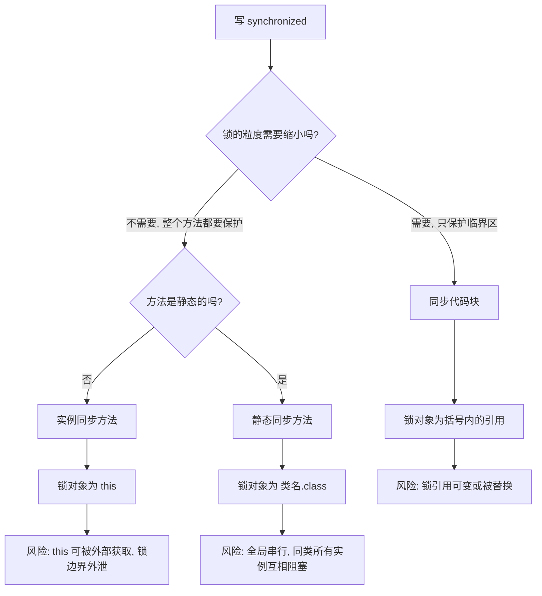

这张图的落点在于三种写法的**风险不对称**：

- 同步代码块锁对象可控，可以用 `private final Object lock = new Object()` 做"专用锁对象"，避免外部干扰。这是推荐写法。
- 实例同步方法锁 `this`，风险在于**这个对象可能被外部拿到并当作锁使用**（比如别的类写 `synchronized (yourService)`），一旦发生就产生跨模块的锁耦合，死锁排查难度指数上升。
- 静态同步方法锁 Class 对象，风险是全局串行。比如在工具类上写 `public static synchronized` 做缓存刷新，多实例环境下会退化成单线程。

### 1.4 monitorenter 的语义细节

JVM 规范对 `monitorenter` 的描述可以浓缩成三句话，这三句话是后面所有锁优化的**语义上界**——优化可以随便改实现，但不能违反它们：

1. 如果 monitor 的进入计数（entry count）为 0，线程进入并把它设为 1。
2. 如果当前线程已经持有该 monitor，进入计数加 1（**这就是可重入**）。
3. 如果 monitor 被其他线程持有，当前线程阻塞，直到进入计数降为 0 再重新竞争。

对应的 `monitorexit` 语义：当前线程把进入计数减 1，减到 0 时释放 monitor。

注意第 2 条——**可重入是 monitor 语义自带的，不是锁优化的产物**。面试问"为什么 synchronized 是可重入的"，标准答案就是"monitor 内部维护了 entry count（HotSpot 里是 `ObjectMonitor::_recursions` 字段），同一线程再次进入只做计数递增"。这跟 `ReentrantLock` 用 `AbstractQueuedSynchronizer#state` 做计数是同一个设计思路。

### 1.5 版本坐标

| 版本 | 变化 | 影响 |
| --- | --- | --- |
| JDK 1.0 | `synchronized` 诞生，只有重量级锁 | 直接对应 OS mutex，用户态到内核态切换，开销大 |
| JDK 5 | 引入 `java.util.concurrent`，`ReentrantLock` 出现 | 有了"显式锁"这条替代路线 |
| JDK 6 | 引入偏向锁、轻量级锁、自适应自旋、锁消除、锁粗化 | synchronized 性能大幅改善，很多场景追平 ReentrantLock |
| JDK 9 | JEP 143 重写栈上锁实现，改为"锁记录内嵌"方案 | 简化了 displaced mark word 的处理 |
| JDK 15 | `-XX:+UseBiasedLocking` 默认关闭，标记废弃 | 偏向锁进入废弃倒计时 |
| JDK 18 | JEP 421 正式废弃偏向锁，`-XX:+UseBiasedLocking` 仍可开但会打印废弃警告 | 新代码不应再依赖偏向锁 |

这个版本表要能背下来，面试官问"偏向锁现在还能用吗"时，答"JDK 15 起默认关闭，JDK 18 起废弃"就是标准答案。

## 二、对象头与 Mark Word：锁状态存在哪里

### 2.1 对象内存布局

HotSpot 里一个 Java 对象在堆上的布局分三块：

| 区域 | 长度（64 位 JVM，开启压缩指针） | 内容 |
| --- | --- | --- |
| 对象头 Mark Word | 8 字节 | 哈希码、GC 分代年龄、锁状态标志、偏向线程 ID、epoch（偏向纪元） |
| 对象头 Klass Pointer | 4 字节（压缩）/ 8 字节（不压缩） | 指向方法区中该类的 `InstanceKlass` |
| 实例数据 | 不定 | 字段内容，按 `long/double`、`int/float`、`short/char`、`byte/boolean`、引用 的顺序排列并做字段重排优化 |
| 对齐填充 | 0~7 字节 | 保证对象总大小是 8 字节的整数倍 |

数组对象还要多 4 字节存数组长度。所以"一个空对象占多少字节"的答案是：**开启压缩指针 16 字节**（8 字节 Mark Word + 4 字节 Klass Pointer + 4 字节对齐填充）。

### 2.2 Mark Word 的 64 位结构（JDK 8）

Mark Word 是一个**复用的 64 位字**，同一个字在不同锁状态下含义完全不同。JDK 8 的 64 位布局如下（这是 `markOop.hpp` 里定义的经典布局，也是面试最常考的版本）：

| 锁状态 | 位 63~39（25 位） | 位 38~8（31 位） | 位 7 | 位 6~3（4 位） | 位 2（偏向标志） | 位 1~0（锁标志） |
| --- | --- | --- | --- | --- | --- | --- |
| 无锁 | unused | identity_hashcode | unused | 分代年龄 | 0 | 01 |
| 偏向锁 | 偏向线程 ID（54 位，占位 63~10） | epoch（2 位，占位 9~8） | unused | 分代年龄 | 1 | 01 |
| 轻量级锁 | 指向栈中 Lock Record 的指针（62 位，占位 63~2） | | | | | 00 |
| 重量级锁 | 指向 ObjectMonitor 的指针（62 位，占位 63~2） | | | | | 10 |
| GC 标记 | 空（占位 63~2） | | | | | 11 |

注意两个要点：

1. **无锁和偏向锁的最后两位都是 `01`**，靠**第 3 位（bit 2）的偏向标志位**区分。JDK 8 里偏向锁状态下 bit 2 为 1，无锁状态下 bit 2 为 0。
2. **`identity_hashcode` 只有 31 位**（占第 8~38 位，正好能塞进一个 `int`）。一旦调用过 `System.identityHashCode(obj)` 或 `obj.hashCode()`（未被重写时），Mark Word 里就写入了哈希值，**偏向锁就再也无法建立**——因为偏向锁要用第 10~63 位（54 位）存线程 ID，哈希值占的第 8~38 位与它重叠，两者没法共存。

第 2 点是极高频的坑：**在偏向锁场景下，一旦对象计算过 identity hash code，就会直接禁用该对象的偏向锁**。所以"为什么我的程序里偏向锁没生效"的答案之一就是代码里某处调用了 `hashCode()`。这也是为什么 `HashMap` 的 key 对象做偏向锁没有意义——`HashMap` 会调用 `key.hashCode()`。

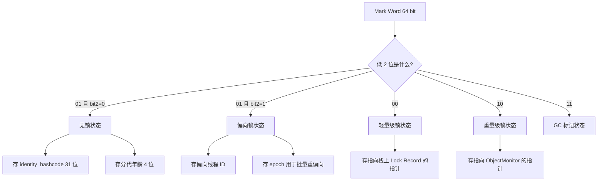

### 2.3 怎么亲眼看到 Mark Word

用 JOL（Java Object Layout）是最直接的方式。JDK 8 对应的版本是 `org.openjdk.jol:jol-core:0.9`，JDK 9+ 用 `0.16` 或更高：

```java
// JDK 8 + jol-core:0.9
Object o = new Object();
System.out.println(ClassLayout.parseInstance(o).toPrintable());
synchronized (o) {
    System.out.println(ClassLayout.parseInstance(o).toPrintable());
}
```

典型输出（JDK 8，开启压缩指针，偏向锁已生效）：

```text
java.lang.Object object internals:
 OFFSET  SIZE   TYPE DESCRIPTION               VALUE
      0     4        (object header)           05 00 00 00 (00000101 ...)
      4     4        (object header)           00 00 00 00 (...)
      8     4        (object header)           e5 01 00 f8 (...)
     12     4        (loss due to the next object alignment)
Instance size: 16 bytes
```

`05 00 00 00` 是**小端序**，真实值是 `0x00000005`，二进制 `...0101`：低两位 `01`，bit 2 为 `1`，即**偏向锁但尚未偏向任何线程**（线程 ID 全 0）。如果输出是 `01 00 00 00`（`0x00000001`，`...0001`），就是无锁且未偏向。

这就是面试的杀手级细节：**"对象刚 new 出来是什么状态？"答案是"取决于偏向锁是否启用以及偏向锁延迟是否已过"**。JDK 8 默认 `-XX:BiasedLockingStartupDelay=4000`，JVM 启动后 4 秒内创建的对象是**无锁**（`0x1`），4 秒后创建的对象是**匿名偏向**（`0x5`）。这个 4000 毫秒的延迟是 HotSpot 刻意设计的，因为启动阶段有大量短命对象，启用偏向锁的撤销成本大于收益。

### 2.4 查看与验证命令

| 目的 | 命令 |
| --- | --- |
| 查看偏向锁相关开关 | `java -XX:+PrintFlagsFinal -version \| grep BiasedLocking` |
| 查看膨胀前自旋相关参数 | `java -XX:+PrintFlagsFinal -version \| grep -i spin` |
| 关闭偏向锁 | `-XX:-UseBiasedLocking` |
| 关闭偏向锁延迟 | `-XX:BiasedLockingStartupDelay=0` |
| 查看 monitor 相关参数 | `java -XX:+UnlockDiagnosticVMOptions -XX:+PrintFlagsFinal -version \| grep -i monitor` |
| 查看字段布局 | `java -XX:+UnlockDiagnosticVMOptions -XX:+PrintFieldLayout`（**notproduct 选项，只有 debug/fastdebug 版 JVM 能用**；产品版 JDK 8/17 上会直接报 `VM option 'PrintFieldLayout' is notproduct`） |

`-XX:+PrintFlagsFinal` 在本机 **JDK 8（1.8.0_421）** 上的真实输出片段，下面每一行都是实跑结果：

```text
bool UseBiasedLocking = true {product}
intx BiasedLockingBulkRebiasThreshold = 20 {product}
intx BiasedLockingBulkRevokeThreshold = 40 {product}
intx BiasedLockingDecayTime = 25000 {product}
intx BiasedLockingStartupDelay = 4000 {product}
intx PreInflateSpin = 10 {pd product}
intx MonitorBound = 0 {product}
bool DoEscapeAnalysis = true {C2 product}
bool EliminateLocks = true {C2 product}
```

这几个数字（20、40、25000、4000、10）是锁升级章节的硬通货，必须记住含义。

**这里有一个必须纠正的常见错误**：网上大量资料写"自旋次数由 `-XX:PreBlockSpin=10` 控制"，但在 **JDK 8 上 `PreBlockSpin` 和 `UseSpinning` 这两个选项已经被删除**，加上去会直接启动失败。在本机 JDK 8 上实测：

```text
$ java -XX:PreBlockSpin=10 SpinFlag
Unrecognized VM option 'PreBlockSpin=10'
Error: Could not create the Java Virtual Machine.

$ java -XX:+UseSpinning SpinFlag
Unrecognized VM option 'UseSpinning'
Error: Could not create the Java Virtual Machine.
```

JDK 8 上真实存在的是 `intx PreInflateSpin = 10 {pd product}`，其中 `pd` 表示 platform-dependent（平台相关）。它的语义是**在膨胀为重量级锁之前的自旋/CAS 尝试次数上限**，即 `ObjectMonitor::enter` 的入口路径上先做若干次抢占尝试，失败才真正入队阻塞。这个值在 x86 上默认 10。

所以面试时正确的说法是：

> 固定次数自旋是 JDK 1.4.2 时代的 `-XX:PreBlockSpin`（默认 10）；JDK 6 引入自适应自旋后，次数改由 JVM 根据同一个锁上一次自旋的成功率和持有者状态动态决定，固定的 `PreBlockSpin` 开关在后续版本（JDK 7/8）已被移除。JDK 8 上 `-XX:+PrintFlagsFinal` 只能看到 `PreInflateSpin=10`，这是膨胀前的自旋尝试上限，不是自适应自旋的最终次数。

## 三、锁升级全流程：偏向锁到重量级锁

### 3.1 为什么需要锁升级

`synchronized` 在 JDK 1.0~1.5 只有一种实现：**直接调用操作系统互斥量**。线程竞争失败要陷入内核态挂起，唤醒又要切回来，一次切换在微秒量级。而绝大多数真实代码的锁竞争概率极低——很多 `synchronized` 块在运行期从来没有第二个线程来过。

HotSpot 的设计思路是**按竞争强度分层，先用最便宜的方案，不行再升级**：

| 锁状态 | 适用场景 | 加锁代价 | 是否阻塞线程 | 依赖的硬件原语 |
| --- | --- | --- | --- | --- |
| 偏向锁 | 只有一个线程反复进入 | 一次 CAS（首次），之后零开销 | 否 | CAS + Mark Word 位操作 |
| 轻量级锁 | 多个线程交替进入，无真正同时竞争 | 每次 CAS + 可能自旋 | 否（自旋失败才升级） | CAS |
| 重量级锁 | 多个线程同时竞争 | 用户态到内核态切换 | 是 | OS mutex + park/unpark |

**核心权衡**：偏向锁和轻量级锁用"多花一点 CPU 做 CAS 和自旋"换取"避免线程挂起/唤醒的系统调用"。当竞争激烈到自旋也拿不到锁时，继续自旋是纯浪费 CPU，此时必须升级为重量级锁，把线程挂起让出 CPU。

### 3.2 完整升级流程

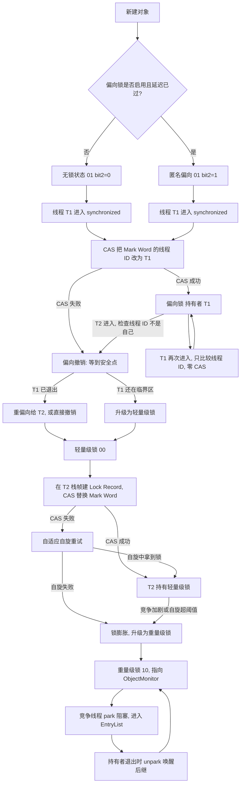

这张图里有三个**不可逆点**，面试常问"锁能降级吗"：

1. 偏向锁可以撤销（revoke）并重偏向（rebiase），但**一旦升级到轻量级锁，就再也回不到偏向锁**。
2. 轻量级锁一旦膨胀（inflate）为重量级锁，**在持有者释放后 monitor 也不会自动降级**，只会因为 `ObjectMonitor` 被回收（deflate）而重新回到无锁状态。
3. 重量级锁的"降级"实际上是**对象被 GC 回收或 monitor 被 deflate 后重新开始**，不是运行中的降级。

### 3.3 状态流转图（另一种视角）

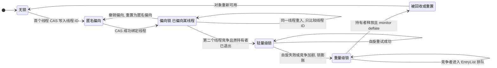

### 3.4 各级锁的适用场景与代价量化

| 维度 | 偏向锁 | 轻量级锁 | 重量级锁 |
| --- | --- | --- | --- |
| 加锁操作 | 首次一次 CAS，后续仅比较 Mark Word 线程 ID | 每次都要 CAS 替换 Mark Word | CAS 失败即 park |
| 解锁操作 | 无（只清偏向标记或不动） | CAS 恢复 Mark Word | unpark 后继 + 释放 monitor |
| 单线程反复进入的开销 | 接近零 | 每次 1 次 CAS | 每次 1 次 CAS + 可能的 park |
| 竞争时的开销 | 撤销需 STW 到安全点 | 自旋烧 CPU | 上下文切换 |
| 典型适用 | 单线程反复访问的集合、单例初始化 | 锁持有时间极短、交替访问 | 临界区耗时长、竞争激烈 |
| 禁用开关 | `-XX:-UseBiasedLocking` | 无法单独禁用 | 无法单独禁用 |

**"什么时候该用哪个"的答案不是程序员选的，是 JVM 根据竞争情况自动选的**。程序员能做的是：

- 缩小临界区（减少持有时间），避免轻量级锁升级为重量级锁。
- 避免在单线程场景频繁撤销偏向锁（比如在循环里对同一个对象反复加锁且中途有其他线程访问）。
- 高竞争场景直接用 `ReentrantLock` 或降低锁粒度（分段锁、`LongAdder`）。

### 3.5 一个具体的升级时序

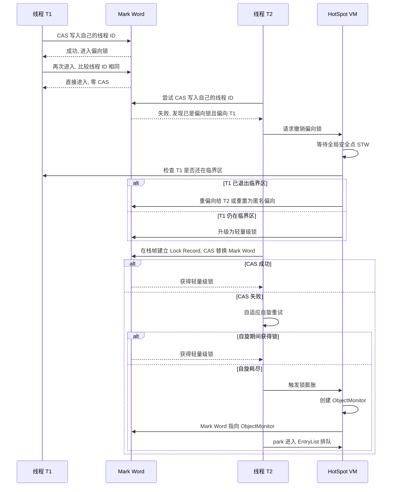

注意时序图里的 `VM->>VM: 等待全局安全点 STW` 这一步——**偏向锁撤销必须在安全点（safepoint）执行**，因为需要遍历持有偏向锁的线程栈帧来判断它是否还在临界区。这是偏向锁在高并发下反而拖慢系统的主要原因，也是它被废弃的技术理由。

## 四、偏向锁：批量重偏向、批量撤销与 JDK 15/18 的命运

### 4.1 偏向锁的设计假设

偏向锁的假设非常具体：**同一个锁在绝大多数情况下只被同一个线程访问**。在这个假设下，加锁的开销可以降到"比较一次 Mark Word 里的线程 ID"。

首次加锁流程（JDK 8，`-XX:+UseBiasedLocking -XX:BiasedLockingStartupDelay=0`）：

1. 检查 Mark Word 的低 2 位是否为 `01`、bit 2 是否为 `1`（可偏向状态）。
2. 如果是匿名偏向（线程 ID 为 0），用 CAS 把当前线程 ID 和 epoch 写入 Mark Word。
3. 如果已经偏向当前线程，什么都不做，直接进入临界区。
4. 如果偏向的是别的线程，进入**撤销流程**。

解锁流程更简单：**偏向锁的解锁不做任何事**。不修改 Mark Word，不清除线程 ID。这样下次同一线程进入时比较线程 ID 就命中。这也是为什么偏向锁在单线程反复加锁场景下几乎没有开销。

### 4.2 偏向撤销：为什么必须 STW

撤销偏向锁需要判断"原偏向线程是否还在临界区"，方法是**遍历该线程的栈帧**，查找是否有指向该对象的 Lock Record。遍历别人的栈必须让目标线程停在安全点上，否则栈帧会变化。

所以偏向撤销的流程是：

1. 请求方（T2）发现偏向线程不是自己，构造一个 `VM_RevokeBias`（批量场景是 `VM_BulkRevokeBias`）交给 `VMThread` 执行。
2. 等到**全局安全点**，所有线程 STW。
3. 检查原偏向线程 T1 的栈帧：如果在临界区，把 Mark Word 升级为轻量级锁（标记为 `00`，并把 T1 的 Lock Record 写回）；如果不在临界区，把 Mark Word 重置为匿名偏向或直接重偏向给 T2。
4. 恢复所有线程。

代价很直白：**一次偏向撤销 = 一次 STW**。如果程序里存在大量"多线程轮流访问同一批对象"的模式，偏向锁会变成负优化。这正是 JDK 15 关闭它的原因。

**怎么确认撤销真的在发生**：JDK 8 加 `-XX:+TraceBiasedLocking`（product 参数，默认 `false`）会打印 `Revoking bias of object 0x... , type java.lang.Object , allow rebias 0`；再配上 `-XX:+PrintSafepointStatistics -XX:PrintSafepointStatisticsCount=1`，就能在 safepoint 日志里看到名为 `RevokeBias` 的 VM operation（JDK 8u421 实测输出）。线上日志里 `RevokeBias` 频繁出现，说明偏向锁对这套代码就是负优化。

### 4.3 批量重偏向与批量撤销

如果逐个撤销，一个 `ArrayList` 在多个线程间传递可能触发成百上千次 STW。HotSpot 用两个计数器做了批量化处理，对应两个参数：

| 参数 | JDK 8 默认值 | 含义 |
| --- | --- | --- |
| `-XX:BiasedLockingBulkRebiasThreshold` | 20 | 同一个类的对象被撤销偏向达到 20 次，触发**批量重偏向** |
| `-XX:BiasedLockingBulkRevokeThreshold` | 40 | 同一个类的对象被撤销偏向达到 40 次，触发**批量撤销**，该类从此禁用偏向锁 |
| `-XX:BiasedLockingDecayTime` | 25000（毫秒） | 距离上次批量重偏向超过 25 秒后，撤销计数清零重新累计 |

批量重偏向（bulk rebias）的机制：**给这个类的所有对象换一个 epoch 值**。判断偏向是否有效时，除了比较线程 ID，还要比较 epoch：

- 如果 Mark Word 里的 epoch 与类元数据里的 epoch 相同，说明偏向有效，直接进入。
- 如果 epoch 不一致，说明发生过批量重偏向，此时**不需要 STW 遍历栈**，直接把偏向更新为当前线程（因为批量重偏向意味着"原偏向线程大概率已经不再使用这些对象"）。

批量撤销（bulk revoke）的机制：把这个类的 `Klass` 标记为"不可偏向"，之后该类**所有新建对象直接进入无锁状态**，不再尝试偏向。这是 JVM 的自我保护——如果一个类的对象反复引起撤销，说明偏向锁对它没有收益。

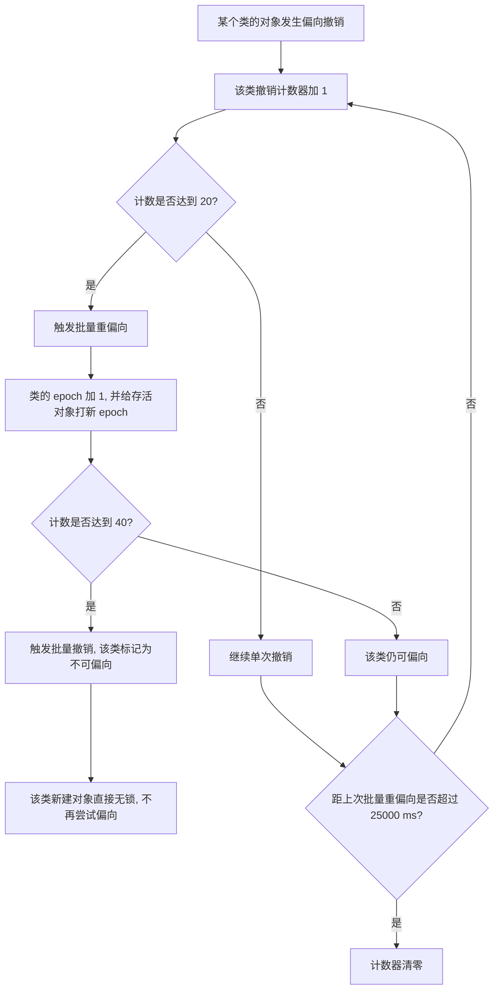

### 4.4 偏向锁的废弃过程

| 时间点 | 事件 | 具体表现 |
| --- | --- | --- |
| JDK 6 | 引入偏向锁，默认开启 | `-XX:+UseBiasedLocking` 默认 `true` |
| JDK 8 | 默认开启 + 4000ms 启动延迟 | `BiasedLockingStartupDelay=4000` |
| JDK 9 | JEP 143 重写栈上锁 | 偏向锁实现同步调整 |
| JDK 15 | JEP 374，`UseBiasedLocking` **默认关闭**，并标记为废弃 | 显式 `-XX:+UseBiasedLocking` 会打印废弃警告 |
| JDK 18 | JEP 421，偏向锁**正式废弃**（deprecate for removal） | 开关仍存在，但强烈不建议使用 |

废弃的**技术原因**（面试要能说出三条以上）：

1. **偏向撤销需要 STW 到安全点**，与低延迟目标冲突。现代 JVM 追求毫秒级甚至亚毫秒级停顿，一次偏向撤销的 STW 可能比锁本身的收益高几个数量级。
2. **收益场景在缩小**。偏向锁的收益主要来自单线程反复访问集合类（`ArrayList`、`HashMap`）。JDK 的集合实现和 JIT 优化（锁消除、逃逸分析）已经能覆盖相当一部分场景。
3. **维护成本高**。偏向锁的代码散布在解释器、C1、C2、safepoint 处理、类元数据（epoch）里，每加一个新特性（比如虚拟线程、值类型）都要额外考虑偏向锁的交互，JEP 421 明确把维护成本列为废弃理由之一。
4. **与虚拟线程的模型不匹配**。虚拟线程大量创建、频繁挂载卸载，偏向锁的"线程 ID"语义会频繁失效并触发撤销。

**实践建议**：JDK 15+ 不要依赖偏向锁。如果从 JDK 8 升级到 JDK 17/21 后吞吐下降，且代码里有大量单线程反复加锁的集合访问，优先考虑**减小锁范围**或换成 `ThreadLocal` / 无锁结构，而不是去把 `UseBiasedLocking` 打开。

## 五、轻量级锁：栈上 Lock Record 与 CAS 自旋

### 5.1 轻量级锁的设计假设

轻量级锁的假设是：**多个线程会访问同一个锁，但访问时间是错开的（交替而非同时）**。在这个假设下，用 CAS 比用 OS 互斥量便宜得多。

关键术语是 **Displaced Mark Word（ displaced 头 / 置换后的 Mark Word）**：加锁时把对象原来的 Mark Word 保存到线程栈帧里，然后用 CAS 把 Mark Word 替换成"指向栈帧中 Lock Record 的指针"。

### 5.2 JDK 8 与 JDK 9+ 的实现差异

这个差异在面试里是加分项：

| 版本 | 实现方式 | 关键点 |
| --- | --- | --- |
| JDK 8 及以前 | `BasicObjectLock` 结构，栈帧里有 `_lock`（指向对象）和 `_displaced_header`（存原 Mark Word） | 需要显式保存 displaced header |
| JDK 9+（JEP 143） | 重写为"锁记录内嵌"方案，`LockStack` 结构，不再需要显式 displaced header | 简化了膨胀和撤销逻辑，减少了栈帧空间 |

JDK 9 的 JEP 143 原文描述是 "Reimplement the implementation of the `synchronized` ... to improve the performance of uncontended and lightly contended cases"，把原来的 displaced header 机制换成了更简单的 LockStack 记录方式。所以面试时如果被追问"JDK 8 和 JDK 9 的轻量级锁有区别吗"，答"有，JEP 143 重写了实现，JDK 8 用 `BasicObjectLock` + displaced mark word，JDK 9 之后用锁记录内嵌方案"就是准确的。

### 5.3 加锁流程（JDK 8 语义）

1. 在当前线程的**栈帧中分配一块 Lock Record 空间**（JVM 实现里是 `BasicObjectLock`）。
2. 把对象的 Mark Word **拷贝**到 Lock Record 的 `_displaced_header` 字段。这一步叫 displaced。
3. 用 **CAS** 尝试把对象的 Mark Word 替换为"指向该 Lock Record 的指针"，同时把低两位改成 `00`。
4. 如果 CAS 成功：当前线程获得轻量级锁，Mark Word 变为 `00`。
5. 如果 CAS 失败：
   - 先检查 Mark Word 是否已经指向**当前线程自己的** Lock Record。如果是，说明是**重入**，直接把 Lock Record 的 `_displaced_header` 置为 `null`（表示这是一次重入记录），然后继续执行。
   - 如果不是自己，说明有竞争，进入**自适应自旋**。
6. 自旋结束后仍失败，触发**锁膨胀（inflate）**，升级为重量级锁。

**重入的处理是轻量级锁最容易问倒人的点**：重入时不再拷贝 Mark Word，而是把新 Lock Record 的 `_displaced_header` 设为 `null`。解锁时看到 `null` 就知道这是重入层，只弹出栈帧不清 Mark Word；只有最外层（`_displaced_header` 非 null）才用 CAS 把原 Mark Word 恢复回去。

### 5.4 解锁流程

1. 从栈帧里取出最上层的 Lock Record，读 `_displaced_header`。
2. 如果 `_displaced_header` 是 `null`：这是重入层，直接把 Lock Record 弹出，**不修改对象 Mark Word**。
3. 如果非 `null`：用 CAS 把 `_displaced_header` 写回对象的 Mark Word，同时清除 `00` 标志。
4. 如果 CAS 失败：说明在持有期间锁已经被其他线程膨胀成重量级锁了，此时要走**重量级锁的释放流程**（唤醒 `ObjectMonitor` 的后继）。

第 4 步是"为什么解锁还需要 CAS"的答案。解锁不是简单赋值，因为期间可能发生了膨胀。

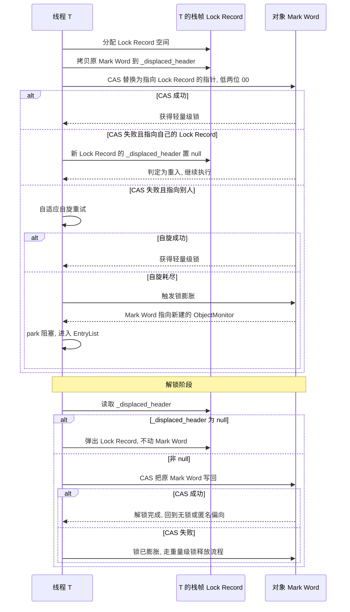

### 5.5 轻量级锁的代价

轻量级锁并不是"免费"的，它的代价集中在三处：

1. **每次加锁都有一次 CAS**。CAS 是 `lock cmpxchg` 指令（x86），会锁缓存行。无竞争时约 10~20 个时钟周期，比偏向锁的"比较线程 ID"贵得多。
2. **竞争失败要自旋**，自旋是纯粹的 CPU 空转。JDK 6 之后改为自适应自旋来缓解，但高竞争下仍会烧 CPU。
3. **膨胀后不可逆**。一旦升级到重量级锁，即使之后没有竞争，也不会退回轻量级锁，直到 monitor 被 deflate。

所以"什么时候轻量级锁比重量级锁好"的边界是：**临界区极短且竞争不激烈**。如果临界区里有 IO、有 `Thread.sleep`、有长循环，轻量级锁的自旋纯属浪费，应该直接让它膨胀。

## 六、重量级锁与 ObjectMonitor 结构

### 6.1 锁膨胀过程

锁膨胀（inflation）发生在轻量级锁自旋失败时，由 `ObjectSynchronizer::inflate` 完成：

1. 检查对象 Mark Word 是否已经指向 `ObjectMonitor`（可能已被其他线程膨胀）。如果是，直接返回已有的 monitor。
2. 如果 Mark Word 仍是 `00`（轻量级锁），调用 `ObjectSynchronizer::omAlloc` 拿一个 `ObjectMonitor`：它先取当前线程私有的 `omFreeList`，取不到再从全局 `gFreeList` 批量补充，两者都空时才 `new ObjectMonitor[_BLOCKSIZE]` 分配新块。
3. 初始化 `ObjectMonitor`：`_header` 设为对象的原 Mark Word（即 displaced header），`_object` 指向锁对象。
4. 用 CAS 把对象 Mark Word 替换为"指向该 `ObjectMonitor` 的指针"，低两位设为 `10`。
5. 当前线程进入 `ObjectMonitor::enter` 尝试获取。

注意第 2 步：**`ObjectMonitor` 是复用的，不是每次膨胀都新建**。JDK 8 里 monitor 由 `ObjectSynchronizer` 统一管理，`-XX:MonitorBound`（**默认 0**）不是硬上限，而是"在用 monitor 数"的阈值：超过它 VM 会主动诱发一次 STW safepoint 去执行 deflate，**默认值 0 表示不主动诱发**。配套的 **monitor deflation** 机制会回收那些 `_owner` 为空、`_EntryList` 与 `_cxq` 均为空的空闲 monitor，把内存还回空闲列表。

版本差异要说清楚，不要张冠李戴：

| 版本 | deflation 相关能力 | 说明 |
| --- | --- | --- |
| JDK 8 | 存在基础的 monitor deflation 逻辑，但没有异步 deflation 线程和保证性间隔参数 | 实测 `-XX:+UnlockDiagnosticVMOptions -XX:+PrintFlagsFinal` 中**没有任何 `deflat` 相关参数** |
| JDK 10+ | 引入 `MonitorDeflationThread` 异步回收线程与 `GuaranteedAsyncDeflationInterval`（默认 60000 毫秒，即最迟约 60 秒触发一次异步回收） | 异步回收不再依赖 safepoint |
| JDK 15+ | 增加 `MonitorUsedDeflationThreshold` 等参数，按使用率触发强制 deflation | 更主动地控制 monitor 占用 |

为什么 monitor 要复用和回收？因为 `ObjectMonitor` 结构不小（JDK 8 里约 100+ 字节），如果每次膨胀都新建且不回收，一个高并发的短临界区应用会持续占用大量内存，表现为**堆外内存或 Metaspace 之外的本机内存持续上涨**。这是"锁竞争导致内存上涨"的真实原因。

### 6.2 ObjectMonitor 结构（JDK 8 HotSpot）

`ObjectMonitor` 定义在 `src/share/vm/runtime/objectMonitor.hpp`，核心字段如下（字段名必须能说出来）：

| 字段 | 类型 | 含义 |
| --- | --- | --- |
| `_header` | `volatile markOop` | 对象原来的 Mark Word（displaced header），解锁时恢复回去 |
| `_object` | `void*` | 指向锁对象（反向引用，用于 deflate 时清理） |
| `_owner` | `void*` | 当前持有 monitor 的线程，未持有时为 `NULL` |
| `_recursions` | `intptr_t` | 重入次数，`synchronized` 可重入的载体 |
| `_EntryList` | `ObjectWaiter*` | 阻塞在 `monitorenter` 上的线程队列（**入口队列**） |
| `_cxq` | `ObjectWaiter*` | 竞争队列（contention queue），新到达的竞争线程先挂这里 |
| `_WaitSet` | `ObjectWaiter*` | 调用 `Object#wait()` 后进入的等待队列 |
| `_succ` | `Thread*` | 预设的继承者线程（successor），用于减少 unpark 竞争 |
| `_SpinDuration` | `int` | 该 monitor 的自旋时长统计，自适应自旋的依据 |
| `_count` | `volatile intptr_t` | 引用计数（约等于 `_WaitSet` 与 `_EntryList` 的长度之和），deflate 时判断 monitor 是否空闲 |
| `_Responsible` | `Thread*` | 负责在无竞争时把 monitor 归还空闲列表的线程 |

三个队列的区别是本节的核心考点：

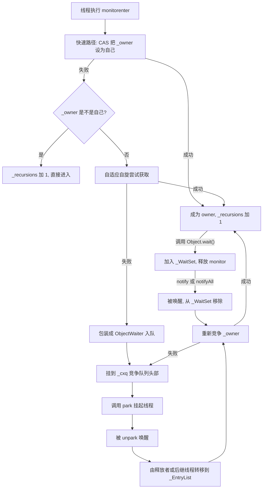

要点：

- **`_cxq` 是单向链表，采用头插（LIFO）**，新来的竞争线程插在头部。
- **`_EntryList` 是双向链表，用于存放"已被唤醒、准备重新竞争"的线程**。`ObjectMonitor::exit` 在释放锁时会根据策略把 `_cxq` 的线程转移到 `_EntryList`。
- **`_WaitSet` 只服务 `Object#wait()`**，与 `monitorenter` 的阻塞完全无关。这是最容易混淆的一点：`wait()` 进入 `_WaitSet`，`monitorenter` 失败进入 `_cxq`/`_EntryList`。

### 6.3 公平性与排队策略

`synchronized` 是**非公平锁**，而且是刻意非公平的。原因和 `ReentrantLock` 的非公平模式一样：**允许刚到达的线程直接抢锁（barging），可以减少线程挂起/唤醒的次数**，提高吞吐。

`ObjectMonitor::exit` 里的唤醒策略在不同 JDK 版本有调整，JDK 8 里由 `Knob_QMode` 控制 `_cxq` 与 `_EntryList` 的转移策略，它只能通过 `-XX:SyncKnobs=QMode=N` 设置（**没有独立的 `-XX:QMode` 开关**，JDK 8 上写 `-XX:QMode=2` 会直接启动失败；`Knob_QMode` 默认 0）。JDK 8 的默认策略（QMode=0）是：**先看 `_EntryList`，非空就唤醒它的头节点；`_EntryList` 为空时才把 `_cxq` 整体摘下、从 LIFO 单链表转成双向链表挂到 `_EntryList` 上（QMode=1 会顺便反转顺序）再唤醒**，同时允许刚到达的线程抢锁。

这带来一个真实后果：**`synchronized` 不保证 FIFO，高竞争下可能出现线程饥饿**。如果一个线程持续在临界区外反复重入，理论上可以让等待队列里的线程长期得不到锁。JDK 的实现通过"唤醒后继 + `_succ` 预设继承者"来缓解，但**不提供公平性保证**。需要公平性就必须用 `new ReentrantLock(true)`。

### 6.4 重量级锁的完整生命周期

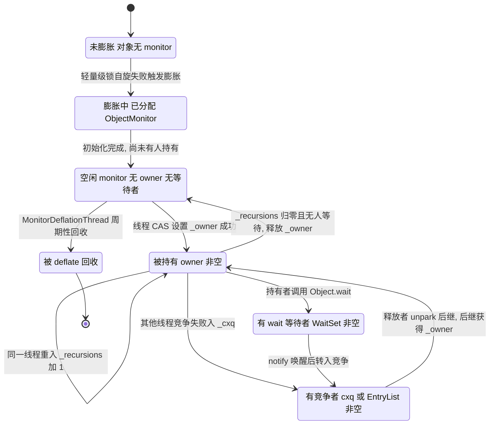

### 6.5 park / unpark 与线程状态

重量级锁的阻塞最终落到 JVM 内部的 `ParkEvent::park`（`JavaThread::_ParkEvent`，源码注释就写着 `for synchronized()`），Linux 上底层是 `pthread_cond_wait`。注意它和 `Unsafe#park` / `LockSupport#park` 用的 `Parker`（`JavaThread::_parker`）**不是同一个东西**，两者只是实现相似。线程状态在 `jstack` 里表现为：

| 情况 | `jstack` 里的状态 | 对应代码位置 |
| --- | --- | --- |
| 等待 `synchronized` 锁 | `BLOCKED (on object monitor)` | `monitorenter` 处 |
| 调用 `Object#wait()` | `WAITING (on object monitor)` | `Object.wait()` |
| 调用 `Object#wait(1000)` | `TIMED_WAITING (on object monitor)` | `Object.wait(long)` |
| 等待 `ReentrantLock` | `WAITING (parking)` | `LockSupport.park` |
| 等待 `ReentrantLock#tryLock(1, SECONDS)` | `TIMED_WAITING (parking)` | `LockSupport.parkNanos` |
| 等待 `Thread#join()` | `WAITING` | `Object.wait` |

**这是排查时最重要的区分**：`BLOCKED` 特指"等 monitor 锁"，也就是 `synchronized` 相关；等 `ReentrantLock` 显示的是 `WAITING (parking)`。很多人在 dump 里只 grep `BLOCKED` 就下结论，会漏掉 `ReentrantLock` 的竞争。

## 七、自旋与自适应自旋

### 7.1 为什么需要自旋

线程阻塞和唤醒的代价：

| 操作 | 大致开销 |
| --- | --- |
| 一次 CAS（无竞争） | 约 10~20 个时钟周期 |
| 一次 `park` + `unpark` | 微秒级，涉及系统调用和上下文切换 |
| 一次上下文切换（含缓存失效） | 约 1~10 微秒，且会污染 CPU 缓存 |

如果锁的持有时间只有几百纳秒，那么"挂起再唤醒"的成本远高于"原地等一会儿"。**自旋就是用可控的 CPU 空转换取避免上下文切换**。

代价同样明确：自旋期间线程占着 CPU 什么都不干。如果锁的持有时间很长（比如临界区里有 IO），自旋就是纯浪费，而且会抢占真正持锁线程的 CPU 时间，形成"越自旋越慢"的正反馈。

### 7.2 自旋的演进

| 阶段 | 实现 | 问题 |
| --- | --- | --- |
| JDK 1.4.2 之前 | 无自旋，直接阻塞 | 短临界区开销大 |
| JDK 1.4.2 | 引入固定次数自旋，由 `-XX:+UseSpinning` 开启 | 需要 `-XX:PreBlockSpin` 手动调参，默认 10 |
| JDK 6 | 引入**自适应自旋（Adaptive Spinning）**，`UseSpinning` 默认开启 | 由 JVM 根据历史成功率动态决定自旋次数 |
| JDK 7 / JDK 8 | `UseSpinning` 与 `PreBlockSpin` 两个开关**被移除**，自适应自旋成为默认且不可关闭的行为 | 只能通过 `PreInflateSpin` 影响膨胀前的尝试次数 |

JDK 6 之后 `-XX:PreBlockSpin=10` 这个固定值**不再直接生效**，因为自旋次数改为由 `ObjectMonitor::_SpinDuration` 统计动态计算；到了 JDK 8，这两个开关已经被删除，写上去会启动失败。面试如果问"自旋次数默认多少"，严谨的回答是：

> JDK 1.4.2 时代是固定 `-XX:PreBlockSpin`，默认 10 次；JDK 6 引入自适应自旋后，次数由 JVM 根据同一个锁上一次自旋的成功率和持有者的运行状态动态调整；JDK 7/8 已移除 `UseSpinning` 与 `PreBlockSpin`，JDK 8 上只剩 `PreInflateSpin=10`（膨胀前的尝试次数上限）。

### 7.3 自适应自旋的决策逻辑

自适应自旋的核心思想：

1. **在同一个锁对象上，如果上次自旋成功获得了锁**，JVM 认为这次自旋也很可能成功，于是**允许自旋更长时间**。
2. **如果某个锁很少自旋成功**，JVM 会**缩短甚至跳过自旋**，直接膨胀为重量级锁并阻塞。
3. 还会参考**持有者线程的状态**：如果持有者正在运行（`_succ` 相关逻辑），自旋更有意义；如果持有者被换出 CPU，自旋基本没戏。

对应到源码，`ObjectMonitor::TrySpin_VaryDuration` 会读取并更新 `_SpinDuration`：

```text
ObjectMonitor::TrySpin_VaryDuration(Thread * Self) {
  // 读取当前 monitor 的自旋时长统计 _SpinDuration
  // 根据历史成功率调整本次自旋次数
  // 上限受 Knob_SpinLimit 等参数约束
}
```

`_SpinDuration` 是**每个 monitor 独立维护**的，不是全局的。这意味着不同锁对象的自旋行为会分化：热点锁会很快学会"不要自旋，直接阻塞"，冷门锁会保留自旋能力。

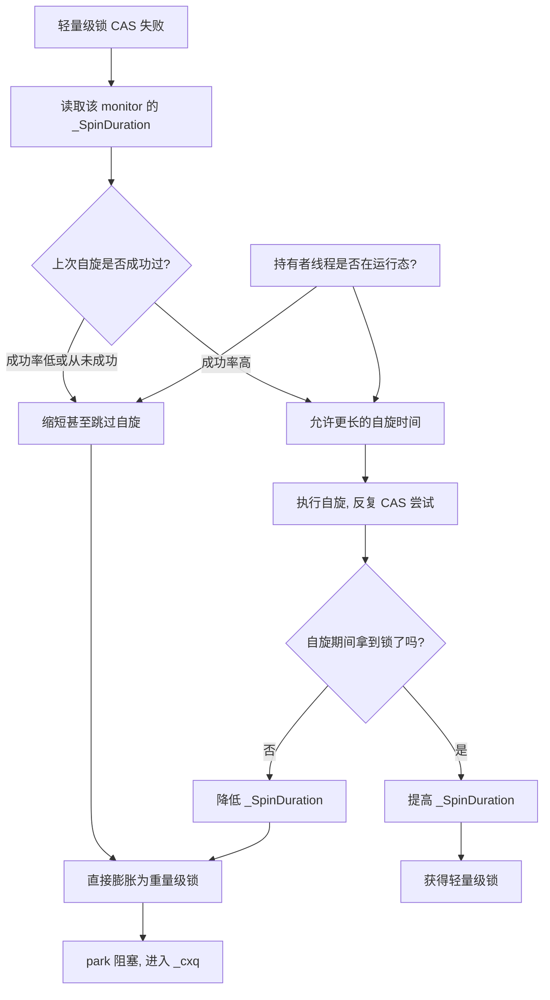

### 7.4 什么时候自旋有害

| 场景 | 现象 | 建议 |
| --- | --- | --- |
| 临界区包含 IO | 自旋线程空转，持锁线程被 IO 阻塞 | 把 IO 移出同步块 |
| 临界区包含 `Thread.sleep` | 自旋必然失败 | 移出同步块，或改用 `ReentrantLock` + 条件变量 |
| 大量线程竞争同一把锁 | 自旋线程互相抢占 CPU | 降低锁粒度（`LongAdder`、分段、`ConcurrentHashMap`） |
| 单核 CPU | 自旋线程和持锁线程抢同一个核 | 自旋完全无效，JVM 会直接膨胀 |

**单核场景值得单独说**：只有 1 个 CPU 时，持锁线程和自旋线程共享同一个核。自旋线程不主动让出 CPU，持锁线程就没有机会执行完并释放锁，自旋必然失败。HotSpot 在 `os::is_MP()`（多处理器检查）为 false 时会跳过自旋直接膨胀。所以"单核机器上 synchronized 慢"不是错觉，是自旋策略失效。

### 7.5 与 `ReentrantLock` 自旋的对比

`ReentrantLock` 的自旋逻辑在 `AbstractQueuedSynchronizer` 里，与 `synchronized` 不同：

- `NonfairSync#tryAcquire` 会先做一次 CAS 抢锁（相当于"一次自旋机会"），失败后才入队。
- 入队后，队列中的线程在 `shouldParkAfterFailedAcquire` 之前会**再检查一次前驱是否是 head**（`hasQueuedPredecessors` 用于公平模式）。
- AQS **没有自适应自旋**，它依赖 `LockSupport.park` 阻塞，只在极少数路径上做短暂自旋（比如取消节点的清理）。

这是两者的重要差异：**`synchronized` 在 JVM 层面做了自适应自旋优化，`ReentrantLock` 在 Java 层面没有等价的动态自旋**。所以"低竞争短临界区"场景下 `synchronized` 可能比 `ReentrantLock` 更快，"需要超时/可中断/公平/条件变量"场景下必须用 `ReentrantLock`。

## 八、锁消除、锁粗化与编译器优化边界

### 8.1 锁消除（Lock Elision）

锁消除基于**逃逸分析（Escape Analysis）**：如果 JIT 编译期能证明锁对象**不会逃逸出当前线程**，那么这个锁就没有任何并发意义，可以直接删除。

典型例子：

```java
public String concat(String a, String b) {
    StringBuffer sb = new StringBuffer();  // StringBuffer 方法都是 synchronized
    sb.append(a);
    sb.append(b);
    return sb.toString();
}
```

`StringBuffer` 的 `append` 是 `synchronized` 方法，但 `sb` 是局部变量、没有逃逸，JIT 会把这些锁全部消除。所以"`StringBuffer` 比 `StringBuilder` 慢"这个结论**只在对象逃逸时成立**，在局部变量场景下 JDK 6 之后性能几乎一致。

锁消除的开关与相关参数：

| 参数 | JDK 8 默认值 | 含义 |
| --- | --- | --- |
| `-XX:+DoEscapeAnalysis` | `true` | 逃逸分析总开关，锁消除依赖它 |
| `-XX:+EliminateLocks` | `true` | 锁消除开关 |
| `-XX:+EliminateAllocations` | `true` | 标量替换，与逃逸分析同源 |
| `-XX:+PrintEliminateLocks` | `false` | 打印被消除的锁（需 `-XX:+UnlockDiagnosticVMOptions`） |

**锁消除只发生在 C2 编译后的代码里**。方法还没被 JIT 编译时（解释执行或 C1 编译），锁依然存在。所以"为什么我的基准测试看不到锁消除"的答案往往是：方法没被 C2 编译（`-XX:CompileThreshold` 默认 10000 次调用，分层编译下由 `Tier4InvocationThreshold` 等控制）。

### 8.2 锁粗化（Lock Coarsening）

锁粗化是反向优化：**如果一段代码里对同一个对象反复加解锁，JIT 会把它们合并成一次大锁**，减少加解锁次数。

典型例子：

```java
for (int i = 0; i < 1000; i++) {
    synchronized (lock) {
        count++;
    }
}
```

JIT 可能把循环内 1000 次加锁粗化成循环外一次加锁。这在**编译器能确定循环体不依赖其他线程可见性**时是安全的。

但要注意：**锁粗化不是总是好事**。它把锁的持有时间从"每次极短"变成"整段较长"，会增大其他线程的等待时间。所以 JIT 的粗化条件是保守的——只在循环体内没有可能抛出异常、没有方法调用边界（或能内联）时才做。

| 优化 | 方向 | 收益 | 风险 |
| --- | --- | --- | --- |
| 锁消除 | 删除无意义的锁 | 完全消除开销 | 依赖逃逸分析准确性，错误会破坏语义 |
| 锁粗化 | 合并相邻的锁 | 减少加解锁次数 | 拉长持锁时间，可能加剧竞争 |
| 自旋 | 不阻塞等锁 | 避免上下文切换 | 空转烧 CPU |

### 8.3 编译器优化不能突破的边界

JIT 可以消除、粗化锁，但**不能违反 JMM 的 happens-before 规则**。具体来说：

1. 锁消除只在**对象不逃逸**时进行。只要对象可能被其他线程看到，锁必须保留。
2. 锁粗化只在**合并后的语义等价**时进行。如果中间有其他同步操作或可能被其他线程观察的写操作，粗化会改变可见性时序，编译器不会做。
3. **`wait()` / `notify()` 所在的锁绝不可能被消除**，因为这两个方法本身依赖 monitor 的状态。

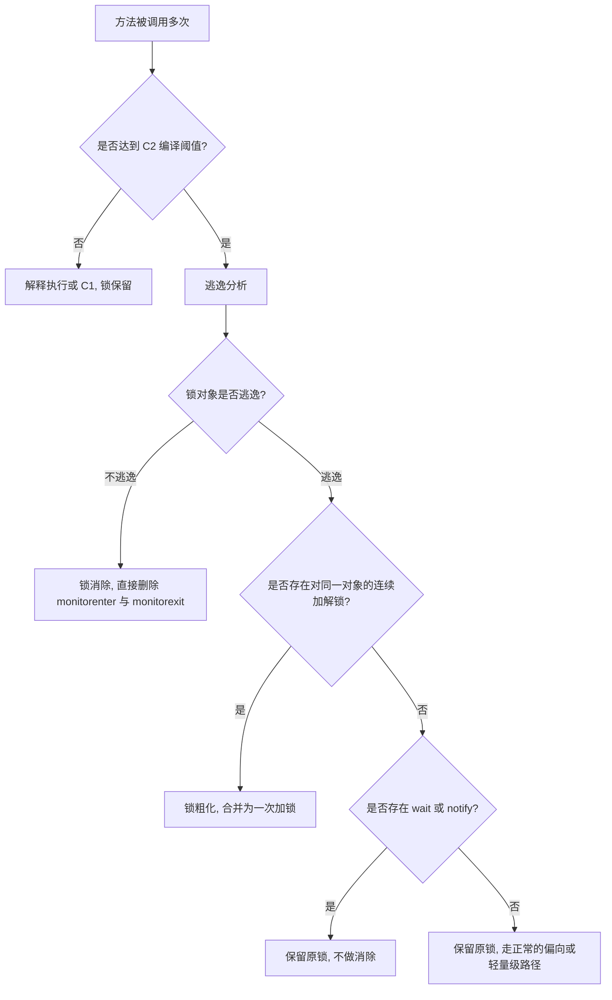

### 8.4 怎么验证锁优化真的发生了

| 手段 | 命令 / 做法 | 能看到什么 |
| --- | --- | --- |
| 打印 JIT 编译日志 | `-XX:+PrintCompilation` | 方法何时被 C1/C2 编译 |
| 打印内联决策 | `-XX:+UnlockDiagnosticVMOptions -XX:+PrintInlining` | 方法是否被内联（影响逃逸分析范围） |
| 打印锁消除 | `-XX:+UnlockDiagnosticVMOptions -XX:+PrintEliminateLocks` | 哪些锁被消除了 |
| 反汇编看指令 | `-XX:+UnlockDiagnosticVMOptions -XX:+PrintAssembly` + hsdis | 编译后是否还有 `lock cmpxchg` |
| 打印逃逸分析结果 | `-XX:+UnlockDiagnosticVMOptions -XX:+PrintEscapeAnalysis` | 对象是否被判为不逃逸 |

`PrintAssembly` 需要额外安装 hsdis 插件（`hsdis-amd64.dylib` 或 `.so`），放到 `$JAVA_HOME/jre/lib/server/` 下。这是面试里"你怎么证明锁被消除了"的标准答案。

## 九、synchronized 的内存语义：可见性与有序性

### 9.1 JMM 里的锁规则

JMM（JSR-133，JDK 5 起）定义了三条与锁相关的 happens-before 规则：

1. **解锁 happens-before 后续对同一个锁的加锁**。这是可见性的来源：线程 A 在同步块里写的数据，线程 B 拿到同一把锁后一定能看到。
2. **程序顺序规则**：同一个线程内，前面的操作 happens-before 后面的操作。
3. **传递性**：A hb B，B hb C，则 A hb C。

所以 `synchronized` 同时提供**原子性、可见性、有序性**三者，这也是它相对于 `volatile` 的优势——`volatile` 只提供可见性和有序性，不提供原子性（复合操作）。

### 9.2 底层实现：内存屏障

`synchronized` 的可见性在 HotSpot 里通过内存屏障实现，但**具体屏障取决于 CPU 架构**：

| 架构 | 加锁（monitorenter） | 解锁（monitorexit） | 说明 |
| --- | --- | --- | --- |
| x86 / x86-64 | 基本不需要额外屏障 | 基本不需要额外屏障 | x86 的 TSO 模型本身保证 LoadLoad、LoadStore、StoreStore 不乱序，只有 StoreLoad 需要显式屏障 |
| ARM / AArch64 | 需要 `dmb ish` 系列屏障 | 需要 `dmb ish` 系列屏障 | 弱内存模型，必须显式插屏障 |

这解释了一个常见面试题："为什么 x86 上 `synchronized` 的开销主要在 CAS 而不在屏障？"——因为 x86 是强内存模型，大部分屏障是空操作，真正的开销来自 `lock` 前缀指令（会锁缓存行并充当全屏障）。

**关键点**：`monitorenter` 的 CAS 操作（`lock cmpxchg`）本身带有全屏障语义（StoreLoad），所以加锁时不需要额外的 `LoadLoad`/`StoreStore` 屏障。解锁时 x86 也不需要额外屏障，因为 TSO 保证 store 不会重排到前面。ARM 上则必须显式插入。

### 9.3 可见性的完整链路

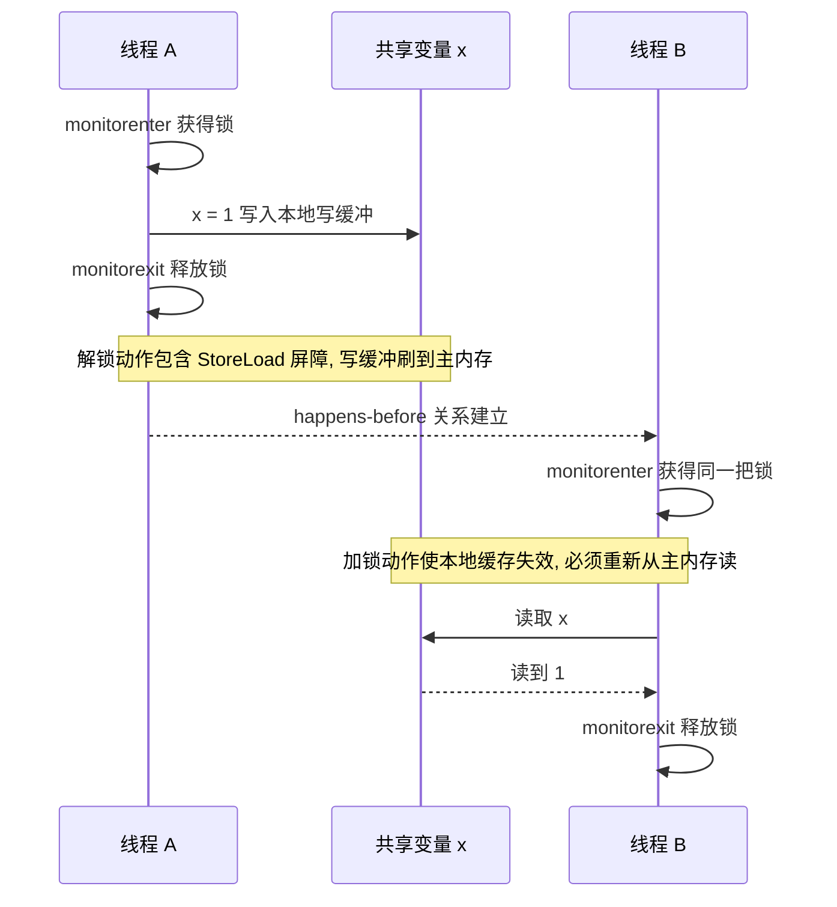

三个必须记住的推论：

1. **可见性只对"同一把锁"成立**。线程 A 在 `lock1` 里写的变量，线程 B 在 `lock2` 里读不到保证。
2. **必须在同步块内读写**。把 `x` 的读放在同步块外，即使写在线程同步块内，也得不到保证。
3. **`synchronized` 不能替代 `volatile` 做双重检查锁定（DCL）**。DCL 的第一次判空在同步块外，`synchronized` 保护不到它：实例字段不加 `volatile` 时，构造函数里的写与"把引用赋给字段"之间没有 happens-before 约束，读线程可能看到"引用已经非 null，但对象还没构造完"——这正是 JDK 5 之前 DCL 被公认为错误写法的原因。JDK 5 起 JSR-133 修正了 JMM，`volatile` 版 DCL 才是标准写法。

### 9.4 有序性：synchronized 能防止哪些重排

| 重排类型 | 同一线程内 | 跨线程（同步块之间） |
| --- | --- | --- |
| 编译器重排 | 受程序顺序规则约束，不能重排有依赖的操作 | 不能跨越 `monitorenter` / `monitorexit` |
| CPU 乱序执行 | 同样受依赖约束 | 被屏障阻止 |
| 写缓冲延迟可见 | 不影响单线程语义 | 被 `monitorexit` 的屏障刷新 |

**要注意一个细节**：`synchronized` 保证的是"临界区内的操作不会重排到临界区外"，但**临界区内部不同变量之间的重排仍然可能发生**（只要不影响单线程语义）。所以"我在同步块里写了 a=1 然后 b=2，另一个线程看到 b=2 时 a 一定已经是 1 吗"——答案是**在同一个同步块内、另一个线程用同一把锁读，是的**，因为两次写都 happens-before 解锁；但如果 a 和 b 分属不同的锁保护，就没有保证。

### 9.5 与 `volatile`、`final`、CAS 的可见性对比

| 手段 | 原子性 | 可见性 | 有序性 | 是否阻塞 | 典型用途 |
| --- | --- | --- | --- | --- | --- |
| `synchronized` | 是（复合操作也安全） | 是 | 是 | 是 | 复合状态变更 |
| `volatile` | 否（仅单次读写） | 是 | 是（禁止重排） | 否 | 状态标志、DCL 单例 |
| `final` | 是（构造后不可变） | 是（正确构造后） | 是 | 否 | 不可变对象 |
| CAS（`AtomicInteger`） | 是（单变量） | 是 | 是 | 否（自旋） | 计数器、状态机 |
| `LongAdder` | 是（最终一致） | 是 | 是 | 否 | 高并发统计计数 |

**"什么时候用 volatile 就够"的判据**：只要满足"写操作不依赖当前值"（比如 `flag = true`），`volatile` 就够；只要出现"读-改-写"（比如 `count++`），就必须用锁或原子类。这是面试里区分背题和理解的经典问题。

## 十、与 ReentrantLock 的八维对比与选型

### 10.1 八维对比表

这是本章必须背下来的一张表。`ReentrantLock` 的实现在 `java.util.concurrent.locks.ReentrantLock`，内部同步器是 `ReentrantLock.Sync extends AbstractQueuedSynchronizer`，公平版是 `FairSync`，非公平版是 `NonfairSync`。

| 维度 | `synchronized` | `ReentrantLock` |
| --- | --- | --- |
| 实现层面 | JVM 内建（monitorenter/monitorexit 字节码 + ObjectMonitor），C++ 实现 | JDK 层 API，纯 Java 实现（AQS + CAS + `LockSupport.park`） |
| 锁的获取方式 | 隐式，进入同步块自动加锁 | 显式，必须调用 `lock()`，且必须 `try/finally` 里 `unlock()` |
| 是否可中断 | 不可中断，等待锁的线程无法被 `interrupt()` 打断 | `lockInterruptibly()` 可中断；`lock()` 本身不可中断 |
| 是否支持超时 | 不支持 | `tryLock(long timeout, TimeUnit unit)` 支持 |
| 公平性 | 非公平，无开关，可能饥饿 | 可选，`new ReentrantLock(true)` 公平模式；默认 `false` 非公平 |
| 条件变量 | 只有一个隐式条件，`Object#wait/notify/notifyAll` | 可创建多个 `Condition`，`newCondition()`，支持精确唤醒 |
| 可重入性 | 支持，靠 `ObjectMonitor::_recursions` 计数 | 支持，靠 `AbstractQueuedSynchronizer#state` 计数 |
| 性能特征 | JDK 6 后引入偏向锁/轻量级锁/自适应自旋，低竞争下与 ReentrantLock 相当甚至更好 | 高竞争下队列管理更稳定，无线程饥饿（公平模式）；无偏向锁优化 |
| 锁状态查询 | 无 API | `isLocked()`、`isHeldByCurrentThread()`、`getHoldCount()`、`getQueueLength()` |
| 与虚拟线程配合 | JDK 21 起 `synchronized` 会 pin 住载体线程（JDK 24 起 JEP 491 已解决） | `ReentrantLock` 不 pin，虚拟线程阻塞时会释放载体线程 |

<strong>最后一行是 2024 年之后的高频新题</strong>。JDK 21 的虚拟线程（JEP 444）在 `synchronized` 块内阻塞时会把<strong>载体线程（carrier thread）</strong>一起 pin 住，导致平台线程被占用；`ReentrantLock` 没有这个问题，因为 AQS 的 `park` 能被虚拟线程调度器接管。JDK 24 的 JEP 491（Synchronize Virtual Threads without Pinning）修掉了这个限制。面试答"虚拟线程场景优先用 `ReentrantLock`"时，如果 JDK 版本是 24+，可以补充"JEP 491 之后 `synchronized` 也不再 pin 了"。

### 10.2 锁的公平性深入

公平性的定义：**锁的获取顺序是否与请求顺序一致**。

| 模式 | `synchronized` | `ReentrantLock(false)` | `ReentrantLock(true)` |
| --- | --- | --- | --- |
| 是否 FIFO | 否 | 否 | 是 |
| 新线程能否插队（barging） | 能 | 能 | 不能，必须检查 `hasQueuedPredecessors()` |
| 吞吐 | 最高 | 高 | 低，因为每次都要检查队列且唤醒开销固定 |
| 饥饿风险 | 有 | 有（理论上） | 无 |
| 实现关键 | `ObjectMonitor::exit` 的唤醒策略 | `NonfairSync#tryAcquire` 直接 CAS | `FairSync#tryAcquire` 先调 `hasQueuedPredecessors()` |

`FairSync#tryAcquire` 的源码逻辑（JDK 8）：

```java
protected final boolean tryAcquire(int acquires) {
    final Thread current = Thread.currentThread();
    int c = getState();
    if (c == 0) {
        if (!hasQueuedPredecessors() &&
            compareAndSetState(0, acquires)) {
            setExclusiveOwnerThread(current);
            return true;
        }
    }
    else if (current == getExclusiveOwnerThread()) {
        int nextc = c + acquires;
        if (nextc < 0)
            throw new Error("Maximum lock count exceeded");
        setState(nextc);
        return true;
    }
    return false;
}
```

关键差异就是那个 `!hasQueuedPredecessors()`：**公平锁要求"队列里没有在我之前等待的线程"才允许 CAS 抢锁**，这就杜绝了插队。非公平版的 `NonfairSync#tryAcquire` 没有这个检查，直接 CAS，所以刚到达的线程可以插队。

**公平锁的代价**：每次释放锁都要唤醒队首线程，而唤醒到线程真正运行有延迟（微秒级），这期间锁是空闲的。非公平锁允许这段时间被新到达的线程利用，吞吐更高。这就是为什么**默认是非公平的**，也是为什么 `synchronized` 干脆不做公平选项。

**什么时候必须用公平锁**：对延迟敏感的排队场景，比如按顺序处理任务、防止某个线程长期饿死。绝大多数业务场景不需要。

### 10.3 条件变量的差异（高频考点）

`synchronized` 配 `Object#wait/notify` 只有一个等待队列（`ObjectMonitor::_WaitSet`），`notifyAll` 会唤醒所有等待者，被唤醒的线程还要重新竞争锁，且**无法区分唤醒的原因**。

`ReentrantLock` 可以创建多个 `Condition`：

```java
ReentrantLock lock = new ReentrantLock();
Condition notFull  = lock.newCondition();
Condition notEmpty = lock.newCondition();
```

这是**生产者-消费者模式的标准实现**：生产者等 `notFull`，消费者等 `notEmpty`，生产者放入元素后 `notEmpty.signal()` 只唤醒消费者。用 `synchronized` + `notifyAll` 的话，一次放入元素会把生产者和消费者全部唤醒，被唤醒的生产者发现队列仍满又回去等，产生大量无效唤醒（惊群效应）。

| 对比项 | `Object#wait/notify` | `Condition#await/signal` |
| --- | --- | --- |
| 条件队列数量 | 1 个（`_WaitSet`） | 任意多个，每个 `newCondition()` 一个 |
| 唤醒精度 | 只能全唤醒或随机唤醒一个 | 可精确唤醒指定条件的等待者 |
| 等待时是否释放锁 | 是 | 是 |
| 中断响应 | `wait()` 抛 `InterruptedException` | `await()` 抛 `InterruptedException` |
| 超时等待 | `wait(long)`，单位毫秒 | `await(long, TimeUnit)`，单位可选 |
| 实现载体 | `ObjectMonitor::_WaitSet` | `AbstractQueuedSynchronizer.ConditionObject` |

### 10.4 选型决策

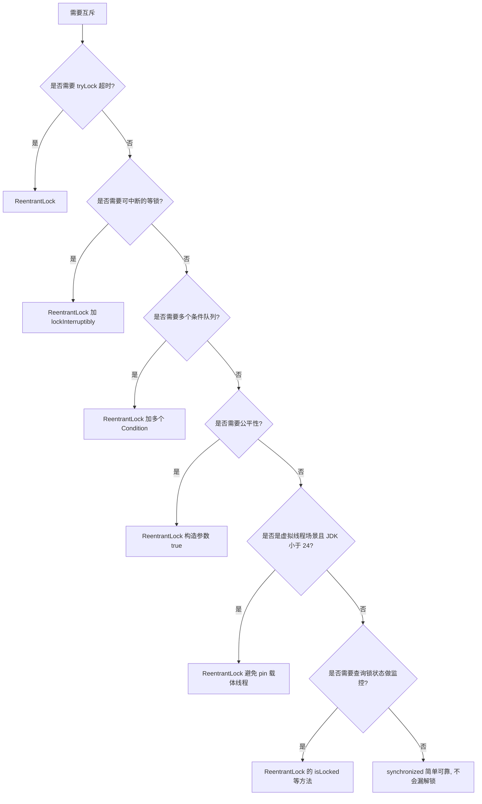

**结论先行**：

- **默认用 `synchronized`**。它不会漏解锁（编译器保证）、JVM 会做锁优化、代码更简洁、不会因为忘记 `finally` 导致死锁。
- **需要超时、可中断、多条件、公平、锁状态查询、虚拟线程友好时用 `ReentrantLock`**。
- **读多写少用 `ReentrantReadWriteLock`**（`ReentrantReadWriteLock` 内部 `ReadLock` / `WriteLock`，注意它**不支持锁升级**，只能降级：持有写锁可以获取读锁，反之不行）。
- **高并发计数用 `LongAdder`** 而不是 `AtomicLong`，前者内部用 `Cell[]` 数组分散竞争。

### 10.5 一个必须知道的坑：`ReentrantReadWriteLock` 的写锁饥饿

`ReentrantReadWriteLock` 默认也是非公平的。非公平模式下，**读锁可以不断插队**，导致写锁长期得不到执行——这就是"写饥饿"。JDK 的实现里 `ReaderShouldBlock()` 在非公平模式下用的是 `apparentlyFirstQueuedIsExclusive()`，即"如果队列头是写线程，读线程应该让路"，这在一定程度上缓解了写饥饿，但**不保证写锁的公平性**。

需要严格避免写饥饿，要用 `new ReentrantReadWriteLock(true)` 公平模式，代价是吞吐下降。

## 十一、生产环境锁竞争排查手册

### 11.1 锁竞争的三类症状

| 症状 | 现象 | 根因方向 |
| --- | --- | --- |
| 吞吐下降、RT 升高、CPU 不高 | 大量线程 `BLOCKED`，CPU 使用率低 | 锁粒度过粗，临界区太长 |
| CPU 飙高但 QPS 不涨 | `TIMED_WAITING (parking)` 或自旋烧 CPU | 高竞争自旋，或 `ReentrantLock` 空转 |
| 请求全部卡死 | 死锁，`jstack` 显示 `Found one Java-level deadlock` | 锁顺序不一致 |

### 11.2 第一步：抓线程 dump

```bash
# 方式一：jstack（最常用）
jstack -l <pid> > /tmp/stack-$(date +%s).txt

# 方式二：jcmd（JDK 7+ 推荐，功能更全）
jcmd <pid> Thread.print -l > /tmp/stack.txt

# 方式三：kill -3（会把 dump 打到应用的标准输出或 catalina.out）
kill -3 <pid>

# 方式四：jattach（容器内无 JDK 工具时）
jattach <pid> threaddump
```

`-l` 参数会额外打印 `java.util.concurrent` 的锁信息（ownable synchronizers），**排查 `ReentrantLock` 必须加 `-l`**。

**关键：连续抓 3~5 次，间隔 5~10 秒**。单次 dump 只能看到瞬间状态，连续 dump 才能区分"瞬时阻塞"和"持续阻塞"。

### 11.3 第二步：统计 BLOCKED 线程

```bash
# 统计 BLOCKED 线程数
grep -c "java.lang.Thread.State: BLOCKED" stack.txt

# 统计各状态分布
grep "java.lang.Thread.State:" stack.txt | sort | uniq -c | sort -rn

# 找出被阻塞线程都在等哪个锁
grep -A1 "waiting to lock" stack.txt | grep "waiting to lock" | sort | uniq -c | sort -rn

# 找出持有锁的线程（谁在长时间持锁）
grep -B2 "locked <" stack.txt | grep -E "^\"" | sort | uniq -c | sort -rn

# 只打印 BLOCKED 线程的完整栈
awk '/^"/{buf=$0; getline; if ($0 ~ /BLOCKED/) {print buf; print; p=1; next}} p&&/^$/{p=0} p' stack.txt
```

`jstack` 输出里锁相关行的格式是固定的，必须认识：

```text
"http-nio-8080-exec-23" #45 daemon prio=5 os_prio=0 tid=0x00007f8c3c1a8800 nid=0x5f2c waiting for monitor entry [0x00007f8c2b1f6000]
   java.lang.Thread.State: BLOCKED (on object monitor)
        at com.example.service.OrderService.calcTotal(OrderService.java:88)
        - waiting to lock <0x000000076b2a3b40> (a com.example.service.OrderService)
        at com.example.controller.OrderController.query(OrderController.java:41)
        - locked <0x000000076b1c8a20> (a java.lang.Object)
```

解读：

- `waiting for monitor entry` + `BLOCKED (on object monitor)`：**正在等 `synchronized` 锁**。
- `- waiting to lock <0x...>`：**它想拿但没拿到的锁对象地址**。
- `- locked <0x...>`：**它当前已经持有的锁**（可能在栈的更下层）。
- 注意同一线程可能有多个 `locked` 行，因为 `synchronized` 可重入，也因为它可能持有多个锁。

**定位"谁在持锁"的方法**：拿到 `waiting to lock <0x000000076b2a3b40>` 这个地址，去 dump 里 grep 这个地址，找到 `- locked <0x000000076b2a3b40>` 的那个线程——它就是持有者。

```bash
# 完整流程：找到竞争最激烈的锁地址，再找持有者
LOCK=0x000000076b2a3b40
grep -n "waiting to lock <$LOCK>" stack.txt | wc -l     # 有多少线程在等它
grep -n "locked <$LOCK>" stack.txt                       # 谁持有它
```

### 11.4 第三步：区分三种等待状态

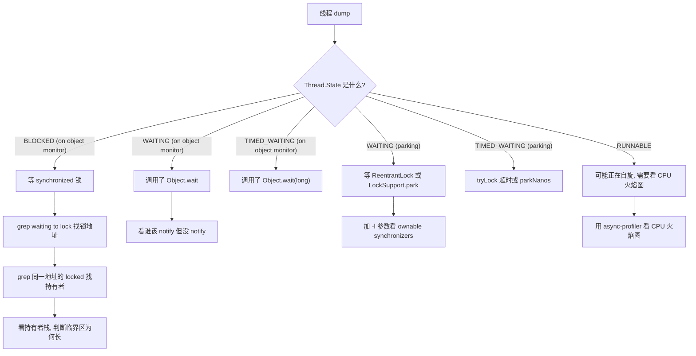

**`RUNNABLE` 也可能是锁问题**：高竞争下自旋线程状态是 `RUNNABLE`，`jstack` 里看不出来，必须用 CPU 火焰图。这是很多人漏掉的一类。

### 11.5 第四步：用 async-profiler 看锁竞争

`jstack` 是采样瞬间的快照，看不到竞争频率。要量化竞争，用 async-profiler：

```bash
# 采集 60 秒的锁竞争事件（需要 JDK 8+ 的 AsyncGetCallTrace 支持）
./profiler.sh -e lock -d 60 -f /tmp/lock.html <pid>

# 采集 wall clock，能看到阻塞时间分布
./profiler.sh -e wall -t -d 60 -f /tmp/wall.html <pid>

# 采集 CPU，看自旋
./profiler.sh -e cpu -d 60 -f /tmp/cpu.html <pid>
```

`-e lock` 事件在 Linux 上基于 `perf` 的锁事件或 JVMTI 的 monitor contention 事件，能直接给出"哪个方法上的锁竞争最激烈、平均等待多久"。这是把"感觉慢"变成"数据"的关键一步。

也可以用 JFR（JDK 11+ 开源）：

```bash
jcmd <pid> JFR.start name=lockprofile settings=profile duration=60s filename=/tmp/lock.jfr
jfr print --events jdk.JavaMonitorEnter,jdk.JavaMonitorWait /tmp/lock.jfr | head -100
```

`jdk.JavaMonitorEnter` 事件包含 `monitorClass`、`previousOwner`、`duration`，可以直接统计出**竞争最激烈的锁对象和持有者**。JDK 8 需要 `-XX:+UnlockCommercialFeatures -XX:+FlightRecorder`，JDK 11+ 完全开源。

锁**膨胀**也有专门的 JFR 事件：`jdk.JavaMonitorInflate`，字段是 `monitorClass`、`address`、`cause`。`cause` 来自 HotSpot 的 `InflateCause`，取值有 `Monitor Enter`、`Monitor Wait`、`Monitor Notify`、`Monitor Hash Code`、`JNI Monitor Enter/Exit`、`VM Internal`；如果膨胀集中在 `Monitor Hash Code`，说明是某处 `hashCode()` 把锁膨胀掉的，跟竞争无关。

### 11.6 第五步：死锁检测

`jstack` 会自动检测 `synchronized` 死锁：

```text
Found one Java-level deadlock:
=============================
"Thread-1":
  waiting to lock monitor 0x00007f8c3c0a5e00 (object 0x000000076b2a3b40, a java.lang.Object),
  which is held by "Thread-0"
"Thread-0":
  waiting to lock monitor 0x00007f8c3c0a5e80 (object 0x000000076b2a3b60, a java.lang.Object),
  which is held by "Thread-1"

Java stack information for the threads listed above:
===================================================
"Thread-1":
        at com.example.DeadLock.run(DeadLock.java:22)
        - waiting to lock <0x000000076b2a3b40> (a java.lang.Object)
        - locked <0x000000076b2a3b60> (a java.lang.Object)
...
Found 1 deadlock.
```

**注意**：`jstack` 只能检测 `synchronized` 和 `ReentrantLock`（需要 `-l`）的死锁。`ReentrantReadWriteLock`、`Semaphore`、数据库锁、分布式锁的死锁**检测不出来**，必须靠 `ThreadMXBean`：

```java
ThreadMXBean bean = ManagementFactory.getThreadMXBean();
long[] ids = bean.findDeadlockedThreads();          // 检测对象监视器和 ownable synchronizer
long[] monitorIds = bean.findMonitorDeadlockedThreads(); // 只检测 monitor
if (ids != null) {
    ThreadInfo[] infos = bean.getThreadInfo(ids, true, true);
    for (ThreadInfo info : infos) {
        System.out.println(info);
    }
}
```

`findDeadlockedThreads()` 能检测 `AbstractOwnableSynchronizer` 子类的死锁，`findMonitorDeadlockedThreads()` 只检测 `synchronized`。可以在应用里定时调用并上报监控，这是**线上死锁自动发现**的标准做法。

### 11.7 排查案例：接口 RT 从 20ms 涨到 2s

**现象**：某订单查询接口 P99 从 20ms 涨到 2000ms，CPU 使用率只有 15%，QPS 从 8000 掉到 900。

**排查步骤**：

1. 抓 dump：`jstack -l 12345 > s1.txt`，间隔 10 秒再抓 `s2.txt`。
2. 统计状态：`grep "Thread.State:" s1.txt | sort | uniq -c`

```text
    412 java.lang.Thread.State: BLOCKED (on object monitor)
     56 java.lang.Thread.State: WAITING (parking)
     38 java.lang.Thread.State: RUNNABLE
     12 java.lang.Thread.State: TIMED_WAITING (parking)
```

3. 412 个 `BLOCKED`，找锁地址：

```bash
grep "waiting to lock" s1.txt | sort | uniq -c | sort -rn | head -3
```

```text
    398        - waiting to lock <0x000000076b2a3b40> (a com.example.cache.LocalCache)
      9        - waiting to lock <0x000000076b1c8a20> (a java.lang.Object)
```

4. 找持有者：

```bash
grep -n "locked <0x000000076b2a3b40>" s1.txt
```

```text
"http-nio-8080-exec-7" ... 
   java.lang.Thread.State: RUNNABLE
        at java.net.SocketInputStream.socketRead0(Native Method)
        at com.example.cache.LocalCache.refresh(LocalCache.java:120)
        - locked <0x000000076b2a3b40> (a com.example.cache.LocalCache)
```

5. **根因确认**：`LocalCache.refresh` 在持有锁的情况下发起了远程调用（读 socket）。远程服务抖动时，持锁线程阻塞在 socket 读上，其余 398 个线程全部等在锁上。CPU 不高正是因为大家都在 `BLOCKED` 而不是忙等。

**修复方案**：

| 方案 | 做法 | 代价 |
| --- | --- | --- |
| 缩小临界区 | 先在锁外完成远程调用，只在锁内做赋值 | 需要处理"多个线程同时刷新"的重复调用 |
| 双检锁 + 状态标记 | 用一个 `volatile boolean refreshing` 让只有一个线程去刷新 | 逻辑复杂度上升 |
| 换 `ReentrantLock` + 超时 | `tryLock(50, MILLISECONDS)`，拿不到就用旧值 | 语义变化，需要接受旧数据 |
| 换异步刷新 | 后台线程定时刷新，请求线程只读 | 数据有延迟 |

这是"锁内做 IO"的典型事故，**排查的核心动作是：找到持有锁的线程，看它的栈顶在干什么**。

### 11.8 排查案例：CPU 100% 但 QPS 很低

**现象**：CPU 打满 100%，QPS 反而下降，RT 上涨。

**排查步骤**：

1. 抓 CPU 火焰图：`./profiler.sh -e cpu -d 30 -f /tmp/cpu.html <pid>`。
2. 火焰图显示大量时间在 `java.util.concurrent.locks.ReentrantLock$NonfairSync.lock` 和 `Unsafe.park`。
3. 抓 dump 看状态分布：大量 `RUNNABLE` 在 `ReentrantLock.lock`，说明是**自旋/竞争激烈**。
4. 用 `-e lock` 事件确认竞争点：

```bash
./profiler.sh -e lock -d 30 -f /tmp/lock.html <pid>
```

5. **根因**：某段代码用 `ReentrantLock` 保护了一个高并发的计数器（比如每秒 10 万次 `lock(); count++; unlock();`）。`ReentrantLock` **没有自适应自旋**，每次失败都入队 park，高并发下入队/出队/唤醒本身的开销巨大，同时大量线程在用户态和内核态之间切换。

**修复**：把 `ReentrantLock` + `int` 计数器换成 `LongAdder`（内部 `Cell[]` 数组按线程分散），或者用 `AtomicLong`（`CAS` 失败重试，无阻塞）。改造后 CPU 从 100% 降到 12%，QPS 提升 6 倍。

**这个案例的面试价值**：它区分了"synchronized 的锁优化"和"ReentrantLock 没有锁优化"这个不对称性。很多人以为 `ReentrantLock` 一定比 `synchronized` 快，实际上在**无竞争或低竞争场景 `synchronized` 更快**（有偏向锁和锁消除），在高竞争场景两者都不如无锁结构。

### 11.9 排查案例：定时任务和请求线程互相阻塞

**现象**：每天凌晨 2 点接口 RT 抖动，持续约 3 分钟。

**排查**：

1. 2 点时抓 dump，发现 `BLOCKED` 集中在 `com.example.service.ReportService`。
2. 持有者是定时任务线程 `scheduling-1`，栈顶在 `ReportService.generate`，正在遍历 100 万行数据。
3. **根因**：定时任务用了 `synchronized` 方法，而请求线程也要调用同一个方法读缓存，临界区包含全量遍历。

**修复**：

| 方案 | 做法 |
| --- | --- |
| 读写分离 | 定时任务写新对象，请求线程读旧对象，用 `volatile` 引用切换（Copy-On-Write 思路） |
| 换读写锁 | `ReentrantReadWriteLock`，定时任务持写锁，请求线程持读锁；但写锁期间读线程仍被阻塞 |
| 换不可变对象 | 定时任务构建不可变快照，`AtomicReference` 原子替换 |
| 错峰 | 定时任务改到业务低峰期，并限制单次处理量 |

**最优解是 `AtomicReference` + 不可变快照**：请求线程完全不加锁，只做一次引用读取；定时任务构建新对象后一次 CAS 替换。这是"读多写少"场景的标准优化。

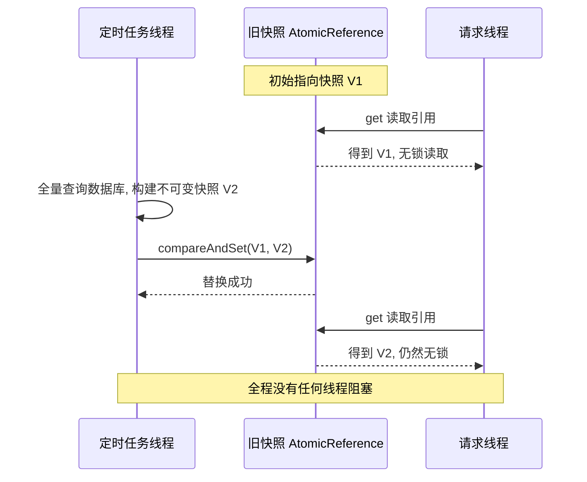

## 十二、高级岗三问

### 12.1 为什么这么设计？替代方案是什么？

**问题**：JDK 6 为什么要在 `synchronized` 上做偏向锁、轻量级锁、自适应自旋这一整套优化，而不是像 `ReentrantLock` 一样只在 Java 层做？

**回答框架**：

1. **`synchronized` 是语言级关键字，无法被替换**。`ReentrantLock` 是 JDK 5 才引入的库，存量代码里全是 `synchronized`。如果只优化库而不优化关键字，等于放弃存量代码的性能。
2. **`synchronized` 可以做 JVM 层优化，`ReentrantLock` 做不了**。偏向锁需要修改对象头 Mark Word、需要在 safepoint 遍历线程栈、需要 JIT 配合做锁消除——这些都需要 JVM 内部能力。纯 Java 库无法触及对象头和栈帧。**这是"设计权衡"的核心：`synchronized` 牺牲了灵活性（不可中断、不可超时、只有单条件），换来了 JVM 可以深度优化的空间。**
3. **代价是复杂度**。偏向锁的撤销需要 STW，导致它在低延迟场景是负优化，最终在 JDK 15/18 被废弃。这说明"JVM 层优化"不是免费的，一旦硬件和负载形态变化，内建优化的适应性反而不如库方案。

**替代方案的代价对照**：

| 方案 | 优势 | 代价 |
| --- | --- | --- |
| 只用重量级锁（JDK 1.5 之前） | 实现简单，语义清晰 | 无竞争场景也要走系统调用 |
| 偏向锁 + 轻量级锁（JDK 6~14） | 无竞争和低竞争场景开销极低 | 撤销要 STW，维护成本高，JDK 15 起废弃 |
| 只用 `ReentrantLock` | 灵活（超时、中断、多条件、公平） | 必须手写 `try/finally`，无 JIT 锁消除，无自适应自旋 |
| 无锁（CAS + 原子类） | 无阻塞，无上下文切换 | 只能保护单个变量，`ABA` 问题，高竞争下 CAS 空转 |

### 12.2 线上出问题怎么定位？

**标准排查流程（可以直接背）**：

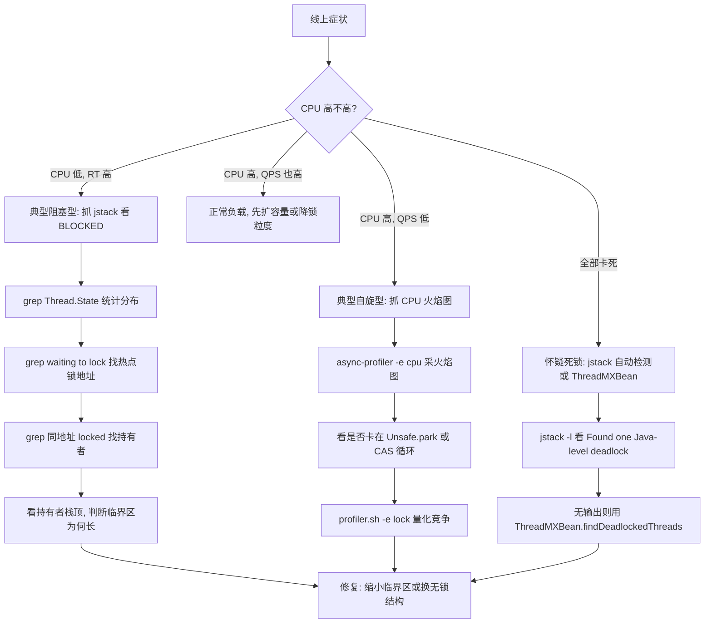

**必须能说出的命令清单**：

| 目的 | 命令 |
| --- | --- |
| 抓 dump | `jstack -l <pid>`、`jcmd <pid> Thread.print -l` |
| 统计状态 | `grep "Thread.State:" d.txt \| sort \| uniq -c` |
| 找热点锁 | `grep "waiting to lock" d.txt \| sort \| uniq -c \| sort -rn` |
| 找持有者 | `grep "locked <0xADDR>" d.txt` |
| CPU 火焰图 | `./profiler.sh -e cpu -d 30 -f cpu.html <pid>` |
| 锁竞争量化 | `./profiler.sh -e lock -d 30 -f lock.html <pid>` |
| JFR 采集 | `jcmd <pid> JFR.start duration=60s filename=/tmp/x.jfr` |
| JFR 分析 | `jfr print --events jdk.JavaMonitorEnter /tmp/x.jfr` |
| 死锁检测 | `jstack -l <pid>` 或 `ThreadMXBean#findDeadlockedThreads` |
| 查看锁相关 VM 参数 | `java -XX:+PrintFlagsFinal -version \| grep -iE "BiasedLocking\|Spin"` |

### 12.3 规模变大后会怎样？

| 规模维度 | 变化 | 失效模式 | 应对 |
| --- | --- | --- | --- |
| QPS 从 1k 涨到 10 万 | 锁竞争概率从接近 0 变成必然 | 轻量级锁全部膨胀为重量级锁，线程大量 `BLOCKED` | 降低锁粒度（分段、`ConcurrentHashMap`、`LongAdder`） |
| 线程数从 50 涨到 2000 | 等待队列变长，唤醒延迟累积 | 吞吐不升反降，线程切换开销吃掉 CPU | 限流 + 减小线程池，用异步非阻塞替代 |
| 临界区处理的数据量变大 | 持锁时间从微秒变毫秒 | 排队时间 = 线程数 × 持锁时间，线性放大 | 快照替换（`AtomicReference` + 不可变对象） |
| 单机变集群 | 单机锁失效 | 用 `synchronized` 做"全局唯一"的假设被打破 | 换分布式锁（Redis / ZooKeeper），注意锁续期和脑裂 |
| 从 JDK 8 升级到 JDK 17/21 | 偏向锁已默认关闭并废弃（JDK 15 关默认、JDK 18 正式废弃，但选项仍在） | 单线程反复加锁场景性能下降 | 减小锁范围，或换 `ThreadLocal`、无锁结构 |
| 引入虚拟线程（JDK 21） | 载体线程数量有限 | `synchronized` 阻塞导致 pin 载体线程，吞吐崩塌（JDK 24 前） | 用 `ReentrantLock`，或升级到 JDK 24+（JEP 491） |

**最关键的一条**：`synchronized` 的优化（偏向锁、轻量级锁）都是**为低竞争场景设计的**。当规模增长导致竞争成为常态，这些优化全部失效并升级为重量级锁，性能特征发生**阶跃式变化**而不是线性下降。这就是为什么容量规划时必须关注锁的竞争度，而不是简单按 QPS 线性外推。

**一个具体的估算公式**（面试可以用来展示量化思维）：

假设临界区平均持有时间 `T` 微秒，线程数 `N`，那么**理想情况下的最大吞吐上限是 `1/T`（每秒）**，与 `N` 无关。因为临界区是串行的：

```text
最大吞吐 = 1 / T  （次/秒，T 单位为秒）
```

如果 `T = 100 微秒`，那么单锁最大吞吐是 10000 QPS，加再多线程也没用。要突破这个上限，只有两条路：**缩短 `T`**（缩小临界区）或**拆分锁**（分段）。

这个公式是"为什么加了线程 QPS 不涨"的标准答案，也是架构评审时判断锁粒度的硬指标。

## 高频面试题

### Q1. synchronized 的三种用法分别锁的是什么？字节码有什么不同？

**答题框架（30 秒版）**：同步代码块锁括号里的对象，编译成 `monitorenter` / `monitorexit`；实例同步方法锁 `this`，静态同步方法锁 `Xxx.class`，两者都只是在方法访问标志上加 `ACC_SYNCHRONIZED`，方法体内没有锁指令。

**展开（2 分钟版）**：
1. 同步代码块会生成**两个** `monitorexit`：一个走正常路径，一个走异常路径，由异常表的 `any` 分支保证。所以同步块抛异常一定会释放锁。
2. 编译器会先把锁引用 `dup` 后存到局部变量槽，退出时再 `aload` 回来，因为 `monitorexit` 需要操作数栈上有引用。
3. 同步方法靠 `ACC_SYNCHRONIZED` 标志，锁的获取释放由方法调用机制隐式完成，比同步块少两条字节码。
4. 静态方法的锁是 Class 对象，全局唯一，所以"两个实例互斥吗"的答案是：实例方法不互斥，静态方法互斥。

**追问**：`monitorenter` 的语义是什么？答：monitor 进入计数为 0 则进入并置 1，已持有则计数加 1（可重入），被其他线程持有则阻塞。计数在 HotSpot 里是 `ObjectMonitor::_recursions`。

### Q2. 对象头的 Mark Word 是什么？锁状态怎么存？

**答题框架（30 秒版）**：64 位 JVM 上 Mark Word 占 8 字节，复用一个 64 位字存哈希码、分代年龄、锁标志位。低 2 位是锁状态：`01` 无锁或偏向、`00` 轻量级锁、`10` 重量级锁、`11` GC 标记。

**展开（2 分钟版）**：
1. 无锁和偏向锁低 2 位都是 `01`，靠 bit 2 的偏向标志区分。
2. `identity_hashcode` 只有 31 位，占 Mark Word 的第 8~38 位。**一旦调用过 `hashCode()`，偏向锁就无法建立**，因为偏向锁要用第 10~63 位（54 位）存线程 ID。
3. 轻量级锁状态存的是"指向线程栈中 Lock Record 的指针"，重量级锁状态存的是"指向 `ObjectMonitor` 的指针"。
4. 用 JOL 可以亲眼看到：`ClassLayout.parseInstance(o).toPrintable()`，`0x1` 是无锁，`0x5` 是匿名偏向。

**追问**：对象刚 new 出来是什么状态？答：JDK 8 下取决于 `-XX:BiasedLockingStartupDelay`（默认 4000ms）。启动 4 秒内创建的对象是 `0x1` 无锁，之后是 `0x5` 匿名偏向。

### Q3. 锁升级的完整流程是什么？能降级吗？

**答题框架（30 秒版）**：无锁 → 偏向锁 → 轻量级锁 → 重量级锁，单向不可逆。偏向锁撤销需要 STW 到安全点，轻量级锁自旋失败触发锁膨胀创建 `ObjectMonitor`。

**展开（2 分钟版）**：
1. 第一个线程 CAS 写入线程 ID 建立偏向锁；后续同线程进入只比较线程 ID，零 CAS。
2. 第二个线程竞争且原持有者已退出，可以重偏向；原持有者还在临界区则升级为轻量级锁。
3. 轻量级锁在线程栈上建 Lock Record，拷贝原 Mark Word 到 `_displaced_header`，CAS 替换对象 Mark Word。
4. 自旋失败触发 `ObjectSynchronizer::inflate`，从全局空闲列表取 `ObjectMonitor`，Mark Word 指向它，低两位变 `10`。
5. **不能降级**。偏向锁可以撤销和重偏向，但升级到轻量级锁后回不去；重量级锁只有等 `ObjectMonitor` 被 deflate 回收才回到无锁。

**追问**：批量重偏向和批量撤销的阈值是多少？答：`-XX:BiasedLockingBulkRebiasThreshold=20`、`-XX:BiasedLockingBulkRevokeThreshold=40`、`-XX:BiasedLockingDecayTime=25000` 毫秒。达到 20 次触发批量重偏向（改 epoch），达到 40 次该类彻底禁用偏向锁。

### Q4. 偏向锁为什么被废弃？JDK 15 和 JDK 18 分别做了什么？

**答题框架（30 秒版）**：JDK 15（JEP 374）把 `-XX:+UseBiasedLocking` 默认关闭并标记废弃；JDK 18（JEP 421）正式废弃。原因是撤销需要 STW 到安全点，与低延迟目标冲突，且维护成本高、与虚拟线程模型不匹配。

**展开（2 分钟版）**：
1. **撤销必须 STW**：要遍历原偏向线程的栈帧判断它是否还在临界区，必须让线程停在安全点。一次撤销的停顿可能远超锁本身节省的时间。
2. **收益场景在缩小**：偏向锁的收益主要来自单线程反复访问集合。JIT 的锁消除和逃逸分析已经覆盖了一部分。
3. **维护成本**：偏向锁代码散布在解释器、C1、C2、safepoint 处理、类元数据（epoch）里，每加一个新特性都要考虑交互，JEP 421 明确把维护成本列为理由。
4. **与虚拟线程不匹配**：虚拟线程频繁挂载卸载，"偏向线程 ID"语义频繁失效。

**追问**：升级 JDK 后性能下降怎么办？答：优先减小锁范围或换 `ThreadLocal` / 无锁结构，不要试图重新打开 `UseBiasedLocking`（JDK 18+ 会打废弃警告，未来会移除）。

### Q5. ObjectMonitor 的结构是什么？三个队列分别是什么？

**答题框架（30 秒版）**：`_owner` 是持有者，`_recursions` 是重入计数，`_EntryList` 和 `_cxq` 是等 `monitorenter` 的队列，`_WaitSet` 是调 `Object#wait()` 的队列。

**展开（2 分钟版）**：
1. `_header` 存对象原 Mark Word（displaced header），解锁时恢复。
2. `_object` 反向指向锁对象，deflate 时用来清理 Mark Word。
3. `_cxq` 是竞争队列，**单向链表头插（LIFO）**，新到达的竞争线程先挂这里。
4. `_EntryList` 是双向链表，存放已被唤醒准备重新竞争的线程，`ObjectMonitor::exit` 会把 `_cxq` 的线程转移过来。
5. `_WaitSet` 只服务 `Object#wait()`，与 `monitorenter` 阻塞完全无关——这是最容易混的点。
6. `_succ` 是预设的继承者线程，用于减少 unpark 的竞争和惊群。

**追问**：`synchronized` 是公平的吗？答：不是，允许新到达的线程插队（barging），可以减少挂起唤醒次数提高吞吐，代价是高竞争下可能饥饿。要公平必须用 `new ReentrantLock(true)`。

### Q6. 自适应自旋是怎么自适应的？自旋次数默认多少？

**答题框架（30 秒版）**：JDK 1.4.2 是固定次数 `-XX:PreBlockSpin=10`；JDK 6 起改成自适应自旋，次数由 JVM 根据**同一个锁上一次自旋的成功率**和持有者状态动态决定。注意 JDK 7/8 已移除 `PreBlockSpin` 和 `UseSpinning`，JDK 8 上只能看到 `PreInflateSpin=10`。

**展开（2 分钟版）**：
1. 上次在同一个 monitor 上自旋成功，JVM 认为这次也可能成功，允许自旋更久。
2. 某把锁很少自旋成功，JVM 缩短甚至跳过自旋，直接膨胀阻塞。
3. 依据是 `ObjectMonitor::_SpinDuration`，**每个 monitor 独立维护**，所以热点锁会很快学会不自旋。
4. 单核机器上 `os::is_MP()` 为 false，JVM 跳过自旋直接膨胀，因为自旋线程会抢占持锁线程的 CPU。

**追问**：自旋什么时候有害？答：临界区含 IO、含 `Thread.sleep`、或竞争线程数远超 CPU 核数时，自旋是纯浪费。修复方向是把 IO 移出同步块或降低锁粒度。

### Q7. 锁消除和锁粗化是什么？怎么验证？

**答题框架（30 秒版）**：锁消除基于逃逸分析，对象不逃逸就删掉锁，典型是局部 `StringBuffer`；锁粗化是把连续对同一对象的加解锁合并成一次。开关是 `-XX:+EliminateLocks`（默认 true）和 `-XX:+DoEscapeAnalysis`（默认 true）。

**展开（2 分钟版）**：
1. 锁消除只发生在 **C2 编译后**的代码里，方法没被 JIT 编译时锁依然存在。
2. `StringBuffer` 是局部变量时性能与 `StringBuilder` 几乎一致，因为锁被消除了。
3. 锁粗化有风险：把持锁时间从"每次极短"变成"整段较长"，可能加剧竞争，所以 JIT 的条件是保守的。
4. 验证手段：`-XX:+UnlockDiagnosticVMOptions -XX:+PrintEliminateLocks` 看被消除的锁；`-XX:+PrintCompilation` 看方法何时被编译；`-XX:+PrintAssembly` 配 hsdis 反汇编看还有没有 `lock cmpxchg`。

**追问**：为什么我的基准测试看不到锁消除？答：通常是方法没达到 C2 编译阈值（`-XX:CompileThreshold` 默认 10000 次调用，分层编译下由 `Tier4InvocationThreshold` 等控制），或者对象逃逸了（比如被存到字段、被返回、被放入集合）。

### Q8. synchronized 的可见性是怎么保证的？和 volatile 有什么区别？

**答题框架（30 秒版）**：JMM 规定"解锁 happens-before 后续对同一个锁的加锁"，所以 A 在同步块里的写对 B 拿到同一把锁后可见。`synchronized` 提供原子性 + 可见性 + 有序性，`volatile` 只提供可见性 + 有序性。

**展开（2 分钟版）**：
1. 底层靠内存屏障。x86 是强内存模型，`monitorenter` 的 `lock cmpxchg` 本身带全屏障语义，所以加解锁基本不需要额外屏障；ARM 弱内存模型必须显式插 `dmb ish`。
2. 可见性只对**同一把锁**成立。用 `lock1` 写的变量，在 `lock2` 里读不到保证。
3. 读写都必须在同步块内，读放在块外就没有保证。
4. `volatile` 不能替代锁做复合操作。`count++` 用 `volatile` 依然不安全。

**追问**：什么时候 `volatile` 就够了？答：写操作不依赖当前值时。比如 `flag = true` 用 `volatile` 就够；`count++` 是读-改-写，必须用锁或原子类。

### Q9. synchronized 和 ReentrantLock 怎么选？说 8 个维度的差异。

**答题框架（30 秒版）**：默认用 `synchronized`（不会漏解锁、有 JVM 优化、代码简洁）；需要超时、可中断、多条件、公平、锁状态查询、虚拟线程友好时用 `ReentrantLock`。

**展开（2 分钟版）**：见本章第十节的八维对比表，重点讲清四条：
1. **实现层面**：`synchronized` 是 JVM 内建 C++ 实现，能享受偏向锁、轻量级锁、锁消除；`ReentrantLock` 是纯 Java（AQS + `LockSupport.park`），没有这些优化。
2. **可中断与超时**：`synchronized` 完全做不到；`ReentrantLock` 有 `lockInterruptibly()` 和 `tryLock(long, TimeUnit)`。**防止死锁的关键手段**——`tryLock` 拿不到就放弃并释放已有锁，可以打破循环等待。
3. **条件变量**：`synchronized` 只有 `_WaitSet` 一个队列，`notifyAll` 惊群；`ReentrantLock` 可以 `newCondition()` 建多个，生产者-消费者场景能精确唤醒。
4. **公平性**：`synchronized` 无开关；`ReentrantLock(true)` 通过 `hasQueuedPredecessors()` 杜绝插队，代价是吞吐下降。

**追问**：JDK 21 虚拟线程场景怎么选？答：JDK 21 里 `synchronized` 阻塞会 pin 住载体线程，`ReentrantLock` 不会，所以虚拟线程优先用 `ReentrantLock`；JDK 24 的 JEP 491 修掉了这个限制。

### Q10.（场景设计）设计一个高并发本地缓存，读 QPS 10 万，写 QPS 100，怎么用锁？

**答题框架（30 秒版）**：读路径完全无锁（`AtomicReference` 持有不可变快照），写路径用单线程或 CAS 替换引用。绝不用 `synchronized` 包住读路径。

**展开（2 分钟版）**：
1. **数据结构选型**：`ConcurrentHashMap` + 不可变 value 对象。读是 `map.get(key)`，`ConcurrentHashMap` 在 JDK 8 里是 CAS + `synchronized` 锁单个桶头节点，读完全无锁。
2. **写路径**：后台线程或定时任务全量构建新快照，用 `AtomicReference.compareAndSet` 一次替换。请求线程永远只 `get` 引用，零阻塞。
3. **局部刷新**：如果必须按 key 刷新，用 `ConcurrentHashMap#computeIfAbsent`，它内部只对单个桶加 `synchronized`，不同 key 不互相阻塞。注意 `computeIfAbsent` 的 mapping function 里**不要做耗时操作**，因为它持有桶锁。
4. **防击穿**：用 `computeIfAbsent` 天然只让一个线程去加载，其他线程阻塞在同一桶上；或者用 `FutureTask` 占位，让其他线程等结果而不是等锁。
5. **量化**：读 QPS 10 万，`ConcurrentHashMap#get` 无锁，单机轻松支撑；写 QPS 100，即使全量替换也毫无压力。**关键是读路径不能有锁**。

**追问**：为什么不用 `ReentrantReadWriteLock`？答：写锁会阻塞所有读线程，写 QPS 100 时每次写都造成一次读停顿；而且 `ReentrantReadWriteLock` 的读锁本身有 CAS 开销（`state` 高 16 位计数），比无锁的 `get` 慢得多。`ConcurrentHashMap` + 不可变快照是更优解。

### Q11.（场景设计）一个服务需要"同一个订单 ID 的操作串行化"，你怎么实现？

**答题框架（30 秒版）**：不要用一把全局锁。用**分段锁**或**按 key 的本地锁池**，保证同一订单串行、不同订单并行；跨实例场景必须用分布式锁。

**展开（2 分钟版）**：
1. **单机方案 A：`ConcurrentHashMap` + 每 key 一把锁**。`locks.computeIfAbsent(orderId, k -> new ReentrantLock())`，用完要清理，否则 map 无限增长（内存泄漏）。可以用带引用计数的封装或 `Caffeine` 的 `expireAfterAccess`。
2. **单机方案 B：`String#intern` 或 key 哈希取模分段**。`synchronized (locks[Math.abs(orderId.hashCode()) % 64])`，64 个段，实现简单且不会泄漏，代价是不同订单可能碰撞到同一段（概率 1/64，可接受）。
3. **单机方案 C：直接让数据库串行**。`select ... for update` 按订单行加锁，或者用乐观锁 `update ... where version = ?`。**这是最简单的方案**，把并发控制交给数据库，避免应用层锁泄漏。
4. **跨实例必须用分布式锁**：Redis `SET key value NX PX 30000`，value 用唯一请求 ID，释放时用 Lua 脚本比对 value 再删除（防止误删别人的锁）。要考虑：锁续期（Redisson 看门狗默认 30 秒续期）、Redis 主从切换导致锁丢失、网络分区脑裂。
5. **更稳的方案**：用 `ZooKeeper` 临时顺序节点，或者直接让数据库唯一约束/行锁兜底。**分布式锁不应该作为正确性的唯一保障**，业务侧要有幂等和最终一致性兜底。

**追问**：锁池的 `computeIfAbsent` 有什么坑？答：JDK 8 的 `ConcurrentHashMap#computeIfAbsent` 在 mapping function 里**递归改同一个 map** 会让线程卡在 `for(;;)` 里出不来——桶里那个占位的 `ReservationNode` 永远等不到被替换，表现是 CPU 打满的假死（不是 monitor 死锁）；JDK 9 起会直接抛 `IllegalStateException: Recursive update`。另外 mapping function 执行期间持有桶锁，做耗时操作会阻塞同桶的其他 key。

### Q12.（场景排查）线上服务线程全部 BLOCKED，怎么一步步定位？

**答题框架（30 秒版）**：抓 3~5 次 `jstack -l`，统计状态分布，找 `waiting to lock` 的热点地址，再 grep 同一地址的 `locked` 找持有者，看持有者的栈顶在做什么。

**展开（2 分钟版）**：
1. **抓 dump**：`jstack -l <pid> > s1.txt`，间隔 5~10 秒再抓两次。单次 dump 无法区分瞬时和持续阻塞。
2. **统计**：`grep "Thread.State:" s1.txt | sort | uniq -c | sort -rn`，确认 `BLOCKED` 数量。
3. **找热点锁**：`grep "waiting to lock" s1.txt | sort | uniq -c | sort -rn | head`，拿到锁对象地址。
4. **找持有者**：`grep "locked <0xADDR>" s1.txt`。注意同一线程可能有多行 `locked`。
5. **看持有者栈顶**：如果栈顶是 `SocketInputStream.socketRead0`、`FileInputStream.read`、`Thread.sleep`，就是"锁内做 IO/等待"的经典问题；如果是死循环或大循环，就是临界区过长。
6. **量化竞争**：`./profiler.sh -e lock -d 30 -f lock.html <pid>`，用 async-profiler 看竞争的频率和平均等待时间。或者 `jcmd <pid> JFR.start duration=60s filename=/tmp/x.jfr` 然后 `jfr print --events jdk.JavaMonitorEnter`。
7. **修复方向**：缩小临界区、锁内不做 IO、换不可变快照、分段锁、或换无锁结构。

**追问**：如果 dump 里一个 `BLOCKED` 都没有但服务很慢呢？答：可能卡在 `WAITING (parking)`（`ReentrantLock` 或线程池），必须加 `-l` 参数才能看到 ownable synchronizers；也可能是自旋导致 CPU 高但状态是 `RUNNABLE`，此时要用 CPU 火焰图而不是 dump。

### Q13.（场景排查）线上 CPU 100% 但 QPS 很低，怀疑锁问题，怎么查？

**答题框架（30 秒版）**：先抓 CPU 火焰图确认热点，再看是否卡在 `Unsafe.park` / CAS 循环 / `ReentrantLock.lock`，然后用 `-e lock` 量化锁竞争。

**展开（2 分钟版）**：
1. **火焰图**：`./profiler.sh -e cpu -d 30 -f cpu.html <pid>`。如果顶部是 `java.util.concurrent.locks.LockSupport.park` 或 `ReentrantLock$NonfairSync.lock`，就是锁问题。
2. **区分自旋和阻塞**：阻塞（`BLOCKED`/`WAITING`）不会消耗 CPU，所以 CPU 100% 说明有大量**自旋**或者**上下文切换**。`ReentrantLock` 没有自适应自旋，高竞争下入队/唤醒开销巨大。
3. **量化**：`./profiler.sh -e lock -d 30 -f lock.html <pid>` 找竞争最激烈的锁；或 JFR 的 `jdk.JavaMonitorEnter` 看 `duration` 和 `previousOwner`。
4. **常见根因**：高并发计数器用了 `ReentrantLock` 或 `synchronized`；`AtomicLong` 在极高并发下 CAS 空转（`LongAdder` 才是正解）；锁粒度过粗导致所有线程抢一把锁。
5. **修复**：换 `LongAdder`（内部 `Cell[]` 按线程分散，`base` + `cells` 求和）；换 `ConcurrentHashMap` 的分段；换无锁队列 `ConcurrentLinkedQueue`。
6. **量化收益**：把 `ReentrantLock` + `int` 计数器换成 `LongAdder` 后，CPU 从 100% 降到 12%、QPS 提升 6 倍，是常见的真实数据量级。

**追问**：为什么 `LongAdder` 比 `AtomicLong` 快？答：`AtomicLong` 所有线程 CAS 同一个 `value`，失败就重试，竞争越激烈失败率越高；`LongAdder` 用 `Cell[]` 数组把不同线程分散到不同 cell，只在扩容或求和时才需要协调，代价是 `sum()` 不是强一致的（弱一致性，遍历时可能有并发更新）。

### Q14.（场景排查）怀疑死锁，怎么确认和定位？

**答题框架（30 秒版）**：`jstack -l` 会自动检测 `synchronized` 死锁并打印 `Found one Java-level deadlock`；检测不到时用 `ThreadMXBean#findDeadlockedThreads`，它能覆盖 `ReentrantLock` 等 AQS 子类。

**展开（2 分钟版）**：
1. **jstack 自动检测**：输出里会有 `Found one Java-level deadlock:` 加两个线程的互等关系，直接给出锁地址和栈帧。
2. **`ThreadMXBean` 主动检测**：
   ```java
   ThreadMXBean bean = ManagementFactory.getThreadMXBean();
   long[] ids = bean.findDeadlockedThreads();
   ```
   `findDeadlockedThreads()` 覆盖对象监视器和 ownable synchronizer；`findMonitorDeadlockedThreads()` 只覆盖 `synchronized`。可以在应用里定时调用并上报监控。
3. **检测不到的情况**：`ReentrantReadWriteLock` 升级死锁、`Semaphore` 死锁、数据库行锁死锁、分布式锁死锁。这些必须靠**超时 + 日志**兜底，而不是靠工具。
4. **预防手段**：
   - 所有锁按固定顺序获取（按对象 hash 排序），打破循环等待。
   - 用 `tryLock(timeout)` 替代 `lock()`，拿不到就释放已有锁并重试。
   - 用 `-XX:+HeapDumpOnOutOfMemoryError` 之外，加 `ThreadMXBean` 定时检测上报。
5. **死锁和活锁的区别**：死锁是互相等待、状态不变；活锁是线程都在运行但互相谦让、无法推进（比如两个线程都 `tryLock` 失败后重试，步调一致）。活锁 CPU 高、dump 里看不到 `BLOCKED`。

**追问**：`synchronized` 能不能做超时？答：不能。这是 `synchronized` 相对 `ReentrantLock` 的核心短板之一，也是"防死锁"场景必须用 `ReentrantLock` 的原因。

### Q15.（场景设计）JDK 8 升级到 JDK 17，发现某个接口性能下降 30%，怎么排查？

**答题框架（30 秒版）**：优先怀疑偏向锁被默认关闭（JDK 15 起默认关闭，JDK 18 废弃但选项仍在）。用 JFR 或火焰图对比，确认热点在 `monitorenter` 相关路径，然后减小锁范围或用无锁结构替代。

**展开（2 分钟版）**：
1. **确认版本行为**：JDK 15 起 `-XX:+UseBiasedLocking` 默认关闭，JDK 17 上偏向锁不再生效。单线程反复加锁的代码（比如循环里 `synchronized` 访问 `ArrayList`）会从"零 CAS"退化成"每次 CAS"。
2. **验证假设**：在 JDK 8 上加 `-XX:-UseBiasedLocking` 跑同样压测，如果性能下降到 JDK 17 的水平，假设成立。
3. **定位热点**：`jcmd <pid> JFR.start duration=60s filename=/tmp/x.jfr`，然后 `jfr print --events jdk.JavaMonitorEnter`，看哪个类上的 monitor 进入次数最多、等待时间最长。
4. **修复方向（按优先级）**：
   - **缩小锁范围**：把不需要同步的代码移出 `synchronized` 块。
   - **换无锁结构**：`ArrayList` + `synchronized` → `CopyOnWriteArrayList`（读多写少）或 `ConcurrentLinkedQueue`。
   - **用 `ThreadLocal`**：如果只是每个线程自己用，根本不需要锁。
   - **考虑 `ReentrantLock`**：如果临界区确实需要互斥且竞争不激烈，`ReentrantLock` 在 JDK 17 上表现稳定（但也没有偏向锁优化）。
   - **不要重新打开 `UseBiasedLocking`**：JDK 18+ 已废弃，未来会移除，属于技术债。
5. **量化**：用 JMH 做基准测试，分别测"锁内只有 `i++`"和"锁内有 10 次方法调用"两种临界区长度，会看到前者对偏向锁移除最敏感、后者几乎无差异——**临界区越短，偏向锁的收益占比越高，移除后下降越明显**。

**追问**：为什么不建议重新打开 `-XX:+UseBiasedLocking`？答：JDK 15 起默认关闭并在 JDK 18 正式废弃（JEP 421），未来版本会移除该选项；同时偏向撤销的 STW 风险依然存在，在低延迟服务上是负优化。

### Q16. synchronized 是可重入的吗？怎么实现的？

**答题框架（30 秒版）**：可重入。`monitorenter` 的语义规定"当前线程已持有则进入计数加 1"，HotSpot 里对应 `ObjectMonitor::_recursions` 字段。

**展开（2 分钟版）**：
1. 可重入是 monitor 语义自带的，不是锁优化的产物。JVM 规范对 `monitorenter` 的第 2 条就是"已持有则计数加 1"。
2. 轻量级锁阶段的重入处理不同：不再拷贝 Mark Word，而是把新 Lock Record 的 `_displaced_header` 置为 `null` 作为重入标记，解锁时看到 `null` 只弹栈不清 Mark Word。
3. 偏向锁阶段的重入最简单：比较 Mark Word 里的线程 ID 是不是自己，是就直接进。
4. `ReentrantLock` 用 `AbstractQueuedSynchronizer#state` 计数，逻辑一致。
5. **可重入的必要性**：如果没有可重入，下面这段代码会自己把自己锁死——`synchronized` 方法调用另一个 `synchronized` 方法，锁对象都是 `this`。

**追问**：可重入会导致什么问题？答：如果嵌套层数失控（比如递归调用同步方法），`_recursions` 会持续增长，但更重要的是**持锁时间被拉长**，容易升级为重量级锁并阻塞其他线程。极端情况下如果递归不收敛，还会栈溢出。

### Q17. 为什么说"锁内不要做 IO"？除了性能还有什么问题？

**答题框架（30 秒版）**：锁内做 IO 会把"微秒级持锁"变成"毫秒甚至秒级持锁"，所有等锁线程被串行放大；更严重的是 IO 超时会导致锁被长期持有，引发雪崩。

**展开（2 分钟版）**：
1. **放大效应**：假设持锁时间 `T`，等锁线程 `N`，那么最后一个线程的等待时间是 `N × T`。`T` 从 100 微秒变成 100 毫秒（远程调用超时），放大 1000 倍。
2. **自旋变纯浪费**：IO 期间锁不会释放，轻量级锁的自旋必然失败，最终全部膨胀为重量级锁。
3. **雪崩**：远程服务抖动 → 持锁线程阻塞 → 等锁线程堆积 → 线程池打满 → 整个服务不可用。**这是锁内做 IO 最危险的地方**，它把一个下游故障放大成全站故障。
4. **正确做法**：先在锁外完成 IO，只在锁内做赋值（写后读校验）；或者用 `AtomicReference` + 不可变快照；或者用 `tryLock` 超时降级。
5. **如果必须锁内 IO**：至少设置合理的超时（连接超时 + 读超时），并加熔断降级，避免无限等待。

**追问**：怎么在代码评审阶段发现这类问题？答：静态扫描 `synchronized` 块和 `lock()` / `unlock()` 之间的方法调用，如果调用了 `*Client`、`*Template`、`*Repository`、`RestTemplate`、`HttpClient` 等，就是高危信号。也可以用 `jstack` 在压测时抽查，看是否有线程在 `RUNNABLE` 且栈顶是 socket 读同时持有锁。

### Q18. 锁的粒度怎么设计？分段锁还有必要吗？

**答题框架（30 秒版）**：优先用 JDK 现成的并发容器（`ConcurrentHashMap`、`LongAdder`、`CopyOnWriteArrayList`），它们内部已经做了细粒度设计；自研分段锁只在极少数场景需要，且要处理内存泄漏。

**展开（2 分钟版）**：
1. **JDK 8 的 `ConcurrentHashMap` 已经是"每桶一把锁"**：CAS 插入空桶，非空桶用 `synchronized` 锁头节点。分段数等于桶数（默认 16，扩容后更多），比 JDK 7 的 `Segment` 分段锁（默认 16 段，由构造参数 `concurrencyLevel` 指定，`DEFAULT_CONCURRENCY_LEVEL=16`）粒度细得多。所以**JDK 8 之后自研 `Segment` 分段锁基本没必要**。
2. **`LongAdder` 的 `Cell[]`** 是另一种"分段"：按线程哈希分散到不同 cell，扩容上限是 CPU 核数向上取 2 的幂。适合高频计数，`sum()` 是弱一致的。
3. **自研按 key 分段锁**的适用场景：需要"同一 key 串行、不同 key 并行"的业务语义（比如同一订单的操作串行）。实现用 `locks[Math.abs(key.hashCode()) % N]`，N 取 2 的幂，用 `& (N-1)` 替代取模。
4. **必须处理的坑**：用 `ConcurrentHashMap` 做锁池时必须清理，否则 map 无限增长；用数组分段不会有这个问题，但要接受碰撞。
5. **判断标准**：先测量竞争度（JFR 的 `jdk.JavaMonitorEnter` 事件），竞争不激烈就不要优化锁粒度——**过早优化锁粒度会引入复杂度而不带来收益**。

**追问**：分段数怎么定？答：按竞争度定。经验值是分段数取 CPU 核数的 1~4 倍，或者让每段的竞争概率足够低（`1/N`）。分段太多会增加内存和缓存失效成本。`LongAdder` 的上限是 CPU 核数向上取 2 的幂，就是这个道理。

## 易错点与踩坑

| 易错点 | 正确理解 |
| --- | --- |
| "synchronized 抛异常不会释放锁" | 错。编译器生成异常表兜底，异常路径上也有 `monitorexit`，锁一定释放 |
| "同步方法也是 `monitorenter` 实现" | 错。同步方法靠 `ACC_SYNCHRONIZED` 访问标志，方法体内没有锁指令 |
| "静态方法和实例方法用同一把锁" | 错。静态方法锁 `Xxx.class`，实例方法锁 `this`，两者互不阻塞 |
| "对象一 new 出来就是偏向锁" | 不严谨。JDK 8 默认 `BiasedLockingStartupDelay=4000`，启动 4 秒内创建的是无锁（`0x1`），之后才是匿名偏向（`0x5`） |
| "调用了 hashCode 不影响锁" | 错。Mark Word 的 31 位 `identity_hashcode` 与偏向锁的线程 ID 互斥，调用 `hashCode()` 后该对象无法建立偏向锁 |
| "锁可以降级" | 错。偏向锁可撤销/重偏向，但升级到轻量级锁后回不去；重量级锁只有 monitor 被 deflate 才回到无锁 |
| "自旋次数是固定 10 次，用 `-XX:PreBlockSpin` 调" | 过时且错误。JDK 1.4.2 是 `-XX:PreBlockSpin=10`，JDK 6 起改为自适应自旋（依据 `_SpinDuration` 动态决定），**JDK 7/8 已移除 `PreBlockSpin` 与 `UseSpinning`**，JDK 8 上写这两个参数会启动失败，只剩 `PreInflateSpin=10` |
| "偏向锁 JDK 15 就被移除了" | 错。JDK 15 是**默认关闭**（JEP 374），JDK 18 才**正式废弃**（JEP 421），选项仍存在但会打警告 |
| "`BLOCKED` 就是死锁" | 错。`BLOCKED` 只是等 `synchronized` 锁，死锁是循环等待，`jstack` 会额外打印 `Found one Java-level deadlock` |
| "等 `ReentrantLock` 也显示 BLOCKED" | 错。等 `ReentrantLock` 显示 `WAITING (parking)`，必须加 `jstack -l` 才能看到 ownable synchronizers |
| "CPU 100% 一定是死锁" | 错。死锁的线程是阻塞的，CPU 通常不高。CPU 100% 更可能是自旋或上下文切换 |
| "`synchronized` 一定比 `ReentrantLock` 慢" | 错。无竞争和低竞争场景 `synchronized` 有偏向锁和锁消除，可能更快；高竞争场景两者都不如无锁结构 |
| "`ReentrantLock` 有自适应自旋" | 错。AQS 没有自适应自旋，失败就 `LockSupport.park` 阻塞 |
| "锁消除在任何时候都生效" | 错。只发生在 C2 编译后的代码里，解释执行和 C1 阶段锁依然存在 |
| "锁粗化总是好的" | 错。粗化会拉长持锁时间，可能加剧竞争，JIT 只在语义等价且保守的条件下做 |
| "`volatile` 能替代 `synchronized` 做计数" | 错。`count++` 是读-改-写三步，`volatile` 不保证原子性 |
| "`ReentrantReadWriteLock` 支持锁升级" | 错。只支持降级（持写锁时可获取读锁），不支持升级（持读锁时不能获取写锁，会死锁） |
| "`ReentrantReadWriteLock` 是公平的" | 默认非公平，写锁可能饥饿。`apparentlyFirstQueuedIsExclusive()` 只做部分缓解，需要严格公平要用 `new ReentrantReadWriteLock(true)` |
| "`computeIfAbsent` 里的方法可以随便耗时" | 错。它持有桶锁，耗时操作会阻塞同桶其他 key；JDK 8 里递归改同一个 map 会让线程卡死在 `for(;;)`（JDK 9 起抛 `IllegalStateException: Recursive update`） |
| "`Object#wait` 和 `monitorenter` 阻塞在同一个队列" | 错。`wait()` 进 `_WaitSet`，`monitorenter` 失败进 `_cxq` / `_EntryList` |
| "偏向锁撤销不需要停顿" | 错。撤销必须 STW 到全局安全点，因为要遍历原偏向线程的栈帧 |
| "单核机器上自旋也能加速" | 错。自旋线程会抢占持锁线程的 CPU，HotSpot 在 `os::is_MP()` 为 false 时直接跳过自旋 |

## 一句话速记

- `synchronized` 三种写法：代码块 `monitorenter`/`monitorexit`，实例方法 `ACC_SYNCHRONIZED` 锁 `this`，静态方法锁 `Xxx.class`。
- 同步块有两个 `monitorexit`（正常 + 异常），异常表 `any` 分支兜底，所以**抛异常也一定释放锁**。
- Mark Word 64 位：低 2 位 `01` 无锁/偏向（bit2 区分）、`00` 轻量级、`10` 重量级、`11` GC 标记。
- `identity_hashcode` 只有 31 位，**对象算过 hashCode 就不能偏向**。
- JDK 8 关键默认值：`BiasedLockingStartupDelay=4000`、`BiasedLockingBulkRebiasThreshold=20`、`BiasedLockingBulkRevokeThreshold=40`、`BiasedLockingDecayTime=25000`、`PreInflateSpin=10`、`MonitorBound=0`、`DoEscapeAnalysis=true`、`EliminateLocks=true`。
- JDK 7/8 已移除 `-XX:UseSpinning` 与 `-XX:PreBlockSpin`，JDK 8 上写这两个参数会直接启动失败。
- 升级路径：无锁 → 偏向锁 → 轻量级锁 → 重量级锁，**单向不可逆**。
- 轻量级锁：栈上 Lock Record + CAS 替换 Mark Word，`_displaced_header` 为 `null` 表示重入。
- 重量级锁：`ObjectMonitor` 的 `_owner` / `_recursions` / `_cxq` / `_EntryList` / `_WaitSet` / `_succ`。
- `_cxq` 是 LIFO 头插的竞争队列，`_EntryList` 是双向的待唤醒队列，`_WaitSet` 只管 `Object#wait`。
- 自适应自旋（JDK 6 起）依据 `ObjectMonitor::_SpinDuration`，**每个 monitor 独立学习**。
- 锁消除靠逃逸分析（局部 `StringBuffer` 与 `StringBuilder` 几乎同速），锁粗化合并连续加解锁。
- JMM 规则：**解锁 happens-before 后续对同一把锁的加锁**，这就是 `synchronized` 可见性的全部来源。
- x86 是强内存模型，`lock cmpxchg` 自带全屏障，加解锁基本不需要额外屏障；ARM 必须显式插 `dmb ish`。
- 与 `ReentrantLock` 的核心取舍：`synchronized` 简单、不会漏解锁、有 JVM 优化；`ReentrantLock` 有超时、可中断、多条件、公平、锁状态查询。
- 公平锁靠 `FairSync#tryAcquire` 里的 `!hasQueuedPredecessors()` 杜绝插队，代价是吞吐下降。
- 排查锁问题：`jstack -l` 抓 3~5 次 → 统计 `Thread.State` → grep `waiting to lock` 找热点锁 → grep 同地址 `locked` 找持有者 → 看持有者栈顶。
- `BLOCKED (on object monitor)` = 等 `synchronized`；`WAITING (parking)` = 等 `ReentrantLock`；`RUNNABLE` + CPU 高 = 可能自旋，要看火焰图。
- 锁内做 IO 是头号反模式：持锁时间被放大 `N` 倍，下游抖动会引发全站雪崩。
- 单锁吞吐上限是 `1/T`（`T` 为临界区持有时长），**加线程不能突破这个上限**，只有缩短 `T` 或拆分锁。
- 规模变大后锁优化全部失效：偏向锁/轻量级锁都是为低竞争设计的，竞争一上来就阶跃式退化。
- 虚拟线程场景（JDK 21）优先 `ReentrantLock`，避免 `synchronized` pin 住载体线程；JDK 24 的 JEP 491 已修复。
