# 03 AQS 与显式锁

> 一句话定位：AQS 是 JUC 的地基，把"state 状态机 + CLH 队列 + park/unpark"封装成模板方法，答透它等于同时答透 ReentrantLock、读写锁、Semaphore、CountDownLatch ｜ 面试权重 ★★★★★ ｜ 建议复习 70 分钟

## 本章大纲

- [一、版本地图：从 JSR 166 到虚拟线程](#一版本地图从-jsr-166-到虚拟线程)
- [二、AQS 的数据结构：state 与 CLH 变体队列](#二aqs-的数据结构state-与-clh-变体队列)
- [三、独占模式：acquire 与 release 源码流程](#三独占模式acquire-与-release-源码流程)
- [四、共享模式：acquireShared 与 releaseShared](#四共享模式acquireshared-与-releaseshared)
- [五、Condition：条件队列与同步队列的转移](#五condition条件队列与同步队列的转移)
- [六、ReentrantLock：公平与非公平的实现差异](#六reentrantlock公平与非公平的实现差异)
- [七、ReentrantReadWriteLock：state 拆分与读写饥饿](#七reentrantreadwritelockstate-拆分与读写饥饿)
- [八、StampedLock：乐观读与三种模式](#八stampedlock乐观读与三种模式)
- [九、LockSupport：park 与 unpark 的语义](#九locksupportpark-与-unpark-的语义)
- [十、基于 AQS 手写一个不可重入锁](#十基于-aqs-手写一个不可重入锁)
- [十一、AQS 全家桶：state 语义对照与选型](#十一aqs-全家桶state-语义对照与选型)
- [高级岗三问](#高级岗三问)
- [高频面试题](#高频面试题)
- [易错点与踩坑](#易错点与踩坑)
- [一句话速记](#一句话速记)

## 一、版本地图：从 JSR 166 到虚拟线程

### 1.1 先建立版本坐标

AQS 的源码在不同 JDK 里**长得不一样**，面试时如果说错版本会被追问到崩。先记住下表（表中的常量值均可在本机 JDK 上用 `javap -p -constants` 与反射验证）。

| 版本 | 事件 | 对 AQS / 显式锁的具体影响 |
| --- | --- | --- |
| JDK 5 (2004) | JSR 166 落地 `java.util.concurrent` | `AbstractQueuedSynchronizer`、`Lock`、`ReentrantLock`、`Condition`、`ReadWriteLock`、`Semaphore`、`CountDownLatch` 首次出现；`ReentrantLock` 当时比 `synchronized` 快很多 |
| JDK 6 (2006) | 偏向锁、自适应自旋；AQS 边界条件修复 | `Node` 的 `waitStatus` 体系固定为 `CANCELLED=1`、`SIGNAL=-1`、`CONDITION=-2`、`PROPAGATE=-3`；共享模式传播逻辑趋于稳定 |
| JDK 7 (2011) | `FutureTask` 脱离 AQS | JDK 6 的 `FutureTask` 继承 AQS，JDK 7 起改为自实现的 `state` + `WaitNode` Treiber 栈，避免为一次性等待付出队列成本 |
| JDK 8 (2014) | `StampedLock`、`LongAdder`、`CompletableFuture` | `StampedLock` 引入乐观读；`ReentrantReadWriteLock` 的 `HoldCounter`/`cachedHoldCounter` 优化成型 |
| JDK 9 (2017) | `Unsafe` 内部化，`VarHandle` 登场 | AQS 里的 `sun.misc.Unsafe` 换成 `jdk.internal.misc.Unsafe`，JDK 11 起字段 CAS 改用 `java.lang.invoke.VarHandle`（`STATE`/`HEAD`/`TAIL`）；`Node` 结构不变 |
| JDK 17 (2021) | **AQS 被重写** | `Node` 字段由 `waitStatus`/`thread`/`nextWaiter` 变为 `prev`/`next`/`waiter`/`status`，并引入抽象基类 `Node` 与子类 `ExclusiveNode`/`SharedNode`/`ConditionNode`；常量变为 `WAITING=1`、`CANCELLED=Integer.MIN_VALUE`、`COND=2`；模板方法被收敛进包级方法 `acquire(Node, int, boolean, boolean, boolean, long)`（无访问修饰符，`javap` 可见）。同时强封装 JDK 内部 API，反射改 `state` 必须加 `--add-opens java.base/java.util.concurrent.locks=ALL-UNNAMED` |
| JDK 19 ~ 21 | 虚拟线程（JEP 425 预览 / JEP 444 正式） | `synchronized` 会让虚拟线程 **pinning** 到载体线程，`ReentrantLock` 不会。虚拟线程时代"用锁还是用 synchronized"第一次有了硬指标 |
| JDK 24 | JEP 491 | `synchronized` 不再导致虚拟线程 pinning，`ReentrantLock` 的性能优势仍然存在但不再有正确性差异 |

结论先行三条：

1. **JDK 8 与 JDK 17 的 AQS 是两套实现**，字段名都不同。面试时先声明"我按 JDK 8 的经典实现讲，JDK 17 重写了节点结构但语义一致"，这句话能挡掉一半的版本追问。
2. **AQS 的对外语义（模板方法名）从 JDK 5 至今没变**：`tryAcquire`/`tryRelease`/`tryAcquireShared`/`tryReleaseShared`/`isHeldExclusively`，全部 `protected`，默认实现直接抛 `UnsupportedOperationException`。
3. **考试重点永远是 JDK 8 的经典实现**，因为它把 CLH 队列、`waitStatus` 状态机、`park/unpark` 三件事暴露得最清楚。

JDK 17 的新实现除了改字段名，机制上也换了零件，被追问"到底改了什么"时按这张表答：

| 维度 | JDK 8 | JDK 17 |
| --- | --- | --- |
| 获取入口 | `acquire`/`acquireInterruptibly`/`doAcquireNanos`/`doAcquireShared` 每个语义一套方法 | 收敛为包级 `acquire(Node, int, boolean shared, boolean interruptible, boolean timed, long)`，返回值：正数=成功、0=超时、负数=被中断 |
| 节点状态 | `waitStatus` + `compareAndSetWaitStatus` 逐次 CAS | `status` 位操作：`WAITING=1`、`CANCELLED=0x80000000`、`COND=2`，用 `getAndUnsetStatus` 一次原子位运算清位；`clearStatus` 则直接置 0 |
| 取消节点清理 | `cancelAcquire` 当场摘链，摘不干净靠 `unparkSuccessor` 从 `tail` 倒序兜底 | `cleanQueue()` 惰性清理，从 `tail` 往前成对修复 `prev`/`next` |
| 唤醒后继 | `unparkSuccessor` | `signalNext`/`signalNextIfShared`：先清 `WAITING` 位，再 `unpark(waiter)` |
| Condition 等待 | 只能 `LockSupport.park` | `ConditionNode implements ForkJoinPool.ManagedBlocker`，在 `ForkJoinPool` 里 `await` 不会耗尽池（仅限无超时版本） |

### 1.2 显式锁 vs 内置锁

| 维度 | `synchronized` | `ReentrantLock` |
| --- | --- | --- |
| 实现层 | JVM 字节码 `monitorenter`/`monitorexit`，C++ 对象头 Mark Word | 纯 Java，AQS + `LockSupport` + CAS |
| 加锁对象 | 对象头 Monitor，锁的是对象 | 锁的是 AQS 的 `state`，与对象无关 |
| 释放方式 | 代码块结束自动释放，异常也释放 | 必须 `finally` 里 `unlock`，漏写就永久泄漏 |
| 可中断 | 不可中断 | `lockInterruptibly()` 可中断 |
| 超时 | 不支持 | `tryLock(long, TimeUnit)` |
| 尝试获取 | 不支持 | `tryLock()` 立即返回布尔值 |
| 公平性 | 非公平，且不可配置 | 可配置：`new ReentrantLock(true)` |
| 条件等待 | 一个 Monitor 只能有一个等待集，`wait/notify` 随机唤醒 | 一个锁可 `newCondition()` 出多个条件队列，`signal` 精确唤醒队首 |
| 读写分离 | 无（`ReentrantReadWriteLock` 才有） | 有读写锁、`StampedLock` 乐观读 |
| 虚拟线程 | JDK 21 会 pinning，JDK 24 修复 | 始终不 pinning |
| 锁状态可观测 | `jstack` 显示 `waiting to lock`，无排队长度 API | `getQueueLength()`/`hasQueuedThreads()`/`getHoldCount()` 可编程观测 |
| 性能（JDK 8 之后） | 无竞争时轻量级锁极快（偏向锁在 JDK 15 起已弃用并默认关闭，JDK 17 上 `-XX:+UseBiasedLocking` 会打出 "deprecated in version 15.0" 告警） | 无竞争时一次 CAS，接近；竞争激烈时 AQS 队列更可控 |

选型口径：

- 临界区极短、无超时/中断需求 → `synchronized`，代码少、不会被 `finally` 坑。
- 需要超时、可中断、多条件队列、公平性、可观测 → 显式锁。
- 出现"锁泄漏"事故的复盘里，90% 是显式锁没写在 `finally` 第一段。

### 1.3 AQS 家族：谁在用它，state 代表什么

| 类 | 是否基于 AQS | `state` 语义 | 重入 | 关键实现类 |
| --- | --- | --- | --- | --- |
| `ReentrantLock` | 是 | 重入次数，0 表示空闲 | 是 | `ReentrantLock.Sync` / `NonfairSync` / `FairSync` |
| `ReentrantReadWriteLock` | 是 | 高 16 位读次数，低 16 位写重入数 | 是 | `ReentrantReadWriteLock.Sync` |
| `Semaphore` | 是 | 剩余许可数 | 否 | `Semaphore.Sync` / `NonfairSync` / `FairSync` |
| `CountDownLatch` | 是 | 剩余未完成计数 | 否，一次性 | `CountDownLatch.Sync` |
| `ThreadPoolExecutor.Worker` | 是 | 0 未锁定，1 已锁定，-1 禁止中断 | **否** | `ThreadPoolExecutor.Worker` |
| `FutureTask` | JDK 6 是，JDK 7+ 否 | 自实现 `state` 状态机 | 否 | `FutureTask` 自身（`state` + `WaitNode` Treiber 栈） |
| `StampedLock` | **否** | `long`：低 7 位读计数 + 写位 + 版本号 | 否 | `StampedLock` 自维护 `WNode` 队列 |
| `CyclicBarrier` | **否** | 用 `ReentrantLock` + `Condition` + `Generation` | — | `CyclicBarrier` |

这张表要能默写。面试官问"还有哪些类用了 AQS"，答出 `ThreadPoolExecutor.Worker` 和"`StampedLock`/`CyclicBarrier` **没用** AQS"就是加分项。

## 二、AQS 的数据结构：state 与 CLH 变体队列

### 2.1 三个核心字段

JDK 8 的 `java.util.concurrent.locks.AbstractQueuedSynchronizer`（下称 AQS）只有三个实例字段：

```java
public abstract class AbstractQueuedSynchronizer
        extends AbstractOwnableSynchronizer implements java.io.Serializable {
    private volatile int state;                       // 唯一的状态位，语义由子类定义
    private transient volatile Node head;             // 同步队列头，永远是一个哨兵节点
    private transient volatile Node tail;             // 同步队列尾
    static final long spinForTimeoutThreshold = 1000L;// 超时小于 1000ns 时自旋，不 park
}
```

配套的两个关键能力：

- `AbstractOwnableSynchronizer` 提供 `private transient Thread exclusiveOwnerThread`，即 `getExclusiveOwnerThread()`/`setExclusiveOwnerThread()`（`protected`）。这就是 `ReentrantLock` 判断"是不是我自己持有"的依据，也是 `jstack -l` 能打印 "Locked ownable synchronizers" 的原因。
- `getState()`/`setState(int)`/`compareAndSetState(int, int)` 都是 `protected final`，专门给子类改状态用。

JDK 8 用 `sun.misc.Unsafe` 做 CAS，静态块里缓存了 5 个偏移量：`stateOffset`、`headOffset`、`tailOffset`、`waitStatusOffset`、`nextOffset`。JDK 11 换成 `VarHandle STATE/HEAD/TAIL`，JDK 17 换成 `jdk.internal.misc.Unsafe U` + `STATE/HEAD/TAIL` 偏移。**类名与字段名变了，CAS 语义没变**。

`state` 语义对照表：

| 同步器 | 0 | 正整数 | 负数 | 关键约束 |
| --- | --- | --- | --- | --- |
| `ReentrantLock` | 未锁定 | 当前线程重入次数 | 不存在 | 只有 owner 能改 |
| `ReentrantReadWriteLock` | 无锁 | 读、写计数混合 | 不存在 | 高 16 位读、低 16 位写 |
| `Semaphore` | 无许可 | 剩余许可 | 不存在 | `tryReleaseShared` 溢出检查 |
| `CountDownLatch` | 全部完成 | 剩余任务数 | 不存在 | 只能递减，到 0 后不可复位 |
| `ThreadPoolExecutor.Worker` | 未锁定 | 已锁定 | `-1` 禁止中断 | `-1` 阶段只存在于线程启动前 |

### 2.2 Node：队列里的每个节点

JDK 8 的 `AbstractQueuedSynchronizer.Node` 是 `static final class`：

| 字段 | 类型 | 作用 |
| --- | --- | --- |
| `waitStatus` | `volatile int` | 节点状态，取值 `-3/-2/-1/0/1` |
| `prev` | `volatile Node` | 前驱，**入队时先赋值**，取消和唤醒时依赖它 |
| `next` | `volatile Node` | 后继，**CAS tail 成功后才赋值**，所以可能短暂为 `null` |
| `thread` | `volatile Thread` | 等待的线程，哨兵 head 的这个字段为 `null` |
| `nextWaiter` | `Node`（非 volatile） | 只在条件队列里串单向链表；取 `SHARED` 常量表示共享模式 |

两个特殊常量：`static final Node SHARED = new Node()`（空节点当标记用）、`static final Node EXCLUSIVE = null`。所以 `node.nextWaiter == SHARED` 等价于共享模式，`isShared()` 就是这么写的。

`waitStatus` 取值：JDK 8 里 `CANCELLED=1`、`SIGNAL=-1`、`CONDITION=-2`、`PROPAGATE=-3`，默认值 `0`。

**最重要的一条规则：节点自己的 `waitStatus` 由它的前驱来改。** 新节点入队后，前驱把自己的状态 CAS 成 `SIGNAL`（-1），意思是"等你释放时记得叫我"。理解这一点，`shouldParkAfterFailedAcquire` 和 `unparkSuccessor` 就不用背了。

JDK 17 的变化：`Node` 变成抽象类，字段为 `volatile Node prev`、`volatile Node next`、`Thread waiter`（去掉了 volatile）、`volatile int status`，状态常量语义改为 `WAITING=1`、`CANCELLED=Integer.MIN_VALUE`、`COND=2`，条件队列单独用 `ConditionNode`。常量数值全变了，任何"背常量"的答案都必须带版本。

### 2.3 为什么是 CLH 队列的变体

AQS 的类注释原话：等待队列是 "CLH (Craig, Landin, and Hagersten) lock queue" 的变体。三个改造点：

1. **原始 CLH 是自旋锁**：每个线程在前驱节点的 `locked` 字段上原地自旋。AQS 把它改成**阻塞队列**：状态字段不再是"前驱是否持锁"，而是"前驱是否需要唤醒我"。
2. **原始 CLH 是单向隐式的**：只靠前驱指针就能走的链表。AQS 改成**显式双向链表**：因为要支持取消（节点需要跳过后继）、超时、以及 `Condition` 节点从条件队列转移到同步队列后需要精确定位前驱与后继。
3. **入队只做一次 CAS**：`compareAndSetTail` 成功即视为入队成功，从"未入队"到"已入队"只有一个原子点。这带来一个副作用：`next` 指针可能暂时为 `null`（前驱 CAS 成功后还没执行 `pred.next = node`），所以任何"从 head 往后找"的逻辑都必须容忍 `next == null`，`unparkSuccessor` 因此改成**从 tail 往前遍历**。

head 永远是哨兵（dummy）：`setHead` 里 `head = node; node.thread = null; node.prev = null`，线程字段被清空。因此 **`head.next` 才是第一个真正有可能拿到锁的节点**，`acquireQueued` 里 `if (p == head && tryAcquire(arg))` 这句判断等价于"我是队列里的第一个等待者"。

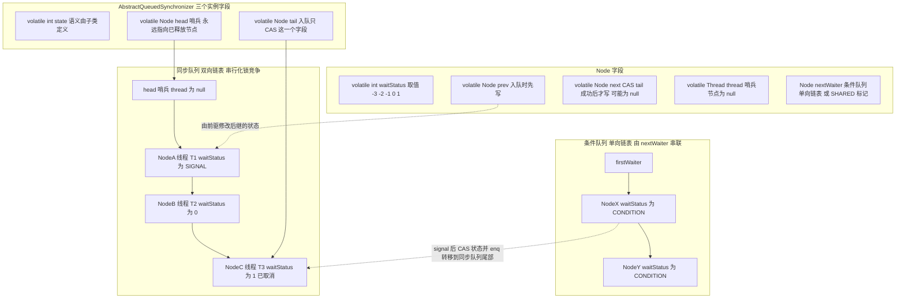

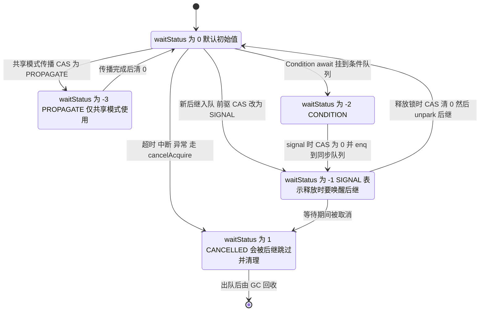

### 2.4 自旋与 park 的分工

AQS 的自旋非常克制，只有两处：

1. `enq` 的 `for (;;)`：初始化哨兵 + CAS tail，这是**必须成功的入队循环**，不是等待循环。
2. `acquireQueued` 的主循环：每次被唤醒后检查 `p == head && tryAcquire(arg)`，失败则再进 `shouldParkAfterFailedAcquire` 决定要不要继续 park。

`shouldParkAfterFailedAcquire(Node pred, Node node)` 的三分支逻辑必须能背：

```java
private static boolean shouldParkAfterFailedAcquire(Node pred, Node node) {
    int ws = pred.waitStatus;
    if (ws == Node.SIGNAL)
        return true;                 // 前驱已经承诺唤醒我，放心 park
    if (ws > 0) {                    // 前驱已 CANCELLED，往前跳过所有取消节点
        do {
            node.prev = pred = pred.prev;
        } while (pred.waitStatus > 0);
        pred.next = node;
    } else {                         // 0 或 PROPAGATE，CAS 成 SIGNAL 再自旋一次
        compareAndSetWaitStatus(pred, ws, Node.SIGNAL);
    }
    return false;                    // 返回 false 意味着"先别 park，再试一次获取"
}
```

注意最后那个 `return false`：新节点入队后**至少自旋两次**才 park。第一次把前驱置为 `SIGNAL`，第二次看到 `SIGNAL` 才 park。这就是著名的"入队后自旋两次"的来源，代价换来的是：如果前驱在两次自旋之间释放了锁，线程根本不用 park，避免了多余的上下文切换。

为什么不用纯自旋？线程数大于核数时，自旋会抢走持锁线程的 CPU 时间片，把锁竞争放大成"全员空转"。为什么不全用 park？`LockSupport.park/unpark` 一次往返是微秒级（Linux 上要走 `pthread_mutex` + `pthread_cond`），而一次无竞争 CAS 是纳秒级。**自旋处理"马上就好"，park 处理"要等一会"**。

### 2.5 规模变大后会怎样

- **队列长度**：每个 `Node` 对象在 64 位 JVM 上 32 字节（对象头 12 + 压缩指针下的 4 个引用 16 + int 4，正好 8 字节对齐、无需填充；JDK 8u421 用 `Instrumentation#getObjectSize` 实测）。10000 个线程同时排队约 320KB，内存不是问题，问题在**下游的上下文切换**：`unpark` 一次唤醒一个，但 OS 调度器会把被唤醒线程放到运行队列，抢占式调度导致持锁线程被换出，出现"锁 convoy"现象。
- **cacheline 争用**：未竞争的 `state` 是一个独立的 `int`，但如果同一条 cacheline 上还有其他热字段，别的核改它就会让持锁核的 cacheline 失效。JDK 8 起 `Striped64.Cell` 与 `Thread` 的 `threadLocalRandomSeed` 等字段就用 `@sun.misc.Contended` 隔离（JDK 9 起换成 `jdk.internal.vm.annotation.Contended`），AQS 本身**没有** `@Contended`。`LongAdder` 比 `AtomicLong` 在写多读少时快一个数量级，主要靠 `Cell` 分段把争用分散到不同对象上，`@Contended` 只是避免相邻 `Cell` 之间的伪共享。
- **公平性成本随队列变长线性上升**：公平模式下每次获取都要读 `head`/`tail`/`head.next` 三个可能被别的核修改的字段，队列越长，这几个字段的 cacheline 迁移越频繁。

## 三、独占模式：acquire 与 release 源码流程

### 3.1 acquire 的三段式

```java
public final void acquire(int arg) {
    if (!tryAcquire(arg) &&
        acquireQueued(addWaiter(Node.EXCLUSIVE), arg))
        selfInterrupt();
}
```

这一行代码浓缩了 AQS 的全部设计：

1. `tryAcquire(arg)`：先给子类一次"不排队直接拿到"的机会。返回 `true` 直接结束，连队列都不碰。
2. `addWaiter(Node.EXCLUSIVE)`：尝试失败则包装成独占节点入队，返回该节点。
3. `acquireQueued(node, arg)`：在队列里自旋 + park，返回值是"等待期间是否被中断过"。
4. `selfInterrupt()`：如果真的被中断过，**把中断标记补回去**。

第 4 点是高频追问。AQS 的选择是：`lock()` 语义上不响应中断（对齐 `synchronized`），但**中断不能被吞掉**。所以 `parkAndCheckInterrupt()` 里用 `Thread.interrupted()`（会清除标记）取状态，循环继续等待锁；等真正拿到锁返回时，如果中途被中断过，再调用 `selfInterrupt()` 把标记还原，让上层代码有机会看到 `Thread.currentThread().isInterrupted() == true`。

```java
static void selfInterrupt() {
    Thread.currentThread().interrupt();   // 只是重新置位，不抛异常
}
private final boolean parkAndCheckInterrupt() {
    LockSupport.park(this);               // this 作为 blocker，便于 jstack 定位
    return Thread.interrupted();          // 清标记并返回旧值
}
```

完全响应中断的版本是另一个方法 `acquireInterruptibly`：

```java
public final void acquireInterruptibly(int arg) throws InterruptedException {
    if (Thread.interrupted())
        throw new InterruptedException();
    if (!tryAcquire(arg))
        doAcquireInterruptibly(arg);      // 循环里被中断直接抛 InterruptedException
}
```

四种获取语义对照：

| 方法 | 中断行为 | 超时 | 失败返回 | 典型调用方 |
| --- | --- | --- | --- | --- |
| `acquire(int)` | 等待期间不响应，返回后补标记 | 无 | void | `ReentrantLock#lock` |
| `acquireInterruptibly(int)` | 立即抛 `InterruptedException` | 无 | void | `ReentrantLock#lockInterruptibly` |
| `tryAcquireNanos(int, long)` | 抛 `InterruptedException` | 有 | `false` | `ReentrantLock#tryLock(long, TimeUnit)` |
| `acquireShared(int)` | 同 `acquire` | 无 | void | `Semaphore#acquire` |

### 3.2 addWaiter 与 enq：一次 CAS 入队

```java
private Node addWaiter(Node mode) {
    Node node = new Node(Thread.currentThread(), mode);
    Node pred = tail;
    if (pred != null) {                       // 快路径：队列已初始化
        node.prev = pred;
        if (compareAndSetTail(pred, node)) {   // 唯一的原子点
            pred.next = node;
            return node;
        }
    }
    enq(node);                                 // 慢路径：队列未初始化或 CAS 失败
    return node;
}

private Node enq(final Node node) {
    for (;;) {
        Node t = tail;
        if (t == null) {                       // 第一次入队，先造哨兵
            if (compareAndSetHead(new Node()))  // 新 Node() 的 thread 为 null
                tail = head;
        } else {
            node.prev = t;
            if (compareAndSetTail(t, node)) {
                t.next = node;
                return t;
            }
        }
    }
}
```

三个细节：

- **队列懒初始化**：队列为空时 `head == tail == null`，第一次入队才用 `compareAndSetHead(new Node())` 造出哨兵。所以 `hasQueuedThreads()` 的实现是 `head != tail`，而不是 `head != null`。
- **`node.prev = pred` 先于 CAS**：这保证了任何一个已入队节点都能通过 `prev` 找到完整的前驱链，即使 `pred.next` 还没设置。这就是 `unparkSuccessor` 敢从 `tail` 倒着找的理由。
- **`enq` 返回的是前驱**：`transferForSignal` 会用到这个返回值来判断前驱状态。

### 3.3 acquireQueued：自旋、出队与取消

```java
final boolean acquireQueued(final Node node, int arg) {
    boolean failed = true;
    try {
        boolean interrupted = false;
        for (;;) {
            final Node p = node.predecessor();
            if (p == head && tryAcquire(arg)) {   // 只有队首才尝试
                setHead(node);
                p.next = null;                     // help GC，断开哨兵
                failed = false;
                return interrupted;
            }
            if (shouldParkAfterFailedAcquire(p, node) && parkAndCheckInterrupt())
                interrupted = true;
        }
    } finally {
        if (failed)
            cancelAcquire(node);
    }
}
```

四个必须讲清的点：

1. **`predecessor()` 可能抛 `NullPointerException`**：源码里 `final Node predecessor() throws NullPointerException { Node p = prev; if (p == null) throw new NullPointerException(); else return p; }`。正常情况下 `node.prev` 在入队时已经写好，不会为 null。
2. **只有 `p == head` 才 `tryAcquire`**：这把"所有人都抢同一个锁"变成"只有队首抢锁"，CAS 失败者直接进入 park 路径，大幅降低 `state` 上的竞争。这也是 AQS 与"所有线程自旋抢 CAS"的无锁实现的本质区别。
3. **`setHead(node)` 出队**：`head = node; node.thread = null; node.prev = null;`。注意这里**没有**修改 `node.next`，因为 `node` 变成哨兵后，下一个竞争者需要通过 `head.next` 找到它自己，清空会破坏链。
4. **`cancelAcquire`**：只有 `tryAcquire` 抛异常（比如 `ReentrantLock` 里 state 溢出抛 `Error`）才会走到 `finally` 的 `failed` 分支。它会把自己的 `waitStatus` 置 `CANCELLED`，并做三种情况的链表摘除：自己是尾节点就直接 CAS tail；前驱也被取消就找到最近的非取消前驱；否则把前驱的 `next` 指向自己的后继（可能失败，靠 `unparkSuccessor` 的倒序扫描兜底）。

### 3.4 release 与 unparkSuccessor

```java
public final boolean release(int arg) {
    if (tryRelease(arg)) {                     // 子类决定是否真正释放
        Node h = head;
        if (h != null && h.waitStatus != 0)
            unparkSuccessor(h);
        return true;
    }
    return false;
}
```

`h.waitStatus != 0` 是关键判断：如果队列里从来没有人把自己置为 `SIGNAL`，说明**没有等待者或等待者已经在自旋中拿到锁**，此时 `unpark` 是多余的。允许 `PROPAGATE`（-3）也能通过这个判断，因此条件是 `!= 0` 而不是 `== SIGNAL`。

```java
private void unparkSuccessor(Node node) {
    int ws = node.waitStatus;
    if (ws < 0)
        compareAndSetWaitStatus(node, ws, 0);  // 清掉 SIGNAL/PROPAGATE，允许新的等待者重新置位
    Node s = node.next;
    if (s == null || s.waitStatus > 0) {        // 后继为空或已取消
        s = null;
        for (Node t = tail; t != null && t != node; t = t.prev)
            if (t.waitStatus <= 0)              // 找最靠前的有效节点
                s = t;
    }
    if (s != null)
        LockSupport.unpark(s.thread);
}
```

**为什么倒着找**：`node.next` 可能为 `null`（入队方 CAS tail 成功但还没来得及写 `next`），也可能指向一个已 `CANCELLED` 的节点。倒序扫描 `prev` 链一定完整，因为 `prev` 是入队时第一时间赋值的。倒序扫描会一路找到最靠近 head 的有效节点，然后只 `unpark` 这一个线程 → **精确唤醒，不惊群**。

### 3.5 超时获取：spinForTimeoutThreshold

```java
private boolean doAcquireNanos(int arg, long nanosTimeout) throws InterruptedException {
    if (nanosTimeout <= 0L) return false;
    final long deadline = System.nanoTime() + nanosTimeout;
    final Node node = addWaiter(Node.EXCLUSIVE);
    boolean failed = true;
    try {
        for (;;) {
            final Node p = node.predecessor();
            if (p == head && tryAcquire(arg)) {
                setHead(node); p.next = null; failed = false; return true;
            }
            nanosTimeout = deadline - System.nanoTime();
            if (nanosTimeout <= 0L) return false;
            if (shouldParkAfterFailedAcquire(p, node) &&
                nanosTimeout > spinForTimeoutThreshold)   // 1000ns
                LockSupport.parkNanos(this, nanosTimeout);
            if (Thread.interrupted()) throw new InterruptedException();
        }
    } finally {
        if (failed) cancelAcquire(node);
    }
}
```

`spinForTimeoutThreshold = 1000L`（纳秒）的含义：**剩余超时小于 1 微秒时不再 park，直接自旋**。因为 `parkNanos` 的调用本身开销就超过 1 微秒，park 完再醒来大概率已经超时。这是一个典型的"用常量换响应性"的工程决策，值得在面试里主动说出来。

### 3.6 acquire 全流程时序

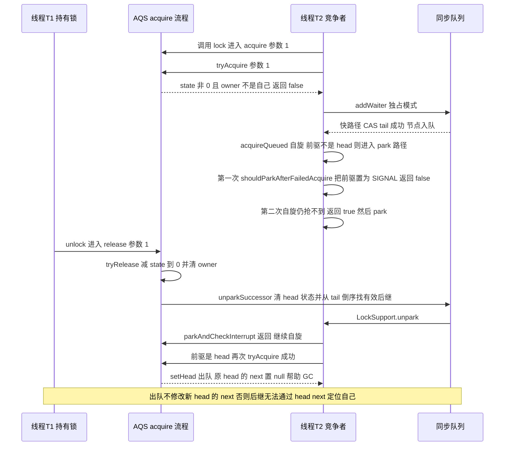

## 四、共享模式：acquireShared 与 releaseShared

### 4.1 返回值语义是共享模式的全部难点

```java
public final void acquireShared(int arg) {
    if (tryAcquireShared(arg) < 0)
        doAcquireShared(arg);
}
```

`tryAcquireShared` 返回 `int`，语义有三档，必须背清楚：

| 返回值 | 含义 | 后续动作 |
| --- | --- | --- |
| 负数 | 获取失败 | 入队阻塞 |
| 0 | 本次获取成功，但**后续共享获取无法成功** | 唤醒传播到此为止 |
| 正数 | 本次获取成功，且**后续共享获取也可能成功** | 继续唤醒后继共享节点（传播） |

`CountDownLatch` 的 `tryAcquireShared` 就返回 `(getState() == 0) ? 1 : -1`：一旦计数归零，所有等待者都能通过，返回 1 表示"可以继续传播"。

### 4.2 doAcquireShared 与 setHeadAndPropagate

```java
private void doAcquireShared(int arg) {
    final Node node = addWaiter(Node.SHARED);
    boolean failed = true;
    try {
        boolean interrupted = false;
        for (;;) {
            final Node p = node.predecessor();
            if (p == head) {
                int r = tryAcquireShared(arg);
                if (r >= 0) {
                    setHeadAndPropagate(node, r);     // 与独占模式的唯一结构差异
                    p.next = null;                    // help GC
                    if (interrupted) selfInterrupt();
                    failed = false;
                    return;
                }
            }
            if (shouldParkAfterFailedAcquire(p, node) && parkAndCheckInterrupt())
                interrupted = true;
        }
    } finally {
        if (failed) cancelAcquire(node);
    }
}

private void setHeadAndPropagate(Node node, int propagate) {
    Node h = head;              // 记录旧 head，后面判断要用
    setHead(node);
    if (propagate > 0 || h == null || h.waitStatus < 0 ||
        (h = head) == null || h.waitStatus < 0) {
        Node s = node.next;
        if (s == null || s.isShared())
            doReleaseShared();  // 继续唤醒后面的共享节点
    }
}
```

三个判断为什么这么写：

- `propagate > 0`：本次获取后仍有剩余资源，直接把唤醒往下传。
- `h == null || h.waitStatus < 0`：旧 head 的状态是 `SIGNAL` 或 `PROPAGATE`，说明它**承诺过**要唤醒后继，或者有传播意图未完成，必须补一次传播。
- `(h = head) == null || h.waitStatus < 0`：`setHead` 之后重新读一次新的 head，覆盖"在 `setHead` 与判断之间又有节点把状态置为 `SIGNAL`"的窗口。
- `s == null || s.isShared()`：后继为空（可能还没写完 `next`）也要传播；后继是独占节点则**不传播**，因为独占节点醒来后发现资源被抢走会重新 park，白唤醒一次。

### 4.3 releaseShared 与 doReleaseShared

```java
public final boolean releaseShared(int arg) {
    if (tryReleaseShared(arg)) {     // 是否真正释放成功，比如计数减到 0
        doReleaseShared();
        return true;
    }
    return false;
}

private void doReleaseShared() {
    for (;;) {
        Node h = head;
        if (h != null && h != tail) {                  // 队列里真有等待者
            int ws = h.waitStatus;
            if (ws == Node.SIGNAL) {
                if (!compareAndSetWaitStatus(h, Node.SIGNAL, 0))
                    continue;                          // CAS 失败就重来
                unparkSuccessor(h);
            }
            else if (ws == 0 &&
                     !compareAndSetWaitStatus(h, 0, Node.PROPAGATE))
                continue;                              // PROPAGATE 兜底
        }
        if (h == head)                                 // head 变了说明有人出队，再来一轮
            break;
    }
}
```

`PROPAGATE`（-3）就是为这里的竞态引入的：当释放线程把 `head.waitStatus` 从 `SIGNAL` CAS 成 `0` 之后、`unpark` 之前，如果另一个线程已经把新节点挂上去且只看到 `0`（不是 `SIGNAL`），它就无法判断"是否需要继续传播"。用一个"传播意图"标记 `PROPAGATE` 把意图存下来，`setHeadAndPropagate` 里的 `waitStatus < 0` 判断就能接住它。

独占与共享模式对照：

| 维度 | 独占模式 | 共享模式 |
| --- | --- | --- |
| 模板方法 | `tryAcquire`/`tryRelease` | `tryAcquireShared`/`tryReleaseShared` |
| 返回值 | `boolean` | `int`，三档语义 |
| 节点标记 | `nextWaiter == EXCLUSIVE`（即 null） | `nextWaiter == SHARED` |
| 出队 | `setHead` | `setHeadAndPropagate` |
| 唤醒 | 只唤醒一个后继 | 可能连续唤醒多个后继（传播） |
| 专用状态 | 只用 `SIGNAL`/`CANCELLED` | 额外使用 `PROPAGATE` |
| 典型实现 | `ReentrantLock`、`Worker` | `Semaphore`、`CountDownLatch`、`ReentrantReadWriteLock` 读锁 |

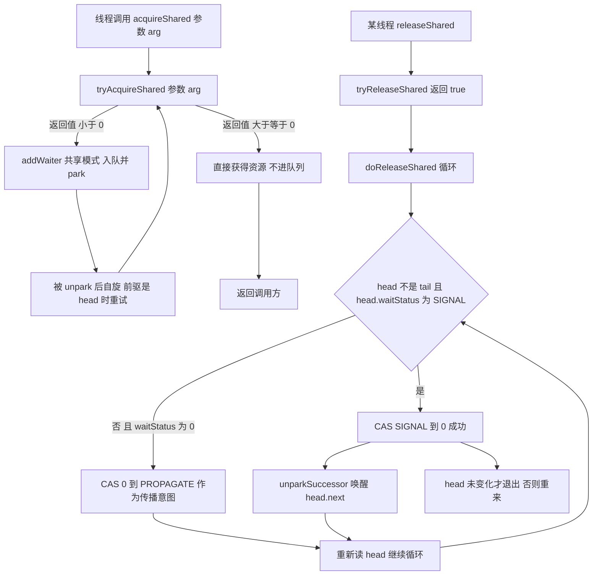

### 4.4 Semaphore 源码要点

```java
abstract static class Sync extends AbstractQueuedSynchronizer {
    Sync(int permits) { setState(permits); }
    final int getPermits() { return getState(); }

    final int nonfairTryAcquireShared(int acquires) {
        for (;;) {
            int available = getState();
            int remaining = available - acquires;
            if (remaining < 0 || compareAndSetState(available, remaining))
                return remaining;      // 不足时返回负数，恰好为 0 时返回 0
        }
    }

    protected final boolean tryReleaseShared(int releases) {
        for (;;) {
            int current = getState();
            int next = current + releases;
            if (next < current)            // 溢出保护
                throw new Error("Maximum permit count exceeded");
            if (compareAndSetState(current, next))
                return true;
        }
    }
}
```

- **公平版只有一行差异**：`FairSync#tryAcquireShared` 先判断 `if (hasQueuedPredecessors()) return -1;` 再走同一个 CAS 循环。
- **默认非公平**：`new Semaphore(1).isFair()` 返回 `false`。
- **`release` 可以把许可数加回超过初始值**（`release(n)` 没有上限校验，只有溢出校验），这是设计上的取舍：`Semaphore` 只保证"许可不会少于 0"，不保证"不会多于初始值"。误用 `release` 会导致限流形同虚设。
- **`drainPermits()`** 一次性取走全部许可（内部 CAS 把 state 置 0，返回旧值）；**`reducePermits(int)`** 是 `protected`，供子类实现动态缩容。
- **`acquire` 的 `state` 是"剩余许可"而不是"已用许可"**：`nonfairTryAcquireShared` 里 `remaining = available - acquires`，只有 `remaining < 0` 才是失败（许可不够）；`remaining == 0` 恰好表示"拿到了最后一个许可"，返回 0 让共享传播到此为止。这个细节能区分"背过源码"和"只背过结论"。

### 4.5 CountDownLatch 与 CyclicBarrier 的对照

```java
private static final class Sync extends AbstractQueuedSynchronizer {
    Sync(int count) { setState(count); }
    int getCount() { return getState(); }
    protected int tryAcquireShared(int acquires) {
        return (getState() == 0) ? 1 : -1;
    }
    protected boolean tryReleaseShared(int releases) {
        for (;;) {
            int c = getState();
            if (c == 0) return false;      // 已经为 0，重复 countDown 不报错也不动作
            int nextc = c - 1;
            if (compareAndSetState(c, nextc))
                return nextc == 0;         // 减到 0 才触发 doReleaseShared
        }
    }
}
```

`new CountDownLatch(3).getCount()` 返回 3，实测其 AQS `state` 就是 3。一次性：`state` 到 0 后不能复位，`await` 永远立即返回。

| 维度 | `CountDownLatch` | `CyclicBarrier` |
| --- | --- | --- |
| 是否基于 AQS | 是 | 否，内部用 `ReentrantLock` + `Condition` |
| 语义 | 一个线程等多个线程（`await` 等 `countDown`） | 多个线程互相等，到齐一起走，且可指定 `Runnable` 栅栏动作 |
| 复用 | 一次性 | 可循环使用，`reset()` 可强制打破 |
| 计数方向 | 递减到 0 | 递增到 `parties` |
| 异常 | 无 `BrokenBarrierException` | 超时/中断/`reset` 会导致 `BrokenBarrierException` |
| 可重入重置风险 | 无 | `reset()` 会让正在等待的线程抛异常，生产里慎用 |
| 典型场景 | 服务启动预加载、批量任务汇总 | 分阶段并行计算、压测多线程同时发起 |

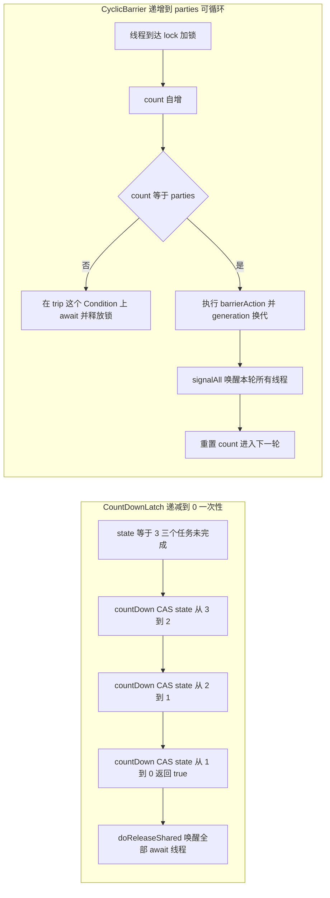

## 五、Condition：条件队列与同步队列的转移

### 5.1 ConditionObject 的结构

`AbstractQueuedSynchronizer.ConditionObject` 只有两个字段：

```java
public class ConditionObject implements Condition, java.io.Serializable {
    private transient Node firstWaiter;
    private transient Node lastWaiter;
    private static final int REINTERRUPT =  1;    // 退出时重新设置中断标记
    private static final int THROW_IE    = -1;    // 退出时抛 InterruptedException
}
```

它**复用了 `Node`**，但用 `nextWaiter` 串成**单向**条件队列，节点入队时 `waitStatus = Node.CONDITION (-2)`。一个 `ReentrantLock` 可以 `newCondition()` 出任意多个 `ConditionObject`，每个维护自己独立的 `firstWaiter`/`lastWaiter`，这就是"精确唤醒"的物理基础。

### 5.2 await 的完整流程

```java
public final void await() throws InterruptedException {
    if (Thread.interrupted())
        throw new InterruptedException();
    Node node = addConditionWaiter();          // 1. 包成 CONDITION 节点挂到条件队列尾部
    int savedState = fullyRelease(node);       // 2. 保存 state 并完全释放锁
    int interruptMode = 0;
    while (!isOnSyncQueue(node)) {             // 3. 只要还在条件队列就 park
        LockSupport.park(this);
        if ((interruptMode = checkInterruptWhileWaiting(node)) != 0)
            break;
    }
    if (acquireQueued(node, savedState) && interruptMode != THROW_IE)
        interruptMode = REINTERRUPT;           // 4. 重新竞争锁，注意用 savedState 恢复重入计数
    if (node.nextWaiter != null)
        unlinkCancelledWaiters();              // 5. 顺手清理被取消的等待节点
    if (interruptMode != 0)
        reportInterruptAfterWait(interruptMode); // 6. 按语义补标记或抛异常
}
```

逐点拆解：

1. **`addConditionWaiter()`** 先检查 `lastWaiter` 是否已被取消（`waitStatus != CONDITION`），是则调用 `unlinkCancelledWaiters()` 清理整个条件队列，避免取消节点永久占用链表。
2. **`fullyRelease(node)`** 一次性把 `state` 全部释放并返回旧值。注意是"全部"：如果当前线程重入了 3 次，`state == 3`，这里直接 `release(3)`。**为什么必须完全释放**：`Condition` 的语义是"等待条件成立时把锁让给别人"，如果只释放一次，别的线程根本进不来，会直接死锁。返回值 `savedState` 用于恢复重入次数。
3. **`while (!isOnSyncQueue(node)) park`**：`isOnSyncQueue` 判断节点是否已经被 `signal` 转移到同步队列（判断依据：`waitStatus == CONDITION` 或 `prev == null` 直接判定**不在**同步队列；`next != null` 直接判定**在**；都不确定时用 `findNodeFromTail` 从 `tail` 倒序兜底）。必须用 `while` 而不是 `if`，因为 `park` 存在**虚假唤醒**（spurious wakeup），且被 `signal` 唤醒后还要转去抢锁。
4. **`acquireQueued(node, savedState)`**：注意这里复用同步器的排队逻辑，用当初保存的 `savedState` 作为参数，这就实现了"重入 3 次，醒来后依然是重入 3 次"。
5. **中断处理**：`checkInterruptWhileWaiting(node)` 会判断中断发生在 `signal` 之前还是之后，返回 `THROW_IE`（-1，被 signal 前中断 → 抛异常）或 `REINTERRUPT`（1，被 signal 后中断 → 补标记）。
6. **`reportInterruptAfterWait`**：`THROW_IE` 抛 `InterruptedException`，`REINTERRUPT` 调 `selfInterrupt()`。

### 5.3 signal 与 transferForSignal

```java
public final void signal() {
    if (!isHeldExclusively())                     // 必须持有锁
        throw new IllegalMonitorStateException();
    Node first = firstWaiter;
    if (first != null)
        doSignal(first);
}

private void doSignal(Node first) {
    do {
        if ((firstWaiter = first.nextWaiter) == null)
            lastWaiter = null;
        first.nextWaiter = null;                  // 从条件队列摘除
    } while (!transferForSignal(first) &&         // 转移失败说明节点已取消，换下一个
             (first = firstWaiter) != null);
}

final boolean transferForSignal(Node node) {
    if (!compareAndSetWaitStatus(node, Node.CONDITION, 0))
        return false;                             // 已被取消，放弃这个节点
    Node p = enq(node);                           // 进入同步队列
    int ws = p.waitStatus;
    if (ws > 0 || !compareAndSetWaitStatus(p, ws, Node.SIGNAL))
        LockSupport.unpark(node.thread);          // 前驱已取消或置 SIGNAL 失败，直接唤醒兜底
    return true;
}
```

三个反直觉的点：

- **`signal` 不释放锁，也不立刻唤醒线程**。它只是把节点从条件队列搬到同步队列，被唤醒的线程还必须重新竞争锁。所以 `signal` 之后紧接着 `unlock` 是常规写法，但**不要把 `signal` 写在 `unlock` 之后**（会抛 `IllegalMonitorStateException`）。
- **`signal` 精确唤醒条件队列的第一个节点**，`signalAll` 循环转移全部节点。`Object.notify` 唤醒哪个是随机的，无法控制。
- **`transferForSignal` 里的 `unpark` 是兜底**：如果前驱已取消（`ws > 0`），说明前驱不会再唤醒它，必须直接 `unpark`，否则线程永远醒不来。有兴趣的读者可以对比 JDK 8 与 JDK 17 的这段实现，JDK 17 把它整理成了 `doSignal(ConditionNode, boolean)`。

### 5.4 await 与 wait 的差异

| 维度 | `Object#wait/notify` | `Condition#await/signal` |
| --- | --- | --- |
| 前置条件 | 必须持有对象 Monitor | 必须持有该 `Condition` 所属的锁 |
| 等待集数量 | 一个对象只有一个等待集 | 一个锁可派生多个 `Condition`，各自独立 |
| 唤醒精度 | `notify` 随机唤醒一个 | `signal` 唤醒条件队列队首 |
| 中断 | 抛 `InterruptedException` | 同样抛，且区分 signal 前/后中断 |
| 超时精度 | `wait(long, int)` 毫秒 + 纳秒 | `awaitNanos(long)` 纳秒、`awaitUntil(Date)` 绝对时间 |
| 锁类型 | 只能是 `synchronized` Monitor | 任意实现 `Lock` 的锁（含读写锁的写锁） |
| 虚假唤醒 | 有，必须 while | 有，必须 while |
| 队列实现 | JVM 内部 ObjectMonitor 的 `_WaitSet` | `ConditionObject` 的 `firstWaiter`/`lastWaiter` 链表 |
| 可观测 | `jstack` 显示 `in Object.wait()` | `jstack` 显示 `parking to wait for` / `waiting on condition`，可用 `hasWaiters()` 编程检测 |

`hasWaiters(Condition)`、`getWaitQueueLength(Condition)`、`getWaitingThreads(Condition)` 是 `ReentrantLock` 提供的三个可观测 API，生产里可以用来做"条件队列积压告警"。

**`awaitNanos(long)` 的返回值是剩余时间，不是等待时长**：javadoc 定义为"参数值 − 已等待时间"的估计，可以 ≤ 0（≤ 0 表示时间已用完）。要"确保睡够总时长"必须 `nanosTimeout = condition.awaitNanos(nanosTimeout);` 循环，直接 `if (awaitNanos(t) <= 0) 超时` 是常见写法错误。返回 `boolean` 的只有 `await(long, TimeUnit)` 与 `awaitUntil(Date)`。

### 5.5 用 Condition 实现有界队列的骨架

`ArrayBlockingQueue` 就是这套模式的标准答案（下面是与 `ArrayBlockingQueue` 同构的骨架，省略了 `checkNotNull`、`itrs` 迭代器维护等细节）：

```java
public class BoundedQueue<E> {
    private final Object[] items;
    private int takeIndex, putIndex, count;

    private final ReentrantLock lock = new ReentrantLock(false);   // 默认非公平
    private final Condition notEmpty = lock.newCondition();        // 空条件：消费者等
    private final Condition notFull  = lock.newCondition();        // 满条件：生产者等

    public BoundedQueue(int capacity) { this.items = new Object[capacity]; }

    public void put(E e) throws InterruptedException {
        Objects.requireNonNull(e);
        lock.lockInterruptibly();                 // 可中断获取，避免线程永久挂住
        try {
            while (count == items.length)         // 必须 while：await 有虚假唤醒
                notFull.await();                  // await 会释放锁，并把线程挂到 notFull 条件队列
            items[putIndex] = e;
            if (++putIndex == items.length) putIndex = 0;
            count++;
            notEmpty.signal();                    // 只唤醒一个消费者，避免唤醒风暴
        } finally {
            lock.unlock();                        // 必须在 finally 里
        }
    }

    @SuppressWarnings("unchecked")
    public E take() throws InterruptedException {
        lock.lockInterruptibly();
        try {
            while (count == 0)
                notEmpty.await();
            E e = (E) items[takeIndex];
            items[takeIndex] = null;              // 置空帮助 GC
            if (++takeIndex == items.length) takeIndex = 0;
            count--;
            notFull.signal();                     // 只唤醒一个生产者
            return e;
        } finally {
            lock.unlock();
        }
    }
}
```

要点：**两个 Condition 分离"满"和"空"**，`put` 只 `signal` 一个 `notEmpty` 等待者，`take` 只 `signal` 一个 `notFull` 等待者。如果只有一个等待集（等价于 `Object.notifyAll`），生产者会唤醒生产者，造成"唤醒风暴"——每次 `put` 唤醒所有线程，被唤醒的线程发现队列仍满又全部 park，再走一遍"释放锁 → 重新竞争锁"的完整流程。这是"两个条件队列"设计价值的量化体现。

三个容易写错的点：`await` 必须包在 `while` 里（虚假唤醒）；`signal` 之后不要立刻假设消费线程会运行（它还要重新抢锁）；`lock.lockInterruptibly()` 与 `unlock` 必须成对，且 `unlock` 放在 `finally` 的第一条语句。

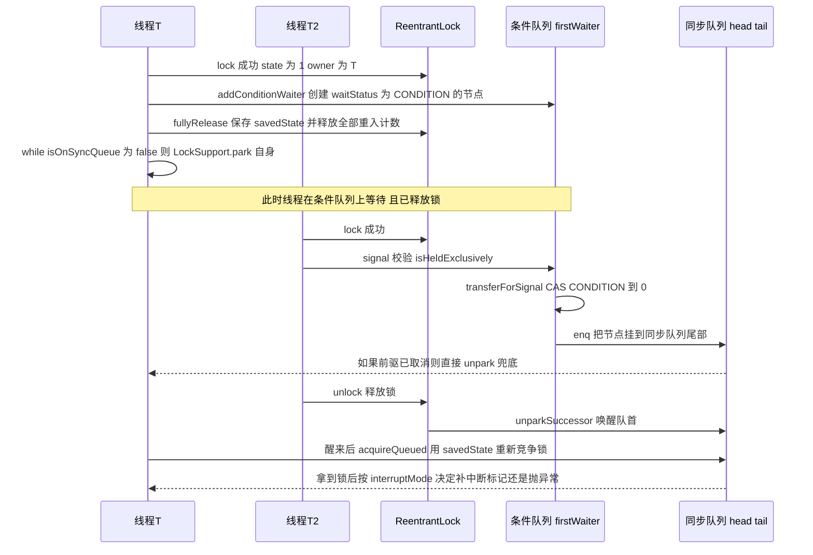

## 六、ReentrantLock：公平与非公平的实现差异

### 6.1 三个内部类的关系

```java
public class ReentrantLock implements Lock, java.io.Serializable {
    private final Sync sync;

    abstract static class Sync extends AbstractQueuedSynchronizer {
        abstract void lock();
        final boolean nonfairTryAcquire(int acquires) { ... }
        protected final boolean tryRelease(int releases) { ... }
        protected final boolean isHeldExclusively() {
            return getExclusiveOwnerThread() == Thread.currentThread();
        }
        final ConditionObject newCondition() { return new ConditionObject(); }
    }
    static final class NonfairSync extends Sync { ... }   // 默认
    static final class FairSync extends Sync { ... }

    public ReentrantLock() { sync = new NonfairSync(); }
    public ReentrantLock(boolean fair) { sync = fair ? new FairSync() : new NonfairSync(); }
}
```

`ReentrantLock` 本身只是个壳，所有同步语义都在 `Sync` 里。`isFair()` 的实现就是 `return sync instanceof FairSync;`（JDK 8 与 JDK 17 的字节码完全一致）。实测：`new ReentrantLock().isFair()` 返回 `false`。

**版本提醒**：JDK 8 的 `Sync` 结构是 `abstract void lock()` + `NonfairSync#lock` 里做一次插队 CAS；JDK 17 重构为 `abstract boolean initialTryLock()` + `final void lock() { if (!initialTryLock()) acquire(1); }`，插队逻辑搬到 `initialTryLock` 并顺带处理了可重入。语义不变，但**面试时按 JDK 8 讲必须声明版本**，否则被追问"`NonfairSync#lock` 里的 CAS 在哪"会答不上来。

### 6.2 非公平：先插队一次（JDK 8）

```java
static final class NonfairSync extends Sync {
    final void lock() {
        if (compareAndSetState(0, 1))                    // 插队：不管有没有人排队
            setExclusiveOwnerThread(Thread.currentThread());
        else
            acquire(1);                                  // 失败才走标准流程
    }
    protected final boolean tryAcquire(int acquires) {
        return nonfairTryAcquire(acquires);              // 再插队一次
    }
}
```

非公平锁有**两次插队机会**：

1. `lock()` 里的 `compareAndSetState(0, 1)`：新来的线程完全不看队列，直接抢。
2. `tryAcquire` 里的 `nonfairTryAcquire`：从 `park` 醒来后再抢一次。

```java
final boolean nonfairTryAcquire(int acquires) {
    final Thread current = Thread.currentThread();
    int c = getState();
    if (c == 0) {
        if (compareAndSetState(0, acquires)) {        // 注意：没有 hasQueuedPredecessors 检查
            setExclusiveOwnerThread(current);
            return true;
        }
    }
    else if (current == getExclusiveOwnerThread()) {  // 可重入
        int nextc = c + acquires;
        if (nextc < 0)                                 // int 溢出，即超过 2^31-1
            throw new Error("Maximum lock count exceeded");
        setState(nextc);
        return true;
    }
    return false;
}
```

**非公平为什么更快**：锁释放与队列头节点被唤醒之间存在一个时间窗（`unpark` 到线程真正被调度执行，通常几微秒）。如果在这个窗口里来了一个新线程，让它直接拿到锁，就不需要唤醒队列线程，省掉一次上下文切换。代价是**队列里的线程可能被反复插队，理论上无限期等待**（没有严格 FIFO 保证）。

**JDK 17 的重构（可主动加分）**：`Sync` 变成

```java
abstract static class Sync extends AbstractQueuedSynchronizer {
    abstract boolean initialTryLock();                    // 各子类实现"不排队的第一次尝试"
    final void lock() {
        if (!initialTryLock())
            acquire(1);
    }
    final void lockInterruptibly() throws InterruptedException {
        if (Thread.interrupted())
            throw new InterruptedException();
        if (!initialTryLock())
            acquireInterruptibly(1);
    }
    protected final boolean tryAcquire(int acquires) { return false; }  // 概念示意，见下
}
```

`NonfairSync#initialTryLock` 里同时做了两件事：`compareAndSetState(0, 1)` 插队，以及"owner 是我自己时 `state + 1` 实现可重入"（字节码里 `getExclusiveOwnerThread` 比较后 `getState() + 1` 并检查溢出抛 `Error("Maximum lock count exceeded")`）。`NonfairSync#tryAcquire` 因此被精简成"只有 `state == 0` 才 CAS"，可重入判断不再重复出现。对比 JDK 8：**JDK 8 的 `NonfairSync#lock` 只做 CAS 不做重入判断**，重入只在 `nonfairTryAcquire` 里处理。这是两版实现最实质的差异。

### 6.3 公平：hasQueuedPredecessors（JDK 8）

```java
static final class FairSync extends Sync {
    final void lock() {
        acquire(1);                                     // 没有插队快路径
    }
    protected final boolean tryAcquire(int acquires) {
        final Thread current = Thread.currentThread();
        int c = getState();
        if (c == 0) {
            if (!hasQueuedPredecessors() &&
                compareAndSetState(0, acquires)) {       // 必须"队列里没有排在我前面的人"
                setExclusiveOwnerThread(current);
                return true;
            }
        }
        else if (current == getExclusiveOwnerThread()) {
            int nextc = c + acquires;
            if (nextc < 0)
                throw new Error("Maximum lock count exceeded");
            setState(nextc);
            return true;
        }
        return false;
    }
}
```

`hasQueuedPredecessors` 是公平性的全部：

```java
public final boolean hasQueuedPredecessors() {
    Node t = tail;                  // 注意：先读 tail 再读 head
    Node h = head;
    Node s;
    return h != t &&
        ((s = h.next) == null || s.thread != Thread.currentThread());
}
```

逐行解释：

- `h != t`：队列里至少有一个真正的等待者（因为 head 是哨兵，`h == t` 表示空队列或只有一个哨兵）。
- `(s = h.next) == null`：`h.next` 为 `null` 但 `h != t`，说明有线程正在入队（CAS tail 成功、`pred.next` 还没写），保守地认为"前面有人"，返回 `true` 让它去排队。
- `s.thread != Thread.currentThread()`：队首等待者就是当前线程自己时，返回 `false`——这是为了**可重入**场景：同一个线程在公平模式下重入时不应该被自己的排队节点挡住。

**为什么先读 `tail` 再读 `head`**：类注释写了 "Read fields in reverse initialization order"。`tail` 的可见性由入队时的 CAS 建立，先读 `tail` 拿到一个"至少是这么新"的快照，能避免读到 `head` 已更新而 `tail` 还是旧值的错序视图，从而漏判"有人排在前面"。这是典型的基于 JMM 的读序设计，属于加分答案。

**JDK 17 里两个方法的差异（容易被追问）**：`FairSync#initialTryLock` 的快速路径用的是 `hasQueuedThreads()`（即 `head != tail`），而 `FairSync#tryAcquire` 用的是 `hasQueuedPredecessors()`。为什么快速路径能用更宽松的判断：走到 `initialTryLock` 时 `state == 0` 意味着当前线程没持锁，它不可能是队首节点，所以"队列非空"与"我前面有人"等价。而在 `acquireQueued` 复活路径上必须用 `hasQueuedPredecessors()`，因为那时当前线程**自己很可能就是队首节点**。

### 6.4 可重入计数与释放

```java
protected final boolean tryRelease(int releases) {
    int c = getState() - releases;
    if (Thread.currentThread() != getExclusiveOwnerThread())
        throw new IllegalMonitorStateException();      // 非持有者 unlock
    boolean free = false;
    if (c == 0) {
        free = true;
        setExclusiveOwnerThread(null);                 // 先清 owner 再写 state
    }
    setState(c);                                      // 这里不需要 CAS：只有 owner 能改
    return free;                                      // 只有真正归零才让 AQS 去唤醒后继
}
```

- 实测 `state`：`lock()` 一次为 1，两次为 2，`getHoldCount()` 同步返回 2。
- 非持有者 `unlock` 抛 `IllegalMonitorStateException`。
- `setExclusiveOwnerThread(null)` 在 `setState(c)` **之前**：先把 owner 清掉，再公布 `state == 0`。这保证了别的线程看到 `state == 0` 时，一定也能看到 `owner == null`；如果顺序反了，线程 A 看到 `state == 0` 去 CAS 成功，却发现 `owner` 还是旧线程，`getExclusiveOwnerThread()` 判断会错乱（语义上锁"没干净地释放"）。
- `setState` 不需要 CAS：`state` 只有 owner 能写（未持有时没人会写非零值），这是 AQS 里少见的"省略原子操作"的地方，也是面试可以主动讲的设计权衡。

### 6.5 四个加锁 API 的实现对照

| `ReentrantLock` 方法 | 底层 AQS 方法 | 中断 | 超时 | 备注 |
| --- | --- | --- | --- | --- |
| `lock()` | `sync.lock()` → `acquire(1)` | 不响应，返回后补标记 | 无 | 对齐 `synchronized` |
| `lockInterruptibly()` | `acquireInterruptibly(1)` | 立即抛 | 无 | 阻塞前也检查一次中断 |
| `tryLock()` | JDK 8：`sync.nonfairTryAcquire(1)`；JDK 17：`sync.tryLock()` | 不涉及 | 无 | **公平锁也插队**：只看 `state` 是否为 0，不查队列 |
| `tryLock(long, TimeUnit)` | `tryAcquireNanos(1, unit.toNanos(timeout))` | 抛 | 有 | 超时判定用 `System.nanoTime()` |
| `unlock()` | `sync.release(1)` | 无 | 无 | 未持有时抛 `IllegalMonitorStateException` |
| `newCondition()` | `sync.newCondition()` | — | — | 必须在持锁时 `await` |

注意 `tryLock()` 的实现细节：JDK 8 的 `ReentrantLock#tryLock()` 直接 `return sync.nonfairTryAcquire(1);`（JDK 17 改为 `sync.tryLock()`，源码注释仍写着 "Performs non-fair tryLock"）。**不管是公平锁还是非公平锁，`tryLock()` 都不尊重公平性**：只要 `state == 0`，有等待者也能插队成功。javadoc 原话是 "the untimed tryLock() method does not honor the fairness setting"，想遵守公平性得用 `tryLock(0, TimeUnit.SECONDS)`。

### 6.6 可观测 API

| API | 返回值 | 用途 |
| --- | --- | --- |
| `isLocked()` | 是否有任意线程持有 | 健康检查，注意有竞态，只能当参考 |
| `isHeldByCurrentThread()` | 当前线程是否持有 | 断言与日志 |
| `getHoldCount()` | 当前线程重入次数 | 排查"锁泄漏"（重入次数只增不减） |
| `getQueueLength()` | 估计的排队线程数 | 锁竞争告警的核心指标 |
| `hasQueuedThreads()` | 是否有线程在等 | `head != tail` 的实现 |
| `getQueuedThreads()` | 等待线程集合（快照） | 出问题时收集线程名 |
| `hasWaiters(Condition)` | 条件队列是否有等待者 | 分条件积压监控 |
| `getWaitingThreads(Condition)` | 条件等待线程集合 | 定位"谁在等" |

生产实践：`getQueueLength()` 是**估计值**（遍历链表时没有加锁），适合做趋势告警，不适合做严格判定。典型规则：`queueLength > 30` 持续 10 秒告警。

### 6.7 公平与非公平对比

| 维度 | 非公平（默认） | 公平 |
| --- | --- | --- |
| 新线程能否插队 | 能，两次机会 | 不能，必须 `!hasQueuedPredecessors()` |
| 吞吐 | 高，减少上下文切换 | 低，通常差一个数量级（高竞争下差 2~10 倍） |
| 延迟抖动 | 大，个别线程可能饥饿 | 小，近似 FIFO，抖动可预测 |
| 队列线程等待时间 | 无上界保证 | 近似按到达顺序 |
| 每次获取的开销 | 1 次 CAS（无竞争） | 1 次 CAS + 读 head/tail/next |
| 适用场景 | 绝大多数业务锁、临界区短 | 严格要求不饥饿；如按请求顺序调度、防止长尾饿死 |
| 与 `synchronized` 的关系 | 语义相近 | `synchronized` 没有对应配置 |

**选型口径**：默认非公平。只有在"排队公平性本身是业务需求"（比如保证请求按序处理、避免写线程被读线程长期压制）时才用公平锁，且必须实测吞吐代价。

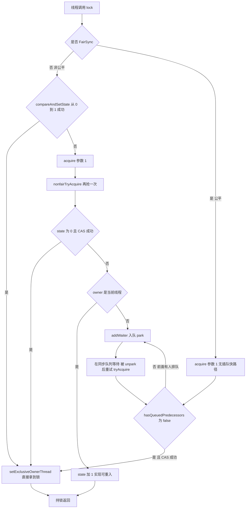

## 七、ReentrantReadWriteLock：state 拆分与读写饥饿

### 7.1 一个 int 装两种锁

```java
public class ReentrantReadWriteLock implements ReadWriteLock, java.io.Serializable {
    private static final int SHARED_SHIFT   = 16;
    private static final int SHARED_UNIT    = (1 << SHARED_SHIFT);      // 65536
    private static final int MAX_COUNT      = (1 << SHARED_SHIFT) - 1;  // 65535
    private static final int EXCLUSIVE_MASK = (1 << SHARED_SHIFT) - 1;  // 65535

    static int sharedCount(int c)    { return c >>> SHARED_SHIFT; }      // 无符号右移取高 16 位
    static int exclusiveCount(int c) { return c & EXCLUSIVE_MASK; }      // 取低 16 位
}
```

必须能画出来：

| 位区间 | 含义 | 每次读锁的操作 | 每次写锁的操作 |
| --- | --- | --- | --- |
| bit 31 ~ 16（高 16 位） | 读锁持有总数（所有线程之和） | `state += 65536` | 不变 |
| bit 15 ~ 0（低 16 位） | 写锁重入次数（只有一个线程） | 不变 | `state += 1` |

实测数据（JDK 17.0.12，反射读 `Sync.state`）：

| 场景 | `state` 十进制 | 二进制高位/低位 |
| --- | --- | --- |
| 刚构造，无锁 | 0 | 读 0，写 0 |
| `readLock().lock()` 一次 | 65536 | 读 1，写 0 |
| `writeLock().lock()` 一次 | 1 | 读 0，写 1 |
| 写锁持有时再 `readLock().lock()` | 65537 | 读 1，写 1（锁降级态） |

**为什么是 16 位**：一个 `int` 只有 32 位，写锁是独占的（同一时刻只有一个写线程），理论上只需要计数重入次数；读锁是共享的，需要累计所有线程。16 位给出 65535 的上限，实测中几乎不可能达到（一个线程重入 65535 次读锁，或 65535 个线程各持一次读锁）。上限到了就抛 `Error("Maximum lock count exceeded")`，不是静默溢出——这是分布式与并发代码里少见的"宁可抛 Error 也不让状态错乱"的选择。

### 7.2 读锁计数为什么需要 ThreadLocal

读锁的计数不能只有全局 `state` 高 16 位，因为**释放读锁时要校验"当前线程到底持有了几次"**。`ReentrantReadWriteLock` 用了四层优化（按访问频率从高到低）：

```java
static final class HoldCounter {
    int count = 0;                                      // 当前线程持有的读锁次数
    final long tid = getThreadId(Thread.currentThread()); // 线程 id，用 Unsafe 读 Thread.tid
}
static final class ThreadLocalHoldCounter extends ThreadLocal<HoldCounter> {
    public HoldCounter initialValue() { return new HoldCounter(); }
}
private transient ThreadLocalHoldCounter readHolds;     // 主存储
private transient HoldCounter cachedHoldCounter;        // 缓存最后一个成功获取读锁的线程计数
private transient Thread firstReader = null;            // 第一个获取读锁的线程
private transient int firstReaderHoldCount;             // 它的重入次数
```

| 优化 | 触发条件 | 收益 |
| --- | --- | --- |
| `firstReader` / `firstReaderHoldCount` | 读锁从 0 到 1 的那个线程 | 完全绕过 `ThreadLocal` |
| `cachedHoldCounter` | 最近一次获取读锁成功的线程 | 一次引用比较命中，省掉 `ThreadLocal.get()` |
| `readHolds` | 其他线程 | 兜底 |
| `HoldCounter` 存 `tid` 而不是 `Thread` 引用 | 全部场景 | 源码注释 "Use id, not reference, to avoid garbage retention"：`cachedHoldCounter` 是长命锁对象的字段，直接持有 `Thread` 会让已结束的线程无法回收 |

`getReadHoldCount()` 的实现顺序就是这套优化：先比 `firstReader`，再比 `cachedHoldCounter.tid`，最后查 `readHolds.get()`。这段代码在面试里被问到"ThreadLocal 在高并发下有什么坑"时是绝佳素材。

### 7.3 写锁 tryAcquire：读锁存在就失败

```java
protected final boolean tryAcquire(int acquires) {
    Thread current = Thread.currentThread();
    int c = getState();
    int w = exclusiveCount(c);
    if (c != 0) {
        // c != 0 且 w == 0 说明高 16 位有读锁，写锁直接失败
        if (w == 0 || current != getExclusiveOwnerThread())
            return false;
        if (w + exclusiveCount(acquires) > MAX_COUNT)
            throw new Error("Maximum lock count exceeded");
        setState(c + acquires);                  // 写锁重入，不需要 CAS
        return true;
    }
    if (writerShouldBlock() ||
        !compareAndSetState(c, c + acquires))
        return false;
    setExclusiveOwnerThread(current);
    return true;
}
```

关键点：`if (w == 0 || ...)` 这行的注释原文是 "if c != 0 and w == 0 then shared count != 0"，即**有读锁时写锁必须排队**。这就是"不支持锁升级"的源码依据。

### 7.4 读锁 tryAcquireShared：三级判断 + fullTryAcquireShared

```java
protected final int tryAcquireShared(int unused) {
    Thread current = Thread.currentThread();
    int c = getState();
    if (exclusiveCount(c) != 0 && getExclusiveOwnerThread() != current)
        return -1;                                        // 1. 别的线程持有写锁，直接失败
    int r = sharedCount(c);
    if (!readerShouldBlock() && r < MAX_COUNT &&
        compareAndSetState(c, c + SHARED_UNIT)) {         // 2. 快路径
        if (r == 0) {
            firstReader = current; firstReaderHoldCount = 1;
        } else if (firstReader == current) {
            firstReaderHoldCount++;
        } else {
            HoldCounter rh = cachedHoldCounter;
            if (rh == null || rh.tid != getThreadId(current))
                cachedHoldCounter = rh = readHolds.get();
            else if (rh.count == 0)
                readHolds.set(rh);
            rh.count++;
        }
        return 1;
    }
    return fullTryAcquireShared(current);                 // 3. 慢路径
}
```

`fullTryAcquireShared` 是一个 `for (;;)`，处理快路径失败的所有情况：读计数到达上限、`readerShouldBlock()` 为真、CAS 被别的线程插队。里面有一段**专门防止死锁**的注释：

```java
if (exclusiveCount(c) != 0) {
    if (getExclusiveOwnerThread() != current)
        return -1;
    // else we hold the exclusive lock; blocking here would cause deadlock.
}
```

翻译过来就是：**如果当前线程已经持有写锁，那么它申请读锁必须成功，否则会死锁**（自己等自己）。这行 `if` 就是"写锁可以降级为读锁、但读锁不能升级为写锁"的第二处源码证据。

### 7.5 readerShouldBlock：公平与非公平的分水岭

```java
// NonfairSync
final boolean readerShouldBlock() { return apparentlyFirstQueuedIsExclusive(); }

// FairSync
final boolean readerShouldBlock() { return hasQueuedPredecessors(); }

// AQS
final boolean apparentlyFirstQueuedIsExclusive() {
    Node h, s;
    return (h = head) != null && (s = h.next) != null &&
           !s.isShared() && s.thread != null;
}
```

| 模式 | 读者阻塞条件 | 效果 |
| --- | --- | --- |
| 非公平（默认） | 队首是**写者**时才阻塞新读者 | 读者可以"插队"提高读吞吐；写者一旦排到队首，后续读者会被挡住，写者不会被无限饿死 |
| 公平 | 队列里有任何等待者（含读者）就阻塞 | 近似 FIFO，但读吞吐明显下降 |

**关于饥饿，必须说 JDK 官方口径**：`ReentrantReadWriteLock` 的类注释明确写了 "This class does not impose a reader or writer preference ordering for lock access... A nonfair lock that is continuously contended may indefinitely postpone one or more reader or writer threads, but will normally have higher throughput than a fair lock."

所以正确回答是：

- 非公平模式**没有**严格的读者优先或写者优先，`apparentlyFirstQueuedIsExclusive()` 只保证"写者排队后不再放新读者进来"，因此最常见的现象是**读多写少场景下写线程等待时间被拉长**，但不是必然饥饿。
- 公平模式按到达顺序，任何一方都不会被无限推迟，代价是吞吐。
- "读写锁一定比 `ReentrantLock` 快"是错的：读多写少、临界区短时读写锁的 `state` CAS 争用可能比独占锁更严重，尤其在 16 核以上机器上。选型必须用 JMH 实测。
- 公平模式下 `tryLock` 同样会插队：`ReadLock#tryLock()` 走 `tryReadLock()`（源码注释 "Performs tryLock for read, enabling barging in both modes"）、`WriteLock#tryLock()` 走 `tryWriteLock()`（源码注释 "Performs tryLock for write, enabling barging in both modes"）——它们不经过 `readerShouldBlock`/`writerShouldBlock`（`writerShouldBlock` 在非公平版里的注释就是 "writers can always barge"），要公平就用带超时的 `tryLock(0, TimeUnit.SECONDS)`。

### 7.6 锁降级：唯一安全的降级路径

**锁升级（读锁 → 写锁）会死锁**：两个线程各持读锁，都去申请写锁，互相等对方的读锁释放。

**锁降级是允许且常用的**：持有写锁时申请读锁，然后释放写锁，这样"修改后的数据对后续读者可见"这件事不依赖重新抢锁的可见性窗口。

```java
// 标准降级写法：先写，再读，再放写
rwLock.writeLock().lock();
try {
    data = loadFromDb();           // 修改共享数据
    rwLock.readLock().lock();      // 降级：在持有写锁时申请读锁，一定能成功
} finally {
    rwLock.writeLock().unlock();   // 释放写锁，此时仍持有读锁
}
try {
    // 这里读 data 是安全的：读锁在手，其他写者进不来
    render(data);
} finally {
    rwLock.readLock().unlock();
}
```

降级能成功的源码依据就是 7.4 里的两处判断：`tryAcquireShared` 的 `getExclusiveOwnerThread() != current` 与 `fullTryAcquireShared` 的 "blocking here would cause deadlock"。

| 转换 | 是否允许 | 原因 |
| --- | --- | --- |
| 读 → 读（重入） | 允许 | 共享模式计数递增 |
| 写 → 写（重入） | 允许 | `exclusiveCount` 递增 |
| 写 → 读（降级） | 允许 | 当前线程是 owner，直接成功 |
| 读 → 写（升级） | **禁止** | `tryAcquire` 里 `w == 0` 直接失败，会死锁 |

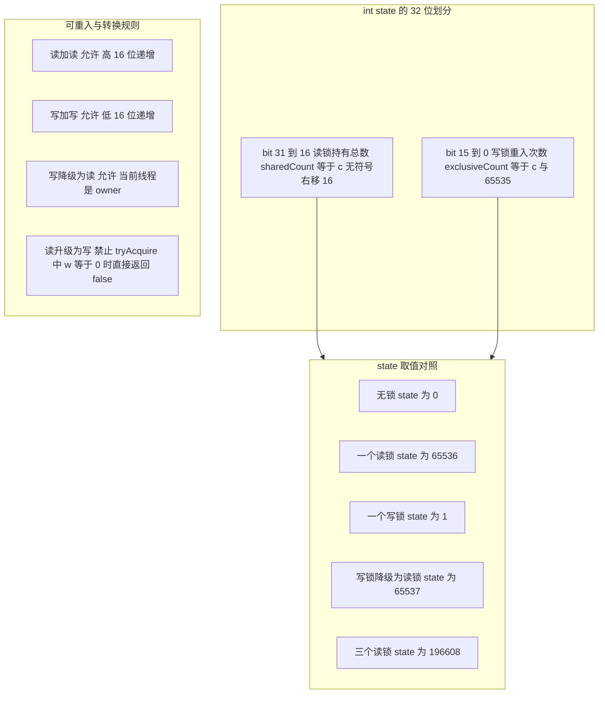

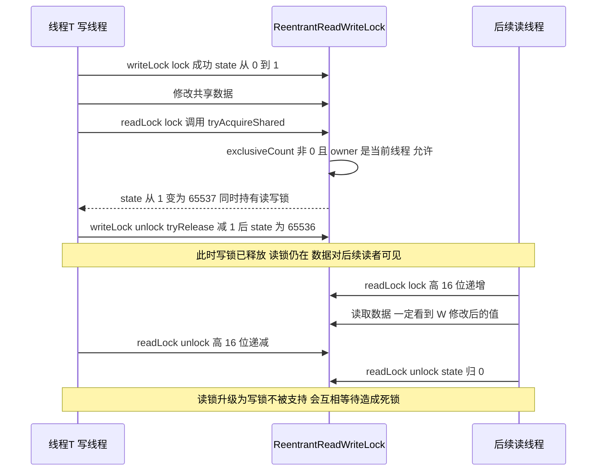

## 八、StampedLock：乐观读与三种模式

### 8.1 三种模式与 stamp 的位布局

`StampedLock`（JDK 8 引入，`java.util.concurrent.locks.StampedLock`）**不基于 AQS**，自己维护一个 `volatile long state` 和一个 `WNode` 队列。

```java
private static final int  LG_READERS = 7;
private static final long RUNIT  = 1L;        // 一次读锁的增量
private static final long WBIT   = 1L << 7;   // 128，写位
private static final long RBITS  = WBIT - 1L; // 127，低 7 位是读计数
private static final long RFULL  = RBITS - 1L;// 126，读计数的软上限
private static final long ABITS  = RBITS | WBIT; // 255，低 8 位掩码
private static final long SBITS  = ~RBITS;    // -128，即保留 bit 7 以上（版本号）
private static final long ORIGIN = WBIT << 1; // 256，初始 state
private static final long INTERRUPTED = 1L;   // 可中断版本返回的特殊 stamp
```

| 位区间 | 含义 | 实测 |
| --- | --- | --- |
| bit 6 ~ 0（低 7 位） | 读锁计数，0 ~ 126 | 读锁后 stamp 低 7 位为 1 |
| bit 7 | 写锁标志位 | 写锁时该位为 1 |
| bit 8 及以上 | **版本号**，每次写锁释放递增 | 初始 256，一次写锁后 512，两次后 768 |

实测数据（JDK 17.0.12，反射读 `state`）：

| 操作 | 返回的 stamp | 操作后 `state` | `tryOptimisticRead()` |
| --- | --- | --- | --- |
| 初始 | — | 256 | 256，`validate(256)` 为 `true` |
| `writeLock()` | 384 | 384 | 0（返回 0 表示"有写锁，不能乐观读"） |
| `unlockWrite(384)` | — | 512 | — |
| `readLock()` | 513 | 513 | 512，高版本位未变（`s & SBITS` 会把低 7 位的读计数抹掉） |
| `unlockRead(513)` | — | 512 | — |
| `validate(0L)` | — | — | 恒为 `false` |

三个模式：

| 模式 | 方法 | 阻塞 | 可重入 | 建立 happens-before |
| --- | --- | --- | --- | --- |
| 悲观读 | `readLock()` / `readLockInterruptibly()` | 可能阻塞 | 否（会死锁） | 是 |
| 悲观写 | `writeLock()` / `writeLockInterruptibly()` | 可能阻塞 | 否 | 是 |
| 乐观读 | `tryOptimisticRead()` + `validate(long)` | 从不阻塞，成功失败都立即返回 | 无状态 | 不建立，靠 `validate` 校验 |

`tryOptimisticRead()` 的实现就是一行判断：

```java
public long tryOptimisticRead() {
    long s;
    return (((s = state) & WBIT) == 0L) ? (s & SBITS) : 0L;   // 有写锁则返回 0
}
public boolean validate(long stamp) {
    U.loadFence();                                            // JDK 8 用 Unsafe.loadFence
    return (stamp & SBITS) == (state & SBITS);                // 只比较 bit 7 以上的版本位
}
```

**乐观读为什么不阻塞**：它只是"读一次 `state` 快照"，不做任何 CAS、不改任何状态、不入队。因为读锁的变化只影响低 7 位，而 `validate` 只比较 `SBITS`（bit 7 以上），所以**读锁的获取与释放不会让乐观读失效**；只有写锁的获取与释放会改变版本位，从而使之前的 stamp 失效。

### 8.2 乐观读的正确写法

```java
import java.util.concurrent.locks.StampedLock;

public class Point {
    private double x, y;                     // 注意：非 volatile
    private final StampedLock sl = new StampedLock();

    void move(double deltaX, double deltaY) {
        long stamp = sl.writeLock();
        try {
            x += deltaX;
            y += deltaY;
        } finally {
            sl.unlockWrite(stamp);
        }
    }

    double distanceFromOrigin() {
        long stamp = sl.tryOptimisticRead();
        double currentX = x, currentY = y;   // 必须读进局部变量
        if (!sl.validate(stamp)) {           // 校验失败则退化为悲观读
            stamp = sl.readLock();
            try {
                currentX = x;
                currentY = y;                // 必须重新读一遍
            } finally {
                sl.unlockRead(stamp);
            }
        }
        return Math.sqrt(currentX * currentX + currentY * currentY);
    }
}
```

四个必须强调的细节：

1. **必须先读进局部变量再 `validate`**。如果先 `validate` 再读字段，`validate` 与字段读之间的写锁可能已经改变了字段。顺序反了就是 bug。
2. **`validate` 失败必须重新读取**，而不是"用旧值再 validate 一次"。
3. **字段不能是 `final`**（`final` 字段由构造器保证可见性，但这里的字段是被写锁修改的）。字段如果是 `long`/`double`，理论上有**撕裂读**风险（读到高低 32 位来自两次不同的写）；工程上建议把多个字段打包成一个不可变对象、用 `volatile` 引用发布，或把 `long` 声明为 `volatile`。这是乐观读最容易被忽略的边界。
4. **`validate(stamp)` 中的 `stamp` 不能被其他线程共享或复用**：stamp 是一个值语义的"版本票据"，只对获取它的那次逻辑有效。

### 8.3 不可重入与其它限制

| 限制 | 说明 | 后果 |
| --- | --- | --- |
| **不可重入** | `readLock()` 拿两次、`writeLock()` 拿两次都会自锁死 | 与 `ReentrantLock` 最大的行为差异，从 `ReentrantLock` 迁移过来容易踩 |
| 不支持 `Condition` | 没有 `newCondition()` | 需要条件等待只能用 `ReentrantLock` |
| 不实现 `Lock`/`ReadWriteLock` | 用 `asReadLock()`/`asWriteLock()`/`asReadWriteLock()` 拿视图 | 视图提供 `Lock` 的 `lock`/`tryLock`/`unlock`（含超时与可中断版本），但**不提供乐观读**，`newCondition()` 抛 `UnsupportedOperationException` |
| 中断语义特殊 | `readLock()`/`writeLock()` 不可中断；`readLockInterruptibly()`/`writeLockInterruptibly()` 可中断并返回 `INTERRUPTED`（1） | 拿到 `INTERRUPTED` 时不需要 `unlock` |
| 读计数溢出 | 低 7 位最多 126，超出部分记在 `readerOverflow`（int） | 所以读锁持有数可以远超 126，只是超过后不再用 `state` 计数 |
| 自旋参数 | `SPINS`、`HEAD_SPINS`、`MAX_HEAD_SPINS` 由核数决定：多核时实测为 64、1024、65536；单核时全为 0 | 单核机器上乐观读收益消失 |

### 8.4 stamp 转换方法

| 方法 | 用途 | 失败时返回 |
| --- | --- | --- |
| `tryConvertToWriteLock(long stamp)` | 乐观读/读锁 → 写锁，不释放再申请 | `0`，此时原 stamp 仍有效，需自行释放 |
| `tryConvertToReadLock(long stamp)` | 乐观读/写锁 → 读锁（降级） | `0` |
| `tryConvertToOptimisticRead(long stamp)` | 读锁/写锁 → 乐观读 stamp | `0` |
| `tryUnlockWrite()` | 释放写锁，不怕 stamp 丢失 | `false` 表示未持有写锁 |
| `tryUnlockRead()` | 释放读锁 | `false` 表示未持有读锁 |

`tryConvertToWriteLock` 的典型用途：乐观读校验失败，但此时"我只需要补一次写"（比如 CAS 式的补偿修改），可以在**不释放乐观读 stamp** 的前提下尝试升级，失败再走 `writeLock()`。它解决了"释放再获取"的竞态窗口。

### 8.5 三种锁的选型对照

| 维度 | `ReentrantLock` | `ReentrantReadWriteLock` | `StampedLock` |
| --- | --- | --- | --- |
| 基于 AQS | 是 | 是 | 否 |
| 可重入 | 是 | 是 | **否** |
| 读并发 | 无读概念 | 读读并发 | 读读并发 + 乐观读 |
| 读写转换 | 无 | 只支持降级 | 支持降级与 stamp 转换 |
| 条件队列 | `newCondition()` | 写锁支持 `newCondition()` | 不支持 |
| 中断支持 | `lockInterruptibly` | `lockInterruptibly` | 只有 `*Interruptibly` 变体 |
| 读多写少吞吐 | 基线 | 中 | 高（乐观读不写任何共享状态） |
| 饥饿风险 | 非公平可能推迟 | 非公平可能推迟读或写 | 无公平模式，写者靠自旋抢占，抖动大 |
| 适用场景 | 通用互斥 | 读多写少、需要条件队列 | 读极多写极少、临界区极短、可容忍重试 |

选型口径：

- 需要条件等待、需要可重入、临界区较长 → `ReentrantLock`。
- 读多写少且需要条件等待，或团队维护成本敏感 → `ReentrantReadWriteLock`。
- 读操作占比超过 90%、临界区只有几个字段读取、且能接受"校验失败重试" → `StampedLock`。
- **不要**因为"`StampedLock` 是 JDK 8 新类"就默认选它：它不可重入、无公平性、API 复杂，误用会死锁。

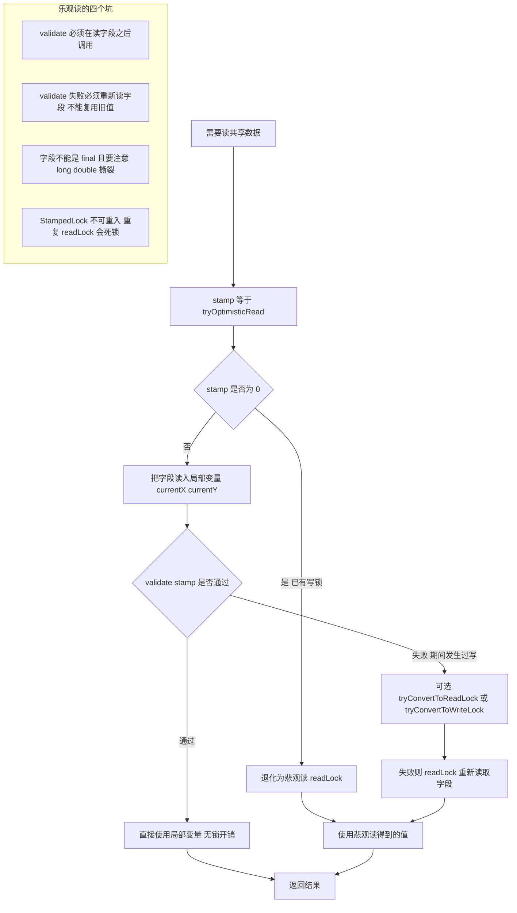

## 九、LockSupport：park 与 unpark 的语义

### 9.1 许可模型：最多一张通行证

```java
public static void park(Object blocker) {
    Thread t = Thread.currentThread();
    setBlocker(t, blocker);       // 记录 blocker 到 Thread.parkBlocker 字段
    UNSAFE.park(false, 0L);       // isAbsolute=false, time=0 表示无限期
    setBlocker(t, null);
}
public static void unpark(Thread thread) {
    if (thread != null)
        UNSAFE.unpark(thread);
}
public static void parkNanos(Object blocker, long nanos) { ... }
public static void parkUntil(Object blocker, long deadline) { ... }
public static Object getBlocker(Thread t) { ... }
```

语义要点：

- **许可最多 1 个，不累计**。连续两次 `unpark(t)`，`t` 只会在第一次 `park` 时立即返回，第二次 `park` 依然阻塞。
- **先 `unpark` 后 `park` 是有效的**：许可被"存起来"，下一次 `park` 直接消耗掉并返回。
- **`park` 返回不代表被 `unpark`**：可能被中断、超时（`parkNanos`/`parkUntil`）、或者**虚假唤醒**。因此所有使用 `park` 的地方都必须在循环里重新校验条件——AQS 的 `for (;;)` 就是这个原因。
- **`park` 不抛 `InterruptedException`**，它只是返回并保留中断标记；是否响应中断由调用方决定。
- **blocker 参数的作用**：记录到 `Thread` 对象的 `parkBlocker` 字段（`Unsafe` 偏移，JDK 8 里叫 `parkBlockerOffset`，JDK 17 改名 `PARKBLOCKER`），纯粹为了诊断。`jstack` 里那句 `parking to wait for <0x000000076b0a1b20> (a java.util.concurrent.locks.ReentrantLock$NonfairSync)` 中的地址就是 blocker。AQS 传的是 `this`（同步器实例），所以能定位到具体是哪个锁。

HotSpot 层的实现（`os_posix.cpp` 的 `Parker::park/unpark`）：每个线程有一个 `Parker` 对象，内含 `pthread_mutex_t _mutex`、`pthread_cond_t _cond` 和 `volatile int _counter`。`unpark` 把 `_counter` 置 1 并 `pthread_cond_signal`，`park` 在 `_counter == 0` 时 `pthread_cond_wait`。所以 `park/unpark` 的成本与一次 `pthread_cond_signal` + 可能的 futex syscall 相当，是微秒级——这就是 AQS 尽量"自旋两次再 park"的根本原因。

### 9.2 park 与 wait 的对照

| 维度 | `Object#wait` | `LockSupport#park` |
| --- | --- | --- |
| 前置条件 | 必须持有 Monitor，否则 `IllegalMonitorStateException` | 无任何前置条件 |
| 唤醒方式 | `notify`/`notifyAll`，需要同一 Monitor | `unpark(Thread)`，直接指定线程 |
| 许可语义 | 无许可概念，必须先等待才能被通知（先 `notify` 后 `wait` 会丢失唤醒） | 有许可，**先 `unpark` 后 `park` 不会丢** |
| 中断行为 | 抛 `InterruptedException` 并清除中断标记 | 直接返回，**保留中断标记** |
| 虚假唤醒 | 有 | 有 |
| 超时精度 | 毫秒 + 纳秒（实际受 OS 调度粒度限制） | 纳秒参数 + `parkUntil` 绝对时间 |
| 诊断信息 | `jstack` 显示 `in Object.wait()` | `jstack` 显示 `parking to wait for <blocker>` |
| 典型使用 | 传统 `wait/notify` 模式 | 所有 JUC 同步器、线程池取任务、`FutureTask` |

**先通知后等待不丢失**这一条是 `park` 相对 `wait` 的关键优势，也是 AQS 敢用"检查状态 → park"这个两段式流程的前提（虽然 AQS 依然用循环兜底虚假唤醒）。

### 9.3 中断与 park 的交互

| 场景 | 中断标记 | `park` 行为 | AQS 的处理 |
| --- | --- | --- | --- |
| 进入 `park` 前已中断 | `true` | **立即返回**，不阻塞 | 循环里发现抢不到锁就继续，等价于"无效唤醒"，最终会 park 失败再自旋 |
| `park` 期间被中断 | `true` | 立即返回 | `parkAndCheckInterrupt()` 用 `Thread.interrupted()` 读走并清除标记，记录 `interrupted = true` |
| `unpark` 与 `interrupt` 同时到达 | `true` | 返回一次 | 同上，最终拿到锁后 `selfInterrupt()` 把标记补回 |

`Thread.interrupted()` 与 `Thread.currentThread().isInterrupted()` 的区别是高频考点：**前者会清除标记，后者不会**。AQS 必须用前者，原因是**中断标记置位时 `LockSupport.park` 会立即返回**（JDK 8u421 与 JDK 17.0.12 实测：标记置位时 `park()` 几十微秒就返回，清掉标记后再 `park` 才会真正阻塞），只读不清的话等待循环会退化成忙等自旋、CPU 打满；清掉标记后由 `selfInterrupt()` 在拿到锁返回前补回，语义不丢。`acquireInterruptibly` 系列同样靠它取走标记，再决定是否抛 `InterruptedException`。

### 9.4 线程 park 状态迁移

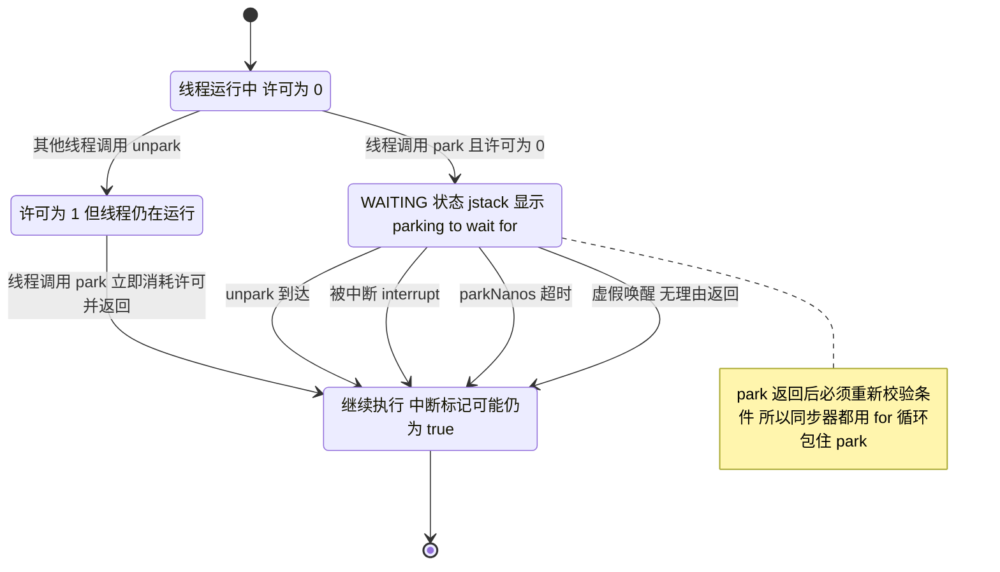

## 十、基于 AQS 手写一个不可重入锁

### 10.1 完整实现

不要写成 `boolean locked` + `synchronized`，那样答不出 AQS。用 AQS 的模板方法写，`state` 只有 0 和 1 两个取值：

```java
import java.util.concurrent.TimeUnit;
import java.util.concurrent.locks.AbstractQueuedSynchronizer;
import java.util.concurrent.locks.Condition;
import java.util.concurrent.locks.Lock;

public class NonReentrantLock implements Lock, java.io.Serializable {

    private static final long serialVersionUID = 1L;

    private static final class Sync extends AbstractQueuedSynchronizer {
        private static final long serialVersionUID = 1L;

        // 关键：只判断 CAS，完全不看 owner 是不是自己 -> 不可重入
        @Override
        protected boolean tryAcquire(int acquires) {
            if (compareAndSetState(0, 1)) {
                setExclusiveOwnerThread(Thread.currentThread());
                return true;
            }
            return false;
        }

        @Override
        protected boolean tryRelease(int releases) {
            if (getExclusiveOwnerThread() != Thread.currentThread())
                throw new IllegalMonitorStateException();
            setExclusiveOwnerThread(null);
            setState(0);                 // 只有 owner 能写，无需 CAS
            return true;                 // 返回 true 才会唤醒后继
        }

        @Override
        protected boolean isHeldExclusively() {
            return getState() == 1;      // jstack -l 与 Condition 都依赖它
        }

        final ConditionObject newCondition() { return new ConditionObject(); }

        final boolean isLocked() { return getState() == 1; }

        final Thread owner() { return getExclusiveOwnerThread(); }

        final boolean tryLockOnce() { return tryAcquire(1); }  // 供外部类调用受保护方法
    }

    private final Sync sync = new Sync();

    @Override public void lock()                  { sync.acquire(1); }
    @Override public void lockInterruptibly() throws InterruptedException {
        sync.acquireInterruptibly(1);
    }
    @Override public boolean tryLock()            { return sync.tryLockOnce(); }
    @Override public boolean tryLock(long time, TimeUnit unit) throws InterruptedException {
        return sync.tryAcquireNanos(1, unit.toNanos(time));
    }
    @Override public void unlock()                { sync.release(1); }
    @Override public Condition newCondition()     { return sync.newCondition(); }

    public boolean isLocked()          { return sync.isLocked(); }
    public boolean hasQueuedThreads()  { return sync.hasQueuedThreads(); }
    public int getQueueLength()        { return sync.getQueueLength(); }
    public Thread getOwner()           { return sync.owner(); }
}
```

### 10.2 六个实现要点

| 要点 | 做法 | 为什么 |
| --- | --- | --- |
| 不可重入的物理含义 | `tryAcquire` 里只判断 `compareAndSetState(0, 1)`，不判断 `getExclusiveOwnerThread()` | 同一线程第二次 `lock()` 也会 CAS 失败并进入队列，永久等待 = 自死锁 |
| `tryRelease` 必须校验 owner | `getExclusiveOwnerThread() != Thread.currentThread()` 抛 `IllegalMonitorStateException` | 否则别的线程可以释放不属于它的锁 |
| `tryRelease` 用 `setState` 而不是 `CAS` | 只有 owner 会执行到这里 | 少一次原子操作，语义上安全（与 `ReentrantLock#tryRelease` 一致） |
| `tryRelease` 必须返回 `true` | AQS 的 `release` 依赖返回值决定是否 `unparkSuccessor` | 返回 `false` 会导致后继线程永久 park |
| 必须实现 `isHeldExclusively` | 返回 `getState() == 1` | `ConditionObject#await` 会先校验它，缺失或不正确会抛 `IllegalMonitorStateException` |
| 外部类调用 `tryAcquire` | 包一层 `tryLockOnce()`（直接写 `sync.tryAcquire(1)` 也能编译，前提是 `sync` 的静态类型是 `Sync`） | `AQS#tryAcquire` 是 `protected`：用 `AbstractQueuedSynchronizer` 类型的引用调用必然编译不过；用同包的子类 `Sync` 类型调用是允许的。这是自研同步器最常踩的编译坑 |

### 10.3 与 ReentrantLock 的行为差异

| 场景 | `ReentrantLock` | `NonReentrantLock` |
| --- | --- | --- |
| 同线程连续 `lock()` 两次 | `state` 变 2，正常通过 | 第二次进入 `acquireQueued`，自死锁 |
| `getHoldCount()` 语义 | 有 | 无（永远 0 或 1） |
| `unlock()` 一次 | 只减少一次计数 | 一次性彻底释放 |
| 与 `Condition` 配合 | 支持 | 支持，但 `await` 后重新抢锁同样不可重入 |
| 公平性 | 可配置 | 无（非公平，`tryAcquire` 就是插队） |

**JDK 里的真实案例**：`ThreadPoolExecutor.Worker` 就是不可重入的 AQS 锁，且更巧妙——它用 `state = -1` 表示"线程已创建但还没开始跑任务，别中断我"：

```java
Worker(Runnable firstTask) {
    setState(-1);                      // 实测 JDK 17 的字节码里就是 iconst_m1 + setState
    this.firstTask = firstTask;
    this.thread = getThreadFactory().newThread(this);
}
protected boolean tryAcquire(int unused) {
    if (compareAndSetState(0, 1)) {    // 同样不看 owner -> 不可重入
        setExclusiveOwnerThread(Thread.currentThread());
        return true;
    }
    return false;
}
protected boolean isHeldExclusively() { return getState() != 0; }
```

`ThreadPoolExecutor#interruptIdleWorkers` 用 `w.tryLock()` 判断"线程是否空闲"，只有拿到锁（说明它没在执行任务）才 `interrupt`，避免打断正在跑任务的线程。`state = -1` 保证启动阶段 `getState() != 0`，从而不会被 `tryLock` 判定为空闲——这是"用状态位表达生命周期"的教科书案例。

### 10.4 再用共享模式写一个许可限流器

```java
public class SimplePermitLimiter implements java.io.Serializable {

    private static final long serialVersionUID = 1L;

    private static final class Sync extends AbstractQueuedSynchronizer {
        private static final long serialVersionUID = 1L;
        Sync(int permits) {
            if (permits < 0) throw new IllegalArgumentException("permits < 0");
            setState(permits);
        }
        @Override
        protected int tryAcquireShared(int acquires) {
            for (;;) {
                int available = getState();
                int remaining = available - acquires;
                if (remaining < 0 || compareAndSetState(available, remaining))
                    return remaining;      // 负数失败；0 表示刚好拿完且停止传播
            }
        }
        @Override
        protected boolean tryReleaseShared(int releases) {
            for (;;) {
                int current = getState();
                int next = current + releases;
                if (next < current) throw new Error("Maximum permit count exceeded");
                if (compareAndSetState(current, next)) return true;
            }
        }
        final int available() { return getState(); }
    }

    private final Sync sync;
    public SimplePermitLimiter(int permits) { this.sync = new Sync(permits); }
    public void acquire()                   { sync.acquireShared(1); }
    public boolean tryAcquire()             { return sync.tryAcquireShared(1) >= 0; }
    public void release()                   { sync.releaseShared(1); }
    public int availablePermits()           { return sync.available(); }
}
```

要点：

- **共享模式必须实现 `tryAcquireShared` 返回 `remaining`**，不能只返回 1：返回 0 是"我刚拿完最后一个，别再往后传播唤醒了"的信号；返回正数是"后面的人也有份，继续唤醒"。
- 这个实现与 JDK 的 `Semaphore.NonfairSync` 语义一致，**没有**实现公平版本。若要公平，在 `tryAcquireShared` 开头加 `if (hasQueuedPredecessors()) return -1;`。
- `release()` 不校验调用者是否持有许可，与 `Semaphore` 一致（允许"归还"）。

### 10.5 自测代码

```java
public class NonReentrantLockTest {
    public static void main(String[] args) throws Exception {
        NonReentrantLock lock = new NonReentrantLock();

        Thread t1 = new Thread(() -> {
            lock.lock();
            try {
                System.out.println("t1 拿到锁并持有 500ms");
                Thread.sleep(500);         // 故意持有久一点，让 t2 真正排进同步队列
                // lock.lock();            // 打开这行就是自死锁：不可重入，jstack 显示 WAITING (parking)
            } catch (InterruptedException ignored) {
            } finally {
                lock.unlock();
            }
        }, "t1");
        t1.start();
        Thread.sleep(100);                 // 确保 t1 先拿到锁

        Thread t2 = new Thread(() -> {
            boolean acquired = false;
            try {
                lock.lockInterruptibly();  // 必须捕获 InterruptedException，不能在 lambda 里抛出
                acquired = true;
                System.out.println("t2 拿到锁");
            } catch (InterruptedException e) {
                System.out.println("t2 被中断，未拿到锁，中断标记已被清除");
            } finally {
                if (acquired) lock.unlock();
            }
        }, "t2");
        t2.start();
        Thread.sleep(100);                 // 等 t2 进入同步队列
        System.out.println("排队线程数 = " + lock.getQueueLength()
                + "，是否有排队 = " + lock.hasQueuedThreads());
        t2.interrupt();                    // t2 在 park，lockInterruptibly 抛 InterruptedException

        t1.join();
        t2.join();
        System.out.println("结束后 isLocked = " + lock.isLocked()
                + "，queueLength = " + lock.getQueueLength());
    }
}
```

实测输出（JDK 8u421 与 JDK 17.0.12 结果一致）：

```
t1 拿到锁并持有 500ms
排队线程数 = 1，是否有排队 = true
t2 被中断，未拿到锁，中断标记已被清除
结束后 isLocked = false，queueLength = 0
```

三个验证点：`lockInterruptibly` 能被中断（`acquireInterruptibly` 路径生效，且异常抛出后中断标记被清除）；`getQueueLength()`/`hasQueuedThreads()` 能编程观测排队长度；把 `lock.lock()` 解开后 `jstack` 里会出现 `parking to wait for ... NonReentrantLock$Sync`，与 `ReentrantLock` 的表现完全一致。另外补充一个同线程验证：持锁状态下 `lock.tryLock()` 返回 `false`（不可重入），`lock.tryLock(50, TimeUnit.MILLISECONDS)` 会超时返回 `false`，不会自死锁——这套实现同时也验证了 `tryAcquireNanos` 路径。

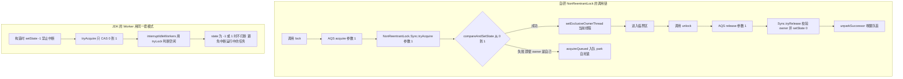

## 十一、AQS 全家桶：state 语义对照与选型

### 11.1 一表看清所有实现

| 类 | `state` 初始值 | `state` 变化 | 模板方法 | 模式 | 是否重入 |
| --- | --- | --- | --- | --- | --- |
| `ReentrantLock` | 0 | `+1` 加锁 / `-1` 解锁 | `tryAcquire` / `tryRelease` | 独占 | 是 |
| `ReentrantReadWriteLock` 写锁 | 0 | 低 16 位 `+1` | `tryAcquire` / `tryRelease` | 独占 | 是 |
| `ReentrantReadWriteLock` 读锁 | 0 | 高 16 位 `+65536` | `tryAcquireShared` / `tryReleaseShared` | 共享 | 是 |
| `Semaphore(permits)` | `permits` | `-acquires` / `+releases` | `tryAcquireShared` / `tryReleaseShared` | 共享 | 否 |
| `CountDownLatch(count)` | `count` | `-1` 直到 0 | `tryAcquireShared` / `tryReleaseShared` | 共享 | 否，一次性 |
| `ThreadPoolExecutor.Worker` | `-1` | `-1` → `0` 或 `1` | `tryAcquire` / `tryRelease` | 独占 | **否** |
| `StampedLock` | 256（`long`，非 AQS） | 读 `+1`，写 `+128`，释放写 `+128` | 自实现 | 乐观读 + 读 + 写 | **否** |
| `FutureTask`（JDK 7+） | 0（自实现） | `NEW→COMPLETING→NORMAL/EXCEPTIONAL` | 自实现 `state` + `WaitNode` | 独占 | 否 |
| `CyclicBarrier` | 无 AQS | `ReentrantLock` + `Condition` | — | — | — |

### 11.2 选型决策

| 需求 | 首选 | 备选 | 不要用 |
| --- | --- | --- | --- |
| 通用互斥 | `ReentrantLock` | `synchronized` | 公平锁（除非必要） |
| 需要条件等待 | `ReentrantLock` + `Condition` | `ArrayBlockingQueue` 等现成容器 | `StampedLock`（无 `Condition`） |
| 需要超时/可中断 | `ReentrantLock#tryLock(long, TimeUnit)` | `Semaphore#tryAcquire` | `synchronized` |
| 限流/并发上限 | `Semaphore` | `RateLimiter`（Guava） | 自己用 `AtomicInteger` 手写（容易漏释放） |
| 等待 N 个任务完成 | `CountDownLatch` | `CompletableFuture#allOf` | `Thread#join` |
| 多阶段汇合 | `CyclicBarrier` | `Phaser`（JDK 7+，可动态注册） | `CountDownLatch`（不能复用） |
| 读极多写极少 | `StampedLock` | `ReentrantReadWriteLock` | `ReentrantLock`（读无法并发） |
| 读多写少且需条件等待 | `ReentrantReadWriteLock` | `Collections.synchronizedMap` | `StampedLock` |
| 高并发计数 | `LongAdder` | `AtomicLong` | `synchronized` 计数 |

### 11.3 规模变大后会怎样

**1. 队列长度增长 → 上下文切换成为瓶颈。**
`ReentrantLock` 的 `getQueueLength()` 超过 CPU 核数后，每次 `unpark` 都意味着一次 futex 唤醒与可能的 CPU 迁移。经验值：临界区执行时间 `T`、线程数 `N`、核数 `P`，当 `T * N > P * 单次上下文切换开销`（约 1~5 微秒）时，锁的吞吐不再提升而是下降。**优化手段不是"换成公平锁"，而是缩短临界区、拆分锁、或改成无锁**。

**2. 精确唤醒 vs 惊群。**
AQS 的 `unparkSuccessor` 只唤醒一个线程，天然没有惊群。但代价是：如果被唤醒的线程在 `tryAcquire` 上又失败（非公平锁被插队），会出现"唤醒了一个却什么都没拿到"的空转。极端情况下表现为 CPU 高但吞吐不涨——`jstack` 里可见大量 `RUNNABLE` 的 `tryAcquire` 自旋栈帧与少量 `WAITING (parking)`。

**3. 伪共享。**
`state` 是 `int`，`head`/`tail` 是引用，三者大概率在同一条 64 字节 cacheline 上（对象头 12 字节 + 字段）。高并发下每次 CAS `state` 都会让其他核持有的 `head`/`tail` 缓存行失效。JDK 没有为 AQS 加 `@Contended`，因为它假设"同一时刻只有一个线程改 state，队列操作频率低"。如果实测发现 cacheline 迁移是热点，正确的方向是**分段**（`LongAdder`/`ConcurrentHashMap` 的思路），不是给 AQS 打补丁。

**4. 虚拟线程下的规模变化。**
JDK 21 的虚拟线程遇到 `synchronized` 会 pinning 载体线程，遇到 `ReentrantLock` 不会。在"百万虚拟线程抢同一把锁"的场景下，`ReentrantLock` 是唯一可行选择（JDK 24 的 JEP 491 修掉了 `synchronized` 的 pinning，但仍建议在虚拟线程时代统一用显式锁，便于观测与中断）。百万级等待线程意味着百万个 `Node`，此时 **队列本身的内存**（约 32 字节 × 100 万 ≈ 32MB）与队列操作（`enq`/`unparkSuccessor` 的链表遍历）开始显著：`unparkSuccessor` 的倒序扫描在大量 `CANCELLED` 节点时是 O(n)，实践中要避免"大量线程带超时轮询同一把锁"。

## 高级岗三问

### 问一：为什么这么设计

| 设计决策 | 替代方案 | 为什么不用替代方案 |
| --- | --- | --- |
| `state` 用 `int` 而不是 `boolean` | 布尔锁标志 | 一个 `int` 同时表达重入次数（`ReentrantLock`）、读计数 + 写计数（`ReentrantReadWriteLock`）、剩余许可（`Semaphore`）、剩余任务数（`CountDownLatch`） |
| head 是哨兵节点 | head 直接指向第一个等待者 | 出队时无需再判断"队列是否为空"，且 `head` 永远表示"已获得锁的节点"，`head.next` 才是竞争者，`p == head` 一句判断即可定位队首 |
| 双向链表（显式 `prev`/`next`） | 原始 CLH 的单向隐式链 | 需要支持取消、超时、`Condition` 转移。取消节点要从链表摘除，必须能拿到前驱；`unparkSuccessor` 需要从 `tail` 倒序扫描绕过失效节点 |
| 入队只 CAS `tail` | 入队时同时 CAS `tail` 和 `head.next` | 单原子点让"入队"有明确语义；代价是 `next` 可能为 `null`，所以所有向后遍历都必须容错 |
| 唤醒后继精确 `unpark` 一个 | 唤醒全部（惊群） | 惊群会导致 N-1 个线程醒来又 park，上下文切换成本随竞争度平方增长 |
| 默认非公平 | 默认公平 | 非公平减少 `unpark` 到线程真正运行之间的空窗浪费，吞吐通常高一个数量级；公平性可通过构造参数选择 |
| `park` 而不是 `Thread#sleep` | 自旋或 `sleep` | `sleep` 无法被精确唤醒，最小粒度也远大于一次 `unpark`；`park` 支持许可、可被中断、可通过 blocker 诊断 |
| 释放时 `h.waitStatus != 0` 才 `unpark` | 无条件 `unpark` | 无等待者时 `unpark` 是纯粹浪费；`waitStatus != 0` 覆盖 `SIGNAL` 与 `PROPAGATE` 两种"有承诺"的情况 |

### 问二：线上出问题怎么定位

**现象 A：CPU 100%，但 QPS 上不去。**

1. `top -H -p <pid>` 找到占用高的线程 id，`printf '%x\n' <tid>` 转十六进制。
2. `jstack <pid> | grep -A 30 nid=0x<hex>` 定位栈帧。看到 `AbstractQueuedSynchronizer$ConditionObject.await` 或 `LockSupport.park` 说明线程在等待；看到 `ReentrantLock$NonfairSync.tryAcquire` 说明在自旋抢锁。
3. `jstack <pid> | grep -c "parking to wait for"` 统计等待线程数；结合 `-l` 参数看 "Locked ownable synchronizers" 找出持锁者。
4. `async-profiler` 采样：`./asprof -d 30 -e cpu -f cpu.html <pid>`，如果 flame graph 里 `tryAcquire`/`park` 占比高，说明瓶颈在锁竞争；如果 `synchronized` 的 `ObjectMonitor::enter` 占比高，说明瓶颈在内置锁。
5. JFR：`jcmd <pid> JFR.start duration=60s filename=lock.jfr`，查看 `jdk.ThreadPark` 事件（含 `parkedClass` 与 `address` 字段）统计 park 热点，以及 `jdk.JavaMonitorEnter`（阈值 `jdk.JavaMonitorEnter#threshold=10ms`）。

**现象 B：接口 RT 抖动，长尾明显。**

1. `jstack` 连续采样 5 次（间隔 200ms），统计 `parking to wait for ... ReentrantLock$NonfairSync` 的地址分布。同一个地址反复出现说明单点锁竞争。
2. 在代码里对可疑锁埋点：`getQueueLength()`、`getHoldCount()`、持锁耗时（`System.nanoTime()` 差）。`getQueueLength() > 核数` 就值得优化。
3. 检查是否有 `getHoldCount()` 持续增长却不下降 → **锁泄漏**（漏写 `unlock`，通常是异常路径没进 `finally`）。
4. 检查是否有线程在持锁状态下做 IO 或调用远程服务 → 临界区过长是 RT 抖动的头号原因。

**现象 C：线程全卡死。**

1. `jstack -l <pid>` 会输出 "Found one Java-level deadlock"，其中：
   - `synchronized` 死锁显示为 `waiting to lock <0x...> (a java.lang.Object)` 与 `locked <0x...>`。
   - `ReentrantLock` 死锁显示为 `parking to wait for <0x...> (a java.util.concurrent.locks.ReentrantLock$NonfairSync)`，且 `-l` 会打印 "Locked ownable synchronizers" 段。
2. 编程检测：`ManagementFactory.getThreadMXBean().findDeadlockedThreads()` 能同时发现 monitor 死锁与 **ownable synchronizer**（即 AQS 子类，如 `ReentrantLock`）死锁；`findMonitorDeadlockedThreads()` 只能发现 monitor 死锁。这是二者的关键区别。
3. 读写锁特有的两类问题：读锁升级导致的死锁（`jstack` 里两个线程都在等对方释放读锁）；`StampedLock` 的不可重入自锁死（一个线程重复 `readLock`，`jstack` 显示该线程自己在 `park`，且没有其他持锁者）。

**现象 D：并发限流失效。**

1. 检查 `Semaphore` 的 `release` 是否被重复调用（`state` 会超过初始许可数），用 `availablePermits()` 打点。
2. 检查 `tryAcquire` 的返回值是否被忽略：`Semaphore#tryAcquire()` 返回 `false` 时必须走降级逻辑，忽略返回值等于完全不限流。

### 问三：规模变大后会怎样

| 规模维度 | 变化 | 失效模式 | 应对 |
| --- | --- | --- | --- |
| 线程数从 100 → 10000 | 队列长度线性增长 | 上下文切换占据 CPU；`unparkSuccessor` 的倒序扫描变慢 | 缩短临界区、用 `Semaphore` 限流、虚拟线程 + 显式锁 |
| 锁粒度从 1 把 → 1 把热锁 | `state` 的 cacheline 反复迁移 | CPU 高、吞吐不涨 | 锁分段（`ConcurrentHashMap`/`LongAdder` 思路）、无锁化、批量化 |
| 单次持锁时间从 1μs → 1ms | 等待时间 = 线程数 × 持锁时间 | 长尾 RT、超时雪崩 | 持锁内禁止 IO/RPC、把耗时操作移到锁外、用 `tryLock` + 降级 |
| 读写比从 1:1 → 100:1 | 读锁 `state` CAS 争用 | 读写锁反而不如独占锁 | `StampedLock` 乐观读、复制不可变数据（COW） |
| 从单机 1 把锁 → 分布式 | AQS 完全失效（进程内） | 跨进程无法互斥 | Redis/ZooKeeper/etcd 分布式锁，注意租约与 fencing token |
| JDK 8 → JDK 21 虚拟线程 | `synchronized` pinning 载体线程 | 载体线程池被打满，吞吐崩塌 | 统一改用 `ReentrantLock`；JDK 24 起 `synchronized` 也安全 |

## 高频面试题

### Q1. 介绍一下 AQS，它的核心组成是什么？

**答题框架（30 秒版）**：AQS 是 JDK 5 随 JSR 166 引入的同步器框架，核心是"一个 `volatile int state` + 一条 CLH 变体双向队列 + `LockSupport.park/unpark`"，用模板方法把子类的"状态判断"和框架的"排队阻塞"解耦。子类只需实现 `tryAcquire`/`tryRelease` 或共享版的 `tryAcquireShared`/`tryReleaseShared` 与 `isHeldExclusively`。

**展开（2 分钟版）**：
1. 三个字段：`state`（语义由子类定义）、`head`（哨兵）、`tail`（入队只 CAS 它）。
2. `Node` 的 `waitStatus` 取值 `CANCELLED=1`、`SIGNAL=-1`、`CONDITION=-2`、`PROPAGATE=-3`，默认 0；**状态由前驱修改**。
3. 独占 `acquire`：`tryAcquire` 成功即返回；失败 `addWaiter` 入队，`acquireQueued` 中只有 `p == head` 才重试；失败则 `shouldParkAfterFailedAcquire` 把前驱置 `SIGNAL` 后 `park`。
4. 共享 `acquireShared`：`tryAcquireShared >= 0` 即成功，`setHeadAndPropagate` 继续传播，用 `PROPAGATE` 处理并发窗口。
5. `release` 只在 `tryRelease` 返回 `true` 且 `head.waitStatus != 0` 时 `unparkSuccessor`。
6. JDK 17 重写了节点结构（`status`/`waiter`/`ConditionNode`），模板方法名与语义不变。

**追问**：`state` 为什么用 `int` 不用 `boolean`？答：一个 `int` 能表达重入次数、读写计数、剩余许可、剩余计数四种语义。

### Q2. 独占模式和共享模式的本质区别是什么？

**答题框架（30 秒版）**：独占模式同一时刻只有一个线程能持有（`boolean` 返回值），共享模式可以有多个线程同时持有（`int` 返回值，负失败、0 成功但停止传播、正成功且继续传播）。

**展开（2 分钟版）**：
1. 节点标记不同：`addWaiter(Node.EXCLUSIVE)` 与 `addWaiter(Node.SHARED)`，判据是 `node.nextWaiter == SHARED`。
2. 出队不同：独占用 `setHead`，共享用 `setHeadAndPropagate`，后者会在旧 head 状态小于 0 或 `propagate > 0` 时继续调用 `doReleaseShared`。
3. 状态位不同：共享模式额外使用 `PROPAGATE`（-3）解决"释放时先 CAS 清 `SIGNAL`、后被新节点覆盖"导致的传播丢失。
4. 后继类型判断：`setHeadAndPropagate` 里 `s == null || s.isShared()` 才会继续传播，避免白唤醒一个独占节点。
5. 典型实现：`Semaphore`（返回剩余许可）、`CountDownLatch`（`state == 0` 时返回 1）、`ReentrantReadWriteLock.ReadLock`。

**追问**：`tryAcquireShared` 返回 0 和返回 1 有什么区别？答：0 表示"我拿到了最后一个，后面的拿不到，别再传播了"；1 表示"后面的人也可能拿到，继续唤醒"。`Semaphore` 的 `remaining` 就是返回值。

### Q3. ReentrantLock 的公平锁和非公平锁是怎么实现的？为什么默认非公平？

**答题框架（30 秒版）**：非公平在 `NonfairSync#lock` 里先 `compareAndSetState(0, 1)` 插队一次，`tryAcquire` 里再插队一次；公平在 `FairSync#tryAcquire` 里加了 `!hasQueuedPredecessors()` 判断。默认非公平是为了省掉 `unpark` 到线程真正被调度之间的空窗浪费。

**展开（2 分钟版）**：
1. `hasQueuedPredecessors()` = `h != t && ((s = h.next) == null || s.thread != Thread.currentThread())`，逐条解释三个条件的含义，以及"先读 tail 再读 head"的读序原因。
2. `nonfairTryAcquire` 与公平版 `tryAcquire` 的 diff 只有一行 `!hasQueuedPredecessors() &&`。
3. 非公平的代价：队列线程可能被反复插队，没有严格 FIFO 保证；收益：高竞争下吞吐通常高一个数量级（减少上下文切换）。
4. 可重入实现相同：`current == getExclusiveOwnerThread()` 时 `state + acquires`，溢出抛 `Error("Maximum lock count exceeded")`。
5. `tryLock()` 的坑：**公平锁的 `tryLock()` 也不公平**——JDK 8 里它固定走 `nonfairTryAcquire`（JDK 17 走 `sync.tryLock()`），只看 `state` 是否为 0，不查队列；要遵守公平性得用 `tryLock(0, TimeUnit.SECONDS)`。

**追问**：`synchronized` 是公平的吗？答：不是，而且无法配置。JDK 的 `ObjectMonitor` 有 `_cxq`/`_EntryList` 两级队列，语义上是"非公平但避免饥饿"的策略，与 AQS 的非公平不完全相同。

### Q4. 为什么只有 `head.next` 才尝试获取锁？线程入队后为什么至少自旋两次？

**答题框架（30 秒版）**：只有队首尝试，把"全员抢同一个 CAS"变成"只有一个人抢"，其余人直接 park，极大降低 `state` 上的竞争。自旋两次是为了给"前驱马上要释放"的窗口一次免费机会——第一次把前驱置为 `SIGNAL` 返回 `false`，第二次看到 `SIGNAL` 才 park。

**展开（2 分钟版）**：
1. `acquireQueued` 里 `final Node p = node.predecessor(); if (p == head && tryAcquire(arg))`。`head` 是哨兵，所以 `p == head` 等价于"我是第一个等待者"。
2. `shouldParkAfterFailedAcquire` 三分支：`ws == SIGNAL` 返回 `true`；`ws > 0` 跳过取消节点并返回 `false`；否则 CAS 成 `SIGNAL` 返回 `false`。
3. 返回 `false` 就回到 `for` 循环再试一次 `tryAcquire`。两次自旋的成本是两次 CAS 尝试，收益是不必触碰 `pthread_cond`，避免微秒级的 park/unpark 往返。
4. 拿下后 `setHead(node)` 出队：`head = node; node.thread = null; node.prev = null`，注意**不清 `node.next`**。

**追问**：`node.thread = null` 为什么必要？答：让旧 head 的引用不再持有线程对象，帮助 GC；同时 `thread == null` 是"这是哨兵/已出队节点"的判据，`apparentlyFirstQueuedIsExclusive` 就是用 `s.thread != null` 判断队首是不是真正在排队的线程。

### Q5. `state` 已经是 `volatile` 了，为什么还要 CAS？只靠 volatile 行不行？

**答题框架（30 秒版）**：`volatile` 只保证可见性与禁止重排序，不保证"读-改-写"的原子性。`state++` 是"读 → 加 → 写"三步，两个线程可能都读到 0 都写 1，导致两个线程同时认为自己拿到了锁。

**展开（2 分钟版）**：
1. `compareAndSetState(expect, update)` 底层是 `Unsafe.compareAndSwapInt` → CPU 的 `lock cmpxchg`，既是原子读改写又带 full memory barrier。
2. `volatile` 在 `state` 上的作用不是防止覆盖，而是保证**释放语义的可见性**：线程 A 在临界区里写的普通字段，必须在 B 看到 `state == 0` 之后可见。这依赖 `setState(c)` 的 volatile 写与 `tryAcquire` 里 `getState()` 的 volatile 读构成的 happens-before（`ReentrantLock#unlock` → `lock` 的传递闭包）。
3. 这也解释了为什么 `ReentrantLock#tryRelease` 敢用 `setState` 而不是 CAS：只有 owner 会写，不存在并发读改写。
4. 对比 `AtomicInteger#compareAndSet` 也是同一原理，所以 `AtomicXxx` 不能替代 `volatile` 做"多字段原子发布"，只能保证单变量。

**追问**：JDK 9 之后为什么换成 `VarHandle`？答：`sun.misc.Unsafe` 被内部化 + JEP 193 提供标准 API，`VarHandle` 支持 `compareAndSet`、`compareAndExchange`、`getAndAdd` 等访问模式，并带有更强的签名检查（JDK 11 的 AQS 已用 `VarHandle`，JDK 17 又改回内部 `jdk.internal.misc.Unsafe`）。面试时说明"API 变了，语义没变"即可。

### Q6. Condition 的 await 和 signal 做了什么？为什么 await 必须释放锁？

**答题框架（30 秒版）**：`await` 把当前线程包成 `waitStatus = CONDITION` 的节点挂到**条件队列**尾部，然后 `fullyRelease` 一次性释放全部重入计数，再在条件队列上 `park`。`signal` 把条件队列队首节点 CAS 成 0 并 `enq` 到**同步队列**，被唤醒的线程还要重新竞争锁。

**展开（2 分钟版）**：
1. 必须释放锁的原因：`Condition` 的语义是"等条件成立时把锁让出去"，不释放的话别的线程无法改变条件，直接死锁。
2. `fullyRelease` 返回 `savedState`，`acquireQueued(node, savedState)` 用它恢复重入次数——重入 3 次 `await`，醒来还是重入 3 次。
3. `while (!isOnSyncQueue(node)) park`：`park` 有虚假唤醒，且 `signal` 后节点已在同步队列，必须重新抢锁。
4. 中断处理 `THROW_IE(-1)` 与 `REINTERRUPT(1)`：区分"signal 之前被中断"与"signal 之后被中断"，前者抛异常，后者补标记。
5. `signal` 必须持锁（`isHeldExclusively()` 校验），否则抛 `IllegalMonitorStateException`；`signal` 只转移一个节点，`signalAll` 循环转移。
6. 一个锁可以有多个 `Condition`，这正是 `ArrayBlockingQueue` 用 `notEmpty`/`notFull` 实现"生产者只唤醒消费者"的基础。

**追问**：`signal` 之后线程什么时候真正运行？答：不保证。它只是进入同步队列，需要 `AQS#release` 触发 `unparkSuccessor`，且必须重新 `tryAcquire` 成功。

### Q7. 【场景设计】读写锁的 `state` 怎么设计的？65535 的上限是怎么来的？

**答题框架（30 秒版）**：用一个 `int` 拆成高 16 位读计数、低 16 位写重入次数。读每次 `+65536`（`SHARED_UNIT`），写每次 `+1`；`sharedCount` 用无符号右移 `>>> 16`，`exclusiveCount` 用 `& 65535`。上限来自 `1 << 16 - 1`。

**展开（2 分钟版）**：
1. 实测：空锁 `state = 0`，一个读锁 `state = 65536`，一个写锁 `state = 1`，写锁降级为读锁 `state = 65537`。
2. 为什么能这么拆：写是独占的，同一时刻只有一个写线程，低 16 位只需要记重入次数；读是共享的，高 16 位是所有线程的持有总数。
3. 达到上限抛 `Error("Maximum lock count exceeded")` 而不是静默溢出——状态错乱比崩溃更危险。
4. 读锁的**每线程**计数不在 `state` 里，而用 `firstReader`/`firstReaderHoldCount` + `cachedHoldCounter` + `ThreadLocalHoldCounter` 三级结构。为什么需要：释放读锁时要校验"当前线程到底持有了几次"，纯全局计数做不到。
5. `HoldCounter.tid` 用 `Unsafe` 读 `Thread.tid` 而不是持有 `Thread` 引用，避免锁对象（`cachedHoldCounter` 是 `Sync` 的字段）让已结束的线程无法回收。

**追问**：如果读线程超过 65535 个会怎样？答：抛 `Error`。这在实际系统中几乎不可能，因为 65535 个线程本身就会先耗尽内存与 `ulimit -u`。可以顺势补充"读锁计数溢出的真实风险是**未释放**的读锁累积"，而不是线程数本身。

### Q8. 【场景设计 + 排查】读写锁为什么不支持锁升级？线上因为升级死锁了怎么定位？

**答题框架（30 秒版）**：源码里 `WriteLock#tryAcquire` 在 `c != 0 && w == 0` 时直接 `return false`，即"只要有读锁，写锁就失败"，同一线程也一样，于是自己等自己。死锁形态是"两个线程各持读锁、都去申请写锁"或"单线程持读锁再申请写锁"。

**展开（2 分钟版）**：
1. 死锁构造：`readLock().lock(); writeLock().lock();` → 永久 `park`。
2. `jstack -l` 特征：两个或以上线程都显示 `parking to wait for <addr> (a java.util.concurrent.locks.ReentrantReadWriteLock$NonfairSync)`，其中第一个线程的栈里有 `ReadLock.lock` 之后紧跟 `WriteLock.lock`；持锁信息里能看到它们持有同一个读锁。
3. 正确做法一：降级。持写锁 → 申请读锁（`tryAcquireShared` 里 `getExclusiveOwnerThread() != current` 判断允许）→ 释放写锁。适合"改完数据要保证后续读取看到新值"。
4. 正确做法二：先释放读锁再申请写锁，然后**重新校验条件**（经典的双重检查），因为释放到重新获取之间数据可能已变。
5. 排查手段：`ThreadMXBean.findDeadlockedThreads()` 能发现 ownable synchronizer 死锁，但**读写锁升级死锁在它眼里可能不是环**（单个线程自己等自己），所以必须靠 `jstack` 人工看栈，或加锁等待超时（`tryLock(100, MILLISECONDS)` + 打日志）主动暴露。

**追问**：`StampedLock` 支持升级吗？答：它用 `tryConvertToWriteLock(stamp)` 提供"转换"语义，且失败时原 stamp 仍有效，不存在"释放再获取"的竞态。但 `StampedLock` 不可重入，不要和 `ReentrantReadWriteLock` 混用同一段代码。

### Q9. 【场景设计】StampedLock 的乐观读原理是什么？什么场景下比读写锁快？

**答题框架（30 秒版）**：`tryOptimisticRead()` 只读一次 `volatile long state` 并返回快照（有写锁时返回 0），不做任何 CAS 也不入队；读完后用 `validate(stamp)` 比较 `state` 的版本位（bit 7 以上）是否变化，变了就退化为悲观读重读。因为读锁只改低 7 位，**读锁的获取/释放不会让乐观读失效**，只有写操作会。

**展开（2 分钟版）**：
1. 位布局：`LG_READERS=7`、`RUNIT=1`、`WBIT=128`、`RBITS=127`、`RFULL=126`、`ABITS=255`、`SBITS=-128`、`ORIGIN=256`。实测初始 `state=256`，`writeLock` 返回 stamp 384，`unlockWrite` 后 `state=512`，`readLock` 返回 513。
2. 正确写法四要素：先 `tryOptimisticRead` → 把字段读进局部变量 → `validate` → 失败则 `readLock` 重读。顺序颠倒或复用旧值都是 bug。
3. `validate` 内部先 `loadFence()`（JDK 8 用 `Unsafe.loadFence`），再比较版本位；`validate(0)` 恒 `false`，所以"写锁被持有"这一情况自然被覆盖。
4. 快的条件：读占比极高、临界区只有几个字段的读取、写操作稀疏。**慢/危险的条件**：不可重入（重复 `readLock` 自锁死）、无 `Condition`、无公平性、字段是 `long`/`double` 时理论上有撕裂读。
5. 选型建议：读:写 > 90:10 且读操作是纯字段读取时用 `StampedLock`；其余情况 `ReentrantReadWriteLock` 或 `ReentrantLock` 更安全。任何"哪个更快"的结论都要用 JMH 实测，不要凭感觉。

**追问**：为什么读计数上限是 `RFULL = 126` 而不是 127？答：读计数占 bit 0~6（7 位，能表示到 127），但源码把最大值 `RBITS = 127` 留作**保护溢出计数的自旋锁哨兵**（类注释：treating the max reader count value (RBITS) as a spinlock protecting overflow updates；`tryIncReaderOverflow` 会先把 `state` 置成含 `RBITS` 的值，改完 `readerOverflow` 再写回），所以可用上限是 `RFULL = RBITS - 1 = 126`；超过后计数转到 `readerOverflow`（int 字段）累加，读锁实际持有数可以远超 126。

### Q10. park/unpark 与 wait/notify 的区别？AQS 里为什么要 `parkAndCheckInterrupt` 后再 `selfInterrupt`？

**答题框架（30 秒版）**：`park/unpark` 基于"许可"（最多 1 个，可先 `unpark` 后 `park` 不丢失），不需要持有任何 monitor，被中断时直接返回且保留中断标记；`wait/notify` 必须持有 monitor，被中断抛异常并清除标记，且先 `notify` 后 `wait` 会丢唤醒。AQS 的 `lock()` 语义上不响应中断，但中断信息不能丢，所以用 `Thread.interrupted()` 取走标记、循环继续等锁，拿到锁后再 `selfInterrupt()` 补回。

**展开（2 分钟版）**：
1. `park` 三种返回原因：`unpark`、中断、超时（`parkNanos`/`parkUntil`），还有**虚假唤醒**，所以必须在循环里重新校验条件。
2. `park(Object blocker)` 会把 blocker 写到 `Thread` 的 `parkBlocker`，这就是 `jstack` 里 `parking to wait for <addr> (a ...ReentrantLock$NonfairSync)` 的来源——AQS 传的是 `this`。
3. HotSpot 实现：每个线程一个 `Parker`，内部 `pthread_mutex_t _mutex` + `pthread_cond_t _cond` + `volatile int _counter`（`os_posix.cpp`），所以一次 park/unpark 往返是微秒级。
4. `acquireInterruptibly` 路径则相反：被中断立即抛 `InterruptedException`。
5. 中断标记语义差异要主动提：`Thread.interrupted()` 清除标记，`isInterrupted()` 不清除。

**追问**：`unpark` 调用两次会怎样？答：许可最多 1 个，第二次无效；线程第一次 `park` 立即返回，第二次 `park` 仍然阻塞。这是与 `Semaphore` 最本质的区别。

### Q11. 【线上排查】线上 CPU 100%，`jstack` 显示大量线程在 `parking to wait for`，怎么定位？

**答题框架（30 秒版）**：先分清是"真的在等"还是"等完立刻又抢不到"，再看是不是同一个 blocker 地址（同一把锁）。定位链路是 `top -H` → `jstack` → 统计 blocker → `async-profiler`/JFR 确认热点 → 代码里埋 `getQueueLength()` 与持锁耗时。

**展开（2 分钟版）**：
1. `top -Hp <pid>` 找高 CPU 线程，`printf '%x\n' <tid>` 转 16 进制，`jstack <pid> | grep -A 30 nid=0x<hex>`。
2. `jstack <pid> | grep -c "parking to wait for"` 看规模；`jstack -l <pid>` 看 "Locked ownable synchronizers" 找出持锁线程。
3. **关键区分**：如果高 CPU 线程的栈在 `ReentrantLock$NonfairSync.tryAcquire` 或 `acquireQueued`，说明是频繁 park/unpark 抖动（自旋抢锁）；如果栈在 `LockSupport.park` 上，说明 CPU 被**别的**东西吃了，锁只是受害者。这一点答错方向整题就废了。
4. `async-profiler -d 30 -e cpu -f cpu.html <pid>`：flame graph 里 `AbstractQueuedSynchronizer` 占比高就是锁竞争；`ObjectMonitor::enter` 占比高就是 `synchronized` 竞争（顺便说明 JDK 21 虚拟线程下 `synchronized` 还会 pinning）。
5. JFR：`jcmd <pid> JFR.start duration=60s filename=lock.jfr`，看 `jdk.ThreadPark`（`parkedClass` 字段直接告诉你是哪个类）与 `jdk.JavaMonitorEnter`（阈值 `jdk.JavaMonitorEnter#threshold`，默认 20ms，可调）。
6. 优化方向：缩短临界区（把 IO/RPC/日志移出锁）、锁分段、读写分离、用 `Semaphore` 限制并发而不是用锁排队、无锁化（`LongAdder`/`AtomicReference` + CAS 循环）。

**追问**：如果所有线程都在 `parking`，CPU 还是 100%，可能是什么？答：GC 线程（`jstat -gcutil` 看 `FGC` 频率）、JIT 编译线程、或者 `jstack` 抓到的瞬间恰好都在 park。需要用 `top -H` + 多次采样确认，不要凭一次 `jstack` 下结论。

### Q12. 【线上排查】接口 P99 从 50ms 涨到 2s，`jstack` 显示大量线程等同一把 `ReentrantLock`，怎么优化？

**答题框架（30 秒版）**：先量化竞争（`getQueueLength()`、持锁耗时），再判断是"临界区太长"还是"锁粒度过粗"，然后按"缩短临界区 → 细化锁 → 去锁化 → 限流降级"的顺序优化，最后用压测验证。

**展开（2 分钟版）**：
1. 量化：`lock.getQueueLength()` 打点到监控（阈值可用 CPU 核数），持锁时间用 `System.nanoTime()` 包裹并记录 `P99`。
2. 检查三类经典问题：临界区里有 IO/RPC/DB 调用；临界区里有 `logger.info`（同步日志锁 + 磁盘 IO）；`unlock` 漏写在异常路径或提前 `return` 上（`getHoldCount()` 持续增长就是证据）。
3. 细化锁的可行手段：按 key 分段（`ConcurrentHashMap<String, Lock>` 或 `Striped` 思路）、读写分离（读多写少改 `StampedLock` 乐观读）、把"读-改-写"改成 CAS 循环（`AtomicReference`/`LongAdder`）。
4. 如果竞争不可避免（例如单点资源），则改成**限制排队长度**：`tryLock(50, MILLISECONDS)` 失败直接走降级或快速失败，避免请求在锁上堆积导致雪崩；这比让所有请求排队到超时更好。
5. 验证：`jstack` 反复采样同一 blocker 地址的出现次数下降；`getQueueLength()` 峰值下降；JMH/压测的 P99 恢复。
6. 虚拟线程场景额外检查：是否在 `synchronized` 里做了阻塞调用（JDK 21 会 pinning 载体线程），能换 `ReentrantLock` 就换。

**追问**：为什么"把锁改成公平锁"不是优化手段？答：公平锁增加了 `hasQueuedPredecessors()` 的三次读与强制排队，吞吐通常更差。公平锁解决的是"饥饿/抖动可预测性"，不是"吞吐"。

### Q13. 【线上排查】怎么排查死锁？`findDeadlockedThreads` 和 `findMonitorDeadlockedThreads` 有什么区别？

**答题框架（30 秒版）**：`jstack -l` 会输出 "Found one Java-level deadlock"，monitor 死锁显示 `waiting to lock`/`locked <0x...> (a java.lang.Object)`，AQS 死锁显示 `parking to wait for <0x...> (a ...ReentrantLock$NonfairSync)` 并在 "Locked ownable synchronizers" 里列出持有者。编程检测时 `findDeadlockedThreads()` 同时覆盖 monitor 与 ownable synchronizer，`findMonitorDeadlockedThreads()` 只管 monitor。

**展开（2 分钟版）**：
1. `ThreadMXBean#findDeadlockedThreads()` 的定义就是"等待获取 object monitor **或 ownable synchronizer** 的线程构成的环"。`AbstractOwnableSynchronizer` 的子类（`ReentrantLock`、`ReentrantReadWriteLock.Sync`）都属于 ownable synchronizer。
2. `findMonitorDeadlockedThreads()` 已废弃（deprecated），只找 monitor 环。
3. `jstack -l` 之所以能看到 "Locked ownable synchronizers"，是因为 `-l` 触发了长格式 dump（内部等价于开启并发锁打印）。不加 `-l` 时可能只看到 `parking to wait for` 而没有持有者信息。
4. 死锁的三个必要条件与破解手段：互斥（无解）、持有并等待（`tryLock` 加超时）、不可剥夺（超时释放）、循环等待（统一加锁顺序）。
5. 生产实践：所有多锁场景强制**全局加锁顺序**（比如按对象 id 排序）；跨服务用分布式锁时给租约加超时；在 CI 里加死锁检测用例。
6. 另外两类容易被漏掉的"伪死锁"：单线程锁升级死锁（`findDeadlockedThreads` 检测不到环）、`StampedLock` 不可重入自锁（同样是单线程）。

**追问**：怎么用代码主动检测？答：`ThreadMXBean bean = ManagementFactory.getThreadMXBean(); long[] ids = bean.findDeadlockedThreads(); if (ids != null) { ThreadInfo[] infos = bean.getThreadInfo(ids, true, true); ... }`，把结果打到日志并告警。

### Q14. 【场景设计】用 AQS 实现一个"最多 N 个线程同时执行"的同步器，还要支持公平与超时，你怎么做？

**答题框架（30 秒版）**：这是 `Semaphore` 的语义，用共享模式：`state` 初始为 N，`tryAcquireShared` 里 CAS 递减并返回 `remaining`，`tryReleaseShared` CAS 递增并做溢出检查；公平版在 `tryAcquireShared` 开头加 `hasQueuedPredecessors()`；超时用 `tryAcquireSharedNanos`（底层 `doAcquireSharedNanos`）。

**展开（2 分钟版）**：
1. `tryAcquireShared` 必须返回 `remaining` 而不是 `1`，否则共享传播会错误地唤醒所有等待者。
2. 溢出检查：`if (next < current) throw new Error("Maximum permit count exceeded")`；`Semaphore` 的 `release` 允许许可数超过初始值，这是设计取舍（只保证不少于 0）。
3. 公平实现只需一行 `if (hasQueuedPredecessors()) return -1;`，其余复用非公平的 CAS 循环。
4. 超时：`sync.tryAcquireSharedNanos(1, unit.toNanos(timeout))`，返回 `false` 表示超时；`doAcquireSharedNanos` 内部会检查 `nanosTimeout > spinForTimeoutThreshold`（1000ns）再决定是否 `parkNanos`。
5. 应用层封装：`tryAcquire()` 返回 `false` 时不能忽略，必须走降级/快速失败，否则限流形同虚设。
6. 与 `Semaphore` 的差异：JDK 的 `Semaphore` 还提供 `drainPermits()`、`reducePermits(int)`（`protected`）、`availablePermits()`；自己实现时至少要有 `availablePermits()` 用于监控。

**追问**：为什么不用 `ThreadPoolExecutor` 的 `corePoolSize/maximumPoolSize` 来做这件事？答：线程池约束的是"线程数"，不是"并发执行的任务数"，队列里的任务还没开始执行；用线程池限流会让请求在无界队列里堆积，反而更危险。

### Q15. 【版本 + 设计】虚拟线程时代，`synchronized` 和 `ReentrantLock` 怎么选？

**答题框架（30 秒版）**：JDK 21 的虚拟线程在 `synchronized` 块中阻塞会 **pinning 载体线程**（`jdk.tracePinnedThreads` 可观测），`ReentrantLock` 不会。所以 JDK 21 上所有可能阻塞的临界区都应使用显式锁；JDK 24 的 JEP 491 修掉了 `synchronized` 的 pinning，之后两者在正确性上等价，但显式锁仍然提供超时、可中断、多条件队列、可观测性。

**展开（2 分钟版）**：
1. 现象：`-Djdk.tracePinnedThreads=full` 会打印 pinning 的栈。表现为载体线程被占满、吞吐崩塌而 CPU 不高。
2. 原因：`synchronized` 的 `ObjectMonitor` 在阻塞时会把自己挂到 monitor 的等待集，而虚拟线程的 unmount 依赖 JVM 的续体机制；早期的实现无法在持有 monitor 时安全 unmount。
3. JDK 24 JEP 491 让 `Object.wait` 与 `synchronized` 不再 pinning，`jdk.tracePinnedThreads` 选项也随之移除（被 JFR 事件替代）。版本要说准。
4. 但仍然建议显式锁的场景：需要 `tryLock` 超时（虚拟线程尤其需要，避免无限等待占满调度器）、需要 `Condition` 精确唤醒、需要监控 `getQueueLength()`。
5. 通用建议：不要在临界区里做 IO——无论用哪种锁，虚拟线程都不能把"持锁期间阻塞"变成好事，`ReentrantLock` 只是不 pinning，阻塞依然是阻塞。

**追问**：`ReentrantLock` 与虚拟线程搭配有什么坑？答：`AQS` 的等待队列是链表节点，百万虚拟线程排队会产生大量 `Node` 对象；更关键的是**锁竞争会让虚拟线程无法发挥优势**——虚拟线程的价值在于"I/O 等待时不占载体线程"，如果瓶颈是锁竞争，应该先解决竞争，而不是换线程模型。

### Q16. 追问清单：AQS 周边的连珠炮

| 追问 | 一句话答案 |
| --- | --- |
| `state` 是什么类型？ | `private volatile int state`，`getState`/`setState`/`compareAndSetState` 均为 `protected final` |
| 模板方法有几个？ | 5 个：`tryAcquire`、`tryRelease`、`tryAcquireShared`、`tryReleaseShared`、`isHeldExclusively`，默认抛 `UnsupportedOperationException` |
| `Node.SHARED` 是什么？ | `static final Node SHARED = new Node()`，空节点当共享模式标记；`EXCLUSIVE = null` |
| head 的 `thread` 为什么是 null？ | `setHead` 里显式置 null，head 是哨兵，代表"已释放锁的节点" |
| `unparkSuccessor` 为什么从 tail 倒序找？ | `next` 可能为 null（入队 CAS 到写 next 之间的窗口）或指向已取消节点，`prev` 链一定完整 |
| `release` 里为什么是 `h.waitStatus != 0`？ | 0 表示没有等待者或有等待者但没置 `SIGNAL`；`!= 0` 同时覆盖 `SIGNAL` 与 `PROPAGATE` |
| `hasQueuedThreads()` 怎么实现？ | `head != tail`，因为空队列时两者都为 null 或都指向哨兵 |
| `spinForTimeoutThreshold` 是多少？ | `1000L`（纳秒），小于它就不 park 直接自旋 |
| `ReentrantLock` 默认公平吗？ | 不，`new ReentrantLock()` 用 `NonfairSync`，`isFair()` 返回 false |
| 公平锁靠哪个方法？ | `hasQueuedPredecessors()`，先读 `tail` 再读 `head` |
| 读写锁的 `SHARED_UNIT` 是多少？ | `1 << 16 = 65536`，`MAX_COUNT = 65535` |
| 读写锁读计数上限？ | `state` 高 16 位 65535，每线程计数用 `ThreadLocalHoldCounter` |
| `StampedLock` 初始 `state`？ | 256（`ORIGIN = WBIT << 1`，`WBIT = 128`） |
| `StampedLock` 的 `validate` 比较什么？ | `(stamp & SBITS) == (state & SBITS)`，只比 bit 7 以上，读锁变化不影响 |
| `LockSupport.unpark` 能存几个许可？ | 最多 1 个，不累计 |
| `ThreadPoolExecutor.Worker` 的初始 state？ | -1，禁止在启动前被中断；`tryAcquire` 只 CAS 0→1，**不可重入** |
| `FutureTask` 还用 AQS 吗？ | JDK 6 用，JDK 7 起改成自实现 `state` + `WaitNode` |
| `CyclicBarrier` 用 AQS 吗？ | 不用，用 `ReentrantLock` + `Condition` + `Generation` |
| JDK 17 的 AQS 有什么变化？ | `Node` 重写为 `prev`/`next`/`waiter`/`status`，`CANCELLED=Integer.MIN_VALUE`、`WAITING=1`、`COND=2`，条件队列用 `ConditionNode` |
| `getQueueLength()` 准确吗？ | 不准确，是无锁遍历的估计值，适合做趋势告警 |

## 易错点与踩坑

| 易错点 | 正确理解 |
| --- | --- |
| "AQS 只有 `state` 一个字段" | 三个：`volatile int state`、`volatile Node head`（哨兵）、`volatile Node tail`；`exclusiveOwnerThread` 在父类 `AbstractOwnableSynchronizer` |
| "`waitStatus` 表示自己的状态，自己改" | 默认语义是**前驱改后继**。新节点入队后由前驱把它自己（前驱）CAS 成 `SIGNAL`；`CANCELLED` 与 `CONDITION` 才是节点改自己 |
| "`signal` 会立刻唤醒线程并让它拿到锁" | `signal` 只做一次"条件队列 → 同步队列"的链表转移；真正唤醒靠 `release` 的 `unparkSuccessor`，且必须重新 `tryAcquire` |
| "`await` 可以不持锁调用" | `await` 内部 `fullyRelease` 会在 `release` 失败时抛 `IllegalMonitorStateException`；`signal` 则直接校验 `isHeldExclusively()` |
| "`Condition` 只有 `notify` 那种随机唤醒" | `signal` 精确唤醒条件队列队首；一个锁可有多个 `Condition`，这是 `ArrayBlockingQueue` 双条件队列的基础 |
| "`ReentrantLock` 默认公平" | 默认 `NonfairSync`，实测 `isFair()` 返回 `false`；公平锁吞吐通常差一个数量级 |
| "公平锁性能更好，因为避免饥饿" | 公平锁解决的是"可预测性/不饥饿"，不是吞吐。性能敏感场景默认用非公平 |
| "读写锁一定比 `ReentrantLock` 快" | 读多写少且临界区长时才可能更快；`state` 上的 CAS 争用 + `ThreadLocal` 计数开销可能让它更慢，必须 JMH 实测 |
| "读写锁可以升级" | 不支持。`WriteLock#tryAcquire` 在 `c != 0 && w == 0` 时直接失败，升级必然死锁；只支持写 → 读的降级 |
| "`StampedLock` 是 `ReentrantReadWriteLock` 的替代品" | 它不可重入、无 `Condition`、无公平性、不实现 `Lock`/`ReadWriteLock`；重复 `readLock()` 会自锁死 |
| "乐观读不需要 `validate`" | `tryOptimisticRead` 不建立 happens-before，必须 `validate`；且必须"先读字段进局部变量，再 `validate`"，失败后重新读 |
| "`validate(stamp)` 可以延迟到别的线程用" | stamp 是本次逻辑的版本票据，只在对应代码路径中有意义 |
| "`park` 被中断会抛 `InterruptedException`" | 不会。`park` 直接返回并**保留**中断标记；`Thread.interrupted()` 才会清除标记 |
| "`unpark` 可以累积多次许可" | 最多 1 个。连续两次 `unpark` 的效果等于一次 |
| "`park` 返回说明被 `unpark` 了" | 还可能是中断、超时、**虚假唤醒**，所以必须在 `for` 循环里重新校验条件 |
| "`findMonitorDeadlockedThreads` 能查出 `ReentrantLock` 死锁" | 不能，它只管 monitor。要用 `findDeadlockedThreads()`，它同时覆盖 object monitor 与 ownable synchronizer |
| "`getQueueLength()` 是精确值" | 无锁遍历的估计值，适合趋势告警 |
| "`await` 用 `if` 判断条件就够了" | 必须 `while`：`park` 有虚假唤醒，`signalAll` 也可能唤醒条件不成立的线程 |
| "`unlock` 写在方法末尾即可" | 必须写在 `finally` 第一段；异常路径漏释放 = 永久锁泄漏，`getHoldCount()` 会持续增长 |
| "背 `NonfairSync#lock` 的 CAS 就够了" | JDK 8 与 JDK 17 的 `ReentrantLock` 内部结构不同（JDK 17 用 `initialTryLock`），答源码必须带版本 |
| "`state` 是 `volatile`，所以不用 CAS" | `volatile` 只保证可见性，不保证读改写原子性；`state++` 必须用 `compareAndSetState` |
| "`Semaphore` 的 `release` 不会超过初始许可" | `release` 只有溢出检查，没有上限校验；多调一次 `release` 就会让限流失效 |
| "虚拟线程下用 `synchronized` 和 `ReentrantLock` 一样" | JDK 21 上 `synchronized` 会 pinning 载体线程（`-Djdk.tracePinnedThreads=full` 可观测），JDK 24 的 JEP 491 才修复 |

## 一句话速记

- AQS = `volatile int state` + CLH 变体双向队列（哨兵 head）+ `LockSupport.park/unpark`，模板方法解耦"状态定义"与"排队阻塞"。
- 三个字段：`state`、`head`、`tail`；`Node` 五个字段：`waitStatus`、`prev`、`next`、`thread`、`nextWaiter`。
- `waitStatus`：`CANCELLED=1`、`SIGNAL=-1`、`CONDITION=-2`、`PROPAGATE=-3`，默认 0；**前驱改后继的状态**。
- 入队只 CAS `tail`，所以 `next` 可能为 null；`unparkSuccessor` 必须从 `tail` 倒序找。
- `acquire`：`tryAcquire` → `addWaiter` → `acquireQueued`（只有 `p == head` 才重试）→ 失败则前驱置 `SIGNAL` 后 `park`。
- 入队后至少自旋两次：第一次置 `SIGNAL` 返回 false，第二次才 park。
- `release`：`tryRelease` 为 `true` 且 `head.waitStatus != 0` 才 `unparkSuccessor`，且只唤醒一个，天然不惊群。
- 中断语义：`lock` 不响应但用 `selfInterrupt()` 补标记；`lockInterruptibly` 立即抛。
- `spinForTimeoutThreshold = 1000L` 纳秒：剩余超时小于 1 微秒就不 park。
- 共享模式：`tryAcquireShared` 负数失败、0 停止传播、正数继续传播；`PROPAGATE` 是为传播竞态准备的。
- `Condition`：`await` = 入条件队列 + `fullyRelease` + park；`signal` = 条件队列队首 CAS 成 0 后 `enq` 到同步队列。
- `ReentrantLock` 默认非公平；差异只在 `hasQueuedPredecessors()`：`h != t && (h.next == null || h.next.thread != current)`。
- 可重入靠 `state + 1`，溢出抛 `Error("Maximum lock count exceeded")`；`tryRelease` 先清 owner 再写 state。
- `ReentrantReadWriteLock`：高 16 位读、低 16 位写；`SHARED_UNIT = 65536`、`MAX_COUNT = 65535`；实测读锁 `state = 65536`、写锁 `state = 1`、降级态 `65537`。
- 读锁计数用 `firstReader` + `cachedHoldCounter` + `ThreadLocalHoldCounter` 三级优化，避免高并发下频繁访问 `ThreadLocal`。
- 读写锁不支持升级、支持降级；非公平模式"可能无限期推迟读者或写者"（官方注释口径）。
- `StampedLock`：`LG_READERS=7`、`WBIT=128`、`SBITS=-128`、`ORIGIN=256`；`validate` 只比版本位，读锁变化不影响；不可重入、无 `Condition`。
- `LockSupport`：许可最多 1 个，可先 `unpark` 后 `park`；blocker 会出现在 `jstack` 的 `parking to wait for` 后面。
- `ThreadPoolExecutor.Worker` 是"不可重入 AQS 锁"的 JDK 实例：初始 `state = -1` 禁止中断，`tryAcquire` 只 CAS 0→1。
- 排查三件套：`jstack -l`（看 blocker 与 ownable synchronizers）、`async-profiler`（看 `tryAcquire`/`ObjectMonitor::enter` 占比）、`ThreadMXBean#findDeadlockedThreads`（看死锁环）。
- 优化顺序：缩短临界区 → 细化锁 → 无锁化 → 限流降级；**换公平锁不是优化**。
- 最后一条：`AQS` 是进程内的，跨进程互斥必须用分布式锁（Redis/ZooKeeper/etcd），别把 `ReentrantLock` 的思路用到分布式场景。
