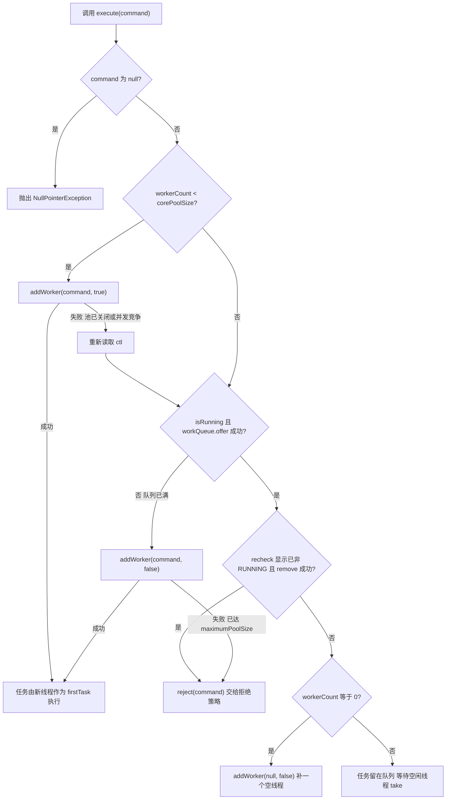
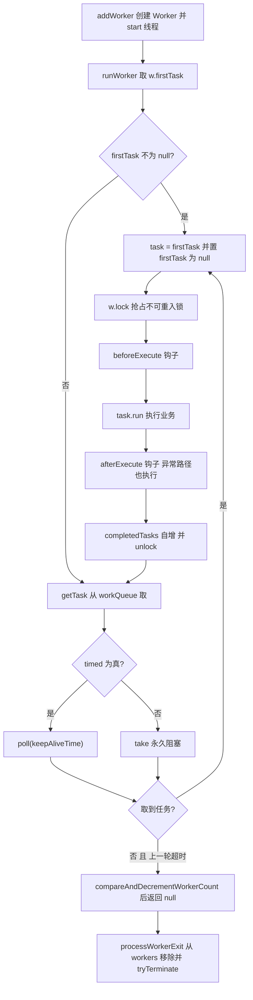
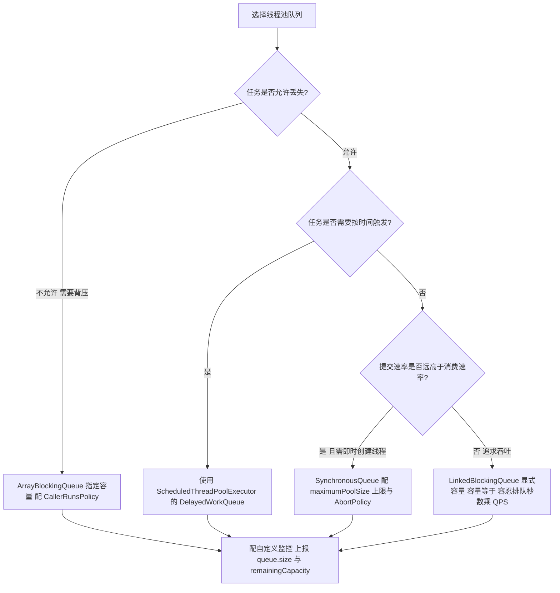
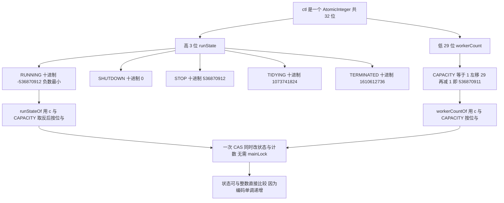
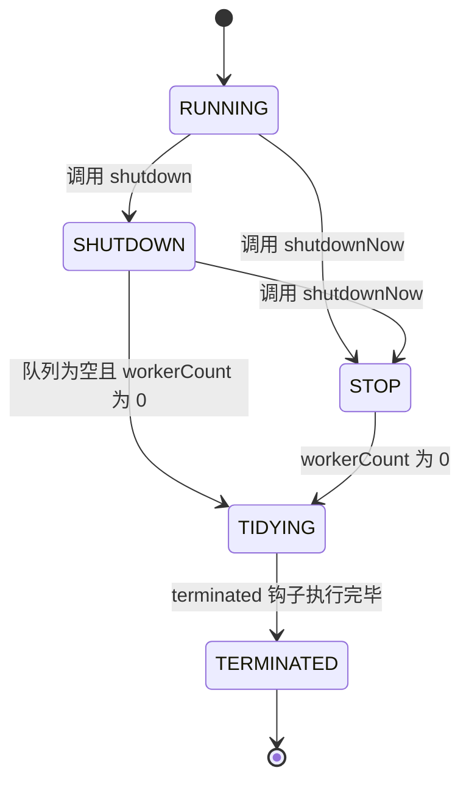
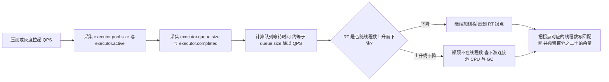
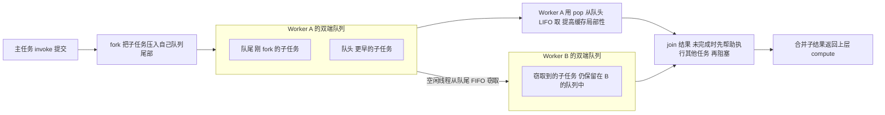
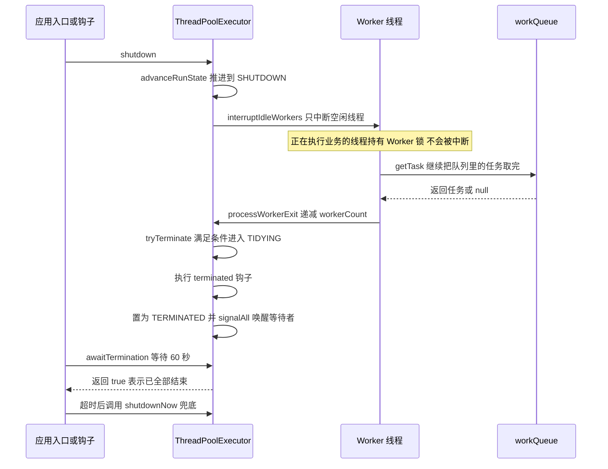
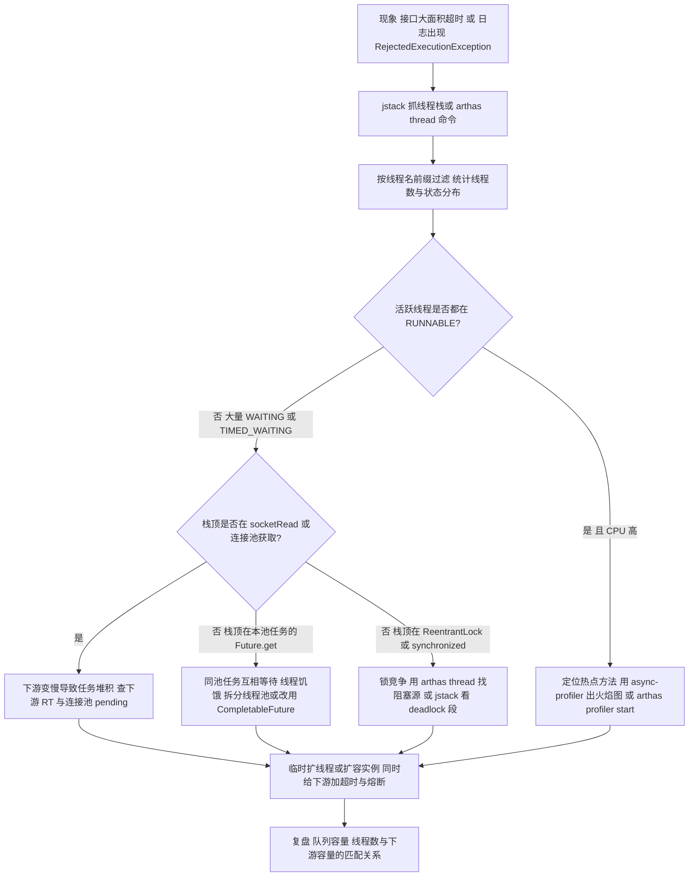

# 04 线程池与并发工具类

> 一句话定位：线程池是"业务代码"与"资源治理"的分界线，答不出 ctl 位布局与 getTask 的回收条件，就说明你只会用不会调 ｜ 面试权重 ★★★★★ ｜ 建议复习 60 分钟

## 本章大纲

- [一、线程池的定位与版本地图](#一线程池的定位与版本地图)
- [二、ThreadPoolExecutor 七大参数](#二threadpoolexecutor-七大参数)
- [三、execute 的完整执行流程](#三execute-的完整执行流程)
- [四、Worker 与 getTask：线程复用与回收](#四worker-与-gettask线程复用与回收)
- [五、四种拒绝策略与自定义](#五四种拒绝策略与自定义)
- [六、四种阻塞队列与选择](#六四种阻塞队列与选择)
- [七、线程池状态与 ctl 高低位设计](#七线程池状态与-ctl-高低位设计)
- [八、核心线程超时 allowCoreThreadTimeOut](#八核心线程超时-allowcorethreadtimeout)
- [九、Executors 工厂方法的坑](#九executors-工厂方法的坑)
- [十、线程池大小估算与动态调参](#十线程池大小估算与动态调参)
- [十一、ScheduledThreadPoolExecutor 与 DelayedWorkQueue](#十一scheduledthreadpoolexecutor-与-delayedworkqueue)
- [十二、ForkJoinPool 与工作窃取](#十二forkjoinpool-与工作窃取)
- [十三、优雅关闭、监控与生产排查](#十三优雅关闭监控与生产排查)
- [十四、CompletableFuture、上下文传递与线程池隔离](#十四completablefuture上下文传递与线程池隔离)
- [十五、JDK 21 虚拟线程对线程池的冲击](#十五jdk-21-虚拟线程对线程池的冲击)
- [高级岗三问](#高级岗三问)
- [高频面试题](#高频面试题)
- [易错点与踩坑](#易错点与踩坑)
- [一句话速记](#一句话速记)

## 一、线程池的定位与版本地图

### 1.1 为什么不能 `new Thread()`

每创建一个平台线程（platform thread）都要向操作系统申请一个内核线程，JDK 默认线程栈大小由 `-Xss` 决定（Linux x64 上 HotSpot 默认 1MB，`-XX:ThreadStackSize`）。三个成本：

1. **创建成本**：`pthread_create` 是内核调用，实测单次 10 微秒量级；请求量 5000 QPS、单请求一个新线程，就是每秒 5000 次内核调用。
2. **内存成本**：1000 个线程约 1GB 虚拟内存（栈），栈内存虽然按页提交，但线程数上万时 `ulimit -u`、`vm.max_map_count` 都会成为天花板。
3. **调度成本**：线程数远超 CPU 核数时，`pidstat -w 1` 的 `cswch/s` 飙升，CPU 大量时间耗在上下文切换与 cache 失效上，吞吐反而下降。

线程池解决的是"线程的复用与数量控制"，但注意它**不解决任务堆积**——任务堆积的后果由队列类型和拒绝策略决定，这才是真正区分候选人水平的地方。

### 1.2 版本地图

| 版本 | 事件 | 影响 |
| --- | --- | --- |
| JDK 1.5 | JSR 166 引入 `java.util.concurrent`，`ThreadPoolExecutor`、`Executors`、`Future`、`BlockingQueue` | 线程池成为标准设施 |
| JDK 6 | `ThreadPoolExecutor#allowCoreThreadTimeOut`、`setCorePoolSize`、`setMaximumPoolSize` | 核心线程可超时回收，参数可运行时调整 |
| JDK 7 | `ScheduledThreadPoolExecutor#setRemoveOnCancelPolicy`、`ForkJoinPool` 随 JSR 166y 进入（JDK 7 提供 `ForkJoinPool`） | 取消任务可即时出队；分治并行可用 |
| JDK 8 | `CompletableFuture`、`Executors#newWorkStealingPool`、`CountedCompleter`、`ForkJoinPool#commonPool` 大规模使用 | 异步编排成为主流；commonPool 成为共享资源 |
| JDK 9 | `ScheduledThreadPoolExecutor` 默认 keepAlive 由 0 改为 `DEFAULT_KEEPALIVE_MILLIS = 10L` 毫秒 | 定时池空闲线程 10ms 后可回收，行为与 JDK 8 不同 |
| JDK 9 | `CompletableFuture` 增加 `orTimeout`、`completeOnTimeout`、`delayedExecutor`、`copy`、`newIncompleteFuture`（JEP 266） | 超时编排不再需要 `ScheduledExecutorService` 手写 |
| JDK 9 | `Executors` 内部类 `FinalizableDelegatedExecutorService#finalize` 废弃 | 依赖 finalize 释放线程池的做法不可靠 |
| JDK 21 | JEP 444 虚拟线程正式发布，`Executors#newVirtualThreadPerTaskExecutor`、`Thread#ofVirtual` | BIO 模型回归，线程池的"复用"价值被削弱 |
| JDK 21 | 虚拟线程默认调度器是一个 `ForkJoinPool`，并行度 = `availableProcessors`，最大 `jdk.virtualThreadScheduler.maxPoolSize` 默认 256 | 大量阻塞任务会占满调度器的载体线程 |
| JDK 24 | JEP 491 移除 `synchronized` 导致的虚拟线程 pinning | JDK 21 下 `synchronized` 块内阻塞会钉住载体线程 |

### 1.3 线程池的两层抽象

| 层次 | 类 | 职责 |
| --- | --- | --- |
| 任务提交 | `Executor` / `ExecutorService` | 定义 `execute`、`submit`、`shutdown` 语义 |
| 任务执行与资源治理 | `ThreadPoolExecutor` | 线程数量、队列、拒绝、生命周期 |
| 定时调度 | `ScheduledExecutorService` / `ScheduledThreadPoolExecutor` | 延迟与周期语义 |
| 分治并行 | `ForkJoinPool` | 工作窃取、任务拆分与合并 |
| 异步编排 | `CompletableFuture` | 任务依赖、组合、异常与超时 |

## 二、ThreadPoolExecutor 七大参数

### 2.1 参数表（含默认值与越界行为）

`java.util.concurrent.ThreadPoolExecutor` 的 7 参构造器是核心：

```java
public ThreadPoolExecutor(int corePoolSize,
                          int maximumPoolSize,
                          long keepAliveTime,
                          TimeUnit unit,
                          BlockingQueue<Runnable> workQueue,
                          ThreadFactory threadFactory,
                          RejectedExecutionHandler handler)
```

| 参数 | 含义 | 约束与默认值 |
| --- | --- | --- |
| `corePoolSize` | 常驻线程数，即使空闲也保留（除非 `allowCoreThreadTimeOut`） | `< 0` 抛 `IllegalArgumentException` |
| `maximumPoolSize` | 线程数上限 | `<= 0` 或 `< corePoolSize` 抛 `IllegalArgumentException` |
| `keepAliveTime` | 超出 `corePoolSize` 的空闲线程存活时长 | `< 0` 抛 `IllegalArgumentException`；JDK 6 起配合 `allowCoreThreadTimeOut` 也作用于核心线程 |
| `unit` | `keepAliveTime` 的时间单位 | `TimeUnit.NANOSECONDS` 等；内部统一转成纳秒存 `keepAliveTime` |
| `workQueue` | 任务排队容器 | `null` 抛 `NullPointerException`；4 参构造器不传时无默认，必须显式传 |
| `threadFactory` | 线程创建工厂 | `null` 抛 `NullPointerException`；4/5 参构造器默认 `Executors.defaultThreadFactory()` |
| `handler` | 拒绝策略 | `null` 抛 `NullPointerException`；默认 `defaultHandler = new AbortPolicy()` |

关键点：**线程池本身有 5 个公开构造器**，4 参版本自动补 `Executors.defaultThreadFactory()` 与 `AbortPolicy`；5 参版本补 `AbortPolicy`。

### 2.2 线程工厂：命名比什么都重要

`Executors.defaultThreadFactory()` 的实现（JDK 8 与 JDK 17 一致）：

```java
private static class DefaultThreadFactory implements ThreadFactory {
    private static final AtomicInteger poolNumber = new AtomicInteger(1);
    private final ThreadGroup group;
    private final AtomicInteger threadNumber = new AtomicInteger(1);
    private final String namePrefix;

    DefaultThreadFactory() {
        ThreadGroup g = Thread.currentThread().getThreadGroup();
        group = g;
        namePrefix = "pool-" + poolNumber.getAndIncrement() + "-thread-";
    }

    public Thread newThread(Runnable r) {
        Thread t = new Thread(group, r, namePrefix + threadNumber.getAndIncrement(), 0);
        if (t.isDaemon()) t.setDaemon(false);
        if (t.getPriority() != Thread.NORM_PRIORITY) t.setPriority(Thread.NORM_PRIORITY);
        return t;
    }
}
```

三个必须知道的后果：

1. 线程名是 `pool-1-thread-1` 这种**无业务语义**的形式，线上 `jstack` 时无法区分是订单池还是风控池。
2. 线程默认**非守护线程（daemon = false）**，所以线程池没关闭会导致 JVM 无法退出，`main` 结束后进程仍挂住。
3. 线程优先级被强制设为 `Thread.NORM_PRIORITY = 5`。

生产做法：自定义 `ThreadFactory`，用 `AtomicInteger` 编号并加业务前缀；同时在工厂里统一设置 `UncaughtExceptionHandler`。

```java
public class NamedThreadFactory implements ThreadFactory {
    private final String prefix;
    private final AtomicInteger seq = new AtomicInteger(1);
    private final boolean daemon;

    public NamedThreadFactory(String prefix, boolean daemon) {
        this.prefix = prefix;
        this.daemon = daemon;
    }

    @Override
    public Thread newThread(Runnable r) {
        Thread t = new Thread(r, prefix + "-" + seq.getAndIncrement());
        t.setDaemon(daemon);
        t.setUncaughtExceptionHandler((thread, ex) ->
            log.error("线程池线程 {} 抛出未捕获异常", thread.getName(), ex));
        return t;
    }
}
```

注意 `UncaughtExceptionHandler` 只对 `execute` 提交的任务生效，`submit` 提交的任务异常被 `FutureTask` 捕获并塞进 `Future`，不会走到这里。

### 2.3 参数与业务语义的映射

| 业务语义 | 参数落点 | 说明 |
| --- | --- | --- |
| 常驻处理能力 | `corePoolSize` | 决定了稳态吞吐下限 |
| 峰值弹性 | `maximumPoolSize - corePoolSize` | 只在**队列满**之后才启用 |
| 弹性回收速度 | `keepAliveTime` | 与 `maximumPoolSize` 一起决定峰值后多久回落到稳态 |
| 排队容忍度 | `workQueue` 容量 | 容量的另一种名字叫"允许的积压秒数 × QPS" |
| 过载行为 | `handler` | 快速失败、调用方执行、丢弃、丢弃最旧，四选一或自定义 |
| 可观测性 | `threadFactory` | 线程名是排查的第一入口 |

## 三、execute 的完整执行流程

### 3.1 源码级流程

`ThreadPoolExecutor#execute`（JDK 8 与 JDK 17 逻辑一致，仅注释精简）：

```java
public void execute(Runnable command) {
    if (command == null)
        throw new NullPointerException();
    int c = ctl.get();
    if (workerCountOf(c) < corePoolSize) {
        if (addWorker(command, true))
            return;
        c = ctl.get();
    }
    if (isRunning(c) && workQueue.offer(command)) {
        int recheck = ctl.get();
        if (!isRunning(recheck) && remove(command))
            reject(command);
        else if (workerCountOf(recheck) == 0)
            addWorker(null, false);
    }
    else if (!addWorker(command, false))
        reject(command);
}
```

四段语义：

1. **核心线程阶段**：`workerCount < corePoolSize`，直接建新线程并把任务作为 `firstTask`，成功即返回。
2. **入队阶段**：检查 `isRunning` 后 `offer` 入队。`offer` 必须是非阻塞的，这是"先队列后扩线程"策略的前提。
3. **双重检查阶段**：入队成功后重新读 `ctl`。若池已关闭且成功 `remove` 掉刚入队的任务，则拒绝；若工作线程数为 0（线程都因超时退出了），补一个空任务的线程。
4. **扩线程阶段**：`offer` 失败（队列满），尝试 `addWorker(command, false)` 把线程数扩到 `maximumPoolSize`，失败则拒绝。



### 3.2 为什么是"核心 -> 队列 -> 最大 -> 拒绝"

这是面试最常被追问的设计问题。三个替代方案与代价：

| 策略 | 行为 | 代价 |
| --- | --- | --- |
| 先扩到 max 再入队 | 来一个任务就建线程直到 max | 线程数抖动剧烈，任务完成后大量线程被回收又重建，`keepAliveTime` 形同虚设 |
| 只用队列不扩线程 | core = max，永不扩容 | 失去峰值弹性，只能靠固定线程数硬扛 |
| 只用线程不排队（SynchronousQueue） | 队列容量 0，offer 必失败 | 每次峰值都要建线程，`newCachedThreadPool` 就是这个模型，线程数无上限 |

JDK 选择的方案本质是：**先用最便宜的稳态资源（核心线程），再用内存（队列），最后用最贵的峰值资源（线程），都不行就拒绝**。代价是它要求使用者必须给一个有界队列，否则第三步永远走不到，`maximumPoolSize` 和拒绝策略都是死代码。

### 3.3 两个经典陷阱

**陷阱一：无界队列下 `maximumPoolSize` 失效。**

```java
// core=2 max=100 queue=LinkedBlockingQueue 默认容量 Integer.MAX_VALUE
ThreadPoolExecutor p = new ThreadPoolExecutor(2, 100, 60, TimeUnit.SECONDS,
        new LinkedBlockingQueue<>());
```

永远只有 2 个线程在跑，任务在堆里无限堆积，最终 `OutOfMemoryError: Java heap space`。拒绝策略一次都不会触发。

**陷阱二：`corePoolSize = 0` 且队列无界时，池子退化为单线程。**

推导过程：第一个任务时 `workerCountOf(c) = 0 < corePoolSize = 0` 为 false，走 `offer` 成功，`recheck` 时 `workerCount == 0` 成立，于是 `addWorker(null, false)` 建 1 个线程；之后 `workerCount = 1 != 0`，`offer` 继续成功，不会再建线程。结果整个池子只有 1 个线程。这是 `Executors.newCachedThreadPool` 用 `SynchronousQueue`（`offer` 必失败）才能弹性的根本原因。

### 3.4 有界队列下的容量计算

队列容量不是一个拍脑袋的数字，它等于**你想容忍的排队时长乘以目标 QPS**：

```
queueCapacity = 可接受的最大排队延迟（秒） × 峰值 QPS
```

例：目标单机 2000 QPS，单任务平均耗时 20ms，`corePoolSize = maximumPoolSize = 40`（40 / 0.02 = 2000 QPS 的理论吞吐），希望排队最多 2 秒，则 `queueCapacity ≈ 2000 × 2 = 4000`。再结合单任务的内存占用估算队列堆积的堆开销：若单任务对象 1KB，4000 个任务约 4MB，可接受。

## 四、Worker 与 getTask：线程复用与回收

### 4.1 Worker 是什么

`ThreadPoolExecutor` 的内部类 `Worker` 同时承担两个角色：

```java
private final class Worker extends AbstractQueuedSynchronizer implements Runnable {
    private static final long serialVersionUID = 6138294804551838833L;
    final Thread thread;        // 由 ThreadFactory 创建，把自己 this 作为 Runnable
    Runnable firstTask;         // 首个任务，可能为 null
    volatile long completedTasks;

    Worker(Runnable firstTask) {
        setState(-1);           // 初始为 -1，抑制中断直到 runWorker 开始
        this.firstTask = firstTask;
        this.thread = getThreadFactory().newThread(this);
    }

    public void run() { runWorker(this); }
}
```

三个设计要点：

1. **继承 AQS 但只用 0/1 两个状态**，是**不可重入**的独占锁。`state = -1` 表示尚未启动，`0` 未加锁（空闲），`1` 已加锁（执行中）。
2. 锁的意义是给 `shutdown` 用的：`interruptIdleWorkers()` 只中断 `tryLock()` 成功的线程，也就是**空闲线程**；正在执行任务的线程持锁，不会被中断，从而保证 `shutdown()` 不会打断正在跑的任务。
3. 不可重入是刻意的：如果可重入，任务内部调用 `setCorePoolSize` 之类的方法重新获取同一把锁，`interruptIdleWorkers` 的判断就会失真。

### 4.2 runWorker：复用循环

`runWorker(Worker w)` 的核心是一个 `while` 循环，循环体就是"线程复用"本身：

```java
final void runWorker(Worker w) {
    Thread wt = Thread.currentThread();
    Runnable task = w.firstTask;
    w.firstTask = null;
    w.unlock();               // 允许中断
    boolean completedAbruptly = true;
    try {
        while (task != null || (task = getTask()) != null) {
            w.lock();
            // 池处于 STOP 或线程被中断时，确保线程被中断
            if ((runStateAtLeast(ctl.get(), STOP) ||
                 (Thread.interrupted() && runStateAtLeast(ctl.get(), STOP))) &&
                !wt.isInterrupted())
                wt.interrupt();
            try {
                beforeExecute(wt, task);
                Throwable thrown = null;
                try {
                    task.run();
                } catch (RuntimeException x) { thrown = x; throw x; }
                  catch (Error x)            { thrown = x; throw x; }
                  catch (Throwable x)        { thrown = x; throw new Error(x); }
                finally {
                    afterExecute(task, thrown);
                }
            } finally {
                task = null;
                w.completedTasks++;
                w.unlock();
            }
        }
        completedAbruptly = false;
    } finally {
        processWorkerExit(w, completedAbruptly);
    }
}
```

可扩展点：`beforeExecute`、`afterExecute`、`terminated`。用 `beforeExecute` 做 MDC 与上下文注入、用 `afterExecute` 做耗时统计与 MDC 清理，是生产中最常见的做法。

### 4.3 getTask：什么时候回收线程

这是全书最容易被问倒的方法，回收逻辑全部集中在条件判断里：

```java
private Runnable getTask() {
    boolean timedOut = false;
    for (;;) {
        int c = ctl.get();
        int rs = runStateOf(c);
        if (rs >= SHUTDOWN && (rs >= STOP || workQueue.isEmpty())) {
            decrementWorkerCount();
            return null;
        }
        int wc = workerCountOf(c);
        boolean timed = allowCoreThreadTimeOut || wc > corePoolSize;
        if ((wc > maximumPoolSize || (timed && timedOut))
            && (wc > 1 || workQueue.isEmpty())) {
            if (compareAndDecrementWorkerCount(c))
                return null;
            continue;
        }
        try {
            Runnable r = timed
                ? workQueue.poll(keepAliveTime, TimeUnit.NANOSECONDS)
                : workQueue.take();
            if (r != null) return r;
            timedOut = true;
        } catch (InterruptedException retry) {
            timedOut = false;
        }
    }
}
```

逐条解读：

| 判断 | 含义 | 后果 |
| --- | --- | --- |
| `rs >= SHUTDOWN && (rs >= STOP \|\| workQueue.isEmpty())` | SHUTDOWN 且队列空，或 STOP 及以上 | 递减计数并退出，线程终结 |
| `timed = allowCoreThreadTimeOut \|\| wc > corePoolSize` | 核心超时开关，或线程数超过核心数 | 决定用 `poll(timeout)` 还是 `take()` |
| `wc > maximumPoolSize` | 运行时把 `maximumPoolSize` 调小了 | 回收多余线程 |
| `timed && timedOut` | 上一轮 `poll` 超时 | 回收 |
| `wc > 1 \|\| workQueue.isEmpty()` | 至少留 1 个线程，或者队列已空 | 防止把最后一个线程杀掉导致任务无人处理 |

**关键结论**：`take()` 是永久阻塞的，所以 `corePoolSize` 个线程即使队列长期为空也不会消失——除非 `allowCoreThreadTimeOut(true)`。另外，`InterruptedException` 在循环里被吞掉并重置 `timedOut = false`，意味着 `shutdown()` 的中断不会让执行中的 `getTask` 立刻退出，而是重新判断状态。



## 五、四种拒绝策略与自定义

### 5.1 四种内置策略源码行为

| 策略 | 类 | 源码行为 | 后果 |
| --- | --- | --- | --- |
| 中止（默认） | `ThreadPoolExecutor.AbortPolicy` | `throw new RejectedExecutionException(...)` | 调用方感知过载，必须处理异常；`submit` 场景下异常也直接抛出 |
| 调用者执行 | `ThreadPoolExecutor.CallerRunsPolicy` | `if (!e.isShutdown()) r.run();` | 背压：调用方线程被占用，天然降低提交速率 |
| 静默丢弃 | `ThreadPoolExecutor.DiscardPolicy` | 空方法体，什么都不做 | 任务无声消失，最危险，只适合幂等的埋点/日志 |
| 丢弃最旧 | `ThreadPoolExecutor.DiscardOldestPolicy` | `if (!e.isShutdown()) { e.getQueue().poll(); e.execute(r); }` | 丢弃队首（最老的）任务再重试提交；对 `PriorityBlockingQueue` 会丢弃优先级最高的 |

`CallerRunsPolicy` 的隐藏风险：如果提交任务的线程是 Web 容器线程（Tomcat `http-nio-8080-exec-*`），那么"调用者执行"会占用容器线程执行业务逻辑，响应时间变长，但请求不会丢。这正是它作为天然限流器的价值，也是它可能在 Tomcat `maxThreads=200`（默认）打满后把压力转成连接排队的原因。

`DiscardOldestPolicy` 与 `PriorityBlockingQueue` 组合时，`getQueue().poll()` 取的是堆顶（优先级最高）任务，实际效果与名字相反，是明确写在 Javadoc 里的注意事项。

### 5.2 自定义拒绝策略

场景一：**先阻塞再提交（背压）**。适合离线批处理，不能丢任务。

```java
public class BlockingRejectPolicy implements RejectedExecutionHandler {
    private final long waitMillis;

    public BlockingRejectPolicy(long waitMillis) {
        this.waitMillis = waitMillis;
    }

    @Override
    public void rejectedExecution(Runnable r, ThreadPoolExecutor e) {
        if (e.isShutdown()) {
            throw new RejectedExecutionException("线程池已关闭，任务被拒绝");
        }
        try {
            if (!e.getQueue().offer(r, waitMillis, TimeUnit.MILLISECONDS)) {
                throw new RejectedExecutionException("等待 " + waitMillis + "ms 仍无法入队");
            }
        } catch (InterruptedException ie) {
            Thread.currentThread().interrupt();
            throw new RejectedExecutionException("提交被中断", ie);
        }
    }
}
```

注意 `RejectedExecutionHandler#rejectedExecution` 的签名没有 `throws InterruptedException`，必须自己捕获并恢复中断标志。

场景二：**降级到持久化或快速失败并打点**。

```java
public class DegradeRejectPolicy implements RejectedExecutionHandler {
    private final MeterRegistry registry;
    private final TaskFallback fallback;

    @Override
    public void rejectedExecution(Runnable r, ThreadPoolExecutor e) {
        registry.counter("threadpool.rejected", "pool", "order-async").increment();
        if (!fallback.persist(r)) {
            throw new RejectedExecutionException("降级落库失败");
        }
    }
}
```

### 5.3 拒绝策略选择表

| 场景 | 推荐策略 | 理由 |
| --- | --- | --- |
| 同步接口内的异步通知 | `AbortPolicy` + 业务 try-catch 降级为同步执行 | 显式失败可控 |
| 前端请求触发的批量计算 | `CallerRunsPolicy` | 天然背压，请求不丢 |
| 埋点/日志/监控上报 | `DiscardPolicy`（配监控计数） | 允许丢弃，不能拖慢主流程 |
| 实时性强的推荐任务 | `DiscardOldestPolicy` | 旧任务已过期，新任务更有价值 |
| 离线批处理、不允许丢 | 自定义阻塞或降级落盘 | 保证最终处理 |
| 有优先级的任务 | 自定义策略 + `PriorityBlockingQueue` | 内置策略对优先级队列语义不匹配 |

## 六、四种阻塞队列与选择

### 6.1 队列对比

| 队列 | 是否有界 | 默认容量 | 数据结构 | 锁 | 是否 FIFO | 线程池适用性 |
| --- | --- | --- | --- | --- | --- | --- |
| `ArrayBlockingQueue` | 有界，必须指定 | 无默认 | 环形数组 | 单锁 `ReentrantLock` + 两个 `Condition` | 是，可选 fair | 推荐，容量明确 |
| `LinkedBlockingQueue` | 可选（有参有界，无参无界） | `Integer.MAX_VALUE` | 单向链表 | 双锁（`putLock`/`takeLock` + `AtomicInteger count`） | 是 | 生产必须显式传容量 |
| `SynchronousQueue` | 虚拟（容量 0） | 0 | 无缓冲，直接交接 | `TransferQueue`/`TransferStack` | 公平模式下 FIFO | 只在 max 很大时用 |
| `PriorityBlockingQueue` | 无界 | 11（`DEFAULT_INITIAL_CAPACITY`） | 二叉堆数组 | 单锁 | 否，按 `Comparator` | 线程池里极少用，需自定义策略 |
| `DelayedWorkQueue` | 无界 | 16（`INITIAL_CAPACITY`） | 二叉堆数组 | 单锁 + leader-follower | 否，按延迟 | `ScheduledThreadPoolExecutor` 专用 |
| `LinkedTransferQueue` | 无界 | - | 链表 | 无锁 CAS + `StampedLock` | 是 | 适合生产者等待消费者的场景 |
| `LinkedBlockingDeque` | 可选 | `Integer.MAX_VALUE` | 双向链表 | 单锁 | 是 | 工作窃取型自定义池 |

### 6.2 队列选择决策



### 6.3 无界队列为什么危险

三个递进的问题：

1. `offer` 永远返回 true，`maximumPoolSize` 与拒绝策略永远不生效，池子退化为固定线程数。
2. 任务对象在堆中堆积，`LinkedBlockingQueue.Node` 每个节点还有对象头与引用开销（压缩指针下 16 字节对齐，一个空 `Node` 约 24 字节），任务量大时堆压力线性上升。
3. 内存耗尽前没有任何信号。**队列长度就是延迟**：`Little 定律` 说平均排队数 = 到达率 × 平均等待时间，队列 10000、QPS 2000 就意味着平均每个请求等 5 秒，此时接口早已超时，任务做完也没人接收。

### 6.4 `LinkedBlockingQueue` 双锁 vs `ArrayBlockingQueue` 单锁

`ArrayBlockingQueue` 用一把锁保护 `items`、`takeIndex`、`putIndex`、`count`，读写互斥。`LinkedBlockingQueue` 用 `putLock` 与 `takeLock` 两把锁，`count` 用 `AtomicInteger`，因此**在非满非空时可以同时生产和消费**，吞吐更高。

代价：出队时判断"是否从满变不满"需要跨锁判断，实现上有 `c = count.getAndDecrement(); if (c > 1) notFull.signal();` 这类细节。选择建议：

- 需要严格容量控制与可预测的内存占用：`ArrayBlockingQueue`。
- 追求吞吐、任务对象大小不一：`LinkedBlockingQueue`（务必显式容量）。
- `SynchronousQueue` 的公平模式（`new SynchronousQueue<>(true)`）在低并发下比非公平慢，但能避免线程饥饿，仅在交接顺序重要时开启。

## 七、线程池状态与 ctl 高低位设计

### 7.1 ctl 的位布局

`ThreadPoolExecutor` 用**一个** `AtomicInteger ctl` 同时保存运行状态与线程数：

```java
private final AtomicInteger ctl = new AtomicInteger(ctlOf(RUNNING, 0));
private static final int COUNT_BITS = Integer.SIZE - 3;              // 29
private static final int CAPACITY   = (1 << COUNT_BITS) - 1;         // 536870911

private static final int RUNNING    = -1 << COUNT_BITS;              // -536870912
private static final int SHUTDOWN   =  0 << COUNT_BITS;              // 0
private static final int STOP       =  1 << COUNT_BITS;              // 536870912
private static final int TIDYING    =  2 << COUNT_BITS;              // 1073741824
private static final int TERMINATED =  3 << COUNT_BITS;              // 1610612736

private static int runStateOf(int c)     { return c & ~CAPACITY; }
private static int workerCountOf(int c)  { return c & CAPACITY; }
private static int ctlOf(int rs, int wc) { return rs | wc; }
```

为什么会这样设计：

1. **原子性**：状态与线程数必须在一次 CAS 中一起变更，否则会出现"状态已是 STOP，但线程数还没减"的中间态。用一个 `int` 就避免了双变量锁。
2. **比较顺序**：`RUNNING = -1 << 29` 是**负数**，`SHUTDOWN = 0`，`STOP`、`TIDYING`、`TERMINATED` 依次增大。所以 `rs >= SHUTDOWN`、`runStateAtLeast(ctl.get(), STOP)` 这类整数比较就等价于状态序比较，源码里到处在用（`rs >= SHUTDOWN && (rs >= STOP || workQueue.isEmpty())`）。
3. **为什么是 3 位**：需要 5 个状态，2 位不够；用 3 位则剩 29 位。`CAPACITY = 536870911` 约 5.3 亿线程，远超任何实际需要，但保留了"负数表示 RUNNING"这个技巧。



### 7.2 五种状态的语义

| 状态 | 值 | 语义 | 新任务 | 队列中任务 |
| --- | --- | --- | --- | --- |
| `RUNNING` | `-536870912` | 接受新任务并处理队列任务 | 接受 | 处理 |
| `SHUTDOWN` | `0` | 不接受新任务，继续处理队列任务 | 拒绝 | 处理完 |
| `STOP` | `536870912` | 不接受新任务，不处理队列任务，中断执行中的任务 | 拒绝 | 丢弃（`drainQueue`） |
| `TIDYING` | `1073741824` | 所有任务已结束，`workerCount` 为 0，`terminated()` 即将执行 | 拒绝 | 无 |
| `TERMINATED` | `1610612736` | `terminated()` 执行完毕 | 拒绝 | 无 |



### 7.3 状态流转的实现

`shutdown()` 与 `shutdownNow()` 的关键差异（JDK 8 与 JDK 17 相同）：

```java
public void shutdown() {
    final ReentrantLock mainLock = this.mainLock;
    mainLock.lock();
    try {
        checkShutdownAccess();
        advanceRunState(SHUTDOWN);   // CAS 循环把状态推到 SHUTDOWN
        interruptIdleWorkers();      // 只中断空闲线程
        onShutdown();                // 钩子，ScheduledThreadPoolExecutor 用
    } finally {
        mainLock.unlock();
    }
    tryTerminate();
}

public List<Runnable> shutdownNow() {
    // ...
    advanceRunState(STOP);
    interruptWorkers();          // 中断所有线程（不看锁）
    tasks = drainQueue();        // 把队列里的任务全部取出返回
    // ...
    tryTerminate();
    return tasks;
}
```

`tryTerminate()` 在三种时机被调用：`shutdown`/`shutdownNow` 之后、`processWorkerExit` 之后、`remove` 之后。它的判断是：

```java
final void tryTerminate() {
    for (;;) {
        int c = ctl.get();
        if (isRunning(c) || runStateAtLeast(c, TIDYING) ||
            (runStateOf(c) == SHUTDOWN && !workQueue.isEmpty()))
            return;
        if (workerCountOf(c) != 0) {   // Eligible to terminate
            interruptIdleWorkers(ONLY_ONE);
            return;
        }
        final ReentrantLock mainLock = this.mainLock;
        mainLock.lock();
        try {
            if (ctl.compareAndSet(c, ctlOf(TIDYING, 0))) {
                try { terminated(); }
                finally { ctl.set(ctlOf(TERMINATED, 0)); termination.signalAll(); }
                return;
            }
        } finally { mainLock.unlock(); }
    }
}
```

注意 `workerCountOf(c) != 0` 时只中断**一个**空闲线程（`ONLY_ONE = true`），靠这被中断的线程退出后再次调用 `tryTerminate`，形成级联收敛，避免每次唤醒全部线程造成惊群。

### 7.4 `advanceRunState` 与"先改状态后中断"

```java
private void advanceRunState(int targetState) {
    for (;;) {
        int c = ctl.get();
        if (runStateAtLeast(c, targetState) ||
            ctl.compareAndSet(c, ctlOf(targetState, workerCountOf(c))))
            break;
    }
}
```

顺序很重要：**先把状态推进到 SHUTDOWN，再中断空闲线程**。否则正在 `execute` 的线程可能在"状态还是 RUNNING"时 `offer` 成功，而 `interruptIdleWorkers` 又没覆盖它，导致 shutdown 后仍有新任务入队。`execute` 里的 `recheck` 就是为这个窗口准备的补偿。

## 八、核心线程超时 allowCoreThreadTimeOut

### 8.1 语义与约束

```java
public void allowCoreThreadTimeOut(boolean value) {
    if (value && keepAliveTime <= 0)
        throw new IllegalArgumentException("Core threads must have nonzero keep alive times");
    if (value != allowCoreThreadTimeOut) {
        allowCoreThreadTimeOut = value;
        if (value)
            interruptIdleWorkers();
    }
}
```

三个要点：

1. 开启后 `getTask()` 中 `timed = allowCoreThreadTimeOut || wc > corePoolSize` 恒为 true，核心线程也走 `poll(keepAliveTime)`，超时即被回收。
2. `keepAliveTime <= 0` 时开启会抛 `IllegalArgumentException`（消息为 `Core threads must have nonzero keep alive times`）。
3. 开启时会调用 `interruptIdleWorkers()`，让空闲的核心线程立刻进入新一轮循环、用 `poll` 而不是 `take`。

配套方法：`allowsCoreThreadTimeOut()` 返回是否开启。

### 8.2 什么时候开启

| 场景 | 建议 | 说明 |
| --- | --- | --- |
| 流量有明显波峰波谷（白天高、夜间低） | 开启 | 夜间释放线程，降低内存与调度开销 |
| 追求极致低延迟（秒杀、撮合） | 关闭 | 保留常驻线程，避免突发时创建线程的延迟 |
| 池子很多（每个池 10 个线程，共 200 个池） | 开启 | 空闲线程总量可达数千，栈内存与 GC 扫描成本明显 |
| 需要 `prestartAllCoreThreads` 预热 | 不要同时开启 | 预热出来的线程很快又被回收，预热白做 |

### 8.3 线程数抖动的排查

开启 `allowCoreThreadTimeOut` 后，如果 `keepAliveTime` 设得过小（如 1 秒），在稀疏流量下会出现"创建-销毁-再创建"的循环，表现为：

- `jstack` 前后两次抓取，线程名 `pool-3-thread-7` 消失又出现（注意 `DefaultThreadFactory` 的序号是递增的，不会复用名称）。
- `pidstat -w 1` 的 `cswch/s` 有周期性小尖峰。
- 用 Micrometer 的 `executor.pool.size` 指标能看到锯齿形曲线。

调参原则：`keepAliveTime` 至少覆盖"两次请求的典型间隔"。比如定时任务每 30 秒一次，`keepAliveTime` 应大于 30 秒。

## 九、Executors 工厂方法的坑

### 9.1 五种工厂方法逐个体检

| 工厂方法 | 核心/最大 | 队列 | 主要风险 |
| --- | --- | --- | --- |
| `newFixedThreadPool(n)` | `n / n` | `LinkedBlockingQueue`（容量 `Integer.MAX_VALUE`） | 队列无界，任务堆积导致 `OutOfMemoryError: Java heap space`；`maximumPoolSize` 与拒绝策略为空设 |
| `newSingleThreadExecutor()` | `1 / 1` | `LinkedBlockingQueue`（无界） | 同上，且单线程串行，一个任务卡住全阻塞 |
| `newCachedThreadPool()` | `0 / Integer.MAX_VALUE` | `SynchronousQueue` | 线程数无上限，创建失败报 `OutOfMemoryError: unable to create new native thread`；`keepAliveTime = 60s` |
| `newScheduledThreadPool(n)` | `n / Integer.MAX_VALUE` | `DelayedWorkQueue`（无界，初始 16） | 任务堆积在延迟队列，同样 OOM；JDK 8 默认 keepAlive 为 0 |
| `newWorkStealingPool()` | `ForkJoinPool`，并行度 = `availableProcessors()` | 每线程双端队列 | 用的是 commonPool 之外的独立池，但仍是 CPU 并行度，跑 IO 任务无意义（JDK 8 起） |
| `newVirtualThreadPerTaskExecutor()` | 每任务一个虚拟线程 | 无 | JDK 21 起；不能 `setCorePoolSize`，不受线程池参数控制 |

源码印证（JDK 8 与 JDK 17 相同）：

```java
public static ExecutorService newFixedThreadPool(int nThreads) {
    return new ThreadPoolExecutor(nThreads, nThreads,
                                  0L, TimeUnit.MILLISECONDS,
                                  new LinkedBlockingQueue<Runnable>());
}

public static ExecutorService newCachedThreadPool() {
    return new ThreadPoolExecutor(0, Integer.MAX_VALUE,
                                  60L, TimeUnit.SECONDS,
                                  new SynchronousQueue<Runnable>());
}

public static ExecutorService newWorkStealingPool() {
    return new ForkJoinPool
        (Runtime.getRuntime().availableProcessors(),
         ForkJoinPool.defaultForkJoinWorkerThreadFactory,
         null, true);
}
```

### 9.2 《阿里巴巴 Java 开发手册》的强制条款

原文（嵩山版，并发处理章节）大意：

> 【强制】线程池不允许使用 `Executors` 去创建，而是通过 `ThreadPoolExecutor` 的方式，这样的处理方式让写的同学更加明确线程池的运行规则，规避资源耗尽的风险。

补充说明里明确点名：`newFixedThreadPool` 和 `newSingleThreadExecutor` 的队列长度是 `Integer.MAX_VALUE`，可能堆积大量请求导致 OOM；`newCachedThreadPool` 和 `newScheduledThreadPool` 的 `maximumPoolSize` 是 `Integer.MAX_VALUE`，可能创建大量线程导致 OOM。

### 9.3 生产级线程池模板

```java
@Bean("orderAsyncExecutor")
public ThreadPoolExecutor orderAsyncExecutor() {
    int core = 16;
    int max = 32;
    int queueCapacity = 2000;
    ThreadPoolExecutor executor = new ThreadPoolExecutor(
            core, max,
            60L, TimeUnit.SECONDS,
            new ArrayBlockingQueue<>(queueCapacity),
            new NamedThreadFactory("order-async", false),
            new ThreadPoolExecutor.CallerRunsPolicy());
    executor.allowCoreThreadTimeOut(true);
    executor.prestartAllCoreThreads();     // 若开启核心超时则不要预热
    return executor;
}
```

注意最后两行是互斥的：要么预热并常驻，要么允许超时并放弃预热。

### 9.4 Spring 的 `ThreadPoolTaskExecutor` 默认值

Spring 5.3.x `/ 6.x` 的 `org.springframework.scheduling.concurrent.ThreadPoolTaskExecutor` 字段默认值：

| 字段 | 默认值 |
| --- | --- |
| `corePoolSize` | 1 |
| `maxPoolSize` | `Integer.MAX_VALUE` |
| `keepAliveSeconds` | 60 |
| `queueCapacity` | `Integer.MAX_VALUE` |
| `allowCoreThreadTimeOut` | false |
| `threadNamePrefix` | 空（回落到 `Executors.defaultThreadFactory` 的 `pool-N-thread-M`） |

队列规则在 `createQueue(int queueCapacity)`：`queueCapacity > 0` 用 `new LinkedBlockingQueue<>(queueCapacity)`，`queueCapacity == 0` 用 `new SynchronousQueue<>()`。

**所以 Spring 的线程池默认值比自己手写 `Executors` 更危险**：默认 `core=1, max=Integer.MAX_VALUE, queue=Integer.MAX_VALUE`，结果是只有 1 个线程在跑、队列无限堆积。Spring Boot 里必须显式配置：

```yaml
spring:
  task:
    execution:
      pool:
        core-size: 16
        max-size: 32
        queue-capacity: 2000
        keep-alive: 60s
        allow-core-thread-timeout: true
```

补充：Spring Boot 3.2 起可用 `spring.threads.virtual.enabled=true` 把 `applicationTaskExecutor` 换成虚拟线程执行器；Spring 6.1 的 `SimpleAsyncTaskExecutor#setVirtualThreads(true)` 也支持。注意 `SimpleAsyncTaskExecutor` 默认 `concurrencyLimit = -1`（不限制），每个任务一个新线程，Spring 5.3 起在无限流情况下会打印警告。

## 十、线程池大小估算与动态调参

### 10.1 两类任务的估算

| 任务类型 | 经验公式 | 8 核机器取值 |
| --- | --- | --- |
| CPU 密集 | `N + 1` | 9 |
| IO 密集 | `2N` 起步 | 16 起步 |
| 通用（Goetz 公式） | `N_threads = N_cpu × U_cpu × (1 + W / C)` | 见下 |

Goetz 公式来自《Java Concurrency in Practice》第 8.2 节：

- `N_cpu`：CPU 核数（用 `Runtime.getRuntime().availableProcessors()`，注意容器里要配合 `-XX:ActiveProcessorCount` 或 JDK 8u191+ 的 `UseContainerSupport`）。
- `U_cpu`：目标 CPU 利用率，0 到 1。
- `W / C`：等待时间与计算时间的比值。

例：8 核、目标利用率 0.8、单请求计算 10ms、等待下游 40ms，则 `W/C = 4`，`N_threads = 8 × 0.8 × 5 = 32`。

必须补充的三点：

1. 公式只给起点，**最终值必须压测得出**。压测时固定 QPS，逐步加大线程数，观察 RT 曲线拐点。
2. 分母不是"机器核数"而是"这个池真正能吃到的并行度"。如果同一台机器上跑多个服务或容器被 CPU limit 限制，要按配额算。
3. 有下游依赖时还要受下游限制：线程池 32 个线程打同一个 DB，`HikariCP` 默认 `maximumPoolSize = 10`，多出来的 22 个线程全在等连接，反而增加 RT。**上游线程池大小不应超过下游连接池大小乘以一个合理倍数**。

### 10.2 动态调参的三个方法

| 方法 | JDK 版本 | 关键行为 |
| --- | --- | --- |
| `setCorePoolSize(int)` | JDK 6 起 | 若新值小于当前线程数，`interruptIdleWorkers()` 回收空闲线程；若变大，`Math.min(delta, workQueue.size())` 个新线程被预创建，队列空了就停 |
| `setMaximumPoolSize(int)` | JDK 6 起 | 小于 `corePoolSize` 时抛 `IllegalArgumentException`；调小后 `getTask` 中 `wc > maximumPoolSize` 触发回收 |
| `setKeepAliveTime(long, TimeUnit)` | JDK 6 起 | 若 `time == 0 && allowsCoreThreadTimeOut()` 抛 `IllegalArgumentException`；调小会立刻 `interruptIdleWorkers()` |

`setCorePoolSize` 源码（JDK 8 与 JDK 17 相同）值得背下来：

```java
public void setCorePoolSize(int corePoolSize) {
    if (corePoolSize < 0) throw new IllegalArgumentException();
    int delta = corePoolSize - this.corePoolSize;
    this.corePoolSize = corePoolSize;
    if (workerCountOf(ctl.get()) > corePoolSize)
        interruptIdleWorkers();
    else if (delta > 0) {
        int k = Math.min(delta, workQueue.size());
        while (k-- > 0 && addWorker(null, true)) {
            if (workQueue.isEmpty()) break;
        }
    }
}
```

注意 `addWorker(null, true)` 传入的是空任务，新线程直接从队列取任务，所以**加核心线程数不会插队**。

### 10.3 动态调参的正确姿势

核心矛盾：`ThreadPoolExecutor` 没有提供"参数变更后重建"的能力，`setCorePoolSize` 只是改了字段。要做到"配置中心一改，线程池立刻生效且可观测"，需要：

```java
@Data
@ConfigurationProperties(prefix = "order.executor")
public class ExecutorProps {
    private int coreSize = 16;
    private int maxSize = 32;
    private int queueCapacity = 2000;
    private long keepAliveSeconds = 60;
}

@Component
public class DynamicExecutorManager {
    private final ThreadPoolExecutor executor;
    private volatile int queueCapacity;

    @EventListener
    public void onPropsChanged(ExecutorPropsChanged event) {
        ExecutorProps p = event.getProps();
        // 顺序很重要：先调 max，再调 core，避免中间态违反约束
        if (p.getMaxSize() != executor.getMaximumPoolSize()) {
            executor.setMaximumPoolSize(p.getMaxSize());
        }
        if (p.getCoreSize() != executor.getCorePoolSize()) {
            executor.setCorePoolSize(p.getCoreSize());
        }
        executor.setKeepAliveTime(p.getKeepAliveSeconds(), TimeUnit.SECONDS);
    }
}
```

三个必须知道的限制：

1. **队列容量不能动态改**。`ArrayBlockingQueue` 的 `capacity` 是 `final`，`LinkedBlockingQueue` 的 `capacity` 也是 `final`。想改容量只能新建队列并把任务搬过去，过程中无法原子切换。工程上的做法是预留一个较大的队列容量，用**拒绝策略**和**并发度**来控流，而不是靠改容量。
2. **调整顺序**：调大时先 `max` 后 `core`；调小时先 `core` 后 `max`。否则 `setMaximumPoolSize` 可能因为小于当前 `corePoolSize` 而抛异常。
3. **`setCorePoolSize` 只会预创建线程到 `workQueue.size()` 为止**，队列为空时不会创建任何新线程。所以调大 `corePoolSize` 后想立刻生效，应同时调用 `prestartAllCoreThreads()`。

### 10.4 调参的观测闭环



## 十一、ScheduledThreadPoolExecutor 与 DelayedWorkQueue

### 11.1 与 `Timer` 的对比

| 维度 | `java.util.Timer` | `ScheduledThreadPoolExecutor` |
| --- | --- | --- |
| 线程数 | 单线程 | 可配置 `corePoolSize` |
| 任务抛异常 | 整个 Timer 线程终止，所有定时任务消失 | 该任务后续执行被抑制，其他任务不受影响 |
| 时间基准 | `TimerThread` 用绝对时间 `executionTime` | 用相对时间 `System.nanoTime` |
| 系统时间回拨 | 基于 `System.currentTimeMillis()`，回拨后行为异常 | 基于 `System.nanoTime()`，单调递增，不受影响 |
| 精度 | 受单线程执行拖累 | 多线程，吞吐与精度更好 |
| 取消任务是否出队 | 需要手动 `cancel()`，队列仍保留 | `setRemoveOnCancelPolicy(true)` 后取消即出队（JDK 7 起，默认 false） |

结论：**生产环境不要用 `Timer`**。

### 11.2 构造与默认值

```java
public ScheduledThreadPoolExecutor(int corePoolSize) {
    super(corePoolSize, Integer.MAX_VALUE,
          DEFAULT_KEEPALIVE_MILLIS, MILLISECONDS,
          new DelayedWorkQueue());
}
```

| 项 | JDK 8 | JDK 9+（含 11/17/21） |
| --- | --- | --- |
| `maximumPoolSize` | `Integer.MAX_VALUE` | `Integer.MAX_VALUE` |
| `keepAliveTime` | `0, NANOSECONDS` | `DEFAULT_KEEPALIVE_MILLIS = 10L` 毫秒 |
| 默认队列 | `DelayedWorkQueue` | `DelayedWorkQueue` |

`maximumPoolSize = Integer.MAX_VALUE` 在这里是安全的，因为 `DelayedWorkQueue` **无界**，`offer` 永远成功，`execute` 永远不会走到扩线程分支。也就是说 `ScheduledThreadPoolExecutor` 实际线程数恒为 `corePoolSize`。

### 11.3 `DelayedWorkQueue` 的实现

```java
static class DelayedWorkQueue extends AbstractQueue<Runnable>
        implements BlockingQueue<Runnable> {
    private static final int INITIAL_CAPACITY = 16;
    private RunnableScheduledFuture<?>[] queue = new RunnableScheduledFuture<?>[INITIAL_CAPACITY];
    private final ReentrantLock lock = new ReentrantLock();
    private int size;
    private Thread leader;                      // leader-follower 模式
    private final Condition available = lock.newCondition();

    private void grow() {
        int oldCapacity = queue.length;
        int newCapacity = oldCapacity + (oldCapacity >> 1);   // 扩容 50%
        if (newCapacity < 0) newCapacity = Integer.MAX_VALUE;
        queue = Arrays.copyOf(queue, newCapacity);
    }
}
```

| 特性 | 值 / 行为 |
| --- | --- |
| 初始容量 | `INITIAL_CAPACITY = 16` |
| 扩容策略 | `oldCapacity + (oldCapacity >> 1)`，即 1.5 倍 |
| 底层结构 | 二叉最小堆（按 `getDelay` 排序） |
| `Delayed` 的 `compareTo` | 先比 `time`（触发时刻），再比 `sequenceNumber`（入队序号），保证同时间任务 FIFO |
| 取任务 | `finishPoll` 把堆顶与末尾交换后下沉，并设置 `heapIndex = -1` |
| 等待优化 | leader-follower：只有一个线程 `awaitNanos(delay)`，其余线程 `await()` 无超时；被唤醒后重新成为 leader |

为什么要用 leader-follower：如果每个线程都用 `awaitNanos(delay)` 等到堆顶到期，N 个线程会被同时唤醒去抢同一把锁，形成惊群；leader 模式只让一个线程做定时等待，其他线程无限期挂起，由 leader 在退出时 `signal`。

`take()` 源码：

```java
public RunnableScheduledFuture<?> take() throws InterruptedException {
    final ReentrantLock lock = this.lock;
    lock.lockInterruptibly();
    try {
        for (;;) {
            RunnableScheduledFuture<?> first = queue[0];
            if (first == null)
                available.await();
            else {
                long delay = first.getDelay(NANOSECONDS);
                if (delay <= 0L)
                    return finishPoll(first);
                first = null;
                if (leader != null)
                    available.await();
                else {
                    Thread thisThread = Thread.currentThread();
                    leader = thisThread;
                    try { available.awaitNanos(delay); }
                    finally { if (leader == thisThread) leader = null; }
                }
            }
        }
    } finally {
        if (leader == null && queue[0] != null) available.signal();
        lock.unlock();
    }
}
```

注意代码里 `first = null;` 之后先 `await`，这是**为了不在等待期间强引用堆顶任务**，避免取消掉的任务无法被 GC。

### 11.4 三种调度语义

| 方法 | 语义 | 时间基准 | 任务耗时超过 period 时 |
| --- | --- | --- | --- |
| `schedule(command, delay, unit)` | 延迟执行一次 | 相对 `System.nanoTime()` | 不适用 |
| `scheduleAtFixedRate(cmd, initialDelay, period, unit)` | 固定频率 | 上一次**开始**执行的时刻 + period | 不并发，顺延执行，会补偿追赶（catch-up） |
| `scheduleWithFixedDelay(cmd, initialDelay, delay, unit)` | 固定间隔 | 上一次**结束**执行的时刻 + delay | 天然串行，不会堆积 |

周期任务的执行逻辑在 `ScheduledFutureTask#run`：

```java
public void run() {
    boolean periodic = isPeriodic();
    if (!canRunInCurrentRunState(periodic))
        cancel(false);
    else if (!periodic)
        ScheduledFutureTask.super.run();
    else if (ScheduledFutureTask.super.runAndReset()) {   // FutureTask#runAndReset
        setNextRunTime();
        reExecutePeriodic(outerTask);
    }
}
```

**关键结论**：周期任务抛异常时，`runAndReset()` 内部会捕获并 `setException(ex)`，返回 false，于是**不会** `reExecutePeriodic`，该任务后续所有执行被静默抑制，且没有任何日志。生产做法是在任务体最外层包 `try-catch`：

```java
scheduler.scheduleAtFixedRate(() -> {
    try {
        doSync();
    } catch (Throwable t) {
        log.error("定时同步任务异常，本轮结束，下轮继续", t);
    }
}, 0, 30, TimeUnit.SECONDS);
```

### 11.5 shutdown 后的策略

| 策略方法 | 默认值 | 语义 |
| --- | --- | --- |
| `setExecuteExistingDelayedTasksAfterShutdownPolicy(boolean)` | `true` | shutdown 后，已提交的一次性延迟任务继续执行 |
| `setContinueExistingPeriodicTasksAfterShutdownPolicy(boolean)` | `false` | shutdown 后，周期任务**不再执行**（并被取消） |
| `setRemoveOnCancelPolicy(boolean)` | `false` | `cancel()` 时立即从 `DelayedWorkQueue` 移除（JDK 7 起） |

`onShutdown()` 钩子（在 `shutdown()` 里被 `ThreadPoolExecutor` 调用）会调用 `cancelUnwantedTasks()` 把不符合策略的任务取消。

**线上坑**：长周期任务（如每小时一次）被 `cancel(false)` 后，由于默认 `removeOnCancel == false`，任务对象仍留在 `DelayedWorkQueue` 的堆里，`delayedExecute` 每次都会入队，长期不消费就会堆内存增长。JDK 7 起应设置 `setRemoveOnCancelPolicy(true)`，尤其是用 `ScheduledFuture#cancel` 做"取消超时任务"的场景。

### 11.6 时间轮 vs 堆

`DelayedWorkQueue` 是 **O(log n)** 入队、**O(1)** 取堆顶、**O(log n)** 出队。任务量大且时间跨度大时（如每秒百万级定时任务），Java 原生实现不如**时间轮**（time wheel）高效：时间轮用哈希到槽位 + 槽内链表，入队 O(1)。Netty 的 `HashedWheelTimer` 是典型实现（`tickDuration` 默认 100ms，`wheelSize` 默认 512），Kafka 的 `SystemTimer` 用分层时间轮。面试被问到"百万定时任务怎么做"时，标准答案是：**分层时间轮 + 持久化 + 分片**，而不是继续用 `ScheduledThreadPoolExecutor`。

## 十二、ForkJoinPool 与工作窃取

### 12.1 与 `ThreadPoolExecutor` 的差异

| 维度 | `ThreadPoolExecutor` | `ForkJoinPool` |
| --- | --- | --- |
| 队列 | 一个共享阻塞队列 | 每个工作线程一个双端队列 `WorkQueue` |
| 取任务方式 | 所有线程竞争同一个队列 | 本地 LIFO，窃取时 FIFO |
| 任务模型 | `Runnable` / `Callable` | `ForkJoinTask`（`RecursiveTask`、`RecursiveAction`、`CountedCompleter`） |
| 子任务依赖 | 不支持，等待会占住线程 | 支持 `join`：等待时会先执行其他任务 |
| 适用任务 | 独立、可阻塞 | 可分治、计算密集、子任务可合并 |
| 阻塞处理 | 直接阻塞线程 | 用 `ManagedBlocker` 补偿并行度（`ForkJoinPool#managedBlock`） |
| 线程数 | 可动态扩缩 | 并行度基本固定（JDK 8 可补偿，JDK 9+ 语义更严格） |
| 线程命名 | `pool-N-thread-M` | `ForkJoinPool-N-worker-M`；commonPool 为 `ForkJoinPool.commonPool-worker-M` |
| 公共实例 | 无 | `ForkJoinPool.commonPool()`，JVM 全局唯一 |

### 12.2 工作窃取流程



LIFO 与 FIFO 的分工是整个设计的精髓：

- **本地取任务用 LIFO（队头 pop）**：刚 `fork` 出来的子任务是"热"的，其数据在 CPU cache 里，先执行它有利于局部性，也更快逼近拆分终止条件。
- **窃取时用 FIFO（队尾 poll）**：从队尾窃取的是最早产生、粒度最大的任务，窃取者拿走它意味着**窃取次数少、每次拿到的活多**，减少了竞争。同时队尾是本地线程最不可能访问的位置，冲突概率最低。

### 12.3 一个标准的 `RecursiveTask`

```java
public class SumTask extends RecursiveTask<Long> {
    private static final int THRESHOLD = 10000;   // 拆分阈值
    private final long[] array;
    private final int lo, hi;

    public SumTask(long[] array, int lo, int hi) {
        this.array = array; this.lo = lo; this.hi = hi;
    }

    @Override
    protected Long compute() {
        if (hi - lo <= THRESHOLD) {
            long sum = 0L;
            for (int i = lo; i < hi; i++) sum += array[i];
            return sum;
        }
        int mid = (lo + hi) >>> 1;
        SumTask left = new SumTask(array, lo, mid);
        SumTask right = new SumTask(array, mid, hi);
        left.fork();                       // 异步提交到当前线程队列
        long rightResult = right.compute(); // 同步计算另一半
        long leftResult = left.join();     // 等待并合并
        return leftResult + rightResult;
    }
}
```

调用：

```java
ForkJoinPool pool = new ForkJoinPool(8);
long result = pool.invoke(new SumTask(array, 0, array.length));
```

要点：

1. `fork()` 把任务推入当前线程的队列，**不会立即执行**；`compute()` 是直接在当前线程执行。
2. 一个 `fork` 配一个 `compute` 再加一个 `join`，是避免任务过多入队（`fork` 两次会让左右都排队，队列压力翻倍）的常见优化。
3. **阈值不能太小**：阈值 1 时任务对象数量与数组元素数量同阶，创建任务的开销远大于求和本身。经验值 1000 到 10000，需要压测确定。
4. `join()` 与 `get()` 的区别：`join()` 抛 `RuntimeException`/`Error` 的原始异常（经包装为 `RuntimeException`），不抛 `InterruptedException`；`get()` 声明 `throws InterruptedException, ExecutionException`。

### 12.4 commonPool 与并行度

```java
private static ForkJoinPool makeCommonPool() {
    // ...
    if (parallelism < 0 &&
        (parallelism = Runtime.getRuntime().availableProcessors() - 1) <= 0)
        parallelism = 1;
    if (parallelism > MAX_CAP) parallelism = MAX_CAP;
    return new ForkJoinPool(parallelism, factory, handler, LIFO_QUEUE,
                            "ForkJoinPool.commonPool-worker-");
}
```

| 项 | 值 |
| --- | --- |
| 默认并行度 | `availableProcessors() - 1`，最小 1（JDK 8 与 JDK 17 行为一致） |
| 上限 | `MAX_CAP = 0x7fff = 32767` |
| 覆盖方式 | `-Djava.util.concurrent.ForkJoinPool.common.parallelism=N` |
| 线程工厂 | `-Djava.util.concurrent.ForkJoinPool.common.threadFactory=<类名>` |
| 异常处理器 | `-Djava.util.concurrent.ForkJoinPool.common.exceptionHandler=<类名>` |
| 线程性质 | 守护线程（`CommonPoolForkJoinWorkerThreadFactory` 里 `setDaemon(true)`） |
| 最大空闲线程 | JDK 8 为 `DEFAULT_COMMON_MAX_SPARES = 256` |
| `shutdown` 影响 | `commonPool` 的 `shutdown()` 不生效，JVM 退出时自动终止 |

**commonPool 的风险**：它是 JVM 全局共享的，并行度只有 `CPU - 1`。把阻塞任务（HTTP 调用、DB 查询）提交到 commonPool，会让所有并行的 `parallelStream()`、`CompletableFuture` 默认异步都一起变慢——这是典型的"线程池互相污染"。JDK 8 之前没有隔离机制，JDK 9 起可以通过 `CompletableFuture` 显式传自定义 Executor 解决。

阻塞补偿的写法：

```java
ForkJoinPool.managedBlock(new ForkJoinPool.ManagedBlocker() {
    @Override public boolean block() throws InterruptedException {
        latch.await();
        return true;
    }
    @Override public boolean isReleasable() { return latch.getCount() == 0; }
});
```

`managedBlock` 会在阻塞前通知池子"我要阻塞了"，池子可临时补充线程以维持并行度（JDK 8 的补偿是无限的，JDK 9+ 之后语义改为记录 compensation 并允许 `maximumPoolSize` 约束）。

### 12.5 异常处理

| 写法 | 异常传播 |
| --- | --- |
| `task.invoke()` / `pool.invoke(task)` | 直接抛出原始异常 |
| `task.join()` | 抛出 `RuntimeException` 包装的原始异常，`Error` 原样抛出 |
| `task.get()` | 抛出 `ExecutionException` 包装的原始异常 |
| `pool.submit(task)` 后不调 `get` | **异常被吞掉**，任务静默失败 |
| `CountedCompleter` | 需自己覆写 `compute` 并用 `completeExceptionally` |

`RecursiveAction`/`RecursiveTask` 的 `compute` 里如果抛异常，`ForkJoinTask` 会把它记录在 `status` 中，`join` 时再抛。但**如果没有任何线程 `join`，异常就丢失**。生产实践：在 `ForkJoinPool` 构造时传 `UncaughtExceptionHandler`，或者在 `compute` 顶层 `try-catch` 打日志。

### 12.6 什么场景用 ForkJoinPool

| 适用 | 不适用 |
| --- | --- |
| 大数组/大集合的并行归并、排序、聚合 | IO 阻塞任务 |
| 可递归拆分的树形结构遍历（如目录扫描、JSON 深拷贝） | 有共享可变状态的计数 |
| CPU 密集且子任务耗时相近 | 子任务耗时差异极大（长尾子任务决定总时长） |
| 数据量足够大（单任务耗时 > 100 微秒） | 小任务（拆分开销大于计算） |

**判断标准**：把任务拆成两半后，孩子的执行时间是否显著大于 `fork` 与 `join` 的开销（数百纳秒量级）。如果拆到 10 个元素还在拆，就是过度拆分。

## 十三、优雅关闭、监控与生产排查

### 13.1 优雅关闭的标准流程



标准代码：

```java
@PreDestroy
public void destroy() {
    executor.shutdown();                       // 不再接收新任务，跑完队列
    try {
        if (!executor.awaitTermination(60, TimeUnit.SECONDS)) {
            List<Runnable> dropped = executor.shutdownNow();   // 中断 + 丢弃
            log.warn("线程池 60 秒未结束，强制关闭，丢弃任务数 {}", dropped.size());
            if (!executor.awaitTermination(10, TimeUnit.SECONDS)) {
                log.error("线程池仍未终止，存在无法中断的任务");
            }
        }
    } catch (InterruptedException e) {
        executor.shutdownNow();
        Thread.currentThread().interrupt();
    }
}
```

三个必须注意的点：

1. **`shutdown()` 不打断正在执行的任务**，只中断空闲线程。所以任务本身如果是死循环或无限阻塞（如没有超时的 `socketRead`），`shutdown` 会一直等下去，必须有 `shutdownNow` 兜底和超时。
2. **`shutdownNow` 也不保证中断成功**。它调用 `Thread#interrupt()`，如果任务在 `while(true) { sleep 忽略中断 }` 或 `synchronized` 等待中，中断无效。而且 `shutdownNow` 返回的是**未执行的任务列表**，正在执行的那个任务已经不在列表里了，无法感知。
3. **注册 JVM 关闭钩子**：Spring 的 `@PreDestroy`、`DisposableBean#destroy`，或者 `Runtime.getRuntime().addShutdownHook(thread)`。`Executors` 返回的 `FinalizableDelegatedExecutorService` 依赖 `finalize()`，JDK 9 起 `finalize` 废弃，不能依赖它。

### 13.2 监控指标

`ThreadPoolExecutor` 提供的公开方法：

| 方法 | 含义 | 精度说明 |
| --- | --- | --- |
| `getPoolSize()` | 当前线程数 | 精确（持 `mainLock`） |
| `getCorePoolSize()` | 核心线程数 | 精确 |
| `getMaximumPoolSize()` | 最大线程数 | 精确 |
| `getActiveCount()` | 正在执行任务的线程数（近似） | 逐个检查 `Worker.isLocked()`，**估算值**，JDK 8 Javadoc 明确说明是 approximate |
| `getLargestPoolSize()` | 历史最大线程数 | 精确 |
| `getTaskCount()` | 累计已提交任务数（近似） | 从队列取 size 与各 Worker 的 `completedTasks` 求和，**估算值** |
| `getCompletedTaskCount()` | 累计已完成任务数 | 累加 `completedTasks`，执行中的任务不计入，**可能滞后** |
| `getQueue().size()` | 队列中等待任务数 | 取决于队列实现，`LinkedBlockingQueue` 用 `AtomicInteger` 精确 |
| `getQueue().remainingCapacity()` | 剩余容量 | 无界队列返回 `Integer.MAX_VALUE` |

Micrometer 通过 `ExecutorServiceMetrics.monitor(registry, executor, "order-async")` 采集，指标名：

| 指标 | 含义 |
| --- | --- |
| `executor.pool.size` | 当前线程数 |
| `executor.pool.core` | 核心线程数 |
| `executor.pool.max` | 最大线程数 |
| `executor.active` | 活跃线程数（`getActiveCount`） |
| `executor.completed` | 完成任务数 |
| `executor.queued` | 队列中任务数 |
| `executor.queue.remaining` | 队列剩余容量 |

版本差异：Micrometer 1.11 起 `executor.queued` 被标记为废弃，推荐使用 `executor.queue.size`（与 `executor.queue.remaining` 成对），Spring Boot 3.2 起 `TaskExecutorMetricsAutoConfiguration` 自动为 `applicationTaskExecutor` 注册指标。迁移时注意告警规则里的指标名。

### 13.3 必须配置的四条告警

| 告警 | 阈值建议 | 说明 |
| --- | --- | --- |
| `executor.active / executor.pool.max > 0.8` | 持续 5 分钟 | 线程接近打满，扩容或降级 |
| `executor.queue.remaining < 10%` | 持续 1 分钟 | 队列即将满，拒绝马上开始 |
| 拒绝次数 counter 增速 > 0 | 立即 | 已经丢任务，必须介入 |
| 任务耗时 P99 > 队列容忍时长 | 持续 5 分钟 | 下游变慢 |

外加两个非线程池指标：`hikaricp.connections.pending`（等连接的请求数）与 `http.server.requests` 的 P99。线程池异常几乎总是下游异常的前兆，单看线程池会误判。

### 13.4 线上排查决策树



具体命令：

```bash
# 1. 看线程状态分布与数量
jstack <pid> | grep -c "pool-3-thread"
jstack <pid> | grep -A 20 "order-async" | head -60

# 2. arthas 看最忙的线程
thread -n 10
thread --state WAITING
thread -b            # 找阻塞其他线程的元凶

# 3. 看线程池实时状态
watch java.util.concurrent.ThreadPoolExecutor getActiveCount
watch java.util.concurrent.ThreadPoolExecutor getQueue '{returnObj.size()}'

# 4. 看拒绝异常
grep -c "RejectedExecutionException" app.log
# 典型栈：java.util.concurrent.ThreadPoolExecutor$AbortPolicy.rejectedExecution

# 5. 上下文切换
pidstat -w -p <pid> 1
vmstat 1
```

`jstack` 输出的 `"order-async-16" #123 prio=5 os_prio=0 tid=0x... nid=0x... waiting on condition` 后面如果跟的是 `java.lang.Thread.State: WAITING (parking)` 且栈顶是 `ThreadPoolExecutor.getTask`，说明这个线程**空闲**；如果栈顶是业务方法，说明在干活。

### 13.5 三个高频线上现象

**现象一：接口全部超时，但 CPU 只有 20%。**

排查：`jstack` 发现 `pool-3-thread-*` 全部 `WAITING` 在 `socketRead0`。结论：下游变慢，线程都堵在 IO 上，CPU 自然不高。解决：给下游调用加超时（`OkHttp` 的 `connectTimeout`/`readTimeout`、`HttpClient` 的 `responseTimeout`），并临时扩线程数与队列容量。**根因是超时缺失，不是线程数不够**。

**现象二：日志出现 `RejectedExecutionException`，但队列还有剩余容量。**

排查：看是否有多个池共用同一份线程工厂名（线程名冲突导致误判），以及 `CallerRunsPolicy` 是否已经生效。更常见的原因是 `shutdown()` 之后还在提交任务——异常消息是 `Task ... rejected from java.util.concurrent.ThreadPoolExecutor@... [Shutting down, pool size = 0, active threads = 0, queued tasks = 0, completed tasks = N]`，看到 `Shutting down` 就说明是关闭后提交。解决：关闭前先下线流量，或用 `AbstractApplicationContext#registerShutdownHook` 保证顺序。

**现象三：任务明明提交了，但结果永远拿不到。**

排查：`submit` 提交的任务如果被拒绝，`RejectedExecutionException` 会直接抛出；但如果被 `DiscardPolicy` 丢弃，异常不会抛出，`Future` 永远不完成，调用方 `get()` 无限阻塞。解决：禁止在需要结果的场景使用 `DiscardPolicy`；给所有 `Future#get` 加超时 `get(3, TimeUnit.SECONDS)`。

## 十四、CompletableFuture、上下文传递与线程池隔离

### 14.1 默认执行器

`CompletableFuture` 的默认异步执行器由静态字段决定（JDK 8 与 JDK 17 名称不同，语义一致）：

```java
// JDK 8
private static final boolean useCommonPool =
    (ForkJoinPool.getCommonPoolParallelism() > 1);
private static final Executor asyncPool = useCommonPool ?
    ForkJoinPool.commonPool() : new ThreadPerTaskExecutor();
static final class ThreadPerTaskExecutor implements Executor {
    public void execute(Runnable r) { new Thread(r).start(); }
}

// JDK 17
private static final boolean USE_COMMON_POOL =
    (ForkJoinPool.getCommonPoolParallelism() > 1);
private static final Executor ASYNC_POOL = USE_COMMON_POOL ?
    ForkJoinPool.commonPool() : new ThreadPerTaskExecutor();
```

| 条件 | 默认执行器 |
| --- | --- |
| `getCommonPoolParallelism() > 1` | `ForkJoinPool.commonPool()`，并行度 = `CPU - 1` |
| 否则（极端单核或 `common.parallelism=1`） | `ThreadPerTaskExecutor`，每个任务新建一个平台线程 |

结论：**`thenApplyAsync`、`supplyAsync`、`runAsync` 不传 Executor 时会用 commonPool**。commonPool 并行度只有 `CPU - 1`，用它跑阻塞任务会污染全局所有并行流与其他 `CompletableFuture`。生产必须显式传线程池。

### 14.2 同步与异步方法的执行线程

| 方法 | 执行线程 |
| --- | --- |
| `thenApply` / `thenAccept` / `thenRun` / `whenComplete` / `handle` | **完成上一个阶段的那个线程**（可能是主线程、commonPool 线程或自定义池线程） |
| `thenApplyAsync` / `thenAcceptAsync` / `thenRunAsync` | 传入的 Executor；不传则 commonPool |
| `thenCompose` | 同上，返回嵌套 `CompletableFuture` 并展平 |
| `allOf` / `anyOf` | 只做编排，自身不执行任务 |

`allOf` 返回 `CompletableFuture<Void>`，拿不到各任务结果，必须先 `get` 再逐个 `join`：

```java
CompletableFuture<String> f1 = CompletableFuture.supplyAsync(() -> rpcA(), executor);
CompletableFuture<String> f2 = CompletableFuture.supplyAsync(() -> rpcB(), executor);
CompletableFuture<Void> all = CompletableFuture.allOf(f1, f2);
try {
    all.get(500, TimeUnit.MILLISECONDS);
    String r1 = f1.join();
    String r2 = f2.join();
} catch (TimeoutException e) {
    log.warn("聚合超时，走降级");
}
```

**`allOf` 的超时不会取消子任务**。`all.get(timeout)` 超时后，`f1`/`f2` 仍在执行，且可能各自阻塞在下游。要真正取消需要保存子 `CompletableFuture` 引用并逐个 `cancel(true)`，而 `cancel` 对已经开始的阻塞调用也无效。JDK 9 起可以用 `orTimeout(1, TimeUnit.SECONDS)` 给**单个**阶段加超时，它内部用 `DelayedExecutor` 调度，超时后 `completeExceptionally(TimeoutException)`。

异常语义：

| 方法 | 异常包装 |
| --- | --- |
| `get()` | `ExecutionException`（包装原始异常），声明 `InterruptedException` |
| `join()` | `CompletionException`（`RuntimeException` 子类），不抛受检异常 |
| `handle` / `whenComplete` | `whenComplete` 的 `BiConsumer` 第二个参数是异常，**不能吞掉异常**（返回的 Future 仍异常）；`handle` 可以返回替代值从而"消化"异常 |
| `exceptionally` | 只处理异常，正常时透传 |

`CompletableFuture` 与 `ForkJoinTask` 的关系：`CompletableFuture` 的所有 `Completion` 内部类都 `extends ForkJoinTask<Void> implements Runnable, AsynchronousCompletionTask`，共享 `ForkJoinPool` 的执行框架与 `tryFire` 触发机制。

### 14.3 父子线程上下文传递

线程池线程是**预先创建并长期存活**的，因此三类上下文全部丢失：

| 上下文 | 载体 | 为什么丢 |
| --- | --- | --- |
| `ThreadLocal` | `Thread#threadLocals` | 池线程只被创建一次，不会重新复制父线程的 `ThreadLocalMap` |
| `InheritableThreadLocal` | `Thread#inheritableThreadLocals`，在 `Thread#init` 中从父线程复制 | 只在**线程创建时**复制，池线程创建时机与提交时机无关 |
| `MDC` | 底层是 `ThreadLocal<Map<String,String>>`（Logback 的 `LogbackMDCAdapter`） | 同上 |
| Spring 事务 | `TransactionSynchronizationManager` 的 `ThreadLocal` | 同上，异步任务不在原事务中 |
| `SecurityContext` | `ThreadLocal`（Spring Security 5 之前）/ `SecurityContextHolder` | 同上 |

三种解决方案：

**方案一：`TaskDecorator`（Spring 4.3 起）。** 最干净，Spring 官方支持。

```java
@Bean("bizExecutor")
public ThreadPoolTaskExecutor bizExecutor() {
    ThreadPoolTaskExecutor executor = new ThreadPoolTaskExecutor();
    executor.setCorePoolSize(16);
    executor.setMaxPoolSize(32);
    executor.setQueueCapacity(2000);
    executor.setThreadNamePrefix("biz-");
    executor.setTaskDecorator(runnable -> {
        Map<String, String> ctx = MDC.getCopyOfContextMap();
        String traceId = TraceContext.get();
        return () -> {
            try {
                if (ctx != null) MDC.setContextMap(ctx);
                TraceContext.set(traceId);
                runnable.run();
            } finally {
                MDC.clear();
                TraceContext.clear();
            }
        };
    });
    executor.initialize();
    return executor;
}
```

**方案二：`TransmittableThreadLocal`（阿里 TTL）。** 解决"线程池复用导致上下文串味"以及"任务提交时快照"的问题。

```java
TransmittableThreadLocal<String> ctx = new TransmittableThreadLocal<>();
ExecutorService ttlExecutor = TtlExecutors.getTtlExecutorService(rawExecutor);
// 或者用装饰后的 ThreadFactory
ExecutorService ttlExecutor2 = Executors.newFixedThreadPool(16,
        TtlExecutors.getTtlThreadFactory(new NamedThreadFactory("biz", false)));
```

TTL 的原理：在任务 `run` 前把提交时刻的快照 `replay` 到当前线程，run 后 `restore` 回池线程原值，避免上一个任务残留的上下文污染下一个任务。

**方案三：手动捕获。** 用 `CompletableFuture` 时显式传值：

```java
String traceId = MDC.get("traceId");
CompletableFuture.supplyAsync(() -> {
    MDC.put("traceId", traceId);
    try { return rpcA(); } finally { MDC.clear(); }
}, executor);
```

### 14.4 线程池隔离

**核心原则：一个业务域一个池，绝不共用，绝不用 commonPool。**

| 隔离维度 | 做法 | 理由 |
| --- | --- | --- |
| 业务域 | 订单池、支付池、风控池各自独立 | 一个域的下游故障不拖垮其他域 |
| 快慢分离 | 快速查询池与批量导出池分开 | 长任务不会占满线程导致短任务排队 |
| 依赖隔离 | 调用不同下游用不同池，参考 Hystrix 线程池隔离 | 单一下游故障只耗尽自己的池 |
| 关键与非关键 | 核心链路独立池，埋点/日志用丢弃策略 | 非关键任务不能占用核心线程 |
| 计算与阻塞 | 计算任务用 `ForkJoinPool`，阻塞任务用 `ThreadPoolExecutor` | 避免阻塞污染 commonPool |

**反面案例**：所有 `@Async` 都用默认的 `applicationTaskExecutor`。它默认 `core=8`（Spring Boot 的 `TaskExecutionProperties.Pool` 默认 `queueCapacity = Integer.MAX_VALUE`、`coreSize = 8`、`maxSize = Integer.MAX_VALUE`、`allowCoreThreadTimeOut = true`），一个慢的批量任务把 8 个核心线程全占住，所有异步通知全部排队。

Spring Boot 的 `spring.task.execution.pool` 默认值（2.x 到 3.x）：

| 属性 | 默认值 |
| --- | --- |
| `core-size` | 8 |
| `max-size` | `Integer.MAX_VALUE` |
| `queue-capacity` | `Integer.MAX_VALUE` |
| `keep-alive` | 60s |
| `allow-core-thread-timeout` | true |

这是"看起来配了其实没配"的典型：`queue-capacity` 无界意味着 `max-size` 永远用不上，实际线程数恒为 8。要发挥弹性必须把 `queue-capacity` 设成有限值。

### 14.5 线程饥饿死锁

单池内的循环依赖是经典的死锁形态：

```java
// 错误示范
ExecutorService pool = Executors.newFixedThreadPool(1);
Future<String> outer = pool.submit(() -> {
    Future<String> inner = pool.submit(() -> "inner-result");
    return "outer-" + inner.get();          // 永远等不到，池里唯一的线程在等自己提交的任务
});
```

池大小 1 时必然死锁；池大小 N 时，只要同时有 N 个这样的任务就会死锁。**症状**：`jstack` 显示所有 `pool-*-thread-*` 都停在 `FutureTask.get` 或 `CompletableFuture.join`，CPU 接近 0，`getActiveCount() == getPoolSize()`，队列还在增长。

解决方案：

| 方案 | 做法 |
| --- | --- |
| 拆分线程池 | 外层任务用一个池，内层任务用另一个池 |
| 用 `ForkJoinPool` | `join` 时会先执行其他任务，天然规避（仅限 `ForkJoinTask`） |
| 调整调用结构 | 不阻塞获取子任务结果，改用回调或 `thenCompose` 链 |
| 设置超时 | 所有 `get`/`join` 都有超时兜底，至少不会永久挂死 |

## 十五、JDK 21 虚拟线程对线程池的冲击

### 15.1 虚拟线程与平台线程对比

| 维度 | 平台线程（JDK 1.0 起） | 虚拟线程（JDK 21 正式，JEP 444） |
| --- | --- | --- |
| 创建方式 | `new Thread(...)`、`Thread.ofPlatform()`（JDK 21+） | `Thread.ofVirtual()`、`Executors.newVirtualThreadPerTaskExecutor()` |
| 内存 | 栈默认 1MB（`-Xss`） | 堆上的 `Continuation` 栈，初始约几百字节，按需增长 |
| 数量级 | 数千到数万 | 百万级（受堆内存限制） |
| 调度者 | 操作系统内核 | JVM，载体线程（carrier thread）来自 `ForkJoinPool` |
| 阻塞代价 | 占住内核线程 | 从载体线程卸载（unmount） |
| 池化 | 必须池化 | **不应池化**，用完即弃，`Executors#newVirtualThreadPerTaskExecutor` 每个任务一个新虚拟线程 |
| `ThreadLocal` 成本 | 低 | 高（每个虚拟线程一份，百万线程会爆内存） |
| `synchronized` 阻塞 | 正常 | JDK 21 到 23 会 pinning（载体线程被钉住）；JDK 24 JEP 491 解决 |
| 适用 | CPU 密集 | IO 密集、线程数需求大 |

### 15.2 虚拟线程调度器

JDK 21 的默认调度器是一个专用 `ForkJoinPool`：

```java
// JDK 21 内部（简化）
ForkJoinPool scheduler = new ForkJoinPool(
        Math.max(1, Runtime.getRuntime().availableProcessors()),
        factory, handler, true, 0,
        Math.max(256, ...),  // maxPoolSize
        1, TimeUnit.MINUTES);
```

| 系统属性 | 默认值 | 含义 |
| --- | --- | --- |
| `jdk.virtualThreadScheduler.parallelism` | `availableProcessors()` | 调度器并行度（载体线程的目标数） |
| `jdk.virtualThreadScheduler.maxPoolSize` | 256 | 补偿后的载体线程上限 |
| `jdk.virtualThreadScheduler.minRunnable` | 1 | 至少保持可运行的载体线程数 |

系统属性 `jdk.virtualThreadScheduler.*` 在 JDK 21 是内部实现细节，变更不保证兼容。**不要把它当成可调优的正式参数**。

### 15.3 虚拟线程下还需要线程池吗

| 场景 | 结论 |
| --- | --- |
| 大量 IO 阻塞任务（HTTP、DB、RPC） | 用 `newVirtualThreadPerTaskExecutor()`，不再池化 |
| CPU 密集任务 | 继续用 `ThreadPoolExecutor`，线程数约等于核数，虚拟线程无收益 |
| 需要限流的场景 | 虚拟线程不能限流，仍需 `Semaphore` 或平台线程池 |
| 需要优先级/隔离 | 仍需多个平台线程池 |
| 依赖 `ThreadLocal` 缓存的框架 | 虚拟线程下 `ThreadLocal` 成本变高，需改为参数传递或 `ScopedValue`（JDK 21 预览，JDK 25 JEP 506 正式） |
| `synchronized` 包裹阻塞调用 | JDK 21 到 23 会 pinning，等 JDK 24 或改用 `ReentrantLock` |

Java 21 上手最稳的模型：**Web 层用虚拟线程，CPU 密集与限流场景仍用平台线程池**。Spring Boot 3.2 起 `spring.threads.virtual.enabled=true` 就能切。

## 高级岗三问

### 三问一：为什么这么设计？

1. **为什么 ctl 要合并状态与线程数**：替代方案是两个 `AtomicInteger` 加锁。代价是每次状态变更都要拿锁或做双变量 CAS，且 `execute` 在 SHUTDOWN 与 `offer` 之间存在竞态。合并成一个 `int` 后，所有判断与变更都是无锁 CAS，且状态编码单调递增让 `>=` 比较可用。
2. **为什么先队列后扩线程**：队列是廉价资源（内存），线程是昂贵资源（内核对象 + 栈）。代价是必须使用有界队列才能触发扩容，这个代价被转嫁给使用者。
3. **为什么 `Worker` 用不可重入的 AQS**：为了让 `shutdown` 精确区分"空闲线程"与"工作中线程"，不可重入保证锁状态与"是否在跑任务"严格对应。
4. **为什么 `ForkJoinPool` 每线程一个双端队列**：消除共享队列的 CAS 竞争，本地 LIFO 提升缓存命中，窃取 FIFO 降低窃取次数。
5. **为什么 `CompletableFuture` 默认用 commonPool**：JDK 8 设计目标是让并行流与异步编排共享一个"按需增长"的池，避免每个库都建自己的池。代价是全局污染，所以 JDK 9 起提供了更丰富的显式 Executor 参数。

### 三问二：线上出问题怎么定位？

固定四步：

1. **确认现象**：`RejectedExecutionException` 计数、接口 RT、错误率。先分清是"任务被拒"还是"任务变慢"。
2. **抓现场**：`jstack <pid>` 或 `arthas thread -n 10`，按业务线程名前缀统计状态分布；`thread -b` 找阻塞元凶。
3. **看指标**：`executor.active`、`executor.pool.size`、`executor.queue.remaining` 三条曲线的相对关系——活跃数等于池大小且队列满，说明线程不够；活跃数低于池大小但队列满，说明任务在等锁或等下游连接。
4. **看下游**：`hikaricp.connections.pending`、下游 RT、`pidstat -w 1` 的上下文切换。线程池问题九成是下游问题的投影。

### 三问三：规模变大后会怎样？

1. **QPS 上来**：队列先涨，然后线程扩到 `max`，然后拒绝。若队列无界，则表现为 GC 频率上升、Full GC 出现、最终 OOM。所以**队列必须有界，且容量对应"可容忍的排队秒数"**。
2. **数据量上来**：单任务耗时变长（一次查更多数据），同样线程数下吞吐下降，线程池从"够用"变成"不够用"。所以线程池容量必须和单任务耗时一起评估，而单任务耗时是随数据量变化的。
3. **节点变多**：每个节点一个池，下游连接数总量 = 节点数 × 池大小 × 单任务连接数。100 个节点、每个池 32 线程，就是 3200 并发打到 DB，DB 直接被打挂。**线程池大小必须和下游容量一起做全局配比**，不能每个节点独立拍脑袋。
4. **池变多**：10 个业务域各一个池，每个池 16 个常驻线程，就是 160 个平台线程，栈内存 160MB。这时候开启 `allowCoreThreadTimeOut` 或改用虚拟线程才有意义。

## 高频面试题

### Q1. 线程池的七个参数是什么？`execute` 的执行流程讲一下。

**答题框架（30 秒版）**：七个参数是 `corePoolSize`、`maximumPoolSize`、`keepAliveTime`、`unit`、`workQueue`、`threadFactory`、`handler`。流程是"核心线程 -> 队列 -> 最大线程 -> 拒绝"四段。先建线程到核心数，再入队，队列满才扩到最大线程数，再满就交给拒绝策略。

**展开（2 分钟版）**：

1. `workerCountOf(ctl.get()) < corePoolSize` 时 `addWorker(command, true)`，任务作为 `firstTask`。
2. 否则 `isRunning(c) && workQueue.offer(command)`，成功后再读一次 `ctl` 做双重检查：若已非 RUNNING 且 `remove` 成功则 `reject`；若 `workerCount == 0` 则 `addWorker(null, false)` 补一个空线程。
3. `offer` 失败说明队列满，`addWorker(command, false)` 扩容到 `maximumPoolSize`。
4. 仍然失败则 `reject(command)`，走 `RejectedExecutionHandler`。

**追问**：为什么队列满才扩线程？答：线程比内存贵；但代价是无界队列会让 `maximumPoolSize` 与拒绝策略失效，所以生产必须显式传有界队列。

### Q2. ctl 为什么要设计成高低位？五种状态怎么流转？

**答题框架（30 秒版）**：`ctl` 是一个 `AtomicInteger`，高 3 位存 `runState`，低 29 位存 `workerCount`。用一个变量是为了让"状态 + 线程数"的变更是单次原子 CAS。`RUNNING = -1 << 29 = -536870912`、`SHUTDOWN = 0`、`STOP = 1 << 29`、`TIDYING = 2 << 29`、`TERMINATED = 3 << 29`，编码单调递增，所以源码里能用 `rs >= SHUTDOWN` 直接比较。

**展开（2 分钟版）**：

1. `COUNT_BITS = 29`，`CAPACITY = (1 << 29) - 1 = 536870911`。
2. `runStateOf(c) = c & ~CAPACITY`，`workerCountOf(c) = c & CAPACITY`，`ctlOf(rs, wc) = rs | wc`。
3. 流转：`RUNNING -> SHUTDOWN` 由 `shutdown()` 触发（中断空闲线程、继续处理队列）；`RUNNING/SHUTDOWN -> STOP` 由 `shutdownNow()` 触发（中断所有线程、`drainQueue` 丢弃队列）；`SHUTDOWN/STOP -> TIDYING` 的条件是队列空且 `workerCount == 0`；`TIDYING -> TERMINATED` 在 `terminated()` 执行完后由 `ctl.set(ctlOf(TERMINATED, 0))` 完成。
4. `tryTerminate()` 在 `workerCount != 0` 时只中断一个空闲线程（`ONLY_ONE`），靠它退出后再次触发 `tryTerminate` 形成级联，避免惊群。

**追问**：为什么 `RUNNING` 是负数？答：`-1 << 29` 的最高位为 1，任何左移 0/1/2/3 位的非负数都严格大于它，于是 `isRunning(c)` 可以写成 `c < SHUTDOWN`。

### Q3. 四种拒绝策略分别是什么？生产怎么选？

**答题框架（30 秒版）**：`AbortPolicy`（默认，抛 `RejectedExecutionException`）、`CallerRunsPolicy`（调用者线程执行，天然背压）、`DiscardPolicy`（静默丢弃）、`DiscardOldestPolicy`（丢队首再重试）。

**展开（2 分钟版）**：

1. `AbortPolicy` 抛异常，调用方能感知，适合必须感知失败的场景。
2. `CallerRunsPolicy` 源码是 `if (!e.isShutdown()) r.run();`，提交线程被占用，提交速率自然下降；代价是可能占用 Tomcat 工作线程（`maxThreads` 默认 200）。
3. `DiscardPolicy` 空实现，任务无声消失，最危险。
4. `DiscardOldestPolicy` 是 `e.getQueue().poll(); e.execute(r);`，对 `PriorityBlockingQueue` 会丢掉优先级最高的任务，与名字语义相反。
5. 自定义：不允许丢的任务用 `queue.offer(r, timeout, unit)` 做阻塞背压；可以丢的任务用"计数 + 降级落盘"。注意 `rejectedExecution` 签名不抛 `InterruptedException`，需要自己处理。

**追问**：`CallerRunsPolicy` 在池已 `shutdown` 时怎么办？答：源码里 `if (!e.isShutdown())` 判断为 false，任务被直接丢弃且不抛异常——这是一个容易忽略的静默丢失点。

### Q4. 线程池的队列怎么选？为什么不能用无界队列？

**答题框架（30 秒版）**：`ArrayBlockingQueue`（有界、单锁、数组）、`LinkedBlockingQueue`（默认无界、双锁）、`SynchronousQueue`（容量 0、直接交接）、`PriorityBlockingQueue`（无界、按优先级）。生产用前两种并显式指定容量。

**展开（2 分钟版）**：

1. 无界队列让 `offer` 永远成功，`maximumPoolSize` 与拒绝策略成为死代码，池退化为固定线程数。
2. 任务在堆中堆积，`LinkedBlockingQueue.Node` 有对象头开销，堆压力线性上升。
3. 队列长度就是延迟：队列 10000、QPS 2000 意味着平均等 5 秒，接口早已超时。
4. 容量按 `可容忍排队秒数 × 峰值 QPS` 计算。
5. **队列容量无法动态修改**：`ArrayBlockingQueue#capacity` 与 `LinkedBlockingQueue#capacity` 都是 `final`，只能靠拒绝策略和并发度控流。

**追问**：`SynchronousQueue` 什么时候用？答：`maximumPoolSize` 很大且任务提交速率与消费速率接近时（如 `newCachedThreadPool` 模型）；公平模式 `new SynchronousQueue<>(true)` 只在交接顺序重要时开启，否则性能更差。

### Q5. `Executors` 的工厂方法有什么坑？为什么阿里手册禁止使用？

**答题框架（30 秒版）**：`newFixedThreadPool` / `newSingleThreadExecutor` 用无界 `LinkedBlockingQueue`（容量 `Integer.MAX_VALUE`）会堆 OOM；`newCachedThreadPool` / `newScheduledThreadPool` 的 `maximumPoolSize = Integer.MAX_VALUE` 会线程 OOM（`unable to create new native thread`）。

**展开（2 分钟版）**：

1. `newCachedThreadPool` 的 `core = 0`、`max = Integer.MAX_VALUE`、`keepAliveTime = 60s`、`SynchronousQueue`；提交速率长期大于消费速率时线程数无限增长，最终 `pthread_create` 失败。
2. `newFixedThreadPool(n)` 的 `core = max = n`、`LinkedBlockingQueue` 无界，任务堆积到堆 OOM。
3. 线程名是 `pool-N-thread-M`，出问题无法定位到业务。
4. `newWorkStealingPool` 返回 `ForkJoinPool`，并行度是 `availableProcessors()`，不适合 IO 任务，且它实现的 `ExecutorService` 在 `shutdown` 语义上与 `ThreadPoolExecutor` 有差异。

**追问**：`newSingleThreadExecutor` 返回的是不是原生 `ThreadPoolExecutor`？答：不是，是 `FinalizableDelegatedExecutorService` 包装的，目的是屏蔽 `setCorePoolSize` 等修改方法，保证真正的"单线程"。而且它的 `finalize()` 在 JDK 9 起已废弃，不能依赖它关闭线程池。

### Q6. 线程池大小怎么估算？CPU 密集和 IO 密集分别取多少？

**答题框架（30 秒版）**：CPU 密集取 `N + 1`，IO 密集取 `2N` 起步，通用公式是 Goetz 的 `N_threads = N_cpu × U_cpu × (1 + W/C)`。8 核算 CPU 密集 9 个、IO 密集 16 个起步。

**展开（2 分钟版）**：

1. `N_cpu` 用 `Runtime.getRuntime().availableProcessors()`，容器里要配合 JDK 8u191+ 的 `UseContainerSupport` 或 `-XX:ActiveProcessorCount`。
2. 8 核、`U_cpu = 0.8`、计算 10ms、等待 40ms，则 `W/C = 4`，`N_threads = 8 × 0.8 × 5 = 32`。
3. 公式只给起点，最终值靠压测：固定 QPS 加大线程数，找 RT 拐点。
4. 必须受下游约束：线程池 32 个线程打同一个 DB，而 `HikariCP` 的 `maximumPoolSize` 默认 10，多出的线程全在等连接，RT 反而变长。
5. 有多个池时要算总账：10 个池各 16 线程 = 160 个平台线程。

**追问**：线程数一直加会怎样？答：超过拐点后上下文切换与内存带宽成为瓶颈，`pidstat -w 1` 的 `cswch/s` 上升、RT 恶化；同时每个线程 1MB 栈（`-Xss`）会对虚拟内存造成压力。

### Q7.（场景排查）线上接口大面积超时，日志出现 `RejectedExecutionException`，你怎么排查？

**答题框架（30 秒版）**：先分清是"线程不够"还是"任务变慢"。抓 `jstack` 看线程状态分布，看 `executor.active` / `pool.size` / `queue.remaining` 三条曲线，再往下游看连接池与 RT。

**展开（2 分钟版）**：

1. **看异常全文**。`AbortPolicy` 的异常消息包含池状态，例如 `rejected from java.util.concurrent.ThreadPoolExecutor@6d06d69c[Running, pool size = 32, active threads = 32, queued tasks = 2000, completed tasks = 881234]`。`Running` 且 `active = pool size` 且 `queued = 队列容量`，说明真正的线程不足（或任务变慢）；若是 `Shutting down`，说明是关闭后提交，属于启动/关闭顺序问题。
2. **抓现场**。`arthas thread -n 10` 看最忙线程；`jstack <pid> | grep -A 25 "order-async"` 看这 32 个线程在干什么。若全部停在 `socketRead0`，是下游变慢；若停在 `HikariPool.getConnection`，是 DB 连接池打满。
3. **看指标趋势**。`executor.active` 是否先上升后顶格？`executor.queue.remaining` 是否线性下降？`executor.completed` 的增速是否下降（说明吞吐在掉）？
4. **判断根因**。线程池打满通常有三种根因：下游 RT 变长（最常见）、单任务死循环、同池内任务互相等待（线程饥饿死锁）。
5. **止血与根治**。止血：临时调大 `corePoolSize`/`maximumPoolSize`（`setMaximumPoolSize` 先于 `setCorePoolSize`）、扩容实例、开启降级。根治：给所有下游调用加超时、把队列容量与线程数和下游容量对齐、把慢任务拆到独立池、加拒绝告警。

**追问**：重启能解决吗？答：重启只是清空队列，若下游仍慢，几分钟后必然复现，而且重启期间的请求全部失败。重启前应先降级非核心流量。

### Q8.（场景排查）线程池里的任务互相等待导致线程饥饿死锁，怎么发现和解决？

**答题框架（30 秒版）**：症状是 CPU 接近 0、线程全在 `WAITING`、`getActiveCount() == getPoolSize()`、队列还在涨。用 `jstack` 看栈顶是否都在 `FutureTask.get` 或 `CompletableFuture.join`。

**展开（2 分钟版）**：

1. **复现模型**：池大小 1 时，任务内 `pool.submit(...)` 再 `get()` 必然死锁；池大小 N 时同时有 N 个这种任务就死锁。
2. **发现手段**：`arthas thread -b` 直接找阻塞其他线程的元凶；`jstack` 里没有 `Found one Java-level deadlock` 段（因为不是锁死锁，是资源等待），所以必须靠"栈顶全在 `get` + CPU 接近 0 + 线程数顶格"这三条一起判断。
3. **区分于普通阻塞**：普通阻塞是等 IO（栈顶 `socketRead0`），线程饥饿是等**自己池里的另一个任务**（栈顶 `FutureTask.get` / `CompletableFuture.join` / `CountDownLatch.await`）。
4. **解决**：外层与内层用不同线程池（隔离）；改用 `ForkJoinPool`（`join` 时会先执行其他任务）；重构为 `thenCompose` 链避免阻塞；所有 `get` 加超时。
5. **预防**：静态检查禁止在提交给池的任务体内再次向同一池 `submit` 并阻塞等待；上线前压测覆盖"最大并发 + 慢下游"组合。

**追问**：`CompletableFuture` 会不会有同样问题？答：会，如果两个 `CompletableFuture` 互相 `join` 且都在同一个自定义池上。用 commonPool 时相对安全（`ForkJoinTask#join` 会帮助执行），但 commonPool 并行度只有 `CPU - 1`，仍可能饿死其他并行任务。

### Q9.（场景设计）设计一个支持动态调参、可监控、优雅关闭的线程池。

**答题框架（30 秒版）**：`ThreadPoolExecutor` 直接构造（不用 `Executors`）+ `ArrayBlockingQueue` 有界队列 + 自定义 `ThreadFactory` 命名 + `CallerRunsPolicy` + 配置中心驱动 `setCorePoolSize`/`setMaximumPoolSize`/`setKeepAliveTime` + Micrometer 采集 + `@PreDestroy` 两阶段关闭。

**展开（2 分钟版）**：

1. **构造**：`core = 16`、`max = 32`、`keepAlive = 60s`、`queue = new ArrayBlockingQueue<>(2000)`（容量 = 2 秒 × 2000 QPS 的 1/2 留余量）、`NamedThreadFactory("order-async")`。
2. **可观测**：`ExecutorServiceMetrics.monitor(registry, executor, "order-async")`；告警四条：`active/pool.max > 0.8`、`queue.remaining < 10%`、拒绝计数 > 0、P99 > 队列容忍时长。
3. **动态调参**：顺序是"调大先 `max` 后 `core`，调小先 `core` 后 `max`"，避免 `setMaximumPoolSize < corePoolSize` 抛异常；`setCorePoolSize` 只预创建 `workQueue.size()` 个线程，想要立即生效再调 `prestartAllCoreThreads()`。**队列容量是 `final`，不能动态改**，只能靠并发度和拒绝策略。
4. **优雅关闭**：`shutdown()` -> `awaitTermination(60, SECONDS)` -> 超时 `shutdownNow()` -> 再等 10 秒 -> 记 error 日志。Spring 里用 `@PreDestroy`，同时确保容器停止接收流量在关闭线程池之前。
5. **扩展点**：`beforeExecute` 注入 trace 上下文、`afterExecute` 统计耗时并清理、`terminated()` 上报关闭完成。

**追问**：为什么不用 `ThreadPoolTaskExecutor`？答：可以用，它本质是 `ThreadPoolExecutor` 的包装，重点是必须显式设置 `queueCapacity`，否则默认 `Integer.MAX_VALUE`，`maxSize` 永远不生效。

### Q10. ForkJoinPool 的工作窃取原理？和 `ThreadPoolExecutor` 的核心差异？

**答题框架（30 秒版）**：每个工作线程一个双端队列，本地 LIFO 取任务（缓存友好、快速逼近拆分终止条件），空闲时从别的队列尾部 FIFO 窃取（窃取次数少、每次拿到的粒度大、冲突低）。`join` 未完成时线程不会干等，而是去执行其他任务。

**展开（2 分钟版）**：

1. 数据结构是 `WorkQueue[]`，通过 `(index & (n-1))` 定位，避免取模。
2. `fork()` 把任务压入自己的队列尾部；`compute()` 直接执行；`join()` 先检查任务是否在自己的队列里，是则 `pop`（LIFO）执行，否则从其他队列 `poll`（窃取）。
3. 线程数基本固定为并行度；JDK 8 阻塞会补偿线程，JDK 9+ 语义更严格，推荐 `ForkJoinPool.managedBlock`。
4. commonPool 并行度 = `availableProcessors() - 1`（最小 1），上限 `MAX_CAP = 32767`，可用 `-Djava.util.concurrent.ForkJoinPool.common.parallelism=N` 覆盖。
5. **不适合 IO 阻塞**；`submit` 后不 `get` 的任务异常会被吞掉。

**追问**：为什么本地用 LIFO 而不是 FIFO？答：刚 `fork` 的子任务数据还在 CPU cache，先执行它局部性好，而且能更快到达拆分终止条件、更快释放内存；窃取方用 FIFO 拿最老的（粒度较大的）任务，减少窃取交互次数。

### Q11. `ScheduledThreadPoolExecutor` 怎么实现定时？周期任务抛异常会怎样？

**答题框架（30 秒版）**：构造时传 `DelayedWorkQueue`（无界最小堆，初始容量 16，1.5 倍扩容），任务封装成 `ScheduledFutureTask`，按 `time` + `sequenceNumber` 排序；取任务用 leader-follower 避免惊群。周期任务抛异常会导致 `runAndReset()` 返回 false，**后续执行被静默抑制**。

**展开（2 分钟版）**：

1. 构造函数是 `super(corePoolSize, Integer.MAX_VALUE, keepAlive, unit, new DelayedWorkQueue())`；JDK 8 的 `keepAliveTime` 是 `0, NANOSECONDS`，JDK 9+ 改为 `DEFAULT_KEEPALIVE_MILLIS = 10L` 毫秒。
2. `DelayedWorkQueue.take()` 只有 leader 线程 `awaitNanos(delay)`，其他线程 `await()` 无超时，退出时 `signal`。
3. `scheduleAtFixedRate` 的时间基准是"上一次开始执行 + period"（会追赶）；`scheduleWithFixedDelay` 是"上一次结束 + delay"。
4. 异常语义见 `ScheduledFutureTask#run`：`runAndReset()` 内部 `setException` 后返回 false，不执行 `reExecutePeriodic`，且不打印任何日志，任务从此消失。必须在任务体最外层 `try-catch Throwable`。
5. `setRemoveOnCancelPolicy(true)`（JDK 7 起，默认 false）能让取消的任务立即出堆；`setContinueExistingPeriodicTasksAfterShutdownPolicy` 默认 false，shutdown 后周期任务不再执行。

**追问**：百万级定时任务怎么设计？答：`DelayedWorkQueue` 是 O(log n)，不够用。用分层时间轮（Netty `HashedWheelTimer`、Kafka `SystemTimer`）做 O(1) 入队，加上任务持久化与分片，参考 Quartz 集群模式或 XXL-JOB 的调度中心 + 执行器架构。

### Q12. `CompletableFuture` 默认用哪个线程池？为什么不建议跑阻塞任务？

**答题框架（30 秒版）**：`ASYNC_POOL` 在 `ForkJoinPool.getCommonPoolParallelism() > 1` 时是 `ForkJoinPool.commonPool()`，否则退化为 `ThreadPerTaskExecutor`（每个任务新建线程）。commonPool 并行度只有 `availableProcessors() - 1`，跑阻塞任务会污染全局所有并行流和其他异步编排。

**展开（2 分钟版）**：

1. `thenApply` 这类**非 Async** 方法不在池里跑，而是在"完成上一阶段的线程"里跑，所以你要清楚上一阶段是谁完成的。
2. `supplyAsync` / `thenApplyAsync` 不传 Executor 才用 commonPool；生产必须显式传。
3. commonPool 的 `shutdown()` 无效，JVM 退出才终止。
4. `allOf(...).get(timeout)` 超时**不会取消子任务**，子任务仍在执行；要取消必须逐个 `cancel`，而 `cancel` 对已开始的阻塞调用无效。JDK 9 起用 `orTimeout` 给单个阶段加超时。
5. 线程名是 `ForkJoinPool.commonPool-worker-M`，在 `jstack` 里看到它意味着有人在用 commonPool 跑业务。

**追问**：`get()` 和 `join()` 的异常区别？答：`get()` 抛 `ExecutionException`（受检）并声明 `InterruptedException`；`join()` 抛 `CompletionException`（非受检）。`whenComplete` 不能吞异常，`handle` 可以返回替代值消化异常。

### Q13. 线程池里怎么传递 `ThreadLocal` / MDC / 事务上下文？

**答题框架（30 秒版）**：池线程创建后长期复用，`InheritableThreadLocal` 只在 `Thread#init` 时复制一次，所以都会丢。三种方案：Spring `TaskDecorator`、阿里 `TransmittableThreadLocal`（TTL）、手动捕获。MDC 必须在 `finally` 里 `clear()`，否则上下文串味。

**展开（2 分钟版）**：

1. **为什么丢**：`Thread#init` 里复制 `inheritableThreadLocals` 的时机是"线程被创建"，池线程只在第一批任务时创建，与后续提交时机无关。
2. **`TaskDecorator`**：`ThreadPoolTaskExecutor#setTaskDecorator`（Spring 4.3 起），在任务外层包一层，run 前 `MDC.setContextMap(snapshot)`，finally 里 `MDC.clear()`。
3. **TTL**：`TtlExecutors.getTtlExecutorService(executor)` 或 `TtlExecutors.getTtlThreadFactory(factory)`；它在 run 前 `replay` 快照、run 后 `restore`，解决"上一个任务残留上下文污染下一个任务"。
4. **事务**：异步任务不在原事务里。若业务要求同事务，就不能异步；若只要求"事务提交后异步"，用 `TransactionSynchronizationManager.registerSynchronization` 的 `afterCommit` 回调再提交任务，避免读到未提交数据。
5. **虚拟线程**：每个虚拟线程一份 `ThreadLocal`，百万线程会爆内存，应改用 `ScopedValue`（JDK 25 JEP 506 正式）。

**追问**：为什么 `finally` 里必须 `MDC.clear()`？答：池线程复用，不清除会让下一个任务继承上一个任务的 `traceId`，日志串号，而且 `traceId` 会随任务数累积成内存泄漏。

### Q14.（场景设计）怎么给一个高并发电商系统做线程池的整体规划？

**答题框架（30 秒版）**：按业务域与快慢做隔离，每个池"有界队列 + 有名字 + 有监控 + 有拒绝策略 + 有超时"，线程数受下游容量约束，总量做全局配比。

**展开（2 分钟版）**：

1. **分域**：订单池（`core=16, max=32, queue=2000`）、支付池（`core=8, max=16, queue=500`，不允许丢，用阻塞或降级）、风控池（`core=16, max=32, queue=1000`）、通知池（`core=4, max=8, queue=1000`，允许丢弃）、导出池（`core=2, max=4, queue=50`，长任务，配 `AbortPolicy` 快速失败）。
2. **快慢分离**：导出、报表这类耗时秒级以上的任务绝不能和实时链路共池。
3. **下游配比**：所有池打同一个 DB 时，总并发不能超过 `HikariCP` 的 `maximumPoolSize`（默认 10，实际按 DB 承载调）乘以一个倍数，否则全在等连接。100 个节点时更要做全局配比。
4. **可观测**：每个池一个指标前缀，四条告警（见 Q9）。
5. **降级**：拒绝发生时走"同步执行 + 记录 + 告警"或"写入 MQ 异步补偿"，而不是直接抛出 500 给用户。
6. **演进**：IO 密集型下游调用改用虚拟线程（JDK 21 + Spring Boot 3.2 的 `spring.threads.virtual.enabled=true`），CPU 密集与限流场景保留平台线程池。

**追问**：怎么验证配置合理？答：全链路压测，按"正常流量 1 倍、峰值 3 倍、下游劣化 2 倍 RT"三组场景验证，观察拒绝率、P99、队列水位与下游连接池 pending，确保在下游劣化时是"可控降级"而不是"雪崩"。

## 易错点与踩坑

| 易错点 | 正确理解 |
| --- | --- |
| 用无界队列 + 大 `maximumPoolSize` | `offer` 永远成功，`maximumPoolSize` 和拒绝策略是死代码，池退化为固定线程数并堆 OOM |
| `corePoolSize = 0` + 无界队列 | 池只会创建 1 个线程（首个任务触发 `addWorker(null, false)`，之后 `workerCount != 0` 不再创建） |
| 认为 `submit` 的异常会被 `UncaughtExceptionHandler` 接住 | `submit` 把异常塞进 `Future`，只有 `execute` 才会走到线程的未捕获异常处理器 |
| 认为 `shutdown()` 会打断正在执行的任务 | 只 `interruptIdleWorkers()`，工作中线程持 `Worker` 锁不受影响；要打断用 `shutdownNow()`，但仍依赖任务响应中断 |
| 认为 `shutdownNow()` 后队列任务都还在返回值里 | 返回值只包含未执行的任务，正在执行的那个无法感知 |
| 认为 `allowCoreThreadTimeOut(true)` 随时可开 | `keepAliveTime <= 0` 时抛 `IllegalArgumentException`（消息 `Core threads must have nonzero keep alive times`） |
| 想动态改队列容量 | `ArrayBlockingQueue#capacity`、`LinkedBlockingQueue#capacity` 都是 `final`，无法修改；只能靠并发度与拒绝策略 |
| 动态调大 `corePoolSize` 立即生效 | `setCorePoolSize` 只预创建 `min(delta, workQueue.size())` 个线程，队列空时一个都不建；要立刻生效需 `prestartAllCoreThreads()` |
| 先 `setCorePoolSize` 再 `setMaximumPoolSize` | 调小时会抛 `IllegalArgumentException`（max < core）；调大时应先 `max` 后 `core`，调小时先 `core` 后 `max` |
| `DiscardOldestPolicy` 会丢最没用的任务 | 它 `poll()` 堆顶，对 `PriorityBlockingQueue` 丢的是优先级最高的任务 |
| `DiscardPolicy` 只影响日志 | 若提交的是 `submit`，`Future` 永不完成，调用方 `get()` 无限阻塞 |
| 周期任务抛异常只影响这一轮 | `runAndReset()` 返回 false，后续所有执行被静默抑制，且无日志 |
| `Timer` 和 `ScheduledThreadPoolExecutor` 等价 | `Timer` 单线程、基于 `System.currentTimeMillis()`（受时钟回拨影响）、任务抛异常会导致整个 Timer 线程终止 |
| 用 commonPool 跑阻塞任务 | 并行度只有 `CPU - 1`，会污染并行流与其他 `CompletableFuture`；`getCommonPoolParallelism() <= 1` 时还会退化成每任务新建线程 |
| `allOf(...).get(timeout)` 超时能取消子任务 | 不会，子任务继续执行；`cancel` 对已开始的阻塞调用也无效 |
| `InheritableThreadLocal` 能传进线程池 | 只在 `Thread#init` 复制一次，池线程创建时机与提交时机无关 |
| MDC 不需要清理 | 池线程复用导致 `traceId` 串味和累积内存占用，必须在 `finally` 里 `MDC.clear()` |
| Spring `ThreadPoolTaskExecutor` 默认够用 | 默认 `corePoolSize=1`、`maxPoolSize=Integer.MAX_VALUE`、`queueCapacity=Integer.MAX_VALUE`，实际只有 1 个线程且队列无界 |
| `ThreadPoolExecutor` 的 `getActiveCount` 精确 | JDK 8 起 Javadoc 明确说明是近似值（approximate）；`getTaskCount` 同样是估算 |
| `ForkJoinPool#submit` 不 `get` 也能发现异常 | 异常被记录在 `ForkJoinTask` 状态里，没人 `join`/`get` 就静默丢失 |
| `ForkJoinPool` 适合 IO 任务 | 它是为 CPU 密集分治设计的，IO 阻塞需要 `managedBlock`，否则并行度被浪费 |
| JDK 21 虚拟线程应该池化 | 虚拟线程不要池化，`newVirtualThreadPerTaskExecutor` 每任务一个新线程；CPU 密集与限流仍用平台线程池 |

## 一句话速记

- 七参数：`corePoolSize`、`maximumPoolSize`、`keepAliveTime`、`unit`、`workQueue`、`threadFactory`、`handler`。
- 执行流程：核心线程 -> 有界队列 -> 扩到最大线程 -> 拒绝策略。
- `ctl` 高 3 位状态、低 29 位线程数；`CAPACITY = 536870911`；`RUNNING = -536870912`。
- 五状态：`RUNNING`、`SHUTDOWN`、`STOP`、`TIDYING`、`TERMINATED`，编码单调递增所以能直接比大小。
- 回收条件在 `getTask`：`timed = allowCoreThreadTimeOut || wc > corePoolSize`，且必须满足 `wc > 1 || workQueue.isEmpty()`。
- 拒绝四策略：`AbortPolicy`（默认）、`CallerRunsPolicy`、`DiscardPolicy`、`DiscardOldestPolicy`。
- 队列要点：生产必须显式容量，容量 = 可容忍排队秒数 × 峰值 QPS。
- `Executors` 五坑：两个无界队列（`newFixedThreadPool`/`newSingleThreadExecutor`）+ 两个无限线程（`newCachedThreadPool`/`newScheduledThreadPool`）。
- 线程数：CPU 密集 `N + 1`，IO 密集 `2N` 起步，通用式 `N_cpu × U_cpu × (1 + W/C)`。
- 动态调参三方法：`setCorePoolSize`、`setMaximumPoolSize`、`setKeepAliveTime`；队列容量改不了。
- 优雅关闭：`shutdown` -> `awaitTermination(60s)` -> `shutdownNow` -> 再等 10 秒。
- 监控八指标：`pool.size`、`pool.core`、`pool.max`、`active`、`completed`、`queued`、`queue.remaining`，加拒绝计数。
- `ScheduledThreadPoolExecutor`：`DelayedWorkQueue` 初始 16、1.5 倍扩容、leader-follower；周期任务抛异常即静默停止。
- `ForkJoinPool`：本地 LIFO、窃取 FIFO；commonPool 并行度 = `CPU - 1`（最小 1），`MAX_CAP = 32767`。
- `CompletableFuture`：默认 commonPool；`thenApply` 在完成线程跑，`thenApplyAsync` 在池里跑。
- 上下文传递：`TaskDecorator`、`TransmittableThreadLocal`、手动捕获；MDC 必须 `clear`。
- 隔离原则：一域一池、快慢分离、绝不共用 commonPool、线程池大小与下游容量做全局配比。
- JDK 21 虚拟线程：IO 密集不再池化，CPU 密集与限流仍用平台线程池。
