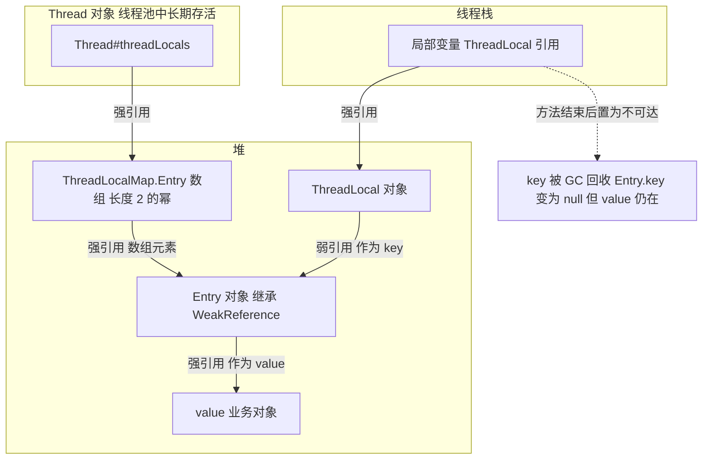
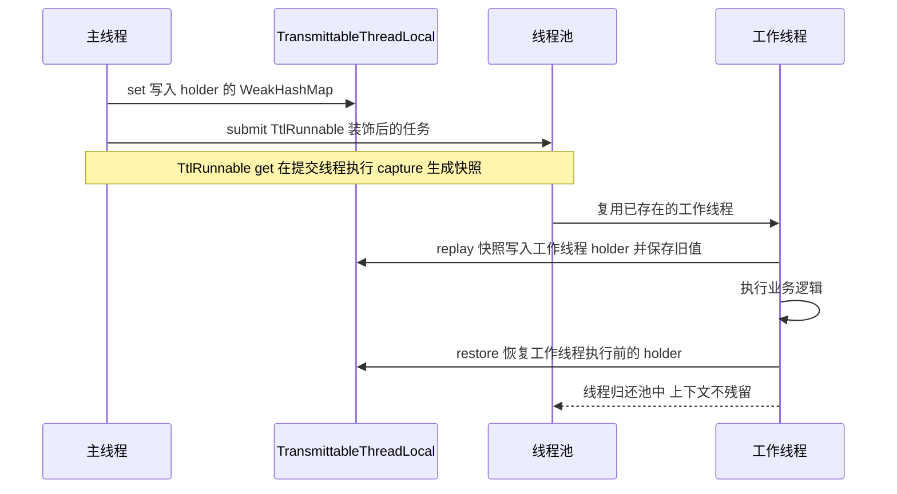
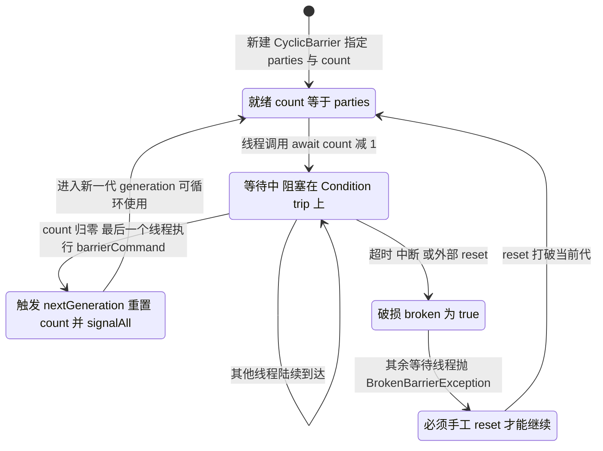
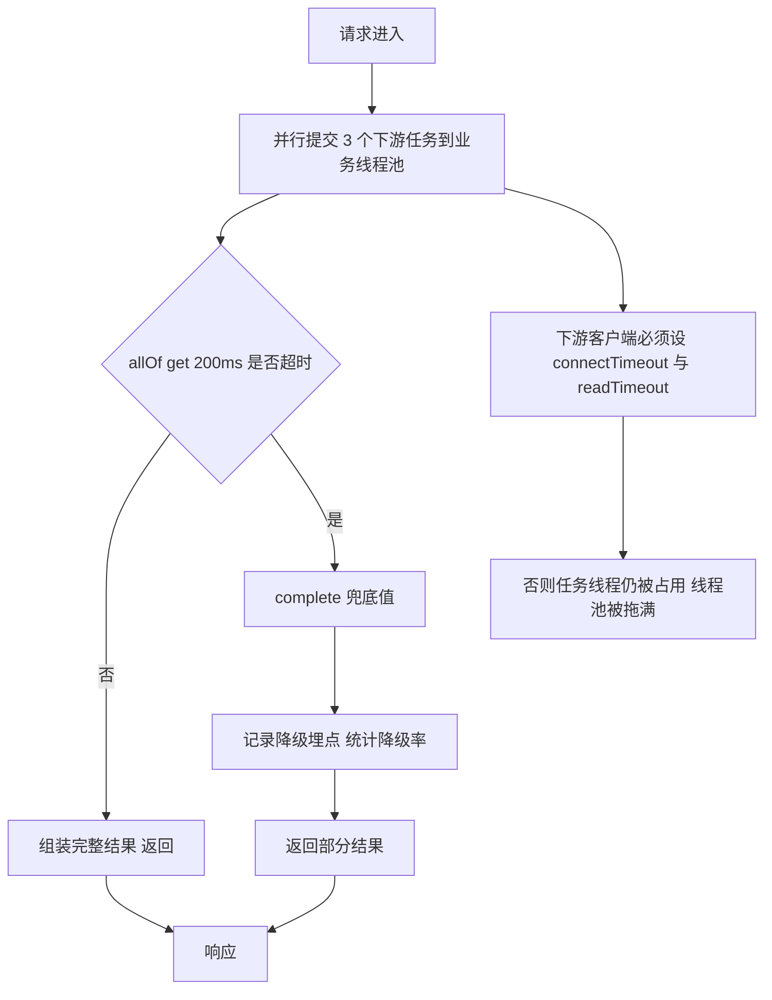
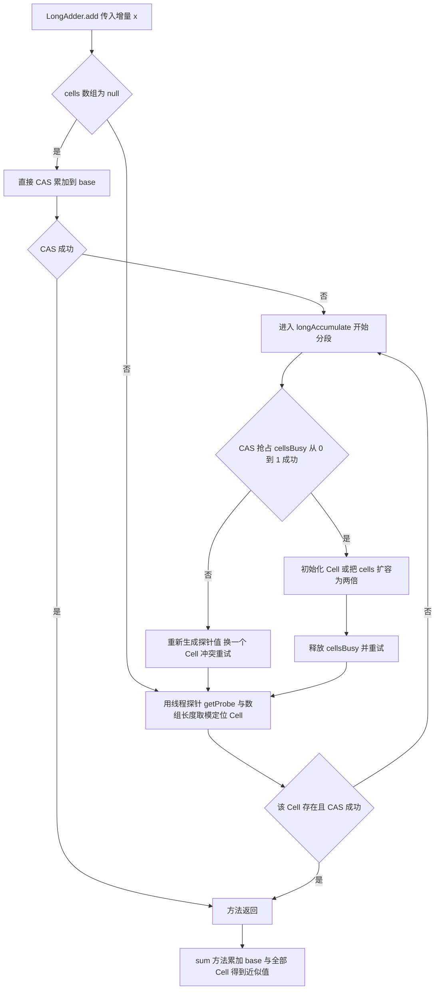
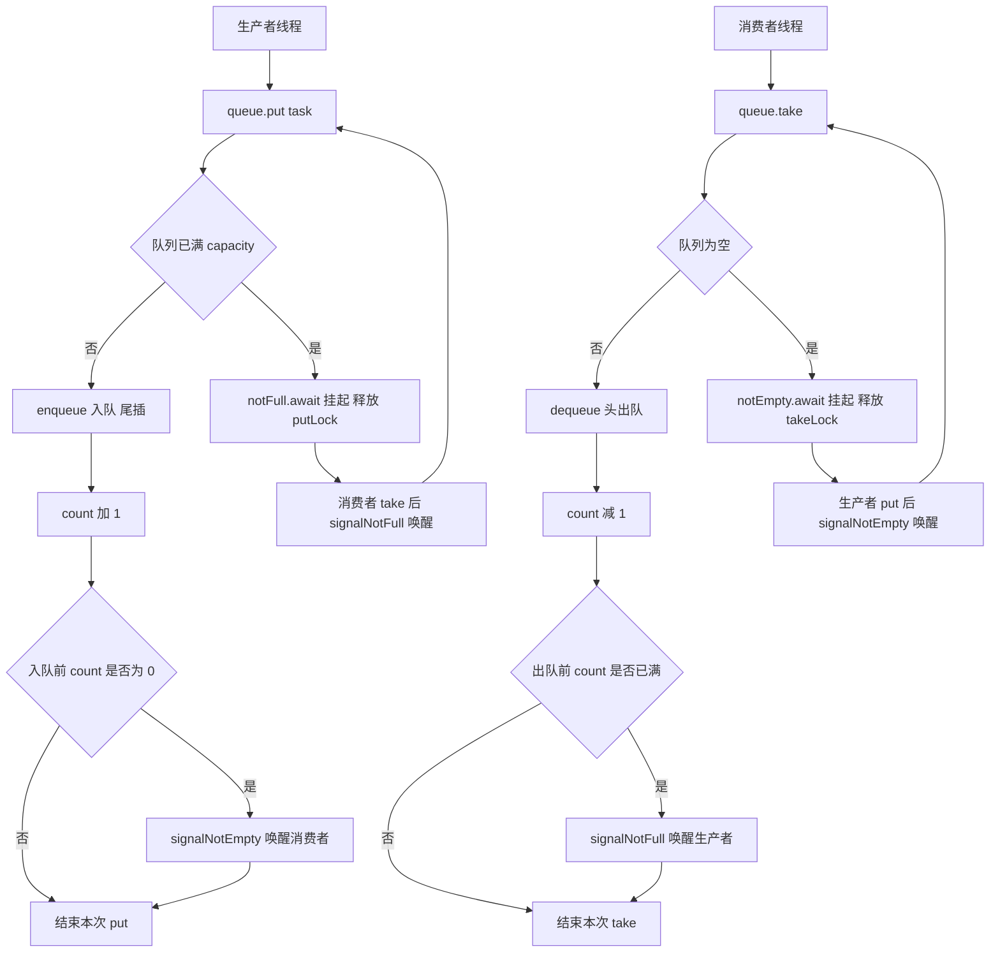
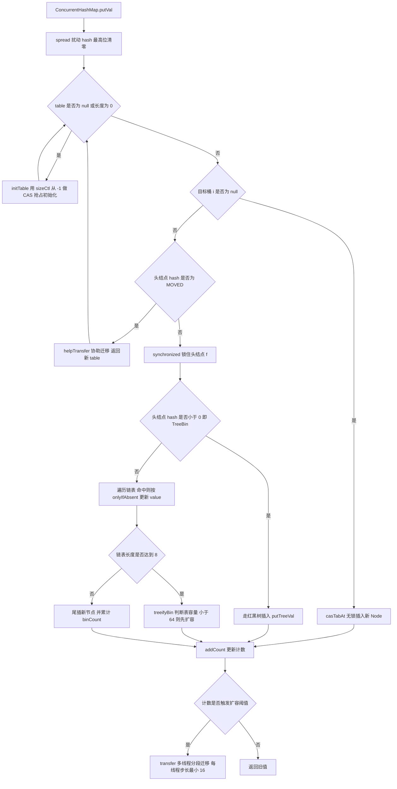
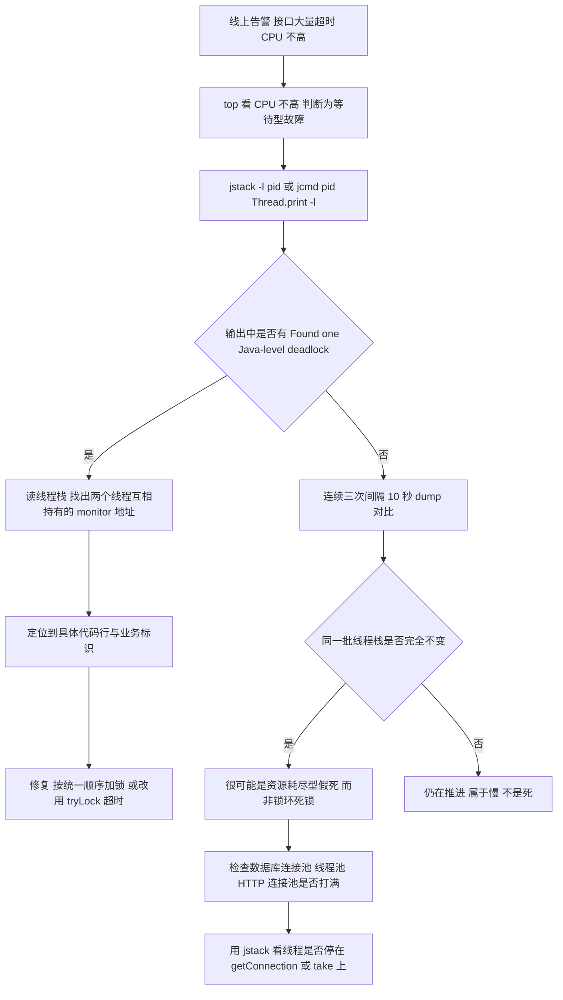

# 05 并发工具、并发容器与实战

> 一句话定位：并发工具类决定你能不能"编排"多线程，并发容器决定你的代码在 8 核 32 线程下会不会退化成串行，这两件事是高级岗与普通岗的分水岭 ｜ 面试权重 ★★★★★ ｜ 建议复习 60 分钟

## 本章大纲

- [一、ThreadLocal 原理与池化失效](#一threadlocal-原理与池化失效)
- [二、同步工具类实战](#二同步工具类实战)
- [三、原子类与 CAS](#三原子类与-cas)
- [四、阻塞队列与生产者消费者](#四阻塞队列与生产者消费者)
- [五、同步容器与并发容器](#五同步容器与并发容器)
- [六、死锁的定位与预防](#六死锁的定位与预防)
- [七、伪共享、上下文切换与性能](#七伪共享上下文切换与性能)
- [八、JMH 基准测试](#八jmh-基准测试)
- [高级岗三问](#高级岗三问)
- [高频面试题](#高频面试题)
- [易错点与踩坑](#易错点与踩坑)
- [一句话速记](#一句话速记)

## 一、ThreadLocal 原理与池化失效

### 1.1 版本地图

| 版本 | 事件 | 影响 |
| --- | --- | --- |
| JDK 1.2 | `ThreadLocal` 引入 | 早期实现是 `Thread` 持有一个 `Map`，按 ThreadLocal 的 hash 定位，Map 挂在 Thread 上而非 ThreadLocal 上 |
| JDK 1.4 | `InheritableThreadLocal` 引入 | 子线程通过 `Thread#init` 拷贝父线程的 `inheritableThreadLocals` |
| JDK 5 | `ThreadLocalMap` 改为开放地址法 + 弱引用 key | 就是今天看到的实现，`ThreadLocal#remove` 语义明确化 |
| JDK 6 | `ThreadLocalMap` 增加 `expungeStaleEntry` / `cleanSomeSlots` 惰性清理 | 弱引用 key 被回收后能顺带清理 value |
| JDK 8 | 新增 `ThreadLocal.withInitial(Supplier)` | 省去匿名内部类；`get()` 首次会调用 supplier |
| JDK 21 | 虚拟线程（JEP 444）正式 | 虚拟线程同样有 `threadLocals`，但数量可能上百万，大对象放 ThreadLocal 会造成内存放大 |

关键结论：**ThreadLocal 的"本地变量"不是存在 ThreadLocal 对象里，而是存在 Thread 对象里的**。ThreadLocal 只是一个"key + 访问入口"。

### 1.2 ThreadLocalMap 的数据结构

`java.lang.ThreadLocal.ThreadLocalMap` 是 ThreadLocal 的静态内部类，它**不是** `java.util.Map` 的实现，而是一个自管理的哈希表：

- 底层是 `Entry[] table`，初始容量 `INITIAL_CAPACITY = 16`。
- 扩容阈值 `threshold = len * 2 / 3`（注意是 2/3，不是 HashMap 的 0.75）。
- 冲突解决用**开放地址法（线性探测）**，`nextIndex(i, len)` 就是 `(i + 1 < len) ? i + 1 : 0`。
- `Entry extends WeakReference<ThreadLocal<?>>`，即 **key 是弱引用，value 是强引用**。
- hash 值来自 `ThreadLocal#threadLocalHashCode`，由静态 `AtomicInteger nextHashCode` 每次加魔数 `HASH_INCREMENT = 0x61c88647` 生成。

为什么用 `0x61c88647`？它是黄金分割比 2^32 的近似值，`(int)((1L << 32) * (Math.sqrt(5) - 1) / 2)`。以它为步长做加法再取低位，能让 2 的幂长度的数组上冲突分布接近均匀，等价于 Fibonacci Hashing。

```java
// JDK 8 java.lang.ThreadLocal
private static final int HASH_INCREMENT = 0x61c88647;
private static AtomicInteger nextHashCode = new AtomicInteger();

private static int nextHashCode() {
    return nextHashCode.getAndAdd(HASH_INCREMENT);
}
```



### 1.3 set / get / remove 的源码路径

`ThreadLocal#set`（JDK 8）：

```java
public void set(T value) {
    Thread t = Thread.currentThread();
    ThreadLocalMap map = getMap(t);
    if (map != null)
        map.set(this, value);
    else
        createMap(t, value);   // 首次创建，容量 16，threshold 为 10
}
```

`ThreadLocalMap#set` 的核心分支：

```java
private void set(ThreadLocal<?> key, Object value) {
    Entry[] tab = table;
    int len = tab.length;
    int i = key.threadLocalHashCode & (len - 1);
    for (Entry e = tab[i]; e != null; e = tab[i = nextIndex(i, len)]) {
        ThreadLocal<?> k = e.get();
        if (k == key) { e.value = value; return; }        // 命中，直接替换
        if (k == null) { replaceStaleEntry(key, value, i); return; }  // 遇到陈旧槽位
    }
    tab[i] = new Entry(key, value);
    int sz = ++size;
    if (!cleanSomeSlots(i, sz) && sz >= threshold) rehash();   // 启发式清理 + 扩容
}
```

`get()` 的路径是 `getEntry` → 未命中则 `getEntryAfterMiss` → 沿探测链继续找，途中遇到 `k == null` 就调用 `expungeStaleEntry(i)` 顺手清理；全部未命中则走 `setInitialValue()`（调用 `initialValue()`，默认返回 `null`，`withInitial` 场景返回 supplier 的结果）。

`remove()` 的路径是 `ThreadLocalMap#remove` → `Entry#clear()` 断开对 key 的弱引用 → `expungeStaleEntry(i)` 把 value 置 null 并把后续元素 rehash 前移。

三个清理方法的分工：

| 方法 | 触发时机 | 清理范围 | 复杂度 |
| --- | --- | --- | --- |
| `expungeStaleEntry(int)` | `set` 遇到陈旧槽位、`remove`、`get` 未命中 | 从指定槽位向后连续清理到第一个 null 槽位 | 局部 |
| `cleanSomeSlots(int, int)` | 每次 `set` 之后 | 以 log2(size) 为次数做启发式扫描 | O(log n) |
| `expungeStaleEntries()` | `rehash()` 时 | 全表扫描 | O(n) |

面试可以直接讲：**JDK 的 ThreadLocalMap 是"惰性清理"，不是"自动清理"**，所以只靠 GC 不能保证 value 一定被释放——清理动作只在有线程再次对同一个 map 做 set/get/remove 时才发生；如果一个线程池线程用完 ThreadLocal 后再也不碰它，value 就一直挂着。

### 1.4 内存泄漏的完整推导

内存泄漏链条，缺一不可：

1. 线程池线程长期存活，`Thread -> threadLocals -> ThreadLocalMap -> Entry[] -> Entry -> value` 这条强引用链一直存在。
2. ThreadLocal 对象被回收（典型写法是把 ThreadLocal 写成方法内的局部变量，或者用普通对象字段而对象本身被释放），导致 Entry 的弱引用 key 变成 `null`。
3. 业务没有调用 `remove()`，value 永远不会被置 null。
4. `ThreadLocalMap` 只在下次 set/get 时才顺带清理，而这个线程可能再也不碰这个 ThreadLocal。

两个必须纠正的常见误解：

- **误解一："key 是弱引用所以 ThreadLocal 不会泄漏"**。对，key 不会泄漏，泄漏的是 value。value 是被 Entry 强引用的，Entry 是被 table 数组强引用的。
- **误解二："写成 static final 就不会泄漏"**。`static final ThreadLocal` 只是让 key 永远不被回收（Entry 永远是 live entry，不会被 `expungeStaleEntry` 清），但 value 依然泄漏，而且更糟——**同一个线程池线程下一次处理请求时会读到上一次请求的脏数据**，这就是典型的"用户 A 看到用户 B 数据"的越权事故。

正确写法（`try-finally` + `remove`）：

```java
public class UserContext {
    private static final ThreadLocal<Long> USER_ID = new ThreadLocal<>();

    public static void set(Long id) { USER_ID.set(id); }
    public static Long get() { return USER_ID.get(); }

    public static void clear() { USER_ID.remove(); }   // 必须在 finally 里调用
}

// 使用侧
try {
    UserContext.set(userId);
    doBusiness();
} finally {
    UserContext.clear();
}
```

Tomcat 在这一点上做过兜底：`org.apache.catalina.core.ThreadLocalLeakPreventionListener` 会在 Web 应用停止时触发 `WebappClassLoaderBase#checkThreadLocalMapForLeaks`，扫描工作线程的 `threadLocals`，如果发现 key 或 value 的类型由该 Webapp 的类加载器加载，就记录日志并调用 `remove`。**这只是最后一道防线，日志一旦出现 `The web application appears to have started a thread named ... but has failed to stop it` 或 threadLocal leaks 相关告警，说明代码里少了 `remove`**。

### 1.5 InheritableThreadLocal 与池化失效

`InheritableThreadLocal` 的做法是重写 `childValue(T parentValue)` 并让线程在构造时拷贝父线程的 map：

```java
// java.lang.Thread#init
if (inheritThreadLocals && parent.inheritableThreadLocals != null)
    this.inheritableThreadLocals =
        ThreadLocal.createInheritedMap(parent.inheritableThreadLocals);
```

`createInheritedMap` 遍历父线程的 table，对每个 live entry 调用 `childValue(parentValue)`（**默认实现直接返回父引用，是浅拷贝**，父子线程共享同一个可变对象，改一个另一个也变），生成新的 `Entry` 放进子线程的 map。

三个必须记住的失效点：

1. **只有创建线程那一刻会拷贝**。`new Thread(...).start()` 之后父线程再 `set`，子线程看不到。
2. **线程池场景基本失效**。线程池的线程是第一次 `execute` 时创建的，之后复用。第 100 个任务提交时，工作线程是第 1 个任务创建时就存在的，它继承的是**创建它的那个线程**在那一刻的值，而不是当前提交任务的线程的值。这就是"上下文透传丢失"。
3. **浅拷贝陷阱**。父线程放进 `InheritableThreadLocal` 的是 `UserContext` 这种可变对象时，子线程改字段会污染父线程。

### 1.6 TransmittableThreadLocal 的解法

阿里的 `com.alibaba:transmittable-thread-local`（2.x，主流稳定版 2.14.x）解决的就是"线程池复用下上下文透传"。它 `extends InheritableThreadLocal`，核心机制是"**快照 - 回放 - 还原**"三步：

- **快照 capture**：`TtlRunnable#get(runnable)` 在**提交任务的线程**里调用，把当前线程所有 `TransmittableThreadLocal` 的 holder（一个 `InheritableThreadLocal<WeakHashMap<TransmittableThreadLocal<Object>, ?>>`）复制一份。
- **回放 replay**：工作线程执行前，把快照里的值写入工作线程的 holder（同时保存工作线程原来的值）。
- **还原 restore**：任务执行完，把工作线程 holder 恢复成 replay 之前的状态，避免污染下一个任务。

使用方式有两种：

```java
// 方式一：显式装饰
ExecutorService pool = TtlExecutors.getTtlExecutorService(rawPool);
pool.submit(task);   // 内部被包成 TtlRunnable

// 方式二：Java Agent 自动增强（-javaagent:transmittable-thread-local-2.x.jar）
// agent 通过 Instrumentation 改写 ExecutorService 实现类的方法字节码，业务代码零改动
ForkJoinPool.commonPool().submit(task);   // 也能透传
```



对比表：

| 维度 | `ThreadLocal` | `InheritableThreadLocal` | `TransmittableThreadLocal` |
| --- | --- | --- | --- |
| 传递方向 | 不传递 | 父线程到子线程，仅创建时 | 提交线程到执行线程，每次提交 |
| 线程池可用 | 可用但需 `remove` | 失效 | 可用 |
| 原理 | Thread 持有 map | `Thread#init` 拷贝 | 装饰器 / Agent 做 capture-replay-restore |
| 支持 `CompletableFuture` 默认线程池 | 不传递 | 不传递 | Agent 模式下可传递 |
| 改动成本 | 无 | 无 | 需装饰线程池或挂 Agent |
| 主要风险 | 内存泄漏、脏数据 | 浅拷贝污染、池化失效 | 快照对象过大会增加 GC 压力 |

`ThreadLocal` 相关的还有一类高频追问：**Tomcat 为什么要用 `ThreadLocal` 的变体存 `RequestContext`？**因为它天然是"一个请求一个线程"的映射，省掉了参数透传。代价是异步 Servlet、`CompletableFuture`、`@Async` 之后线程变了，`RequestContextHolder` 拿不到值——Spring 的解法是 `RequestContextHolder.setRequestAttributes(attrs, true)` 显式开启 `inheritable`，但依然受池化限制，正确做法是把需要的字段作为参数传出去。

## 二、同步工具类实战

JDK 5 的 `java.util.concurrent` 提供了四个"协调型"工具：`CountDownLatch`、`CyclicBarrier`、`Semaphore`、`Exchanger`；JDK 7 增加了 `Phaser`。它们都建立在 AQS 或 `ReentrantLock + Condition` 之上。

### 2.1 CountDownLatch

内部 `Sync extends AbstractQueuedSynchronizer`，`state` 就是计数器：

```java
// JDK 8 java.util.concurrent.CountDownLatch.Sync
protected int tryAcquireShared(int acquires) {
    return (getState() == 0) ? 1 : -1;         // 非 0 一律失败，进队列
}
protected boolean tryReleaseShared(int releases) {
    for (;;) {
        int c = getState();
        if (c == 0) return false;
        int nextc = c - 1;
        if (compareAndSetState(c, nextc)) return nextc == 0;
    }
}
```

要点：

- **一次性**。计数归零后不能重置，`await` 之后的线程立即通过。需要复用就用 `CyclicBarrier` 或 `Phaser`。
- `countDown()` 必须放在 `finally`，否则异常会让计数永远到不了 0，等待线程永久挂起（线程池场景直接线程泄漏）。
- `await()` 响应中断，`await(long, TimeUnit)` 超时返回 `false`，业务要判断返回值而不是无脑往下走。
- `getCount()` 可用于监控埋点，判断"还有几个依赖没就绪"。
- 两种典型用法：**一等多**（主线程等 N 个 RPC 结果）、**多等一**（发令枪，N 个线程同时 `await` 后一起跑，用于压测）。

### 2.2 CyclicBarrier

内部不用 AQS，而是 `ReentrantLock lock` + `Condition trip`，字段包括 `parties`、`count`、`barrierCommand`、`generation`：

```java
// JDK 8 java.util.concurrent.CyclicBarrier#dowait 核心分支
int index = --count;
if (index == 0) {                       // 最后一个到达的线程
    boolean ranAction = false;
    try {
        final Runnable command = barrierCommand;
        if (command != null) command.run();   // 由它执行 barrierAction
        ranAction = true;
        nextGeneration();                     // trip.signalAll(); count = parties; generation = new Generation();
        return 0;
    } finally {
        if (!ranAction) breakBarrier();       // command 抛异常则打破栅栏
    }
}
for (;;) {
    try {
        if (!timed) trip.await();
        else if (nanos > 0L) nanos = trip.awaitNanos(nanos);
    } catch (InterruptedException ie) { /* breakBarrier 后抛出 */ }
    if (g.broken) throw new BrokenBarrierException();
    if (g != generation) return index;        // 正常换代
    if (timed && nanos <= 0L) { breakBarrier(); throw new TimeoutException(); }
}
```



要点：

- **可循环**：`nextGeneration()` 里 `count = parties`、`generation = new Generation()`，所以叫 Cyclic。
- **参与线程数必须等于 parties**。线程池核心线程数小于 parties 时（例如 `parties=10`、`corePoolSize=5`），前 5 个线程占住线程卡在 `await`，后 5 个任务永远排不进队列，形成**死等**——这是生产上最常见的 CyclicBarrier 事故。
- `reset()` 会 `breakBarrier()` 当前代，正在等待的线程全部抛 `BrokenBarrierException`，是"暴力重置"。
- 一个线程被中断，整个栅栏破损，其他线程也失败（快速失败，避免半死不活）。
- `getNumberWaiting()` 可以用于排查"卡在栅栏上的线程数"。

### 2.3 Semaphore

`state` 表示可用许可数，`NonfairSync` / `FairSync` 两种实现：

```java
// 非公平
final int nonfairTryAcquireShared(int acquires) {
    for (;;) {
        int available = getState();
        int remaining = available - acquires;
        if (remaining < 0 || compareAndSetState(available, remaining)) return remaining;
    }
}
// 公平版多一行： if (hasQueuedPredecessors()) return -1;

// 释放：没有任何持有者校验
protected final boolean tryReleaseShared(int releases) {
    for (;;) {
        int current = getState();
        int next = current + releases;
        if (next < current) throw new Error("Maximum permit count exceeded");
        if (compareAndSetState(current, next)) return true;
    }
}
```

**`release()` 不校验调用者是否持有许可**，这是设计上的取舍（允许"释放方"与"获取方"不是同一个线程，适配资源归还语义），但工程上是坑：代码里多写一次 `release()` 就会把并发度放大，直到超过下游承载能力。可靠的写法是用 `try/finally` 保证 acquire / release 严格配对，并在 Code Review 中把它当作必须检查项。

其他要点：

- `acquire()` 响应中断，`acquireUninterruptibly()` 不响应；`tryAcquire(long, TimeUnit)` 带超时。
- `drainPermits()` 一次性拿走所有剩余许可并返回数量，适合"暂停放量"的开关。
- `Semaphore` 控制的是"同时执行的任务数"，不新建线程；`ThreadPoolExecutor` 的 `corePoolSize` 控制的是"线程数"。用 `Semaphore` 给线程池做二次限流毫无意义，限流要放在线程池**之外**（调用方）或下游客户端上。

### 2.4 Phaser

JDK 7 引入，解决 `CyclicBarrier` 的两个死穴：**parties 不能变、必须所有线程到达同一个点**。Phaser 的 state 用一个 `long` 编码：高 32 位是 `phase`，低 32 位再拆成 `parties` 和 `unarrived`。

- `register()` / `bulkRegister(n)` / `deregister()`：运行中动态增减参与方。
- `arrive()`：到达但不等待，返回当前 phase。
- `arriveAndAwaitAdvance()`：到达并等这一轮结束。
- `arriveAndDeregister()`：到达后退出，不再参与后续轮次（John 干完活先走）。
- `awaitAdvance(int phase)`：等待指定轮次结束，可配合超时 `awaitAdvanceInterruptibly(phase, timeout, unit)`。
- 重写 `onAdvance(int phase, int registeredParties)` 返回 `true` 可终止 Phaser（默认实现是 `registeredParties == 0` 时返回 true）。
- **分层 tiering**：当 parties 超过阈值时自动构造父子 Phaser 树，把竞争分散到子节点，降低单个 state 的 CAS 争用。

### 2.5 四个工具横向对比

| 维度 | `CountDownLatch` | `CyclicBarrier` | `Semaphore` | `Phaser` |
| --- | --- | --- | --- | --- |
| 引入版本 | JDK 5 | JDK 5 | JDK 5 | JDK 7 |
| 底层实现 | AQS 共享模式 | `ReentrantLock` + `Condition` | AQS 共享模式 | 自研 state + 自旋 + 队列 |
| 语义 | 一等多 / 多等一 | 多等多，等到齐一起走 | 许可数控制并发度 | 多阶段多等多 |
| 是否可重用 | 否，一次性 | 是，自动换代 | 是 | 是 |
| parties 能否变化 | 不适用（计数固定） | 否，构造时固定 | 不适用 | 可动态注册注销 |
| 支持 barrierAction | 否 | 是，由最后一个到达线程执行 | 否 | 通过重写 `onAdvance` 实现 |
| 一方失败的影响 | 其他方继续等（需自己超时） | 全体抛 `BrokenBarrierException` | 无关联 | 可 `forceTermination()` |
| 典型场景 | 并行结果汇总、启动预热门闸 | 分阶段计算、并发压测对齐起点 | 限流、连接池、并发度控制 | 多阶段流水线、DAG 分批执行 |

选型一句话：**只要"等条件"用 `CountDownLatch`，只要"等到齐"用 `CyclicBarrier`，只要"限制数量"用 `Semaphore`，只要"阶段会变"用 `Phaser`**。

### 2.6 实战一：并发压测与结果汇总

一个可落地的模式：固定并发数 + `CountDownLatch` 对齐起点 + 统计 P99。

```java
public static void stressTest(int concurrency, int totalPerThread) throws Exception {
    ExecutorService pool = new ThreadPoolExecutor(
            concurrency, concurrency, 0L, TimeUnit.MILLISECONDS,
            new LinkedBlockingQueue<>(concurrency),
            new ThreadFactoryBuilder().setNameFormat("stress-%d").build(),
            new ThreadPoolExecutor.CallerRunsPolicy());

    CountDownLatch startGate = new CountDownLatch(1);          // 发令枪
    CountDownLatch endGate = new CountDownLatch(concurrency);  // 汇总门
    LongAdder success = new LongAdder();
    LongAdder fail = new LongAdder();
    long[] latencies = new long[concurrency * totalPerThread];

    for (int t = 0; t < concurrency; t++) {
        final int threadIdx = t;
        pool.execute(() -> {
            try {
                startGate.await();                              // 所有线程在同一时刻开跑
                for (int i = 0; i < totalPerThread; i++) {
                    long s = System.nanoTime();
                    try {
                        invokeTarget();
                        success.increment();
                    } catch (Throwable e) {
                        fail.increment();
                    } finally {
                        latencies[threadIdx * totalPerThread + i] = System.nanoTime() - s;
                    }
                }
            } catch (InterruptedException e) {
                Thread.currentThread().interrupt();
            } finally {
                endGate.countDown();                            // 必须在 finally
            }
        });
    }
    startGate.countDown();
    endGate.await(60, TimeUnit.SECONDS);
    pool.shutdown();

    Arrays.sort(latencies);
    System.out.printf("QPS=%.0f success=%d fail=%d P50=%dms P99=%dms%n",
            (success.sum() + fail.sum()) / 10.0, success.sum(), fail.sum(),
            latencies[latencies.length / 2] / 1_000_000,
            latencies[(int) (latencies.length * 0.99)] / 1_000_000);
}
```

压测脚本本身最容易犯的错：

1. **用 `Executors.newFixedThreadPool` + 无界 `LinkedBlockingQueue`**：任务无限堆积，测出来的是排队时间不是服务耗时。
2. **任务数不等于并发数**：并发由线程数决定，不是由提交的任务总数决定。
3. **忘了 `startGate`**：线程是"边创建边执行"的，先创建的早就跑完了，实际并发度上不去，压不出真实瓶颈。
4. **统计口径缺失**：只统计成功请求的耗时，失败请求（通常就是超时的那些）被丢掉，P99 严重失真。

### 2.7 实战二：多任务汇总与超时降级

`CountDownLatch` 的短板是"不能带返回值、不能部分超时"。生产上优先用 `CompletableFuture`：

```java
// 三个下游并行调用，总耗时不超过 200ms，超时的用兜底值
CompletableFuture<Price> a = CompletableFuture.supplyAsync(() -> priceA(userId), pool);
CompletableFuture<Coupon> b = CompletableFuture.supplyAsync(() -> couponB(userId), pool);
CompletableFuture<Stock> c = CompletableFuture.supplyAsync(() -> stockC(skuId), pool);

CompletableFuture<Void> all = CompletableFuture.allOf(a, b, c);
try {
    all.get(200, TimeUnit.MILLISECONDS);
} catch (TimeoutException e) {
    a.complete(Price.fallback());     // 未完成的用兜底值补上
    b.complete(Coupon.empty());
    c.complete(Stock.unknown());
}
```

注意 `CompletableFuture#get` 超时**不会取消底层任务**，只是不再等待；底层线程还在跑，所以线程池必须设置合理的 `queueCapacity` 和拒绝策略，并给下游客户端配置 connectTimeout / readTimeout，否则"降级了但线程还在占着"。



## 三、原子类与 CAS

### 3.1 CAS 与底层指令

CAS 是 `Unsafe#compareAndSwapInt(Object o, long offset, int expected, int x)` 这类方法，落到 CPU 上是 `lock cmpxchg`（x86）或 `ldrex/strex`（ARM）。它的语义是"比较并交换"，整体是一个原子操作，同时提供 `volatile` 读写的内存语义（可见性与有序性）。

`AtomicInteger#getAndIncrement` 在 JDK 8 的实现是自旋：

```java
public final int getAndIncrement() {
    for (;;) {
        int current = get();                         // volatile 读
        int next = current + 1;
        if (compareAndSet(current, next)) return current;
    }
}
```

JDK 9 引入 `java.lang.invoke.VarHandle`（JEP 193），`java.util.concurrent.atomic` 包内逐步改为 `VALUE.getAndAdd(this, delta)` 这类签名方法，**对外 API 与内存语义完全不变**，只是不再依赖 `sun.misc.Unsafe`。写代码时不需要关心这层，但面试提到"`Unsafe` 要移除"时可以补一句这个背景。

CAS 的三大问题：

| 问题 | 现象 | 解法 |
| --- | --- | --- |
| 自旋开销 | 高竞争下大量线程空转，CPU 100% 而吞吐不涨 | 换 `LongAdder`、减少共享变量、退避重试 |
| ABA | 值从 A 改成 B 又改回 A，CAS 误判"没人动过" | `AtomicStampedReference`、`AtomicMarkableReference` |
| 只能保证一个变量 | 需要多个字段一起原子更新 | `AtomicReference` 包对象、`AtomicXXXFieldUpdater`、加锁 |

### 3.2 ABA 问题与版本号

典型场景是**无锁栈**：线程 T1 读到栈顶 A，`next = A.next`（即 B），此时 T2 把 A、B 都弹出再压回 A，T1 的 CAS 依然成功，但 `A.next` 已经不是 B 了，栈结构被破坏。

`AtomicStampedReference` 把 `(reference, stamp)` 打包成 `Pair`，只有两者都匹配才成功：

```java
private static class Pair<T> {
    final T reference;
    final int stamp;
}

public boolean compareAndSet(V expectedReference, V newReference,
                             int expectedStamp, int newStamp) {
    Pair<V> current = pair;
    return expectedReference == current.reference &&
           expectedStamp == current.stamp &&
           ((newReference == current.reference && newStamp == current.stamp) ||
            casPair(current, Pair.of(newReference, newStamp)));
}
```

`AtomicMarkableReference` 是把 stamp 换成 `boolean mark`，只关心"有没有被改过"，不关心改了几次。

要点提醒：

- `AtomicStampedReference` 内部是 `AtomicReference<Pair>`，**每次修改都新建 `Pair` 对象**，写入频繁时会产生大量短命对象，加深 Yong GC。它适合"低频写 + 需要正确性"的无锁结构，不适合计数。
- `AtomicStampedReference` 只能解决它能覆盖的 ABA：**如果 stamp 回绕（int 溢出）或业务语义上"A 就是 A"但对象已被替换（引用变了、equals 相同），它也没辙**。真正要严格正确性时，用锁或者不可变数据结构。

### 3.3 字段更新器

`AtomicIntegerFieldUpdater` / `AtomicLongFieldUpdater` / `AtomicReferenceFieldUpdater` 通过反射 + `Unsafe` 直接操作已有对象的字段，避免为每个实例额外创建一个 `AtomicInteger` 对象（一个对象 16 字节，百万实例就是 16MB 的额外开销）。

硬性约束（JDK 8 与 JDK 17 一致）：

1. 字段必须是 `volatile`，否则 `newUpdater` 抛 `IllegalArgumentException`。
2. 字段不能是 `static`。
3. 调用方必须能访问该字段（跨类使用时字段不能是 `private`，或者调用方 `setAccessible`）。
4. 在 JDK 9+ 模块化下，跨模块反射访问非开放包会抛 `InaccessibleObjectException`。

```java
public class Node {
    volatile long next = 0L;
    private static final AtomicLongFieldUpdater<Node> NEXT =
            AtomicLongFieldUpdater.newUpdater(Node.class, "next");
    public boolean casNext(long expect, long update) { return NEXT.compareAndSet(this, expect, update); }
}
```

**更现代的做法**：JDK 9+ 用 `VarHandle`，它同时支持普通字段、数组元素和 `volatile` 语义，且性能与 `Unsafe` 相同：

```java
private static final VarHandle NEXT;
static {
    try {
        NEXT = MethodHandles.lookup().findVarHandle(Node.class, "next", long.class);
    } catch (ReflectiveOperationException e) { throw new ExceptionInInitializerError(e); }
}
public boolean casNext(long expect, long update) { return NEXT.compareAndSet(this, expect, update); }
```

### 3.4 LongAdder 的分段思想

`LongAdder`（JDK 8）继承 `Striped64`，字段极简：

```java
// java.util.concurrent.atomic.Striped64
transient volatile Cell[] cells;
transient volatile long base;
transient volatile int cellsBusy;                 // 0 空闲，1 已被占用
static final int NCPU = Runtime.getRuntime().availableProcessors();

@sun.misc.Contended static final class Cell {
    volatile long value;
    Cell(long x) { value = x; }
    final boolean cas(long cmp, long val) { return VALUE.compareAndSet(this, cmp, val); }
}
```

`LongAdder#add` 的逻辑就是"**先试 base，失败了去 cells 里挑一个格子**"：

```java
public void add(long x) {
    Cell[] as; long b, v; int m; Cell a;
    if ((as = cells) != null || !casBase(b = base, b + x)) {
        boolean uncontended = true;
        if (as == null || (m = as.length - 1) < 0 ||
            (a = as[getProbe() & m]) == null ||
            !(uncontended = a.cas(v = a.value, v + x)))
            longAccumulate(x, null, uncontended);
    }
}
```

`sum()` 是"base + 遍历所有 Cell 求和"，**不是原子快照**：求和过程中其他线程还在写，所以 `sum()` 的结果是某一时刻的近似值。这正是它快的代价——把一次 CAS 热点分散成 N 个 CAS 点，用"最终一致"换吞吐。



选型结论：

| 场景 | 选择 | 原因 |
| --- | --- | --- |
| 读多写少、需要精确瞬时值 | `AtomicLong` | 单点 CAS，`get()` 就是真值 |
| 写多读少（QPS 计数、指标打点） | `LongAdder` | 分段消除热点，吞吐可高数倍 |
| 需要累加逻辑而非加法 | `LongAccumulator` | 提供 `LongBinaryOperator`，注意它要求操作满足交换律 |
| 浮点计数 | `DoubleAdder` | `LongAdder` 的 double 版，同样分段 |

一个必须提的工程点：**`sum()` 不要在业务判断里用**。`if (adder.sum() > threshold)` 这种判断在并发下会抖动，需要精确门限时用 `AtomicLong` 或者加锁。

## 四、阻塞队列与生产者消费者

### 4.1 BlockingQueue 的语义矩阵

`BlockingQueue` 在 `Queue` 之上定义了两套 API：

| 操作 | 抛异常 | 返回特殊值 | 阻塞 | 超时阻塞 |
| --- | --- | --- | --- | --- |
| 入队 | `add(e)` | `offer(e)` 返回 boolean | `put(e)` | `offer(e, timeout, unit)` |
| 出队 | `remove()` | `poll()` 返回 null | `take()` | `poll(timeout, unit)` |
| 检查 | `element()` | `peek()` | 无 | 无 |

### 4.2 队列家族对比

| 队列 | 有界性 | 锁结构 | 底层结构 | 特点与陷阱 |
| --- | --- | --- | --- | --- |
| `ArrayBlockingQueue` | 有界，必须指定容量 | 一把 `ReentrantLock` + `notEmpty` / `notFull` 两个 `Condition` | 环形数组 | 默认非公平；公平模式吞吐显著下降；入队出队互斥 |
| `LinkedBlockingQueue` | 可选，默认 `Integer.MAX_VALUE` | 两把锁 `putLock` / `takeLock`，`count` 是 `AtomicInteger` | 单向链表 | 默认无界是最大风险，堆积到 OOM；入队出队可并行 |
| `SynchronousQueue` | 容量 0 | `TransferQueue`（公平）/ `TransferStack`（非公平） | 无缓冲 | `put` 必须等到 `take`；`newCachedThreadPool` 用它，配合 `maximumPoolSize=Integer.MAX_VALUE` 是经典 OOM 组合 |
| `PriorityBlockingQueue` | 无界 | 一把锁 + `notEmpty` | 二叉堆 | 入队不阻塞（除非 OOM）；元素必须 `Comparable` 或传 `Comparator`；**不保证同优先级元素的顺序** |
| `DelayQueue` | 无界 | 一把锁 + `available` + `leader` | `PriorityQueue` | 元素实现 `Delayed`（`getDelay` + `compareTo`）；`leader` 字段保证只有一个线程做定时等待，到期后才 `signalAll` |
| `LinkedTransferQueue` | 无界 | 无锁 `CAS` | 链表 | JDK 7 引入，`transfer(e)` 语义是"必须有消费者接手才返回"；`tryTransfer` 不等待；`size()` 是 O(n) |
| `LinkedBlockingDeque` | 可选 | 一把锁 + 两个 `Condition` | 双向链表 | 支持 `putFirst` / `takeLast`，可实现工作窃取式队列 |

`LinkedBlockingQueue` 的两把锁实现要点：

```java
// 入队
private void enqueue(Node<E> node) {
    last = last.next = node;
}
public void put(E e) throws InterruptedException {
    Node<E> node = new Node<E>(e);
    final ReentrantLock putLock = this.putLock;
    final AtomicInteger count = this.count;
    putLock.lockInterruptibly();
    try {
        while (count.get() == capacity) notFull.await();   // while 而非 if
        enqueue(node);
        c = count.getAndIncrement();
        if (c + 1 < capacity) notFull.signal();            // 还有空位才唤醒其他生产者
    } finally { putLock.unlock(); }
    if (c == 0) signalNotEmpty();                          // 由消费者锁唤醒，避免锁嵌套
}
```

注意两处细节：**`while` 而不是 `if`**（防虚假唤醒和"被唤醒后条件又不成立"），**`signalNotEmpty()` 在 `putLock` 释放之后调用**（减少锁持有时间、避免死锁）。

### 4.3 生产者消费者标准实现

```java
public class ProducerConsumer {
    private final BlockingQueue<Task> queue = new ArrayBlockingQueue<>(1024);
    private static final Task POISON = new Task(-1);       // 毒丸
    private volatile boolean running = true;
    private final List<Thread> workers = new ArrayList<>();

    public void start(int workerCount) {
        for (int i = 0; i < workerCount; i++) {
            Thread t = new Thread(this::consume, "worker-" + i);
            t.setDaemon(false);
            workers.add(t);
            t.start();
        }
    }

    private void consume() {
        try {
            while (running) {
                Task task = queue.take();                  // 阻塞取
                if (task == POISON) {                      // 优雅停止
                    queue.put(POISON);                     // 毒丸传下去，让其他 worker 也能退出
                    return;
                }
                try {
                    task.run();
                } catch (Throwable e) {
                    log.error("task failed, id={}", task.getId(), e);   // 单任务异常不能拖垮消费者
                }
            }
        } catch (InterruptedException e) {
            Thread.currentThread().interrupt();            // 恢复中断位，退出循环
        }
    }

    public void shutdown() throws InterruptedException {
        running = false;
        queue.put(POISON);                                 // 投毒
        for (Thread t : workers) t.join(5_000);            // 限时等待收敛
    }
}
```

要点清单：

1. **条件判断必须 `while`**。`if (queue.isEmpty()) wait();` 是教科书级别的错误。
2. **单任务异常必须捕获**。消费者线程一旦因未捕获异常退出，吞吐就永久下降，且没有任何告警。
3. **`InterruptedException` 必须 `Thread.currentThread().interrupt()` 恢复中断位**，不要吞掉。
4. **停止协议要显式设计**：`volatile` 标志位 + 毒丸，或者 `queue.poll(timeout)` + 标志位轮询。线程池场景直接用 `shutdown()` / `awaitTermination()` / `shutdownNow()` 三件套。
5. **有界 + 拒绝策略**。无界队列把背压问题推给了内存，最终以 OOM 收场。



### 4.4 延迟队列的实战细节

`DelayQueue` 的 `leader` 字段设计值得单独讲：如果不做优化，N 个消费者线程全部 `awaitNanos(队首剩余延迟)`，队首到期后 `signalAll` 唤醒全部线程，但只有一个能拿到元素，其余全部白跑一遍（惊群效应）。JDK 在 `take()` 里加了 `leader`：

```java
// JDK 8 java.util.concurrent.DelayQueue#take 片段
long delay = first.getDelay(NANOSECONDS);
if (delay <= 0) return q.poll();
first = null;                                   // 不持引用，防止元素被其他线程释放后内存泄漏
if (leader != null) available.await();          // 已有 leader 在等，自己睡死
else {
    Thread thisThread = Thread.currentThread();
    leader = thisThread;
    try { available.awaitNanos(delay); }        // 只有 leader 做定时等待
    finally { if (leader == thisThread) leader = null; }
}
```

使用陷阱：

- `getDelay` 返回**剩余**时间，不是延迟总量。常见错误是返回固定的延迟值，导致元素永远不会到期。
- `DelayQueue` 元素出队后不可变，否则堆序被破坏。
- 大量延迟任务（百万级）时 `Delayed` 对象的内存占用不可忽视，生产上通常用时间轮（Netty `HashedWheelTimer`）或分布式调度替代。

## 五、同步容器与并发容器

### 5.1 同步容器的历史

| 类 | 版本 | 同步粒度 | 现在还能用吗 |
| --- | --- | --- | --- |
| `Vector` | JDK 1.0 | 每个方法 `synchronized` | 不要用，`ArrayList` + 外部同步或 `CopyOnWriteArrayList` |
| `Hashtable` | JDK 1.0 | 每个方法 `synchronized`，且 key/value 不允许 null | 不要用，换 `ConcurrentHashMap` |
| `Collections.synchronizedList` / `synchronizedMap` | JDK 1.2 | 包装类的每个方法 `synchronized`（`mutex` 字段） | 只在读极少写极少且需要"整体互斥"时考虑 |
| `StringBuffer` | JDK 1.0 | 方法级同步 | 单线程场景用 `StringBuilder` |

同步容器的三个致命问题：

1. **复合操作非原子**。`if (!map.containsKey(k)) map.put(k, v);` 是两个同步方法，中间可以被插入，即经典的 check-then-act 竞态。替代是 `ConcurrentHashMap#putIfAbsent` / `computeIfAbsent`。
2. **迭代器不是线程安全的**。`Vector` / `Collections.synchronizedList` 的迭代器没有加锁，遍历时被修改会抛 `ConcurrentModificationException`（fail-fast）。必须手动 `synchronized (list) { for (E e : list) {...} }`。
3. **性能差**。所有操作串在同一把监视器锁上，`synchronizedMap` 的读读之间也互斥（JDK 8 的 `ConcurrentHashMap` 读操作是无锁的）。

### 5.2 ConcurrentHashMap 的两次架构演进

**JDK 7 的分段锁**：

- 结构是 `Segment[] segments`（默认 `DEFAULT_CONCURRENCY_LEVEL = 16`），每个 `Segment extends ReentrantLock`，内部是 `HashEntry[] table`。
- 定位要两次 hash：先用 key 的高位扰动值定位 Segment（`segmentShift` / `segmentMask`），再用低位定位桶。所以**并发度上限就是 Segment 数量**，初始化后不能扩容。
- `size()` 先无锁累加两次 `modCount`，两次一致就返回；不一致则依次给所有 Segment 加锁再统计。

**JDK 8 的重写**：

- 取消 Segment，直接是 `transient volatile Node<K,V>[] table`，并发度等于桶数组长度，**没有 16 的上限**。
- 插入空桶用 `casTabAt`（无锁），插入非空桶用 `synchronized (f)` 锁住**头结点**，粒度细化到单个桶。
- 扩容支持多线程协助：`ForwardingNode`（`hash == MOVED == -1`）标记已迁移的桶，其他线程通过 `helpTransfer` 加入迁移。
- 计数改为 `baseCount` + `CounterCell[]`，思想与 `LongAdder` 一致。
- key 和 value **不允许 null**（并发下无法区分"不存在"和"值为 null"）。

核心常量（JDK 8）：

| 常量 | 值 | 含义 |
| --- | --- | --- |
| `DEFAULT_CAPACITY` | 16 | 默认初始容量 |
| `MAXIMUM_CAPACITY` | 1 << 30 | 最大容量 |
| `DEFAULT_CONCURRENCY_LEVEL` | 16 | 仅用于计算初始容量，已不是并发度 |
| `LOAD_FACTOR` | 0.75 | 负载因子 |
| `TREEIFY_THRESHOLD` | 8 | 链表长度达到 8 尝试树化 |
| `UNTREEIFY_THRESHOLD` | 6 | 树退化回链表的阈值 |
| `MIN_TREEIFY_CAPACITY` | 64 | 树化前要求的最小表容量，否则先扩容 |
| `MOVED` | -1 | `ForwardingNode` 的 hash |
| `TREEBIN` | -2 | `TreeBin` 的 hash |
| `RESERVED` | -3 | `computeIfAbsent` 占位节点的 hash |
| `MIN_TRANSFER_STRIDE` | 16 | 扩容时每个线程迁移的最小桶数 |

`putVal` 主流程：

```java
final V putVal(K key, V value, boolean onlyIfAbsent) {
    if (key == null || value == null) throw new NullPointerException();
    int hash = spread(key.hashCode());          // (h ^ (h >>> 16)) & HASH_BITS，HASH_BITS = 0x7fffffff
    int binCount = 0;
    for (Node<K,V>[] tab = table;;) {
        Node<K,V> f; int n, i, fh;
        if (tab == null || (n = tab.length) == 0)
            tab = initTable();                                   // sizeCtl 为 -1 表示正在初始化
        else if ((f = tabAt(tab, i = (n - 1) & hash)) == null) {
            if (casTabAt(tab, i, null, new Node<K,V>(hash, key, value, null)))
                break;                                           // 空桶无锁插入
        }
        else if ((fh = f.hash) == MOVED)
            tab = helpTransfer(tab, f);                          // 协助扩容
        else {
            V oldVal = null;
            synchronized (f) {                                   // 锁头结点
                // 链表尾插或树插入，binCount >= TREEIFY_THRESHOLD 时 treeifyBin
            }
        }
    }
    addCount(1L, binCount);                                      // baseCount / CounterCell
    return null;
}
```

`sizeCtl` 的三种语义必须记住：**正数**表示下一次扩容的阈值（`n - (n >>> 2)`）；**-1** 表示正在初始化；**其他负数**表示正在扩容，`(sizeCtl >>> RESIZE_STAMP_SHIFT) + 1` 是参与扩容的线程数。



### 5.3 CopyOnWriteArrayList

写操作全量复制：

```java
// JDK 8 java.util.concurrent.CopyOnWriteArrayList
private transient volatile Object[] array;

public boolean add(E e) {
    final ReentrantLock lock = this.lock;
    lock.lock();
    try {
        Object[] elements = getArray();
        int len = elements.length;
        Object[] newElements = Arrays.copyOf(elements, len + 1);
        newElements[len] = e;
        setArray(newElements);        // volatile 写，发布新数组
        return true;
    } finally { lock.unlock(); }
}

public E get(int index) { return elementAt(getArray(), index); }   // 完全无锁，读快照
```

特点与陷阱：

- **读无锁、写加锁 + 全量复制**，所以"读多写极少"才合适：白名单、监听器列表、配置快照。
- **写操作代价是 O(n) 且内存瞬时翻倍**。频繁写会触发大量 Young GC，甚至因大数组直接进老年代。
- **迭代器是快照**。`COWIterator` 持有创建时的数组引用，遍历期间的写看不见（弱一致性），但不会抛 `ConcurrentModificationException`。
- **`COWIterator` 不支持 `remove` / `set`**，调用抛 `UnsupportedOperationException`（JDK 11 起 `set` 也是这个行为，早期版本实现不一致，不要依赖）。
- 没有 `size` 之外的随机访问优化，`add(int, E)` 同样是全量复制。

### 5.4 ConcurrentLinkedQueue 与 ConcurrentSkipListMap

`ConcurrentLinkedQueue` 是 Michael-Scott 队列的 Java 实现：

- 使用**哨兵节点**（`head` 指向的 Node 的 item 通常为 null），`head` / `tail` 都**不保证**指向真正的队首/队尾，允许"松弛"，减少 CAS 次数。
- `offer` 是自旋 CAS，`size()` 需要遍历全表，**O(n)，不要在生产循环里调用 `size()`**，用 `isEmpty()`。
- `poll` 时把出队节点的 `item` 置为 null（`updateHead` + `casItem`），帮助 GC 回收。

`ConcurrentSkipListMap` 用**跳表**实现有序并发 Map：

| 维度 | `ConcurrentSkipListMap` | `TreeMap` + 同步包装 |
| --- | --- | --- |
| 线程安全 | 是，无锁 CAS | 需要外部同步 |
| 平均复杂度 | O(log n) 查找/插入/删除 | O(log n)，但全树锁 |
| 范围查询 | `subMap` / `headMap` / `tailMap` 弱一致，不阻塞写 | 需独占锁 |
| 为什么不用红黑树 | 跳表插入删除只影响局部指针，容易做无锁；红黑树的旋转会牵动大范围结构 | 红黑树全局平衡 |
| 有序性 | `firstKey` / `lastKey` / 按 key 排序 | 同 |

### 5.5 选型总表

| 需求 | 选择 | 不要用 |
| --- | --- | --- |
| 高并发 Key-Value，无需排序 | `ConcurrentHashMap` | `Hashtable`、`Collections.synchronizedMap` |
| 高并发且需要按 key 有序、范围查询 | `ConcurrentSkipListMap` | `TreeMap` + 同步 |
| 读极多写极少的有序列表 | `CopyOnWriteArrayList` | `Vector`、`synchronizedList` |
| 高并发无界队列（生产者消费者） | `ConcurrentLinkedQueue` | 无界的 `LinkedBlockingQueue` 要警惕堆积 |
| 需要阻塞语义的队列 | `ArrayBlockingQueue`（有界首选） | 默认构造的 `LinkedBlockingQueue` |
| 手递手交付给消费者 | `SynchronousQueue` | 配合无界 `maximumPoolSize` |
| 定时 / 延迟任务 | `DelayQueue` 或时间轮 | 大批量场景用 `DelayQueue` 会吃内存 |
| 计数 / 指标累加 | `LongAdder` | 高并发下的 `AtomicLong` |

## 六、死锁的定位与预防

### 6.1 四个必要条件

死锁必须同时满足，破坏任意一个即可避免：

| 条件 | 含义 | 破坏方式 |
| --- | --- | --- |
| 互斥 | 资源同一时刻只能被一个线程占用 | 尽量用无锁结构、不可变对象 |
| 请求与保持 | 持有资源的同时还去申请新资源 | 一次性申请全部资源（`tryLock` 全部成功才继续） |
| 不可剥夺 | 已获得的资源不能被强行抢走 | `ReentrantLock#tryLock(timeout)` 超时主动释放 |
| 循环等待 | 存在线程 - 资源的环形等待链 | **全局锁顺序**，按对象 hash 或业务 ID 排序后加锁 |

### 6.2 最小复现代码

```java
public class DeadLockDemo {
    private static final Object LOCK_A = new Object();
    private static final Object LOCK_B = new Object();

    public static void main(String[] args) {
        new Thread(() -> {
            synchronized (LOCK_A) {
                sleep(100);
                synchronized (LOCK_B) { System.out.println("t1 ok"); }
            }
        }, "t1").start();

        new Thread(() -> {
            synchronized (LOCK_B) {
                sleep(100);
                synchronized (LOCK_A) { System.out.println("t2 ok"); }
            }
        }, "t2").start();
    }
}
```

### 6.3 定位手段

**手段一：jstack**。命令是 `jstack -l <pid>`（`-l` 输出额外锁信息 `ownable synchronizers`），输出里会有明确的段落：

```
Found one Java-level deadlock:
=============================
"t2":
  waiting to lock monitor 0x00007f8a4c00b2e8 (object 0x000000076ab5c8f8, a java.lang.Object),
  which is held by "t1"
"t1":
  waiting to lock monitor 0x00007f8a4c00b318 (object 0x000000076ab5c908, a java.lang.Object),
  which is held by "t2"

Java stack information for the threads listed above:
===================================================
"t2":
        at DeadLockDemo.lambda$main$1(DeadLockDemo.java:22)
        - waiting to lock <0x000000076ab5c8f8> (a java.lang.Object)
        - locked <0x000000076ab5c908> (a java.lang.Object)
"t1":
        at DeadLockDemo.lambda$main$0(DeadLockDemo.java:16)
        - waiting to lock <0x000000076ab5c908> (a java.lang.Object)
        - locked <0x000000076ab5c8f8> (a java.lang.Object)

Found 1 deadlock.
```

注意：`jstack` 只检测**监视器锁（synchronized）**和 `AbstractOwnableSynchronizer` 子类（`ReentrantLock`）。**`LockSupport.park` 造成的等待、`wait/notify` 造成的语义死锁（不是锁环）、数据库连接池耗尽，它检测不出来。**

**手段二：ThreadMXBean 程序化检测**。适合做周期性自检和告警：

```java
ThreadMXBean bean = ManagementFactory.getThreadMXBean();
long[] ids = bean.findDeadlockedThreads();          // 包含 synchronized 与 ownable synchronizer
// bean.findMonitorDeadlockedThreads();             // 仅监视器锁，JDK 6 起
if (ids != null) {
    ThreadInfo[] infos = bean.getThreadInfo(ids, true, true);   // 带锁信息与堆栈
    for (ThreadInfo info : infos) {
        log.error("deadlock detected: {}\n{}", info.getThreadName(), info);
    }
}
```

`ThreadMXBean#findDeadlockedThreads` 从 JDK 6 起可用，JDK 10 起 `ThreadInfo` 的锁对象不便直接获取（`ThreadInfo#getLockedMonitors` 仍然可用）。生产做法：定时任务每 30 秒检测一次，命中就打告警并 `jstack` 落盘。

**手段三：jconsole / JMC / VisualVM**。`jconsole` 的"线程"页有"检测死锁"按钮，底层调用的就是 `findDeadlockedThreads`。`jcmd <pid> Thread.print -l` 与 `jstack -l` 等价，容器里没有 jstack 时用 `jcmd`。



### 6.4 排查的常见误判

- **"CPU 100% 就是死锁"**：错。死锁是等待型，CPU 通常不高。CPU 100% 更多是死循环、GC（`jstat -gcutil` 看 `FGC` 增长）、频繁锁竞争自旋（`jstack` 里大量 `BLOCKED`）。
- **"BLOCKED 就是死锁"**：`BLOCKED` 说明在等 `synchronized` 监视器，但等待链不闭合就只是竞争。
- **"所有线程卡住就是死锁"**：可能是一方在等另一方**永远不会主动通知**的 `Condition`（漏了 `signal`），或者线程池被自己提交的任务占满（线程池饥饿）。后者用 `jstack` 看线程名（如 `pool-1-thread-*`）都在 `take`/`await` 上，而任务队列里有任务在等同一个池的线程——这是"线程池递归调用"导致的经典假死。修复手段是**隔离线程池**（IO 池与业务池分开，配置独立的核心线程数和队列）。
- **`jstack` 卡住不出结果**：加 `-F` 强制 dump（`jstack -F <pid>`），或用 `kill -3 <pid>` 让 JVM 把线程栈输出到标准输出。

### 6.5 预防清单

1. **统一加锁顺序**。多个对象加锁时按 `System.identityHashCode(o)` 或业务主键排序；转账场景按 `fromId < toId` 排序加锁。
2. **`tryLock(long, TimeUnit)` 超时**。拿不到就释放已持有的锁重试或失败，破坏"不可剥夺"。
3. **锁的持有范围最小化**。不要在持锁期间做 RPC、IO、`Thread.sleep`。
4. **拒绝锁嵌套**。能用一把粗粒度锁解决的场景，不要为了"看起来细粒度"而引入多把锁。
5. **避免在持锁时调用外部可重写方法**（开放调用问题，`synchronized` 的代码块里调用回调最危险）。
6. **数据库侧同样有死锁**。InnoDB 死锁用 `SHOW ENGINE INNODB STATUS` 看 `LATEST DETECTED DEADLOCK` 段落；预防靠按索引顺序更新、小事务、必要时 `SELECT ... FOR UPDATE` 固定顺序。MySQL 默认会自动检测并回滚代价小的事务（`innodb_deadlock_detect=ON`）。

## 七、伪共享、上下文切换与性能

### 7.1 伪共享

CPU 从内存读数据是按**缓存行**读取的，x86 典型是 **64 字节**。MESI 一致性协议下，一个核心修改缓存行中的任意字节，其他核心对应的缓存行副本整体失效，必须重新从内存或 L3 加载。

**伪共享（False Sharing）** 就是两个互不相关的变量落在同一个缓存行，一个核心写 A 导致另一个核心的 B 失效，产生无效的缓存同步。

典型受害对象是并发数据结构里的"热字段相邻"：

```java
// 坏：head 与 tail 在同一缓存行，生产者写 tail、消费者写 head 互相弹来弹去
class BadQueue {
    volatile long head;
    volatile long tail;
}

// 好（JDK 8 内部结构）：用 @Contended 让 JVM 自动填充
// 或者手工 padding，补 6 个 long 凑满 64 字节
class PaddedQueue {
    volatile long head;
    long p1, p2, p3, p4, p5, p6;    // 填充
    volatile long tail;
    long q1, q2, q3, q4, q5, q6;
}
```

关键事实：

- JDK 8 引入 `@sun.misc.Contended`，但**在用户代码里默认被限制**，需要启动参数 `-XX:-RestrictContended` 才生效；JDK 9 起注解改名 `jdk.internal.vm.annotation.Contended`，属于 JDK 内部 API。
- **JDK 自己用它是开放的**：`LongAdder` / `Striped64` 的 `Cell`、`Thread` 里的 `@Contended` 字段（如 `threadLocalRandomSeed`、`threadLocalRandomProbe`）都是这个机制。所以高并发计数场景优先用 `LongAdder`，它天然已经被 padding 保护。
- `ThreadLocalRandom` 替代 `Random` 的一个重要原因就是：`Random` 内部的种子是多个线程共享的 `AtomicLong`，属于单点伪共享 + CAS 竞争；`ThreadLocalRandom` 把种子放在 `Thread` 的 `@Contended` 字段里，每线程一个，无竞争。
- 定位工具：Linux 上用 `perf c2c record -a -g -- sleep 10` 然后 `perf c2c report`，能列出 HITM（命中被修改行）最多的地址，直接指到伪共享变量。

### 7.2 上下文切换

线程切换的代价包括：保存/恢复寄存器、切换内核栈、TLB 与缓存部分失效。经验值在一次切换**几微秒**量级，是所有优化里最贵的"隐形税"。

观察指标与命令：

| 命令 | 看什么 | 判读 |
| --- | --- | --- |
| `vmstat 1` | `cs` 列（每秒上下文切换次数）、`r` 列（运行队列长度） | `cs` 随 QPS 线性上升且远超 `r` 的合理倍数，说明切换过频 |
| `pidstat -w -p <pid> 1` | `cswch/s`（自愿，多为锁/IO 等待）、`nvcswch/s`（非自愿，被时间片抢占） | 非自愿切换高说明线程太多抢 CPU |
| `jstack` 次数对比 | 大量 `RUNNABLE` 却吞吐上不去 | 线程数远超核数，在抢 CPU |
| `perf sched latency` | 调度延迟分布 | 定位切换热点 |

线程数经验公式（Java Concurrency in Practice 给出）：

```
N_threads = N_cpu * U_cpu * (1 + W / C)
```

`W` 是等待时间，`C` 是计算时间。IO 密集型 `W/C` 大，线程可以多；CPU 密集型 `W/C` 趋近 0，线程数应等于核数（超线程算 1.3 倍左右）。**线程数 = 200 的纯 CPU 任务在 8 核机上，吞吐一定不如线程数 = 8。**

减少上下文切换的手段：

1. **降低锁竞争**：分段锁、`LongAdder`、无锁队列。竞争激烈时线程被 `park` 又 `unpark`，都是切换。
2. **批量化**：一次加锁处理一批任务，而不是逐条处理。
3. **`Thread.onSpinWait()`**（JDK 9）：短暂等待时给 CPU 一个 hint（x86 上是 `PAUSE`），比裸自旋省电且让出流水线资源，但只能用于极短期等待。
4. **有界的无锁结构替换有界锁队列**：低竞争场景收益明显，高竞争场景 CAS 自旋反而更糟，要实测。
5. **虚拟线程**（JDK 21，JEP 444）：把"阻塞"从平台线程上卸下来，载体线程数量等于 CPU 核数，海量阻塞任务不再需要海量平台线程。但 `synchronized` 在 JDK 21/22 仍会 pin 载体线程（JDK 24 的 JEP 491 才解决），所以虚拟线程 + `synchronized` 长临界区会退化成平台线程模型。

### 7.3 一个容易被忽略的对比：自旋 vs 阻塞

| 等待时长 | 推荐策略 | 原因 |
| --- | --- | --- |
| 纳秒 ~ 亚微秒 | CAS 自旋 / `Thread.onSpinWait` | 切换成本远大于等待成本 |
| 微秒 ~ 毫秒 | `LockSupport.parkNanos` / `Condition.await(timeout)` | 自旋会白烧 CPU |
| 毫秒以上 | 阻塞 + 超时 + 降级 | 必须让出 CPU |

AQS 的做法是把这三者混起来：先 `tryAcquire`（一次 CAS），失败后短自旋，再 `park`，被唤醒后重新竞争。理解这条路径，就能解释"为什么 `ReentrantLock` 在低竞争下比 `synchronized` 略慢、高竞争下更稳"。

## 八、JMH 基准测试

### 8.1 依赖与最小骨架

`org.openjdk.jmh:jmh-core` + `org.openjdk.jmh:jmh-generator-annprocess`，主流稳定版 `1.37`（2024）。Maven 配置：

```xml
<dependency>
  <groupId>org.openjdk.jmh</groupId>
  <artifactId>jmh-core</artifactId>
  <version>1.37</version>
</dependency>
<dependency>
  <groupId>org.openjdk.jmh</groupId>
  <artifactId>jmh-generator-annprocess</artifactId>
  <version>1.37</version>
  <scope>provided</scope>
</dependency>
```

完整示例（对比 `AtomicLong` 与 `LongAdder` 的写吞吐）：

```java
@BenchmarkMode(Mode.Throughput)
@OutputTimeUnit(TimeUnit.MICROSECONDS)
@Warmup(iterations = 5, time = 1, timeUnit = TimeUnit.SECONDS)
@Measurement(iterations = 5, time = 1, timeUnit = TimeUnit.SECONDS)
@Fork(value = 2, jvmArgs = {"-Xms1g", "-Xmx1g"})
@Threads(8)
@State(Scope.Benchmark)
public class CounterBenchmark {

    private AtomicLong atomicLong;
    private LongAdder longAdder;

    @Setup(Level.Iteration)
    public void setup() {
        atomicLong = new AtomicLong();
        longAdder = new LongAdder();
    }

    @Benchmark
    public void atomicWrite(Blackhole bh) {
        atomicLong.incrementAndGet();
        bh.consume(atomicLong);
    }

    @Benchmark
    public void adderWrite(Blackhole bh) {
        longAdder.increment();
        bh.consume(longAdder);
    }

    public static void main(String[] args) throws RunnerException {
        Options opt = new OptionsBuilder()
                .include(CounterBenchmark.class.getSimpleName())
                .result("jmh-result.json")
                .resultFormat(ResultFormatType.JSON)
                .build();
        new Runner(opt).run();
    }
}
```

运行方式：`mvn clean package` 后 `java -jar target/benchmarks.jar -f 2 -wi 5 -i 5`，或直接跑 `main`。生产回归推荐 `-rf json` 把结果存档，用 `jmh-visualizer` 比较版本间差异。

### 8.2 注解速查

| 注解 | 作用 | 常用值 |
| --- | --- | --- |
| `@Benchmark` | 标记被测方法 | 必须是 `public`，参数只能是 `Blackhole` / `Control` / `@State` 对象 |
| `@BenchmarkMode` | 测量模式 | `Throughput`、`AverageTime`、`SampleTime`、`SingleShotTime`、`All` |
| `@Warmup(iterations, time)` | 预热轮数与时长 | `5` 轮、`1s`；JIT 需要预热，不预热数据完全不可信 |
| `@Measurement(iterations, time)` | 正式测量轮数 | `5` 轮、`1s` |
| `@Fork(value, jvmArgs)` | 独立 JVM 进程数 | `2` 起；防止多次测量互相污染（profile pollution） |
| `@Threads` | 并发线程数 | 默认 1；并发基准必须显式设置并测多个梯度 |
| `@State(Scope)` | 状态对象共享范围 | `Thread`（每线程一份）、`Benchmark`（全局共享）、`Group` |
| `@Setup` / `@TearDown(Level)` | 生命周期 | `Trial`、`Iteration`、`Invocation` |
| `@OperationsPerInvocation(n)` | 每次调用折算的操作数 | 批处理场景用于把耗时折算到单次 |
| `@CompilerControl` | 控制 JIT 内联 | `DONT_INLINE` 用于隔离被测方法 |

### 8.3 七个必踩的坑

1. **死代码消除（Dead Code Elimination）**。被测方法的结果没有被使用，JIT 会把整个计算删掉。必须用 `Blackhole#consume` 或者把结果写到 `@State` 的 `volatile` 字段。
2. **常量折叠（Constant Folding）**。参数是字面量时 JIT 会在编译期算出结果。正确做法是把参数放在 `@State` 类字段里，运行时读取。
3. **预热不足**。JIT 编译阈值（`-XX:CompileThreshold`，C1 场景 1500）没达到，测的是解释执行。`@Warmup` 不要省。
4. **不 fork**。同一个 JVM 里跑多个 benchmark 会互相污染（前一个的 profile 影响后一个的内联决策）。`@Fork(1)` 是底线，严谨对比用 `2`。
5. **在 `@Benchmark` 里手写循环**。JMH 本身负责迭代，手写 `for (int i = 0; i < 1000; i++)` 会让 JIT 有机会做循环优化（比如向量化），结果不可比。需要批量语义时用 `@OperationsPerInvocation`。
6. **手写 `System.nanoTime()` 计时**。粒度受 `System.currentTimeMillis` / `nanoTime` 精度、GC、编译线程干扰，误差可达数倍。
7. **忽略 GC 与堆配置**。不同堆大小（`-Xms`/`-Xmx`、`-XX:+UseG1GC`）的结果不可比。对比版本时固定 JVM 参数并记录 JDK 版本、CPU 型号、核数与 `-XX:+PrintFlagsFinal` 输出。

### 8.4 何时不该用 JMH

- 测的是**端到端延迟**（含网络、序列化、磁盘）：JMH 只适合微基准，端到端要用真实压测工具（wrk、JMeter、Gatling）并做全链路埋点。
- 测的是**低频路径**（如一天几次的任务）：微秒级差异没有工程意义，先解决算法复杂度。
- 拿不到稳定的机器（容器 CPU 限额抖动、邻居干扰）：结果噪声大于差异，必须至少跑 3 次取中位数并检查方差。

## 高级岗三问

### 问一：为什么这么设计？

- **ThreadLocal 把 map 挂在 Thread 上而不是 ThreadLocal 上**：`ThreadLocalMap` 需要以 ThreadLocal 为 key；如果挂在 ThreadLocal 上，就要用 Thread 当 key，Thread 生命周期长、数量多，且以 Thread 为 key 会造成 Thread 无法回收。挂在 Thread 上则线程结束 map 自然释放（线程池场景例外，所以才需要 `remove`）。
- **ThreadLocalMap 用开放地址法而不是链表**：Thread 上的 ThreadLocal 数量通常个位数到几十，开放地址法不用建 Node 链表、内存更紧凑、缓存友好。
- **`Semaphore#release` 不校验持有者**：为了支持"信号从一个线程发出、在另一个线程消费"的跨线程场景（例如异步回调归还许可）。代价是误用不受保护。
- **`LongAdder` 牺牲强一致性换吞吐**：计数是典型的"写多读少"，精确瞬时值没有业务价值，最终一致足够。
- **`ConcurrentHashMap` JDK 8 取消 Segment**：Segment 把并发度锁死在 16，而锁头结点让并发度等于桶数组长度，扩容后还能继续提升。
- **`CopyOnWriteArrayList` 用复制换读性能**：读路径完全无锁，适合"读频率高几个数量级"的场景，代价是写 O(n) 与内存瞬时翻倍。

### 问二：线上出问题怎么定位？

| 现象 | 首选命令 | 判读要点 |
| --- | --- | --- |
| 接口全部卡死、CPU 低 | `jstack -l <pid>` / `jcmd <pid> Thread.print -l` | 找 `Found one Java-level deadlock`；没有则连打三次对比是否原地不动 |
| 内存持续上涨、Full GC 后不降 | `jmap -histo:live <pid>` + `jmap -dump:format=b,file=a.hprof` + MAT | 找 `ThreadLocalMap$Entry` / `java.lang.Thread` 的 incoming references，定位是哪条业务链没 `remove` |
| CPU 高但吞吐低 | `top -Hp <pid>` + `printf '%x\n' <tid>` + `jstack` 匹配 nid | 大量线程在 `AtomicInteger.getAndIncrement` 自旋 → 换 `LongAdder` |
| 缓存命中率突然下降、RT 抖动 | `perf c2c record/report`；`jstat -gcutil` | HITM 高说明伪共享；`cs` 高说明切换过频 |
| 线程池任务堆积 | `jstack` 看池内线程状态 + 线程池埋点（`getQueue().size()`、`getActiveCount()`） | 线程都在 `take` 且队列满 → 下游慢，需要扩容或降级 |
| 上下文切换异常 | `vmstat 1`、`pidstat -w -p <pid> 1` | 非自愿切换高 → 线程数配置过大 |

### 问三：规模变大后会怎样？

- **ThreadLocal 数量增长**：每个 ThreadLocal 都要在 Thread 的 map 里占一个槽位，且 map 长度是 2 的幂、阈值 2/3。当 Web 应用引入大量框架（Spring Security、MyBatis、事务、链路追踪）后，每个工作线程的 map 可能有几十个 entry，扩容与清理成本上升。治理手段是把相关的上下文合并到一个 `Context` 对象里，一个 ThreadLocal 承载多个字段。
- **`ConcurrentHashMap` 奔着 `MAXIMUM_CAPACITY` 去**：`1 << 30` 之后不再扩容，退化成长链表 + 树，写竞争集中在少数桶上。真实场景更常见的是**key 设计不当导致 hash 冲突**，要检查 `hashCode` 实现。
- **`LongAdder` 的 Cell 数组膨胀**：`cells` 最大长度是大于等于 `NCPU` 的最小 2 的幂，`sum()` 遍历成本随核数增长。64 核机器上高频 `sum()` 会成为瓶颈，指标上报应该降频（如每 10 秒采集一次）而不是每个请求都读。
- **线程数超过核数之后**：吞吐不再上升，P99 反而恶化（排队 + 切换）。压测时要画出"并发数 - 吞吐"曲线找到拐点，而不是无脑加线程。
- **节点变多**：本地 `LongAdder` 只统计单机，集群口径需要聚合（Prometheus + Micrometer），这时精确性问题被聚合误差掩盖，反而更不敏感。

## 高频面试题

### Q1. ThreadLocal 为什么会内存泄漏？说说完整的引用链。

**答题框架（30 秒版）**：Entry 的 key 是弱引用、value 是强引用；线程池线程长期存活，`Thread -> ThreadLocalMap -> Entry[] -> Entry -> value` 这条链不断；ThreadLocal 被回收后 key 变 null，value 只有在下一次 set/get/remove 触发惰性清理时才可能被释放。

**展开（2 分钟版）**：

1. 结构：`Thread` 持有 `threadLocals` 字段，类型是 `ThreadLocal$ThreadLocalMap`，内部 `Entry[] table`，`Entry extends WeakReference<ThreadLocal<?>>`。
2. 泄漏点：key 弱引用保证 ThreadLocal 对象本身能被回收，但 value 是被 Entry 强引用的，Entry 被数组强引用，数组被 Thread 强引用。
3. 清理时机：`set` 遇到 `k == null` 调 `replaceStaleEntry`；`get` 未命中调 `expungeStaleEntry`；`rehash` 时全表 `expungeStaleEntries`。都是**被动触发**。
4. 正确做法：`static final ThreadLocal` + `try/finally` 里 `remove()`。static 只解决 key 不被回收，不解决 value 泄漏和脏数据。

**追问**：那我把 ThreadLocal 定义成 `static final` 是不是就不会泄漏了？
答：不会。key 永远不会变成 null，Entry 永远是 live entry，连惰性清理都不会清它，value 泄漏得更彻底；更严重的是线程池复用时会读到上一个请求的脏数据，可能造成越权。`static final` 的目的是避免重复创建 ThreadLocal 对象、避免 hash 冲突堆积，不是防泄漏。

### Q2. InheritableThreadLocal 在线程池里为什么失效？TransmittableThreadLocal 怎么解决的？

**答题框架（30 秒版）**：`InheritableThreadLocal` 只在 `Thread#init` 时拷贝一次父线程的 map，线程池线程是首次提交任务时创建的，之后复用，不会重新执行拷贝。TTL 用装饰器在**每次提交**时 capture 快照，执行前 replay、执行后 restore。

**展开（2 分钟版）**：

1. `Thread#init`：`if (inheritThreadLocals && parent.inheritableThreadLocals != null) this.inheritableThreadLocals = ThreadLocal.createInheritedMap(parent.inheritableThreadLocals);`
2. `childValue` 默认是浅拷贝：直接返回父引用，父子共享可变对象，改一个另一个也变。
3. 三重失效：只在创建时拷贝、池化线程不重建、浅拷贝污染。
4. TTL 三步：`TtlRunnable#get` 提交时 capture（用 WeakHashMap 拷贝 holder）；工作线程 `replay` 前先保存旧值；`finally` 里 `restore`。Agent 模式用 `Instrumentation` 改写 `ExecutorService` 实现类字节码，业务零改动。
5. 代价：TTL 每次提交都要复制 map，上下文对象大时是额外的 GC 压力；`CompletableFuture` 默认线程池只能靠 Agent。

**追问**：如果不想引入 TTL 依赖，还有什么办法？
答：显式传参（最可靠）；或者在任务包装类里手工把需要的字段 set 进工作线程的 ThreadLocal，执行完 remove；或者用 Agent 类似的 `Runnable` 装饰器，本质是自己实现一遍 capture-replay-restore。

### Q3. CountDownLatch 和 CyclicBarrier 有什么区别？各自适合什么场景？

**答题框架（30 秒版）**：`CountDownLatch` 是"一等多"、一次性、基于 AQS 共享模式、计数器可以在任意线程 `countDown`；`CyclicBarrier` 是"多等多"、可循环、基于 `ReentrantLock + Condition`、只有等到达的线程自己才能推进计数。

**展开（2 分钟版）**：

| 维度 | CountDownLatch | CyclicBarrier |
| --- | --- | --- |
| 等待方向 | 一个/多个线程等 N 个事件 | N 个线程互相等 |
| 计数递减者 | 任意线程通过 `countDown` | 只有 `await` 的参与线程 |
| 可否重用 | 否 | 是，`nextGeneration` |
| 底层 | AQS 共享模式 | `ReentrantLock` + `Condition` |
| 出错行为 | 其他等待者继续等（需自己加超时） | `breakBarrier`，全体抛 `BrokenBarrierException` |
| 回调 | 无 | `barrierCommand`，由最后一个到达的线程执行 |

**追问**：`CyclicBarrier` 的 `parties` 设成 10，但线程池只有 5 个线程会怎样？
答：死等。前 5 个任务占住全部线程卡在 `trip.await()`，后 5 个任务排在队列里没人执行，`count` 永远到不了 0。这是生产最常见的 `CyclicBarrier` 事故，必须保证线程池核心线程数与最大线程数都大于等于 `parties`，或者改用 `Phaser` + 分批。

### Q4. CAS 的 ABA 问题是什么？`AtomicStampedReference` 是怎么解决的？有局限吗？

**答题框架（30 秒版）**：值从 A 变成 B 又变回 A，CAS 只看值，会误判"没被改过"。`AtomicStampedReference` 把引用和 int 版本号打包成 `Pair`，`compareAndSet` 要求两者都匹配。

**展开（2 分钟版）**：

1. 无锁栈场景：T1 读栈顶 A、记录 `next = B`；T2 弹 A 弹 B 再压 A；T1 的 CAS 成功，但 `A.next` 已经变了，链表断裂。
2. `AtomicStampedReference#compareAndSet(V expectedReference, V newReference, int expectedStamp, int newStamp)`，内部 `Pair<T>` 持有 `reference` 与 `stamp`。
3. `AtomicMarkableReference` 是布尔版，只关心"改没改过"。

**追问**：它有什么局限？
答：三点。一是每次写入新建 `Pair` 对象，写密集场景 GC 压力大，不适合计数，适合低频的无锁结构。二是 `stamp` 是 int，会回绕，理论上仍存在 ABA。三是引用相等性用的是 `==`，如果业务上"A 对象被替换成了内容相同的新对象"，它认为变了（这通常是期望行为），但如果你想按 `equals` 判断就需要自己封装。

### Q5. LongAdder 为什么比 AtomicLong 快？什么时候不能用它？

**答题框架（30 秒版）**：`AtomicLong` 是单点 CAS，高并发下所有线程竞争同一个 `value` 字段；`LongAdder` 继承 `Striped64`，用 `base` + `Cell[]` 把热点分散到多个缓存行，每个线程在自己的 Cell 上 CAS，最后 `sum()` 汇总。代价是 `sum()` 不是原子快照。

**展开（2 分钟版）**：

1. 字段：`transient volatile Cell[] cells`、`transient volatile long base`、`transient volatile int cellsBusy`。
2. `add` 路径：先试 `casBase`，失败则用 `getProbe() & (len - 1)` 定位 Cell 做 CAS，再失败进 `longAccumulate` 扩容或初始化。
3. `Cell` 用 `@sun.misc.Contended` 标注，避免 Cell 之间伪共享。
4. `sum()` 遍历 base 与所有 Cell，不是原子读。
5. 不适用场景：需要一个精确的瞬时值做门限判断（如限流计数器）；读极多写极少（`sum()` 是 O(cells)）；需要"先读后写"的复合语义（应该用 CAS 或锁）。

**追问**：`LongAdder` 的 `cells` 数组会无限扩容吗？
答：不会。`Striped64#longAccumulate` 在 `cells.length >= NCPU` 时不再扩容，`NCPU = Runtime.getRuntime().availableProcessors()`。这也意味着 64 核机器上 `sum()` 最多遍历 64 个 Cell。

### Q6. 为什么 `LinkedBlockingQueue` 默认容量是 `Integer.MAX_VALUE`？生产中怎么用？

**答题框架（30 秒版）**：默认无界是为了让 `Executors.newFixedThreadPool` 这类工厂方法"不抛拒绝异常"，代价是把背压问题推给了内存，堆积到 OOM。生产上必须显式指定容量并配拒绝策略。

**展开（2 分钟版）**：

1. `LinkedBlockingQueue()` 构造是 `this(Integer.MAX_VALUE)`，`newFixedThreadPool` 与 `newSingleThreadExecutor` 都用它。
2. 无界队列下 `maximumPoolSize` 形同虚设：线程数永远停留在 `corePoolSize`，任务无限入队。
3. 后果：RT 一路升高（排队时间计入响应时间），最后 OOM；且线程池的活跃线程数看不出异常（`getActiveCount()` 一直是 `corePoolSize`），监控失灵。
4. 正确配置示例：`new ThreadPoolExecutor(8, 32, 60, TimeUnit.SECONDS, new ArrayBlockingQueue<>(200), threadFactory, new ThreadPoolExecutor.CallerRunsPolicy())`，并给线程池打埋点（队列长度、活跃数、拒绝数）。

**追问**：为什么 `newCachedThreadPool` 用 `SynchronousQueue` 反而更危险？
答：`SynchronousQueue` 容量为 0，任务来了必须有空闲线程接手，否则创建新线程。配合 `maximumPoolSize = Integer.MAX_VALUE` 和 60 秒空闲回收，突发流量下会创建海量线程，直接 `OutOfMemoryError: unable to create new native thread`。生产上不要用 `Executors` 的快捷工厂方法，全部手写 `ThreadPoolExecutor`。

### Q7. 【场景设计】要做一个"多下游并行调用 + 总超时 200ms + 部分降级"的接口，怎么设计？

**答题框架（30 秒版）**：`CompletableFuture` 并行提交 + `allOf().get(200ms)` + 超时后 `complete` 兜底值 + 独立线程池隔离 + 下游客户端超时，最后统计降级率。

**展开（2 分钟版）**：

1. 线程池隔离：给这类并行调用单独一个池（例如 `corePoolSize=16`、`ArrayBlockingQueue(64)`、`CallerRunsPolicy`），不与主业务池共享，避免一个下游慢拖垮全部接口。
2. 并行提交：`CompletableFuture.supplyAsync(() -> rpc.call(), pool)`，三个 future 同时在飞。
3. 超时控制：`allOf(a, b, c).get(200, MILLISECONDS)`；捕获 `TimeoutException` 后对未完成的 future 调 `complete(fallback)`。注意 `get` 超时**不会取消**底层任务。
4. 兜底值语义：价格用"上次缓存价"、库存用"未知"、优惠券用"空"，业务侧必须能处理"未知"，否则等于没降级。
5. 下游超时：RPC 客户端设 `connectTimeout=50ms`、`readTimeout=150ms`，保证总超时能兜住。
6. 可观测：记录每个下游的耗时、降级次数、线程池队列长度；降级率突增要告警。
7. 更彻底的做法：用 `orTimeout`（JDK 9+）或 Resilience4j / Sentinel 的超时熔断组件，把超时策略从代码里抽出来配置化。

**追问**：如果 200ms 内只回来两个，第三个永远不回来会怎样？
答：`get` 到点抛 `TimeoutException`，我们 `complete` 兜底并返回，用户侧不受影响；但第三个任务的线程仍然被占用直到它自己的 `readTimeout` 到期。所以下游超时必须小于线程池的容忍度，否则线程池会被"僵尸任务"占满。这就是为什么第 5 步是必须的。

### Q8. 【场景设计】线程池任务越积越多，RT 从 50ms 涨到 5s，你从哪查起？

**答题框架（30 秒版）**：先看线程池指标区分"进不来"还是"出不去"，再用 `jstack` 看工作线程在等什么，最后定位到下游资源或锁。

**展开（2 分钟版）**：

1. 指标：`getPoolSize()`、`getActiveCount()`、`getQueue().size()`、`getCompletedTaskCount()`、拒绝计数。
   - 队列涨、活跃线程数等于 `corePoolSize` → 队列太短或核心线程太少。
   - 队列涨、活跃线程数等于 `maximumPoolSize` → 任务是"出不去"，卡在下游。
2. `jstack -l <pid>`，连续两次间隔 10 秒，对比线程栈：
   - 停在 `SocketInputStream.socketRead0` / `HttpClient` → 下游慢，查下游 RT 与超时配置。
   - 停在 `ReentrantLock.lock` / `BLOCKED` → 锁竞争，找锁持有者。
   - 停在 `ArrayBlockingQueue.take` 且队列为空 → 其实是消费者不够，不是堆积。
   - 线程名都在 `pool-1-thread-*` 且栈里有本服务的另一个 `submit` → 线程池递归调用导致的饥饿，必须拆池。
3. 资源面：`vmstat 1` 看 `cs`、`pidstat -w` 看非自愿切换；`jstat -gcutil` 看 GC 是否在长暂停；连接池 `activeCount` 是否打满。
4. 治理：给线程池加隔离（不同业务不同池）、加拒绝策略（`CallerRunsPolicy` 保背压）、加超时与熔断、把队列长度和活跃数接入监控告警。

**追问**：为什么不要用 `CallerRunsPolicy` 之外的"丢弃策略"？
答：`DiscardPolicy` 静默丢任务，业务侧表现为"数据少了"且没有异常，极难排查；`DiscardOldestPolicy` 丢掉最早的任务，会造成"先到的永远失败"的诡异现象。`AbortPolicy`（默认）快速失败最安全，`CallerRunsPolicy` 把背压传导给调用方（但要注意调用方如果是 RPC 线程，会拖慢整个入口）。真正要丢弃时必须带上自定义拒绝处理器 + 打点。

### Q9. 【线上排查】应用 CPU 100%，`jstack` 没有死锁，怎么定位？

**答题框架（30 秒版）**：`top -Hp` 找高 CPU 线程，转成十六进制，在 `jstack` 里按 `nid` 匹配；区分是业务死循环、GC 线程、还是 CAS 自旋。

**展开（2 分钟版）**：

1. `top -Hp <pid>` 找到 CPU 最高的 TID（十进制）。
2. `printf '%x\n' <tid>` 转成十六进制（`jstack` 里的 `nid=0x...` 是小写十六进制）。
3. `jstack <pid> | grep -A 30 nid=0x<hex>` 定位栈顶方法。
4. 三种典型：
   - 栈顶是你自己的业务类 → 死循环或正则回溯（成对括号匹配、`Pattern` 灾难性回溯）。
   - 栈顶是 `GCTaskThread` / `VM Thread`，配合 `jstat -gcutil <pid> 1000` 看 `FGC` 与 `GCT` → GC 问题，用 `-Xlog:gc*` 或 `jmap -dump` + MAT 定位大对象。
   - 栈顶是 `AtomicLong.getAndIncrement` / `Unsafe.compareAndSwapInt` 且大量线程 → CAS 自旋，换 `LongAdder` 或减小共享。
5. `jstack -l` 也顺便看一下 `Found one Java-level deadlock`，排除"CPU 高 + 死锁同时存在"（死锁也可能伴随自旋）。

**追问**：如果 `jstack` 匹配不到那个十六进制 `nid`？
答：可能是 JIT 编译线程（`C2 CompilerThread`，它们不在常规线程 dump 的 nid 里，看 `jstack` 顶部的 JNI/VM 线程段），或者线程已经结束（采样是瞬时的，需要多采样几次）。容器里也可以用 `jcmd <pid> Thread.print`、`jcmd <pid> GC.heap_info` 组合排查。

### Q10. 【线上排查】`jmap -histo` 显示大量 `ThreadLocal$ThreadLocalMap$Entry`，怎么定位是哪段代码？

**答题框架（30 秒版）**：dump 堆，用 MAT 按"到 GC Root 的最短路径"分析 `Thread` 对象，看它的 `threadLocals` 里是哪些 key 的 value 占内存，再回溯业务代码。

**展开（2 分钟版）**：

1. `jmap -histo:live <pid> | head -30` 确认 `Entry` / `Object[]` / 业务对象的实例数与占用。
2. `jmap -dump:format=b,file=/tmp/a.hprof <pid>`，用 MAT 打开，`Histogram` 里找 `java.lang.Thread`，`Merge Shortest Paths to GC Roots`（排除弱引用/软引用），查看每个线程的 `threadLocals` 数组。
3. 关键点：**Entry 的 `referent`（key）是 null 还是非 null**。
   - key 为 null 且 value 很大 → 典型泄漏，`static final ThreadLocal` 之外的情况，业务忘了 `remove`。
   - key 非 null（ThreadLocal 还活着）但 value 大 → 不是泄漏，是"用完了没清"，同样是 bug，会导致线程池内存长期占用。
4. 在 MAT 里对 Entry 做 `Path to GC Roots`，四步就能从 `Thread` 追到业务 value 的类名，反查代码。
5. 修复：`try/finally` 加 `remove`；或者把多个小 ThreadLocal 合并成一个 `Context` 对象，减少槽位；Tomcat 场景确认 `ThreadLocalLeakPreventionListener` 已生效。

**追问**：为什么用 `jmap -histo` 不加 `:live` 会看到更多？
答：不加 `:live` 会包含未被 GC 的对象（包含已经死掉但还没回收的），数字偏大但无需 `Full GC`，对线上影响小；加 `:live` 会先触发一次 `Full GC`（JDK 8 上是 `System.gc()` 语义），**生产上对延迟敏感的服务慎用**，优先用 `jcmd <pid> GC.class_histogram` 或直接 dump。

### Q11. `ConcurrentHashMap` 为什么 key 和 value 不允许 null？

**答题框架（30 秒版）**：并发下无法区分"key 不存在"和"key 存在但 value 为 null"，`get` 返回 null 会是二义性的，而加锁再判断会破坏无锁读。

**展开（2 分钟版）**：

1. `HashMap` 允许 null：单线程下 `containsKey` 就能区分，`get` 返回 null 时再调一次 `containsKey` 即可。
2. `ConcurrentHashMap#get` 是无锁读，返回 null 时如果要区分，就得再走一次可能已经变化的 `containsKey`，两次调用之间状态可能不同，结论不可靠。
3. 所以 `putVal` 第一行就是 `if (key == null || value == null) throw new NullPointerException();`。
4. 工程影响：从 `HashMap` 迁移到 `ConcurrentHashMap` 时，**原来能存 null 的代码会直接抛 NPE**；`computeIfAbsent` 的 mapping function 返回 null 时不会写入任何映射（`HashMap` 同样如此，但语义更微妙）。

**追问**：那如果要表达"值可以是空"，怎么办？
答：用一个哨兵对象（`NULL_VALUE` 常量）或者 `Optional`（不推荐，`Optional` 有额外对象开销）。`computeIfAbsent` 的 mapping function 里不能返回 null，否则既不写入也不报错，容易静默丢数据。

### Q12. JMH 有哪些必须注意的坑？为什么手写 `System.nanoTime()` 测不准？

**答题框架（30 秒版）**：死代码消除、常量折叠、预热不足、不 fork、手写循环、忽略 GC。手写计时的误差来自采样粒度、JIT 未编译、GC 干扰，且无法做统计显著性判断。

**展开（2 分钟版）**：

1. 死代码消除：结果没被使用 JIT 直接删掉 → `Blackhole#consume`。
2. 常量折叠：字面量参数编译期算完 → 放 `@State` 字段。
3. 预热：JIT 需要足够调用次数，`@Warmup(iterations=5, time=1)` 是底线。
4. 隔离：`@Fork(2)` 防 profile pollution，同时隔离堆状态。
5. 采样：JMH 输出 `Score ± Error` 与置信区间，手写计时只有一个平均值，噪声与真实差异无法区分。
6. 结论表述：差异在误差范围内就不能下结论。看到"优化了 3%"但 `± 5%` 误差，等于没优化。

**追问**：JMH 结果里 `Score` 的 `±` 是什么？
答：是 99.9% 置信区间（JMH 默认 `--confidence` 相关参数，报告中通常显示为 99.9% CI 半宽）。对比两组结果时，如果区间重叠，就不能断言有性能差异。严格对比要在同一台机器、同一 JDK、同一 JVM 参数下交替运行（A/B/A/B），避免环境漂移。

## 易错点与踩坑

| 易错点 | 正确理解 |
| --- | --- |
| "ThreadLocal 的 key 是弱引用，所以不会泄漏" | key 不泄漏，**value 泄漏**。value 被 Entry 强引用，线程不结束就回收不掉 |
| "ThreadLocal 写成 static final 就不会泄漏" | static 只防止 key 被回收，value 照样泄漏，还会造成跨请求脏数据与越权 |
| "GC 会自动清理 ThreadLocal 的 value" | 只在**下次对同一个 ThreadLocalMap 做 set/get/remove** 时惰性清理，线程不再访问就永远不清 |
| "InheritableThreadLocal 能在所有子线程里生效" | 只在 `new Thread` 那一刻由 `Thread#init` 拷贝，线程池复用线程不重新拷贝 |
| "`countDown()` 放哪都行" | 必须在 `finally`，否则异常导致计数不到 0，等待线程永久挂起 |
| "`CyclicBarrier` 和 `CountDownLatch` 差不多" | 方向、可重用性、底层实现、出错行为都不同，见 2.5 对比表 |
| "线程池线程数小于 `parties` 也能跑 `CyclicBarrier`" | 会死等，`await` 的线程占住池内线程，剩余任务永远排不进 |
| "`Semaphore#release` 会校验我是否持有许可" | 不校验，多调一次就把并发度放大，必须用 `try/finally` 严格配对 |
| "`Semaphore` 能给线程池限流" | 给线程池自己套信号量没有意义；限流要放在调用方或下游客户端上 |
| "`AtomicStampedReference` 能解决所有 ABA" | stamp 是 int 会回绕；每次写入新建 `Pair` 对象，写密集场景 GC 压力大 |
| "`LongAdder` 的 `sum()` 是精确值" | 不是原子快照，求和期间其他线程仍在写；不能用作精确门限判断 |
| "`AtomicLongFieldUpdater` 可以更新任意字段" | 字段必须 `volatile`、不能 `static`，且调用方要有访问权限；JDK 9+ 还要考虑模块开放 |
| "`LinkedBlockingQueue` 默认有界" | 默认容量 `Integer.MAX_VALUE`，等同无界，`newFixedThreadPool` 用的就是它 |
| "消费者用 `if` 判断队列空就够了" | 必须 `while`，防虚假唤醒与"唤醒后条件又不成立" |
| "`ConcurrentHashMap` 和 `HashMap` 只差线程安全" | 还有 key/value 不允许 null、`size()` 是估算（JDK 8 的 `sumCount` 精确但需要汇总 Cell）、弱一致迭代器 |
| "`Vector` / `Collections.synchronizedList` 遍历也是安全的" | 迭代器没有加锁，必须手动 `synchronized` 包住整个遍历 |
| "`CopyOnWriteArrayList` 的迭代器能删元素" | `COWIterator` 不支持 `remove` / `set`，抛 `UnsupportedOperationException` |
| "CPU 100% 就是死锁" | 死锁是等待型，CPU 通常不高；CPU 高要看业务死循环、GC、CAS 自旋 |
| "`jstack` 能检测所有死锁" | 只能检测监视器锁与 `AbstractOwnableSynchronizer` 子类，`park` 等待、线程池饥饿、资源耗尽检测不到 |
| "`jstack` 卡住就没办法了" | 用 `jstack -F`、`jcmd <pid> Thread.print` 或 `kill -3 <pid>` 输出到标准输出 |
| "伪共享只在多核测试环境存在" | 生产 8 核以上机器普遍存在，`perf c2c` 可直接定位 |
| "`Random` 和 `ThreadLocalRandom` 只是 API 不同" | `Random` 共享一个 `AtomicLong` 种子是竞争点；`ThreadLocalRandom` 把种子放在 Thread 的 `@Contended` 字段里，无竞争 |
| "JMH 里可以手写循环计时" | 手写循环会让 JIT 做循环优化，且无法防死代码消除，必须交给 JMH 迭代 |
| "JMH 差异 3% 说明优化有效" | 若误差区间是 ±5%，差异不显著，必须看置信区间并与环境噪声对比 |

## 一句话速记

- ThreadLocal 的值存在 **Thread** 上，ThreadLocal 只是 key；泄漏的是 value，不是 key。
- 弱引用 key + 强引用 value + 线程池长期存活 + 没有 `remove` = 内存泄漏 + 脏数据。
- `InheritableThreadLocal` 只在 `new Thread` 时拷贝，线程池必失效；TTL 用 capture-replay-restore 解决。
- `CountDownLatch` 一次性一等多；`CyclicBarrier` 可循环多等多；`Semaphore` 控并发度且 `release` 不校验持有者；`Phaser` 支持动态参与方与多阶段。
- `CyclicBarrier` 的 `barrierCommand` 由**最后一个到达**的线程执行，`parties` 必须小于等于线程池可用线程数。
- CAS 三问：自旋开销、ABA、只能管一个变量；ABA 用 `AtomicStampedReference`，但 stamp 会回绕。
- `LongAdder` = `base` + `Cell[]` + `cellsBusy`，用分段消除热点，代价是 `sum()` 不是原子快照。
- `LinkedBlockingQueue` 默认 `Integer.MAX_VALUE`；队列消费者必须用 **while** 而不是 if。
- `ConcurrentHashMap` JDK 7 是 Segment 分段锁（并发度上限 16），JDK 8 是 CAS + 锁头结点（`MOVED = -1` 触发 `helpTransfer`）。
- `CopyOnWriteArrayList` 读无锁写复制，适合读多写极少；迭代器是快照且不可修改。
- 死锁四条件：互斥、请求与保持、不可剥夺、循环等待；破坏任意一个即可，工程首选统一加锁顺序。
- 死锁检测：`jstack -l`、`jcmd Thread.print -l`、`ThreadMXBean#findDeadlockedThreads`、`jconsole`。
- 缓存行 64 字节，伪共享用 `@Contended`（用户代码需 `-XX:-RestrictContended`）或手工 padding；JDK 自己的 `Striped64$Cell` 已经处理过。
- 线程数公式 `N_cpu * U_cpu * (1 + W/C)`；CPU 密集型线程数超过核数只会恶化 P99。
- JMH 四不要：不要手写循环、不要用手写 `nanoTime`、不要省 `@Warmup`、不要只 fork 一次还不看置信区间。
