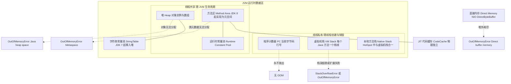
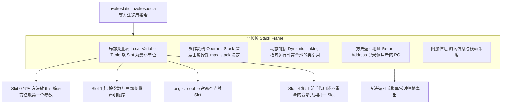
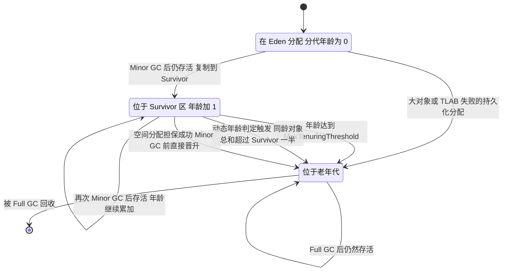
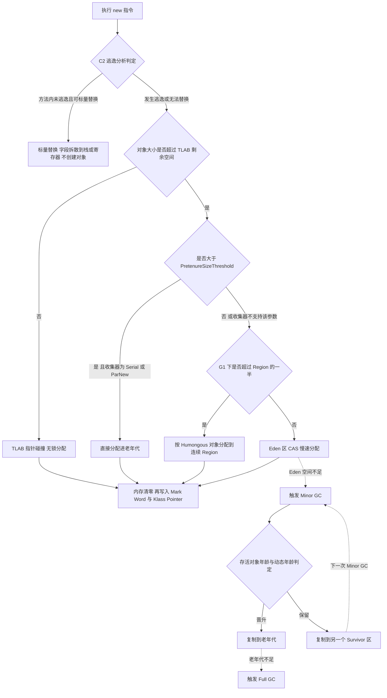
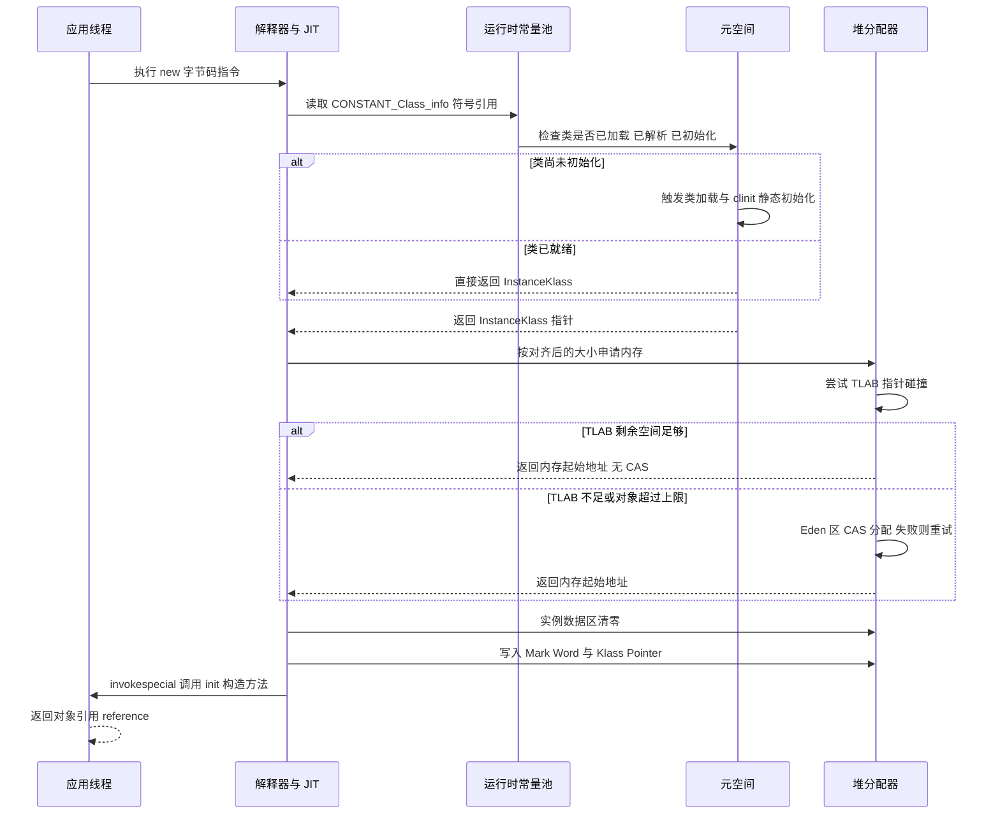
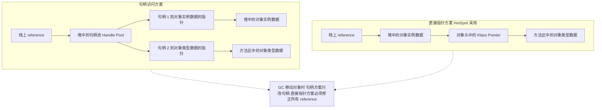
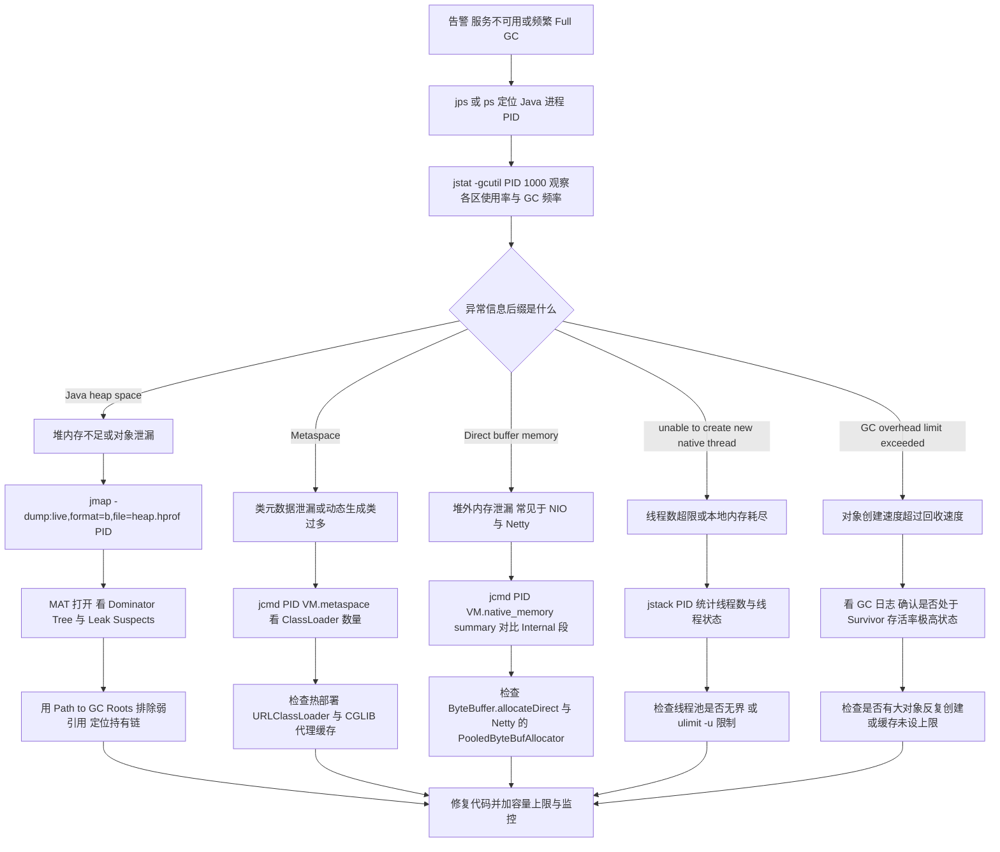

# 01 JVM 内存区域与对象创建

> 一句话定位：这是 JVM 的"地图题"，所有 GC、调优、OOM 排查都必须先落到具体内存区域上，答不清区域归属就等于没有 JVM 基础 ｜ 面试权重 ★★★★★ ｜ 建议复习 50 分钟

## 本章大纲

- [一、运行时数据区全景](#一运行时数据区全景)
- [二、栈帧结构与 Slot 复用](#二栈帧结构与-slot-复用)
- [三、堆的分代结构与默认比例](#三堆的分代结构与默认比例)
- [四、对象分配流程](#四对象分配流程)
- [五、对象内存布局与指针压缩](#五对象内存布局与指针压缩)
- [六、对象创建全过程](#六对象创建全过程)
- [七、对象访问定位](#七对象访问定位)
- [八、逃逸分析与标量替换](#八逃逸分析与标量替换)
- [九、StringTable、元空间与永久代迁移](#九stringtable元空间与永久代迁移)
- [十、各区域 OOM 复现与排查](#十各区域-oom-复现与排查)
- [十一、高级岗三问](#十一高级岗三问)
- [高频面试题](#高频面试题)
- [易错点与踩坑](#易错点与踩坑)
- [一句话速记](#一句话速记)

## 一、运行时数据区全景

### 1.1 六块内存与它们的生命周期

《Java 虚拟机规范》（Java SE 8 版，第 2.5 节）定义了五块运行时数据区，HotSpot 在实现上又多出一块"直接内存"。这六块内存的**生命周期**和**线程共享性**是两把钥匙：GC 只发生在堆上，OOM 的信息后缀直接指向是哪一块出了事。

| 区域 | 线程共享性 | 生命周期 | 存放内容 | 异常 |
| --- | --- | --- | --- | --- |
| 程序计数器 PC | 线程私有 | 与线程同生共死 | 当前线程正在执行的字节码行号；native 方法时值未定义 | 唯一不会抛 OOM 的区域 |
| 虚拟机栈 VM Stack | 线程私有 | 与线程同生共死 | 每个 Java 方法对应一个栈帧，存局部变量表、操作数栈、动态链接、返回地址 | `StackOverflowError` / `OutOfMemoryError` |
| 本地方法栈 Native Stack | 线程私有 | 与线程同生共死 | native 方法（JNI）的栈帧 | 同虚拟机栈 |
| 堆 Heap | 线程共享 | JVM 启动时创建，进程退出销毁 | 对象实例、数组 | `OutOfMemoryError: Java heap space` |
| 方法区 Method Area | 线程共享 | 逻辑上属于堆的永久区域 | 类元信息、运行时常量池、字段与方法描述符、JIT 代码缓存（CodeCache 物理上独立） | JDK 7 及以前 `OutOfMemoryError: PermGen space`；JDK 8 起 `OutOfMemoryError: Metaspace` |
| 直接内存 Direct Memory | 进程级，非 JVM 规范定义 | 由 `DirectByteBuffer` 的 `Cleaner` 决定 | `java.nio.DirectByteBuffer` 的堆外缓冲区 | `OutOfMemoryError: Direct buffer memory` |

几个必须说死的点：

1. **程序计数器是唯一不会 OOM 的区域**。它只需要存一个行号，占用是常量级；并且它是线程私有且每线程一个，不存在共享扩容问题。规范明确写了这一条。
2. **HotSpot 把本地方法栈和虚拟机栈合并成一条**。所以打印线程栈时你看到的是统一的 `JavaThread` 栈，`-Xss` 同时约束两者。栈溢出时异常栈里会出现 `Native Method` 帧，那就是本地方法栈部分。
3. **方法区是规范概念，永久代 / 元空间是 HotSpot 的实现**。JDK 7 及以前方法区用永久代实现（堆内，受 `-XX:MaxPermSize` 约束）；JDK 8 起（JEP 122）改为元空间（本地内存实现，受 `-XX:MaxMetaspaceSize` 约束）。面试里把"方法区 = 元空间"是错的。
4. **运行时常量池在 JDK 7 起被拆开**：类文件里的符号引用、字面量仍在方法区；但字符串常量池（StringTable）在 JDK 7 被搬到了堆里。这是 JDK 7 最容易被忽略的一次内存结构变更。
5. **JIT 编译产物放在 CodeCache 里**，物理上是独立的内存段，不在元空间内，用 `-XX:ReservedCodeCacheSize` 控制，默认：分层编译开启时 240MB（64 位），否则 48MB。CodeCache 满了会停止 JIT 编译（出现 `CodeCache is full` 警告），应用表现是"越来越慢"而不是 OOM。



### 1.2 为什么要有线程私有的区域

面试官问"为什么程序计数器是私有的"，标准答案是**为了线程切换后能恢复到正确的执行位置**：CPU 时间片轮转时，被切走的线程必须记住自己执行到哪条字节码。这是个纯设计问题，没有替代方案——如果 PC 共享，多线程根本无法正确交替执行。

虚拟机栈私有的理由是**方法调用是线程局部的**。一个线程调用 `a()` → `b()` → `c()`，这三层的局部变量互不干扰。如果栈共享，两个线程调用同一条方法链就会互相踩踏。替代方案是"每个方法一帧、帧存在堆上"，那是解释型语言的常见做法（例如 Python 的帧对象），代价是每次调用都要在堆上分配对象并触发 GC，而 Java 选择了用连续栈内存 + 指针移动，把方法调用的开销压到纳秒级。

堆共享的理由是**对象需要跨线程传递**。这是《Java 语言规范》里对象引用语义的前提。

## 二、栈帧结构与 Slot 复用

### 2.1 一个栈帧的四个组成部分

虚拟机栈里存的单位是**栈帧（Stack Frame）**，每调用一个 Java 方法就压入一帧，方法返回就弹出。一个栈帧由四部分组成（JVM 规范 2.6 节）：

| 组成部分 | 作用 | 编译期是否确定大小 |
| --- | --- | --- |
| 局部变量表 Local Variable Table | 存方法参数和方法体内定义的局部变量 | 是，`javap -v` 里的 `max_locals` |
| 操作数栈 Operand Stack | 字节码运算的工作区，所有计算都在这里进行 | 是，`javap -v` 里的 `max_stack` |
| 动态链接 Dynamic Linking | 指向运行时常量池中该方法所属类的引用，用于把符号引用转成直接引用 | 是，一个引用 |
| 方法返回地址 Return Address | 记录调用者的 PC，或者异常时的异常处理表入口 | 是，一个指针 |
| 附加信息 | 调试信息、栈帧深度等，规范未强制 | JVM 实现决定 |

关键结论：**局部变量表和操作数栈的大小在编译期就写死在 Code 属性里，运行期不会变化**。这是栈这个数据结构的核心优势——不需要动态扩容、不需要额外元数据、压栈出栈就是移动一个栈指针。你在 `javap -v` 里看到的 `stack=2, locals=3, args_size=1` 就是这三个值。



### 2.2 局部变量表的 Slot 语义

- **Slot 是虚拟机规范里的最小单位**，32 位。`boolean`、`byte`、`char`、`short`、`int`、`float`、`reference`、`returnAddress` 都占一个 Slot；`long` 和 `double` 占两个**连续**的 Slot（这是规范硬要求，方便用一条 64 位 load/store 指令处理）。
- **实例方法的 Slot 0 永远是 `this`**（用 `aload_0` 读取），静态方法没有 `this`，Slot 0 直接放第一个参数。这就是为什么字节码里实例方法总能看到 `aload_0`，而静态方法开头往往是 `iload_0`。
- 访问一个占两个 Slot 的 64 位变量时，只允许用**前一个 Slot 的索引**，不允许拆开访问。`javap -c` 里看不到第一个 Slot 的显式读写。

验证方式：

```java
public class SlotDemo {
    public int calc(long a, int b) {
        long c = a + b;
        return (int) c;
    }
}
```

`javap -v SlotDemo.class` 输出（JDK 8u421 实测）：

```text
public int calc(long, int);
  descriptor: (JI)I
  flags: ACC_PUBLIC
  Code:
    stack=4, locals=5, args_size=3
       0: lload_1
       1: iload_3
       2: i2l
       3: ladd
       4: lstore        4
       6: lload         4
       8: l2i
       9: ireturn
```

注意 `locals=5`：Slot 0 是 `this`，Slot 1~2 是 `long a`，Slot 3 是 `int b`，Slot 4~5 是 `long c`。三个参数（`this` + `a` + `b`）占了 `args_size=3`，但**占了 4 个 Slot**——`long` 算两个。这是调优栈深度时最容易算错的地方。

### 2.3 Slot 复用与它对 GC 的致命影响

**Slot 复用**：当一个变量的作用域结束后，它占用的 Slot 可以交给后面声明的变量复用。编译器会在方法体的 `LocalVariableTable` 属性里记录每个变量的 `start_pc` 和 `length`，重叠检测靠这两个值。

```java
public static void main(String[] args) {
    {
        byte[] placeholder = new byte[64 * 1024 * 1024];
    }
    int a = 0;
    System.gc();
}
```

这段代码在 `-Xmx128m`（或更小）下运行，**placeholder 不会被回收**，`System.gc()` 后仍然占着 64MB。原因是：变量 `placeholder` 的作用域虽然结束了，但它占用的 Slot 在 `int a = 0` 之前没有被新变量复用，于是这个 Slot 里还残留着对 64MB 数组的引用——**局部变量表是 GC Roots 的一部分**，Slot 里的引用算可达。

把 `int a = 0;` 换成 `int a = 0; int b = 0;`，或者直接写成 `placeholder = null`，立刻就能回收。**这就是 Slot 复用对 GC 的真实影响**，也是"GC Roots 到底有哪些"这道题里最容易漏的一项。

生产含义：长方法里声明过的大对象，如果方法迟迟不返回，即使对象"已经没用了"，也可能因为 Slot 未复用而被钉在内存里。经验法则是**大对象用完立刻置 null，或者把长方法拆短**。

## 三、堆的分代结构与默认比例

### 3.1 分代的物理划分

HotSpot 的堆（除 G1、ZGC 之外的分代收集器）物理上划分为新生代和老年代：

| 区域 | 默认比例参数 | HotSpot 默认值 | 说明 |
| --- | --- | --- | --- |
| 新生代 Young Gen | `-XX:NewRatio=2`（老年代:新生代） | 1:2，新生代占堆的 1/3 | 也可用 `-Xmn` 直接指定大小，`-Xmn` 与 `-XX:NewRatio` 冲突时 `-Xmn` 优先 |
| Eden | `-XX:SurvivorRatio=8`（Eden:S0） | 8:1:1，Eden 占新生代 8/10 | 实际 S0 与 S1 可能因对象搬运产生不严格相等 |
| Survivor0 / Survivor1 | 同上 | 各占新生代的 1/10 | 同一时刻只有一个 Survivor 有数据，另一个是空的 |
| 老年代 Old Gen | 新生代之外的部分 | 占堆的 2/3 | 存放长寿命对象与大对象 |

其他必须记住的数字：

- `-XX:MaxTenuringThreshold`：晋升老年代的年龄阈值，串行 / ParNew+Parallel / G1 默认 **15**，**CMS（ParNew + CMS）默认 6**。最大只能是 15，因为 Mark Word 里分代年龄只给了 4 bit。
- `-XX:TargetSurvivorRatio=50`：Survivor 空间的目标使用率，动态年龄判定用它做参照。
- `-XX:PretenureSizeThreshold`：大于该值的大对象直接在老年代分配，默认 **0（即不启用）**，且**只对 Serial 和 ParNew 有效**，Parallel Scavenge、G1、ZGC 会忽略它。
- `-XX:Xms` 与 `-XX:Xmx`：64 位 JVM 上默认 `-Xmx` 是物理内存的 1/4，`-Xms` 是 1/64。JDK 8u191 起 HotSpot 支持容器感知（`-XX:+UseContainerSupport`，默认开启，JDK 10 起成为正式特性），会用 cgroup 限额而非宿主机内存作为基数。**生产必须显式设置 `-Xms == -Xmx`**，否则堆反复扩缩容会带来额外的 Full GC。

### 3.2 为什么分代

分代的依据是**弱分代假说（Weak Generational Hypothesis）**：绝大多数对象都是朝生夕死的。实测数据（Oracle 官方 GC 调优指南）显示，新生代的 Minor GC 通常能回收 70%~95% 的对象。

分代带来的收益：
1. Minor GC 只需要扫描新生代那一小块（默认占堆 1/3），标记-复制算法代价与存活对象数量成正比而非堆大小成正比。
2. 老年代增长慢，Full GC 频率低。
3. 可以针对不同区域选不同算法：新生代用复制算法（存活少、无碎片），老年代用标记-清除或标记-整理。

代价是**跨代引用**：老年代对象引用新生代对象时，Minor GC 只扫新生代就会漏掉这条引用链。解决方案是**卡表（Card Table）**：把老年代按 512 字节切成一张"卡"，用写屏障（Write Barrier）在引用赋值时把对应的卡标记为 dirty；Minor GC 时只扫描 dirty 的卡作为 GC Roots 的一部分。这个值在 HotSpot 里是固定的 `card_size = 512`（`1 << 9`）。**这就是"为什么 Minor GC 不用扫全堆"的底层答案**，也是记忆集（Remembered Set，G1 里叫 RSet）的鼻祖。

### 3.3 对象在堆中的生命周期



## 四、对象分配流程

### 4.1 分配的五个层次

对象分配不是"在 Eden 找个位置"这么简单，HotSpot 的处理顺序是一条约五层的流水线，越靠前越廉价：

1. **逃逸分析 + 标量替换**（编译期，C2）：对象未逃逸且可拆散时不创建对象，字段直接用寄存器或栈 Slot 承载。这是最廉价的一层，也是面试里最容易被忽略的一层。
2. **TLAB 分配**（Thread Local Allocation Buffer）：每个线程在 Eden 里预先划走一小块私有缓冲区，分配时只做"指针碰撞"（bump-the-pointer），**完全不需要 CAS**。
3. **Eden 慢速分配**：TLAB 不够时，用 CAS 在 Eden 里重新分配一块（或直接在 Eden 分配大对象）。
4. **老年代直接分配**：对象大小超过 `-XX:PretenureSizeThreshold`（仅 Serial/ParNew），或 G1 下对象超过 Region 一半（Humongous 对象）。
5. **动态年龄判定与空间分配担保**：Minor GC 时决定哪些对象活过这次 GC 就能直接进老年代。

### 4.2 TLAB 的三个关键参数与默认值

| 参数 | 默认值 | 作用 |
| --- | --- | --- |
| `-XX:+UseTLAB` | **true**（JDK 6 起默认开启） | 开关 TLAB |
| `-XX:TLABSize` | 0（自动推导） | 显式指定 TLAB 大小；为 0 时 HotSpot 按 `-XX:TLABAllocationWeight` 与 Eden 大小自适应 |
| `-XX:TLABAllocationWeight` | **35** | 自动推导 TLAB 大小时的权重，值越大 TLAB 越小、重填越频繁 |
| `-XX:TLABWasteTargetPercent` | **1** | 允许被浪费的 Eden 空间百分比。TLAB 尾部剩余空间不足以分配时会产生"TLAB 内部碎片"，超过 1% 就触发重填（refill） |
| `-XX:TLABRefillWasteFraction` | **64** | 单次浪费的容忍上限为 TLAB 大小的 1/64 |
| `-XX:MinTLABSize` | **2048** 字节 | TLAB 最小尺寸 |

TLAB 的两个副作用必须知道：

- **TLAB 内部碎片**：TLAB 尾部剩下的空间如果装不下新对象，这块空间就直接浪费。这也是"为什么堆显示用了 900MB，但实际对象只有 880MB"的常见原因之一。
- **TLAB 只服务小对象**。对象超过 TLAB 剩余空间时会走慢速分配；HotSpot 对超过 `TLAB 大小的 1/2`（实际由 `-XX:TLABSize` 与分配路径决定）的对象会直接走 Eden 慢速分配。

### 4.3 指针碰撞与空闲列表

分配内存有两种实现，取决于 GC 是否做**压缩整理（compact）**：

| 分配方式 | 适用收集器 | 原理 | 代价 |
| --- | --- | --- | --- |
| 指针碰撞 Bump the Pointer | Serial、ParNew、Parallel Scavenge、G1 的 Region 内 | 维护一个 `top` 指针，分配就是把 `top` 往后挪 size 字节 | 需要内存规整 |
| 空闲列表 Free List | CMS（标记-清除，不做整理） | 维护一张空闲块链表，挑一个够大的块切出去 | 碎片化，分配要遍历/查表 |

**并发安全**问题：即使是指针碰撞，多线程同时挪 `top` 也会冲突。HotSpot 用两种手段解决：① TLAB，让每个线程在自己的缓冲区里独占挪指针，无需同步；② 失败时退化为 CAS + 失败重试（`Atomic::cmpxchg`）。

### 4.4 完整分配流程图



### 4.5 动态年龄判定与空间分配担保

**动态年龄判定**（HotSpot 在 `DefNewGeneration::collect` / `PSAdaptiveSizePolicy` 里的实际行为）：

> 在 Survivor 空间中，如果**相同年龄的所有对象大小总和大于 Survivor 空间的一半**（`-XX:TargetSurvivorRatio=50`），那么年龄大于或等于该年龄的对象就可以直接进入老年代，无需等到 `MaxTenuringThreshold`。

这道题的完整表述要带上三个条件：① 只有年龄 1 到 `MaxTenuringThreshold` 之间的年龄段参与计算；② 是"同龄对象总和"，不是"全部对象总和"；③ 一旦触发，**大于等于该年龄**的都会晋升，所以实际晋升年龄常远小于 15。

**空间分配担保**：Minor GC 之前，JVM 要判断老年代是否有足够空间接收这次晋升的对象。判断逻辑是：

1. 如果**老年代最大可用连续空间 > 新生代所有对象总大小**，则 Minor GC 一定安全，直接执行。
2. 否则，查看 `-XX:HandlePromotionFailure` 是否允许担保失败。允许的话，再判断**老年代最大可用连续空间是否 > 历次晋升到老年代对象的平均大小**；大于则冒险尝试 Minor GC，小于或担保被禁止则直接改为 Full GC。

注意：**`-XX:HandlePromotionFailure` 从 JDK 6 Update 24 起不再影响虚拟机的担保策略**，HotSpot 直接按上述第 2 条的"平均值"判断，在 JDK 8 上显式设置该参数会被忽略。面试答这条要带上版本，否则会露怯。

## 五、对象内存布局与指针压缩

### 5.1 三部分结构

一个对象在堆里的布局分三块（HotSpot，64 位）：

| 部分 | 大小（开启压缩指针） | 大小（关闭压缩指针） | 内容 |
| --- | --- | --- | --- |
| 对象头 - Mark Word | 8 字节 | 8 字节 | 哈希码、分代年龄、锁状态标志、偏向线程 ID、偏向时间戳、GC 标记 |
| 对象头 - 类型指针 Klass Pointer | 4 字节 | 8 字节 | 指向方法区中该对象的 `InstanceKlass` |
| 数组长度（仅数组对象） | 4 字节 | 4 字节 | 数组元素个数，`arraylength` 指令读取 |
| 实例数据 Instance Data | 由字段决定 | 由字段决定 | 各字段值 |
| 对齐填充 Padding | 补到 8 的整数倍 | 补到 8 的整数倍 | 无实际含义 |

所以：**开启压缩指针时，普通对象头 = 12 字节，数组对象头 = 16 字节；关闭压缩指针时统一是 16 字节**。`new Object()` 在开启压缩指针的 64 位 HotSpot 上是 **16 字节**（12 字节头 + 4 字节对齐填充）。

用 JOL（`org.openjdk.jol:jol-core`）可以亲眼验证：

```java
Object o = new Object();
System.out.println(ClassLayout.parseInstance(o).toPrintable());
```

JDK 8u421 + jol-core 0.16 实际输出：

```text
java.lang.Object object internals:
 OFFSET  SIZE   TYPE DESCRIPTION                               VALUE
      0     4        (object header)                           01 00 00 00 (00000001 ...)
      4     4        (object header)                           00 00 00 00 (00000000 ...)
      8     4        (object header)                           e5 01 00 f8 (11100101 ...)
     12     4        (loss due to the next object alignment)
Instance size: 16 bytes
Space losses: 0 bytes internal + 4 bytes external = 4 bytes total
```

第 12 字节开始的 4 字节是**纯浪费**——没有任何数据放在那里，只是为了满足 8 字节对齐。

### 5.2 Mark Word 的位布局

64 位 HotSpot 的 Mark Word（8 字节）在不同状态下复用同一块空间：

| 状态 | bit 63~39 | bit 38~8 | bit 7 | bit 6~3 | bit 2 | bit 1~0 |
| --- | --- | --- | --- | --- | --- | --- |
| 无锁 Normal | unused（25 bit） | identity_hashcode（31 bit） | unused | 分代年龄（4 bit） | biased_lock = 0 | `01` |
| 偏向锁 Biased | 偏向线程 ID（54 bit，占 bit 63~10） | epoch（2 bit，占 bit 9~8） | unused | 分代年龄（4 bit） | biased_lock = 1 | `01` |
| 轻量级锁 Lightweight | 指向线程栈中 Lock Record 的指针（62 bit） | | | | | `00` |
| 重量级锁 Heavyweight | 指向 ObjectMonitor 的指针（62 bit） | | | | | `10` |
| GC 标记 Marked | 空（GC 自己使用） | | | | | `11` |

关键点：

- **分代年龄只有 4 bit**，取值 0~15。这就是 `MaxTenuringThreshold` 上限为 15 的硬件原因。
- **`identity_hashcode` 是 31 位**（不是 32 位），惰性计算：只有调用 `Object#hashCode()` 或 `System.identityHashCode()` 时才写入。**一旦写入，偏向锁就无法建立**——因为那 54 位被线程 ID 占着。这是"为什么重写了 `hashCode` 的集合元素上偏向锁失效"的根因。
- **锁状态占低 2 位（bit 1~0），bit 2 是偏向标志**。无锁与偏向锁的低 2 位都是 `01`，靠 bit 2 区分：bit 2 = 0 是无锁（JOL 打印值为 `0x1`），bit 2 = 1 是匿名偏向（JOL 打印值为 `0x5`）。轻量级锁是 `00`，重量级锁是 `10`，GC 标记是 `11`。

### 5.3 实例数据的字段排列规则

HotSpot 的字段分配策略（`-XX:FieldsAllocationStyle`，默认值 1）：

1. **父类字段排在子类字段之前**。
2. 同一类内部，按字段宽度从大到小排列：`long`/`double` → `int`/`float` → `short`/`char` → `byte`/`boolean` → `reference`。
3. 相同宽度的字段尽量连续分配，减少填充。
4. 如果 `+XX:+CompactFields`（**默认 true**），子类的窄字段可以插进父类字段的间隙里。

最后一条规则非常重要：**不要靠调整 Java 字段声明顺序来省内存**。默认开启 `CompactFields` 后，HotSpot 已经帮你重排了；实测手动按大小排序的收益通常在 0~8 字节之间，不值得为此牺牲可读性。真正省内存要靠把 `int` 换成 `short`、"用原语数组替代对象数组"、"用对象池替代逐条对象"这类结构性优化。

### 5.4 指针压缩

64 位 JVM 上裸指针是 8 字节，会让对象头翻倍、引用数组膨胀。HotSpot 用**压缩普通对象指针（Compressed Oops）**解决：

| 参数 | 默认值 | 作用 | 生效条件 |
| --- | --- | --- | --- |
| `-XX:+UseCompressedOops` | **true**（JDK 6 起，堆 ≤ 32GB 时） | 把对象引用从 8 字节压到 4 字节 | 堆小于约 32GB；超出后自动失效 |
| `-XX:+UseCompressedClassPointers` | **true**（JDK 8 起） | 把 Klass Pointer 从 8 字节压到 4 字节 | 需 `UseCompressedOops` 同时开启 |
| `-XX:ObjectAlignmentInBytes` | **8** | 对象对齐字节数，压缩指针寻址粒度 | 可调到 16，把 32GB 上限提到 64GB |
| `-XX:CompressedClassSpaceSize` | **1GB** | 类指针压缩专用空间，位于元空间内 | 类加载器过多时可能成为瓶颈 |

原理：压缩指针不是"直接存 32 位地址"，而是**存"以 8 字节为粒度的偏移量"**。4 字节的 oop 最大表示 2^32 个粒度，乘以 8 = 2^35 = 32GB。所以：堆 ≤ 32GB 时压缩指针可用；堆 > 32GB 时 JVM 会关闭 `UseCompressedOops`，**对象引用体积翻倍，同一个应用反而更耗内存**。

这就是那条著名的经验法则：**堆开到 31GB 比开到 33GB 能装更多对象**。粗略估算，堆 32GB 且开启压缩指针，实际可用对象空间相当于关闭压缩指针时的约 1.5 倍。

验证命令：

```bash
java -XX:+PrintFlagsFinal -version | grep -E "UseCompressedOops|UseCompressedClassPointers|ObjectAlignmentInBytes"
java -Xmx31g -XX:+PrintFlagsFinal -version | grep UseCompressedOops   # true
java -Xmx33g -XX:+PrintFlagsFinal -version | grep UseCompressedOops   # false
```

## 六、对象创建全过程

### 6.1 从 new 到 init 的五步

`new` 一条字节码指令背后是五步（《深入理解 Java 虚拟机》的经典划分，与 HotSpot 的 `InterpreterRuntime::_new` 实现一致）：

| 步骤 | HotSpot 实现位置 | 做了什么 |
| --- | --- | --- |
| 1. 类加载检查 | 解释器 / `InterpreterRuntime::_new` | 取常量池的类符号引用，检查是否已加载、解析、初始化；没有则先触发类加载 |
| 2. 分配内存 | `CollectedHeap::obj_allocate` | 按对象大小在堆中划出内存（TLAB / Eden / 老年代） |
| 3. 内存清零 | `MemAllocator::allocate` 内的 `Copy::zero_to_bytes` | 把分配到的内存全部置零（**不含对象头**），这解释了"字段有默认值" |
| 4. 设置对象头 | `oopDesc::init_mark` / `oopDesc::set_klass` | 写入 Mark Word（初始为无锁或偏向）、Klass Pointer（指向 InstanceKlass） |
| 5. 执行 `<init>` | 字节码 `invokespecial` | 调用构造方法，按程序员写的顺序初始化字段 |

**注意第 3 步的顺序**：零值初始化在对象头设置**之前**？规范描述是先分配、再零值、再设置对象头。HotSpot 的 `MemAllocator::allocate` 里的顺序是：分配内存 → `Copy::zero_to_bytes` 清零（对 TLAB 分配只清实例数据部分，对象头由 `init_mark` 单独写）→ 由调用方 `oopDesc::addr_at(0)` 构造 oop 并设置 klass。**结论：零值是"实例数据部分"清零，对象头的写入是单独一步，两者不冲突。** 面试里说"先清零再设置对象头"是安全的。

第 5 步里有个高频陷阱：**如果类有父类，`<init>` 里会先 `invokespecial` 调用父类 `<init>`，再初始化自己的字段**。所以 `new Son()` 时父类字段的初始化先于子类字段。而从第 1 步到第 4 步之间，`this` 已经存在但所有字段都是零值（`null` / `0` / `false`）——这就是"构造方法里调用可被子类重写的方法会出问题"（`this` 逃逸）的根因。

### 6.2 类加载检查触发什么

`new` 指令在常量池里对应的是一项 `CONSTANT_Class_info`（`javap -v` 里显示为 `#3 = Class #24 // java/lang/Object`）。JVM 检查三件事：

1. 该符号引用代表的类**是否已经加载**（在方法区里有 `InstanceKlass`）；
2. 是否已经**解析**（符号引用已转直接引用）；
3. 是否已经**初始化**（`<clinit>` 已执行）。

任何一步没完成都会触发对应阶段。**这就是为什么 `new` 会触发类初始化**——首次 `new Singleton()` 会执行静态初始化块，这也是"单例的懒加载"必须用类变量而不是静态方法的原因之一。

### 6.3 对象创建时序图



### 6.4 创建时机与几个容易答漏的入口

除 `new` 外，还有五种方式会在堆上产生对象，面试里常用来做追问：

| 方式 | 字节码 / API | 是否调用构造方法 |
| --- | --- | --- |
| `new` 关键字 | `new` + `dup` + `invokespecial <init>` | 是 |
| 反射 `Class#newInstance` | JDK 8 起走 `Constructor#newInstance` | 是 |
| 反射 `Constructor#newInstance` | 同上 | 是 |
| `Object#clone` | `invokevirtual clone` | **否**，直接复制内存 |
| 反序列化 `ObjectInputStream#readObject` | 无字节码，由 JVM 直接构造 | **否** |
| Unsafe `allocateInstance` | `sun.misc.Unsafe#allocateInstance` | **否** |

`clone`、反序列化、`Unsafe.allocateInstance` 这三条**不执行构造方法**，所以对象可能处在字段未初始化的"半成品"状态——这是单例模式被反射或反序列化破坏之外的另一类安全漏洞来源（比如绕过构造方法里的校验逻辑）。

## 七、对象访问定位

### 7.1 两种方案

栈上的 `reference` 怎么找到堆上的对象，有两种实现：

| 维度 | 句柄访问 Handle | 直接指针 Direct Pointer |
| --- | --- | --- |
| reference 指向 | 堆中句柄池的一个句柄 | 堆中的对象本身 |
| 额外结构 | 需要句柄池，每个对象多 8~16 字节 | 无 |
| 访问对象的字段 | 两次指针解引用 | 一次指针解引用 |
| 对象移动时（GC 压缩） | **只改句柄，reference 不用变** | **必须修改所有 reference** |
| 空间开销 | 每个对象多一个句柄 | 无 |
| 实现复杂度 | 分配/回收句柄需要额外管理 | 简单 |
| 典型实现 | Sun Classic VM、部分移动式 JVM | **HotSpot（所有版本）** |

HotSpot 选择直接指针的核心理由：**访问频率极高**。对象访问是字节码里最热的操作，多一层间接寻址在 C2 优化的代码里是实打实的 IPC 损失。而"对象移动时改 reference"这个代价，HotSpot 通过与 GC 协作完成——GC 搬运对象时，通过**卡表 / RSet 与 Forwarding Pointer** 在存活对象上留下转发地址，再统一修正栈、寄存器、其他对象里的引用。这部分开销已经包含在 GC 的 STW 时间里了，不需要额外结构。



### 7.2 一个常见的错误说法

面试里常有人说"HotSpot 用句柄，因为 GC 会移动对象"。这是**错的**，正确的答案是：

- HotSpot 使用**直接指针**；
- GC 移动对象后修正 reference 是必要的，但修正靠的是 GC 自身的根扫描与引用更新（`GenCollectedHeap::GenProcessRoots`、`CompactibleSpace::adjust_pointers`），不需要句柄池；
- 判决性依据：`-XX:PrintFlagsFinal` 里没有句柄相关开关，而 JOL 打印的对象头第 8 字节就是 Klass Pointer 直接位于对象内部。

## 八、逃逸分析与标量替换

### 8.1 逃逸分析的三种判定结果

逃逸分析（Escape Analysis）是 `-XX:+DoEscapeAnalysis`（**JDK 6u23 起默认 true**）控制的 JIT 优化。它分析一个对象的引用会不会"逃出"方法或线程：

| 结果 | 判定条件 | 可做的优化 |
| --- | --- | --- |
| 不逃逸 No Escape | 对象只在方法内使用，没被赋值给字段、没被返回、没被放进逃逸的集合、没传给其他线程 | 标量替换、栈上分配、锁消除 |
| 方法逃逸 Arg Escape | 作为参数传给其他方法，但没出线程 | 部分锁消除 |
| 线程逃逸 Global Escape | 赋值给静态字段、被其他线程访问、被返回 | 无优化 |

### 8.2 标量替换是 HotSpot 真正落地的优化

**HotSpot 从未实现教科书意义上的"栈上分配"**——对象实体仍然在堆上分配。真正落地的是**标量替换（Scalar Replacement）**：把一个对象拆散成若干个标量（primitive 或 reference），直接放在栈的 Slot 或寄存器里，**根本不创建对象**。

```java
public int distance() {
    Point p = new Point(1, 2);   // Point 只在方法内使用，不逃逸
    return p.x * p.x + p.y * p.y;
}
```

C2 编译后，上面这段代码不会分配 `Point` 对象，`p.x` 和 `p.y` 直接变成两个寄存器/栈槽。开关是 `-XX:+EliminateAllocations`（**默认 true**）。

需要说清的三个边界：

1. **没被 C2 编译的方法不会做逃逸分析**。解释执行或 C1 编译的代码里对象照样在堆上分配。所以"为什么我的测试没看到标量替换"通常是方法没到编译阈值（`-XX:CompileThreshold=10000`，分层编译下由 `Tier4InvocationThreshold` 等控制）。
2. **逃逸分析本身有编译开销**，C2 里是 `ConnectionGraph` 的构造与迭代（`EscapeAnalysisIterations`、`EscapeAnalysisTimeout` 等内部参数控制收敛），对象引用关系复杂时会让编译时间显著变长。这是 JDK 6 之后一直存在的编译期代价，与运行期收益之间需要实测权衡。
3. **锁消除（`-XX:+EliminateLocks`，默认 true）依赖同一份分析结果**。局部 `StringBuffer` 的性能与 `StringBuilder` 相当，就是因为它的锁被消除了。

## 九、StringTable、元空间与永久代迁移

### 9.1 两次内存结构变更

| 版本 | 变更 | 影响 |
| --- | --- | --- |
| JDK 7（2011） | 字符串常量池（StringTable）和静态变量从永久代移到堆 | `String#intern()` 行为变化；永久代更容易 OOM |
| JDK 8（2014，JEP 122） | 永久代完全移除，方法区改由**元空间 Metaspace** 实现，位于本地内存 | `-XX:PermSize` / `-XX:MaxPermSize` 被忽略并给出警告；改 `-XX:MetaspaceSize` / `-XX:MaxMetaspaceSize` |
| JDK 8 | 类指针压缩独立出 `CompressedClassSpace` | `-XX:CompressedClassSpaceSize` 默认 1GB，属元空间的一部分 |

迁移的原因（面试常问"为什么废弃永久代"）：

1. **永久代大小难以预估**。`-XX:MaxPermSize` 默认 64 位下是 82MB、`PermSize` 默认约 21MB，动态生成类（CGLIB、反射、JSP、Groovy、OSGi）多一点的框架很容易打满，且打满之后 Full GC 也未必能回收，只能重启。
2. **永久代与老年代共享堆空间**，导致堆调优参数互相干扰：为了让永久代不 OOM 调大堆，反而让 Full GC 时间变长。
3. **元空间用本地内存，天然不受堆上限约束**，类元数据的回收可以与老年代 GC 解耦（元空间有独立的 `MetaspaceGC` 阈值与 `_capacity_until_GC`）。
4. **为 JRockit 与 HotSpot 的融合铺路**（Oracle 收购 BEA 后需要统一虚拟机实现）。

### 9.2 元空间的关键参数

| 参数 | JDK 8 默认值 | 说明 |
| --- | --- | --- |
| `-XX:MetaspaceSize` | 约 21MB（21807104 字节） | **首次触发 Metaspace GC 的阈值，不是元空间的初始大小**。很多资料把它翻译成"初始大小"，是错的 |
| `-XX:MaxMetaspaceSize` | **-1（不限制）** | 不设置时只受本地内存限制，一旦泄漏就是耗尽宿主机内存，远比堆 OOM 危险 |
| `-XX:MinMetaspaceFreeRatio` | 40 | GC 后空闲比例低于该值就扩大阈值 |
| `-XX:MaxMetaspaceFreeRatio` | 70 | GC 后空闲比例高于该值就缩小阈值 |
| `-XX:CompressedClassSpaceSize` | 1GB | 类指针压缩空间 |
| `-XX:+CMSClassUnloadingEnabled` | JDK 8 默认 true（配合 CMS 使用） | 允许卸载类；`-XX:+ClassUnloading` 在 JDK 8 中默认 true |

**生产建议**：`-XX:MaxMetaspaceSize=256m`（按框架规模 256m~512m）。理由是元空间默认无上限，一旦类加载器泄漏（典型是 `ThreadLocal` 里存了大 ClassLoader、热部署残留、`URLClassLoader` 没关），表现是宿主机内存被吃满，`top` 里看到 RSS 一路涨而堆却正常，排查难度远高于堆 OOM。

### 9.3 StringTable 的关键点

- **JDK 7 起 StringTable 在堆里**，所以 `new String("abc").intern()` 超出新生代时会被 Minor GC 当成普通对象回收。
- `StringTableSize` 是**桶数量**，JDK 8 默认 **60013**（一个质数）。大量使用 `intern()` 的应用应该调大到 `-XX:StringTableSize=1000003` 甚至更大，否则 `intern()` 会退化成链表遍历。
- `-XX:+PrintStringTableStatistics`（**JDK 7u6 及以上**）可以在 JVM 退出时打印 StringTable 的桶数、条目数、总大小，是判断"要不要调大 StringTableSize"的直接依据。
- **JDK 8 中 `intern()` 不会复制字符串**：如果堆里已有等值字符串，直接返回堆中那份的引用；没有才把当前字符串的引用放进 StringTable。JDK 6 及以前是复制到永久代。这个差异导致 JDK 6 时代"用 `intern()` 去重"的优化在 JDK 7+ 上语义不同。**不要靠 `intern()` 做去重缓存**：被 `intern()` 过的字符串会被 StringTable 长期持有，大量唯一的动态字符串（订单号、URL、用户输入）`intern()` 之后就是典型的 StringTable 膨胀，表现是堆 OOM 而对象直方图里 `char[]` 与 `String` 数量异常巨大。要缓存请用自己的 `ConcurrentHashMap` 加容量上限（Guava/Caffeine 的 `maximumSize`）。

## 十、各区域 OOM 复现与排查

### 10.1 五类 OOM 的复现参数与日志特征

| 区域 | 复现参数 | 异常信息 | 排查手段 |
| --- | --- | --- | --- |
| 堆 | `-Xms20m -Xmx20m -XX:+HeapDumpOnOutOfMemoryError -XX:HeapDumpPath=/tmp/h.hprof` | `java.lang.OutOfMemoryError: Java heap space` | MAT 打开 hprof 看 Dominator Tree；`jmap -histo:live` 看 Top 类 |
| 元空间 | `-XX:MetaspaceSize=10m -XX:MaxMetaspaceSize=10m` + CGLIB 动态生成类 | `java.lang.OutOfMemoryError: Metaspace` | `jcmd <pid> VM.metaspace`（JDK 8+）；看 `jstat -gc` 的 `MC`/`MU`/`MCMN`/`MCMX` 列 |
| 虚拟机栈 | `-Xss128k` + 无限递归 | `java.lang.StackOverflowError` | `jstack` 看线程栈深度；定位递归或过深调用链 |
| 线程创建失败 | 无限 `new Thread()` + `-Xss2m` | `java.lang.OutOfMemoryError: unable to create new native thread` | `jstack` 看线程数；`ulimit -u` 看进程线程数限制；`/proc/<pid>/status` 的 `Threads` |
| 直接内存 | `-XX:MaxDirectMemorySize=10m` + `ByteBuffer.allocateDirect` | `java.lang.OutOfMemoryError: Direct buffer memory` | `jcmd <pid> VM.native_memory summary`（需 `-XX:NativeMemoryTracking=summary`）；NMT 的 `Internal` / `Other` 段 |
| GC 开销超限 | 默认开启 `-XX:+UseGCOverheadLimit`，`-XX:GCTimeLimit=98`、`-XX:GCHeapFreeLimit=2` | `java.lang.OutOfMemoryError: GC overhead limit exceeded` | 看 GC 日志：GC 时间占比 > 98% 且每次回收不到 2%，是"垃圾产生速度 > 回收速度"的强信号 |

### 10.2 关键 JVM 参数速查

```bash
# 让 OOM 时自动 dump 并退出，这是生产必备
-XX:+HeapDumpOnOutOfMemoryError
-XX:HeapDumpPath=/data/dump
-XX:+ExitOnOutOfMemoryError      # JDK 8u92 起支持；OOM 后直接退出，交给 K8s 重启
-XX:+CrashOnOutOfMemoryError      # OOM 时生成 core dump 并崩溃

# GC 日志（JDK 8）
-XX:+PrintGCDetails -XX:+PrintGCDateStamps -Xloggc:/data/gc.log -XX:+PrintGCApplicationStoppedTime

# GC 日志（JDK 9+ 统一日志框架）
-Xlog:gc*,gc+heap=debug,gc+age=trace:file=/data/gc.log:time,uptime,level,tags:filecount=10,filesize=50m
```

注意 `-XX:+PrintGCDetails` 在 **JDK 9 起被废弃**，JDK 9+ 必须改用 `-Xlog:gc*`。写面试答案时混用 JDK 8 和 JDK 9+ 的参数是常见扣分点。

### 10.3 线上 OOM 排查流程



### 10.4 常用的排查命令与它们的副作用

| 命令 | 作用 | 副作用 |
| --- | --- | --- |
| `jps -lvm` | 列出 Java 进程与启动参数 | 无 |
| `jstat -gcutil <pid> 1000 10` | 每秒打印各分区使用率与 GC 次数/耗时 | 无，可在生产常驻 |
| `jinfo -flags <pid>` | 查看**运行时生效**的 JVM 参数（含 `-XX:+PrintFlagsFinal` 里的默认值） | 无 |
| `jcmd <pid> VM.flags` | 同上，JDK 7 起推荐 | 无 |
| `jmap -histo <pid>` | 打印对象直方图 | 轻微 STW |
| `jmap -histo:live <pid>` | 只统计存活对象 | **触发一次 Full GC**，生产慎用 |
| `jmap -dump:live,format=b,file=x.hprof <pid>` | 导出堆快照 | **STW + 写盘**，大堆可能几十秒；`live` 会先 Full GC |
| `jcmd <pid> GC.heap_info` | 打印堆各分区容量与使用量 | 无 |
| `jcmd <pid> VM.metaspace` | 打印元空间明细 | 无 |
| `jstack <pid>` | 打印线程栈 | 无（有极短的 safepoint） |
| `jcmd <pid> Thread.print` | 同上，JDK 7 起推荐 | 无 |

`jmap -dump:live` 的 STW 是生产事故的高发点。高流量服务导出几 GB 堆时，**先摘流量再 dump**，或者用 `-XX:+HeapDumpOnOutOfMemoryError` 让 JVM 在 OOM 那一刻自动导出。

## 十一、高级岗三问

### 11.1 为什么这么设计？

**问题一：为什么 PC 是私有的？** 因为线程切换后必须恢复执行位置，共享会让多线程交替执行失去基准。这是唯一没有替代方案的区域。

**问题二：为什么栈是私有的？** 方法调用天然是线程局部的，替代方案（帧对象放堆上）会把每次方法调用变成一次对象分配，代价是 GC 压力数量级的上升。

**问题三：为什么堆要分代？** 弱分代假说成立的前提下，分代能把 Minor GC 的代价从 O(n=堆大小) 降到 O(n=存活对象数)，实测回收率 70%~95%。代价是跨代引用需要卡表，堆结构变复杂。

**问题四：为什么用元空间替换永久代？** 永久代的大小难预估且与堆共享空间，动态生成类的框架极易打满；元空间用本地内存 + 可独立触发 Metaspace GC，把类元数据的管理从堆调优里解耦出来。代价是默认无上限，`MaxMetaspaceSize` 必须显式设置。

**问题五：为什么 HotSpot 不用句柄？** 对象访问是最高频操作，句柄多一次间接寻址；而"GC 搬运对象需要修正引用"这个代价本来就要在 GC 里付，句柄带来的只是把一部分工作从 GC 转移到每次访问，反而更贵。

### 11.2 线上出问题怎么定位？

第一原则是**先看异常后缀，异常后缀就是内存区域的名字**。

- `Java heap space` → 堆。`jmap -dump:live` + MAT。
- `Metaspace` → 元空间。`jcmd <pid> VM.metaspace`，看 ClassLoader 数量。
- `Direct buffer memory` → 直接内存。NMT：`-XX:NativeMemoryTracking=summary` + `jcmd <pid> VM.native_memory summary`。
- `unable to create new native thread` → 线程数。`jstack` 统计线程数，`ulimit -u` 看限制。
- `StackOverflowError` → 栈深。`jstack` 看递归深度。
- 没有 OOM 但 RSS 一直涨 → 优先怀疑直接内存、线程栈（每个线程 `-Xss` 默认 1MB × 2000 线程 = 2GB）、JIT CodeCache、以及内核页缓存。

第二原则是**先止损再定位**。止损手段：扩容实例 / 重启实例 / 摘流量，同时保留现场（`-XX:+HeapDumpOnOutOfMemoryError` 已经自动 dump 到 `HeapDumpPath`）。

### 11.3 规模变大后会怎样？

- **堆变大**：一旦超过 32GB，压缩指针自动失效，引用体积翻倍，**内存效率反而下降**。要么控制在 31GB 以内用多实例，要么用 G1/ZGC 并接受这个代价。
- **线程变多**：每个线程的栈默认 1MB（`-Xss1m`），2000 个线程就是 2GB 栈内存，且这部分**不在堆里，不受 `-Xmx` 约束**，很容易被忽略。虚拟线程（JDK 21）正是为解决这个问题，栈按需增长且存储在堆上。
- **类变多**：`-XX:CompressedClassSpaceSize` 默认 1GB，Spring Boot + 大量 CGLIB 代理的实例可能吃满，表现是元空间 OOM 但 `MaxMetaspaceSize` 还没到。
- **TLAB 冲突**：线程数远超 CPU 核数时，TLAB 频繁 refill，Eden 的 CAS 竞争上升，表现为分配速率下降。
- **老年代增长加速**：Survivor 太小而对象存活时间长（比如长生命周期的缓存对象），会频繁触发动态年龄判定导致对象提前晋升，最终频繁 Full GC。这是"缓存对象撑爆老年代"的经典模式，修法是给缓存设容量上限并改用 `-XX:CMSInitiatingOccupancyFraction` 或 G1 的 `-XX:InitiatingHeapOccupancyPercent`（默认 45）提前触发并发标记。

## 高频面试题

### Q1. JVM 运行时数据区有哪些？哪些线程共享、哪些私有？

**答题框架（30 秒版）**：五块规范定义的区域加一块直接内存。私有的三块是程序计数器、虚拟机栈、本地方法栈；共享的两块是堆和方法区（JDK 8 起方法区由元空间实现）；直接内存是进程级的堆外内存。

**展开（2 分钟版）**：
1. 程序计数器线程私有，存当前线程执行的字节码行号，执行 native 方法时为 undefined，**是唯一不会抛 OOM 的区域**。
2. 虚拟机栈线程私有，每调用一个 Java 方法压入一个栈帧；HotSpot 里**本地方法栈与虚拟机栈合并**，所以 `-Xss` 同时约束两者。
3. 堆线程共享，JVM 启动时创建，存对象实例与数组，是 GC 的主要战场。
4. 方法区线程共享，JDK 7 及以前由永久代实现（堆内），JDK 8 起由元空间实现（本地内存），存类元信息、字段方法描述符、运行时常量池。
5. 直接内存不是规范定义的区域，`DirectByteBuffer` 用它，`-XX:MaxDirectMemorySize` 控制，**未设置时默认等于 `-Xmx`**。

**追问**：字符串常量池在哪？答：JDK 7 起在堆里（从永久代搬过来的），JDK 6 及以前在永久代。

### Q2. 为什么程序计数器不会 OOM？栈溢出和栈 OOM 有什么区别？

**答题框架（30 秒版）**：PC 只需要存一个行号，占用是常量级的，且每线程独立、不共享扩容，规范明确写它不抛 OOM。栈的两类异常语义不同：`StackOverflowError` 是**栈深度超过 `-Xss` 限制**，`OutOfMemoryError` 是**栈扩展时申请不到内存**。

**展开（2 分钟版）**：
1. HotSpot 的虚拟机栈**不支持动态扩展**，`-Xss` 在启动时就固定了栈容量，所以实际生产中单线程递归几乎只会看到 `StackOverflowError`。
2. 栈 OOM 的典型场景是**多线程**：不断 `new Thread()`，每个线程都要分配一份 `-Xss` 大小的栈，系统本地内存耗尽时报 `unable to create new native thread`，而不是栈本身的 OOM。
3. 排查 `StackOverflowError`：`jstack` 看线程栈顶，定位递归或过深调用链；注意异常栈里会打印几百行，通常只需要看**重复的那几帧**。
4. 排查 `unable to create new native thread`：`jstack <pid> | grep '^"' | wc -l` 数线程数；`cat /proc/<pid>/status | grep Threads`；`ulimit -u` 看进程数限制；`cat /proc/sys/kernel/threads-max`。

**追问**：`-Xss` 默认多少？答：Linux x64 上 JDK 8 和 JDK 11 的 HotSpot 默认都是 1MB。JDK 21 的虚拟线程不受 `-Xss` 控制，其栈按需增长并存储在堆上。

### Q3. 局部变量表的 Slot 是什么？Slot 复用为什么会阻止对象被回收？

**答题框架（30 秒版）**：Slot 是虚拟机规范里 32 位的最小存储单位，`long`/`double` 占两个连续 Slot。作用域结束后 Slot 可以被后面的变量复用，但**未被复用前，Slot 里残留的引用仍然算 GC Root**，所以对象不会被回收。

**展开（2 分钟版）**：
1. 实例方法 Slot 0 固定放 `this`，静态方法没有 `this`，Slot 0 直接是第一个参数。
2. 64 位变量只允许用前一个 Slot 的索引访问，字节码里表现为 `lload_1` 这种。
3. `javap -v` 的 `LocalVariableTable` 属性用 `start_pc` 和 `length` 记录每个变量的有效范围，编译器靠这两个值做重叠检测。
4. 经典实验：作用域里 `new byte[64MB]` 后，紧接着只声明一个 `int a = 0`，64MB 不会被回收；再加一个 `int b = 0` 让 Slot 被复用，或者显式写 `placeholder = null`，立刻回收。
5. 生产含义：长方法里的大对象用完置 null，或者把方法拆短；这也是"GC Roots 有哪些"里最常被漏的一项。

**追问**：`javap -v` 里 `locals` 值一定等于参数个数吗？答：不一定。`args_size` 是参数个数（每个参数算一个，`long` 也算一个），`locals` 是需要的 Slot 总数，`long`/`double` 算两个。

### Q4. 堆的分代结构是什么？Eden 和两个 Survivor 的默认比例是多少？

**答题框架（30 秒版）**：新生代 + 老年代。`-XX:NewRatio=2` 表示老年代:新生代 = 2:1，新生代占堆 1/3；`-XX:SurvivorRatio=8` 表示 Eden:S0:S1 = 8:1:1。

**展开（2 分钟版）**：
1. `-Xmn` 可直接指定新生代大小，与 `NewRatio` 冲突时 `-Xmn` 优先。
2. `MaxTenuringThreshold` 默认：串行 / Parallel / G1 都是 15，**CMS 是 6**。上限 15 是因为 Mark Word 里分代年龄只有 4 bit。
3. `PretenureSizeThreshold` 默认 0（不启用），且**只对 Serial 和 ParNew 生效**。
4. 为什么分代：弱分代假说 —— 绝大多数对象朝生夕死，Minor GC 的代价与存活对象数成正比而非堆大小成正比，实测回收率 70%~95%。
5. 代价是跨代引用。解决方案是卡表：把老年代按 512 字节切成卡，写屏障在引用赋值时把卡标脏，Minor GC 只扫脏卡。

**追问**：为什么有两个 Survivor？答：为了用**复制算法**。Minor GC 时把 Eden + 一个 Survivor 的存活对象复制到另一个空的 Survivor，复制完直接清空前两者，不产生碎片，也不需要逐个标记清除。

### Q5. new 一个对象，JVM 到底做了哪几步？

**答题框架（30 秒版）**：类加载检查 → 分配内存 → 内存清零 → 设置对象头 → 执行 `<init>`。理解这五步的关键是：第 3 步零点初始化解释了字段有默认值，第 4 步和第 1 步共同解释了对 `this` 逃逸的敏感性。

**展开（2 分钟版）**：
1. **类加载检查**：读常量池的 `CONSTANT_Class_info` 符号引用，检查类是否已加载、解析、初始化，任一步没完成就触发对应阶段（这就是 `new` 会触发 `<clinit>` 的原因）。
2. **分配内存**：走"逃逸分析标量替换 → TLAB 指针碰撞 → Eden CAS → 老年代直接分配"这条流水线，内存规整的收集器用指针碰撞，CMS 这种不整理的用空闲列表。
3. **内存清零**：把实例数据区全部置零，所以 `int` 初始是 0、引用初始是 null。**局部变量没有这一步，所以必须显式赋值**。
4. **设置对象头**：写 Mark Word（初始为无锁或偏向）和 Klass Pointer（指向 InstanceKlass）。
5. **执行 `<init>`**：字节码层是 `invokespecial`，先调父类 `<init>` 再初始化自己的字段。

**追问**：哪些方式创建对象不执行构造方法？答：`Object#clone`、反序列化 `ObjectInputStream#readObject`、`sun.misc.Unsafe#allocateInstance`。所以绕过构造方法里的校验是可能的，单例防反射之外还要防这三条。

### Q6. 对象在内存里长什么样？Mark Word 存了什么？开启压缩指针后对象头多大？

**答题框架（30 秒版）**：对象头（Mark Word 8 字节 + Klass Pointer 4 或 8 字节 + 数组长度 4 字节）+ 实例数据 + 对齐填充。开启压缩指针时普通对象头 12 字节、数组对象头 16 字节；关闭时统一 16 字节。`new Object()` 是 16 字节。

**展开（2 分钟版）**：
1. Mark Word 用 8 字节复用存：`identity_hashcode`（31 位，惰性写入）、分代年龄（4 bit，所以阈值上限 15）、锁状态标志（低 2 位）、偏向线程 ID / epoch / Lock Record 指针 / ObjectMonitor 指针。
2. **调用过 `hashCode()` 的对象无法建立偏向锁**，因为 54 位被线程 ID 占用，而 hash 要占 31 位。
3. 实例数据的排列规则：父类字段在子类字段前，同宽度字段连续，`-XX:+CompactFields` 默认 true 允许窄字段插入父类间隙。
4. 对齐填充：`-XX:ObjectAlignmentInBytes` 默认 8，补到 8 的整数倍。`new Object()` 最后 4 字节是纯浪费。
5. 用 `ClassLayout.parseInstance(o).toPrintable()`（jol-core）可以直接看到 OFFSET/SIZE/VALUE 三列。

**追问**：怎么让对象更小？答：优先做结构优化——用 `int` 替代 `Integer`、用 `short`/`byte` 替代 `int`、用原语数组替代对象数组。手动调字段顺序收益通常只有 0~8 字节，不值得。

### Q7. 指针压缩是什么？堆开到 33GB 会发生什么？

**答题框架（30 秒版）**：压缩指针把 64 位引用压成 32 位，存的是"以 8 字节为粒度的偏移量"，所以寻址上限是 2^32 × 8 = 32GB。堆超过 32GB 时 `-XX:+UseCompressedOops` 自动失效，引用体积翻倍，**同样的堆反而装更少对象**。

**展开（2 分钟版）**：
1. 两个参数：`-XX:+UseCompressedOops`（JDK 6 起默认 true）压对象引用；`-XX:+UseCompressedClassPointers`（JDK 8 起默认 true）压 Klass Pointer。
2. 粒度由 `-XX:ObjectAlignmentInBytes` 决定，默认 8。调到 16 可以把上限提到 64GB，代价是对齐浪费更多。
3. 验证：`java -Xmx31g -XX:+PrintFlagsFinal -version | grep UseCompressedOops` 是 true，`-Xmx33g` 是 false。
4. 经验法则：堆控制在 31GB 以内，超了就拆成多实例或换用更大的对齐粒度。
5. 类指针压缩用的是元空间里的 `CompressedClassSpace`，默认 1GB（`-XX:CompressedClassSpaceSize`），类加载器极多时可能在这里 OOM。

**追问**：忘了设置 `-Xmx` 会怎样？答：64 位默认 `-Xmx` 是物理内存 1/4，`-Xms` 是 1/64。在 16GB 机器上默认堆上限 4GB，可能超过 32GB 上限之外的压缩指针边界不是问题，但**`-Xms` 与 `-Xmx` 不等会导致堆反复扩容**，每次扩容可能触发一次 Full GC，生产必须设为相等。JDK 8u191 起支持容器感知。

### Q8. 对象访问定位有哪两种？HotSpot 用哪种？为什么？

**答题框架（30 秒版）**：句柄访问和直接指针。HotSpot 用**直接指针**。句柄的好处是 GC 移动对象时只改句柄、reference 不用动；直接指针的好处是**少一次间接寻址**。

**展开（2 分钟版）**：
1. 句柄方案：堆里划一块句柄池，reference 指向句柄，句柄里有两个指针分别指向对象实例数据和类型数据。移动对象只改句柄里的实例数据指针。
2. 直接指针方案：reference 直接指向对象，对象头的 Klass Pointer 指向类型数据。
3. HotSpot 选直接指针的理由：对象访问是字节码里最热的操作，多一次解引用在 C2 代码里是实打实的损失；而"GC 搬运对象后修正 reference"这件事本来就要在 GC 的根扫描与引用更新阶段完成，句柄只是把开销从 GC 转移到了每一次访问，整体更贵。
4. 判决依据：用 JOL 看对象内部布局，第 8 字节就是 Klass Pointer，直接嵌在对象里，不存在额外的句柄结构。

**追问**：常见的错误说法是什么？答："HotSpot 用句柄因为 GC 会移动对象"。这是把"句柄存在的理由"和"HotSpot 的实现"混为一谈。Sun Classic VM 用句柄，HotSpot 从第一版就用直接指针。

### Q9. 逃逸分析是什么？HotSpot 真的会把对象分配到栈上吗？

**答题框架（30 秒版）**：逃逸分析判断对象引用会不会逃出方法或线程，结果是"不逃逸 / 方法逃逸 / 线程逃逸"。HotSpot **没有实现真正的栈上分配**，落地的是**标量替换**——把对象拆散成标量放进栈 Slot 或寄存器，根本不创建对象。

**展开（2 分钟版）**：
1. 开关：`-XX:+DoEscapeAnalysis`（JDK 6u23 起默认 true）、`-XX:+EliminateAllocations`（默认 true）、`-XX:+EliminateLocks`（默认 true）。
2. 只有 **C2 编译后**的代码才有这些优化，解释执行和 C1 编译的代码里对象照样在堆上。
3. 典型收益场景：方法内 `new` 的临时对象（`StringBuilder`、`Point`、装箱对象）、局部 `StringBuffer` 的锁消除。
4. 阻塞逃逸的常见写法：把对象赋给字段、返回对象、放进静态集合、传给其他线程、放进 `ThreadLocal`。
5. 验证：`-XX:+PrintEliminateAllocations` 与 `-XX:+PrintEliminateLocks`（需先开 `-XX:+UnlockDiagnosticVMOptions`）可以看到被消除的分配；`-XX:+PrintAssembly` 配 hsdis 反汇编看还有没有分配指令。

**追问**：为什么我的基准测试看不到标量替换？答：多半是方法没到 C2 编译阈值（`-XX:CompileThreshold` 默认 10000），或者对象真的逃逸了。基准测试必须配 JMH 并预热足够轮次。

### Q10.（排查类）线上频繁 Full GC，老年代每次都能回收一部分但很快又涨满，怎么定位？

**答题框架（30 秒版）**：先看 GC 日志确认是"分配速率过高"还是"对象泄漏"。判据是**Full GC 后老年代使用量是否回到低位**：能回到低位是分配压力，回不去是泄漏。

**展开（2 分钟版）**：
1. **看 GC 日志**：`jstat -gcutil <pid> 1000 20` 观察 `O`（老年代使用率）、`FGC`（Full GC 次数）、`FGCT`（Full GC 总耗时）。如果 `O` 在 Full GC 后能降到 20% 以下然后几秒内又涨到 90%，是**分配速率过高**；如果 Full GC 后 `O` 仍然 80%+，是**内存泄漏**。
2. **分配速率过高的定位**：`jmap -histo:live` 看 Top 类的实例数和占用；用 JFR（`-XX:StartFlightRecording=duration=60s,filename=app.jfr`）看 `ObjectAllocationSample` 事件，直接定位到分配最热的类和方法。
3. **泄漏的定位**：`jmap -dump:live,format=b,file=/tmp/heap.hprof <pid>`，MAT 打开看 Dominator Tree 与 Leak Suspects，用 "Path to GC Roots"（排除 weak/soft reference）找到持有链。
4. **常见误区**：把 Survivor 调得很小而对象存活时间较长，会频繁触发**动态年龄判定**，对象还没"成年"就提前晋升。判据是 `jstat -gc` 里的 `TT`（当前实际晋升年龄）明显小于 `MaxTenuringThreshold`（默认 15）。
5. **止损**：先把 `-Xmx` 与 `-Xms` 设为相等避免扩容抖动；内存泄漏只能改代码或重启，扩容只是拖延。

**追问**：`jmap -histo:live` 有什么风险？答：它**会触发一次 Full GC**。大堆应用上这个停顿可能几百毫秒到数秒，生产必须先摘流量或选在低峰期。

### Q11.（排查类）服务报 `java.lang.OutOfMemoryError: Metaspace`，怎么排查？

**答题框架（30 秒版）**：元空间 OOM 几乎只有三类原因——类加载器泄漏、动态生成类过多（CGLIB/反射/脚本引擎）、`MaxMetaspaceSize` 设得太小。先看 ClassLoader 数量，再看类加载统计。

**展开（2 分钟版）**：
1. **确认现状**：`jcmd <pid> VM.metaspace` 打印各区容量与使用量；`jstat -gc <pid>` 看 `MC`（元空间容量）、`MU`（已用）、`MCMN`/`MCMX`（最小/最大）。MC 只涨不跌说明类没被卸载。
2. **看类加载统计**：加 `-XX:+TraceClassLoading`（JDK 9+ 用 `-Xlog:class+load=info`）观察是否有同名类被反复加载。同名类反复加载 + 类加载器不断新增 = 典型的类加载器泄漏。
3. **定位泄漏源**：常见是热部署 / 插件化的 `URLClassLoader` 没关闭、`ThreadLocal` 里存了 ClassLoader 实例、CGLIB 生成的代理类被缓存在静态 `Map` 里、JSP/ScriptEngine 反复编译。用 MAT 打开堆快照，按 `java.lang.ClassLoader` 的 retained size 排序，看哪个加载器的实例数异常。
4. **参数层面**：JDK 8 起永久代参数 `-XX:MaxPermSize` 会给出 "ignoring option" 警告并失效，必须改用 `-XX:MaxMetaspaceSize`。生产建议显式设置 256m~512m，避免元空间无上限地吃宿主机内存。
5. **相比之下，元空间 OOM 比堆 OOM 更危险**：它不受 `-Xmx` 约束，`top` 里表现为 RSS 持续上涨而堆指标正常，很容易被误判为"操作系统问题"。

**追问**：为什么元空间默认不设上限？答：JEP 122 的设计意图是让类元数据随需增长，避免永久代那种"预估不准就 OOM"的问题；同时元空间有自己的 GC 阈值（`MetaspaceSize` 默认约 21MB，GC 后按 `MinMetaspaceFreeRatio=40` / `MaxMetaspaceFreeRatio=70` 调整 `_capacity_until_GC`）。但这要求应用没有类加载器泄漏，否则等价于放弃保护。

### Q12.（场景设计）一个高频交易系统，要求 GC 停顿 < 10ms，单机内存 64GB，你如何规划内存区域与相关参数？

**答题框架（30 秒版）**：跳过 32GB 压缩指针陷阱需要权衡，低延迟场景优先选 ZGC 或 Shenandoah；堆建议 31GB 以内 + 多实例；线程栈按实际并发调小；元空间显式设上限；直接内存单独限制。

**展开（2 分钟版）**：
1. **收集器选择**：JDK 8 上只有 G1 可选，`-XX:MaxGCPauseMillis=10` 是目标而非保证（G1 只能尽力）。真正的亚毫秒级停顿要 JDK 11+ 的 ZGC（`-XX:+UseZGC`，JDK 15 起正式）或 JDK 12+ 的 Shenandoah（`-XX:+UseShenandoahJdk`），ZGC 在 JDK 16 起停顿降到亚毫秒且与堆大小无关。
2. **堆大小**：64GB 机器上如果开一个大堆，压缩指针会失效（引用翻倍）。建议 `-Xms31g -Xmx31g` 开多个实例，或者用 `-XX:ObjectAlignmentInBytes=16` 把上限推到 64GB（代价是对齐浪费最多 15 字节/对象）。ZGC 支持无压缩指针也支持压缩指针，需要实测。
3. **新生代**：低延迟场景减小新生代比例让 Minor GC 更频繁但每次更短，`-XX:NewRatio=1`（1:1）或 `-XX:NewRatio=2` 起步，用 `-XX:MaxTenuringThreshold` 观察晋升节奏，避免动态年龄判定导致提前晋升。
4. **线程栈**：`-Xss256k~512k`，配合虚拟线程（JDK 21）把阻塞 IO 转成虚拟线程，可以让几万并发任务的栈开销从 GB 级降到 MB 级。
5. **元空间与直接内存**：`-XX:MaxMetaspaceSize=256m` 防止类加载器泄漏吃满宿主机；`-XX:MaxDirectMemorySize=1g` 单独限制 NIO 堆外内存；两者相加要计入容器内存限额。
6. **必须配的运维参数**：`-XX:+HeapDumpOnOutOfMemoryError -XX:HeapDumpPath=/data/dump -XX:+ExitOnOutOfMemoryError -Xlog:gc*:file=/data/gc.log:time,uptime:filecount=10,filesize=100m`。低延迟系统没有 GC 日志等于没有观测。

**追问**：怎么验证停顿达标？答：用 `-Xlog:gc+phases=debug` 看每次 GC 的各阶段耗时，配合 `-XX:+PrintGCApplicationStoppedTime`（JDK 8）或统一日志里的 `safepoint` 事件看 STW 总时间；压测时用 JFR 的 `GCPhasePause` 事件统计 P99 与 P99.9。注意**停顿不只有 GC**，偏向锁撤销、`jmap -dump:live`、类加载的 safepoint 都会造成长停顿，必须一起测量。

### Q13.（场景设计）要在内存里放 2 亿条用户画像记录，单机堆 16GB，怎么从对象布局层面把内存压下来？

**答题框架（30 秒版）**：第一原则是**别用对象数组**，改用"原始类型数组 + 偏移量寻址"的列式布局。其次才是字段瘦身和对齐。按下面四步做，2 亿条记录从"装不下"变成"装得下"是常见的。

**展开（2 分钟版）**：
1. **算清基线**：`new Object()` 就是 16 字节；一个只含 `long uid` 和 `int age` 的普通对象，对象头 12 字节 + 实例数据 8 + 4 = 24，补齐到 8 的整数倍是 24 字节。2 亿条 × 24 字节 = 4.8GB，**只存两个字段就吃掉 16GB 堆的 30%**；再加一个 `String` 引用和一个 `Integer` 字段，轻松翻倍到 10GB 以上。
2. **换成列式原始数组**：`long[] uid`（8 字节/条）+ `byte[] age`（1 字节/条）= 9 字节/条，2 亿条约 **1.8GB**。用下标做关联，"第 i 条记录"的三个字段分别是 `uid[i]`、`age[i]`。这里 `age` 用 `byte` 是因为 `byte` 占 1 字节而 `int` 占 4 字节，**且 HotSpot 会把 `byte` 字段打包进对象，只要对象宽度不满 8 的倍数就不会额外膨胀**——但列式数组省掉的是整个对象头，收益远大于字段宽度优化。
3. **避开指针压缩陷阱**：`long[] uid` 的元素是原始类型，本来就不受压缩指针影响；但**数组对象头是 16 字节**（含 4 字节 length），且 `uid` 数组要连续 1.6GB，得确认老年代没有碎片能放下——用 `-Xms16g -Xmx16g` 并且**在启动阶段就分配好**，别等到运行一段时间无可用连续空间时报 `Requested array size exceeds VM limit` 或堆 OOM。堆超过 32GB 才会关闭压缩指针，本场景 16GB 不受影响，但如果有 `Long[]` 这种装箱数组，压缩指针只能在 31GB 内救你。
4. **字符串单独处理**：`String` 在 JDK 8 里是 `char[]`（JDK 9 起是 `byte[]` + `coder`，Latin-1 场景省一半），一个 10 字符的拉丁串在 JDK 8 是：对象头 12 + `hash` 4 + `char[]` 引用 4（压缩）+ 对齐 4 = 24 字节，再加 `char[10]` 的 16 字节头 + 20 字节数据 + 对齐 = 40 字节，合计 64 字节。**2 亿条就是 12.8GB，直接爆炸**。这类字段必须走"字典编码（低基数枚举 → `byte` 编码）+ 全局字符串池"，或者把画像数据落到堆外 / 列式存储（RocksDB、Arrow），只把索引留在堆里。
5. **验证手段**：`ClassLayout.parseInstance(obj).toPrintable()`（jol-core）确认单个对象的实际字节数；`jmap -histo:live <pid> | head -20` 确认 `[J`、`[B`、`[C`、`String` 的实例数与总字节数；用 GC 日志里的 `-Xlog:gc+heap=debug`（JDK 9+）或 `-XX:+PrintGCDetails -XX:+PrintAdaptiveSizePolicy`（JDK 8）确认晋升速率。

**追问**：为什么不用 `Map<Long, UserProfile>`？答：`HashMap` 每个 `Node` 是一个对象，对象头 12 字节 + `hash` 4 + `key` 引用 4 + `value` 引用 4 + `next` 引用 4 + 对齐 4 = 32 字节，再加装箱的 `Long` key（16 字节）和 `UserProfile` 对象本身，**单条记录的管理开销就超过 60 字节**，是列式布局的 6 倍以上。能用数组下标关联就别用 Map；必须用 Map 时，`long` 键优先选支持原始类型的实现（如 Fastutil 的 `Long2ObjectOpenHashMap`、HPPC），避免装箱。

## 易错点与踩坑

| 易错点 | 正确理解 |
| --- | --- |
| 方法区就是元空间 | 方法区是 JVM 规范概念，永久代（JDK 7 及以前）和元空间（JDK 8 起）是 HotSpot 的实现。JDK 8 之后才可以说"方法区由元空间实现" |
| 字符串常量池一直在堆里 | JDK 6 及以前在永久代，JDK 7 才搬到堆。`intern()` 的行为也随之改变 |
| `-XX:MetaspaceSize` 是元空间的初始大小 | 它是**触发首次 Metaspace GC 的阈值**，GC 后按 `MinMetaspaceFreeRatio` / `MaxMetaspaceFreeRatio` 动态调整 |
| `MaxTenuringThreshold` 可以设成 20 | 不能。Mark Word 里分代年龄只有 4 bit，上限是 15 |
| `PretenureSizeThreshold` 对 G1 有效 | 无效。它只对 Serial 和 ParNew 生效，Parallel Scavenge、G1、ZGC 都忽略它 |
| HotSpot 会把对象分配到栈上 | HotSpot 未实现真正的栈上分配，落地的是**标量替换**，对象被拆散而不是分配在栈上 |
| 局部变量表不是 GC Root | 它是。Slot 里未被复用/未置 null 的引用会把对象钉住，这是经典的 64MB 实验 |
| `-Xss` 影响堆大小 | 不影响。线程栈在堆外，2000 线程 × 1MB = 2GB 本地内存，不计入 `-Xmx` |
| `jmap -histo` 和 `jmap -histo:live` 一样安全 | 不同。`-histo:live` 会**触发一次 Full GC**，生产慎用 |
| 堆开了 33GB 就比 31GB 能装更多对象 | 错。超过 32GB 压缩指针失效，引用从 4 字节变 8 字节，内存效率反而下降 |
| `-Xmn` 和 `-XX:NewRatio` 可以同时生效 | 冲突时 `-Xmn` 优先，同时设置会让 `NewRatio` 被忽略 |
| `-XX:HandlePromotionFailure` 现在还有用 | JDK 6u24 起它不再影响空间分配担保策略，JDK 8 上设置会被忽略 |
| 对象头一律 16 字节 | 开启压缩指针时普通对象头 12 字节、数组对象头 16 字节；关闭时才是 16 字节 |
| 调用过 `hashCode()` 还能建偏向锁 | 不能。`identity_hashcode` 占 31 位，与 54 位的偏向线程 ID 冲突 |
| `clone` 和反序列化会执行构造方法 | 不会。`Object#clone`、`readObject`、`Unsafe#allocateInstance` 都不执行 `<init>` |
| JDK 9+ 还能用 `-XX:+PrintGCDetails` | 该参数在 JDK 9 被废弃，必须改用统一日志框架 `-Xlog:gc*` |
| `-XX:MaxMetaspaceSize` 不设置也没事 | 不设置等于无上限，类加载器泄漏时会吃满宿主机内存，比堆 OOM 更难排查 |

## 一句话速记

- 三私有（PC、虚拟机栈、本地方法栈）两共享（堆、方法区）加一个堆外的直接内存；**PC 是唯一不会 OOM 的区域**。
- 异常后缀就是区域名：`Java heap space` 是堆，`Metaspace` 是元空间，`Direct buffer memory` 是直接内存，`unable to create new native thread` 是线程栈。
- 栈帧四件套：局部变量表、操作数栈、动态链接、返回地址；大小在编译期由 `max_locals` 和 `max_stack` 写死。
- Slot 是 32 位单位，`long`/`double` 占两个连续 Slot；实例方法 Slot 0 是 `this`；**未复用的 Slot 里残留引用照样是 GC Root**。
- 分代默认：`NewRatio=2`（1:2）、`SurvivorRatio=8`（8:1:1）、`MaxTenuringThreshold=15`（CMS 是 6）、`TargetSurvivorRatio=50`。
- 分配流水线：标量替换 → TLAB（`UseTLAB` 默认 true，`TLABWasteTargetPercent=1`）→ Eden CAS → 老年代（`PretenureSizeThreshold` 默认 0 且只对 Serial/ParNew 有效）。
- 对象创建五步：类加载检查 → 分配内存 → 清零 → 写对象头 → `<init>`；第三步解释了字段默认值，也是"局部变量必须显式赋值"的原因。
- 对象头：Mark Word 8 字节 + Klass Pointer 4 字节（压缩）+ 数组长度 4 字节；`new Object()` 16 字节，最后 4 字节是对齐填充。
- 压缩指针 `UseCompressedOops` 默认 true，寻址上限 = 2^32 × `ObjectAlignmentInBytes`(默认 8) = 32GB；**堆 31GB 优于 33GB**。
- `DoEscapeAnalysis`、`EliminateAllocations`、`EliminateLocks` 默认都是 true，但只在 C2 编译后的代码里生效。
- HotSpot 对象访问用**直接指针**，不是句柄；热路径少一次解引用。
- JDK 7 把 StringTable 搬进堆（默认桶数 60013），JDK 8 用元空间替换永久代（`MetaspaceSize` 默认约 21MB，`MaxMetaspaceSize` 默认 -1）。
- 生产必备四参数：`-Xms==-Xmx`、`-XX:MaxMetaspaceSize=256m`、`-XX:+HeapDumpOnOutOfMemoryError`、GC 日志（JDK 8 用 `-Xloggc`，JDK 9+ 用 `-Xlog:gc*`）。
