# 02 垃圾回收与 GC 调优

> 一句话定位：GC 是唯一能同时问穿「对象生命周期 + 并发算法 + 操作系统内存 + 线上事故定位」的模块，也是高级岗从「会写代码」到「敢上生产」的分水岭 ｜ 面试权重 ★★★★★ ｜ 建议复习 60 分钟

## 本章大纲

- [一、如何判断对象已死](#一如何判断对象已死)
- [二、四种引用与典型场景](#二四种引用与典型场景)
- [三、垃圾回收算法与分代收集理论](#三垃圾回收算法与分代收集理论)
- [四、三色标记、漏标与读写屏障](#四三色标记漏标与读写屏障)
- [五、GC 分类与触发条件](#五gc-分类与触发条件)
- [六、Serial、ParNew 与 Parallel Scavenge](#六serialparnew-与-parallel-scavenge)
- [七、CMS 收集器](#七cms-收集器)
- [八、G1 收集器](#八g1-收集器)
- [九、ZGC 与 Shenandoah](#九zgc-与-shenandoah)
- [十、GC 参数速查与收集器选型](#十gc-参数速查与收集器选型)
- [十一、GC 日志解读与分析工具](#十一gc-日志解读与分析工具)
- [十二、典型调优案例](#十二典型调优案例)
- [十三、高级岗三问](#十三高级岗三问)
- [高频面试题](#高频面试题)
- [易错点与踩坑](#易错点与踩坑)
- [一句话速记](#一句话速记)

> 版本基线：本章默认以 **JDK 8u421（HotSpot、Parallel GC 为默认）** 与 **JDK 17.0.12（HotSpot、G1 为默认）** 两台真实 JVM 的实测行为为基线。所有默认值均来自 `java -XX:+PrintFlagsFinal -version` 实测输出，非文档抄写。凡涉及版本差异，逐条标注版本。

## 一、如何判断对象已死

### 1.1 引用计数法为什么被淘汰

引用计数法的规则很简单：对象内部维护一个计数器，被引用加 1，引用失效减 1，计数为 0 即回收。

它有两个无法用工程手段绕过的缺陷：

| 缺陷 | 具体表现 | 后果 |
| --- | --- | --- |
| 循环引用 | `a.next = b; b.next = a;` 之后把 a、b 置 null，两者计数都不为 0 | 内存永久泄漏，无法回收 |
| 维护成本 | 每次赋值都要插入写屏障更新双方计数 | 吞吐量下降，且计数更新本身需要原子操作 |

正因为这两点，**HotSpot 不用引用计数判定 Java 对象存活性**。需要说明的是，HotSpot 内部确实存在引用计数式的字段，例如 `InstanceKlass` 的 `_refcount`（用于元数据生命周期管理、匿名类与 JVMTI 相关场景），但那和"Java 对象是否已死"完全是两件事，面试时不要混为一谈。

Python（CPython）、COM 用引用计数 + 周期检测，这是语言实现选择差异，不是对错问题。

### 1.2 可达性分析（Reachability Analysis）

HotSpot 的判定方式：以一系列称为 **GC Roots** 的根对象为起点，沿引用链向下遍历（图搜索），遍历不到的对象判为可回收。遍历的是**引用类型变量（reference）本身，不是对象内容**。

关键实现细节（面试常追问）：

- **枚举根节点时必须 STW**（Stop The World）。不是 GC 算法要求 STW，而是**引用关系在遍历过程中不能变**。如果用户在 GC 线程遍历时改引用，遍历的正确性无法保证。
- 枚举根节点用 <strong>OopMap</strong> 加速。HotSpot 在类加载完成、JIT 编译后，在<strong>安全点（Safepoint）</strong>位置记录哪些栈槽（slot）和寄存器是引用——这就是 OopMap。没有 OopMap 就要扫描整个栈和寄存器，耗时不可接受。
- <strong>安全点（Safepoint）</strong>与 <strong>安全区域（Safe Region）</strong> 的区别：安全点是执行过程中的特定位置（方法调用、循环回跳、异常跳转等），线程必须"走到"安全点才能停；安全区域指一段引用关系不变的代码区间（如线程处于 `Thread.sleep`、Blocked 状态），线程进入安全区域时先标记自己，GC 不需要等它。

### 1.3 GC Roots 到底有哪些

这是"背结论"和"懂原理"的分界线。HotSpot 中实际的根集合分为五类：

| 类别 | 具体内容 | 说明 |
| --- | --- | --- |
| 虚拟机栈 | 各线程栈帧中**局部变量表**里引用的对象 | 最常考的一类。局部变量表的 slot 是复用的 |
| 方法区静态属性 | 类的 `static` 字段引用的对象 | 注意：JDK 8 起静态字段的存储随 `Class` 对象一起在堆中，但语义上仍算根 |
| 方法区常量 | 运行时常量池中引用的对象，如 `String` 字面量 | 字符串常量池 JDK 7 起移到堆中 |
| 本地方法栈 | JNI 引用，包括 JNI Local Reference、JNI Global Reference、JNI Weak Global Reference | Native 代码持有的引用 |
| JVM 内部引用 | 基本类型的 `Class` 对象（`int.class`）、常驻异常对象（`OutOfMemoryError`、`NullPointerException`、`StackOverflowError` 由 Bootstrap 预加载）、系统类加载器、JMXBean、JVMTI 注册的回调、本地代码缓存 | 部分实现细节，回答时能补上会很加分 |

两个高频追问：

1. **`synchronized` 持有的对象算不算 GC Root？** 算。被 `synchronized` 锁住的对象的 monitor 挂在对象头或 ObjectMonitor 上，而被锁对象必然被某个线程的栈帧引用，所以它通过"虚拟机栈"这一类间接成为根。更严格的表述是：被同步锁持有的对象属于 GC Roots 的一部分。
2. <strong>跨代引用怎么处理？</strong> 分代收集时"老年代对象引用新生代对象"的引用链也必须被扫描到，否则会漏标。HotSpot 不遍历整个老年代，而是用<strong>卡表（Card Table）</strong>记录跨代引用，见 3.6。

### 1.4 对象"已死"要经过两次标记

可达性分析判定不可达，**不等于**立刻回收。HotSpot 还有一层 `finalize()` 门槛：

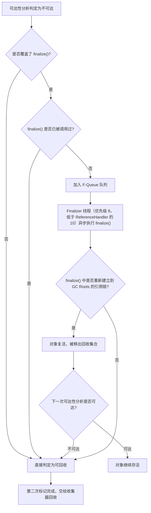

规则要点：

- `F-Queue` 由 `java.lang.ref.Finalizer` 管理，实际执行者是 `Finalizer$FinalizerThread`，优先级为 `Thread.MAX_PRIORITY - 2`（即 8，低于 ReferenceHandler 的 10，并不是"普通优先级"），且**只保证"会尝试执行"，不保证执行完成**。JVM 退出前不会等待所有 finalize 执行完。
- `finalize()` 只会被执行一次。复活一次之后再不可达，直接回收。
- `finalize()` 中抛出的异常会被 `Finalizer#runFinalizer` 捕获并吞掉（不中断 Finalizer 线程），因此**不能靠 finalize 抛异常来做错误处理**。
- 如果 `finalize()` 执行很慢（例如里面做网络 IO），会拖住 Finalizer 线程，导致 `F-Queue` 积压，进而**大量对象堆积变成"慢性 OOM"**。线上见过 finalize 里调 `Thread.sleep` 直接打爆堆的案例。

### 1.5 finalize 的现状与替代方案

版本事实（务必记准）：

- JDK 9 起，`Object#finalize` 被标注 `@Deprecated`。
- JEP 421 在 **JDK 18** 引入命令行开关 `--finalization=disabled`，默认是 `enabled`，即默认行为不变。
- `finalize()` 从未被真正移除，但已经被官方定性为"将废弃且不再支持"。

替代方案：

| 方案 | 引入版本 | 用法 | 优点 |
| --- | --- | --- | --- |
| `java.lang.ref.Cleaner` | JDK 9 | `Cleaner.create()`，注册 `Runnable` 清理动作 | 清理逻辑在独立线程执行，不依赖对象引用；避免 finalize 的复活语义 |
| `try-with-resources` | JDK 7 | `AutoCloseable` | 确定性释放，首选 |
| `PhantomReference` + `ReferenceQueue` | JDK 1.2 | 自己监听队列 | 最底层可控，JDK 内部（如 DirectByteBuffer）用这个思路 |

JDK 8 里没有 `java.lang.ref.Cleaner`，只有内部类 `sun.misc.Cleaner`（`PhantomReference` 的子类），由 `java.nio.DirectByteBuffer` 使用。

### 1.6 为什么"枚举根节点"必须在安全点做：一个可观测的验证

面试官可能追问："你说要 STW，怎么观测到？"可用的手段：

```bash
# 1. 打开 GC 日志，看每次停顿的 real 时间（JDK 9+ 统一日志）
java -Xlog:gc*:file=gc.log:time,uptime,level,tags -XX:+UseG1GC -jar app.jar

# 2. 直接看安全点/GC 相关的 VM 日志（JDK 9+，需解锁 debug 日志）
java -Xlog:safepoint=info:file=safepoint.log -jar app.jar
# 输出形如：Safepoint "G1CollectFull", Time since last: 1234567 ns, Reaching safepoint: 45678 ns, At safepoint: 1234 ns, Total: 46912 ns

# 3. JDK 8 用 -XX:+PrintSafepointStatistics -XX:PrintSafepointStatisticsCount=1 配合 -XX:+UnlockDiagnosticVMOptions
```

`safepoint.log` 里 `Reaching safepoint` 时间过长（毫秒级甚至秒级）就是典型的"**TTSP（Time To Safe Point）问题**"，根因通常是：可数循环（counted loop）没有 safepoint 轮询点、大数组拷贝、JNI 临界区过长。这是线上"GC 日志显示停顿 20ms，但应用 RT 抖动 800ms"的常见原因，具体排查见第十二章案例。

## 二、四种引用与典型场景

### 2.1 引用强度与回收时机

| 引用类型 | 类 | 回收时机 | `get()` 返回 | 典型用途 |
| --- | --- | --- | --- | --- |
| 强引用 | 普通赋值 `new` / 字段 | 只要引用链可达，**绝不回收**，宁愿 OOM | 对象本身 | 99% 的业务对象 |
| 软引用 | `java.lang.ref.SoftReference` | 内存**不足时**才回收（`-XX:SoftRefLRUPolicyMSPerMB` 控制留多久） | 对象，被回收后返回 `null` | 本地缓存（图片、配置、大计算结果） |
| 弱引用 | `java.lang.ref.WeakReference` | **每次 GC 都回收**（无论内存是否充足） | 对象，回收后 `null` | `ThreadLocalMap.Entry` 的 key、`WeakHashMap`、监听器注册表 |
| 虚引用 | `java.lang.ref.PhantomReference` | 与弱引用一样，回收时会**收到通知** | **永远返回 `null`** | 堆外内存释放（DirectByteBuffer）、资源回收通知 |

设计要点：引用强度是**分级缓存淘汰策略**的语言级原语。软引用 = LRU 近似缓存；弱引用 = "键不在就自然消失"的旁挂结构；虚引用 = 唯一能在对象死亡后安全地拿到通知的机制（因为 `get()` 恒为 null，无法"复活"对象）。

### 2.2 Reference 的四个状态与 ReferenceHandler 线程

理解引用队列，必须理解 `Reference` 的状态机（`java.lang.ref.Reference`，JDK 8 与 JDK 17 语义一致）：

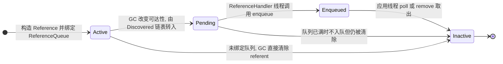

- `Active`：对象可达，引用未被清理。
- `Pending`：GC 判定可达性变化，`referent` 被置 null（**这一步由 GC 线程做，早于 `enqueue`**），并挂入 `Reference.pending` 静态链表。
- `Enqueued`：`ReferenceHandler` 线程（`java.lang.ref.Reference$ReferenceHandler`，优先级 `Thread.MAX_PRIORITY = 10`）把引用放进对应的 `ReferenceQueue`。
- `Inactive`：应用调用 `poll()` / `remove()` 取出后进入终态。

两个工程含义：

1. **`enqueue` 是异步的**，所以"对象被回收"和"你在队列里拿到它"之间有延迟（毫秒到秒级）。清理逻辑不能假设实时性。
2. **不绑定 `ReferenceQueue` 的软/弱引用，`referent` 同样会被清除**，只是不会入队、不走 Pending/Enqueued。这也是"弱引用没有队列也能被回收"的原因。

### 2.3 SoftReference 与 `-XX:SoftRefLRUPolicyMSPerMB`

软引用"内存不足才回收"的实现不是简单的"OOM 前回收"，而是**基于时间和空闲内存的近似 LRU**：

- 每个 `SoftReference` 有一个 `timestamp` 字段（由 JVM 在 GC 时写入，`java_lang_ref_SoftReference::set_clock`）。
- 判定公式（HotSpot 的 `LRUCurrentHeapPolicy` / `LRUMaxHeapPolicy`，两者都读同一个参数）：

```text
(clock - timestamp) > (free_heap_MB * SoftRefLRUPolicyMSPerMB)  =>  清除该软引用
```

- **默认值 `-XX:SoftRefLRUPolicyMSPerMB=1000`（JDK 8 与 JDK 17 实测均为 1000）**，含义是"每 1MB 空闲堆让软引用多存活 1 秒"。

这条公式解释了几个真实线上现象：

| 现象 | 原因 |
| --- | --- |
| 堆很大（如 `-Xmx32g`）时软引用缓存"清不掉"，最后 OOM | 空闲堆 8GB → 阈值 8000 秒 ≈ 2.2 小时内不清 |
| 服务长时间不 GC 后突然一次超长 Full GC | 软引用在内存压力变大后被批量清除，注意 CMS/G1 会在并发周期/Full GC 中清理软引用 |
| 设 `-XX:SoftRefLRUPolicyMSPerMB=0` 后缓存命中率暴跌 | 软引用退化成近似弱引用，每次 GC 必清 |

生产建议：**做本地缓存优先用 Caffeine / Guava Cache（强引用 + 容量上限 + TTL）**，不要用 `SoftReference` 裸写缓存，因为回收时机不可控、无法统计命中率。

### 2.4 WeakReference 与 WeakHashMap

`java.util.WeakHashMap` 的实现核心（JDK 8 与 JDK 17 一致）：

```java
private static class Entry<K,V> extends WeakReference<Object> implements Map.Entry<K,V> {
    V value;
    final int hash;
    Entry<K,V> next;
    // key 通过 ReferenceQueue 传入父类构造器
}
```

要点：

- key 是**弱引用**，value 是**强引用**（`Entry.value` 字段直接持有）。
- `WeakHashMap#get` / `put` / `size` 会调用 `expungeStaleEntries()`：从 `ReferenceQueue` 中取出已失效 Entry，把 table 对应桶的链表断开并置 `value = null`。
- **只有访问时才会清理**，也就是说"没有访问就没有清理"，堆里会残留一段时间的失效 Entry。
- 经典陷阱：**value 直接或间接强引用 key**，则 key 永远可达，弱引用形同虚设：

```java
// 反例：value 是 key 的强引用，key 无法被回收
Map<Key, List<Key>> map = new WeakHashMap<>();
Key k = new Key();
map.put(k, new ArrayList<>(List.of(k))); // 泄漏
```

正确做法是让 value 不引用 key，或者用 `WeakReference` 再包一层 value。

适用场景：**以对象身份为键的旁挂元数据**，例如 `ClassLoader` → 缓存、`Class` → 注解解析结果、`Session` → 临时状态。典型反例是把它当 LRU 缓存用：它没有容量上限，也没有淘汰顺序。

### 2.5 ThreadLocal 内存泄漏：一张图说清

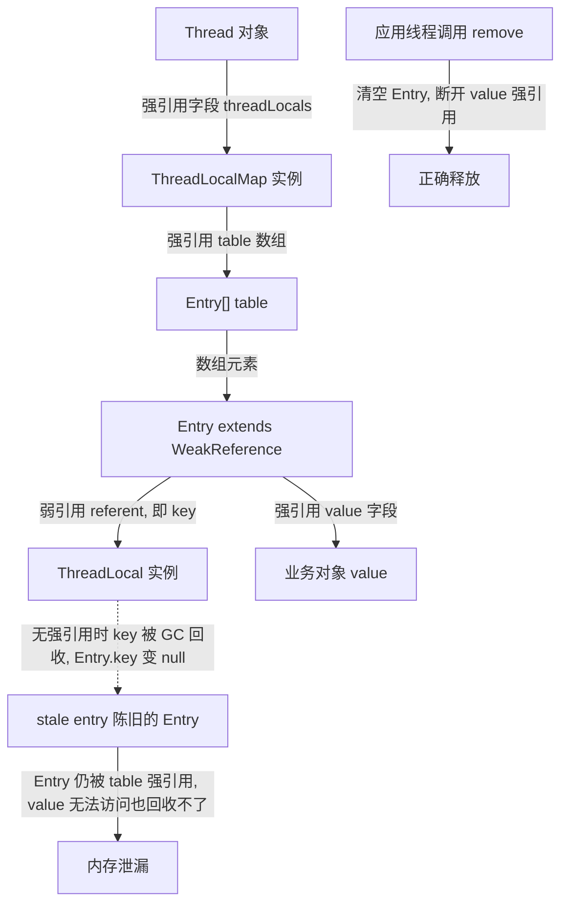

结论链条（面试按这个顺序说）：

1. `ThreadLocalMap` 是 `Thread` 的字段，生命周期与线程一致。线程池里线程长期存活 → Map 长期存活。
2. `Entry extends WeakReference<ThreadLocal<?>>`，key 是弱引用，**这是 JDK 的自我保护设计**：ThreadLocal 对象本身被回收后，Entry 的 key 变成 null，至少不会因为 Map 强引用 key 而导致 ThreadLocal 永远无法回收。
3. 但 **value 是强引用**，且被 `Entry[]` 强引用。key 变 null 后，应用再也拿不到这个 value（无法通过 `get()` 访问，因为 key 不匹配），但 GC 回收不了它。
4. `ThreadLocalMap` 里有兜底清理：`get` / `set` / `remove` 时触发 `expungeStaleEntry`、`cleanSomeSlots`、`replaceStaleEntry`。这些是"顺手清理"，**不能依赖**：如果线程池线程之后再也不调用该 ThreadLocal 的 get/set，脏 Entry 就永久留着。
5. 所以规范是 **`try { ... } finally { threadLocal.remove(); }`**，特别是线程池 + 大对象（如 `UserContext`、`RequestContext`）场景。

顺带一个隐藏收益：`InheritableThreadLocal` 在线程池里**不生效**，因为线程复用、创建时机早于任务提交。要用就得上 `TransmittableThreadLocal`（阿里 TTL）或者显式传参。

### 2.6 PhantomReference 与堆外内存释放

`PhantomReference#get` 永远返回 null（源码里直接 `return null`），构造时**必须**传 `ReferenceQueue`（JDK 8 起无队列构造器已废弃/不可用）。它唯一的作用是"死亡通知"。

JDK 内部用它管理堆外内存：

| JDK 版本 | 实现 | 细节 |
| --- | --- | --- |
| JDK 8 | `sun.misc.Cleaner`（`PhantomReference` 子类）+ `java.nio.DirectByteBuffer.Deallocator` | `Deallocator` 实现 `Runnable`，由 Cleaner 在对象回收后调用 `Unsafe#freeMemory`；`DirectByteBuffer` 构造函数里调用 `Cleaner.create(this, deallocator)` |
| JDK 9 起 | `jdk.internal.ref.CleanerFactory` / `CleanerImpl` | `PhantomCleanable` 继承 `PhantomReference`，`ReferenceQueue` 由 `CleanerImpl` 的清理线程消费；`Deallocator` 仍实现 `Runnable` |

由此产生两条重要结论：

1. **`-XX:MaxDirectMemorySize` 默认值为 0，表示"不单独限制"**（JDK 8 与 JDK 17 实测均为 0），此时上限等于 `-Xmx`（`Runtime#maxMemory`）。所以 `DirectByteBuffer` 撑爆时看到的是 `OutOfMemoryError: Direct buffer memory`，而不是堆 OOM。
2. **堆外内存的释放依赖 GC**。如果堆很空闲，GC 不发生，`Cleaner` 就不会被触发，`DirectByteBuffer` 的堆外内存就一直不释放 → `OutOfMemoryError: Direct buffer memory`。这也是 Netty 自己实现 `ByteBuf` 引用计数（`ReferenceCountUtil.release`）而不是依赖 GC 的原因：**确定性释放 > 依赖 GC**。

### 2.7 引用体系在规模变大后的失效模式

| 场景 | 小规模为什么没事 | 规模变大后怎么爆 |
| --- | --- | --- |
| `WeakHashMap` 当缓存 | 对象少，访问频繁，`expungeStaleEntries` 总能跟上 | 百万级 key 后，每次 `put` 都可能清理一批，Map 操作变慢；没有容量控制，命中率不可测 |
| `SoftReference` 缓存大对象 | 堆余量大，软引用留得住 | 缓存与业务对象争抢堆，GC 频率升高后批量清除，缓存雪崩式失效，回源打爆下游 DB |
| `ThreadLocal` 存上下文 | 线程少，偶尔不 `remove` 也看不出问题 | 线程池固定 200 线程 × 每线程 1MB value = 200MB 常驻，最终表现为"老年代缓慢上涨、Full GC 后降不下去" |
| `PhantomReference` 清理堆外内存 | 堆外用得少 | 堆外利用率 90%+ 时 GC 不发生 → `Direct buffer memory` OOM，且堆 dump 里看不到任何证据 |

## 三、垃圾回收算法与分代收集理论

### 3.1 三种基础算法

| 维度 | 标记-清除 Mark-Sweep | 复制 Copying | 标记-整理 Mark-Compact |
| --- | --- | --- | --- |
| 执行步骤 | 标记存活 → 直接清除垃圾 | 标记存活 → 复制到另一块空间 → 整块清空原空间 | 标记存活 → 移动存活对象到一端 → 清理边界外内存 |
| 空间利用率 | 高（不预留） | 低（需预留一半或两块 Survivor） | 高 |
| 是否产生碎片 | **会** | 不会（复制后紧凑） | 不会 |
| 是否移动对象 | 否 | 是 | 是 |
| 对象移动带来的成本 | 无 | 需更新所有引用（STW 内做） | 需更新所有引用 |
| 分配效率 | 需要空闲链表，分配慢 | **指针碰撞（bump the pointer）**，分配极快 | 指针碰撞 |
| 吞吐量 | 中（标记+清除两遍，且碎片导致后续分配变慢） | 高（针对存活率低的区域） | 中 |
| 典型代表 | CMS 的老年代回收（并发清除） | Serial/ParNew/Parallel Scavenge 的新生代、G1 的 Young GC、ZGC 的 Relocate | Serial Old、Parallel Old、G1 的 Full GC |
| 适用前提 | 任意 | **存活率低**（新生代天然满足） | 存活率高且不希望有碎片 |

选择逻辑的关键判断：**对象存活率**。新生代对象 98% 朝生夕灭 → 复制算法只复制少量存活对象，代价极低；老年代存活率高 → 复制算法要复制大部分对象，不划算，所以用标记-清除（CMS，换来低停顿但忍受碎片）或标记-整理（Parallel Old / G1，换来无碎片但要移动对象）。

### 3.2 分代收集理论的三个假说

分代收集不是"拍脑袋分区"，它建立在三条经验假说上（这是能体现深度的回答）：

1. **弱分代假说（Weak Generational Hypothesis）**：绝大多数对象都是朝生夕灭的。→ 所以新生代用小空间、高频回收，回收性价比最高。
2. **强分代假说（Strong Generational Hypothesis）**：熬过越多次垃圾收集的对象，越有可能继续存活。→ 所以老年代用大空间、低频回收；同时用**年龄晋升**机制把长期对象搬走。
3. **跨代引用假说（Intergenerational Reference Hypothesis）**：跨代引用相对于同代引用只占极少数。→ 所以**不需要为了少数跨代引用扫描整个老年代**，用卡表（512 字节粒度）记录即可，代价从"扫描整个老年代"降到"扫描脏卡"。

第三条假说直接决定了 3.6 节卡表的存在，也决定了 G1 的 RSet 的成本模型。

### 3.3 堆内存布局与默认比例

以 JDK 8 的 Serial / ParNew / Parallel Scavenge（分代物理连续）为例：

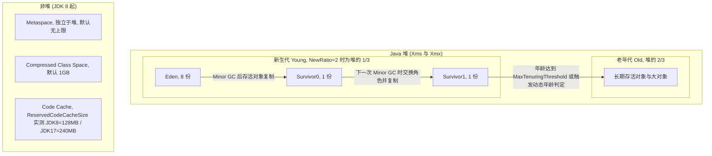

实测默认值（`-XX:+PrintFlagsFinal`）：

| 参数 | 默认值 | 含义 |
| --- | --- | --- |
| `-XX:NewRatio` | 2 | 老年代 : 新生代 = 2 : 1，即新生代占堆的 1/3 |
| `-XX:SurvivorRatio` | 8 | Eden : 单个 Survivor = 8 : 1，即 Eden 占新生代 80% |
| `-XX:InitialSurvivorRatio` | 8 | `-XX:+UseAdaptiveSizePolicy` 开启时 Survivor 的初始比例 |
| `-XX:MaxTenuringThreshold` | 15 | 晋升老年代的年龄阈值上限（CMS 下实测被压到 6） |
| `-XX:TargetSurvivorRatio` | 50 | Survivor 空间的目标使用率，超过触发动态年龄判定 |
| `-XX:MetaspaceSize` | JDK 8 = 21807104 B（约 20.8MB），JDK 17 = 22020096 B（21MB） | 首次触发元空间 GC 的阈值（`MetaspaceSize` 是**水位线**，不是初始容量） |
| `-XX:MaxMetaspaceSize` | 无上限（实测为 `18446744073709551615`） | 不设置就是受物理内存限制 |
| `-XX:CompressedClassSpaceSize` | 1073741824（1GB） | 压缩类空间固定上限 |
| `-XX:MaxDirectMemorySize` | 0（等于 `-Xmx`） | 堆外内存上限 |

注意 `MetaspaceSize` 的语义陷阱：它**不是初始大小，而是第一次触发元空间 GC 的阈值**。调大它（如 `-XX:MetaspaceSize=256m`）能避免启动期反复触发元空间 GC。

### 3.4 对象分配全流程

这是把"分配"和"回收"连起来的关键图，绝大多数 GC 参数都在这个流程里起作用：

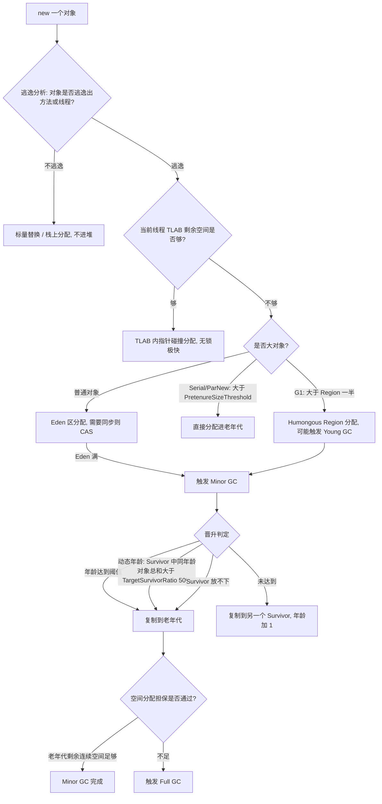

流程里的每个分支都有对应参数或机制，逐条对照：

| 分支 | 机制 | 相关参数 / 默认值 |
| --- | --- | --- |
| 逃逸分析 | JIT 编译期分析对象是否逃逸，不逃逸则可标量替换、消除分配 | `-XX:+DoEscapeAnalysis`（JDK 8 起默认开启）、`-XX:+EliminateAllocations`（默认开启） |
| TLAB | 每个线程在 Eden 内独占一小块，分配无需同步 | `-XX:+UseTLAB`（默认开启）、`-XX:TLABSize`（默认 0 自适应）、`-XX:TLABWasteTargetPercent`（默认 1） |
| 大对象判定 | 避免大对象在 Eden/Survivor 之间反复复制 | `-XX:PretenureSizeThreshold`（默认 0 即不生效，**只对 Serial 与 ParNew 有效**，对 Parallel Scavenge 不生效）；G1 用 Humongous 规则 |
| 动态年龄判定 | 不一定要等到 15 岁，Survivor 中年龄从小到大累加，当某年龄及更年轻对象大小总和超过 Survivor 的 50% 时，该年龄及以上直接晋升 | `-XX:TargetSurvivorRatio=50`、`-XX:+UseAdaptiveSizePolicy`（默认 true，会动态调整 Survivor 大小） |
| 空间分配担保 | Minor GC 前检查老年代是否有足够空间容纳最坏情况 | 见 3.5 |

**动态年龄判定是最容易答错的一题**，正确表述是：HotSpot 并不使用"某一年龄对象数量超过一半"这种粗糙说法，而是把 Survivor 中对象按年龄从小到大累加大小，累加值超过 `TargetSurvivorRatio`（默认 50%）时，取该年龄与 `MaxTenuringThreshold` 的较小值作为**新的晋升阈值**（`ageTable#compute_tenuring_threshold`）。它解释了"为什么没有大对象，对象却提前进了老年代"。

**怎么观测到它真的发生了**：JDK 8 加 `-XX:+PrintTenuringDistribution`，JDK 9+ 用 `-Xlog:gc+age=trace`。实测日志形如 `Desired survivor size 11010048 bytes, new threshold 7 (max 15)`——`new threshold` 就是本轮实际生效的晋升阈值，它会随着 Survivor 中存活对象的累积一路被压低（实测从 7 降到 6、5、4）；JDK 9+ 的 trace 级别还会打印决策依据本身：`Age table with threshold N (max threshold 15)` 加各年龄的字节数（实测出现过阈值从 15 直接被压到 1 的情况，下一轮年龄 ≥ 1 的对象就全部晋升）。线上问"对象为什么提前进老年代"，把这两条日志拿出来就是证据。

### 3.5 空间分配担保

Minor GC 之前，JVM 必须确认老年代能否容纳新生代所有对象（最坏情况是全部存活晋升）：

- **JDK 6u24 之前**：由 `-XX:+HandlePromotionFailure` 控制，允许"冒险"，失败再 Full GC。
- **JDK 6u24 之后**：该分支的逻辑被移除。**实测确认：JDK 8u421 上 `-XX:+HandlePromotionFailure` 已经无法识别**（`Unrecognized VM option 'HandlePromotionFailure'`）。很多老面试资料还把它列为 JDK 8 参数，这是错的，面试时如果被问到，可以直接指出这个版本事实，是加分项。

现在的逻辑（`DefNewGeneration` / `GenCollectorPolicy` 一侧）：

```text
if (老年代最大连续可用空间 > 新生代所有对象总大小
    || 老年代最大连续可用空间 > 历次晋升到老年代对象的平均大小) {
    允许 Minor GC（有风险，但失败会退化为 Full GC）
} else {
    直接触发 Full GC
}
```

工程推论：

- "担保失败"表现为 GC 日志里 **Minor GC 之后紧跟 Full GC**，是"Full GC 频繁"最常见的原因之一。
- 根治手段不是调大参数，而是**降低晋升速率**：减小新生代（让短命对象在 Minor GC 里就死掉，而不是熬到晋升）、修正动态年龄判定（调 `TargetSurvivorRatio`）、排查是否有意外的大对象或长生命周期缓存。

### 3.6 卡表与写屏障

**问题**：分代收集时，Minor GC 只扫新生代，但老年代对象可能引用新生代对象。如果漏掉这些引用，就会把活对象当垃圾回收（灾难性 bug）。

**朴素解法**：把老年代也加入 GC Roots 全扫一遍 → 每次 Minor GC 都变成近似 Full GC，不可接受。

**HotSpot 解法：卡表（Card Table）**

- 把整个堆按 **512 字节**划分为卡页（card page），卡表是一个 `byte[]`（`CardTable::_byte_map`），一个卡页对应一个字节。
- 只要某个卡页内的对象引用被**修改**，就把对应卡表项标记为 dirty（值 `dirty_card_val() = 0`，clean 为 `clean_card_val() = 1`）。
- Minor GC 时只需把**脏卡**加入 GC Roots 扫描范围（`CardTableRS::younger_refs_iterate` / `ScavengeRootsTask`）。
- 维护卡表的动作由<strong>写屏障（Write Barrier）</strong>完成，即在引用赋值前后插入的少量代码。HotSpot 中针对引用字段赋值的是 `store_check`（在解释器和 C1/C2 生成的代码里）。

两个实现细节值得说出：

1. **`-XX:+UseCondCardMark` 默认关闭**（JDK 17 实测 `UseCondCardMark = false`）。开启后写屏障先判断卡表项是否已经是 dirty，是则不再写，避免多线程反复写同一卡表项造成的**伪共享（false sharing）**；代价是每次赋值多一次读。大堆、多线程写密集的场景可以考虑开启。
2. 卡表是"粗粒度、可能有假阳性"的结构：一个卡页 512 字节内只要有一个引用变化，整个卡页都要被扫描。这就是"卡表扫描"成为大堆 GC 停顿来源之一的原因。

### 3.7 记忆集与 RSet 的关系（为 G1 铺垫）

术语澄清，避免面试时用词混乱：

| 术语 | 范围 | 含义 |
| --- | --- | --- |
| 卡表 Card Table | 整个堆一份 | 记录"哪些卡页是脏的"，用于分代回收时的跨代引用 |
| 记忆集 RSet (Remembered Set) | 每个 Region 一份（G1） | 记录"**谁指向我**"（point-into），是"从其他 Region 指向本 Region"的引用的集合，本质是 points-into 结构 |
| 卡表的关系 | G1 中卡表是 RSet 的**实现基础**之一 | G1 用全局卡表 + 每 Region 的 RSet 两级结构 |

G1 的 RSet 越准确，Mixed GC 时能回收的 Region 越多；RSet 越膨胀，维护成本越高。这是 G1 里最重要的权衡，见 8.2。

## 四、三色标记、漏标与读写屏障

### 4.1 三色标记法

并发标记（GC 线程与应用线程同时跑）的算法基础是三色标记：

| 颜色 | 含义 |
| --- | --- |
| 白色 | 尚未被访问。若标记结束时仍为白色，判定为垃圾 |
| 灰色 | 自己已被访问，但**至少还有一个引用未扫描** |
| 黑色 | 自己已被访问，且**所有引用都已扫描完**（存活确定） |

遍历过程：初始所有对象为白，GC Roots 直接引用的对象入灰 → 从灰色队列取对象，扫描其引用，把自己变黑，把引用的白对象变灰 → 直到灰色队列为空。

并发带来的问题：**标记过程中应用线程在改引用**，可能把本该存活的对象漏掉。

### 4.2 漏标的两个必要条件

这是本章最重要的结论，必须记住"两个条件同时满足才漏标"：

```text
条件一：赋值器插入了一条或多条从黑色对象到白色对象的新引用
条件二：赋值器删除了全部从灰色对象到该白色对象的直接或间接引用
```

也就是说：**只要破坏其中任意一个条件，就不会漏标**。两个破坏方式对应两种经典的并发标记方案：

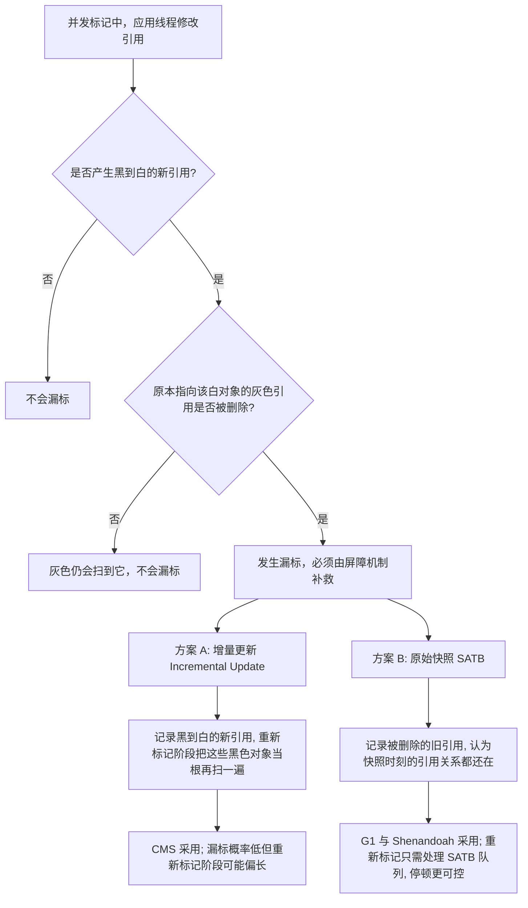

### 4.3 增量更新与原始快照对比

| 维度 | 增量更新 Incremental Update | 原始快照 SATB (Snapshot At The Beginning) |
| --- | --- | --- |
| 破坏哪个条件 | 破坏条件一：记录新增的黑→白引用 | 破坏条件二：记录被删除的引用（保留旧快照） |
| 写屏障记录内容 | 新引用的**目标对象** + 产生引用的黑色对象 | 被覆盖（删除）的**旧引用** |
| 重新标记阶段做什么 | 以记录下来的黑色对象为根，重新扫描其引用（可能递归，即"增量更新"） | 只需处理 SATB 队列里的引用，标记它们的指向对象 |
| 是否会"多标"（浮动垃圾） | 较少 | 会。快照时刻存活、之后死掉的对象本轮不回收 → 浮动垃圾 |
| 停顿特性 | 重新标记阶段耗时与"新增引用量"相关，可能变长 | 暂停时间更可预测，适合做停顿预测（G1 的核心卖点） |
| 代表收集器 | CMS（`ConcurrentMarkIncrementalUpdate`） | G1（`G1SATBMarkQueueSet`）、Shenandoah（SATB 模式） |
| 代价 | 重新标记需 STW 重扫，容易成为长停顿 | 浮动垃圾，需要预留空间（G1 用 `-XX:G1ReservePercent=10`） |

一句话记忆：**增量更新盯着"新加进来的引用"，SATB 盯着"被删掉的引用"**。CMS 选择增量更新是为了可选地跳过重新标记前的可中断预清理（`CMS-concurrent-abortable-preclean`）；G1 选择 SATB 是为了让停顿可预测。

### 4.4 SATB 队列与 TAMS：G1 的实现细节

G1 的并发标记依赖两个关键机制：

1. **SATB 队列**：每个线程有本地 `SATBMarkQueue`，写屏障（`G1SATBCardTableModRefBS` 一侧，JDK 12+ 重构为 `G1BarrierSet`）把被删除的旧引用压入本地队列，队列满（`-XX:G1SATBBufferSize=1024`，实测默认 1024）时交给全局队列由并发标记线程消费。接近饱和时，G1 会"加锁"（`SATBMarkQueueSet` 的 Java 线程挂起机制）以保证不漏标。
2. **TAMS（Top At Mark Start）**：每个 Region 有一对指针 `_next_mark_bitmap` 与 `_prev_mark_bitmap`，配合 `top_at_mark_start`。并发标记开始后新分配的对象位于 TAMS 之上，**默认视为存活**（隐式标记），因此并发标记期间新创建的对象不会被漏掉。代价同样是浮动垃圾。

### 4.5 读屏障与写屏障的分工

| 屏障类型 | 插入位置 | 作用 | 使用者 |
| --- | --- | --- | --- |
| 写屏障 | 引用字段赋值处（`putfield` / `aastore`） | 维护卡表 / SATB 队列 | 几乎所有分代收集器、G1、Shenandoah |
| 读屏障 | 从堆中读取引用处 | 修正"读到的引用"，可用于并发移动对象 | ZGC（染色指针 + 自愈）、Shenandoah 的 LRB 模式 |

读屏障的成本特性很关键：它**每次读引用都要执行**，因此 ZGC/Shenandoah 的读屏障被设计得极短（几条指令，通常是判断指针颜色 + 慢路径跳转）。这也是"为什么 ZGC 只有 OpenJDK 提供，且需要 JIT 配合生成屏障代码"的根本原因。

### 4.6 小结：算法 → 收集器 的映射表

| 收集器 | 新生代算法 | 老年代算法 | 并发标记方案 | 是否需要读屏障 |
| --- | --- | --- | --- | --- |
| Serial / Serial Old | 复制 | 标记-整理 | 无（全 STW） | 否 |
| ParNew | 复制 | 配合 CMS | 由 CMS 决定 | 否 |
| Parallel Scavenge / Parallel Old | 复制 | 标记-整理 | 无（全 STW） | 否 |
| CMS | ParNew 复制 | 标记-清除（并发） | 增量更新 | 否 |
| G1 | 复制（Region 间） | 复制 + 标记-整理（CSet 疏散） | SATB | 否 |
| Shenandoah | 复制（含并发疏散） | 并发标记-整理 | SATB 或增量更新（`-XX:ShenandoahGCMode`） | 是（Brooks 或 LRB） |
| ZGC | 并发标记-整理（JDK 21 起引入分代） | 并发标记-整理 | SATB 变体 | 是（染色指针 + 自愈） |

## 五、GC 分类与触发条件

### 5.1 四个术语的准确定义

绝大多数"Full GC 频繁怎么优化"的讨论之所以无效，是因为术语本身混用了。先把定义钉死：

| 术语 | 回收范围 | 停顿特性 | 谁会打这个日志 | 备注 |
| --- | --- | --- | --- | --- |
| Minor GC / Young GC | 只回收新生代 Eden + Survivor | STW，通常 1~50ms | 所有分代收集器；G1 打 `Pause Young` | G1 的 Young GC 也叫 Evacuation Pause |
| Major GC / Old GC | 只回收老年代 | 视实现而定 | **严格来说只有 CMS 有这个概念**（`CMS GC`） | 日常语境常与 Full GC 混用，面试时要指出这个混淆 |
| Full GC | 整个堆 + 元空间（JDK 8 起含元空间回收、类卸载） | STW，通常 100ms~数秒 | 所有收集器；G1 打 `Pause Full` | 停顿最长，是调优的主要打击对象 |
| Mixed GC | G1 独有：全部 Young Region + **部分** Old Region | STW，按 `MaxGCPauseMillis` 控制 | G1 打 `Pause Young (Mixed)` | 停顿可控是 G1 的核心卖点 |

一句话：**"Major GC" 是 CMS 时代的词，G1 时代应该谈 Young / Mixed / Full 三类**。能主动纠正这个术语，是高级岗的加分点。

### 5.2 Minor GC 的触发条件

只有一条：**Eden 区没有足够空间分配新对象**（分配失败）。

日志里的 GC 原因（`GCCause`）说明了具体路径，常见的有：

| 日志原因 | 含义 |
| --- | --- |
| `Allocation Failure` | 最常见，Eden 满了 |
| `G1 Evacuation Pause` | G1 的 Young/Mixed GC，把存活对象从 CSet 复制到其他 Region |
| `G1 Humongous Allocation` | 分配 Humongous 对象时找不到足够连续 Region，被迫先做一次 Young GC |
| `Ergonomics` | 收集器根据自适应策略主动发起的 GC（Parallel Scavenge 的自适应策略会做这件事） |
| `Metadata GC Threshold` | 元空间达到 `MetaspaceSize` 水位线，触发的是 Full GC（也可只做元空间回收） |

实测 JDK 8（Parallel GC，`-Xmx64m`）：

```text
2026-10-12T05:17:01.826-0800: 0.020: [GC (Allocation Failure) [PSYoungGen: 16343K->2528K(18944K)] 16343K->15352K(62976K), 0.0013333 secs] [Times: user=0.01 sys=0.01, real=0.00 secs]
```

实测 JDK 17（G1，`-Xmx64m`，统一日志）：

```text
[2026-10-12T05:17:02.162+0800][0.013s][info][gc,start    ] GC(0) Pause Young (Concurrent Start) (G1 Humongous Allocation)
[2026-10-12T05:17:02.162+0800][0.013s][info][gc          ] GC(0) Pause Young (Concurrent Start) (G1 Humongous Allocation) 28M->27M(64M) 0.276ms
```

注意 JDK 17 的输出里同时出现 `Concurrent Start`（这次 Young GC 顺带完成了并发标记周期的初始标记）和 `G1 Humongous Allocation`（原因），这是 G1 用"初始标记搭载在 Young GC 上"的设计证据。

### 5.3 Full GC 的触发场景（面试高频）

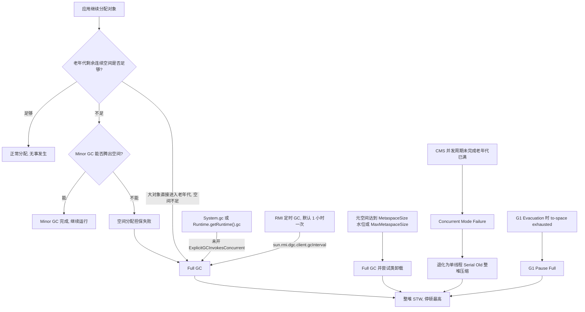

按收集器分列具体触发点：

**JDK 8 + Parallel Scavenge / Parallel Old（默认组合）**

1. 老年代空间不足：Minor GC 后晋升对象放不下，或 `PretenureSizeThreshold` 生效的大对象直接分配失败。
2. 空间分配担保失败（见 3.5）：Minor GC 前的检查不通过，直接 Full GC。
3. 元空间不足：达到 `MetaspaceSize` 水位后触发元空间 GC（伴随类卸载），若回收后仍不足则扩容；达到 `MaxMetaspaceSize` 则 OOM。
4. 显式调用 `System.gc()` / `Runtime.getRuntime().gc()`。
5. JDK 8 默认 `-XX:+DisableExplicitGC` 为 false（实测），即显式 GC 生效。
6. RMI 的 DGC 定时 GC：默认 1 小时一次（`-Dsun.rmi.dgc.client.gcInterval=3600000`、`-Dsun.rmi.dgc.server.gcInterval=3600000`，单位毫秒），本质上也是 `System.gc()`。

**JDK 8 + CMS**

7. `promotion failed`：Minor GC 时 Survivor 放不下、晋升老年代又失败（老年代有碎片或确实满了）。
8. `Concurrent Mode Failure`：并发收集还没结束，老年代就满了（预测失败）。
9. 以上两种都会退化为一轮整堆 STW（Serial Old 的标记-整理），停顿是并发周期的几十倍。

**JDK 9+ G1（默认）**

10. 并发标记周期来不及（IHOP 预测失败），或 Mixed GC 期间产生的新垃圾超过预期。
11. **Evacuation Failure / `to-space exhausted`**：疏散时找不到空闲 Region 容纳存活对象。日志形如 `Pause Young (Mixed) (G1 Evacuation Pause) (to-space exhausted)`，紧接着通常是一次 `Pause Full`。
12. 元空间不足：`Pause Full (Metadata GC Threshold)`。
13. Humongous 对象找不到连续 Region。
14. `System.gc()`：未开 `-XX:+ExplicitGCInvokesConcurrent` 时走 Full GC；JDK 10 起 G1 的 Full GC 是并行的（JEP 307），不再像 JDK 9 那样单线程。

**共同的两条**

15. `-XX:+HeapDumpOnOutOfMemoryError` 触发的是一次 OOM，不一定伴随 Full GC，但 OOM 前几乎必然有一次"尽力回收"（`GC overhead limit exceeded` 时更是连续 Full GC）。
16. `-XX:+ExplicitGCInvokesConcurrent`（CMS/G1）把显式 GC 转为并发周期，能显著降低 `System.gc()` 的停顿；但**注意副作用**：如果代码/框架依赖"显式 GC 一定会做一次完整 Full GC 来释放堆外内存"（老版本 Netty、部分 RPC 框架的 `System.gc()` 调用），开启该参数或 `-XX:+DisableExplicitGC` 后可能表现为 `OutOfMemoryError: Direct buffer memory`。

### 5.4 显式 GC 的处置建议

| 参数 | 作用 | 生产建议 |
| --- | --- | --- |
| `-XX:+DisableExplicitGC` | `System.gc()` 变成空操作 | 有堆外内存依赖（Netty/NIO 直连缓冲、mmap 文件）时**慎用**，需确认框架不依赖显式 GC |
| `-XX:+ExplicitGCInvokesConcurrent` | 显式 GC 转为并发收集（CMS/G1） | 比 `DisableExplicitGC` 更温和，优先选它 |
| `-XX:+ExplicitGCInvokesConcurrentAndUnloadsClasses` | 同上，并顺带卸载类 | 需要时加上 |
| `-Dsun.rmi.dgc.client.gcInterval=86400000` | 把 RMI 的 GC 间隔拉长到 24 小时 | 使用 RMI 的服务建议显式设置，避免整点对时触发 Full GC |

**排查坑位**：GC 日志里出现"每小时整点一次 Full GC"这种**周期性规律**，第一反应就是 RMI DGC 的定时 `System.gc()`，而不是内存泄漏——因为泄漏的 GC 间隔不会这么规整。

### 5.5 GC 类型与收集器的对应关系

| 收集器 | Young GC 名称/日志 | 是否支持 Mixed | Full GC 实现 | Full GC 是否并行 |
| --- | --- | --- | --- | --- |
| Serial + Serial Old | `[GC (Allocation Failure) [DefNew: ...]]` | 否 | Serial Old 标记-整理 | 否（单线程） |
| ParNew + CMS | `[GC (Allocation Failure) [ParNew: ...]]` | 否 | Serial Old 标记-整理 | 否（这是 CMS 最痛的退化路径） |
| Parallel Scavenge + Parallel Old | `[GC (Allocation Failure) [PSYoungGen: ...]]` | 否 | Parallel Old 标记-整理 | 是 |
| G1（JDK 9+） | `Pause Young` | **是**，`Pause Young (Mixed)` | G1 Compaction，JDK 10 起并行（JEP 307） | 是（JDK 10+） |
| ZGC | `Pause Young`（JDK 21 分代模式） | 无 Mixed 概念 | 并发标记-整理，几乎无 Full GC 概念 | 并发 |
| Shenandoah | `Pause Init Mark` / `Pause Final Mark` | 无 Mixed 概念 | 并发标记-整理，退化为 `Degenerated GC` 或 `Full GC` | 并发 |

## 六、Serial、ParNew 与 Parallel Scavenge

### 6.1 Serial / Serial Old

- 参数：`-XX:+UseSerialGC`，等价于新生代 Serial + 老年代 Serial Old。
- 算法：新生代复制算法，老年代标记-整理。
- 特点：**单线程**，收集时必须 STW，所有应用线程停止。内存占用小（无线程栈与同步开销），没有线程交互开销（在单核上反而吞吐量最高）。
- 适用：`-Xmx` 小于 100MB 的场景、单核容器、客户端桌面应用、命令行工具。（JDK 8 的 32 位 Client 模式默认就是 Serial。）
- 生产现状：几乎只用于小内存容器与本地调试。**但它仍有两个"活着"的用途**：一是 JDK 8 中 `-XX:+UseParallelGC -XX:-UseParallelOldGC` 时老年代用 Serial Old；二是 CMS 的兜底退化收集器。

### 6.2 ParNew

- 参数：JDK 8 用 `-XX:+UseParNewGC`；也可以由 `-XX:+UseConcMarkSweepGC` 隐式启用。
- 本质：**Serial 的多线程版本**，算法完全一致（复制），只是把"标记-复制"并行化。
- 线程数：`-XX:ParallelGCThreads`，默认按 CPU 数推算。实测（JDK 17，`-XX:ActiveProcessorCount` 显式指定核数）：

| CPU 核数 N | `ParallelGCThreads` | G1 的 `ConcGCThreads` |
| --- | --- | --- |
| 1 | 0（特殊值，表示不并发/自动） | 0 |
| 2 | 2 | 1 |
| 4 | 4 | 1 |
| 8 | 8 | 2 |
| 10 | 9 | 2 |
| 16 | 13 | 3 |
| 32 | 23 | 6 |
| 64 | 43 | 11 |

规律：`N <= 8` 时 `ParallelGCThreads = N`；`N > 8` 时 `ParallelGCThreads = 8 + (N - 8) * 5 / 8`。`ConcGCThreads` 与 `ParallelGCThreads` 的关系实测完全符合 `(ParallelGCThreads + 2) / 4`。

- 与 CMS 的绑定关系：**CMS 要求新生代收集器是 ParNew**（JDK 8），所以"用 CMS"和"用 ParNew"经常一起出现。
- 版本命运（实测数据）：
  - JDK 8：`-XX:+UseParNewGC` 可用；单独使用（ParNew + Serial Old）时打印警告 `Using the ParNew young collector with the Serial old collector is deprecated and will likely be removed in a future release`。
  - JDK 11.0.24：`-XX:+UseParNewGC` 已经是 `Unrecognized VM option`（**参数被移除，但 CMS 仍可用，ParNew 由 CMS 隐式启用**）。
  - JDK 14：JEP 363 删除 CMS；JDK 17 实测 `-XX:+UseConcMarkSweepGC` 与 `-XX:+UseParNewGC` 都是 `Unrecognized VM option`。

### 6.3 Parallel Scavenge / Parallel Old

- 参数：`-XX:+UseParallelGC`（JDK 8 的服务端默认，实测 `UseParallelGC := true`、`UseParallelOldGC = true`，即默认组合是 Parallel Scavenge + Parallel Old）。
- 算法：新生代复制，老年代标记-整理，都是多线程并行。
- 设计目标与其他收集器**不同**：追求**可控的吞吐量**，而不是最短停顿。这是回答"Parallel 和 CMS/G1 的本质区别"的关键。

| 参数 | 默认值（实测） | 作用 |
| --- | --- | --- |
| `-XX:GCTimeRatio` | 99 | GC 时间占总时间的上限为 `1 / (1 + 99) = 1%`。调大即允许更少 GC 时间（更高吞吐） |
| `-XX:MaxGCPauseMillis` | JDK 8 实测为 `18446744073709551615`（即未设置） | 期望的最大停顿，设置后与吞吐目标共同参与自适应 |
| `-XX:+UseAdaptiveSizePolicy` | true | 自适应调节 Eden/Survivor 比例、晋升年龄阈值（`PSAdaptiveSizePolicy`），**不需要手工设 `-Xmn`、`SurvivorRatio`** |
| `-XX:+UseAdaptiveSizePolicyFootprintGoal` | true | 自适应时兼顾内存占用目标 |
| `-XX:+UseAdaptiveSizePolicyWithSystemGC` | false | 是否把显式 GC 的统计纳入自适应 |
| `-XX:ParallelGCThreads` | 按核数推算（见上表） | 并行 GC 线程数 |
| `-XX:+UseParallelOldGC` | JDK 8 = true；**JDK 17 已 `Unrecognized`** | 老年代是否用 Parallel Old |

**两个容易考的默认值**：

- `GCTimeRatio=99` 意味着 Parallel Scavenge 默认允许 GC 占 1% 的时间；如果实际 GC 时间超过这个目标，收集器会**缩小新生代**（更频繁但更短的 Minor GC），而不是"优化"。
- `UseAdaptiveSizePolicy` 默认开启，所以**你设置的 `-XX:SurvivorRatio`、晋升年龄阈值在 Parallel Scavenge 下会被自适应策略覆盖**（实测 `-Xmn` 会把 `NewSize` 与 `MaxNewSize` 同时定死，新生代的**总大小**不会被改，但 Eden : Survivor 的划分仍由自适应调整）。这条常被问："为什么我设了 SurvivorRatio 不生效？"答案就在这里；结论是 Parallel 下要固定比例就得显式 `-XX:-UseAdaptiveSizePolicy`。

### 6.4 三种"常规"收集器的对比

| 维度 | Serial / Serial Old | ParNew | Parallel Scavenge / Parallel Old |
| --- | --- | --- | --- |
| 线程模型 | 单线程 | 新生代多线程 | 新生代与老年代都多线程 |
| 设计目标 | 最小额外开销 | 低停顿（配合 CMS） | 高吞吐量 |
| 新生代算法 | 复制 | 复制 | 复制 |
| 老年代算法 | 标记-整理 | 依赖搭配的 CMS | 标记-整理 |
| 能否与 CMS 搭配 | 不能 | 能（唯一选项） | 不能（GC 框架不兼容） |
| 自适应调节 | 不涉及 | 不涉及 | `UseAdaptiveSizePolicy` 默认开 |
| 适用场景 | 小内存、单核、Client | CMS 的配套新生代 | 批处理、离线计算、对吞吐敏感的在线服务 |
| STW 时长 | 最长 | 中等 | 中等（可调） |

组合合法性（**实测结论**，不能不写）：

| 组合 | 参数 | 结果 |
| --- | --- | --- |
| Serial + Serial Old | `-XX:+UseSerialGC` | JDK 8/11/17 均支持 |
| Parallel Scavenge + Parallel Old | `-XX:+UseParallelGC` | JDK 8 默认；JDK 9+ 仍支持 |
| ParNew + CMS | `-XX:+UseConcMarkSweepGC` | JDK 8 支持；JDK 9~13 支持但废弃告警；JDK 14+ 参数已移除 |
| ParNew + Serial Old | `-XX:+UseParNewGC` | JDK 8 支持但打印废弃警告；JDK 11 起参数已不存在 |
| Serial + CMS | `-XX:+UseConcMarkSweepGC -XX:-UseParNewGC` | JDK 8 支持；JDK 9 起废弃 |
| Serial + CMS 参数冲突 | `-XX:+UseSerialGC -XX:+UseConcMarkSweepGC` | 启动直接失败：`Conflicting collector combinations in option list` |
| G1 | `-XX:+UseG1GC` | JDK 7u4 起可用；JDK 9 起服务端默认 |
| ZGC | `-XX:+UseZGC` | JDK 11 起；JDK 14 起支持 Linux/macOS/Windows；JDK 15 起转正 |
| Shenandoah | `-XX:+UseShenandoahGC` | JDK 12 起（OpenJDK 构建）；Oracle JDK 17 实测报 `Option -XX:+UseShenandoahGC not supported` |

## 七、CMS 收集器

### 7.1 定位与整体周期

CMS（Concurrent Mark Sweep）的目标只有一个：**把老年代回收的停顿压到最短**。代价是：CPU 敏感（并发阶段占用 CPU 资源）、产生浮动垃圾、产生碎片。

它只回收老年代，新生代必须配 ParNew（JDK 8）。整个周期是 **2 次 STW + 4 个并发阶段**：

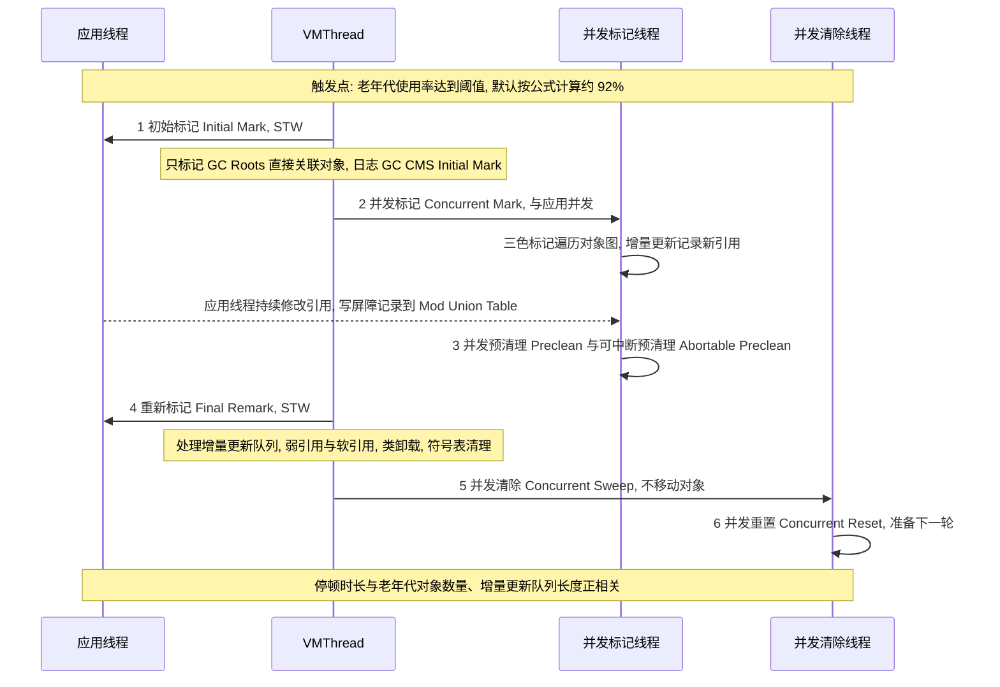

各阶段的日志标志与关键参数：

| 阶段 | 是否 STW | JDK 8 日志标志（实测） | 关键参数（JDK 8 实测默认值） |
| --- | --- | --- | --- |
| 1 初始标记 | 是 | `[GC (CMS Initial Mark) [1 CMS-initial-mark: 49967K(87424K)] ...]` | `-XX:+CMSParallelInitialMarkEnabled`（默认 true） |
| 2 并发标记 | 否 | `[CMS-concurrent-mark-start]` / `[CMS-concurrent-mark: ...]` | `-XX:CMSSamplingGrain`、`-XX:CMSExpAvgFactor`（默认 50） |
| 3 并发预清理 | 否 | `[CMS-concurrent-preclean-start]` | — |
| 3b 可中断预清理 | 否 | `[CMS-concurrent-abortable-preclean-start]` | `-XX:CMSMaxAbortablePrecleanTime`（默认 5000 ms）、`-XX:CMSMaxAbortablePrecleanLoops`（默认 0）、`-XX:CMSScheduleRemarkEdenSizeThreshold`（默认 2097152 B = 2MB）、`-XX:CMSScheduleRemarkEdenPenetration`（默认 50 %）、`-XX:CMSScheduleRemarkSamplingRatio`（默认 5） |
| 4 重新标记 | 是 | `[GC (CMS Final Remark) [YG occupancy: ...] ... [Rescan (parallel) ...] [weak refs processing ...] [class unloading ...] [scrub symbol table ...] [scrub string table ...] ...]` | `-XX:+CMSParallelRemarkEnabled`（默认 true）、`-XX:CMSWaitDuration`（默认 2000 ms） |
| 5 并发清除 | 否 | `[CMS-concurrent-sweep-start]` | `-XX:+UseCMSCompactAtFullCollection`（默认 true）、`-XX:CMSFullGCsBeforeCompaction`（默认 0） |
| 6 并发重置 | 否 | `[CMS-concurrent-reset-start]` | — |

挑两条容易被追问的默认值说清楚：

- `CMSScheduleRemarkEdenSizeThreshold = 2MB`：Eden 使用量**小于** 2MB 时，可中断预清理会**跳过**（因为马上要做 Young GC，预清理白做）。
- `CMSScheduleRemarkEdenPenetration = 50`：Eden 使用率超过 50% 时就**停止**可中断预清理，直接进入重新标记，避免 Eden 撑爆。这条参数是 CMS 线上调优常改的点（改为 80 能延长预清理时间、缩短 Final Remark，但会增加一次 Young GC 被打断的概率）。

### 7.2 增量更新与重新标记的工作量

CMS 用**增量更新**处理漏标（见 4.3）。实现上还有两个辅助结构：

- **卡表 + 写屏障**：记录并发标记期间发生的引用变化。
- **Mod Union Table**：记录并发标记期间被修改的"已标记完成"的卡页，避免在整个堆上重新扫描。重新标记阶段（`CMSParRemarkTask`）会同时处理"根扫描（`[Rescan (parallel)]`）+ 增量更新队列 + Mod Union Table"。

**工程含义**：重新标记的停顿时长与"并发标记期间的引用修改量"成正比。所以"引用修改疯狂"的服务（大量缓存写、订单状态机高频切换）用 CMS 时，Final Remark 的停顿可能达到几百毫秒，甚至比 Parallel Old 的 Full GC 还长。这是 CMS 被 G1 取代的核心原因之一。

### 7.3 三大经典故障与真实日志

#### 故障一：Concurrent Mode Failure（并发模式失败）

- 定义：并发收集周期还没走完（通常在并发标记或并发清除阶段），老年代使用率已经达到 100%，不得不中止并发收集，退化为一次整堆 STW 回收（Serial Old 的标记-整理）。
- 后果：停顿时间从"几十毫秒的并发周期"变成"几百毫秒到几秒的完整压缩"，且是单线程，CPU 利用率低。
- 真实日志（JDK 8u421，`-Xmx80m -XX:+UseConcMarkSweepGC -XX:CMSInitiatingOccupancyFraction=40 -XX:+UseCMSInitiatingOccupancyOnly`，实测捕获）：

```text
2026-10-12T05:21:19.543-0800: 0.029: [GC (Allocation Failure) 2026-10-12T05:21:19.543-0800: 0.029: [ParNew (promotion failed): 21426K->23826K(24576K), 0.0012929 secs]2026-10-12T05:21:19.545-0800: 0.030: [CMS: 54284K->36281K(54656K), 0.0013717 secs] 60708K->36281K(79232K), [Metaspace: 2592K->2592K(1056768K)], 0.0026890 secs] [Times: user=0.01 sys=0.00, real=0.00 secs]
2026-10-12T05:21:19.546-0800: 0.032: [GC (Allocation Failure) 2026-10-12T05:21:19.546-0800: 0.032: [ParNew (promotion failed): 21427K->23827K(24576K), 0.0007611 secs]2026-10-12T05:21:19.547-0800: 0.033: [CMS (concurrent mode failure): 54284K->33281K(54656K), 0.0012670 secs] 57709K->33281K(79232K), [Metaspace: 2592K->2592K(1056768K)], 0.0020615 secs] [Times: user=0.01 sys=0.00, real=0.00 secs]
```

日志特征（**面试时直接说出这几个 token**）：

- `(concurrent mode failure)`：出现在 `[CMS ...]` 段里，本次 GC 从并发退化成了整堆 STW。
- `(promotion failed)`：出现在 `[ParNew ...]` 段里，说明新生代晋升失败，是 CMF 的前置征兆。
- 二者常在同一条日志里出现，且**没有单独的 `Full GC` 字样**（这是 JDK 8 的日志特点，容易被漏看）。

#### 故障二：promotion failed（晋升失败）

- 定义：Minor GC 时，Survivor 放不下存活对象，需要晋升到老年代，但老年代**没有连续空间**（注意：不是没有总空间，而是没有连续空间——碎片问题）。
- 与 CMF 的关系：promotion failed 会触发一次 Full GC（退化）；若此 Full GC 又赶在 CMS 并发周期中，就可能进一步变成 CMF。

#### 故障三：碎片与"越回收越碎"

- CMS 的并发清除**不移动对象**，因此不整理内存。长期运行后老年代会出现大量小块空洞，表现为："老年代总空闲还有 500MB，但一个 200MB 的 Humongous/大对象分配不下去"。
- 相关参数：
  - `-XX:+UseCMSCompactAtFullCollection`（默认 **true**）：在 Full GC 时做一次压缩整理。
  - `-XX:CMSFullGCsBeforeCompaction`（默认 **0**）：多少次 Full GC 之后做一次压缩。默认 0 表示**每次都压缩**（这是 JDK 8 的默认，因为压缩停顿长，早期默认值是 5）。
  - `-XX:CMSInitiatingOccupancyFraction`（默认 **-1**，表示由公式推算而非固定值）。实测印证：本章 7.3 的日志中老年代容量为 `54656K`，CMS 在 `49967K`（约 91.4%）时启动初始标记，与"默认约 92%"的说法一致。生产上建议显式设置为 70~80，把触发时机前移以降低 CMF 概率。
  - `-XX:+UseCMSInitiatingOccupancyOnly`（默认 **false**）：一旦开启，就完全按 `CMSInitiatingOccupancyFraction` 触发，不再由 JVM 自适应估算。**生产上建议同时设置这两个参数**，让触发时机可预测。
  - `-XX:+CMSClassUnloadingEnabled`（默认 **true**，JDK 8）：CMS 周期中允许类卸载。

### 7.4 CMS 参数速查表

| 参数 | 实测默认值（JDK 8u421） | 作用与建议 |
| --- | --- | --- |
| `-XX:+UseConcMarkSweepGC` | false | 启用 CMS。JDK 14+ 已移除 |
| `-XX:CMSInitiatingOccupancyFraction` | -1 | 老年代使用率达到多少触发并发收集。设 70~80 可降低 CMF 概率，代价是 GC 更频繁、CPU 占用升高 |
| `-XX:+UseCMSInitiatingOccupancyOnly` | false | 是否只按固定比例触发。建议开启，避免 JVM 自适应的"惊喜" |
| `-XX:+CMSParallelRemarkEnabled` | true | 重新标记并行化，几乎必开 |
| `-XX:+CMSScavengeBeforeRemark` | false | 重新标记前先做一次 Minor GC，能显著缩短 Remark；代价是多一次 Young GC |
| `-XX:CMSMaxAbortablePrecleanTime` | 5000 ms | 可中断预清理的最长持续时间 |
| `-XX:CMSScheduleRemarkEdenSizeThreshold` | 2097152 B | Eden 小于此值跳过预清理 |
| `-XX:+UseCMSCompactAtFullCollection` | true | Full GC 时压缩 |
| `-XX:CMSFullGCsBeforeCompaction` | 0 | 每 0 次（即每次）Full GC 都压缩 |
| `-XX:CMSWaitDuration` | 2000 ms | 等待下一次 Young GC 以便搭车做初始标记的最长时间 |
| `-XX:+CMSClassUnloadingEnabled` | true | 允许类卸载 |
| `-XX:ParallelGCThreads` | 按核数推算 | 并行阶段线程数 |
| `-XX:ConcGCThreads` | 0（自适应） | 并发阶段线程数，约为 `ParallelGCThreads / 4` |

### 7.5 CMS 版本命运（必背）

| 版本 | 变化 |
| --- | --- |
| JDK 9 | CMS 被标记为废弃（deprecated）。JDK 11.0.24 实测仍会打印 `Option UseConcMarkSweepGC was deprecated in version 9.0 and will likely be removed in a future release` |
| JDK 9 | `-XX:+UseParNewGC`、`-XX:+UseParallelOldGC` 与 CMS 的相关组合被废弃 |
| JDK 11 | `-XX:+UseParNewGC` 在 11.0.24 上已 `Unrecognized`（CMS 仍可用，ParNew 隐式启用） |
| JDK 14 | JEP 363 删除 CMS。JDK 17 实测 `-XX:+UseConcMarkSweepGC` 报 `Unrecognized VM option` |
| JDK 17 | `-XX:+UseParallelOldGC` 也已 `Unrecognized`（并行老年代由 `-XX:+UseParallelGC` 直接隐含） |

**面试标准答案**："CMS 在 JDK 9 起废弃、JDK 14 移除了，新项目不要用；它的历史价值在于第一次把并发收集带进 HotSpot，代价是碎片、浮动垃圾和 CPU 敏感，这些问题 G1 用 Region + 停顿预测模型解决了。"

## 八、G1 收集器

### 8.1 Region 布局：G1 的空间模型

G1（Garbage First）把整个堆划分成约 2048 个大小相等的 **Region**：

- Region 大小 = 堆大小 / 2048，向上取整到 2 的幂，范围限制在 **1MB ~ 32MB**；也可用 `-XX:G1HeapRegionSize` 显式指定。
- 实测：`-Xmx256m` → Region = 1MB；`-Xmx2g` → Region = 1MB（2GB / 2048 = 1MB）。
- 每个 Region 在逻辑上属于 Eden / Survivor / Old / Humongous 之一，**角色可以动态变化**（这也是"分代"不再是物理连续的原因）。

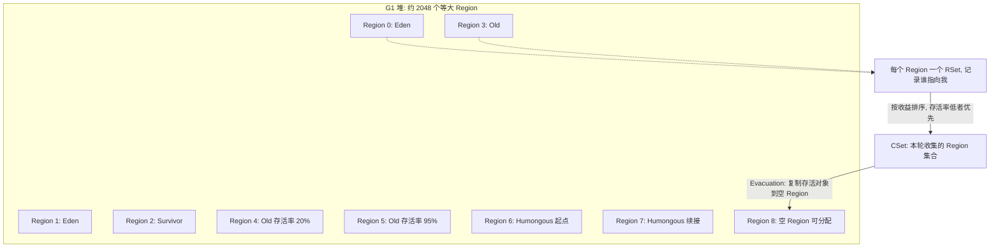

两个空间模型上直接决定的结论：

1. **Humongous 对象**：单个对象大小 **大于 Region 大小的 50%** 即视为 Humongous；超过一个 Region 时占用**连续的多个 Region**（`_humongous_start_region` 记录起点）。Humongous 对象**直接分配在老年代的 Humongous Region**，回收代价高（只在 Young GC / Full GC 时处理），这是 G1 最著名的坑。
2. **无物理连续老年代**：由于 Region 角色互换，"老年代对象"只是逻辑概念，因此不能再用 `-XX:NewRatio` 精确控制新生代大小（G1 用 `G1NewSizePercent` / `G1MaxNewSizePercent`，且是**实验性参数**，实测 JDK 17 上必须加 `-XX:+UnlockExperimentalVMOptions` 才能设置，且 unlock 必须写在前面）。

### 8.2 RSet（记忆集）与卡表

G1 的 RSet 是它与其他收集器最大的结构差异：

| 层次 | 结构 | 粒度 | 说明 |
| --- | --- | --- | --- |
| 全局 | 卡表 Card Table | 512 字节 | 写屏障维护，标记哪些卡页脏 |
| 每 Region | `HeapRegionRemSet` / `OtherRegionsTable` | 三级 | 记录"谁指向我"，供 CSet 疏散时精确找根 |
| 细粒度 | `PerRegionTable`（PRT） | 卡索引 | 稀疏时用，按卡记录引用者 |
| 稀疏 | `SparsePRT` | 整个 Region | 引用很少时用低位图表示 |
| 粗粒度 | `_coarse_map`（Bitmap） | 一个 bit 一个 Region | 引用很多时退化为"整个 Region 都算"，代价是扫描变粗、可能出现假阳性 |

关键工程点：

- **RSet 的维护成本不能全压在 STW 里**。G1 用并发优化线程（`-XX:G1ConcRefinementThreads`，实测 `ParallelGCThreads=9` 时为 9）在后台消费写屏障产生的脏卡队列，并用 `-XX:G1RSetUpdatingPauseTimePercent=10`（实测默认 10）限制**暂停期间**最多用 10% 的暂停时间去更新 RSet。
- **RSet 的内存开销随堆变大而膨胀**。经验值：堆很大（如 64GB 以上）且跨 Region 引用密集时，RSet 可能吃掉堆的 5%~10% 甚至更多，表现为"`jcmd GC.heap_info` 里 used 涨得比业务对象快"。相关参数：`-XX:G1RSetRegionEntries`（实测默认 512，每个 Region 的细粒度表项数）。
- **RSet 的准确性直接决定 Mixed GC 能回收多少老年代**：RSet 记录越粗（退化到 `_coarse_map`），扫描成本越高，G1 就越倾向于不把这些 Region 放进 CSet（因为没有"收益"），于是老年代回收变慢，最终 Full GC。

### 8.3 G1 的三类 GC 与并发标记周期

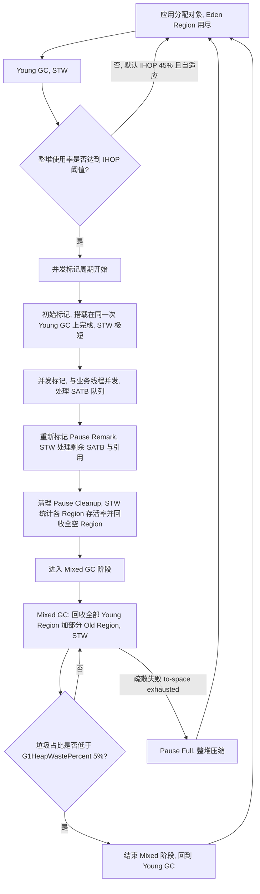

各阶段的实测日志（JDK 17.0.12，`-Xmx64m -Xlog:gc`）：

```text
[2026-10-12T05:17:02.162+0800][0.013s][info][gc,start    ] GC(0) Pause Young (Concurrent Start) (G1 Humongous Allocation)
[2026-10-12T05:17:02.162+0800][0.013s][info][gc          ] GC(0) Pause Young (Concurrent Start) (G1 Humongous Allocation) 28M->27M(64M) 0.276ms
[2026-10-12T05:17:02.163+0800][0.013s][info][gc          ] GC(3) Concurrent Mark Cycle
[2026-10-12T05:17:02.163+0800][0.013s][info][gc,marking  ] GC(3) Concurrent Mark
[2026-10-12T05:17:08.583+0800][0.017s] GC(3) Pause Remark 41M->41M(64M) 0.089ms
[2026-10-12T05:17:08.583+0800][0.017s] GC(3) Pause Cleanup 41M->41M(64M) 0.001ms
[2026-10-12T05:17:08.583+0800][0.018s] GC(6) Pause Young (Concurrent Start) (G1 Humongous Allocation) 28M->28M(64M) 0.106ms
[2026-10-12T05:17:08.584+0800][0.018s] GC(7) Pause Remark 40M->40M(64M) 0.046ms
[2026-10-12T05:17:08.584+0800][0.018s] GC(7) Pause Cleanup 40M->40M(64M) 0.001ms
```

日志要点：

- `Pause Young (Concurrent Start)`：这次 Young GC 同时是并发标记周期的**初始标记**。所以"看到 Concurrent Start 就是并发周期开始了"。
- `Pause Young (Prepare Mixed)`：并发周期结束后、`(Mixed)` 阶段开始前的那次 Young GC。JDK 17 实测的典型序列是 `(Normal) ... → (Concurrent Start) → Pause Remark → Pause Cleanup → (Prepare Mixed) → (Mixed) ...`，所以"看到 Prepare Mixed 就说明接下来要回收 Old Region 了"。
- `Concurrent Mark Cycle` / `Concurrent Mark`：并发标记阶段（无停顿标注，因为是并发的）。
- `Pause Remark`：重新标记，STW，处理 SATB 队列与引用。
- `Pause Cleanup`：清理阶段，STW，耗时极短（实测 0.001ms），它只做统计与回收全空 Region，**不做对象复制**。
- **G1 没有"并发清除"阶段**：真正的回收发生在 Young/Mixed GC 的 Evacuation 阶段（复制存活对象，等价于标记-整理）。

### 8.4 停顿预测模型与关键参数

G1 是**唯一把"停顿时间"作为一等目标的经典收集器**（ZGC/Shenandoah 是后来的"极低停顿"路线）。它的做法：

1. 记录每个阶段（Young GC、并发标记、RSet 更新、疏散）的**单位 Region 成本**，用**衰减均值（decaying average）+ 线性回归**（`G1Predictions`、`AbsSeq` 系列类）做预测。
2. Young GC 时，根据预测的"回收一个 Region 的耗时"乘以目标停顿 `-XX:MaxGCPauseMillis`，决定**选多少个 Young Region 进入 CSet**。
3. Mixed GC 时，把候选 Old Region 按"垃圾占比（GC 效率）"从高到低排序，依次加入 CSet，直到预测耗时填满目标停顿。
4. 这就是"Garbage First"名字的由来：**优先回收垃圾最多的 Region**。

实测默认值（JDK 17.0.12，`-XX:+PrintFlagsFinal`）：

| 参数 | 默认值 | 是否需要解锁 | 作用 |
| --- | --- | --- | --- |
| `-XX:MaxGCPauseMillis` | 200 | 否 | G1 的目标停顿（毫秒）。**是软目标，不保证**。建议 100~300；设成 20 会导致 Young Region 过少、GC 极频繁、对象提前晋升 |
| `-XX:InitiatingHeapOccupancyPercent` | 45 | 否 | 整堆使用率达到 45% 启动并发标记周期 |
| `-XX:+G1UseAdaptiveIHOP` | true | 否 | **默认开启自适应 IHOP**，JVM 会忽略你设的 45，根据标记耗时与晋升速率自动计算本轮 IHOP。要强制固定必须 `-XX:-G1UseAdaptiveIHOP` |
| `-XX:G1NewSizePercent` | 5 | **是（实验性）** | 新生代占堆的最小比例 |
| `-XX:G1MaxNewSizePercent` | 60 | **是（实验性）** | 新生代占堆的最大比例 |
| `-XX:G1MixedGCLiveThresholdPercent` | 85 | **是（实验性）** | 存活率高于 85% 的 Old Region 不加入 CSet（回收不划算） |
| `-XX:G1HeapWastePercent` | 5 | 否 | 允许的垃圾占比低于 5% 时停止 Mixed GC 阶段 |
| `-XX:G1MixedGCCountTarget` | 8 | 否 | 一个 Mixed 阶段目标分 8 次完成，避免单次停顿过长 |
| `-XX:G1OldCSetRegionThresholdPercent` | 10 | **是（实验性）** | 单次 Mixed GC 加入 CSet 的 Old Region 数量上限（占堆百分比） |
| `-XX:G1ReservePercent` | 10 | 否 | 预留 10% 堆空间，用于降低 Evacuation Failure 概率 |
| `-XX:G1RSetRegionEntries` | 512 | 否 | 每个 Region 的细粒度 RSet 表项数 |
| `-XX:G1RSetUpdatingPauseTimePercent` | 10 | 否 | 暂停期间用于更新 RSet 的时间比例上限 |
| `-XX:G1ConcRefinementThreads` | 按核数推算（实测 9） | 否 | 并发优化线程数 |
| `-XX:G1SATBBufferSize` | 1024 | 否 | SATB 队列缓冲区大小 |
| `-XX:G1HeapRegionSize` | 堆 / 2048，取整到 2 的幂（实测 256MB 堆 = 1MB） | 否 | Region 大小 |
| `-XX:G1PeriodicGCInterval` | 0 | 否 | 周期性 GC 间隔（毫秒），0 表示关闭。设为非 0 可用于空闲时归还内存 |
| `-XX:G1PeriodicGCInvokesConcurrent` | true | 否 | 周期性 GC 走并发还是 Full GC |

**"实验性参数必须解锁"这条细节非常容易踩坑**：JDK 17 上写 `-XX:G1NewSizePercent=10` 会直接启动失败：

```text
Error: VM option 'G1NewSizePercent' is experimental and must be enabled via -XX:+UnlockExperimentalVMOptions.
Error: The unlock option must precede 'G1NewSizePercent'.
```

正确写法：`java -XX:+UnlockExperimentalVMOptions -XX:G1NewSizePercent=10 -XX:G1MaxNewSizePercent=40 ...`。

### 8.5 G1 的四个经典坑

| 坑 | 现象（日志/指标） | 根因 | 处置 |
| --- | --- | --- | --- |
| Humongous 频繁 | 大量 `Pause Young (Concurrent Start) (G1 Humongous Allocation)`，Young GC 频率远超预期 | 单个对象 > Region/2 直接进 Humongous Region，且只在 Young/Full GC 时回收 | 调大 `-XX:G1HeapRegionSize`（如 4MB~16MB）让对象不再"超一半"；或从业务上切断大对象（分批查询、避免大 JSON 序列化、限制批量大小） |
| Evacuation Failure / to-space exhausted | `Pause Young (Mixed) (G1 Evacuation Pause) (to-space exhausted)`，紧接着 `Pause Full` | 存活对象比 RSet 预测的多（RSet 不准）、晋升速率突增、预留空间不足 | 调大 `-XX:G1ReservePercent`（如 15~20）；增大堆；检查是否有突发大对象/缓存膨胀；必要时缩短 Mixed 阶段（`G1MixedGCCountTarget`） |
| 停顿目标失效 | 设了 `-XX:MaxGCPauseMillis=50` 但实际停顿 200ms+ | 目标太小导致 Young Region 太少 → Young GC 频繁 → 晋升加速 → Mixed/Full 更频繁，恶性循环 | 目标设 100~300ms；观察 `Pause Young (Mixed)` 的 Region 数量是否过少 |
| Full GC 频繁（`Pause Full`） | `Pause Full (G1 Compaction Pause)` 反复出现 | 并发标记周期赶不上分配速率（IHOP 预测失败）、元空间不足、Humongous 碎片 | 降低 `-XX:InitiatingHeapOccupancyPercent` 或关闭自适应让它更早启动；检查元空间与 Humongous |

**关于 JDK 9 vs JDK 10 的关键差异**（面试常问）：JDK 9 的 G1 在 evacuation failure 之后的 Full GC 是**单线程**的，超大堆上可能停顿数秒；JEP 307 在 **JDK 10** 把它改为并行 Full GC。所以"G1 的 Full GC 很慢"这个说法要分版本——JDK 10 之前成立，之后明显缓解。

## 九、ZGC 与 Shenandoah

### 9.1 ZGC 的染色指针（Colored Pointers）

ZGC（Z Garbage Collector）的核心创新是**把 GC 状态放进指针本身**，而不是对象头：

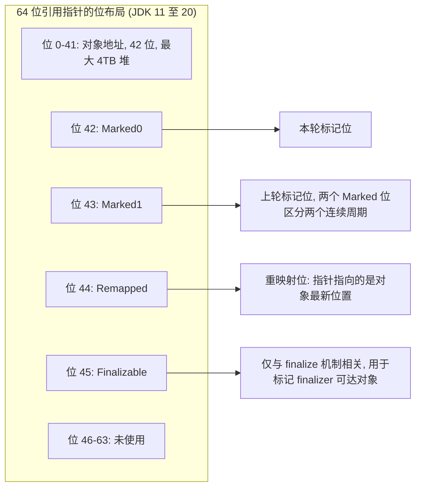

染色指针带来的三个直接好处：

1. **对象头里不需要 GC 信息**，所以对象可以随时被移动，旧指针依然"可用"——因为可以通过标志位判断它是否过期。
2. **不需要写屏障维护卡表和 RSet**（ZGC 不使用分代记忆集），省掉了大堆下 RSet 的内存与维护开销。
3. **可支持超大堆**：42 位地址空间 = 4TB。

代价：

- 指针里被吃掉 4 位，所以**压缩指针被自动关闭**（实测开启 ZGC 后 `UseCompressedOops = false`，即使显式写 `-XX:+UseCompressedOops` 也会被覆盖），对象引用从 4 字节变 8 字节，堆内引用密度下降（这是"同样业务 ZGC 更吃内存"的原因之一）。
- 需要**读屏障**配合（见 9.2）。

### 9.2 读屏障与自愈（Self-Healing）

ZGC 在每次从堆中**读取引用**时插入读屏障。逻辑抽象如下：

```text
读取引用 ref
if (ref 的标志位与当前 GC 阶段期望的颜色不一致) {
    走慢路径: 查询转发表得到对象新地址, 修正 ref
    把修正后的 ref 写回原位置   // 这一步叫自愈 self-healing
}
返回修正后的 ref
```

自愈的工程价值极高：**同一个引用被修正一次后，后续再读就是快路径**，所以读屏障的均摊成本很低（约几个 CPU 指令）。ZGC 的设计目标是"停顿时间与堆大小、存活对象数量无关"，JDK 11 引入时给的目标是 10ms 以内；JDK 16 的 JEP 376 把线程栈处理也并发化之后，停顿进一步降到亚毫秒级。

### 9.3 ZGC 的并发周期

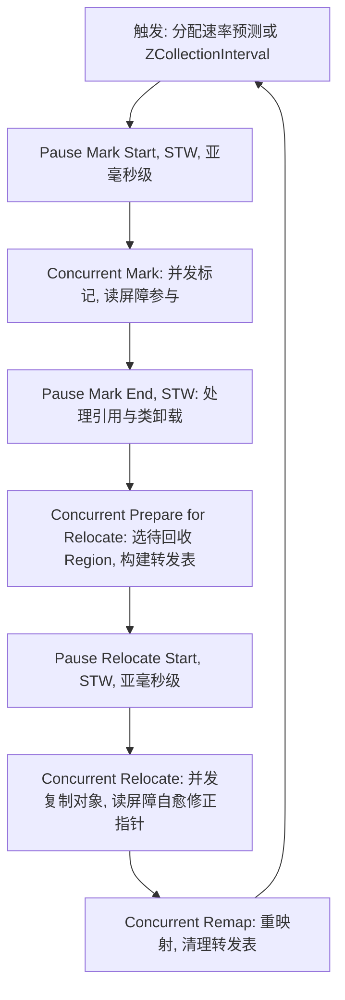

- **三个 STW 点**（`Pause Mark Start`、`Pause Mark End`、`Pause Relocate Start`）都是**亚毫秒级**，主要工作是切换全局标志位、处理根集合的快照；重映射（Remap）不是独立的 STW 阶段，它随并发阶段一起完成（JDK 17 实测的 ZGC 日志里只有上述三个 `Pause`）。
- **Relocate 是并发移动对象**，这是 ZGC 与 G1 最大的区别：G1 的复制（Evacuation）在 STW 内完成，ZGC 在并发阶段完成。
- 不使用 `-XX:+UseCompressedOops`，因此**堆内存占用普遍比 G1 高 10%~20%**，这是选型时必须向老板解释的成本。

### 9.4 ZGC 版本演进（必背，容易答错）

| 版本 | 事件 | JEP |
| --- | --- | --- |
| JDK 11 | ZGC 作为**实验性**特性引入（需 `-XX:+UnlockExperimentalVMOptions`） | JEP 333 |
| JDK 13 | 引入未使用内存归还 OS（对应 `-XX:+ZUncommit` 与 `-XX:ZUncommitDelay`） | JEP 351 |
| JDK 14 | 支持 macOS 与 Windows | JEP 364 / JEP 365 |
| JDK 15 | **ZGC 转正（Production Ready），不再需要 UnlockExperimentalVMOptions** | JEP 377 |
| JDK 16 | 并发处理线程栈，进一步消除停顿来源 | JEP 376 |
| JDK 21 | **分代 ZGC**（`-XX:+ZGenerational`） | JEP 439 |
| JDK 23 | **非分代模式被标记为废弃**，官方建议使用分代模式 | JEP 474 |

**重要纠正**：常见复习资料写"ZGC 在 JDK 17 转正"，这是错的。**转正版本是 JDK 15（JEP 377）**；JDK 17 与 ZGC 的关联只是"JDK 17 是当前主流 LTS，因此 ZGC 在 LTS 上可用"。这类版本错误在面试中一旦说错，会直接影响面试官对你其他结论的信任度。

### 9.5 ZGC 参数速查（JDK 17 实测）

| 参数 | 实测默认值 | 作用 |
| --- | --- | --- |
| `-XX:+UseZGC` | false | 启用 ZGC（JDK 15 起无需解锁） |
| `-XX:ZCollectionInterval` | 0.0 | 强制 GC 间隔（秒），0 = 关闭。用于"长时间空闲但堆外/缓存需要定期清理"的场景 |
| `-XX:ZAllocationSpikeTolerance` | 启用 ZGC 后实测为 1.0（未启用时 `PrintFlagsFinal` 报 2.0） | 分配尖峰容忍度。值越大越容忍突发分配、GC 触发越晚 |
| `-XX:ZProactive` | true | 是否主动 GC（空闲时提前回收，避免堆积） |
| `-XX:ZUncommit` | true | 是否把空闲堆归还操作系统 |
| `-XX:ZUncommitDelay` | 300（秒） | 内存空闲多久后才归还 OS |
| `-XX:SoftMaxHeapSize` | 实测默认等于 `-Xmx` | 软上限，超过它 ZGC 会更积极 GC，但不 OOM |
| `-XX:ZMarkStackSpaceLimit` | 8589934592（8GB） | 标记栈空间上限 |
| `-XX:ZFragmentationLimit` | 25.0 | 碎片率上限，超过则触发压缩 |
| `-XX:ConcGCThreads` / `-XX:ParallelGCThreads` | 实测并发 3 / 并行 6（本机 10 核） | ZGC 的线程模型与 G1 不同，别照搬 G1 的经验值 |

**注意 `SoftMaxHeapSize`**：这是 ZGC（以及 G1）的"软上限"，配合容器场景非常有用——`-Xmx` 给足以便应对峰值，`-XX:SoftMaxHeapSize` 设置一个更低的日常水位，GC 会更早介入，避免堆长期高位运行导致归还 OS 失败。

### 9.6 Shenandoah

Shenandoah 是 Red Hat 主导的低停顿收集器，目标与 ZGC 类似（并发标记-整理、停顿与堆大小解耦），实现路线不同。

| 维度 | Shenandoah | ZGC |
| --- | --- | --- |
| 指针方案 | 两代方案：**Brooks Pointer**（对象头前加转发指针）与 **LRB（Load Reference Barrier）**；JDK 13 起默认使用 LRB 模式的变体 | 染色指针 |
| 每对象额外开销 | Brooks 模式每对象多一个字（8 字节，压缩指针下 4 字节）；LRB 模式无此开销 | 无对象头开销，但引用变 8 字节（禁用压缩指针） |
| 屏障类型 | 读屏障（LRB）或读写屏障 | 读屏障 |
| 并发模式 | `-XX:ShenandoahGCMode=satb`（默认）/ `iu` / `passive` / `aggressive` | 无此配置 |
| 启发式 | `-XX:ShenandoahGCHeuristics=adaptive`（默认）/ `static` / `compact` / `aggressive` | 由分配速率与尖峰容忍度驱动 |
| 分代支持 | 较新版本中以实验性方式提供分代模式，具体可用性以发行版文档与 `-XX:+PrintFlagsFinal` 实测为准 | JDK 21 起分代 |
| 版本 | JEP 189 在 JDK 12 引入（实验性），JDK 15 转正（JEP 379）；**不在 Oracle JDK 构建中**，Red Hat 已回移到 OpenJDK 8u | JDK 11 实验，JDK 15 转正 |
| 本机验证 | **Oracle JDK 17.0.12 实测 `-XX:+UseShenandoahGC` 报 `Option -XX:+UseShenandoahGC not supported`** | 本机未安装 ZGC 可用版本时同样要注意构建差异 |

Shenandoah 常用参数（**默认值随版本调整，使用前务必以 `-XX:+PrintFlagsFinal` 实测为准**，本章不写不确定的数字）：

| 参数 | 作用 |
| --- | --- |
| `-XX:ShenandoahGCMode` | 并发标记方案：`satb` / `iu` / `passive`（退化测试用） |
| `-XX:ShenandoahGCHeuristics` | 触发启发式：`adaptive` / `static` / `compact` / `aggressive` |
| `-XX:ShenandoahMinFreeThreshold` | 空闲空间低于该比例时启动 GC |
| `-XX:ShenandoahAllocSpikeFactor` | 分配尖峰容忍因子，越大越晚触发 |
| `-XX:ShenandoahGarbageThreshold` | 一个 Region 的垃圾占比超过该值才加入 CSet |
| `-XX:ShenandoahInitFreeThreshold` | 初始空闲空间阈值，影响启动时机 |
| `-XX:ShenandoahRegionSize` | Region 大小 |
| `-XX:ShenandoahUncommit` / `-XX:ShenandoahUncommitDelay` | 是否归还内存及延迟 |

Shenandoah 的三个降级路径（面试问到"低停顿收集器出问题会怎样"时可用）：

1. **Degenerated GC**：并发周期没跑完但内存快满了，退化为 STW 的标记/整理（比 Full GC 轻）。
2. **Full GC**：彻底失败时的整堆压缩。
3. `passive` 模式：直接把 GC 变成全 STW，用于与不兼容的 JVMTI agent 排查问题。

### 9.7 四代收集器横向对比（选型终极表）

| 维度 | Parallel GC | CMS（JDK 14 已移除） | G1（JDK 9+ 默认） | ZGC（JDK 15+ 转正） |
| --- | --- | --- | --- | --- |
| 分代 | 物理分代 | 物理分代 | 逻辑分代（Region） | JDK 21 前不分代，之后分代 |
| 停顿目标 | 吞吐优先 | 低停顿 | 可预测停顿（默认 200ms 软目标） | 亚毫秒~10ms，与堆大小无关 |
| 停顿与堆大小关系 | 强相关 | 强相关 | 中度相关 | 基本无关 |
| 内存开销 | 低 | 中（碎片） | 中高（RSet 约 5%~10%） | 高（禁用压缩指针 + 10%~20%） |
| 压缩（无碎片） | 是 | **否**（碎片是致命伤） | 是（Evacuation） | 是（并发 Relocate） |
| 最大推荐堆 | 4GB 以内 | 4~8GB | 4GB~64GB（大堆常见） | 数十 GB 到 TB 级 |
| 适合场景 | 批处理、离线计算、吞吐型服务 | 历史项目维护（新项目禁用） | 主流在线服务，6~64GB 堆 | 超大堆、停顿极敏感（交易、实时风控、缓存） |
| 关键缺点 | 停顿长 | 碎片、CMF、CPU 敏感 | 大堆 RSet 开销、Humongous 坑 | 内存占用高、CPU 消耗高 |

## 十、GC 参数速查与收集器选型

### 10.1 通用参数（与收集器无关，实测默认值）

| 参数 | 实测默认值 | 作用与建议 |
| --- | --- | --- |
| `-Xms` | 物理内存的 1/64（未设容器限制时） | 初始堆。**生产必须与 `-Xmx` 设成相等**，避免运行期反复扩缩容带来的停顿与内存抖动 |
| `-Xmx` | 物理内存的 1/4 | 最大堆。容器场景优先用 `-XX:MaxRAMPercentage` |
| `-Xmn` | 未设置 | 新生代大小。等价于同时设置 `NewSize` 与 `MaxNewSize`，会**关闭新生代自适应** |
| `-Xss` | 平台相关（Linux x64 常见 1MB） | 单线程栈大小。线程数是堆外开销的重要来源：`1000 线程 × 1MB = 1GB` |
| `-XX:MetaspaceSize` | JDK 8 = 21807104 B，JDK 17 = 22020096 B | **首次触发元空间 GC 的水位线**，不是初始容量。建议显式设 128m~256m |
| `-XX:MaxMetaspaceSize` | 无上限 | 元空间上限。**生产必须设置**，否则类加载泄漏会吃掉整机内存 |
| `-XX:MaxDirectMemorySize` | 0（等于 `-Xmx`） | 堆外内存上限。使用 Netty/NIO 时建议显式设置 |
| `-XX:CompressedClassSpaceSize` | 1073741824（1GB） | 压缩类空间，与元空间一起计入 RSS |
| `-XX:+AlwaysPreTouch` | false | 启动时把所有页都真实提交。启动变慢，但运行时不会因"首次触碰页"抖动 |
| `-XX:+HeapDumpOnOutOfMemoryError` | false | **生产必须开**，配合 `-XX:HeapDumpPath` |
| `-XX:HeapDumpPath` | 空 | dump 目录。注意预留磁盘（dump 大小约等于堆中存活对象量） |
| `-XX:+ExitOnOutOfMemoryError` | false | OOM 后直接退出进程（由容器重启），比"半死不活"更好 |
| `-XX:OnOutOfMemoryError` | 空 | OOM 时执行脚本，如 `-XX:OnOutOfMemoryError="/opt/restart.sh %p"` |
| `-XX:+DisableExplicitGC` | false | 见 5.4，注意与堆外内存的冲突 |
| `-XX:+ExplicitGCInvokesConcurrent` | false | 把显式 GC 转并发 |
| `-XX:+ParallelRefProcEnabled` | **JDK 8 = false，JDK 17 = true** | Reference（软/弱/虚引用）并行处理。**JDK 8 上如果引用多，这项必须手动开**，否则 `weak refs processing` 会成为停顿大头 |
| `-XX:+UseCompressedOops` | true（堆 < 32GB 时） | 压缩指针。ZGC 需关闭 |
| `-XX:+UseCompressedClassPointers` | true | 压缩类指针 |
| `-XX:+UseAdaptiveSizePolicy` | true | 自适应调节堆各区域。Parallel/G1 下会覆盖你设的比例参数 |
| `-XX:MinHeapFreeRatio` / `-XX:MaxHeapFreeRatio` | **JDK 8 = 0 / 100；JDK 17 = 40 / 70** | 控制堆扩容与缩容的触发。JDK 17 的默认值意味着堆更容易被缩容，低负载服务上会带来额外的内存抖动；配合 `Xms=Xmx` 使用 |
| `-XX:+UseStringDeduplication` | false | G1 专属的字符串去重（配合 `-XX:StringDeduplicationAgeThreshold=3`），只对长期存活的大重复字符串有价值 |

### 10.2 三套可直接抄的生产模板

**JDK 8 + CMS（4 核 8G 容器，堆 4G，历史项目维护）**

```bash
java -server \
  -Xms4g -Xmx4g -Xmn1536m \
  -XX:MetaspaceSize=256m -XX:MaxMetaspaceSize=256m \
  -XX:+UseConcMarkSweepGC \
  -XX:CMSInitiatingOccupancyFraction=75 -XX:+UseCMSInitiatingOccupancyOnly \
  -XX:+CMSParallelRemarkEnabled -XX:+CMSScavengeBeforeRemark \
  -XX:+ParallelRefProcEnabled -XX:+UseCMSCompactAtFullCollection \
  -XX:CMSFullGCsBeforeCompaction=0 -XX:+CMSClassUnloadingEnabled \
  -XX:+HeapDumpOnOutOfMemoryError -XX:HeapDumpPath=/data/dump \
  -XX:ErrorFile=/data/logs/hs_err_%p.log \
  -Xloggc:/data/logs/gc.log -XX:+PrintGCDetails -XX:+PrintGCDateStamps -XX:+PrintGCTimeStamps \
  -XX:+UseGCLogFileRotation -XX:NumberOfGCLogFiles=10 -XX:GCLogFileSize=32M \
  -jar app.jar
```

要点：`-Xmn1536m` 把新生代固定为堆的 37.5%（略大于默认 1/3），配合 CMS 减少晋升；`CMSScavengeBeforeRemark` 让重新标记前先做一次 Young GC，能明显缩短 Final Remark；`ParallelRefProcEnabled` 在 JDK 8 上默认关闭，必须手动开。

**JDK 11 / JDK 17 + G1（8 核 16G 容器，堆 8G，主流在线服务）**

```bash
java -server \
  -Xms8g -Xmx8g \
  -XX:MetaspaceSize=256m -XX:MaxMetaspaceSize=512m \
  -XX:+UseG1GC -XX:MaxGCPauseMillis=200 \
  -XX:InitiatingHeapOccupancyPercent=40 -XX:-G1UseAdaptiveIHOP \
  -XX:G1HeapRegionSize=4m \
  -XX:G1HeapWastePercent=5 -XX:G1MixedGCCountTarget=8 \
  -XX:G1ReservePercent=15 \
  -XX:ParallelGCThreads=8 -XX:ConcGCThreads=2 \
  -XX:+ParallelRefProcEnabled -XX:+AlwaysPreTouch \
  -XX:+HeapDumpOnOutOfMemoryError -XX:HeapDumpPath=/data/dump \
  -Xlog:gc*,gc+heap=debug,gc+age=trace:file=/data/logs/gc.log:time,uptime,level,tags:filecount=10,filesize=64M \
  -jar app.jar
```

要点：`-XX:-G1UseAdaptiveIHOP` 关闭自适应 IHOP（默认 true），让 `InitiatingHeapOccupancyPercent` 真正生效——这是"为什么我设了 IHOP 没用"的标准答案；`G1ReservePercent=15` 比默认 10 更能抗 Evacuation Failure；**不设置 `-Xmn`**，因为 G1 需要 `MaxGCPauseMillis` 来动态决定新生代尺寸。

**JDK 17 + ZGC（停顿极敏感，堆 16G）**

```bash
java -server \
  -Xms16g -Xmx16g -XX:SoftMaxHeapSize=12g \
  -XX:+UseZGC -XX:+ZProactive -XX:ZUncommit -XX:ZUncommitDelay=300 \
  -XX:MaxMetaspaceSize=512m -XX:MaxDirectMemorySize=2g \
  -XX:ConcGCThreads=4 \
  -XX:+HeapDumpOnOutOfMemoryError -XX:HeapDumpPath=/data/dump \
  -Xlog:gc*:file=/data/logs/gc.log:time,uptime,level,tags:filecount=10,filesize=64M \
  -jar app.jar
```

要点：`SoftMaxHeapSize=12g` 让 ZGC 在 12G 就积极回收（而不是等到 16G），配合 `ZUncommit` 把空闲内存还给 OS；ZGC 下**没有 `-Xmn`、`SurvivorRatio`、`MaxTenuringThreshold` 可用**，别把 G1 的参数表直接搬过来。

### 10.3 收集器选型决策树

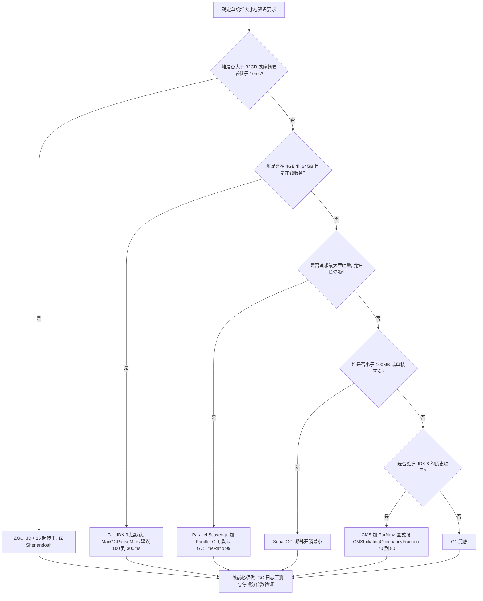

选型的三条硬规则：

1. **能用 G1 就用 G1**（JDK 9+ 默认，4GB~64GB 堆的在线服务几乎无脑选它）。
2. **堆超过 32GB 且停顿敏感就上 ZGC**，先确认版本不小于 JDK 15（转正），并接受内存占用增加 10%~20%。
3. **JDK 8 的 CMS 只作为"维护存量"的选择**，新项目即使跑在 JDK 8 上也应该评估 G1（JDK 8 已支持 `-XX:+UseG1GC`）。

### 10.4 容器化环境的五个坑

| 坑 | 现象 | 原因与处置 |
| --- | --- | --- |
| JDK 8u191 之前不认识容器内存限制 | 容器 limit 2G，JVM 却按宿主机 64G 设置 `-Xmx16g`，容器被 OOMKill | 该版本需手动设 `-Xmx`；8u191+ 起 `-XX:+UseContainerSupport` 默认开启 |
| 默认堆只占容器内存 25% | 容器 8G，堆只有 2G，`OutOfMemoryError: Java heap space` | JDK 10+ 默认 `-XX:MaxRAMPercentage=25.0`（实测）。按需调大到 60~70，或直接 `-Xmx` |
| 初始堆只有 1.5625% | 启动时堆很小、频繁 GC，随后才扩容 | 实测 `-XX:InitialRAMPercentage=1.5625`、`-XX:MinRAMPercentage=50.0`。用 `Xms=Xmx` 或调大 `InitialRAMPercentage` |
| CPU 识别错误导致 GC 线程过多 | 容器限 2 核，JVM 认为 16 核 → `ParallelGCThreads=13`，GC 时与应用抢 CPU，`Times: user` 远超 CPU 配额 | 显式 `-XX:ActiveProcessorCount=2`（实测该参数会直接影响 `ParallelGCThreads` 与 `ConcGCThreads`） |
| RSS 远大于堆与元空间之和 | 容器内存持续上涨但堆很稳，最终 OOMKill | 堆外（直接内存、线程栈、Code Cache）+ glibc 的 malloc arena 碎片。排查用 `jcmd <pid> VM.native_memory summary`，glibc 场景可设 `MALLOC_ARENA_MAX=2` |

**容器内存计算公式（面试可以直接给）**：

```text
容器内存上限 >= 堆(-Xmx)
                + 元空间(MaxMetaspaceSize) + 压缩类空间(CompressedClassSpaceSize)
                + 直接内存(MaxDirectMemorySize)
                + 线程数 × 线程栈(-Xss)
                + Code Cache(ReservedCodeCacheSize, 实测 JDK 8 = 128MB / JDK 17 = 240MB)
                + JVM 自身与其他 native 开销(经验值 100MB~300MB)
                + 安全余量(10%~20%)
```

经验做法：**堆占容器 limit 的 60%~70%，绝不超过 75%**。

### 10.5 参数冲突与覆盖关系（高频追问）

| 冲突组合 | 结果 |
| --- | --- |
| `-Xmn` 与 `-XX:NewRatio` | `-Xmn` 优先级更高，且会自动反推 `NewRatio` |
| `-XX:SurvivorRatio` 与 `-XX:+UseAdaptiveSizePolicy`（Parallel Scavenge 默认开） | 自适应策略会覆盖手动设置的比例，要固定比例必须 `-XX:-UseAdaptiveSizePolicy` |
| `-XX:MaxGCPauseMillis` 与 `-Xmn`（G1） | 设了 `-Xmn` 相当于固定新生代，G1 的停顿预测模型无法调节新生代大小，`MaxGCPauseMillis` 基本失效 |
| `-XX:InitiatingHeapOccupancyPercent` 与 `-XX:+G1UseAdaptiveIHOP`（默认 true） | 自适应生效时显式设置的 IHOP 被忽略，必须 `-XX:-G1UseAdaptiveIHOP` |
| `-XX:G1NewSizePercent` / `G1MaxNewSizePercent` / `G1MixedGCLiveThresholdPercent` | 这三个是**实验性参数**，JDK 17 实测必须 `-XX:+UnlockExperimentalVMOptions`，且该选项必须写在前面 |
| `-XX:+UseCompressedOops` 与 ZGC | ZGC 需要染色指针占用的地址空间，开启 ZGC 后压缩指针会被 JVM 自动关闭（实测 `UseCompressedOops = false`，显式写 `-XX:+UseCompressedOops` 也会被覆盖），引用变 8 字节 |
| `-Xloggc` / `-XX:+PrintGCDetails` 与 JDK 9+ | 实测 JDK 11 与 17 上会打印 `-Xloggc is deprecated. Will use -Xlog:gc:<path> instead` 与 `-XX:+PrintGCDetails is deprecated. Will use -Xlog:gc* instead`；而 `-XX:+PrintGCDateStamps` 在 JDK 17 上已是 `Unrecognized VM option`，**JVM 直接启动失败**（这是"从 JDK 8 升级 JDK 17 启动不起来"的常见原因之一） |
| `-XX:+UseSerialGC` 与 `-XX:+UseConcMarkSweepGC` | 启动失败：`Conflicting collector combinations in option list`（实测） |
| `-XX:+DisableExplicitGC` 与依赖 `System.gc()` 释放堆外内存的框架 | 表现为 `OutOfMemoryError: Cannot reserve ... bytes of direct buffer memory` |

**参数优先级**：命令行 `-XX` 参数按**从左到右、后者覆盖前者**；外部来源的优先级是 `_JAVA_OPTIONS` 环境变量 > 命令行 > `JAVA_TOOL_OPTIONS` 环境变量（实测：`_JAVA_OPTIONS=-Xmx100m` 配命令行 `-Xmx222m`，最终生效 100m；换成 `JAVA_TOOL_OPTIONS=-Xmx111m` 配同样的命令行，生效 222m）。两者启动时都会打印 `Picked up ...`，排查"参数为什么没生效"时优先检查 `_JAVA_OPTIONS`。运行时用 `jcmd <pid> VM.flags` 或 `jinfo -flags <pid>` 看**实际生效值**，而不是你以为设置的值。

### 10.6 调优方法论：用压测定参数，不靠猜

1. **定目标**：延迟型服务看 P99 停顿（如小于 200ms），吞吐型服务看 GC 时间占比（如小于 5%）。
2. **建基线**：上线前用生产流量（或等比模型）压测，打开 GC 日志，记录 GC 频率、停顿分布、晋升速率。
3. **定位瓶颈**：先看 Full GC 有没有、为什么（用 5.3 的清单），再看 Young GC 是否过频（对比分配速率），最后才动参数。
4. **一次只调一个参数**：改一个、压测、记录。GC 参数之间强耦合，同时改多个等于无法归因。

## 十一、GC 日志解读与分析工具

### 11.1 JDK 8 日志逐字段拆解

拿本章实测的一条 Full GC 日志逐字段说明（JDK 8u421，Parallel GC）：

```text
2026-10-12T05:17:01.831-0800: 0.025: [Full GC (Ergonomics) [PSYoungGen: 2496K->0K(18944K)] [ParOldGen: 37921K->16660K(44032K)] 40417K->16660K(62976K), [Metaspace: 2584K->2584K(1056768K)], 0.0012020 secs] [Times: user=0.01 sys=0.00, real=0.00 secs]
```

| 字段 | 值 | 含义 |
| --- | --- | --- |
| `2026-10-12T05:17:01.831-0800` | 绝对时间 | 由 `-XX:+PrintGCDateStamps` 输出 |
| `0.025` | JVM 启动后 0.025 秒 | 相对时间戳，由 `-XX:+PrintGCTimeStamps` 输出。判断"两次 GC 间隔多久"全靠它 |
| `[Full GC` | GC 类型 | Full GC / GC（Minor）/ CMS 各阶段 |
| `(Ergonomics)` | GC 原因 | 收集器自适应策略主动发起。常见其他值：`Allocation Failure`、`Metadata GC Threshold`、`promotion failed`、`concurrent mode failure` |
| `PSYoungGen: 2496K->0K(18944K)` | 新生代 回收前->回收后(总容量) | 回收前 2496K，回收后 0K（没有存活对象）；总容量 18944K |
| `ParOldGen: 37921K->16660K(44032K)` | 老年代 同上 | 老年代从 37921K 降到 16660K，本次回收主要收益来自老年代 |
| `40417K->16660K(62976K)` | 堆总体 同上 | 堆总使用从 40417K 降到 16660K |
| `[Metaspace: 2584K->2584K(1056768K)]` | 元空间 | 回收前后使用量没变，说明本次没有卸载类 |
| `0.0012020 secs` | 本次停顿 | **这才是应用真正被 STW 的时长** |
| `[Times: user=0.01 sys=0.00, real=0.00 secs]` | CPU 时间 | `user + sys > real` 说明多线程并行执行；`user + sys` 远大于 `real` 且 `real` 很长，说明并发线程在抢 CPU |

**用 `Times` 快速判断 GC 是否被 CPU 拖累**：

- `real` 明显大于 `user + sys`：GC 线程在**等 CPU 被调度**（容器 CPU 配额不足、机器负载高）。此时调 GC 参数没用，要加 CPU 或降低 `-XX:ParallelGCThreads`。
- `user + sys` 远大于 `real`：正常的并行 GC。
- `user + sys` 约等于 `real`：单线程 GC（Serial，或 CMS 退化后的 Serial Old 兜底）。

### 11.2 JDK 9+ 统一日志（Unified Logging）

JDK 9 起所有 GC 日志统一到 `-Xlog`，语法有四段：

```text
-Xlog:<tag 组合>:<输出目标>:<装饰器>:<输出选项>
```

| 段 | 取值 | 说明 |
| --- | --- | --- |
| tag 组合 | `gc`、`gc*`（含所有 gc 子 tag）、`gc+heap`、`gc+metaspace`、`gc+phases`、`gc+ergo`、`gc+age`、`gc+ref`、`gc+marking`、`gc+task`、`gc+stringdedup`、`safepoint` | 用 `=` 指定级别，如 `gc+heap=debug`、`gc+age=trace` |
| 输出目标 | `stdout`、`stderr`、`file=/data/logs/gc.log` | 不写则默认 stdout |
| 装饰器 | `time`、`uptime`、`level`、`tags`、`pid`、`tid`、`hostname` | 逗号分隔 |
| 输出选项 | `filecount=10`、`filesize=64M` | 日志轮转。**装饰器与输出选项是两个不同的段**，把 `tags` 写到输出选项段会报 `Invalid option 'tags' for log file output`（实测踩过这个坑） |

实测可用的写法与产物：

```bash
# 轮转配置，实测可用
-Xlog:gc*:file=/data/logs/gc.log:time,uptime,level,tags:filecount=10,filesize=64M

# 输出样例（实测）
[2026-10-12T05:17:02.162+0800][0.013s][info][gc,start    ] GC(0) Pause Young (Concurrent Start) (G1 Humongous Allocation)
[2026-10-12T05:17:02.162+0800][0.013s][info][gc          ] GC(0) Pause Young (Concurrent Start) (G1 Humongous Allocation) 28M->27M(64M) 0.276ms
```

JDK 17 上旧参数的实际行为（实测，用于升级排查）：

```text
[0.001s][warning][gc] -Xloggc is deprecated. Will use -Xlog:gc:/tmp/t3.log instead.
[0.001s][warning][gc] -XX:+PrintGCDetails is deprecated. Will use -Xlog:gc* instead.
```

**调优时更该打开 `gc+phases`**：`-Xlog:gc+phases=trace` 会把一次 Young GC 拆成顶层阶段与子阶段并给出各自耗时。顶层是 `Pre Evacuate Collection Set` / `Merge Heap Roots` / `Evacuate Collection Set` / `Post Evacuate Collection Set` / `Other`；JDK 17 实测的 G1 子阶段有 `Ext Root Scanning`、`Merge Heap Roots`（其下细分 `Remembered Sets`、`Hot Card Cache`、`Log Buffers`）、`Scan Heap Roots`、`Code Root Scan`、`Object Copy`、`Termination`。定位逻辑：卡表/RSet 相关的 `Merge Heap Roots`、`Scan Heap Roots` 占比高 → 大堆加跨 Region 引用密集（"堆越大停顿越长"的来源）；`Object Copy` 高 → 存活对象太多（Survivor 偏小或动态年龄判定导致提前晋升）；`Ext Root Scanning` 高 → 线程数多或根集合大。子阶段命名随版本调整，以日志实际输出为准。

### 11.3 GC 健康度指标（给出数字才好判断）

| 指标 | 采集方式 | 健康基线 | 异常含义 |
| --- | --- | --- | --- |
| Young GC 频率 | GC 日志计数 / 时间 | 大堆在线服务通常 1~10 次/分钟 | 超过 30 次/分钟：新生代太小或分配速率过高（对象创建风暴） |
| Young GC 单次停顿 | 日志 `real` 值 | 10~50ms | 大于 100ms：存活对象太多（跑到了不该跑的地方）或 RSet/卡表扫描成本高 |
| Full GC 次数 | GC 日志 | **长期 0 次**（G1/ZGC）；出现就要解释 | 频繁 Full GC 是最高优先级故障 |
| GC 时间占比 | `-XX:+PrintGCApplicationStoppedTime` 或日志汇总 | 小于 5%（延迟型可放宽到 10%） | 大于 10% 说明吞吐被 GC 吃掉 |
| 晋升速率 | `jstat -gc` 的 `OU` 增量 / 时间 | 与业务量成线性 | 突然跳变通常意味着缓存膨胀、大对象或长生命周期集合泄漏 |
| Full GC 后老年代占用 | `jstat -gcutil` 的 `O` 列，每次 Full GC 后记录 | 稳定或轻微波动 | **持续单调上升 = 内存泄漏**（判定泄漏最硬的证据） |
| 单次晋升对象大小 | Minor GC 前后老年代差值 | 远小于 Survivor 容量 | 接近 Survivor 容量说明动态年龄判定被触发，对象提前晋升 |

实测 `jstat -gcutil` 输出（JDK 17，`jstat -gcutil -h1 <pid> 1 1`）：

```text
  S0     S1     E      O      M     CCS    YGC     YGCT    FGC    FGCT     CGC    CGCT       GCT
  0.00 100.00  51.91  63.81  27.84   2.59   3653     2.341     1     0.003  1162     0.076     2.420
```

列含义与**版本差异**：

- `S0`/`S1`：两个 Survivor 的使用率（百分比）。`E`：Eden。`O`：老年代。`M`：元空间。`CCS`：压缩类空间。
- `YGC`/`YGCT`：Young GC 次数与总耗时（秒）。`FGC`/`FGCT`：Full GC 次数与总耗时。
- `CGC`/`CGCT`：**并发 GC 次数与耗时，只有 JDK 11+ 才有这两列**（JDK 8 的 `jstat -gcutil` 没有 `CGC`/`CGCT`，看到 13 列就说明是 JDK 11+）。这是判断"G1 的并发周期有没有在跑"的最快方法。
- `GCT`：GC 总耗时。

### 11.4 工具矩阵

| 工具 | 可用版本 | 用途 | 关键命令 |
| --- | --- | --- | --- |
| `jps` | 全版本 | 找 Java 进程 | `jps -l -m` |
| `jstat` | 全版本（列有版本差异） | 实时看 GC 次数、各区域使用率、GC 耗时 | `jstat -gcutil <pid> 1000`、`jstat -gc <pid> 1000`、`jstat -gccause <pid> 1000` |
| `jcmd` | JDK 7+ | 万能诊断入口（优先用） | `jcmd <pid> GC.heap_info`、`GC.class_histogram`、`GC.heap_dump /path/x.hprof`、`VM.metaspace`、`VM.native_memory summary`、`VM.flags`、`GC.run` |
| `jmap` | 全版本 | 堆直方图与堆 dump | `jmap -histo:live <pid>`（配合 head 只看前 20 行）、`jmap -dump:live,format=b,file=/data/x.hprof <pid>`（注意 `-histo:live` 与 `-dump:live` 会触发一次 Full GC，**生产慎用**） |
| `jinfo` | 全版本 | 查看与动态修改部分参数 | `jinfo -flags <pid>`、`jinfo -flag MaxHeapFreeRatio <pid>` |
| `jstack` | 全版本 | 线程栈，排查死锁与阻塞 | `jstack -l <pid>`（GC 卡住时看 `Finalizer`、`Reference Handler` 线程） |
| `GCViewer` | 第三方开源 | 本地分析 GC 日志，画吞吐与停顿曲线 | 直接打开 gc.log |
| `GCeasy` | 在线服务 | 上传 gc.log 自动出报告（停顿分布、参数建议） | gceasy.io；**生产日志含类名，注意脱敏合规** |
| `Censum` | 第三方 | GC 日志分析 | 已被收购，仍可用 |
| `Eclipse MAT` | 第三方 | 分析 .hprof，看支配树与泄漏嫌疑对象 | 打开 Heap Dump，看 Dominator Tree、Leak Suspects |
| `Arthas` | 第三方（阿里） | 线上诊断工具箱（无需重启） | `dashboard`、`jvm`、`memory`、`heapdump /data/x.hprof`、`vmtool --action forceGc`、`profiler start` |

实测 `jcmd <pid> GC.heap_info`（G1，`-Xmx256m`）：

```text
 garbage-first heap   total 262144K, used 102940K [0x00000007f0000000, 0x0000000800000000)
  region size 1024K, 68 young (69632K), 20 survivors (20480K)
 Metaspace       used 89K, committed 320K, reserved 1114112K
  class space    used 3K, committed 128K, reserved 1048576K
```

四行信息量很大：`region size 1024K` 是 `G1HeapRegionSize` 的实际生效值（用于推算 Humongous 阈值 = 512K）；`68 young + 20 survivors` 说明当前新生代由 88 个 Region 组成；`Metaspace reserved 1114112K` 是**虚拟地址保留量**（不是 RSS），判断元空间泄漏要看 `used` 与 `committed`。

实测 `jcmd <pid> VM.metaspace` 片段：

```text
Total Usage - 2 loaders, 493 classes (487 shared):
  Non-Class:    2 chunks,      4.00 MB capacity,  132.00 KB (  3%) committed,    85.93 KB (  2%) used
      Class:    2 chunks,    258.00 KB capacity,   66.00 KB ( 26%) committed,     3.32 KB (  1%) used
```

`loaders` 与 `classes` 数量是判断类加载泄漏的直接证据：**如果 `loaders` 数量随请求量单调上升，就是类加载器泄漏**（典型原因：热部署、动态代理、脚本引擎，以及 `ThreadLocal` 里持有 WebAppClassLoader）。

### 11.5 日志特征到病因的速查表

| 日志特征 | 病因 | 优先动作 |
| --- | --- | --- |
| `[Full GC` 每小时整点出现一次 | RMI DGC 定时 `System.gc()` | 调 `-Dsun.rmi.dgc.client.gcInterval` 或加 `-XX:+ExplicitGCInvokesConcurrent` |
| `Full GC (Metadata GC Threshold)` 反复出现 | 元空间水位线太低或类加载泄漏 | 调大 `MetaspaceSize`；用 `jcmd VM.metaspace` 看 loaders 是否增长 |
| `Full GC` 前紧跟一次 Minor `GC` | 空间分配担保失败 | 降低晋升速率：缩小新生代或调 `TargetSurvivorRatio` |
| `[ParNew (promotion failed)` | 老年代碎片或空间不足 | 见 12.2 |
| `[CMS (concurrent mode failure)` | CMS 并发周期赶不上分配速度 | 降低 `CMSInitiatingOccupancyFraction`，或换 G1 |
| `Pause Young (Mixed) (G1 Evacuation Pause) (to-space exhausted)` | G1 疏散失败 | 调大 `G1ReservePercent`、增大堆、查 Humongous |
| 大量 `(G1 Humongous Allocation)` | 大对象频繁分配 | 调大 `G1HeapRegionSize` 或改业务分批 |
| `GC overhead limit exceeded` | GC 占用了 98% 以上时间却只回收不到 2% 的堆 | 本质是堆太小或内存泄漏，**不要靠调 GC 参数解决** |
| `Times: real` 远大于 `user + sys` | CPU 不足或被限流 | 加 CPU 或降低 `ParallelGCThreads` |
| `PrintGCDateStamps` 报 `Unrecognized` | JDK 8 参数用在 JDK 17 上 | 换成 `-Xlog:gc*` |

### 11.6 一次线上 GC 问题的标准排查流程

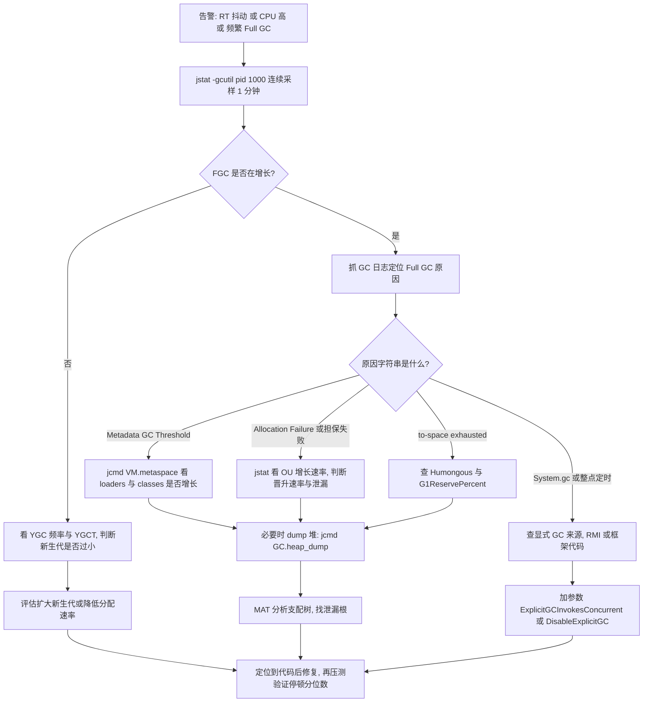

## 十二、典型调优案例

以下五个案例覆盖面试中 90% 的"线上 GC 问题"，每个都按**现象 → 证据链 → 根因 → 处置 → 验证**组织。所有错误信息与日志均为本章实测捕获。

### 12.1 案例一：Full GC 频繁（每小时一次，且老年代降不下来）

**现象**：JDK 8 + CMS，8G 堆。监控显示每 30~60 分钟一次 Full GC，每次 800ms~2s，期间接口超时。`jstat -gcutil` 显示 `FGC` 稳步增长，每次 Full GC 后 `O` 只降一点点，很快又满。

**证据链（按顺序执行）**：

```bash
# 1. 确认 Full GC 频率与停顿（JDK 8 没有 CGC/CGCT 列）
jstat -gcutil <pid> 1000 60
# 关注: FGC 增量, FGCT 增量, O 列在 Full GC 后是否仍然很高

# 2. 看 Full GC 的原因（这批日志最关键）
grep "Full GC" gc.log | tail -20
#   (Ergonomics)              -> 自适应策略主动发起, 通常是担保失败或晋升压力
#   (Metadata GC Threshold)   -> 元空间水位触发
#   (System.gc())             -> 显式调用
#   (Allocation Failure)      -> 真的不够用了

# 3. 判断是否泄漏: 记录每次 Full GC 后的老年代占用
grep "Full GC" gc.log | awk '{print $1, $NF}'
#   若 Full GC 后老年代持续上升 -> 内存泄漏; 若稳定 -> 是分配/晋升压力

# 4. 元空间与类加载
jcmd <pid> VM.metaspace | head -20     # loaders 与 classes 是否单调增长

# 5. 确认泄漏后 dump 堆
jcmd <pid> GC.heap_dump /data/dump/leak.hprof
```

**根因分三类，处置完全不同**：

| 根因 | 证据 | 处置 |
| --- | --- | --- |
| 内存泄漏（`ThreadLocal`、静态集合、无上限缓存、监听器未反注册） | Full GC 后老年代单调上升；MAT 支配树里有单个超大 `HashMap$Node` 或 `Object[]` | 修代码：缓存加容量上限（Caffeine `maximumSize`）、静态 Map 换 `WeakHashMap`、`ThreadLocal` 补 `remove()` |
| 晋升过快（Survivor 太小、动态年龄判定把对象提前推向老年代） | Young GC 后老年代有明显的量级增长；`S0`/`S1` 长期接近 100% | 扩大新生代（`-Xmn`）或调大 `-XX:TargetSurvivorRatio`，让短命对象死在新生代 |
| 元空间水位线过低导致反复 Full GC | `Full GC (Metadata GC Threshold)` 反复出现 | 设置 `-XX:MetaspaceSize=256m`（默认仅约 20.8MB） |

**验证**：修复后再次压测，要求"Full GC 次数为 0（G1）或小于 1 次/天（CMS）"，且 P99 停顿下降。**不要只用"Full GC 变少了"作为验收标准**，要同时看老年代使用曲线是否变成锯齿（正常）而非阶梯上升（泄漏）。

### 12.2 案例二：CMS Concurrent Mode Failure（大促期间 RT 抖动）

**现象**：JDK 8 + CMS，堆 8G（老年代约 5.3G）。大促开始 10 分钟后，P99 从 80ms 涨到 3s，GC 日志里出现大量 `(concurrent mode failure)`。

**证据链**：

```bash
# 1. 抓两个标志性 token
grep -c "concurrent mode failure" gc.log
grep -c "promotion failed" gc.log
grep -n "concurrent mode failure" gc.log | head -3
```

实测日志形态（`-Xmx80m` 复现，真实捕获）：

```text
[GC (Allocation Failure) ... [ParNew (promotion failed): 21426K->23826K(24576K), 0.0012929 secs] ... [CMS: 54284K->36281K(54656K), 0.0013717 secs] 60708K->36281K(79232K), ...]
[GC (Allocation Failure) ... [ParNew (promotion failed): 21427K->23827K(24576K), 0.0007611 secs] ... [CMS (concurrent mode failure): 54284K->33281K(54656K), 0.0012670 secs] 57709K->33281K(79232K), ...]
```

**根因**：CMS 触发得太晚（默认约 92% 才启动并发收集），并发周期还没跑完老年代就满了。触发太晚的原因通常有三个：`CMSInitiatingOccupancyFraction` 太高、老年代碎片导致虽有空间但无连续空间、促销期间晋升速率突增。

**处置（按收益排序）**：

1. **前移触发点**：`-XX:CMSInitiatingOccupancyFraction=70 -XX:+UseCMSInitiatingOccupancyOnly`。最直接有效的一招。
2. **缩短重新标记**：`-XX:+CMSScavengeBeforeRemark`，让 Final Remark 前先做一次 Young GC。
3. **抗碎片**：`-XX:+UseCMSCompactAtFullCollection`（默认已开）+ `-XX:CMSFullGCsBeforeCompaction=0`（默认已是 0），保证每次 Full GC 都压缩。
4. **降低晋升**：适当增大 `-Xmn`，让促销期间的短命对象死在新生代。
5. **兜底**：单机堆已超过 8GB 时，**直接把 CMS 换成 G1**——Mixed GC 用 Region 复制天然无碎片，停顿可控。这是 CMF 反复出现时的最终解。

**验证**：`grep -c "concurrent mode failure"` 归零；P99 回到目标水位；`jstat -gcutil` 的 `O` 列在两次并发周期之间呈锯齿而非持续贴近 100%。

### 12.3 案例三：G1 Humongous 频繁（Excel 导出导致 Young GC 风暴）

**现象**：JDK 17 + G1，堆 8G（`G1HeapRegionSize` 推算为 4MB）。运营功能上线后，GC 日志出现大量 `(G1 Humongous Allocation)`，Young GC 从 3 次/分钟涨到 40 次/分钟，单次停顿只有 5ms——停顿不高，但 GC 线程吃掉 30% 的 CPU。

**证据链**：

```bash
# 1. 数 Humongous 触发的 GC
grep -c "G1 Humongous Allocation" gc.log
grep "G1 Humongous Allocation" gc.log | tail -5

# 2. 确认 Region 大小（Humongous 阈值 = Region 的一半）
jcmd <pid> GC.heap_info | head -2
#  region size 4096K, ...   -> 大于 2MB 的对象就是 Humongous

# 3. 找大对象来源
jmap -histo:live <pid> | head -20     # 注意会触发一次 Full GC
#   实测输出样例（JDK 17）:
#    num     #instances         #bytes  class name (module)
#    -------------------------------------------------------
#       1:          7884       26308344  [B (java.base@17.0.12)
#    [B 就是 byte[], 优先看它的实例数与字节数
```

**根因**：导出 Excel 时把 50 万行数据一次性 `toByteArray()` 成一个 `byte[]`（约 30~80MB），远超 Region 的一半，直接进入 Humongous Region。Humongous 对象只在 Young GC / Full GC 时回收，且需要**连续的多个 Region**，于是每次导出触发多次 Young GC，还容易制造碎片。

**处置**：

1. **调大 Region（止血）**：`-XX:G1HeapRegionSize=16m`，让 8MB 的对象不再算 Humongous。代价是 RSet 粒度变粗，且一个 8MB 对象会独占一个 16MB Region（浪费一半）。
2. **改业务（根治）**：导出改成分页流式写出（SXSSFWorkbook 或 EasyExcel 流式模式），或直接写磁盘再下载，避免在堆里拼出超大 `byte[]`。
3. **不分批也要控大小**：给单次导出加行数硬上限，并纳入接口限流。
4. **辅助**：`-XX:+UseStringDeduplication` 对重复字符串多的导出场景有额外收益（只对长期存活的字符串生效）。

**验证**：`grep -c "G1 Humongous Allocation"` 大幅下降；Young GC 频率回到基线；导出压测时 CPU 使用率下降。

### 12.4 案例四：元空间 OOM（`OutOfMemoryError: Metaspace`）

**现象**：服务运行数天后容器被杀，或进程抛 `java.lang.OutOfMemoryError: Metaspace`。实测复现的完整堆栈：

```text
Exception in thread "main" java.lang.OutOfMemoryError: Metaspace
	at java.base/java.lang.ClassLoader.defineClass1(Native Method)
	at java.base/java.lang.ClassLoader.defineClass(ClassLoader.java:1017)
	at java.base/java.lang.ClassLoader.defineClass(ClassLoader.java:879)
	at MetaOOM2.main(MetaOOM2.java:9)
```

复现条件：`-XX:MaxMetaspaceSize=32m`，用不同的 ClassLoader 反复定义同一个类（每个存活的 ClassLoader 都会贡献一份类元数据）。

**GC 日志特征（实测捕获，非常关键）**：

```text
GC(12) Concurrent Mark Cycle 5.111ms
GC(13) Pause Young (Concurrent Start) (Metadata GC Threshold) 7M->7M(34M) 0.262ms
GC(15) Concurrent Mark Cycle
GC(14) Pause Full (Metadata GC Threshold) 7M->7M(34M) 3.567ms
GC(16) Pause Full (Metadata GC Clear Soft References) 7M->7M(34M) 4.377ms
```

两条规律：

- `(Metadata GC Threshold)` 是元空间相关的 GC 原因字符串。
- `Pause Full (Metadata GC Clear Soft References)`：JVM 在元空间压力下会**先清除软引用**再尝试卸载类。如果服务里用软引用做缓存，这一轮会把缓存全清掉，表现为缓存雪崩。

**证据链**：

```bash
# 1. 类加载器与类数量是否随时间增长（最硬的证据）
jcmd <pid> VM.metaspace | head -20
#   Total Usage - 2 loaders, 493 classes (487 shared):   <- loaders/classes 单调增长即泄漏

# 2. 元空间使用量与 committed
jcmd <pid> GC.heap_info | grep -i metaspace

# 3. 确认上限设置
jcmd <pid> VM.flags | tr ' ' '\n' | grep -i metaspace
```

**根因（生产上的四类）**：

| 根因 | 识别方法 |
| --- | --- |
| 动态类生成失控：CGLIB 等字节码框架为每个请求生成代理类 | `classes` 快速增长；`jmap -histo` 里 `Class` 实例数暴涨；类名带 `$$EnhancerByCGLIB`、`$Proxy` |
| 热部署或类加载器泄漏：每次 reload 新建 ClassLoader，旧的被 `ThreadLocal`、静态字段、定时器线程持有 | `loaders` 数量单调上升 |
| 反射或脚本引擎：Groovy/JS 引擎每次执行都生成新类 | `classes` 与请求量正相关，且集中在脚本相关类 |
| 元空间上限设置过小 | 启动后很快（而非数天）就 OOM，`MaxMetaspaceSize` 明显偏小 |

**处置**：

1. 先保住可用性：调大 `-XX:MaxMetaspaceSize`（512m~1g），并让 `-XX:MetaspaceSize` 与上限接近，避免运行中反复扩容引发的元空间 GC。
2. 再修根因：缓存动态代理类、把 CGLIB 换成 JDK 动态代理、清理泄漏的 ClassLoader 引用（重点检查 `ThreadLocal`、日志框架 MDC、`DriverManager`）。
3. 长期治理：把 `loaders` 与 `classes` 数量做成趋势监控并告警。

**注意**：`GC.heap_info` 里的 `Metaspace reserved` 是**虚拟内存保留量**（如 1114112K 约 1GB），不代表实际占用；判断泄漏只能看 `used`、`committed` 与 loaders/classes 趋势。

### 12.5 案例五：堆外内存泄漏（堆很稳，容器却 OOMKill）

**现象**：JDK 17 + G1，堆 4G，Netty 做网关。GC 日志正常（Full GC 几乎为 0，停顿 20ms 内），但容器 RSS 持续上涨，最终被 OOMKill。堆 dump 里找不到可疑对象。

**实测的两类真实错误信息（版本差异，务必分清）**：

```text
JDK 8u421:   java.lang.OutOfMemoryError: Direct buffer memory
JDK 17.0.12: java.lang.OutOfMemoryError: Cannot reserve 1048576 bytes of direct buffer memory (allocated: 16777216, limit: 16777216)
```

第二条的 `allocated` 与 `limit` 直接给出当前用量与上限，是 JDK 17 的改进（复现条件：`-XX:MaxDirectMemorySize=16m`，循环 `ByteBuffer.allocateDirect(1024 * 1024)`）。

**证据链**：

```bash
# 1. 开启 Native Memory Tracking 后重启（必须重启，无法对运行中进程开启）
java -XX:NativeMemoryTracking=summary -jar app.jar

# 2. 看各区域 native 内存
jcmd <pid> VM.native_memory summary
#   关注 Internal / Other / Class / Thread / GC 与 Java Heap 的 committed 对比

# 3. 建立基线后对比，定位增长区域
jcmd <pid> VM.native_memory baseline
jcmd <pid> VM.native_memory summary.diff

# 4. 确认是直接内存后，统计 DirectByteBuffer 数量
jcmd <pid> GC.class_histogram | grep -i -E "DirectByteBuffer|ByteBuf"
```

**根因**：`DirectByteBuffer` 的堆外内存由 `Cleaner`（`PhantomReference`）在对象被回收时释放（见 2.6），所以**释放时机取决于 GC**。常见三种：

| 根因 | 说明 |
| --- | --- |
| 业务代码分配了 `DirectByteBuffer` 却长期持有（静态字段、无界集合） | 对象一直可达，GC 不回收，堆外永不释放 |
| Netty 的 `ByteBuf` 没有 `release()` | Netty 用引用计数管理池化内存，未 release 时即使 GC 也无法归还池 |
| 堆很空闲导致 GC 长期不发生 | 无 GC 就无 Cleaner，堆外只增不减。这是最反直觉的一种 |

**处置**：

1. **显式设置上限**：`-XX:MaxDirectMemorySize=2g`（默认等于 `-Xmx`，很容易被忽视）。
2. **不依赖 GC**：Netty 场景用 `ResourceLeakDetector`（`-Dio.netty.leakDetection.level=paranoid`）定位未释放点；Java NIO 场景避免长期持有 `DirectByteBuffer`。
3. **谨慎兜底**：必要时用 `-XX:+ExplicitGCInvokesConcurrent` 让引用处理与 Cleaner 有机会运行；这是权宜之计，并注意与 `-XX:+DisableExplicitGC` 的冲突。
4. **监控 RSS 而不是只看堆**：容器监控里堆指标（如 `jvm_memory_used_bytes`）永远健康，只有进程 RSS 能暴露问题。

**验证**：`jcmd VM.native_memory summary.diff` 显示 `Other`/`Internal` 区域稳定；RSS 曲线走平；压测 8 小时后 RSS 不回升。

### 12.6 五个案例的共性（面试总结句）

1. **先看 GC 日志的"原因字符串"，再动手调参数**。`promotion failed`、`concurrent mode failure`、`to-space exhausted`、`Metadata GC Threshold` 各自对应完全不同的处置路径。
2. **区分"堆问题"与"堆外问题"**：堆稳定但 RSS 上涨，一律按 12.5 处理。
3. **区分"泄漏"与"压力"**：Full GC 后老年代占用是否单调上升，是唯一可靠的判据。
4. **遵守"先扩容止血、再定位、后根治"的顺序**，不要在故障中用未验证的参数组合赌运气。

## 十三、高级岗三问

### 13.1 为什么这么设计？（替代方案与代价）

| 设计决策 | 替代方案 | 选择它的理由 | 付出的代价 |
| --- | --- | --- | --- |
| 用可达性分析而非引用计数 | 引用计数 | 解决循环引用，且不需要在每次赋值时原子更新计数 | 需要 STW 枚举根节点，需要 OopMap 与安全点机制 |
| 分代收集 | 全堆统一收集 | 弱分代假说成立时回收收益成本比极高（新生代存活率低，复制算法极便宜） | 需要卡表维护跨代引用；需要处理晋升、担保等复杂逻辑 |
| CMS 用标记-清除（不移动对象） | 标记-整理 | 不移动对象就没有"更新引用"的长停顿，并发清除才可行 | 碎片、浮动垃圾、CMF |
| G1 用 Region 加 RSet 加停顿预测 | 物理连续分代 | 回收粒度从"整个老年代"降到"若干 Region"，停顿可控；新生代与老年代比例动态调整 | RSet 的内存与维护成本；Humongous 坑；实现极复杂 |
| ZGC 用染色指针加读屏障 | 写屏障加卡表与 RSet（G1 路线） | 对象头无 GC 信息，可并发移动对象；不需要 RSet | 禁用压缩指针（内存占用高 10%~20%）；引用变 8 字节；读屏障需要 JIT 深度配合 |
| Shenandoah 用 Brooks 指针或 LRB | 染色指针 | 不依赖特定硬件与地址空间布局，可移植到 OpenJDK 8u | Brooks 模式每对象多一个字；LRB 模式仍需读屏障 |
| G1 默认把 `MaxGCPauseMillis` 设为 200 | 固定的新生代大小 | 给用户一个"延迟目标"而非"内存比例"，让收集器自己权衡 | 软目标不保证；设太小会引发 Young GC 风暴（反向优化） |

### 13.2 线上出问题怎么定位？（证据链顺序）

固定顺序（面试时按这个说，会显得有方法论）：

1. **指标层**：`jstat -gcutil <pid> 1000` → 判断是 Young GC 频繁、Full GC 频繁，还是 GC 时间占比高。JDK 11+ 有 `CGC`/`CGCT` 列，能看出并发周期是否在跑。
2. **日志层**：GC 日志的**原因字符串**（`Allocation Failure` / `promotion failed` / `concurrent mode failure` / `to-space exhausted` / `Metadata GC Threshold` / `System.gc()`），以及 `Times` 的 `user/sys/real` 关系（判断是 STW 长、并行度不足，还是被 CPU 限流）。
3. **结构层**：`jcmd <pid> GC.heap_info`（Region 大小、堆使用）、`jcmd <pid> VM.metaspace`（loaders/classes 趋势）、`jcmd <pid> VM.native_memory summary`（堆外）。
4. **对象层**：`jmap -histo:live` 快速看类型分布（注意会触发 Full GC），必要时 `jcmd <pid> GC.heap_dump` 后用 MAT 看支配树与 GC Root 路径。
5. **代码层**：拿到支配树里最大的那棵树后，反查是哪段代码持有的（缓存、静态集合、`ThreadLocal`、监听器、`ClassLoader`）。

**只调参数不找证据是初级做法**；高级岗要能说清"每个数字代表什么、下一步查什么"。

### 13.3 规模变大后会怎样？（失效模式）

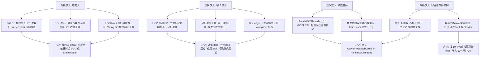

三条结论：

1. **堆超过 32GB 后 G1 收益递减**（RSet 膨胀、Full GC 变长、停顿与堆大小重新耦合），此时应评估 ZGC/Shenandoah 并接受内存成本。
2. **QPS 上来后，"调参数"通常不如"减少对象分配"**：对象池、避免大对象、避免无界缓存、减少装箱与临时字符串，这些改动对 GC 的收益远大于把 `MaxGCPauseMillis` 从 200 调到 150。
3. **容器化后 JVM 的"默认值"全部要重新核对**（内存、CPU、堆外），因为 JDK 8 早期版本与 JDK 10+ 的行为差异巨大，`MaxRAMPercentage=25` 的默认值极易造成"堆太小"的低级故障。

## 高频面试题

### Q1. 如何判断一个对象"已死"？GC Roots 有哪些？

**答题框架（30 秒版）**：两种思路——引用计数和可达性分析；HotSpot 用可达性分析，从 GC Roots 出发做图遍历，遍历不到就是可回收。判死要经过两次标记，中间隔着 `finalize()`。

**展开（2 分钟版）**：

1. 引用计数解决不了循环引用，且每次赋值都要维护计数，HotSpot 不用它。
2. GC Roots 五类：虚拟机栈局部变量表、方法区静态属性、方法区常量、本地方法栈 JNI 引用、JVM 内部引用（基本类型 Class、常驻异常对象、系统类加载器等）。
3. 枚举根节点必须 STW，靠 OopMap 在安全点记录引用位置，避免全栈扫描。
4. 不可达之后还有一层 `finalize()`：未覆盖或已执行过则直接回收；否则进 `F-Queue`，由 `Finalizer$FinalizerThread` 异步执行，执行中重建引用链就能"复活"，但只复活一次。

**追问**：跨代引用怎么处理？答：不加处理会漏标，HotSpot 用卡表（512 字节卡页 + 写屏障）只扫脏卡；G1 额外维护每 Region 的 RSet（points-into）。

### Q2. `finalize()` 有什么问题？为什么被废弃？替代方案是什么？

**答题框架（30 秒版）**：执行时机不确定、可能不执行、会拖住 Finalizer 线程导致对象积压，还能让对象"复活"增加实现复杂度。JDK 9 起 `@Deprecated`，JEP 421（JDK 18）提供 `--finalization=disabled`。替代是 `Cleaner`（JDK 9）、`try-with-resources`（JDK 7）。

**展开（2 分钟版）**：

1. `F-Queue` 由 `java.lang.ref.Finalizer` 管理，执行者是优先级不高的 `FinalizerThread`，JVM 退出不等它跑完。
2. `finalize()` 只执行一次；抛异常被 `Finalizer#runFinalizer` 吞掉，不能用来做错误处理。
3. 最致命的工程问题是：finalize 里做慢操作（IO、sleep）会让 `F-Queue` 积压，对象堆在堆里回收不了，形成"慢性 OOM"。
4. 替代：确定性释放（`AutoCloseable`）优先，其次 `java.lang.ref.Cleaner`，底层可用 `PhantomReference + ReferenceQueue`。

**追问**：JDK 8 有 `Cleaner` 吗？答：JDK 8 只有内部类 `sun.misc.Cleaner`（`PhantomReference` 子类，`DirectByteBuffer` 用），`java.lang.ref.Cleaner` 是 JDK 9 才有的公开 API。

### Q3. 强、软、弱、虚四种引用的区别与使用场景？`ThreadLocal` 为什么内存泄漏？

**答题框架（30 秒版）**：强度递减——强引用绝不回收；软引用内存不足才回收（`-XX:SoftRefLRUPolicyMSPerMB=1000`）；弱引用每次 GC 都回收；虚引用 `get()` 恒为 null，只用于回收通知。`ThreadLocal` 泄漏是因为 key 弱引用、value 强引用，且线程池线程长期存活。

**展开（2 分钟版）**：

1. 软引用的公式：`(clock - timestamp) > free_heap_MB * SoftRefLRUPolicyMSPerMB`，默认 1000 表示"每 1MB 空闲堆多活 1 秒"。堆越大留得越久，这就是大堆服务器软引用缓存"清不掉"的原因。
2. `WeakHashMap` 的 `Entry extends WeakReference<Object>`，key 弱引用、value 强引用；`get`/`put`/`size` 时靠 `expungeStaleEntries()` 清理。如果 value 反向引用 key 就退化成强引用，泄漏。
3. `ThreadLocalMap.Entry extends WeakReference<ThreadLocal<?>>`，key 弱引用，value 是强引用。key 被回收后 Entry 的 key 变 null（stale entry），value 拿不到也回收不了。`get`/`set`/`remove` 会顺手 `expungeStaleEntry`，但不能依赖。
4. 规范：`try { ... } finally { threadLocal.remove(); }`；线程池里 `InheritableThreadLocal` 不生效，需要 TTL。

**追问**：虚引用能做什么？答：唯一用途是死亡通知，`get()` 永远 null 所以无法复活对象；JDK 8 的 `sun.misc.Cleaner`（DirectByteBuffer 释放堆外内存）和 JDK 9+ 的 `jdk.internal.ref.CleanerImpl` 都用它。

### Q4. 三色标记为什么会漏标？增量更新和原始快照（SATB）有什么区别？

**答题框架（30 秒版）**：漏标必须同时满足两个条件——插入黑到白的新引用，且删除所有灰到该白的引用。破坏条件一叫增量更新（CMS），破坏条件二叫原始快照 SATB（G1、Shenandoah）。

**展开（2 分钟版）**：

1. 颜色定义：白（未访问）、灰（已访问但引用没扫完）、黑（自己和引用都扫完）。
2. 增量更新：写屏障记录"新插入的黑→白引用"，重新标记阶段把这些黑色对象当根重扫，可能递归，所以 Final Remark 停顿与引用修改量成正比。
3. SATB：写屏障记录"被删除的旧引用"，标记阶段以旧快照为准，只处理 SATB 队列，停顿更可预测，代价是浮动垃圾。
4. G1 另有两个配套机制：SATB 本地队列（`-XX:G1SATBBufferSize=1024`）与 TAMS（并发标记开始后新分配对象默认视为存活）。

**追问**：为什么 CMS 用增量更新而 G1 用 SATB？答：CMS 的目标是让可选的可中断预清理（abortable preclean）尽量承担工作、把 Final Remark 压短，增量更新与它的卡表/Mod Union Table 机制天然契合；G1 的核心卖点是**停顿可预测**，SATB 的工作量更稳定，且浮动垃圾可以用 `G1ReservePercent`（默认 10）兜住。

### Q5. Minor GC、Major GC、Full GC、Mixed GC 有什么区别？各自什么时候触发？

**答题框架（30 秒版）**：Minor 只回收新生代（Eden 满触发）；Major 严格说只有 CMS 有这个称呼；Full GC 回收整堆加元空间，停顿最长；Mixed GC 是 G1 特有——全部 Young Region 加部分 Old Region。

**展开（2 分钟版）**：把 Full GC 的触发场景讲全（这是区分度所在）：

1. 老年代空间不足或空间分配担保失败（Minor GC 后紧跟 Full GC 是典型日志特征）。
2. 大对象直接进入老年代但空间不足。
3. 元空间达到 `MetaspaceSize` 水位或 `MaxMetaspaceSize`（日志原因 `Metadata GC Threshold`）。
4. 显式 `System.gc()`（含 RMI DGC 默认每 1 小时的定时调用）。
5. CMS：`promotion failed` 与 `concurrent mode failure`。
6. G1：`to-space exhausted`（疏散失败）、Humongous 分配失败、并发标记赶不上分配。
7. JDK 8 上 `HandlePromotionFailure` **已不存在**（实测 `Unrecognized VM option`），不要按老资料回答"靠它控制担保"。

**追问**：怎么减少 Full GC？答：先按原因分类——泄漏就修代码，晋升快就调新生代与 `TargetSurvivorRatio`，元空间就调 `MetaspaceSize`，显式 GC 就用 `ExplicitGCInvokesConcurrent`，G1 就查 Humongous 与 `G1ReservePercent`。

### Q6. CMS 的收集过程？Concurrent Mode Failure 怎么产生、怎么解决？

**答题框架（30 秒版）**：CMS = 初始标记（STW）、并发标记、重新标记（STW）、并发清除，外加预清理与并发重置；它只回收老年代，新生代必须配 ParNew。CMF 是并发周期还没结束老年代就满了，退化为单线程 Serial Old 整堆压缩，停顿暴涨。

**展开（2 分钟版）**：

1. 阶段与日志：`[GC (CMS Initial Mark)`、`[CMS-concurrent-mark-start]`、`[GC (CMS Final Remark)`（含 `Rescan (parallel)`、`weak refs processing`、`class unloading`、`scrub symbol table`）、`[CMS-concurrent-sweep-start]`。
2. CMF 的日志特征（实测）：同一条 GC 记录里出现 `[ParNew (promotion failed): ...]` 和 `[CMS (concurrent mode failure): ...]`，**没有单独的 `Full GC` 字样**，很容易漏看。
3. 根因：触发太晚（默认约 92%）、碎片、晋升速率突增。
4. 解决顺序：`CMSInitiatingOccupancyFraction=70 + UseCMSInitiatingOccupancyOnly` → `CMSScavengeBeforeRemark` → 保证 Full GC 压缩（`UseCMSCompactAtFullCollection` 默认 true、`CMSFullGCsBeforeCompaction` 默认 0）→ 增大 `-Xmn` → 换 G1。
5. 版本：JDK 9 废弃、JDK 14 移除（JEP 363）；JDK 17 上 `-XX:+UseConcMarkSweepGC` 实测 `Unrecognized`。

**追问**：CMS 为什么是"标记-清除"而不是"标记-整理"？答：整理要移动对象、更新引用，必须在 STW 内完成，那就失去了并发的意义；代价就是碎片与 CMF。

### Q7. G1 的 Region 与 RSet 是怎么工作的？停顿预测模型怎么选 CSet？

**答题框架（30 秒版）**：堆分成约 2048 个等大 Region（1MB~32MB），角色动态变化；每个 Region 一个 RSet 记录"谁指向我"，是 points-into 结构；停顿预测用衰减均值加线性回归估算"回收一个 Region 的成本"，在 `MaxGCPauseMillis`（默认 200ms）内按垃圾占比从高到低挑 Region 进 CSet。

**展开（2 分钟版）**：

1. Region 大小 = 堆 / 2048 取整到 2 的幂，实测 256MB 与 2GB 堆都是 1MB。
2. RSet 三级：细粒度 `PerRegionTable`、稀疏 `SparsePRT`、粗粒度 `_coarse_map`（Bitmap）。越粗越省内存但扫描成本越高。
3. RSet 维护不能全压 STW：`-XX:G1RSetUpdatingPauseTimePercent=10` 限制暂停内的时间占比，后台靠 `G1ConcRefinementThreads` 并发消费脏卡队列。
4. CSet 选择：候选 Old Region 按存活率过滤（`G1MixedGCLiveThresholdPercent=85` 以上不进），按收益排序填满停顿预算；`G1HeapWastePercent=5` 决定什么时候结束 Mixed 阶段，`G1MixedGCCountTarget=8` 让一个 Mixed 分摊到 8 次。
5. 触发并发标记用 `InitiatingHeapOccupancyPercent=45`，但 JDK 9+ 默认 `G1UseAdaptiveIHOP=true` 会忽略它——要固定必须 `-XX:-G1UseAdaptiveIHOP`。

**追问**：为什么 G1 的 `MaxGCPauseMillis` 设成 20ms 反而更慢？答：停顿预算太小 → 每次只选很少的 Young Region → Young GC 极频繁、晋升加速、Mixed 与 Full GC 增多，形成恶性循环。官方建议 100~300ms。

### Q8. G1 的 Humongous 对象是什么？为什么会成为性能杀手？（场景题）

**答题框架（30 秒版）**：单个对象超过 Region 的一半就是 Humongous，直接进老年代的 Humongous Region（超过一个 Region 时占连续的多个 Region），只在 Young GC / Full GC 时回收，且容易因找不到连续 Region 而触发 GC。

**展开（2 分钟版）**：

1. 阈值 = `G1HeapRegionSize / 2`，用 `jcmd <pid> GC.heap_info` 看实际 Region 大小。
2. 典型来源：一次性 `toByteArray()` 的大 JSON、Excel 导出、批量查询结果、大 `String`（`String` 底层 `byte[]` 也适用）。
3. 危害：日志出现大量 `(G1 Humongous Allocation)`；Young GC 频率飙升；反复分配释放造成 Region 碎片，最终 `to-space exhausted` 甚至 `Pause Full`。
4. 处置：止血调大 `-XX:G1HeapRegionSize`（如 4m → 16m），根治改业务为流式或分批，并给单次请求的对象大小设上限。

**追问**：为什么不能简单把 Region 调到 32MB？答：Region 越大，RSet 粒度越粗、每次 Young GC 要处理的 Region 内对象越多，且小对象独占大 Region 会浪费空间，`-XX:G1HeapWastePercent=5` 的收益判断也会失准。

### Q9. ZGC 为什么能做到亚毫秒停顿？染色指针和读屏障的原理是什么？哪个版本转正？

**答题框架（30 秒版）**：ZGC 把 GC 状态放进 64 位指针的 4 个标志位（Marked0、Marked1、Remapped、Finalizable），对象头不再存 GC 信息，于是可以在并发阶段移动对象；读屏障在读取引用时检查颜色并"自愈"修正指针，所以停顿与堆大小、存活对象数量基本无关。**ZGC 在 JDK 11 实验性引入，JDK 15 转正（JEP 377）**。

**展开（2 分钟版）**：

1. 阶段：Pause Mark Start（STW 亚毫秒）→ Concurrent Mark → Pause Mark End（STW，处理引用与类卸载）→ Concurrent Prepare for Relocate → Pause Relocate Start（STW）→ Concurrent Relocate（并发移动对象）→ Concurrent Remap。
2. 自愈：慢路径修正一次后写回，后续读走快路径，读屏障均摊成本只有几条指令。
3. 代价：必须关闭压缩指针（引用 8 字节），内存占用比 G1 高 10%~20%；不使用写屏障维护 RSet。
4. 演进：JDK 11 实验（JEP 333）、JDK 14 支持 macOS/Windows（JEP 364/365）、JDK 15 转正（JEP 377）、JDK 16 并发处理线程栈（JEP 376）、JDK 21 分代 ZGC（JEP 439）。
5. **常见错误**：说"ZGC 在 JDK 17 转正"是错的，转正是 JDK 15。

**追问**：为什么需要两个 Marked 位？答：为了区分两个连续的标记周期，避免上一轮遗留的标志位被误判为本轮的标记状态。

### Q10. 【场景设计】一个 8C16G 的在线服务和一台 64G 大堆的数据服务，GC 怎么选型？

**答题框架（30 秒版）**：8C16G 在线服务用 G1，堆 8~10G，`MaxGCPauseMillis=200`，容器内存按公式核算；64G 大堆的服务如果停顿敏感就上 ZGC（JDK 15+），否则 G1 并把 `MaxGCPauseMillis` 放宽到 300~500ms 接受 RSet 开销。给出参数、验收指标与回滚方案。

**展开（2 分钟版）**：

1. **8C16G 在线服务**：`-Xms8g -Xmx8g`（堆占容器 50%~62%），`-XX:+UseG1GC -XX:MaxGCPauseMillis=200`，`-XX:MaxMetaspaceSize=512m`，`-XX:MaxDirectMemorySize=1g`，`-XX:ActiveProcessorCount=8`，GC 日志用 `-Xlog:gc*:file=...:filecount=10,filesize=64M`。验收：Young GC 停顿 P99 < 50ms，Full GC 0 次，GC 时间占比 < 5%。
2. **64G 大堆数据服务**：先问清延迟要求。停顿敏感（P99 < 50ms）→ `-XX:+UseZGC -XX:SoftMaxHeapSize=48g`，接受内存多 10%~20%，并确认 JDK ≥ 15；停顿不敏感但吞吐优先 → G1 加 `MaxGCPauseMillis=300~500`，注意 RSet 可能占堆 5%~10%，实际可用对象空间要相应缩小。
3. **容器内存核算**（必须给公式）：堆 + 元空间 + 压缩类空间 + 直接内存 + 线程数 × Xss + Code Cache + native 开销 + 余量 ≤ limit。
4. **风险与回滚**：ZGC 不兼容部分 JVMTI agent 与压缩指针优化，切之前做灰度与压测对比（同流量下的 P99、CPU、内存、吞吐四组指标），保留回滚参数。

**追问**：如果堆只有 2G 呢？答：小堆下 G1 的 Region 会退到 1MB、收益有限，可以考虑 Parallel GC（吞吐更高）；如果对停顿敏感且核少，甚至可以评估 Serial 在单核上的表现，但主流仍是 G1。

### Q11. 【排查题】线上 Full GC 频繁，且每次 Full GC 后老年代都降不下来，怎么排查？

**答题框架（30 秒版）**：这是典型的"内存泄漏特征"。第一步确认频率与原因（`jstat -gcutil` + GC 日志原因字符串），第二步确认是否泄漏（Full GC 后老年代是否单调上升），第三步 dump 堆用 MAT 找支配树，第四步回到代码找持有者。

**展开（2 分钟版）**（完整证据链）：

```bash
jstat -gcutil <pid> 1000 60              # FGC/FGCT 增量, O 列走势
grep "Full GC" gc.log | tail -20         # 原因: Ergonomics / Metadata GC Threshold / System.gc() / Allocation Failure
jcmd <pid> VM.metaspace | head -20       # loaders 与 classes 是否增长
jcmd <pid> GC.heap_dump /data/dump/leak.hprof
# MAT: Dominator Tree -> 最大对象 -> Path to GC Roots (排除弱引用)
```

1. 若原因是 `Metadata GC Threshold`：走元空间那条线（Q13）。
2. 若原因是 `System.gc()` 且间隔规整（每小时）：RMI DGC 定时 GC，不是泄漏。
3. 若原因是 `Ergonomics`/`Allocation Failure` 且 Full GC 后老年代单调上升：真泄漏，看支配树里最大的 `HashMap$Node`、`Object[]`、`Entry[]` 是谁在持有。
4. 常见持有者：无上限的静态 Map 缓存、`ThreadLocal`、监听器/回调未反注册、`ClassLoader` 泄漏、`ScheduledExecutorService` 未关闭。

**追问**：为什么不能只看堆使用率？答：堆使用率高有两种情况——对象存活（泄漏）和对象短命（分配压力）。判据是 Full GC 后的**回收后**占用，而不是回收前的使用率。

### Q12. 【排查题】堆很稳、GC 也正常，但容器 RSS 持续上涨最后被 OOMKill，怎么定位？

**答题框架（30 秒版）**：这是堆外内存问题。用 Native Memory Tracking 看各 native 区域，重点查直接内存、线程栈、Code Cache、元空间与 glibc arena 碎片。直接内存用 `GC.class_histogram` 数 `DirectByteBuffer`。

**展开（2 分钟版）**：

1. 先区分对象：`jcmd <pid> VM.native_memory summary`（需启动时加 `-XX:NativeMemoryTracking=summary`），对比 `Java Heap committed` 与 `Total: reserved/committed`。
2. 用 baseline + summary.diff 看哪个区域在涨：`Other`/`Internal` 涨 → 多为直接内存或 native 库；`Thread` 涨 → 线程数泄漏；`Class` 涨 → 元空间。
3. 直接内存：`jcmd <pid> GC.class_histogram | grep -E "DirectByteBuffer|ByteBuf"`；看 `-XX:MaxDirectMemorySize` 是否设置（默认等于 `-Xmx`）。
4. 三类根因：长期持有 `DirectByteBuffer`、Netty `ByteBuf` 未 `release()`、堆太空闲导致 GC 不发生（Cleaner 不跑）。
5. 工具：若已 OOM，错误信息本身很有用——JDK 17 是 `Cannot reserve 1048576 bytes of direct buffer memory (allocated: 16777216, limit: 16777216)`，JDK 8 只有 `Direct buffer memory`。
6. 别忘了排除 glibc malloc arena 碎片（设 `MALLOC_ARENA_MAX=2` 验证）。

**追问**：为什么加了 `-XX:+DisableExplicitGC` 之后反而更容易出现直接内存 OOM？答：有些框架/老版本 Netty 依赖显式 GC 触发引用处理来释放堆外内存；禁用后 Cleaner 只能等自然 GC，堆很空闲时就不发生。

### Q13. 【排查题】服务运行数天后报 `OutOfMemoryError: Metaspace`，怎么定位与解决？

**答题框架（30 秒版）**：先看 `jcmd <pid> VM.metaspace` 的 `loaders` 与 `classes` 是否随请求量单调增长——增长就是类加载泄漏；不增长就是上限设置太小或类数量本身合理但超限。

**展开（2 分钟版）**：

1. 证据：`jcmd <pid> VM.metaspace` 里 `Total Usage - N loaders, M classes`；`jcmd <pid> GC.heap_info` 里 Metaspace `used/committed`（**注意 reserved 是虚拟地址保留量，不是内存占用**）。
2. GC 日志特征：`Pause Young (Concurrent Start) (Metadata GC Threshold)`、`Pause Full (Metadata GC Threshold)`，严重时出现 `Pause Full (Metadata GC Clear Soft References)`——元空间压力下 JVM 会先清软引用，软引用缓存会雪崩。
3. 根因四类：CGLIB 等动态代理按请求生成类、热部署导致 ClassLoader 泄漏（`loaders` 单调上升）、脚本引擎反复生成类、`MaxMetaspaceSize` 设太小。
4. 处置：先把 `-XX:MaxMetaspaceSize` 调大止血（512m~1g），并让 `-XX:MetaspaceSize` 与之接近；再修根因（缓存代理类、清理 `ThreadLocal`/MDC/`DriverManager` 对 ClassLoader 的引用）；最后把 loaders/classes 做成趋势监控。
5. 验证：压测 24 小时后 `classes` 数量稳定不增长。

**追问**：元空间和永久代有什么区别？答：永久代在堆内、受 `-XX:MaxPermSize` 限制、由 JVM 管理；元空间（JDK 8 起）在本地内存、默认无上限、用 `MetaspaceSize`/`MaxMetaspaceSize` 控制，字符串常量池在 JDK 7 就已移到堆中。JDK 8 移除永久代的原因包括：永久代大小难调（太小 PermGen OOM、太大挤占老年代）、与 JRockit 合并、以及把元数据交给本地内存更灵活。

### Q14. 【场景设计】大促压测：P99 从 80ms 涨到 3s，GC 日志出现 `concurrent mode failure`，给你 30 分钟，怎么做？

**答题框架（30 秒版）**：先止血再定位。止血优先级：前移 CMS 触发点 → 缩短 Final Remark → 必要时临时扩容/重启降水位；同时抓日志与 `jstat` 记录证据；压测结束后按根治方案（换 G1 或调整堆与新生代配比）做变更。

**展开（2 分钟版）**：

1. **前 5 分钟（确认范围）**：`jstat -gcutil <pid> 1000` 看 `O` 列是否贴近 100%、`FGC` 是否暴涨；`grep -c "concurrent mode failure" gc.log` 确认次数；确认是老年代问题而非下游超时（否则 GC 是结果不是原因）。
2. **5~15 分钟（止血）**：
   - 若有参数热更新能力（`jinfo -flag` 只能改少部分 manageable 参数，`CMSInitiatingOccupancyFraction` 不支持运行时修改），只能重启带新参数：`-XX:CMSInitiatingOccupancyFraction=70 -XX:+UseCMSInitiatingOccupancyOnly`。
   - 同时加 `-XX:+CMSScavengeBeforeRemark` 缩短重新标记；`-XX:+ParallelRefProcEnabled` 并行处理引用。
   - 临时扩容堆（如 8G → 12G）通常能立刻缓解，因为 CMF 的本质是空间不足。
3. **15~30 分钟（验证与记录）**：观察 CMF 归零、P99 回落、`Times: real` 是否受 CPU 限制（`real` 远大于 `user + sys` 说明要加 CPU）。
4. **压测后的根治**：单机堆 > 8GB 时换 G1（Region 复制天然无碎片，停顿可控）；或把大对象/批量任务拆小、给缓存加容量上限；把"CMF 次数"做成告警项。

**追问**：为什么不直接 `-XX:+DisableExplicitGC`？答：CMF 与显式 GC 无关，禁用显式 GC 解决不了它，还可能引发堆外内存 OOM，属于错误的止血动作。

### Q15. 对象什么时候进入老年代？空间分配担保是怎么回事？

**答题框架（30 秒版）**：四条路径——年龄达到 `MaxTenuringThreshold`（默认 15）、动态年龄判定（Survivor 中某年龄及更年轻对象总和超过 `TargetSurvivorRatio=50`）、Survivor 空间不足、大对象直接分配（`PretenureSizeThreshold` 或 G1 的 Humongous）。分配担保是 Minor GC 前对老年代空间的检查。

**展开（2 分钟版）**：

1. 动态年龄判定的准确表述：HotSpot 把 Survivor 中对象按年龄从小到大累加大小，累加值超过 Survivor 的 50%（`TargetSurvivorRatio`）时，取该年龄与 `MaxTenuringThreshold` 的较小值作为新的晋升阈值（`ageTable#compute_tenuring_threshold`）。
2. 担保逻辑：老年代最大连续可用空间大于"新生代所有对象总大小"或"历次晋升平均值"才允许 Minor GC，否则直接 Full GC。
3. **版本事实**：`-XX:+HandlePromotionFailure` 在 JDK 6u24 后逻辑被移除，JDK 8u421 实测 `Unrecognized VM option 'HandlePromotionFailure'`。老资料里的这一条已经过时。
4. `PretenureSizeThreshold` 默认 0（不生效），且只对 Serial 与 ParNew 生效；G1 用 Humongous 规则（Region 一半）。
5. 现象判据：Minor GC 后紧跟 Full GC，就是担保失败的典型日志特征。

**追问**：怎么减少提前晋升？答：调大 Survivor（`SurvivorRatio` 或 `-Xmn`）、调大 `TargetSurvivorRatio`（如 80）、排查意外的大对象；Parallel Scavenge 下还要注意 `UseAdaptiveSizePolicy` 默认开启会覆盖手工比例。

### Q16. 怎么读 GC 日志？`Times: user/sys/real` 能看出什么？

**答题框架（30 秒版）**：JDK 8 看"时间戳、GC 类型、原因、各分代回收前后与容量、停顿秒数、Times"；JDK 9+ 用 `-Xlog:gc*` 统一日志。`Times` 的 `user + sys` 与 `real` 的关系能判断是并行 GC、单线程 GC，还是被 CPU 限流。

**展开（2 分钟版）**：

1. `24496K->16660K(62976K)` 是"回收前->回收后(总容量)"，**箭头左边是使用量，括号里是容量**，这是最常见的读错点。
2. `real` 远大于 `user + sys`：GC 线程在等 CPU 调度（容器 CPU 配额不足），调 GC 参数无效，要加 CPU 或降 `ParallelGCThreads`。
3. `user + sys` 远大于 `real`：并行 GC 正常表现。
4. `user + sys ≈ real`：单线程 GC（Serial 或 CMS 退化后的 Serial Old）。
5. JDK 9+ 语法四段式 `-Xlog:<tag>:<输出>:<装饰器>:<输出选项>`，轮转用 `filecount`/`filesize`；`tags` 属于装饰器段，写到输出选项段会报 `Invalid option 'tags' for log file output`。
6. 工具：GCViewer（本地）、GCeasy（在线，注意脱敏）、`jstat`（实时）。

**追问**：JDK 8 的 `-Xloggc -XX:+PrintGCDetails -XX:+PrintGCDateStamps` 能直接搬到 JDK 17 吗？答：不能。实测 JDK 17 上 `-Xloggc` 与 `-XX:+PrintGCDetails` 只打废弃警告并自动转换为 `-Xlog`，但 `-XX:+PrintGCDateStamps` 已经是 `Unrecognized VM option`，会导致**启动失败**。

## 易错点与踩坑

| 易错点 | 正确理解 |
| --- | --- |
| "GC Roots 只有栈和静态变量" | 还有方法区常量、JNI 引用、JVM 内部引用（基本类型 Class、常驻异常对象、系统类加载器），以及被 `synchronized` 持有的对象 |
| "不可达就立刻回收" | 还有 `finalize()` 这道门，对象可以"复活"一次；`F-Queue` 积压会造成慢性 OOM |
| "`-XX:+HandlePromotionFailure` 用来控制空间分配担保" | 该参数的逻辑在 JDK 6u24 后已移除，JDK 8u421 实测已是 `Unrecognized VM option`，直接启动失败 |
| "Major GC 就是 Full GC" | Major GC 严格来说是 CMS 时代"只回收老年代"的概念；G1 时代应区分 Young / Mixed / Full |
| "`-XX:MaxTenuringThreshold` 就是晋升年龄" | 实际晋升年龄还受动态年龄判定（`TargetSurvivorRatio=50`）影响，通常远小于 15 |
| "弱引用没有 ReferenceQueue 就不会被清理" | 无论有没有队列，`referent` 都会被 GC 清除；有队列只是能收到通知 |
| "`WeakHashMap` 可以当缓存" | 它没有容量上限与淘汰顺序，且只有访问时才清理失效 Entry；做缓存用 Caffeine |
| "软引用一定会在 OOM 前回收" | 回收取决于"空闲堆 × `SoftRefLRUPolicyMSPerMB`（默认 1000ms/MB）"，大堆下可能长期不回收 |
| "`ThreadLocal` 泄漏是因为 key 是强引用" | 恰恰相反：key 是弱引用（这是保护设计），泄漏是因为 value 是强引用且线程长期存活 |
| "`PhantomReference.get()` 能拿到对象" | 恒为 `null`，它只用于回收通知 |
| "ZGC 在 JDK 17 转正" | 转正是 **JDK 15（JEP 377）**；JDK 11 实验性引入，JDK 21 引入分代 |
| "CMS 在 JDK 9 被移除" | JDK 9 是**废弃**，JDK 14 才移除（JEP 363）；JDK 17 上实测 `Unrecognized` |
| "`-XX:G1NewSizePercent` 可以直接设" | 它是实验性参数，JDK 17 实测必须 `-XX:+UnlockExperimentalVMOptions` 且写在前面，否则启动失败 |
| "设了 `-XX:InitiatingHeapOccupancyPercent` 就会生效" | JDK 9+ 默认 `G1UseAdaptiveIHOP=true`，会忽略该值，需 `-XX:-G1UseAdaptiveIHOP` |
| "`G1HeapRegionSize` 可以随便设" | 取值是 1MB~32MB 的 2 的幂，JVM 会按堆/2048 自动推算（实测 256MB 堆为 1MB）；调大 Region 会粗化 RSet 粒度 |
| "堆外内存泄漏也能在堆 dump 里看出来" | `DirectByteBuffer` 对象本身很小，真正的堆外内存不在 dump 里；要靠 NMT 与 RSS 判断 |
| "`-XX:MaxDirectMemorySize` 默认是 64MB 之类" | 默认 0，含义是"等于 `-Xmx`"，不设置等于不单独限制 |
| "Full GC 频繁就调大堆" | 先分清是泄漏还是压力；泄漏调大堆只是延后故障，且堆越大单次 Full GC 越久 |
| "GC 日志里 `A->B(C)` 的 B 是容量" | B 是**回收后使用量**，括号里的 C 才是容量 |
| "JDK 8 的 GC 参数在 JDK 17 上还能用" | `-XX:+PrintGCDateStamps`、`-XX:+PrintGCTimeStamps` 等会直接导致启动失败；`-Xloggc`、`-XX:+PrintGCDetails` 只留废弃警告 |
| "容器里不用管 CPU 核数" | JVM 可能识别到宿主机核数，导致 `ParallelGCThreads` 过大、GC 与业务抢 CPU；用 `-XX:ActiveProcessorCount` 修正 |
| "元空间 reserved 大就是泄漏" | `reserved` 是虚拟地址保留量；判断泄漏看 `used`/`committed` 与 `jcmd VM.metaspace` 的 loaders/classes 趋势 |

## 一句话速记

- 判死走可达性分析，GC Roots 五类，枚举根节点必须 STW，靠 OopMap 与安全点。
- 不可达不等于回收，中间隔着 `finalize()`；自己别写 finalize，用 `Cleaner` 或 `AutoCloseable`。
- 引用强度：强（不回收）> 软（`SoftRefLRUPolicyMSPerMB=1000`，空闲堆每 MB 多活 1 秒）> 弱（每次 GC 必清）> 虚（`get()` 恒 null，只做通知）。
- `ThreadLocal` 泄漏的本质是 key 弱引用、value 强引用加线程复用；规范是 `finally remove()`。
- 三种算法对应三种场景：标记-清除（CMS，忍受碎片）、复制（新生代，存活率低）、标记-整理（老年代，无碎片但移动对象）。
- 分代的三条假说里，跨代引用假说直接决定了卡表（512 字节卡页 + 写屏障）的存在。
- 漏标需要同时满足"插入黑到白"和"删除灰到白"；增量更新记录新引用（CMS），SATB 记录被删引用（G1）。
- Full GC 的原因字符串比任何参数都重要：`Allocation Failure`、`Metadata GC Threshold`、`promotion failed`、`concurrent mode failure`、`to-space exhausted`。
- 判泄漏的唯一硬标准：Full GC 之后老年代占用是否单调上升。
- CMS 的致命伤是碎片与 CMF，日志特征是 `[ParNew (promotion failed)` 加 `[CMS (concurrent mode failure)`；JDK 14 已移除。
- G1 的关键数字：Region = 堆/2048（1MB~32MB）、`MaxGCPauseMillis=200`、IHOP=45（默认自适应）、`G1HeapWastePercent=5`、`G1MixedGCLiveThresholdPercent=85`、`G1ReservePercent=10`。
- G1 的 Humongous 阈值是 Region 的一半，大对象导出是它的头号杀手。
- ZGC 用染色指针加读屏障实现并发移动对象，JDK 11 实验、**JDK 15 转正**、JDK 21 分代。
- 容器内存 = 堆 + 元空间 + 直接内存 + 线程栈 × 线程数 + Code Cache + native 开销 + 余量，堆占 limit 的 60%~70%。
- 排查顺序：`jstat -gcutil` 看趋势 → GC 日志看原因 → `jcmd` 看结构（heap_info/metaspace/native_memory）→ dump 看对象 → 回代码找持有者。
- 参数永远一次只改一个，并且用压测的 P99 停顿与 GC 时间占比验证，而不是凭感觉。
