# 03 类加载机制与字节码

> 一句话定位：双亲委派、clinit 时机、invokedynamic、Metaspace 泄漏与 Tomcat 隔离是高级岗的区分点，能把 Class 文件结构与 javap 输出讲清楚的候选人极少 ｜ 面试权重 ★★★★★ ｜ 建议复习 60 分钟

## 本章大纲

- [一、类加载生命周期](#一类加载生命周期)
- [二、类初始化的触发时机](#二类初始化的触发时机)
- [三、类加载器与双亲委派模型](#三类加载器与双亲委派模型)
- [四、打破双亲委派的四类场景](#四打破双亲委派的四类场景)
- [五、自定义类加载器与热部署](#五自定义类加载器与热部署)
- [六、类卸载与 Metaspace 泄漏](#六类卸载与-metaspace-泄漏)
- [七、Class 文件结构](#七class-文件结构)
- [八、javap 实战解读](#八javap-实战解读)
- [九、方法调用指令与 invokedynamic](#九方法调用指令与-invokedynamic)
- [十、字节码增强与 AOP](#十字节码增强与-aop)
- [十一、Tomcat 类加载隔离模型](#十一tomcat-类加载隔离模型)
- [十二、生产实战 JVM 诊断命令手册](#十二生产实战-jvm-诊断命令手册)
- [高级岗三问](#高级岗三问)
- [高频面试题](#高频面试题)
- [易错点与踩坑](#易错点与踩坑)
- [一句话速记](#一句话速记)

本文所有字节码、Class 文件偏移、类加载行为与诊断命令输出，均在 JDK 1.8.0_421（HotSpot，macOS arm64）与 JDK 17.0.12 上实测得到。涉及版本差异处会显式标注。

## 一、类加载生命周期

### 1.1 七个阶段与三个层次

JVM 把"一个 Class 文件进入内存到被回收"的全过程划分为七个阶段。注意区分：**JVM 规范只定义了五个阶段（加载、验证、准备、解析、初始化）**，"使用"和"卸载"是生命周期描述性的说法，不属于 `ClassLoader` 的职责，但面试里按七个阶段答更完整。

| 阶段 | 归属 | 核心动作 | 发生位置 | 失败抛出的错误 |
| --- | --- | --- | --- | --- |
| 加载 Loading | 类加载子系统 | 获取二进制字节流，生成运行时数据结构，堆中建 `Class` 对象 | 方法区 + 堆 | `NoClassDefFoundError`、`ClassNotFoundException` |
| 验证 Verification | 链接 Linking | 保证字节流合法、语义安全 | 方法区 | `VerifyError`、`ClassFormatError`、`UnsupportedClassVersionError` |
| 准备 Preparation | 链接 Linking | 为 static 字段分配内存并赋**零值** | 方法区（JDK 8 起为 Metaspace） | `OutOfMemoryError: Metaspace` |
| 解析 Resolution | 链接 Linking | 符号引用转直接引用 | 方法区 + 常量池缓存 | `NoSuchFieldError`、`NoSuchMethodError`、`IllegalAccessError`、`IncompatibleClassChangeError` |
| 初始化 Initialization | 类加载子系统 | 执行 `<clinit>` | 方法区 | `ExceptionInInitializerError`、`NoClassDefFoundError` |
| 使用 Using | 运行时 | 实例化、字段访问、方法调用 | 堆 + 栈 | —— |
| 卸载 Unloading | GC | 回收 `InstanceKlass` 与 Metaspace 块 | 方法区 | —— |

一个必须答准确的细节：**加载、验证、准备、初始化、卸载这五个阶段的顺序是确定的，但解析阶段不一定**。Java 虚拟机规范允许解析延迟到第一次真正使用某个符号引用时（JVMS §5.4），HotSpot 就是懒解析。

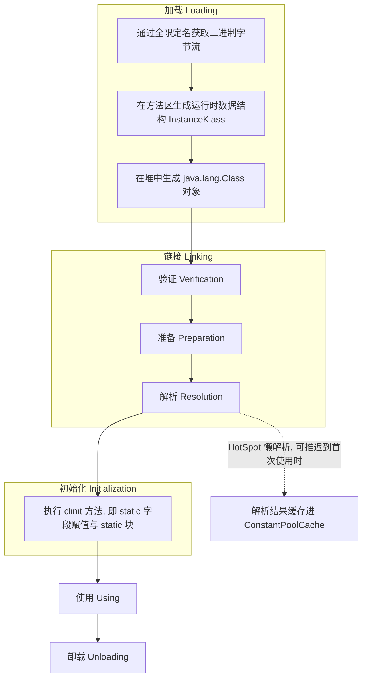

### 1.2 加载阶段：字节流的来源不受限制

"通过一个类的全限定名获取描述该类的二进制字节流"——规范只说"获取"，**没有限定从哪里获取**。这是整个类加载体系最重要的开放性设计，所有字节码增强、热部署、远程加载、加密类都建立在这一条上。

常见的字节流来源：

| 来源 | 典型实现 | 说明 |
| --- | --- | --- |
| 本地 Class 文件 | `URLClassLoader#findClass` | 最常见，`file:` 协议 |
| jar / zip 包 | `URLClassLoader` 内部 `JarLoader` | `jar:file:...!/` 协议 |
| 网络 | 自定义 `ClassLoader#findClass` | Applet、早期 RMI、动态下发代码 |
| 运行时生成 | `Proxy#getProxyClass`、`ASM`、`ByteBuddy` | 不落盘，直接 `defineClass` |
| JSP 编译产物 | Tomcat `JasperLoader` | JSP 改动后重启该加载器 |
| 加密文件 | 自定义加载器先解密再 `defineClass` | 防反编译，代价是无法被标准工具链处理 |
| 数据库 / 注册中心 | 自定义加载器 | 少见，用于配置化插件 |

HotSpot 侧的实现链路：`ClassLoader#loadClass` → `findClass` → `defineClass` → JNI 进入 `JVM_DefineClassWithSource` → `ClassFileParser::parseClassFile` 解析字节流 → 创建 `InstanceKlass` 并挂到 `ClassLoaderData` 的 `_klasses` 链表上 → 反射层创建 `java.lang.Class` 镜像（`java_lang_Class::create_mirror`）。

**数组类是一个例外**：数组类（如 `int[]`、`String[]`）不由类加载器创建，JVM 在需要时直接于内存中生成。但数组的元素类型仍由对应的加载器加载：`String[].class.getClassLoader()` 返回 `null`（因为 `String` 由 bootstrap 加载），而 `MyPlugin[].class.getClassLoader()` 返回加载 `MyPlugin` 的那个自定义加载器。

### 1.3 验证阶段：四个子阶段

验证是链接中最复杂、最容易拖慢启动的一环。规范把行为约束分成四段：

| 子阶段 | 检查内容 | 失败后果 |
| --- | --- | --- |
| 文件格式验证 | 魔数是否为 `0xCAFEBABE`、主次版本号是否在当前 JVM 支持范围内、常量池 tag 是否合法、UTF-8 编码是否合法、是否有被删除的常量池索引 | `ClassFormatError`、`UnsupportedClassVersionError` |
| 元数据验证 | 是否有父类（除 `Object`）、是否继承了被 `final` 修饰的类、抽象方法是否被实现、字段与方法是否与父类产生矛盾 | `VerifyError`、`ClassCircularityError` |
| 字节码验证 | 最复杂。对方法体做数据流与控制流分析：操作数栈类型是否匹配、跳转指令不跳到方法体外、类型转换是否合法、局部变量表使用是否越界 | `VerifyError` |
| 符号引用验证 | 解析阶段执行：引用的类/字段/方法是否存在、访问权限是否允许 | `NoSuchFieldError`、`NoSuchMethodError`、`IllegalAccessError` |

字节码验证的演进必须记住：

- **JDK 5（Class 文件版本 49）及以前**，使用纯类型推导（type inference）验证，需要遍历所有分支，慢。
- **JDK 6（版本 50）** 引入 `StackMapTable` 属性，把验证所需的类型信息由编译器预先算好。版本 50 允许验证失败时回退到旧推导验证器。
- **JDK 7（版本 51）起**，`StackMapTable` 是强制的，不再回退。这直接影响了字节码增强工具：ASM 必须设置 `ClassWriter.COMPUTE_FRAMES` 来重新计算栈映射帧，否则增强后的类会在加载时报 `VerifyError`。
- `-Xverify:none` / `-noverify` 可关闭验证，但 JDK 13 起被标记废弃并在使用时输出警告，生产环境不应使用。

### 1.4 准备阶段：赋零值 vs clinit 赋值

准备阶段做两件事：**为 static 字段在方法区分配内存**，并**把字段设置为该类型的零值**。注意是 static 字段，实例字段的分配在对象创建时随堆一起完成，不在准备阶段。

| 类型 | 零值 |
| --- | --- |
| `int` / `short` / `byte` / `char` | `0`（`char` 为 `'\u0000'`） |
| `long` | `0L` |
| `float` / `double` | `0.0f` / `0.0d` |
| `boolean` | `false` |
| 引用类型 | `null` |

**唯一的例外是编译期常量**。如果一个 static 字段同时被 `static final` 修饰，且类型是基本类型或 `String`，且初始值是编译期可确定的常量表达式，那么 javac 会为它生成 `ConstantValue` 属性，JVM 在**准备阶段**就把它赋成真实值，而不会等到 `<clinit>`。

实测 javap 输出（JDK 8）：

```text
static final int CONST;
  descriptor: I
  flags: ACC_STATIC, ACC_FINAL
  ConstantValue: int 42
```

对照 `static int staticField = 7`，它没有 `ConstantValue`，赋值发生在 `<clinit>` 里：

```text
static {};
  descriptor: ()V
  flags: ACC_STATIC
  Code:
    stack=2, locals=0, args_size=0
       0: bipush        7
       2: putstatic     #15       // Field staticField:I
       5: getstatic     #17       // Field java/lang/System.out:Ljava/io/PrintStream;
       8: ldc           #24       // String clinit
      10: invokevirtual #23       // Method java/io/PrintStream.println:(Ljava/lang/String;)V
      13: return
```

一个高频陷阱：`static final Integer BOX = 43;` **不是**编译期常量。`Integer` 是引用类型，javac 不会生成 `ConstantValue`，赋值退回到 `<clinit>`。同理 `static final int X = new Random().nextInt(10);` 也不是。

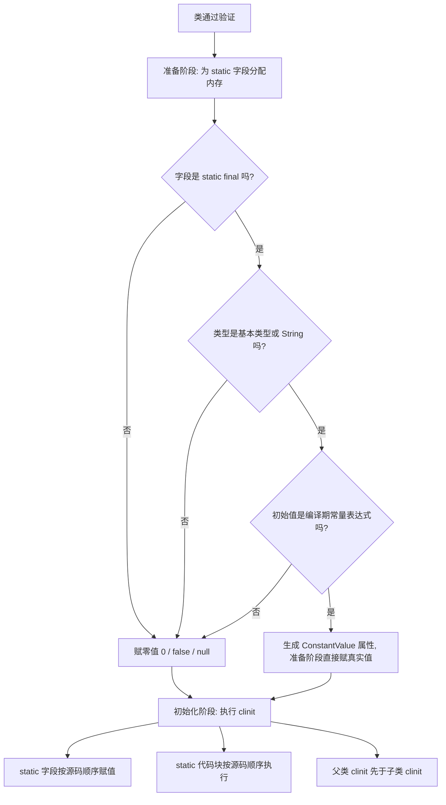

### 1.5 解析阶段：符号引用与直接引用

- **符号引用（Symbolic Reference）**：以一组字面量描述目标，如常量池里的 `#7 = Methodref #5.#58 // p1/Demo.instanceCall:()V`。
- **直接引用（Direct Reference）**：直接指向目标的指针、相对偏移量或间接句柄。HotSpot 上最终落到方法区的 `InstanceKlass*`、`Method*` 指针，以及 `vtable` / `itable` 中的索引。

哪些引用在解析阶段就能确定？

| 指令 | 能否静态解析 | 原因 |
| --- | --- | --- |
| `invokestatic` | 能 | 静态方法不可被重写 |
| `invokespecial` | 能 | 私有方法、构造器、`super.` 调用，编译期已唯一 |
| `invokevirtual` 且方法被 `final` 修饰 | 能 | 无法被重写 |
| `invokevirtual`（普通） | 不能 | 需要运行时按接收者实际类型分派 |
| `invokeinterface` | 不能 | 接口实现类不确定 |
| `invokedynamic` | 不能 | 由 BootstrapMethod 在运行时决定 |

HotSpot 的解析是**懒解析 + 缓存**：第一次遇到未解析的常量池项时调用 `ConstantPool::resolve_constant_at_impl`，把结果写回常量池缓存 `ConstantPoolCache`，后续访问直接命中。所以"解析"在一次运行中并不是一次性的批量动作，而是分散在运行期逐步发生。

也因此有一个容易忽略的运维事实：**如果某个方法从未被执行，它引用的类即使不存在，也不会抛 `NoSuchMethodError`**。这是"改了个无关分支的代码，把某个依赖类删掉，服务照样启动，某条冷路径被触发时才崩"的根因。

## 二、类初始化的触发时机

### 2.1 主动引用：六种必须初始化的场景

JVMS §5.5 严格列举了会触发初始化的情形。面试背"六种"即可：

1. **遇到 `new`、`getstatic`、`putstatic`、`invokestatic` 四条指令**，且目标类尚未初始化。注意是这四条，`getfield` / `putfield` / `invokevirtual` 不在此列。
2. **使用 `java.lang.reflect` 包的方法对类进行反射调用**，如 `Class.forName("X")`、`Class#getDeclaredMethod` 后在首次实际调用时。注意 `Class.forName(String)` 的内部是 `forName0(className, true, loader)`，第二个参数 `initialize=true`。
3. **初始化一个类时，其父类尚未初始化，则先初始化父类**。接口不适用这条（见 2.3）。
4. **虚拟机启动时，用户指定的主类**（含 `main` 方法的那个类）。这是"主类的静态块比 `main` 先执行"的原因。
5. **JDK 7 起，`java.lang.invoke.MethodHandle` 实例解析结果为 `REF_getStatic`、`REF_putStatic`、`REF_invokeStatic`、`REF_newInvokeSpecial` 四种句柄时**，需要先初始化该句柄对应的类。
6. **JDK 8 起，若接口定义了 `default` 方法，其实现类初始化时会先初始化该接口**。这是 `default` 方法引入后对 JVMS 的修订。

### 2.2 被动引用三例（实测）

三种**不会**触发初始化的情况，是笔试题的固定考点。

**例一：通过子类引用父类的静态字段，不触发子类初始化。**

```java
class Super { static int sField = 1; static { System.out.println("[clinit] Super"); } }
class Sub extends Super { static int subField = 2; static { System.out.println("[clinit] Sub"); } }
// 访问 Sub.sField
```

实测输出只有 `[clinit] Super`。原因在 javac：访问 `Sub.sField` 时，编译器把它解析为 `getstatic Super.sField`，常量池里指向的是**字段声明所在的类** `Super`，`Sub` 从未被引用。

**例二：通过数组定义引用类，不触发初始化。**

```java
Super[] arr = new Super[2];   // 只生成 anewarray, 不触发 Super 的 clinit
```

实测无任何 clinit 输出。数组类由 JVM 直接生成，`anewarray` 只需要元素类型的 `Class` 对象，不需要初始化。

**例三：引用编译期常量，不触发初始化。**

```java
System.out.println(Sub.CONST);   // CONST 是 static final int
```

实测无 clinit 输出。javac 直接把常量值内联进调用方常量池，字节码是 `bipush 42`，连 `getstatic` 都没有：

```text
0: getstatic     #2      // Field java/lang/System.out:Ljava/io/PrintStream;
3: bipush        42
```

**例四（进阶）：`static final Integer BOX = 43;` 不是编译期常量，但同样不触发子类初始化。** 实测访问 `Sub.BOX` 只输出 `[clinit] Super`。原因是 javac 把字段引用解析到了声明类 `Super`，字节码是 `getstatic Super.BOX`——和例一同一个机制，而不是常量内联的机制。这两个机制容易混，面试可以主动区分。

| 写法 | 是否生成 ConstantValue | 字节码 | 触发哪个类初始化 |
| --- | --- | --- | --- |
| `Sub.CONST`（`static final int`） | 是 | `bipush 42` | 都不触发 |
| `Sub.BOX`（`static final Integer`） | 否 | `getstatic Super.BOX` | 只触发 `Super` |
| `Sub.sField`（父类普通静态字段） | 否 | `getstatic Super.sField` | 只触发 `Super` |
| `Sub.subField` | 否 | `getstatic Sub.subField` | 触发 `Sub`，连带 `Super` |
| `new Super[2]` | —— | `anewarray` | 都不触发 |

### 2.3 接口的初始化规则（易错）

JVMS §5.5 第 7 步的原文限定语是"**if C is a class rather than an interface**"——只有当 C 是**类**时，才递归初始化其父类与"声明了至少一个 `default` 方法的超接口"。也就是说：

- 初始化一个**类** → 先初始化父类，并且要初始化它实现的、声明了 `default` 方法的接口。
- 初始化一个**接口** → **不初始化**它的任何父接口，即使父接口有 `default` 方法。

实测（JDK 1.8.0_421）：

```text
--- 初始化实现类 K: 期望 I2 被初始化, I1 不 ---
[clinit] I2-有default
[clinit] K
--- 初始化接口 I3 本身: 期望 仅 I3, 不初始化父接口 I2 ---
[clinit] I3
1
```

其中 `I1` 无 `default` 方法，`I2` 有 `default` 方法，`K implements I1, I2`，`I3 extends I2`。结论与规范完全一致。这个实验能直接证明两件事：`default` 方法会导致实现类的初始化连带初始化接口；而接口之间的继承不会。

### 2.4 clinit 的线程安全与失败语义

JVM 保证 `<clinit>` 在多线程环境下**只被执行一次**，且由 JVM 内部加锁，不需要开发者写 `synchronized`。HotSpot 的实现：

- `InstanceKlass` 有 `_init_state` 字段，取值是 `ClassState` 枚举：`allocated`、`loaded`、`linked`、`being_initialized`、`fully_initialized`、`initialization_error`。
- 初始化入口是 `InstanceKlass::initialize` → `initialize_impl`，通过 `_init_monitor`（一个 `ObjectMonitor`，与 `java.lang.Class` 镜像对象的监视器是同一个）串行化。
- 若状态是 `being_initialized` 且**当前线程就是正在初始化的那个线程**（递归初始化，例如 `A.<clinit>` 里访问了 `A` 的另一个静态字段），直接放行，不阻塞。
- 若状态是 `being_initialized` 但是别的线程，则 `Object.wait()` 挂起等待，直到状态变为 `fully_initialized` 或 `initialization_error`。

**这是"类初始化死锁"的根源**：如果 `A.<clinit>` 里启动了一个线程并 `join` 它，而那个线程又要访问 `A`，双方互相等待。生产中更常见的是间接形式——`A.<clinit>` 里调用了 `B` 的静态方法，`B` 的静态方法回调了 `A`，且这套调用发生在不同线程上（例如静态块里注册回调、启动线程池、初始化 `ThreadLocal`）。

**clinit 抛异常的语义是排查时的硬知识**，实测结果如下：

```text
--- 第1次访问 Bad: 期望 ExceptionInInitializerError ---
  java.lang.ExceptionInInitializerError
--- 第2次访问 Bad: 期望 NoClassDefFoundError ---
  java.lang.NoClassDefFoundError: Could not initialize class InitErr$Bad
--- 另一个线程访问 Bad ---
  [子线程2] java.lang.NoClassDefFoundError: Could not initialize class InitErr$Bad
--- Class.forName(Bad) 期望 ExceptionInInitializerError ---
  java.lang.NoClassDefFoundError: Could not initialize class InitErr$Bad
```

规律：

| 访问次序 | 抛出 |
| --- | --- |
| 第一个触发初始化的线程，第一次访问 | `ExceptionInInitializerError`，`getCause()` 里是被包装的业务异常 |
| 之后任何线程的任何访问（含 `Class.forName`） | `NoClassDefFoundError: Could not initialize class X` |

面试价值极高：线上日志里出现 `NoClassDefFoundError: Could not initialize class com.xxx.Foo`，**根因不在 `Foo` 找不到，而是 `Foo` 的静态初始化曾经失败过**。真正的异常在日志更早的位置（`ExceptionInInitializerError`），或者是被 `catch(Throwable)` 吞掉的。定位方法：搜索同一个类名的 `ExceptionInInitializerError`，或检查静态块里的 IO、配置读取、`ThreadLocal` 初始化。

**等待类初始化的线程在 jstack 里非常难认**，这是实测结论（JDK 1.8.0_421）：让 `initiator` 线程在 `Slow.<clinit>` 里 `Thread.sleep(15000)`，`waiter` 线程在此期间访问 `Slow.touch()`，此时 jstack 输出是：

```text
"initiator" #10 ... in Object.wait() [0x0000000171dfa000]     <- 实际在 sleep
   java.lang.Thread.State: TIMED_WAITING (sleeping)
	at java.lang.Thread.sleep(Native Method)
	at Slow.<clinit>(Slow.java:3)
	at Runner.lambda$main$0(Runner.java:3)

"waiter" #11 ... in Object.wait() [0x0000000172006000]
   java.lang.Thread.State: RUNNABLE
	at Runner.lambda$main$1(Runner.java:5)
	at Runner$$Lambda$2/0x0000000800072c28.run(Unknown Source)
	at java.lang.Thread.run(Thread.java:750)
```

三个关键观察：

1. `waiter` 的 `Thread.State` 是 **`RUNNABLE`**，线程头行却写着 `in Object.wait()`，状态自相矛盾。只按 `Thread.State` 过滤会漏掉它。
2. `waiter` 的**栈顶就是发起类引用的那一行调用点** `Runner.lambda$main$1`，`Slow.touch` 的栈帧根本没被压入——因为初始化发生在 `invokestatic` 真正执行之前。这是识别"卡在类初始化"的唯一可靠特征。
3. 没有 `- waiting to lock <0x...> (a java.lang.Class ...)` 这样的行，**也不会**出现 `Found one Java-level deadlock`。jstack 的自动死锁检测在这里给不出答案（实测 grep 计数为 0）。

因此排查口径是：`jstack` 里看到大量线程停在同一个调用点、状态 `RUNNABLE` 却毫无进展，就去别的线程栈里找 `<clinit>` 帧和它调用的阻塞动作（`Thread.sleep`、`Thread.join`、远程调用、`CountDownLatch.await`）。

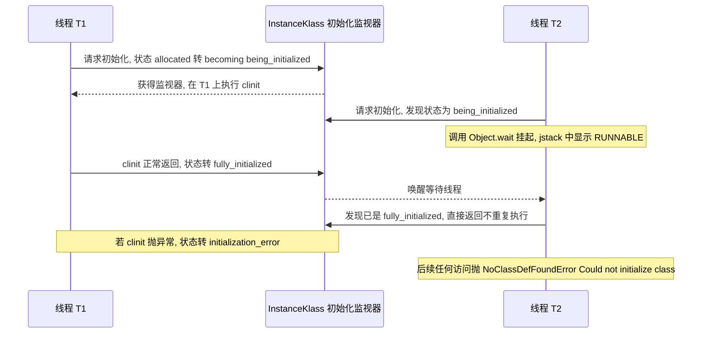

## 三、类加载器与双亲委派模型

### 3.1 三层类加载器（JDK 8 vs JDK 9+）

实测 JDK 1.8.0_421：

```text
AppClassLoader  = sun.misc.Launcher$AppClassLoader
AppCL.parent    = sun.misc.Launcher$ExtClassLoader
AppCL.parent.parent = null
String.class CL = null
```

实测 JDK 17.0.12：

```text
AppClassLoader      = jdk.internal.loader.ClassLoaders$AppClassLoader
AppCL.parent        = jdk.internal.loader.ClassLoaders$PlatformClassLoader
AppCL.parent.parent = null
String.class CL     = null
PlatformCL          = jdk.internal.loader.ClassLoaders$PlatformClassLoader
```

对照表：

| 层次 | JDK 8 实现类 | JDK 9+ 实现类 | 加载路径 | `getParent()` |
| --- | --- | --- | --- | --- |
| 启动类加载器 Bootstrap | C++ 实现（HotSpot 内），Java 侧为 `null` | `jdk.internal.loader.BootLoader` | JDK 8：`sun.boot.class.path`（`rt.jar`、`resources.jar` 等）；JDK 9+：`java.base` 等平台模块 | 无父 |
| 扩展 / 平台类加载器 | `sun.misc.Launcher$ExtClassLoader` | `jdk.internal.loader.ClassLoaders$PlatformClassLoader` | JDK 8：`java.ext.dirs`；JDK 9+：平台模块（`java.sql`、`java.xml` 等） | 是 `null`，但内部会先委派 Bootstrap |
| 应用类加载器 System | `sun.misc.Launcher$AppClassLoader` | `jdk.internal.loader.ClassLoaders$AppClassLoader` | `java.class.path`，即 `-cp` / `CLASSPATH` | Ext / Platform |
| 自定义 | 继承 `ClassLoader` / `URLClassLoader` | 同左 | 自定义 | 通常为 App |

JDK 8 实测的 `java.ext.dirs` 是 `/Users/tanbinyuan/Library/Java/Extensions`，`sun.boot.class.path` 指向 `$JAVA_HOME/jre/lib/resources.jar` 等。JDK 9 的 JEP 220 移除了扩展机制（`java.ext.dirs` 与 `$JAVA_HOME/jre/lib/ext` 不再生效），`ExtClassLoader` 被 `PlatformClassLoader` 取代，这是升级 JDK 时**把 jar 放进 `jre/lib/ext` 的"土办法"失效**的原因。

### 3.2 `loadClass` 源码：双亲委派的完整逻辑

JDK 8 `java.lang.ClassLoader#loadClass(String, boolean)` 的真实源码（取自 `src.zip`）：

```java
protected Class<?> loadClass(String name, boolean resolve)
    throws ClassNotFoundException
{
    synchronized (getClassLoadingLock(name)) {
        // First, check if the class has already been loaded
        Class<?> c = findLoadedClass(name);
        if (c == null) {
            long t0 = System.nanoTime();
            try {
                if (parent != null) {
                    c = parent.loadClass(name, false);
                } else {
                    c = findBootstrapClassOrNull(name);
                }
            } catch (ClassNotFoundException e) {
                // ClassNotFoundException thrown if class not found
                // from the non-null parent class loader
            }

            if (c == null) {
                // If still not found, then invoke findClass in order
                // to find the class.
                long t1 = System.nanoTime();
                c = findClass(name);

                // this is the defining class loader; record the stats
                sun.misc.PerfCounter.getParentDelegationTime().addTime(t1 - t0);
                sun.misc.PerfCounter.getFindClassTime().addElapsedTimeFrom(t1);
                sun.misc.PerfCounter.getFindClasses().increment();
            }
        }
        if (resolve) {
            resolveClass(c);
        }
        return c;
    }
}
```

必须能指出的细节：

- `synchronized (getClassLoadingLock(name))`。JDK 6 之前是 `synchronized (this)`，全局串行；JDK 7 起引入 `getClassLoadingLock`，方法内部判断 `parallelLockMap` 是否为空：**注册了并行能力的加载器**（`ClassLoader.registerAsParallelCapable()` 且其所有父类都已注册）使用 `ConcurrentHashMap<String, Object>` 按类名分段加锁；否则退化为 `this`。`sun.misc.Launcher$AppClassLoader` 与 `ExtClassLoader` 都继承自 `URLClassLoader`，而 JDK 8 的 `java.net.URLClassLoader` 在静态块里调用了 `ClassLoader.registerAsParallelCapable()`（`src.zip` 中该文件有两处注册），所以它们都是并行能力的。
- `parent` 为 `null` 时调用 `findBootstrapClassOrNull`，这是 ExtClassLoader（其 `parent` 为 `null`）仍能把请求送上 Bootstrap 的原因。
- `resolveClass` 只在 `resolve=true` 时调用。`ClassLoader#loadClass(String)`（单参）传的是 `false`，所以**用 `loadClass` 加载的类不会被初始化，甚至不会被链接**。这解释了 `Class.forName` 与 `ClassLoader.loadClass` 的经典差异：

| 方法 | 是否链接 | 是否初始化 |
| --- | --- | --- |
| `Class.forName(String)` | 是 | 是（`initialize=true`） |
| `Class.forName(String, false, loader)` | 是 | 否 |
| `ClassLoader.loadClass(String)` | 否 | 否（`resolve=false`） |
| `ClassLoader.loadClass(String, true)` | 是 | 否（`resolve` 只触发链接，初始化仍由首次主动引用触发） |

`Class.forName` 触发静态块、`loadClass` 不触发——这是 JDBC 驱动注册那个年代留下的经典考点。

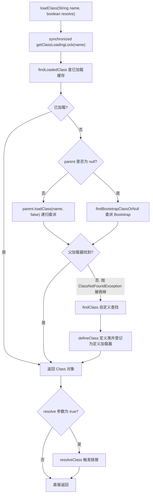

### 3.3 为什么需要双亲委派：安全性与唯一性

面试常问"双亲委派解决了什么问题"，标准答案是两条，缺一不可：

**第一，安全性（防止核心类库被篡改）。** 假设攻击者在自己的 classpath 里放了一个 `java.lang.String`，里面埋了窃取密码的代码。因为委派顺序是"先父后子"，`java.lang.String` 的加载请求会一路委派到 Bootstrap，由 `rt.jar` 里的版本返回，攻击者的 `String` 永远排不上队。**注意**：JVM 还有第二道防线——`ClassLoader#preDefineClass` 会检查包名，`java.` 开头的包一律抛 `SecurityException`：

```java
if (name != null && name.startsWith("java.")) {
    throw new SecurityException("Prohibited package name: " + name);
}
```

也就是说即使打破委派直接 `defineClass`，`java.*` 也定义不进去。这是安全加固后的行为（早期 JDK 版本没有这道检查，所以"自定义加载器能否替换 String"要看版本）。

**第二，唯一性（保证类在 JVM 中的唯一标识）。** 双亲委派保证同一个类名最终只会被同一个加载器定义一次。这条的重要性在于：JVM 判定"两个类是否相同"的依据是**类加载器实例 + 全限定名**，而不是字节码内容。

```text
同一个 class 文件, 被两个不同的类加载器加载:
  k1 == k2                 -> false
  k1.getClassLoader()      -> HotDemo$HotLoader@1cf4f579
  k2.getClassLoader()      -> HotDemo$HotLoader@694f9431
```

实测中 `HotDemo.class.getClassLoader().loadClass("plug.Payload") != 自定义加载器.loadClass("plug.Payload")` 返回 `false`（不相等）。后果：

- `instanceof` 返回 `false`，即使两个对象来自完全相同的 class 文件。
- 强转抛 `ClassCastException: plug.Payload cannot be cast to plug.Payload`——报错信息看起来荒诞，但完全合法。
- `catch (MyException e)` 抓不到另一个加载器抛出的 `MyException`。

这就是所有"同名类冲突"问题的统一解释：**先看是不是两个加载器**。

### 3.4 双亲委派的代价

| 代价 | 表现 | 场景 |
| --- | --- | --- |
| 父加载器可见的类，子加载器无法覆盖 | webapp 里放了新版本 jar 却不生效，实际用的是父加载器的旧版本 | Tomcat 部署两个使用不同版本 `commons-lang3` 的应用 |
| 父加载器看不到子加载器的类 | SPI 接口在父加载器，实现在子加载器，父加载器找不到实现 | JDBC 驱动、`ServiceLoader` |
| 委派是单向的，无法反向查找 | 需要"子加载器优先"或"网状委派"时必须自定义 | Tomcat、OSGi |
| 加载路径固定 | 需要从网络/数据库/加密文件加载时无法直接支持 | 插件化平台 |

## 四、打破双亲委派的四类场景

"如何打破双亲委派"是高级岗的分水岭问题。答案不是"重写 `loadClass`"这么单薄，而是四类真实场景各有一种解法。

### 4.1 SPI 与线程上下文类加载器

问题：`java.sql.Driver` 接口在 `rt.jar` 里，由 Bootstrap 加载；MySQL 的 `com.mysql.cj.jdbc.Driver` 实现在应用 classpath 里，由 AppClassLoader 加载。`DriverManager` 由 Bootstrap 加载，它要用 `ServiceLoader` 找到实现类，**但 Bootstrap 看不到 AppClassLoader 的路径**。

解法：JDK 6 起引入 `Thread#setContextClassLoader` / `getContextClassLoader`。这是一个**默认继承父线程**的字段，作为"当前线程的任务合作者加载器"存在。`DriverManager` 的静态块里：

```java
// DriverManager 静态初始化中
loadInitialDrivers();
// 内部: ServiceLoader<Driver> loadedDrivers = ServiceLoader.load(Driver.class);
// ServiceLoader.load 的实现:
//   Thread.currentThread().getContextClassLoader()
```

即 `ServiceLoader.load(Class)` 用线程上下文类加载器去加载实现，从而让"父加载器使用子加载器的路径"。这是**打破双亲委派的官方后门**，是"父委托子"的反向委派。

其他使用同一机制的组件：JAXP（`DocumentBuilderFactory.newInstance()`）、JNDI、`FileSystemProvider`、Spring 的 `SpringFactoriesLoader`（用 `ClassLoader.getSystemClassLoader()` 与线程上下文类加载器）、Dubbo 的 SPI。

**生产陷阱**：线程池里的线程复用时上下文类加载器不会自动重置。webapp 卸载后，池化线程的 `contextClassLoader` 仍指向已卸载的 webapp 加载器，导致 `Metaspace` 泄漏与 `NoClassDefFoundError`。Tomcat 的 `WebappClassLoaderBase#checkThreadLocalsForLeaks()` 专门检测这类残留并打警告日志，但**它只检测不清理**，需要业务自己修。

### 4.2 Tomcat：子加载器优先

Tomcat 让 webapp 自己的 `WEB-INF/classes` 和 `WEB-INF/lib` 优先于父加载器，否则同一台机器上两个应用无法使用不同版本的库。详见[第十一章](#十一tomcat-类加载隔离模型)。

### 4.3 OSGi：网状委派

OSGi 把类加载委派从"树"改成"网"：每个 Bundle 有自己的 `BundleClassLoader`，按 `Import-Package` / `Export-Package` 声明决定委派给谁，顺序是：`java.*` → 父加载器 → `Import-Package` 指定的 Bundle → `Require-Bundle` 指定的 Bundle → 自己的 `Bundle-ClassPath`。OSGi 还能做包级别的热替换（同一 Bundle 内不同包可以由不同加载器加载）。

代价极高：类加载规则复杂、调试困难、启动慢。这是 OSGi 在互联网后端未成为主流的原因，也是"模块化热部署"这条路线的历史教训。JDK 9 的 JPMS（`module-info.class`）选择了另一条路：不改委派模型，而是在加载器之上加可见性约束（`Module#addReads`、`--add-opens`）。

### 4.4 直接重写 `loadClass`

最简单粗暴的方式，也是最危险的方式：完全绕开父加载器。适合"所有依赖必须自带、与宿主完全隔离"的插件沙箱。风险是 `java.*` 会 `SecurityException`，且 JDK 内部类（`sun.*`、`jdk.internal.*`）必须委派，否则会因缺少访问权限而崩。实践中正确写法是**只对特定包前缀自加载，其余全部委派**：

```java
@Override
protected Class<?> loadClass(String name, boolean resolve) throws ClassNotFoundException {
    if (name.startsWith("java.") || name.startsWith("javax.") || name.startsWith("sun.")) {
        return super.loadClass(name, resolve);          // JDK 核心类必须委派
    }
    if (name.startsWith("plug.")) {                     // 插件包自加载, 不走父
        Class<?> c = findLoadedClass(name);
        if (c == null) {
            c = findClass(name);
        }
        if (resolve) {
            resolveClass(c);
        }
        return c;
    }
    return super.loadClass(name, resolve);
}
```

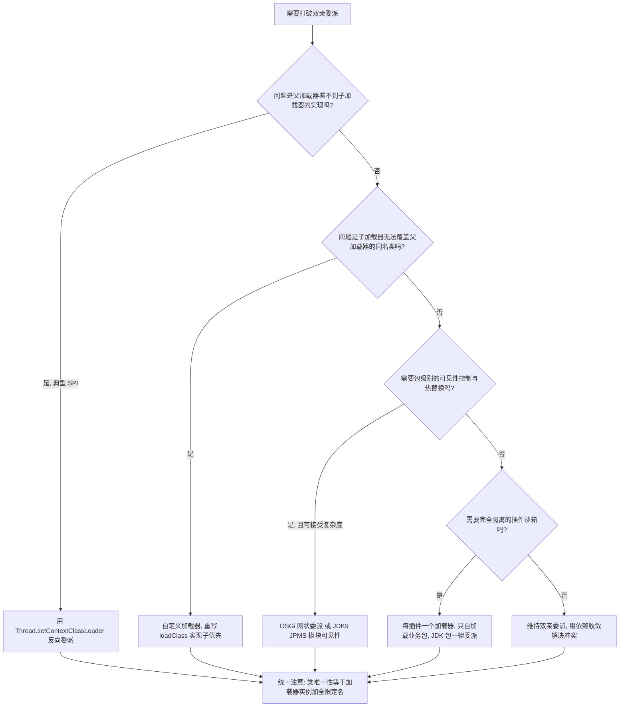

## 五、自定义类加载器与热部署

### 5.1 三个必须区分的钩子

| 方法 | 职责 | 是否必须重写 |
| --- | --- | --- |
| `loadClass(String, boolean)` | 委派逻辑 + 缓存查询 | 只有打破委派时才重写 |
| `findClass(String)` | 按名字定位字节流并调用 `defineClass` | 常规自定义加载器只重写这个 |
| `defineClass(String, byte[], int, int)` | 把字节流转成 `Class`，登记定义加载器，触发格式验证 | 不重写，除非要拦截字节流 |
| `resolveClass(Class)` | 触发链接 | 通常配合 `loadClass(resolve=true)` |

`defineClass` 是 `final` 之外的 `protected final` 方法（JDK 8 中是 `protected final Class<?> defineClass(...)`），它做三件不可绕过的事：格式验证、把类登记到 `ClassLoaderData`、把该类标记为"由本加载器定义"（`Class#getClassLoader()` 返回本加载器）。**`getClassLoader()` 返回谁，取决于谁调用了 `defineClass`，而不是谁触发了加载**——这是理解类唯一性的关键。

`Class.forName(name, initialize, loader)` 与 `loader.loadClass(name)` 的差别在 3.2 已列，两者都只在"本加载器是定义加载器"时生效。

### 5.2 并行加载能力

默认（未注册并行能力）的加载器，`getClassLoadingLock` 返回 `this`，所有类加载串行。多线程并发加载大量类的场景（如 Spring 启动扫描、CGLIB 批量生成）会成为瓶颈。注册方式：

```java
public class MyLoader extends URLClassLoader {
    static {
        ClassLoader.registerAsParallelCapable();
    }
}
```

JDK 要求**该加载器的所有父类（直到 `ClassLoader`）都注册过**，否则 `registerAsParallelCapable` 返回 `false` 且不生效。`URLClassLoader` 自身已注册，所以继承它的自定义加载器注册即可。Tomcat 8.5+ 提供了 `ParallelWebappClassLoader` 专门解决这个问题。

### 5.3 热部署的两种实现

**方案一：换 ClassLoader。** 类一旦被加载就无法重新定义，但可以让旧加载器整体"作废"：新建一个加载器重新加载同名类，旧加载器连同它定义的所有类在 GC 后一起卸载。实测（JDK 1.8.0_421，`-XX:+TraceClassUnloading`）：

```text
[clinit] Payload loaded by HotDemo$HotLoader@1cf4f579
round1 -> hello/1 | loader=HotDemo$HotLoader@1cf4f579 | 与 AppClassLoader 加载同一类是否相同: false
round2 -> hello/1 | loader=HotDemo$HotLoader@694f9431 | 与 AppClassLoader 加载同一类是否相同: false
[Unloading class plug.Payload 0x0000000800060828]
round3 -> hello/1 | loader=HotDemo$HotLoader@20fa23c1 | 与 AppClassLoader 加载同一类是否相同: false
[Unloading class plug.Payload 0x0000000800061028]
```

三点结论：

1. 每一轮 `loader` 实例不同，`getDeclaredConstructor().newInstance()` 触发了新加载器的 `<clinit>`，静态字段 `x` 重置回 `1`——**静态状态随类一起重置**，这是热部署"配置丢了"的根因。
2. 与 AppClassLoader 加载的同类**不相等**，证明唯一性由加载器决定。
3. `[Unloading class plug.Payload]` 证明旧类确实被卸载了。注意 round1 没有卸载日志、round2/round3 才有——**类卸载依赖 GC 真正回收加载器**，不可预期。要稳定复现需要 `System.gc()` 且确保没有强引用残留。

这个方案的落地要点：所有对旧对象的引用必须断开（`cl = null; k = null; o = null; m = null;`），特别注意 `ThreadLocal`、静态缓存、`Thread` 对象、`ScheduledExecutorService`、JMX MBean、JDBC 驱动注册表。

**方案二：Instrumentation 原地重定义。** 不换加载器，用 `java.lang.instrument.Instrumentation#redefineClasses` 或 `#retransformClasses` 替换方法体。限制很硬：**不能增删字段、不能增删方法、不能改继承关系、不能改方法签名**，只能改方法体、常量池和部分属性。所以只有"修 bug 级"的热替换可行，加功能的场景做不到。

### 5.4 热部署的完整流程

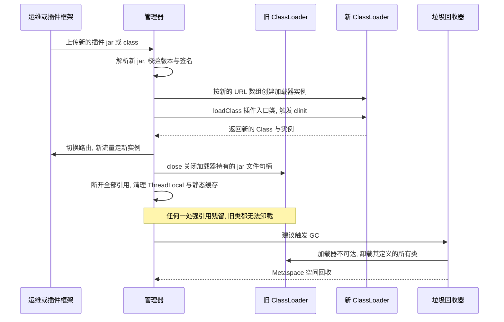

## 六、类卸载与 Metaspace 泄漏

### 6.1 类卸载的三个条件

类要满足**全部**条件才可能被卸载：

1. 该类的**所有实例**都已被回收（堆中不再有该类的对象）。
2. **加载该类的 `ClassLoader` 实例已被回收**。
3. 该类的 `java.lang.Class` 对象**没有被任何地方引用**，包括反射缓存、`JNI` 全局引用、`ClassLoader` 之外的静态字段。

第 2 条是决定性条件——HotSpot 的 `ClassLoaderData` 是整个卸载的粒度：**加载器活着，它定义的类就永远卸载不掉**。所以类卸载问题一律翻译成"谁还在引用那个加载器"。

`java.lang.Class` 对象与其 `ClassLoader` 是互相引用的（`Class#getClassLoader`、`ClassLoaderData` 反向持有 `_klasses`），HotSpot 用 `ClassLoaderData` 到 `Class` 的弱引用（`WeakReference` 语义）来打破循环，所以这个环本身不会阻止卸载。

卸载的触发时机：

- JDK 8 默认 `ParallelGC` / `CMS`：类卸载发生在 Full GC 时。实测 `-XX:+PrintFlagsFinal` 确认 `ClassUnloading = true`、`CMSClassUnloadingEnabled = true`（默认值）。
- G1（JDK 7 起）：`ClassUnloadingWithConcurrentMark = true`（默认），允许在并发标记阶段卸载类，不必等 Full GC。这对"频繁热部署"的系统是显著的延迟改善。
- `-Xnoclassgc` 关闭类卸载。只应在"确定不会热部署、且 Metaspace 是瓶颈"时使用，代价是 Metaspace 只增不减。

### 6.2 Metaspace 与常见泄漏源

JDK 8（JEP 122）用 Metaspace 取代永久代 PermGen。实测默认值（JDK 1.8.0_421，`-XX:+PrintFlagsFinal`）：

| 参数 | 实测默认值 | 含义 |
| --- | --- | --- |
| `MetaspaceSize` | `21807104`（约 20.8 MB） | **不是初始大小**，而是首次触发 Metaspace GC 的高水位线。调大它可以避免启动期反复 Full GC |
| `MaxMetaspaceSize` | `18446744073709535232`（uintx 最大值） | 默认无上限，只受本机内存限制 |
| `CompressedClassSpaceSize` | `1073741824`（1 GB） | 压缩类指针空间，仅在 `UseCompressedClassPointers` 开启时生效（堆小于 32 GB 时默认开启） |
| `ClassUnloading` | `true` | 允许类卸载 |
| `InitialBootClassLoaderMetaspaceSize` | `4194304`（4 MB） | Bootstrap 加载器的初始 Metaspace |

OOM 信息差异要记住：JDK 7 及以前是 `java.lang.OutOfMemoryError: PermGen space`，JDK 8 起是 **`java.lang.OutOfMemoryError: Metaspace`**，压缩类指针空间耗尽时是 `Compressed class space`。

**Metaspace 泄漏的高频根因（按生产出现频率排序）**：

| 泄漏源 | 机制 | 特征 |
| --- | --- | --- |
| `ThreadLocal` 未清理 | 池化线程的 `ThreadLocalMap` 的 `Entry` key 是弱引用但 value 强引用；`Entry` 挂在 `Thread` 上，线程不死则 value 不死；value 常是业务对象，间接引用加载器 | 热部署后 Metaspace 阶梯上涨，`jmap -histo` 里 `ThreadLocalMap$Entry` 数量不降 |
| 线程的 `contextClassLoader` | 线程持有加载器强引用，池化线程不退出 | `jstack` 看不到，需 `jcmd <pid> VM.classloader_stats` 观察加载器个数持续增长 |
| 静态字段缓存 | `static Map<String, Object>` 缓存了实例，实例的 `Class` 指向加载器 | 缓存不清空则永不卸载 |
| 定时任务 / 线程池 | `ScheduledExecutorService` 的线程持有 `Runnable`，`Runnable` 的 `Class` 持有加载器 | 卸载后仍每秒报 `ClassNotFoundException` 或静默执行旧代码 |
| JDBC 驱动注册 | `DriverManager` 的 `registeredDrivers` 静态列表持有驱动实例 | 卸载 webapp 后仍能通过 `DriverManager.getConnection` 拿到旧连接 |
| JMX / MBean | `MBeanServer` 持有对象引用 | 与 Tomcat 的 `clearReferences()` 相关，它清理 RMI 目标与部分缓存 |
| JNI 全局引用 | `NewGlobalRef` 创建的引用 `GC` 不可回收 | 需在 `native` 代码中 `DeleteGlobalRef` |
| 日志框架的静态引用 | Logback 的 `LoggerContext` 缓存 `Logger`，`Logger` 持有 `Class` | 老版本 Logback 的著名问题 |

### 6.3 定位手段

| 命令 | 用途 | 实测注意 |
| --- | --- | --- |
| `jcmd <pid> VM.classloader_stats` | 按加载器统计类数与 Metaspace 占用 | 输出列：`ClassLoader`、`Parent`、`CLD*`、`Classes`、`ChunkSz`、`BlockSz`、`Type`。实测一个空应用是 3 个加载器、465 个类、约 4.5 MB ChunkSz |
| `jmap -clstats <pid>` | 同上，另一条路径 | **macOS 上实测失败**：`task_for_pid failed (os/kern failure) (5)`，因为它走 SA（Serviceability Agent）需要额外的任务端口权限。改用 `jcmd` 的 `VM.classloader_stats` |
| `jcmd <pid> GC.class_stats` | 按类统计 Metaspace 占用明细 | 需要 `-XX:+UnlockDiagnosticVMOptions`，输出巨大，生产慎用 |
| `jmap -histo:live <pid>` | 堆内对象直方图，找残留的 `Entry` / `ClassLoader` | 会触发一次 Full GC，谨慎 |
| `jcmd <pid> GC.heap_dump /tmp/x.hprof` | 导出堆 | 用 MAT 看 `ClassLoader` 的 GC Root 路径 |
| `-XX:+TraceClassUnloading` | 打印卸载事件 | 实测格式：`[Unloading class plug.Payload 0x0000000800060828]` |
| `-XX:+TraceClassLoading` | 打印加载事件 | 实测格式：`[Loaded Lam from file:/private/tmp/cldemo/out/]`；`-verbose:class` 等价 |
| `jcmd <pid> GC.heap_info` | 堆与 Metaspace 汇总 | 快速确认是不是 Metaspace 问题 |

两者都是产品版可用的开关（实测 `TraceClassLoading`、`TraceClassUnloading` 的 `PrintFlagsFinal` 类型是 `{product rw}`）。而 `-XX:+TraceClassResolution`、`-XX:+TraceClassInitialization` 属于 develop 级开关，**标准产品版 JVM 上设置会直接报 `Unrecognized VM option` 并退出**，需要 fastdebug 版本才有，不要在生产命令里写。

MAT 里定位加载器泄漏的标准动作：打开 `Dominator Tree`，搜索 `ClassLoader`，检查它的 `Path to GC Roots`（排除弱引用），路径终点一定是某个 `Thread`、静态字段或 `ThreadLocalMap`。

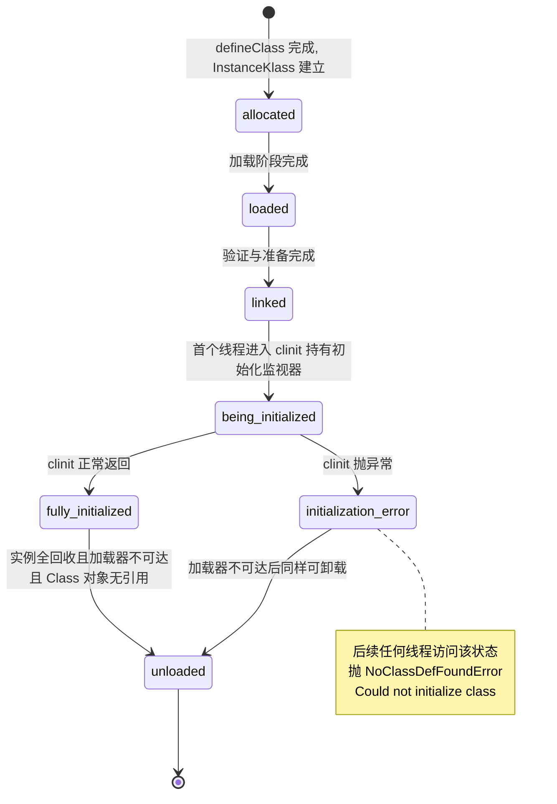

## 七、Class 文件结构

### 7.1 真实文件的全景

下面所有数字来自对 `p1/Demo.class` 的实测解析。原始文件头 32 字节：

```text
00000000: cafe babe 0000 0034 007e 0a00 1900 3509  .......4.~....5.
00000010: 0005 0036 0800 3709 0005 0038 0700 390a  ...6..7...8...9.
00000020: 0005 0035 0a00 0500 3a0a 0005 003b 1200  ...5....:....;..
00000030: 0000 400b 0041 0042 1200 0100 4608 0047  ..@..A.B....F..G
```

逐字段解析结果：

| 字段 | 字节数 | 实测值 | 解读 |
| --- | --- | --- | --- |
| `magic` | 4 | `0xCAFEBABE` | 魔数，`cafe babe` |
| `minor_version` | 2 | `0` | 次版本号 |
| `major_version` | 2 | `52`（`0x0034`） | 主版本号，**52 = JDK 8** |
| `constant_pool_count` | 2 | `126`（`0x007E`） | 常量池容量计数，**实际条目数是 125**（索引 1..125，第 0 项被 JVM 保留） |
| `access_flags` | 2 | `0x0021` | `ACC_PUBLIC` 与 `ACC_SUPER` 的按位或 |
| `this_class` | 2 | `#5` | 指向常量池 `#5 = Class #57 // p1/Demo` |
| `super_class` | 2 | `#25` | 指向 `#25 = Class #86 // java/lang/Object` |
| `interfaces_count` | 2 | `1` | 实现了 1 个接口 |
| `interfaces[0]` | 2 | `#26` | `#26 = Class #87 // java/lang/Comparable` |
| `fields_count` | 2 | `4` | `CONST`、`staticField`、`instField`、`tag` |
| `methods_count` | 2 | `8` | 见下表 |
| `attributes_count` | 2 | `4` | `Signature`、`SourceFile`、`InnerClasses`、`BootstrapMethods` |

**偏移 1595** 处是 `access_flags` 的起始位置——常量池占了文件的前 1595 字节，整个文件 2210 字节。这解释了为什么"常量池是 Class 文件里最大的一块"。

主版本号对照表（查到版本就能判断这个 class 是哪个 JDK 编译的，反之亦然）：

| 主版本 | JDK | 主版本 | JDK |
| --- | --- | --- | --- |
| 45 | 1.1 | 58 | 14 |
| 46 | 1.2 | 59 | 15 |
| 47 | 1.3 | 60 | 16 |
| 48 | 1.4 | 61 | 17 |
| 49 | 5 | 62 | 18 |
| 50 | 6 | 63 | 19 |
| 51 | 7 | 64 | 20 |
| 52 | 8 | 65 | 21 |
| 53 | 9 | 66 | 22 |
| 54 | 10 | 67 | 23 |
| 55 | 11 | 68 | 24 |
| 56 | 12 | 69 | 25 |
| 57 | 13 | —— | —— |

规则是 `major = JDK 版本 + 44`（JDK 1.1 起），JDK 5 之后用主版本号命名。

实测 JDK 17 编译同一个源文件得到 `major version: 61`，与表一致。**高版本 JVM 能运行低版本 class，低版本 JVM 不能运行高版本 class**，后者抛 `UnsupportedClassVersionError`（信息里会带上这两个数字，例如 `class file version 61.0, this version of the Java Runtime only recognizes class file versions up to 52.0`）。

### 7.2 常量池的 14 种 tag

实测 `p1/Demo.class` 的常量池 tag 分布：

| tag | 名称 | 实测个数 | 说明 |
| --- | --- | --- | --- |
| 1 | `CONSTANT_Utf8` | 62 | 字面量，占比最高 |
| 3 | `CONSTANT_Integer` | 1 | `Integer 42` |
| 7 | `CONSTANT_Class` | 12 | 类或数组的符号引用 |
| 8 | `CONSTANT_String` | 4 | 字符串字面量，指向 Utf8 |
| 9 | `CONSTANT_Fieldref` | 4 | 字段符号引用 |
| 10 | `CONSTANT_Methodref` | 12 | 类方法符号引用 |
| 11 | `CONSTANT_InterfaceMethodref` | 3 | 接口方法符号引用 |
| 12 | `CONSTANT_NameAndType` | 19 | 名字加描述符 |
| 15 | `CONSTANT_MethodHandle` | 3 | 方法句柄，JDK 7 引入 |
| 16 | `CONSTANT_MethodType` | 3 | 方法类型，JDK 7 引入 |
| 18 | `CONSTANT_InvokeDynamic` | 2 | 动态调用点，JDK 7 引入 |

未出现但必须知道的：`4 CONSTANT_Float`、`5 CONSTANT_Long`、`6 CONSTANT_Double`、`17 CONSTANT_Dynamic`（JDK 11 引入的条件常量）、`19 CONSTANT_Module` / `20 CONSTANT_Package`（JDK 9 模块化引入）。

**`Long` 和 `Double` 占两个常量池槽位**（JVMS §4.4.5）：如果一个 `Long` 常量在索引 `n`，则 `n+1` 也是"已占用但不可用"的。这是"常量池计数比实际条目多"之外的另一个计数陷阱，也是手写 Class 文件最常见的一个 off-by-one。

常量池的引用结构值得记住：`Methodref` 不直接存方法名字符串，而是指向一个 `Class` 项和一个 `NameAndType` 项。实测：

```text
#1  = Methodref          #25.#53       // java/lang/Object."<init>":()V
#5  = Class              #57           // p1/Demo
#53 = NameAndType        #35:#36       // "<init>":()V
#36 = Utf8               ()V
```

`void <init>()` 被拆成 `Utf8 "<init>"` 和 `Utf8 "()V"` 两项，通过 `NameAndType` 组合。这种"二级索引"设计让相同的方法名和描述符可以跨类复用，显著压缩常量池。

### 7.3 访问标志表

| 标志 | 值 | 适用 | 含义 |
| --- | --- | --- | --- |
| `ACC_PUBLIC` | `0x0001` | 类、字段、方法 | public |
| `ACC_PRIVATE` | `0x0002` | 字段、方法 | private |
| `ACC_PROTECTED` | `0x0004` | 字段、方法 | protected |
| `ACC_STATIC` | `0x0008` | 字段、方法 | static |
| `ACC_FINAL` | `0x0010` | 类、字段、方法 | final |
| `ACC_SUPER` | `0x0020` | 类 | 调用父类方法时使用特殊语义，JDK 1.0.2 之后编译器都设置 |
| `ACC_SYNCHRONIZED` | `0x0020` | 方法 | 同步方法，注意与 `ACC_SUPER` 同值但适用对象不同 |
| `ACC_VOLATILE` | `0x0040` | 字段 | volatile |
| `ACC_BRIDGE` | `0x0040` | 方法 | 桥接方法，由编译器生成 |
| `ACC_TRANSIENT` | `0x0080` | 字段 | transient |
| `ACC_VARARGS` | `0x0080` | 方法 | 可变参数 |
| `ACC_NATIVE` | `0x0100` | 方法 | native |
| `ACC_INTERFACE` | `0x0200` | 类 | 是接口 |
| `ACC_ABSTRACT` | `0x0400` | 类、方法 | abstract |
| `ACC_STRICT` | `0x0800` | 方法 | strictfp |
| `ACC_SYNTHETIC` | `0x1000` | 类、字段、方法 | 编译器生成，源码不可见 |
| `ACC_ANNOTATION` | `0x2000` | 类 | 注解类型 |
| `ACC_ENUM` | `0x4000` | 类、字段 | 枚举 |
| `ACC_MODULE` | `0x8000` | 类 | 模块描述符，JDK 9 |

实测验证：`Demo.class` 的 `access_flags = 0x0021` = `ACC_PUBLIC | ACC_SUPER`。8 个方法的标志实测值：`1`（`ACC_PUBLIC`，构造器）、`9`（`0x0009` = `ACC_PUBLIC | ACC_STATIC`，`main`）、`4161`（`0x1041` = `ACC_PUBLIC | ACC_BRIDGE | ACC_SYNTHETIC`，桥接方法）、`4106`（`0x100A` = `ACC_PRIVATE | ACC_STATIC | ACC_SYNTHETIC`，`lambda$main$0`）、`8`（`ACC_STATIC`，`<clinit>`）。

### 7.4 字段表与方法表

两者的结构完全一致：

```text
field_info / method_info {
    u2             access_flags;
    u2             name_index;          // 指向 CONSTANT_Utf8
    u2             descriptor_index;    // 指向 CONSTANT_Utf8
    u2             attributes_count;
    attribute_info attributes[attributes_count];
}
```

实测 `fields_count = 4`：

| # | access_flags | name_index | descriptor_index | attributes |
| --- | --- | --- | --- | --- |
| 1 | `24`（`0x0018` = `ACC_STATIC` 与 `ACC_FINAL` 的按位或） | `27`（`CONST`） | `28`（`I`） | `29`（`ConstantValue`） |
| 2 | `8`（`ACC_STATIC`） | `31`（`staticField`） | `28`（`I`） | 无 |
| 3 | `0` | `32`（`instField`） | `28`（`I`） | 无 |
| 4 | `0` | `33`（`tag`） | `34`（`Ljava/lang/String;`） | 无 |

实测 `methods_count = 8`：

| # | access_flags | name | descriptor | attributes |
| --- | --- | --- | --- | --- |
| 1 | `1` public | `35` `<init>` | `36` `()V` | `Code` |
| 2 | `9` public static | `39` `main` | `40` `([Ljava/lang/String;)V` | `Code` |
| 3 | `1` public | `41` `instanceCall` | `36` `()V` | `Code` |
| 4 | `9` public static | `42` `staticCall` | `36` `()V` | `Code` |
| 5 | `1` public | `43` `compareTo` | `44` `(Lp1/Demo;)I` | `Code` |
| 6 | `4161` public bridge synthetic | `43` `compareTo` | `45` `(Ljava/lang/Object;)I` | `Code` |
| 7 | `4106` private static synthetic | `46` `lambda$main$0` | `47` `(Lp1/Demo;)V` | `Code` |
| 8 | `8` static | `48` `<clinit>` | `36` `()V` | `Code` |

注意第 5、6 项：**同一个方法名 `compareTo` 出现两次，描述符不同**。这就是桥接方法，泛型擦除的产物，详见 8.3。

`<init>` 和 `<clinit>` 不是普通方法名，而是编译器生成的固定名字（JVMS §2.9）：`<init>` 是实例初始化方法（对应构造器与实例字段赋值），`<clinit>` 是类初始化方法。**`<clinit>` 只会出现一次，且不需要显式调用**。如果一个类既没有静态字段赋值也没有静态块，javac **不会**生成 `<clinit>`。

### 7.5 属性表

属性是 Class 文件中"可扩展"的部分，`attribute_name_index` 指向常量池的 Utf8，不同位置允许出现的属性不同。

| 属性 | 出现位置 | 作用 |
| --- | --- | --- |
| `Code` | 方法 | 字节码、操作数栈深度、局部变量表、异常表 |
| `ConstantValue` | 字段 | 编译期常量，准备阶段赋值的依据 |
| `Exceptions` | 方法 | `throws` 声明的受检异常 |
| `LineNumberTable` | `Code` 内 | 字节码偏移到源码行号的映射，异常栈的行号靠它 |
| `LocalVariableTable` | `Code` 内 | 局部变量名与作用域，`javac -g` 才生成，IDE 调试靠它 |
| `LocalVariableTypeTable` | `Code` 内 | 泛型化后的局部变量签名 |
| `StackMapTable` | `Code` 内 | 栈映射帧，Class 版本 ≥ 51 强制，验证器的输入 |
| `SourceFile` | 类 | 源文件名，用于打印"文件名加行号" |
| `Signature` | 类、字段、方法 | 泛型签名，实测 `#50 = Utf8 Ljava/lang/Object;Ljava/lang/Comparable<Lp1/Demo;>;` |
| `Deprecated` / `Synthetic` | 类、字段、方法 | 标记位 |
| `RuntimeVisibleAnnotations` | 类、字段、方法 | 运行时注解，反射可读 |
| `BootstrapMethods` | 类 | `invokedynamic` 的引导方法表，JDK 7 引入 |
| `NestHost` / `NestMembers` | 类 | JDK 11 起，嵌套类访问私有成员 |
| `Record` | 类 | JDK 16 起，记录类 |
| `PermittedSubclasses` | 类 | JDK 17 起，密封类 |

`Code` 属性内部结构（实测 `main` 方法是 `stack=2, locals=5, args_size=1`）：

```text
Code_attribute {
    u2 attribute_name_index;
    u4 attribute_length;
    u2 max_stack;        // 操作数栈最大深度, 实测 main 为 2
    u2 max_locals;       // 局部变量表槽位数, 实测 main 为 5
    u4 code_length;
    u1 code[code_length];
    u2 exception_table_length;
    exception_table entries;
    u2 attributes_count;
    attribute_info attributes[];
}
```

`max_locals` 的单位是**槽位（slot），不是字节**：`long` / `double` 占 2 个槽位，其余占 1 个。`this` 在实例方法中占第 0 个槽位，所以实测 `args_size=1`（构造器与 `instanceCall`）；静态方法的 `args_size` 不含 `this`，实测 `staticCall` 是 `locals=0, args_size=0`。**方法是静态还是实例，看 `args_size` 与 `locals` 差 1 就能判断**，这是阅读陌生字节码的实用技巧。

### 7.6 字节码指令分类

| 类别 | 代表指令 | 要点 |
| --- | --- | --- |
| 加载与存储 | `iload`、`aload_0`、`istore_1`、`bipush`、`ldc`、`iconst_1` | `_0` 到 `_3` 后缀是隐式带下标的短指令，不占操作数 |
| 运算 | `iadd`、`isub`、`imul`、`idiv`、`irem`、`ineg`、`iinc` | 类型前缀 `i`/`l`/`f`/`d`/`a` |
| 类型转换 | `i2l`、`i2f`、`d2i`、`checkcast`、`instanceof` | 窄化转换需显式 |
| 对象创建与访问 | `new`、`dup`、`invokespecial`、`getfield`、`putfield`、`getstatic`、`putstatic`、`anewarray`、`newarray`、`multianewarray`、`arraylength` | `new` 必须配 `dup`，因为 `invokespecial <init>` 会消耗一个引用，要留一个给后续使用 |
| 操作数栈 | `pop`、`pop2`、`dup`、`dup_x1`、`swap` | —— |
| 控制转移 | `ifeq`、`ifne`、`if_icmpgt`、`goto`、`tableswitch`、`lookupswitch`、`ireturn`、`return` | `switch` 在 case 密集时编译为 `tableswitch`（数组跳转），稀疏时是 `lookupswitch`（二分查找） |
| 方法调用 | `invokevirtual`、`invokespecial`、`invokestatic`、`invokeinterface`、`invokedynamic` | 见第九章 |
| 异常处理 | `athrow` | `finally` 靠异常表的 `any` 分支复制代码，不靠指令 |
| 同步 | `monitorenter`、`monitorexit` | 同步方法用 `ACC_SYNCHRONIZED` 标志，不用指令 |
| 返回 | `ireturn`、`lreturn`、`freturn`、`dreturn`、`areturn`、`return` | `return` 用于 void |

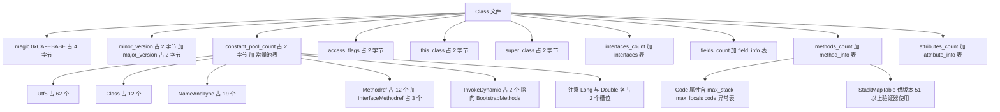

## 八、javap 实战解读

### 8.1 常用参数

| 参数 | 作用 |
| --- | --- |
| `javap -p` | 显示 private 成员 |
| `javap -c` | 反汇编字节码 |
| `javap -v` | 输出全部信息，含常量池、版本、属性 |
| `javap -l` | 输出行号表与局部变量表 |
| `javap -s` | 输出类型描述符 |
| `javap -sysinfo` | 显示 class 文件大小、MD5、修改时间 |
| `javap -constants` | 显示 `static final` 常量的值 |
| `javap -classpath out p1.Demo` | 按类名反汇编 |
| `javap -v -p -c out/p1/Demo.class` | 最常用于排查的组合 |

### 8.2 逐段解读真实输出

```text
Classfile /private/tmp/cldemo/out/p1/Demo.class
  Last modified 2026-10-12; size 2210 bytes
  MD5 checksum 534156e9a3b1f7c946cacca3b9043bc2
  Compiled from "Demo.java"
public class p1.Demo extends java.lang.Object implements java.lang.Comparable<p1.Demo>
  minor version: 0
  major version: 52
  flags: ACC_PUBLIC, ACC_SUPER
```

要点：

- `major version: 52` 是 JDK 8。若线上报 `UnsupportedClassVersionError`，对一下这个数字和运行 JVM 的版本。
- `flags: ACC_PUBLIC, ACC_SUPER` 与实测的 `0x0021` 对应。
- `extends java.lang.Object implements java.lang.Comparable<p1.Demo>` 里的泛型是 `Signature` 属性还原出来的，字节码层面只有 `java.lang.Comparable`。

`const` 字段与 `ConstantValue`：

```text
  static final int CONST;
    descriptor: I
    flags: ACC_STATIC, ACC_FINAL
    ConstantValue: int 42
```

没有 `Code` 属性——因为它是编译期常量，准备阶段就赋值完成，不需要执行任何指令。

实例字段的赋值在构造器里，而不是单独的块：

```text
  public p1.Demo();
    descriptor: ()V
    flags: ACC_PUBLIC
    Code:
      stack=2, locals=1, args_size=1
         0: aload_0
         1: invokespecial #1       // Method java/lang/Object."<init>":()V
         4: aload_0
         5: bipush        9
         7: putfield      #2        // Field instField:I
        10: aload_0
        11: ldc           #3        // String t
        13: putfield      #4        // Field tag:Ljava/lang/String;
        16: return
      LineNumberTable:
        line 13: 0
        line 8: 4
        line 13: 10
```

三个必须能讲清的点：

1. **第一句一定是 `aload_0` + `invokespecial <init>` 调用父类构造器**，即使是隐式 `super()`。
2. 实例字段的初始化（`instField = 9`、`tag = "t"`）被编译器搬进 `<init>`，且**排在 `super()` 之后**。这解释了"字段初始化为什么能看到父类构造器里的赋值"这一反直觉现象。
3. `LineNumberTable` 的行号是乱序的（13, 8, 13），因为 javac 把源码第 8 行的字段声明与第 13 行的构造器合并了，但保留了原始行号。异常栈里出现字段声明所在行，就是这个原因。

`main` 方法的完整字节码，覆盖了五条方法调用指令中的四条：

```text
  public static void main(java.lang.String[]);
    descriptor: ([Ljava/lang/String;)V
    flags: ACC_PUBLIC, ACC_STATIC
    Code:
      stack=2, locals=5, args_size=1
         0: new           #5        // class p1/Demo
         3: dup
         4: invokespecial #6        // Method "<init>":()V
         7: astore_1
         8: aload_1
         9: invokevirtual #7        // Method instanceCall:()V
        12: invokestatic  #8        // Method staticCall:()V
        15: aload_1
        16: invokedynamic #9,  0    // InvokeDynamic #0:run:(Lp1/Demo;)Ljava/lang/Runnable;
        21: astore_2
        22: aload_2
        23: invokeinterface #10,  1 // InterfaceMethod java/lang/Runnable.run:()V
        28: invokedynamic #11,  0   // InvokeDynamic #1:apply:()Ljava/util/function/Function;
        33: astore_3
        34: aload_3
        35: ldc           #12        // String 1
        37: invokeinterface #13,  2 // InterfaceMethod java/util/function/Function.apply:(Ljava/lang/Object;)Ljava/lang/Object;
        42: pop
        43: aload_1
        44: astore        4
        46: aload         4
        48: aload_1
        49: invokeinterface #14,  2 // InterfaceMethod java/lang/Comparable.compareTo:(Ljava/lang/Object;)I
        54: pop
        55: return
```

关键观察：

- **`new` + `dup` + `invokespecial <init>` 是固定三连**。`new` 只分配内存并把**未初始化**的引用压栈，`dup` 复制一份给构造器消耗，剩下的那份留给 `astore`。如果少了 `dup`，`invokespecial` 消耗掉唯一引用后就没有引用可存了。
- `invokeinterface #10, 1` 后面的 `1` 是**历史遗留的参数字节数**（`Runnable.run()` 只有 `this`，计 1 个槽位）。JVMS 要求这个字节存在但为 0（由编译器填，JVM 忽略），历史实现用它做对齐。实测 `Function.apply` 是 `invokeinterface #13, 2`（`this` + 一个参数）。
- `Comparable.compareTo` 编译成 `invokeinterface`，而不是 `invokevirtual`——**接口方法一律 `invokeinterface`**，哪怕实参的类型是具体类。
- 第 43 到 49 行是 `Comparable<Demo> c = d; c.compareTo(d);`：`aload_1`（`d`）、`astore 4`（`c`）然后从槽位 4 取回。因为局部变量槽位 0 是 `args`、1 是 `d`、2 是 `r`、3 是 `f`，`c` 是第 4 个（`long`/`double` 会跳号）。`locals=5` 与之一致。

### 8.3 桥接方法：泛型擦除的产物

```text
  public int compareTo(p1.Demo);
    descriptor: (Lp1/Demo;)I
    flags: ACC_PUBLIC
    Code:
      stack=1, locals=2, args_size=2
         0: iconst_0
         1: ireturn

  public int compareTo(java.lang.Object);
    descriptor: (Ljava/lang/Object;)I
    flags: ACC_PUBLIC, ACC_BRIDGE, ACC_SYNTHETIC
    Code:
      stack=2, locals=2, args_size=2
         0: aload_0
         1: aload_1
         2: checkcast     #5        // class p1/Demo
         5: invokevirtual #16       // Method compareTo:(Lp1/Demo;)I
         8: ireturn
```

`Comparable<Demo>` 被擦除成 `Comparable`，接口方法是 `compareTo(Object)`。但源码里 `Demo` 只写了 `compareTo(Demo)`——两者不同，属于**重载而非重写**，多态会失效。javac 因此合成一个 `compareTo(Object)` 桥接方法：做一次 `checkcast` 转成 `Demo`，再调用真正的实现。

面试延伸：

- `ACC_BRIDGE` 与 `ACC_SYNTHETIC` 都置位，所以**反射遍历方法时会看到两个 `compareTo`**，`Method#isBridge()` 返回 `true`。框架里按名字匹配方法时要过滤掉桥接方法，否则会拿到错的那个。
- **桥接方法的位置影响反射结果**：`Class#getMethod("compareTo", Object.class)` 拿到的是桥接方法。
- 协变返回值也会生成桥接方法。如 `Object clone()` 被 `Demo clone()` 覆盖时，javac 生成一个返回 `Object` 的桥接。

### 8.4 `<clinit>` 与常量内联

`static { ... }` 与静态字段赋值的合并结果：

```text
  static {};
    descriptor: ()V
    flags: ACC_STATIC
    Code:
      stack=2, locals=0, args_size=0
         0: bipush        7
         2: putstatic     #15       // Field staticField:I
         5: getstatic     #17       // Field java/lang/System.out:Ljava/io/PrintStream;
         8: ldc           #24       // String clinit
        10: invokevirtual #23       // Method java/io/PrintStream.println:(Ljava/lang/String;)V
        13: return
```

`locals=0, args_size=0` 证明 `<clinit>` 是静态无参方法。**static 块与静态字段赋值的执行顺序严格等于源码顺序**，javac 只是把它们按出现次序拼进同一个 `<clinit>`，这也是"静态字段声明在使用之后会得到零值"的原因：

```java
static int a = b + 1;   // a = 0 + 1 = 1
static int b = 5;       // 但 b 在使用时还是零值 0
```

另一个实测证据——常量内联。`System.out.println(Init.Sub.CONST)` 编译后是：

```text
0: getstatic     #2      // Field java/lang/System.out:Ljava/io/PrintStream;
3: bipush        42
```

**完全没有 `getstatic Init$Sub.CONST`**，`42` 直接被编进了调用方的字节码。这条有两个重要推论：

1. 改了常量所在类的值，**不重新编译调用方就不生效**。这是"改了个常量，只重启了服务没重新打包，值还是旧的"的根因。
2. 常量所在类的 `<clinit>` 永远不会被这个调用点触发，因为字节码里根本没有对它的引用。

### 8.5 用 `javap` 做线上排查的思路

| 症状 | javap 检查点 |
| --- | --- |
| `UnsupportedClassVersionError` | `major version` 与运行 JVM 是否匹配 |
| `NoSuchMethodError` | 方法描述符是否与调用方常量池一致（改参数类型会导致描述符变化，但方法名不变） |
| `AbstractMethodError` | 接口方法是否只存在于接口而未在实现类生成桥接 |
| `VerifyError` | `StackMapTable` 是否缺失，`max_stack` / `max_locals` 是否与实际指令不匹配 |
| 反射拿到两个同名方法 | `ACC_BRIDGE` 是否置位 |
| 异常栈行号为空 | `LineNumberTable` 是否被 `-g:none` 去掉 |
| 局部变量名显示为 `arg0` | `LocalVariableTable` 是否缺失（`-g` 未开启） |

编译参数对照：`-g` 生成所有调试信息；`-g:lines` 只生成 `LineNumberTable`；`-g:vars` 生成 `LocalVariableTable`；`-g:none` 都不生成。**生产环境建议保留 `LineNumberTable`**，否则异常栈没有行号，排查成本剧增。

## 九、方法调用指令与 invokedynamic

### 9.1 五条指令对照

| 指令 | 调用对象 | 分派方式 | 解析时机 | 典型来源 |
| --- | --- | --- | --- | --- |
| `invokestatic` | 静态方法 | 静态分派 | 解析阶段可确定 | `Utils.foo()` |
| `invokespecial` | 私有方法、构造器、`super.` 方法 | 静态分派 | 解析阶段可确定 | `new`、`super.foo()`、`private void bar()` |
| `invokevirtual` | 普通实例方法 | 动态分派（`vtable`） | 运行时按接收者类型 | `d.instanceCall()` |
| `invokeinterface` | 接口方法 | 动态分派（`itable`） | 运行时 | `runnable.run()`、`list.add()` |
| `invokedynamic` | 由 BootstrapMethod 决定 | 调用点绑定 | 首次执行时绑定并缓存 | Lambda、`String` 拼接、`record` 的 `equals` |

实测 `main` 方法里同时出现了 `invokespecial`、`invokevirtual`、`invokestatic`、`invokeinterface`、`invokedynamic` 五条中的五条——这是理解指令分工的最佳样本。

**`invokevirtual` 与 `invokeinterface` 的实现差异**：HotSpot 为每个 `InstanceKlass` 维护 `vtable`（虚方法表，数组，按声明顺序排列，子类覆盖时替换槽位）和 `itable`（接口方法表，需要做接口到偏移的查找，结构比 `vtable` 复杂）。历史上 `invokeinterface` 更慢，现代 JIT 在单态调用点会把两者都内联成直接调用，差异被抹平。面试中"`invokeinterface` 比 `invokevirtual` 慢"的说法**只在解释执行或极端多态场景下成立**。

**方法重载与重写的指令差异**：重载在编译期确定，用的是同一个指令但常量池里的符号引用不同；重写是同一符号引用，运行时按接收者分派。这就是"重载看编译期类型，重写看运行期类型"在字节码层面的依据。

### 9.2 解析时机与调用点缓存

- `invokestatic` / `invokespecial` 的符号引用在**首次执行这条指令时**解析（HotSpot 懒解析），解析结果写进 `ConstantPoolCacheEntry`，后续直接读取。
- `invokevirtual` / `invokeinterface` 解析出的是**方法表的索引**，实际调用时还要用接收者的 `Klass` 做一次查表。JIT 的**内联缓存（inline cache）**会把"上次的接收者类型 + 目标方法"记在调用点：单态（monomorphic）直接比较 `Klass` 后跳转；双态用两个缓存项；超过阈值（HotSpot 中是 2）退化为 `vtable` 查表，即多态内联缓存（megamorphic）。
- 这解释了为什么"接口调用多态程度过高会掉性能"：调用点去虚拟化失败，无法内联，无法做后续优化。诊断手段是 `-XX:+PrintInlining` 或 JITWatch 看是否有 `megamorphic` 提示。

### 9.3 invokedynamic 与 Lambda 的实现原理

`invokedynamic` 与其他四条指令的本质区别：**其他四条指令的目标在常量池里已经写好了方法引用，`invokedynamic` 的目标要等第一次执行时由引导方法算出来，并把结果缓存到调用点（CallSite）**。

JVM 在执行 `invokedynamic` 时的步骤：

1. 读取常量池的 `CONSTANT_InvokeDynamic` 项，得到 `bootstrap_method_attr_index` 与 `NameAndType`。
2. 从类的 `BootstrapMethods` 属性取出引导方法（一个 `CONSTANT_MethodHandle`）与静态参数。
3. 以 `MethodHandles.Lookup`、方法名、`MethodType`、静态参数为实参调用引导方法。
4. 引导方法返回一个 `CallSite`，JVM 把 `CallSite#getTarget` 得到的 `MethodHandle` 绑定到该调用点。
5. 之后每次执行这条 `invokedynamic` 都直接走绑定的 `MethodHandle`，不再走引导方法。

实测 `Demo.class` 的 `BootstrapMethods` 属性（JDK 8）：

```text
BootstrapMethods:
  0: #61 invokestatic java/lang/invoke/LambdaMetafactory.metafactory:(Ljava/lang/invoke/MethodHandles$Lookup;Ljava/lang/String;Ljava/lang/invoke/MethodType;Ljava/lang/invoke/MethodType;Ljava/lang/invoke/MethodHandle;Ljava/lang/invoke/MethodType;)Ljava/lang/invoke/CallSite;
    Method arguments:
      #62 ()V
      #63 invokestatic p1/Demo.lambda$main$0:(Lp1/Demo;)V
      #62 ()V
  1: #61 invokestatic java/lang/invoke/LambdaMetafactory.metafactory:(Ljava/lang/invoke/MethodHandles$Lookup;Ljava/lang/String;Ljava/lang/invoke/MethodType;Ljava/lang/invoke/MethodType;Ljava/lang/invoke/MethodHandle;Ljava/lang/invoke/MethodType;)Ljava/lang/invoke/CallSite;
    Method arguments:
      #67 (Ljava/lang/Object;)Ljava/lang/Object;
      #68 invokestatic java/lang/Integer.parseInt:(Ljava/lang/String;)I
      #69 (Ljava/lang/String;)Ljava/lang/Integer;
```

逐项对应：

| 项 | 值 | 含义 |
| --- | --- | --- |
| 调用点常量池项 | `#9 = InvokeDynamic #0:#64 // #0:run:(Lp1/Demo;)Ljava/lang/Runnable;` | 引导方法索引 `0`，`NameAndType = #64` |
| 引导方法 | `LambdaMetafactory.metafactory` | 六个参数 |
| `samMethodType` | `#62 ()V` | `Runnable.run()` 的签名 |
| `implMethod` | `#63 invokestatic p1/Demo.lambda$main$0:(Lp1/Demo;)V` | javac 生成的私有静态合成方法 |
| `instantiatedMethodType` | `#62 ()V` | 实例化后的签名 |

第二个调用点对应 `Integer::parseInt`：`implMethod` 是 `Integer.parseInt`，`samMethodType` 是 `Function.apply(Object)Object`（因为 `Function<String,Integer>` 被擦除），`instantiatedMethodType` 是 `(String)Integer`。

**javac 为 Lambda 做三件事**：

1. 生成一个私有静态合成方法，命名为 `lambda$<方法名>$<序号>`，实测为 `lambda$main$0`，标志 `ACC_PRIVATE | ACC_STATIC | ACC_SYNTHETIC`。
2. 把 Lambda 表达式的**捕获变量**放进 `invokedynamic` 的**动态参数**（`invokedynamic #9, 0` 的 `0` 就是动态参数个数）。实测 `() -> System.out.println("lambda " + d.tag)` 捕获了 `d`，所以 `invokedType` 是 `(Lp1/Demo;)Ljava/lang/Runnable;`，即**接收 `Demo` 参数、返回 `Runnable`**——这是工厂方法的签名，不是 `run` 的签名。
3. 用 `LambdaMetafactory.metafactory` 在运行时把两者粘起来。

**生成的 Lambda 类长什么样**，实测（JDK 1.8.0_421 与 JDK 17.0.12 输出一致）：

```text
非捕获 lambda 类名 = Lam$$Lambda$1/0x0000000800072028
捕获 lambda 类名   = Lam$$Lambda$2/0x0000000800073028
是否匿名类         = false
是否合成类         = true
```

- 类名格式是 `宿主类名$$Lambda$序号/十六进制后缀`。
- `isAnonymousClass()` 返回 `false`，`isSynthetic()` 返回 `true`——**Lambda 不是匿名内部类**，这是一个高频考点。匿名内部类会生成 `Outer$1.class` 文件且 `isAnonymousClass()` 为 `true`；Lambda 不生成 class 文件，只在运行时由 `LambdaMetafactory` 用 ASM 生成字节码并 `defineClass`（JDK 15 起改用 `Lookup#defineHiddenClass` 的隐藏类，与 `Class#isHidden` 对应）。
- 无捕获的 Lambda 可以复用同一个实例（`ConstantCallSite` 绑定到静态实例），捕获的 Lambda 每次求值都要生成新实例。所以"Lambda 一定比匿名类快"是错的：它省掉了 class 文件与类加载开销，但捕获场景仍有对象分配。

**JDK 9 起 `String` 拼接也改用 `invokedynamic`**，实测 JDK 17 编译同一份源码：

```text
#63 = InvokeDynamic      #2:#64        // #2:makeConcatWithConstants:(Ljava/lang/String;)Ljava/lang/String;
#111 = MethodHandle      6:#112        // REF_invokeStatic java/lang/invoke/StringConcatFactory.makeConcatWithConstants:...
        7: invokedynamic #63,  0       // InvokeDynamic #2:makeConcatWithConstants:(Ljava/lang/String;)Ljava/lang/String;
```

同一段 `"lambda " + d.tag`，在 JDK 8 上编译成 `new StringBuilder` + `append` + `toString` 三条调用，在 JDK 9+ 上编译成一条 `invokedynamic` 调用 `StringConcatFactory.makeConcatWithConstants`。这是"JDK 8 与 JDK 9+ 字节码差异"的最经典例子，也是 JEP 280 的内容。好处是字符串拼接的实现策略（`StringBuilder`、`MethodHandle` 链、直接生成字节码）可以在不重新编译的前提下替换。

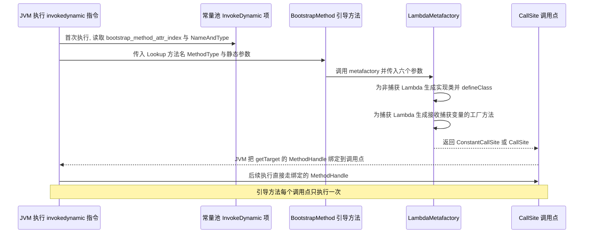

## 十、字节码增强与 AOP

### 10.1 三种增强时机

| 时机 | 代表技术 | 优点 | 缺点 |
| --- | --- | --- | --- |
| 编译期（源码级） | APT 注解处理器、Lombok | 无运行时代价 | 只能改自己编译的代码，不能改第三方 jar |
| 编译后 / 打包期 | AspectJ 的 `ajc` 编译期织入、Maven 插件的字节码替换 | 无运行时代价，能给字段加逻辑 | 需要构建期接入，局部改动要重新打包 |
| 类加载期 | `ClassFileTransformer`、`java.lang.instrument`、JVM TI | 可以增强任何类，包括 JDK 类 | 启动参数必须加 `-javaagent`，调试困难 |
| 运行期（动态代理） | JDK 动态代理、CGLIB、ByteBuddy 生成子类 | 无需启动参数，可按需增强 | 只能拦截非 final 的 public 方法，有代理开销 |

### 10.2 ASM / Javassist / ByteBuddy 对照

| 维度 | ASM | Javassist | ByteBuddy |
| --- | --- | --- | --- |
| 抽象层次 | 字节码指令级（`ClassVisitor` / `MethodVisitor` / `ClassWriter`） | 源码字符串级（`CtClass` / `CtMethod`，编译器把字符串编译成字节码） | 类型与行为级（`ByteBuddy` / `DynamicType.Builder` / `MethodDelegation`） |
| 学习曲线 | 陡，需懂指令集与 `StackMapTable` | 平缓，会写 Java 就会用 | 中等，API 流式但概念多（`Implementation`、`Advice`、`ElementMatcher`） |
| 性能 | 最高，生成期与运行期都最优 | 生成期慢（要解析字符串），运行期与手写字节码一致 | 生成期较快，可用 `TypeCache` 缓存 |
| 栈映射帧 | 需显式 `COMPUTE_FRAMES` | 自动处理 | 自动处理 |
| 主要使用方 | Spring 的 `org.springframework.asm`、CGLIB、Gradle、Fastjson2 | MyBatis 的懒加载与延迟属性、老版本 Hibernate | Mockito 2+、Hibernate 5.4+、Spring Boot 的配置增强、Akka |
| 版本兼容痛点 | 每支持一个新 JDK 版本都要升级（新的 class 文件版本与常量池 tag） | 同左 | 同左 |

**版本兼容是这里最重要的一条工程经验**：字节码库强耦合于 class 文件版本。JDK 17 的 class 文件版本是 61，如果 ASM 版本过旧，`ClassReader` 会抛 `IllegalArgumentException: Unsupported class file major version 61`。这就是"升级 JDK 后 CGLIB 报错""Lombok 报错""Mockito 报错"的统一根因。Spring 从 5.x 开始把 ASM 重打包到 `org.springframework.asm` 并随 Spring 版本升级，就是为了避免与用户依赖的 ASM 版本冲突。

### 10.3 Spring AOP 的代理选择

| 维度 | JDK 动态代理 | CGLIB |
| --- | --- | --- |
| 实现机制 | `Proxy#newProxyInstance` 运行时生成实现目标全部接口的类 | 生成目标类的子类，覆写非 final 的 public / protected 方法 |
| 前提 | 目标类必须实现至少一个接口 | 目标类不能是 final，被增强方法不能是 final / private / static |
| 生成类名 | `com.sun.proxy.$Proxy0`（JDK 8）；JDK 9+ 是 `jdk.proxy1.$Proxy0` | `Target$$EnhancerBySpringCGLIB$$xxxx` |
| 包可见性 | 代理类在 `com.sun.proxy` 包，与目标类不同包 | 代理类与目标类同包，因此能调用包级可见方法 |
| 字段与构造器 | 不涉及 | 需要调用父类构造器；目标类无默认构造器时要注意 |
| 性能 | JDK 8 上反射调用略慢，JDK 8+ 有 `MethodHandle` 优化后差距很小 | 生成期慢，调用期快 |
| Spring 默认 | `spring.aop.proxy-target-class=false`（Spring Boot 2.x 起默认 `true`） | Spring Boot 2.x 起默认 `true`，即默认走 CGLIB |

Spring 的 `DefaultAopProxyFactory#createAopProxy` 的逻辑：如果 `config.isOptimize()` 或 `config.isProxyTargetClass()` 为真，或者目标类本身是接口，用 CGLIB；否则如果目标类没有实现任何接口，用 CGLIB；否则用 JDK 动态代理。这就是"`@Transactional` 加在没实现接口的类上，Spring Boot 2 之前要用 `proxyTargetClass=true`"的由来。Spring 6.0 起要求 JDK 17+，并继续使用自己的 CGLIB 与 ASM 分支。

**AOP 失效的三个经典原因**（本质都是代理未生效）：

1. **同类内部方法调用**：`this.b()` 不经过代理对象，拦截器不执行。因为 `this` 是原始对象而非代理。
2. **方法不是 public 或方法是 final / static**：CGLIB 无法覆写。
3. **对象不是 Spring 容器创建的**：`new` 出来的对象没有代理。

### 10.4 Instrumentation 的两种挂载方式

```java
// 启动时挂载: java -javaagent:/path/agent.jar=key=value -cp app.jar Main
public static void premain(String agentArgs, Instrumentation inst) {
    inst.addTransformer(new MyTransformer(), true);   // true 表示允许 retransform
}

// 运行时 attach: VirtualMachine.attach(pid).loadAgent("/path/agent.jar", "key=value")
public static void agentmain(String agentArgs, Instrumentation inst) {
    inst.addTransformer(new MyTransformer(), true);
    // 对已加载的类重转换
    for (Class<?> c : inst.getAllLoadedClasses()) {
        if (inst.isModifiableClass(c) && c.getName().startsWith("com.example")) {
            inst.retransformClasses(c);
        }
    }
}
```

Manifest 必须声明（`META-INF/MANIFEST.MF`）：

```text
Premain-Class: com.example.MyAgent
Agent-Class: com.example.MyAgent
Can-Redefine-Classes: true
Can-Retransform-Classes: true
```

`ClassFileTransformer` 的签名（JDK 8）：

```java
byte[] transform(ClassLoader loader, String className, Class<?> classBeingRedefined,
                 ProtectionDomain protectionDomain, byte[] classfileBuffer)
    throws IllegalClassFormatException;
```

要点：

- `className` 是**斜杠分隔**的（`com/example/Foo`），不是点分隔。这是最常见的错误。
- 返回 `null` 表示不修改。
- `classBeingRedefined` 在 `redefineClasses` / `retransformClasses` 时非 `null`，普通加载时为 `null`。
- `retransformClasses` 与 `redefineClasses` 都不允许增删字段与方法，但 `retransformClasses` 会把上一次 transform 的结果作为输入（可叠加），`redefineClasses` 不会。
- JDK 21（JEP 451）起，**运行时动态加载 agent 会打印警告**，可通过 `-XX:+EnableDynamicAgentLoading` 抑制。设计意图是逐步淘汰生产环境的动态 attach，因为它有安全与稳定性风险。

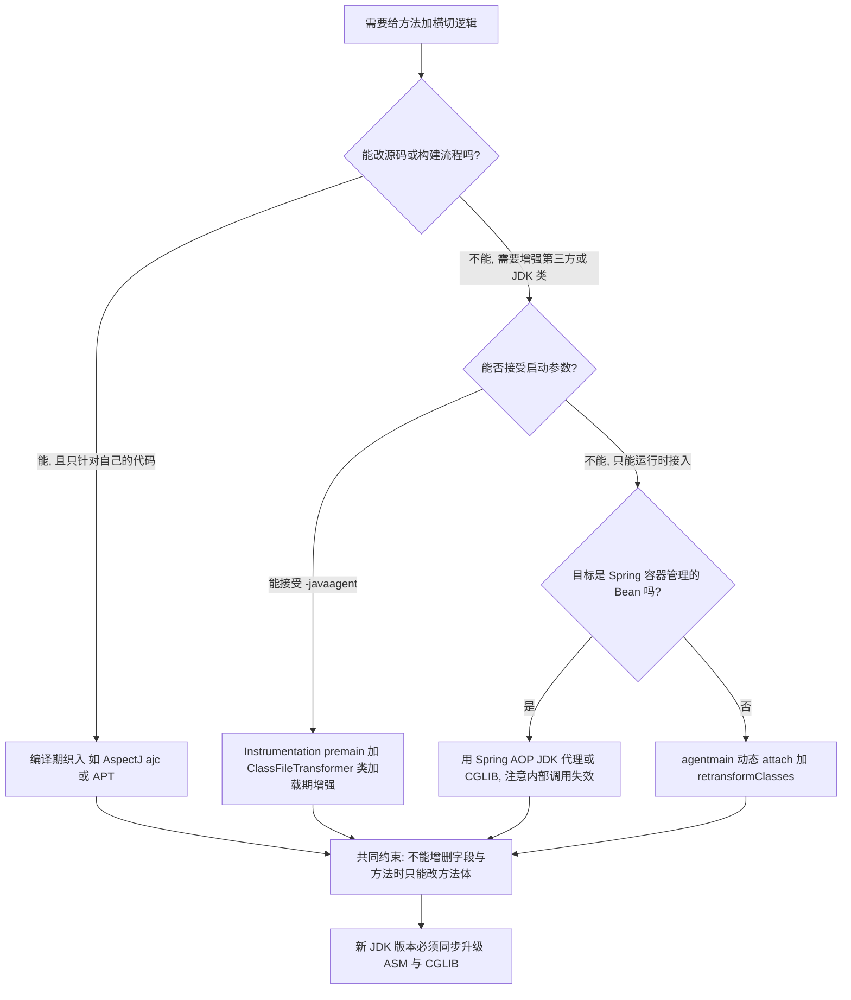

## 十一、Tomcat 类加载隔离模型

### 11.1 层级结构

Tomcat 8 / 9 / 10 的类加载器层级（类名以 Tomcat 9 为准）：

| 层次 | 实现类 | 加载路径 | 配置项 |
| --- | --- | --- | --- |
| Bootstrap | JVM 内置 | `$JAVA_HOME/jre/lib` 下的核心类 | —— |
| System | `sun.misc.Launcher$AppClassLoader` | `$CATALINA_HOME/bin/bootstrap.jar`、`tomcat-juli.jar`、`CLASSPATH` | `CLASSPATH` |
| Common | `URLClassLoader` | `$CATALINA_BASE/lib`（Tomcat 6 之后 Common 与 Catalina 合并） | `conf/catalina.properties` 的 `common.loader` |
| Catalina | `URLClassLoader` | Tomcat 自身内部类 | `server.loader`（默认空，即复用 Common） |
| Shared | `URLClassLoader` | 所有 webapp 共享的类 | `shared.loader`（默认空） |
| Webapp | `org.apache.catalina.loader.WebappClassLoaderBase`（Tomcat 8.5+ 还有 `ParallelWebappClassLoader`） | `WEB-INF/classes`、`WEB-INF/lib/*.jar` | 每个 webapp 一个实例 |

Tomcat 7 及以前用 `org.apache.catalina.loader.WebappClassLoader`，Tomcat 8 起改为 `WebappClassLoaderBase` 抽象基类。

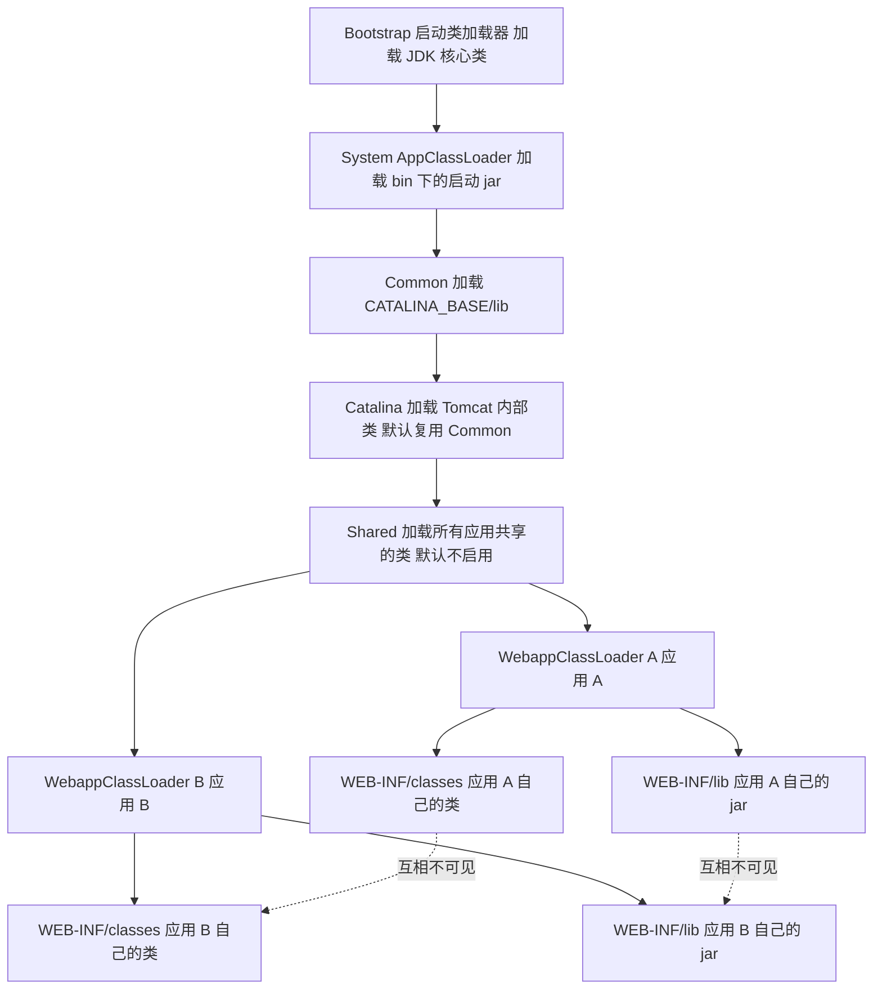

### 11.2 WebappClassLoader 的委派顺序

与标准双亲委派相反，Tomcat 的 `WebappClassLoaderBase#loadClass(String, boolean)` 顺序是"**先自己，再父类**"。以下步骤按 Tomcat 8.5.31 的 `tomcat-embed-core` 反编译结果整理：

1. `getClassLoadingLock(name)` 加锁，再 `checkStateForClassLoading(name)` 校验容器状态。
2. 查 Tomcat 自己的资源缓存 `findLoadedClass0(name)`，再查 JVM 的已加载缓存 `findLoadedClass(name)`。
3. 把类名转成资源路径（`binaryNameToPath(name, false)`），然后调用 `getJavaseClassLoader()` 拿到 Java SE 加载器，用 **`javaseLoader.getResource(path) != null`** 做一次存在性判断；只有 Java SE 侧确实存在该资源时，才调用 `javaseLoader.loadClass(name)`。这一步保证 webapp 无法覆盖 Java SE 的类。
4. 如果配置了 `SecurityManager`，用 `checkPackageAccess(包名)` 做包访问检查，失败时记录 `Security Violation, attempt to use Restricted Class:` 日志并抛 `ClassNotFoundException`。
5. 判断 `delegate || filter(name, true)`。`delegate` 是 `WebappClassLoaderBase` 的 `protected boolean` 字段（默认 `false`）；`filter` 是硬编码规则，**只识别 `javax.` 前缀**，并且要求后续以 `el.`、`servlet.`、`websocket.`、`security.auth.message.` 开头才返回 `true`（`servlet.jsp.jstl.` 被显式排除）。命中任一条即用 `Class.forName(name, false, parent)` 委派父加载器，日志为 `Delegating to parent classloader1`。
6. 未命中则调用 `findClass(name)` 从本地 `WEB-INF/classes` 与 `WEB-INF/lib` 加载——**这是与标准委派最大的差别**。
7. 本地也没有，才委派父加载器 Common（日志 `Delegating to parent classloader2`），全失败抛 `ClassNotFoundException`。

可以通过 `<Context>` 下的 `<Loader delegate="true"/>` 把第 5 步的条件置真，从而恢复"父加载器优先"的标准顺序。

**为什么必须有"必须委派"的那一步**：`javax.servlet.ServletRequest`（Tomcat 9 及以前）或 `jakarta.servlet.ServletRequest`（Tomcat 10+，`filter` 的判断前缀也相应改为 `jakarta.`）由 Common 加载器加载。如果某个 webapp 的 `WEB-INF/lib` 里也放了一份 servlet API jar，且被该 webapp 的加载器加载，那么 Tomcat 内部传给应用的 `Request` 对象与应用的 `ServletRequest` 就是**两个不同的类**，强转直接抛：

```text
java.lang.ClassCastException: class org.apache.catalina.connector.RequestFacade
    cannot be cast to class javax.servlet.ServletRequest
```

这个异常的典型成因不是 Tomcat 有问题，而是**webapp 里重复打包了 servlet API**（用 `provided` scope 解决）。

### 11.3 隔离带来的三个经典问题

| 问题 | 表现 | 定位 | 解决 |
| --- | --- | --- | --- |
| `ClassCastException` | 同一个类名互转失败，日志里两个类的名字完全一样 | 在异常信息里看两个类的**加载器**（需打印 `getClass().getClassLoader()`），或用 `jcmd <pid> VM.classloader_stats` 确认存在多个同名类 | 排除重复依赖，把 API jar 设为 `provided` |
| `NoClassDefFoundError` | 类明明在 `WEB-INF/lib` 里 | 检查是否被父加载器"抢先"加载成旧版本 | 调整 `delegate`，或统一由 Common 提供 |
| Metaspace 泄漏 | 反复部署应用，Metaspace 阶梯上涨不回落 | `jcmd <pid> VM.classloader_stats` 看加载器数量是否只增不减；MAT 里查 `WebappClassLoader` 的 GC Root | 清理 `ThreadLocal`、停掉自己起的线程池、注销 JDBC 驱动与 JMX；升级 Tomcat |

Tomcat 提供了一道不完全的防线（以下方法名均来自 Tomcat 8.5.31 的 `WebappClassLoaderBase` 反编译结果）：`clearReferences()` 会调用 `clearReferencesJdbc()` 注销本 webapp 注册的 JDBC 驱动、`clearReferencesThreads()` 处理残留线程（受 `clearReferencesStopThreads` 控制，默认 `false`，即默认不杀线程）、`clearReferencesRmiTargets()` 清理 RMI 目标、`clearReferencesStopTimerThread()` 停掉 `java.util.Timer` 线程、`clearReferencesObjectStreamClassCaches()` 清 `ObjectStreamClass` 缓存。**关键区别是 `ThreadLocal`：Tomcat 通过 `checkThreadLocalsForLeaks()` 与 `checkThreadLocalMapForLeaks(Object, Field)` 只做检测并打警告日志，并不会替你清理。**

它的存在恰恰说明**这些问题在真实项目中极其普遍**。但它清不干净所有情况，尤其是业务自己创建的线程池、`ScheduledExecutorService`、消息队列的消费者线程、Netty 的 `EventLoopGroup`——这些必须在 `ServletContextListener#contextDestroyed` 里显式 `shutdown`。

一个必须知道的历史事实：**JDK 8 时代 `ThreadLocal` 泄漏导致 Metaspace OOM 是 Tomcat 热部署的头号故障**，Tomcat 的日志里会打印：

```text
The web application [xxx] created a ThreadLocal with key of type [...] and a value of
type [...] but failed to remove it when the web application was stopped.
```

看到这条日志，说明该应用的类加载器无法卸载。

## 十二、生产实战 JVM 诊断命令手册

### 12.1 类加载与 Metaspace 相关启动参数

| 参数 | 默认值 | 作用 |
| --- | --- | --- |
| `-XX:MetaspaceSize=N` | 约 20.8 MB（`21807104` 字节） | 首次 Metaspace GC 的触发水位。**不是初始大小**，调大可减少启动期 Full GC |
| `-XX:MaxMetaspaceSize=N` | 无上限 | 显式设限，让 Metaspace 泄漏尽早暴露为 OOM 而不是拖垮整机 |
| `-XX:CompressedClassSpaceSize=N` | 1 GB（`1073741824`） | 压缩类指针空间 |
| `-XX:+UseCompressedClassPointers` | 堆小于 32 GB 时开启 | 与 `CompressedClassSpaceSize` 配套 |
| `-Xnoclassgc` | 关闭 | 禁止类卸载，Metaspace 只增不减 |
| `-XX:+TraceClassLoading` | 关闭 | 打印类加载事件 |
| `-XX:+TraceClassUnloading` | 关闭 | 打印类卸载事件 |
| `-verbose:class` | 关闭 | 等价于同时打印加载与卸载 |
| `-XX:+ClassUnloading` | `true` | 允许类卸载 |
| `-XX:+ClassUnloadingWithConcurrentMark` | `true` | G1 允许并发标记阶段卸载类 |
| `-XX:+CMSClassUnloadingEnabled` | `true` | CMS 的类卸载开关 |
| `-Xverify:none` | 关闭 | 跳过字节码验证，JDK 13 起废弃并警告 |
| `-XX:+PrintFlagsFinal -version` | —— | 打印所有参数的最终值，排查"参数到底生效没有"的权威手段 |

### 12.2 工具命令对照

| 目的 | 命令 | 实测备注 |
| --- | --- | --- |
| 查看 JVM 参数与系统属性 | `jinfo -flags <pid>`、`jinfo -sysprops <pid>` | 也能动态改部分参数：`jinfo -flag +HeapDumpOnOutOfMemoryError <pid>` |
| 按加载器统计类 | `jcmd <pid> VM.classloader_stats` | 输出含 `Classes`、`ChunkSz`、`BlockSz`、`Type` |
| 类加载器统计的另一入口 | `jmap -clstats <pid>` | **macOS 实测失败**：`task_for_pid failed (os/kern failure) (5)`，用 `jcmd` 替代 |
| 类层次结构 | `jcmd <pid> VM.class_hierarchy` | 加 `-s` 显示子类 |
| GC 与类加载统计 | `jstat -class <pid> 1000 10` | 列见 12.3 |
| GC 各代容量与使用 | `jstat -gc <pid> 1000 10` | 关注 `MU`（Metaspace Used）与 `MC`（Metaspace Capacity） |
| GC 原因 | `jstat -gcutil -gccause <pid> 1000` | 输出最后一列是上次 GC 原因，能区分 `Metadata GC Threshold` 与 `Heap Inspection` |
| 线程栈 | `jstack -l <pid>`、`jcmd <pid> Thread.print` | `-l` 额外打印 `Locked ownable synchronizers` |
| 堆直方图 | `jmap -histo:live <pid>` | 触发 Full GC，谨慎 |
| 堆转储 | `jmap -dump:live,format=b,file=/tmp/h.hprof <pid>`、`jcmd <pid> GC.heap_dump /tmp/h.hprof` | `live` 只 dump 存活对象 |
| 堆信息 | `jcmd <pid> GC.heap_info` | 快速看堆与 Metaspace |
| 动态改参数 | `jcmd <pid> VM.set_flag TraceClassUnloading true` | 需该 flag 可写（`manageable` 或 `product rw`） |
| 核心 dump 分析 | `jhsdb jmap --heap --pid <pid>`、`jhsdb jstack --pid <pid>`、`jhsdb clhsdb --pid <pid>` | **JDK 9 起**才有 `jhsdb`，它把原先散落在 `jmap`/`jstack`/`jinfo` 里的 SA 工具统一了。子命令：`clhsdb`、`hsdb`、`debugd`、`jstack`、`jmap`、`jinfo`、`jsnap` |
| 强制 dump（进程无响应） | `jmap -F -dump:live,format=b,file=/tmp/h.hprof <pid>` | `-F` 在目标不响应时使用 |
| 诊断命令列表 | `jcmd <pid> help` | 实测含 `VM.classloader_stats`、`VM.class_hierarchy`、`GC.class_stats`、`GC.class_histogram`、`GC.heap_dump`、`GC.heap_info`、`VM.system_properties`、`VM.flags`、`VM.dynlibs` 等 |
| 进程列表 | `jps -l -v` | `-l` 打全类名，`-v` 打 JVM 参数 |

JDK 8 上 `jmap` 的可用选项实测为：无参数（打印内存映射）、`-heap`、`-histo[:live]`、`-clstats`、`-finalizerinfo`、`-dump:<dump-options>`、`-F`。**没有 `-permstat`**（JDK 8 已移除，改用 `-clstats`），JDK 7 时代的老命令不要写进新文档。

### 12.3 jstat 关键列

`jstat -class <pid>`：

| 列 | 含义 |
| --- | --- |
| `Loaded` | 已加载类数量 |
| `Bytes` | 已加载类占用的字节数（近似 Metaspace 中的类元数据） |
| `Unloaded` | 已卸载类数量 |
| `Bytes` | 加载与卸载的字节差 |
| `Time` | 类加载与卸载耗时（秒） |

**排查 Metaspace 泄漏时最直接的指标是 `Unloaded` 是否长期为 0 而 `Loaded` 持续增长。** 正常的长期运行应用，`Loaded` 会稳定在一个平台期，`Unloaded` 缓慢增长。

`jstat -gc <pid>` 的关键列：`MU`（Metaspace Used，KB）、`MC`（Metaspace Capacity，KB）、`CCSC`/`CCSU`（压缩类空间容量与使用）、`YGC`/`YGCT`（年轻代 GC 次数与耗时）、`FGC`/`FGCT`（Full GC 次数与耗时）、`GCT`（总 GC 耗时）。

`jstat -gcutil -gccause <pid>` 最后一列 `LGCC` 是上次 GC 原因，常见值：

| 原因 | 含义 | 处置 |
| --- | --- | --- |
| `Allocation Failure` | 年轻代分配失败 | 正常，看频率 |
| `Metadata GC Threshold` | Metaspace 达到 `MetaspaceSize` 水位 | 调大 `MetaspaceSize`，或排查类加载泄漏 |
| `Heap Inspection` | 执行了 `jmap -histo:live` 或 `GC.class_histogram` | 主动触发，忽略 |
| `Ergonomics` | JVM 自适应触发 | 正常 |
| `System.gc()` | 代码或 RMI 主动调用 | 排查显式调用与 `-XX:+DisableExplicitGC` |

**`Metadata GC Threshold` 频繁出现是 Metaspace 问题的第一个信号**，它对应的 Full GC 会 STW，在低延迟系统里直接表现为长尾尖刺。

### 12.4 三个真实故障的定位流程

**故障一：`java.lang.OutOfMemoryError: Metaspace`。**

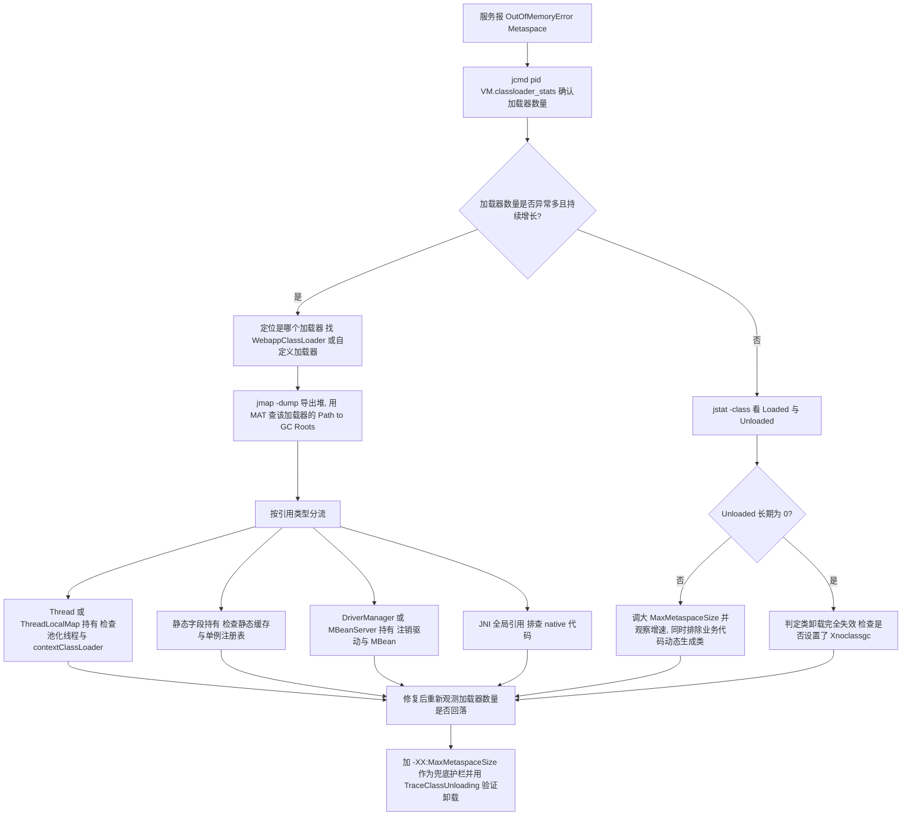

配套命令序列：

```bash
jcmd <pid> GC.heap_info
jcmd <pid> VM.classloader_stats | head -50
jstat -class <pid> 1000 20
jmap -dump:live,format=b,file=/tmp/heap.hprof <pid>
# 事后离线用 MAT 打开, 查 Dominator Tree 中的 ClassLoader
```

关键判据：`VM.classloader_stats` 的 `Total` 行里类数持续增长、加载器条目数持续增长，且 `jstat -class` 的 `Unloaded` 长期为 0。三者同时成立即可判定为类加载器泄漏而不是单纯的类多。

**故障二：应用启动卡死，日志停在某个静态初始化。**

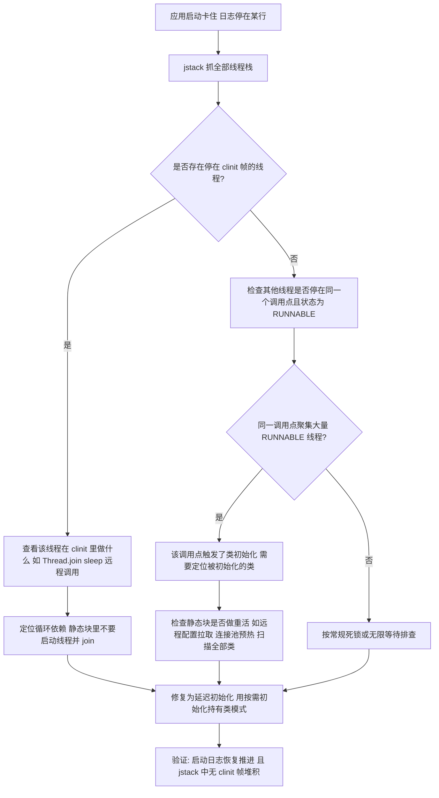

配套命令与判据：

```bash
jstack -l <pid> > /tmp/s.txt
grep -n "clinit" /tmp/s.txt            # 找停在静态初始化的线程
grep -c "java.lang.Thread.State: RUNNABLE" /tmp/s.txt   # 与状态分布对比
grep -n "in Object.wait()" /tmp/s.txt  # 注意这些线程的 Thread.State 可能是 RUNNABLE
```

**必须记住的反直觉点（本文 2.4 实测）**：等待类初始化的线程 `Thread.State` 是 `RUNNABLE`，栈顶是发起类引用的调用点，**没有 `waiting to lock` 行，也不会有 `Found one Java-level deadlock`**。如果只用 `grep "BLOCKED"` 或依赖 jstack 的自动死锁报告，会完全漏掉这类故障。

**故障三：热部署后新代码不生效，或静态状态丢失。**

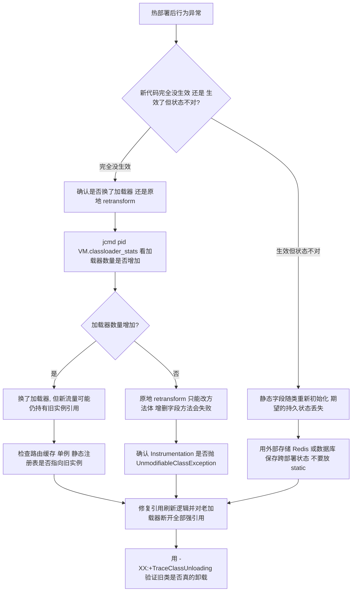

`UnmodifiableClassException` 是 `redefineClasses` / `retransformClasses` 最典型的能力边界错误，触发条件就是试图增删字段或方法。

## 高级岗三问

这三个问题是高级岗与初中级的真正分界线：初中级答"是什么"，高级答"为什么这样设计、线上怎么定位、规模上来后哪里先坏"。本章的三问答案如下。

### 一问：为什么这么设计？

类加载机制的核心设计取舍是"**开放性换复杂度**"。把"获取字节流"这一步抽象成 `findClass`，让 JVM 能支持网络加载、动态生成、加密类、热部署；代价是必须引入"类加载器"这一层身份，导致类的唯一性不再由名字决定，而是"加载器 + 全限定名"。

双亲委派是这套设计的安全补丁：它用"先父后子"的顺序，把 `java.*` 的加载权强制收归 Bootstrap，同时保证同一份类不重复定义。代价是"父加载器看不到子加载器的类"，于是必须有 `Thread.setContextClassLoader` 这个反向后门。**没有一个方案能同时满足隔离与共享**：双亲委派偏共享，Tomcat 偏隔离，OSGi 想要两者兼得但付出了极高的复杂度代价，JPMS 选择不改委派模型而在其上叠加可见性约束。

`invokedynamic` 的设计动机是把"链接时机"从编译期推迟到运行期首次执行，从而让 Lambda、字符串拼接这类"语法糖"的实现策略可以独立演进，不绑定在 class 文件格式上。

### 二问：线上出问题怎么定位？

| 现象 | 第一手命令 | 判据 |
| --- | --- | --- |
| `NoClassDefFoundError: Could not initialize class X` | `grep "ExceptionInInitializerError" app.log` | 根因是 X 的静态初始化失败过，不是类找不到 |
| `ClassCastException` 且两个类名一模一样 | 打印 `getClass().getClassLoader()`，或 `jcmd <pid> VM.classloader_stats` | 两个加载器定义了同名类 |
| Metaspace 持续上涨 | `jcmd <pid> VM.classloader_stats` 加 `jstat -class` | 加载器数量与 `Loaded` 同增，`Unloaded` 长期为 0 |
| 启动卡死 | `jstack -l`，找 `<clinit>` 帧与聚集在同一调用点的 `RUNNABLE` 线程 | 类初始化在等外部动作 |
| `UnsupportedClassVersionError` | `javap -v` 看 `major version` | 编译版本高于运行 JVM |
| 字节码增强类报 `VerifyError` | `javap -v` 看 `StackMapTable` 与 `max_stack` | 增强库未启用 `COMPUTE_FRAMES` |
| 升级 JDK 后代理类报错 | 检查 ASM / CGLIB / ByteBuddy 版本 | 字节码库不支持新的 class 文件版本 |

### 三问：规模变大后会怎样？

| 规模维度 | 变化 | 失效模式 | 应对 |
| --- | --- | --- | --- |
| 应用从 1 个变成 50 个共享 Tomcat | 每个 webapp 一个加载器 | 加载器数量与 Metaspace 线性增长，隔离问题从个例变成常态 | 只把真正共享的库放 `common.loader`，webapp 严格 `provided` 依赖，给 `MaxMetaspaceSize` 设护栏 |
| 热部署频率从每天 1 次变成每天 100 次 | 加载器创建与销毁频率升高 | 一次泄漏就被放大 100 倍，Metaspace 快速打满 | 强制在 `contextDestroyed` 中停线程池、清 `ThreadLocal`、注销驱动；用 `-XX:+ClassUnloadingWithConcurrentMark` 让 G1 并发卸载 |
| 依赖的 Lombok / ASM / 字节码库版本分裂 | 同一 JVM 内多份 ASM 共存（经重打包隔离） | `Unsupported class file major version` 或 `IllegalAccessError` | 统一 upgrade 到与 JDK 匹配的版本，避免自己直接依赖 ASM |
| 类数量从 1 万涨到 10 万（微服务聚合或大型单体） | Metaspace 与类加载耗时上升 | 启动变慢、`Metadata GC Threshold` 触发 Full GC | 调大 `MetaspaceSize`，开启 `-XX:+UseCompressedClassPointers` 并评估 `CompressedClassSpaceSize` |
| 引入大量 Lambda 与 Stream | `invokedynamic` 调用点数量激增 | 首次执行时生成大量 Lambda 类，启动期类加载尖峰 | 避免在启动路径上大量创建不同的捕获 Lambda；关注 `TraceClassLoading` 里的 `$$Lambda$` 数量 |
| 插件化平台上线 | 加载器数量与依赖完全动态 | 隔离正确但共享状态、线程、`ThreadLocal` 全是坑 | 给插件定义明确的生命周期契约（`start` / `stop`），并把 `stop` 的清理动作做成框架强制 |

## 高频面试题

### Q1. 描述一下类加载的完整生命周期，准备阶段和初始化阶段分别做什么？

**答题框架（30 秒版）**：加载、验证、准备、解析、初始化五个阶段（加使用与卸载共七个）。准备阶段给 static 字段分配内存并赋**零值**，唯一的例外是被 `static final` 修饰的编译期常量，它通过 `ConstantValue` 属性在准备阶段就赋真实值。初始化阶段执行 `<clinit>`，按源码顺序完成静态字段赋值与静态块。

**展开（2 分钟版）**：
1. 加载阶段的开放点在于"获取二进制字节流"没有限定来源，这是热部署与字节码增强的基础。数组类由 JVM 直接生成，不走类加载器。
2. 验证分四段：文件格式、元数据、字节码、符号引用。字节码验证依赖 `StackMapTable`（Class 版本 51 起强制），这直接决定字节码增强工具必须重新计算栈映射帧。
3. 准备阶段的零值表要能背：`int`/`short`/`byte`/`char`/`boolean` 是 0 或 false，`long` 是 0L，`float`/`double` 是 0.0，引用是 `null`。
4. 反例要能给：`static final Integer BOX = 43;` 不是编译期常量，赋值在 `<clinit>` 里；`static final int X = new Random().nextInt();` 同理。
5. 解析阶段 JVMS 允许延迟，HotSpot 是懒解析并把结果缓存到 `ConstantPoolCache`，所以解析动作分散在运行期。

**追问**：`<clinit>` 和 `<init>` 的区别？答：`<clinit>` 是类初始化方法，静态无参（实测 `locals=0, args_size=0`），由 JVM 保证只执行一次且线程安全；`<init>` 是实例初始化方法，包含父类构造器调用、实例字段赋值与构造器代码。如果没有静态字段赋值也没有静态块，javac 不生成 `<clinit>`；但 `<init>` 总是有。

### Q2. 类初始化的触发时机有哪些？被动引用的三种情况是什么？

**答题框架（30 秒版）**：主动引用六种——四条指令（`new`/`getstatic`/`putstatic`/`invokestatic`）、反射调用、初始化子类前先初始化父类、虚拟机启动时的主类、`MethodHandle` 的四种句柄解析、接口有 `default` 方法时实现类初始化会先初始化接口。被动引用三种——通过子类引用父类的静态字段、数组定义、引用编译期常量。

**展开（2 分钟版）**：
1. 被动引用的机制要讲清楚，不能只背结论。第一种是 javac 把字段引用解析到**声明类**（`getstatic Super.sField`）；第三种是常量被**内联**进调用方常量池（`bipush 42`），连 `getstatic` 都没有。
2. 这两个机制不同，可以主动区分：`static final int CONST` 走内联，`static final Integer BOX` 走"解析到声明类"。
3. 数组的情况是 `anewarray` 只需要元素类型的 `Class`，不需要初始化。
4. 接口的规则可以给出 JVMS §5.5 的原文限定："if C is a class rather than an interface"。初始化接口不初始化父接口，即使父接口有 `default` 方法。

**追问**：`Class.forName` 和 `ClassLoader.loadClass` 有什么差别？答：`Class.forName(String)` 内部是 `forName0(name, true, loader)`，`initialize=true`，会触发静态块；`loadClass(String)` 传 `resolve=false`，既不链接也不初始化。需要"只加载不初始化"时用 `Class.forName(name, false, loader)`。

### Q3. 双亲委派模型是什么？为什么要它？怎么打破？

**答题框架（30 秒版）**：委派顺序是"查缓存 → 委派父加载器 → 父加载器找不到才自己 `findClass`"。目的有两条：安全性（`java.lang.String` 的加载请求一路委派到 Bootstrap，防止核心类被替换）和唯一性（同一个类只被一个加载器定义，保证 `==` 与 `instanceof` 的语义）。打破方式有四类：SPI 用线程上下文类加载器、Tomcat 子加载器优先、OSGi 网状委派、直接重写 `loadClass`。

**展开（2 分钟版）**：
1. 源码级：`loadClass` 里 `findLoadedClass` → `parent.loadClass` → `findClass`，`parent == null` 时走 `findBootstrapClassOrNull`。`getClassLoadingLock` 决定并发度，未注册并行能力时锁的是 `this`。
2. 安全性的第二道防线是 `preDefineClass` 对 `java.` 前缀抛 `SecurityException`，所以"自定义加载器替换 String"在实践中不可行。
3. 唯一性的判定依据是"加载器实例 + 全限定名"。实测同一个 class 文件被两个加载器加载后 `==` 为 `false`，强转抛 `ClassCastException`，异常信息里两个类名完全相同。
4. 四类打破场景各自的动机要能说：SPI 是"父加载器看不到子加载器"、Tomcat 是"子加载器要覆盖父加载器的同名类"、OSGi 是"要包级别可见性控制"、重写 `loadClass` 是"完全隔离的插件沙箱"。
5. 打破时必须注意：`java.` / `javax.` / `sun.` 的类**必须委派**，否则会 `SecurityException` 或因缺少包访问权限而崩。

**追问**：为什么 `Thread.setContextClassLoader` 能解决 SPI 的问题？答：它是一个可被应用设置的"合作者加载器"，默认继承父线程。`ServiceLoader.load` 用 `Thread.currentThread().getContextClassLoader()` 去加载实现类，从而让由 Bootstrap 加载的 `DriverManager` 能拿到应用 classpath 里的 MySQL 驱动。这也是 `DriverManager` 能发现驱动的唯一途径。

### Q4. 什么是类的唯一性？举一个真实的 ClassCastException 场景。

**答题框架（30 秒版）**：JVM 中"类相同"的判定是"同一个类加载器实例 + 同一个全限定名"。因此同一份 class 文件被两个加载器加载后是两个不同的类，`instanceof` 为 `false`，强转抛 `ClassCastException`。

**展开（2 分钟版）**：
1. 实测输出：两个加载器加载 `plug.Payload`，`k1.getClassLoader()` 与 `k2.getClassLoader()` 是不同实例，`k1 == k2` 为 `false`。
2. 真实场景一：Tomcat 里 webapp 自己打包了 servlet API，导致 Tomcat 传进来的 `RequestFacade` 与 webapp 的 `ServletRequest` 互转失败，异常里两个类名完全一样。
3. 真实场景二：插件平台里插件 A 与插件 B 各自依赖 `Fastjson`，A 解析出的对象传给 B 时强转失败。
4. 真实场景三：`catch (MyBusinessException e)` 抓不到，因为抛出的异常是另一个加载器的同名类。
5. 定位手段：在日志里打印 `obj.getClass().getClassLoader()`，或用 `jcmd <pid> VM.classloader_stats` 确认同名类存在多份，或在 MAT 里搜类名看有几个 `ClassLoader`。

**追问**：怎么避免？答：把跨模块共享的 API 与异常类收敛到共同的父加载器（Tomcat 的 `common.loader`、插件的 API 模块），Maven 里用 `provided` 而不是 `compile`，或者把 API 抽成独立的 `api.jar` 由宿主提供。

### Q5. 类什么时候会被卸载？怎么排查 Metaspace 泄漏？

**答题框架（30 秒版）**：三个条件同时满足——该类的所有实例被回收、加载该类的 `ClassLoader` 被回收、该类的 `Class` 对象无任何引用。`ClassLoader` 被回收是最关键的一条。排查用 `jcmd <pid> VM.classloader_stats` 看加载器数量，配合 `jstat -class` 看 `Unloaded`，再用堆 dump 与 MAT 查 GC Root。

**展开（2 分钟版）**：
1. 卸载的粒度是 `ClassLoaderData`：加载器活着，它定义的类就永远卸载不掉。所以类卸载问题一律翻译成"谁还在引用加载器"。
2. JDK 8 默认 `ClassUnloading=true`、`CMSClassUnloadingEnabled=true`；G1 有 `ClassUnloadingWithConcurrentMark=true`，允许并发标记阶段卸载，不必等 Full GC。
3. Metaspace 默认值要能报数：`MetaspaceSize` 约 20.8 MB（`21807104` 字节，是首次 GC 水位而非初始大小），`MaxMetaspaceSize` 无上限，`CompressedClassSpaceSize` 1 GB。
4. 泄漏源按频率排：`ThreadLocal` 未清理、池化线程的 `contextClassLoader`、静态缓存、未关闭的线程池与定时任务、`DriverManager` 的 `registeredDrivers`、Logback 的 `LoggerContext`、JMX MBean、JNI 全局引用。
5. 工具选择上有个实测坑：**macOS 上 `jmap -clstats` 会因 `task_for_pid` 权限失败**，用 `jcmd <pid> VM.classloader_stats` 替代。两者输出等价。

**追问**：怎么验证类真的被卸载了？答：加 `-XX:+TraceClassUnloading`，实测输出格式是 `[Unloading class plug.Payload 0x0000000800060828]`。但要注意卸载依赖 GC 真正回收，实测三轮热部署中只有两轮产生了卸载日志，所以**不能只用一次 GC 判断有没有泄漏**，要连续观测 `VM.classloader_stats` 的加载器总数趋势。

### Q6. Class 文件的结构是什么？常量池有哪些 tag？

**答题框架（30 秒版）**：按顺序是魔数 `0xCAFEBABE`（4 字节）、次版本号与主版本号（各 2 字节）、常量池计数与常量池表、访问标志、`this_class`、`super_class`、接口表、字段表、方法表、属性表。常量池有 14 种 tag，常用的有 `Utf8(1)`、`Class(7)`、`String(8)`、`Fieldref(9)`、`Methodref(10)`、`InterfaceMethodref(11)`、`NameAndType(12)`、`MethodHandle(15)`、`MethodType(16)`、`InvokeDynamic(18)`。

**展开（2 分钟版）**：
1. 版本号能直接判断编译用的 JDK：`major = JDK 版本 + 44`，JDK 8 是 52，JDK 17 是 61，JDK 21 是 65。
2. `constant_pool_count` 是**容量计数**，实际条目数要减 1（索引 0 保留）。实测 `126` 对应 125 个条目。
3. `Long` 和 `Double` 常量各占**两个槽位**（JVMS §4.4.5），这是手写 Class 文件最常踩的 off-by-one。
4. 引用结构是二级的：`Methodref` 指向 `Class` 与 `NameAndType`，`NameAndType` 再指向两个 `Utf8`。实测 `#1 = Methodref #25.#53 // java/lang/Object."<init>":()V`，`#53 = NameAndType #35:#36`，`#35 = Utf8 <init>`，`#36 = Utf8 ()V`。
5. 属性表是可扩展的：`Code`、`ConstantValue`、`StackMapTable`、`Signature`、`SourceFile`、`BootstrapMethods` 等。`Code` 里有 `max_stack`、`max_locals`、`code[]`、异常表与嵌套属性。

**追问**：`<clinit>` 一定会存在吗？答：不一定。如果类既没有静态字段的非常量赋值也没有静态代码块，javac 不会生成 `<clinit>`。`<init>` 则总是存在（除非类是接口或抽象类且没有构造器）。还可以提一个读字节码的技巧：`args_size` 与 `locals` 差 1 说明是实例方法（`this` 占 0 号槽位），相等说明是静态方法。

### Q7. `invokevirtual`、`invokespecial`、`invokeinterface`、`invokestatic`、`invokedynamic` 有什么区别？

**答题框架（30 秒版）**：`invokestatic` 调静态方法，`invokespecial` 调私有方法、构造器与 `super.` 方法——这两条在解析阶段就能确定目标。`invokevirtual` 调普通实例方法，按接收者实际类型在 `vtable` 里动态分派。`invokeinterface` 调接口方法，走 `itable`。`invokedynamic` 的目标由引导方法在首次执行时算出并缓存在 `CallSite` 上。

**展开（2 分钟版）**：
1. 实测一段 `main` 方法的字节码里同时出现了五条指令，可以直接背下这个样本：`invokespecial` 调 `Object.<init>`、`invokevirtual` 调 `instanceCall`、`invokestatic` 调 `staticCall`、`invokeinterface` 调 `Runnable.run` 与 `Function.apply`、`invokedynamic` 用于两个 Lambda。
2. `new` + `dup` + `invokespecial <init>` 是固定三连，`dup` 的原因要能解释。
3. 接口方法即使实参是具体类也用 `invokeinterface`。
4. 重载在编译期确定（常量池符号引用不同），重写在运行期按接收者分派——这是"重载看编译期类型，重写看运行期类型"的字节码依据。
5. 现代 JIT 在单态调用点会把 `invokevirtual` 与 `invokeinterface` 都内联掉，所以"`invokeinterface` 一定更慢"的说法只在解释执行或极度多态（megamorphic）时成立。

**追问**：`invokedynamic` 相对于反射调用有什么优势？答：反射每次调用都要做访问检查、参数装箱与 `Method` 查找；`invokedynamic` 在首次执行后把目标绑定到 `CallSite`，之后是接近直接调用的 `MethodHandle` 调用，且 JIT 可以内联。这就是 Lambda 比匿名内部类/反射回调更高效的原因，但捕获型 Lambda 仍有对象分配成本。

### Q8. Lambda 表达式的底层实现是什么？为什么不生成 class 文件？

**答题框架（30 秒版）**：javac 生成一个私有静态合成方法（实测命名 `lambda$main$0`，标志 `ACC_PRIVATE | ACC_STATIC | ACC_SYNTHETIC`），并把 Lambda 表达式编译成一条 `invokedynamic`。运行时由 `LambdaMetafactory.metafactory` 作为引导方法，用 ASM 生成实现类并 `defineClass`，结果绑定到 `CallSite`。整个过程不产生 `.class` 文件。

**展开（2 分钟版）**：
1. 引导方法的六个参数要能对上：`Lookup`、方法名、`invokedType`、`samMethodType`、`implMethod`、`instantiatedMethodType`。实测 `Runnable r = () -> ...` 对应 `samMethodType = ()V`、`implMethod = lambda$main$0`、`instantiatedMethodType = ()V`。
2. 捕获变量通过 `invokedynamic` 的**动态参数**传入，所以 `invokedType` 是工厂方法签名。实测 `() -> System.out.println("lambda " + d.tag)` 的 `invokedType` 是 `(Lp1/Demo;)Ljava/lang/Runnable;`——接收 `Demo`、返回 `Runnable`。
3. 生成的类名实测是 `Lam$$Lambda$1/0x0000000800072028`，`isAnonymousClass()` 返回 `false`，`isSynthetic()` 返回 `true`，所以 **Lambda 不是匿名内部类**。
4. JDK 15 起 Lambda 类改用 `Lookup#defineHiddenClass` 定义成隐藏类（JEP 371），与 `Class#isHidden` 对应。
5. 无捕获的 Lambda 可以复用同一个实例，捕获的每次求值都要新建实例——"Lambda 一定比匿名内部类快"是错的。

**追问**：JDK 8 和 JDK 9+ 对字符串拼接的处理有什么不同？答：JDK 8 编译成 `StringBuilder` 的 `new` / `append` / `toString` 三条 `invokevirtual`；JDK 9 起（JEP 280）编译成一条 `invokedynamic`，引导方法是 `StringConcatFactory.makeConcatWithConstants`。实测同一个源文件在 JDK 17 上编译出的字节码是 `invokedynamic // InvokeDynamic #2:makeConcatWithConstants:(Ljava/lang/String;)Ljava/lang/String;`。好处是拼接策略可以独立于 class 文件格式演进。

### Q9. 【场景设计】线上服务报 `NoClassDefFoundError: Could not initialize class com.xxx.Foo`，你怎么定位？

**答题框架（30 秒版）**：这不是"类找不到"，而是 `Foo` 的静态初始化**曾经失败过**。真正的根因异常是第一次触发初始化时抛出的 `ExceptionInInitializerError`，日志里在更早的位置。定位动作是搜 `ExceptionInInitializerError`、检查静态块里的 IO 与配置读取、检查是否有 `catch (Throwable)` 吞掉了异常。

**展开（2 分钟版）**：
1. 语义要讲准（实测）：第一个触发初始化的线程第一次访问抛 `ExceptionInInitializerError`，`getCause()` 里是原始异常；之后**任何**线程的任何访问（含 `Class.forName`）都抛 `NoClassDefFoundError: Could not initialize class X`。JVM 把 `InstanceKlass` 的状态置为 `initialization_error` 并永久保持。
2. 排查顺序：`grep -n "ExceptionInInitializerError" app.log` 找到首次失败；如果没有，说明被吞了，搜 `catch (Throwable)` 与 `catch (Error)`，或者检查静态初始化里是否有 `System.exit`、`Runtime.halt`。
3. 常见根因：静态字段初始化读取配置中心失败、静态块里建连接池超时、静态块里做类扫描时某个依赖类缺失、`static final` 字段调用 `Paths.get` 之类的可能抛异常的方法。
4. 更隐蔽的一种：静态块里 `ThreadLocal` 或 `Thread` 相关的初始化在容器环境（如无 `SecurityManager` 权限、无网络）下失败。
5. 修复后要注意：**同一 JVM 内无法恢复**，必须重启。所以修复代码之外，还要把静态初始化改成延迟初始化（holder 模式或 `Supplier`），避免启动期硬依赖外部系统。

**追问**：怎么避免静态初始化脆弱？答：静态块里只做纯计算与常量赋值，把 IO、网络、连接池这类操作移到显式的 `init()` 方法或 `@PostConstruct`。多线程场景可以提一个死锁排查点：如果 `jstack` 里大量线程停在同一个调用点且状态是 `RUNNABLE`，去别的线程栈里找 `<clinit>` 帧——**等待类初始化的线程不会显示 `waiting to lock`，jstack 也常常报不出 `Found one Java-level deadlock`**（实测）。

### Q10. 【场景设计】某插件化平台每次热部署后 Metaspace 都涨 100 MB 不回落，怎么定位和治理？

**答题框架（30 秒版）**：先确认是"加载器泄漏"而不是"类真的变多"：`jcmd <pid> VM.classloader_stats` 看加载器条目总数是否只增不减，`jstat -class` 的 `Unloaded` 是否长期为 0。然后导出堆 dump，用 MAT 查旧 `ClassLoader` 的 `Path to GC Roots`，按引用来源分流修复。

**展开（2 分钟版）**：
1. 确认阶段：`jcmd <pid> GC.heap_info` 看 Metaspace 使用量；`jcmd <pid> VM.classloader_stats | head -50` 看 `Total` 行的加载器数量与类数趋势；`jstat -class <pid> 1000 20` 观察 `Loaded` 与 `Unloaded`。三者同时表现为增长且卸载为 0，即可定性为加载器泄漏。
2. 注意工具坑：macOS 上 `jmap -clstats` 会因 `task_for_pid` 权限失败（实测报 `(os/kern) failure (5)`），用 `jcmd VM.classloader_stats` 代替。
3. dump 与归因：`jmap -dump:live,format=b,file=/tmp/heap.hprof <pid>`，MAT 里用 `Dominator Tree` 搜 `ClassLoader`，对旧加载器做 `Path to GC Roots`（排除弱引用）。
4. 分流修复，按实测经验排序：`ThreadLocalMap` 挂在池化线程上（清 `ThreadLocal`）、线程的 `contextClassLoader` 指向旧加载器（重置或改为类加载器无关键的写法）、静态缓存持有实例（加清理钩子）、插件自己起的线程池未 `shutdown`、`DriverManager` 与 JMX 未注销、Logback 的 `LoggerContext` 缓存。
5. 验证：修复后再热部署 3 到 5 次，观察加载器总数是否回落；加 `-XX:+TraceClassUnloading` 看是否出现 `[Unloading class ...]`。要提醒的是卸载依赖 GC 真正回收，实测三轮中只有两轮产生卸载日志，所以**单次观察不下结论**。

**追问**：如果接入方说"我已经 `shutdown` 线程池了"，你怎么继续？答：检查 `shutdown` 之后是否 `awaitTermination`，以及线程是否真的退出（`jstack` 里确认没有残留的旧线程）；检查是否还有定时任务、Netty 的 `EventLoopGroup`、消息队列消费者；检查是否有 `static` 注册表（如 SPI 的 `ServiceLoader` 缓存、自定义的事件总线）持有插件对象。治理层面给出硬约束：插件的 `stop()` 由框架强制调用并把清理动作做成模板方法，把 `MaxMetaspaceSize` 设为兜底护栏。

### Q11. 【场景设计】升级 JDK 8 到 JDK 17 后，应用启动报字节码相关错误，怎么排查？

**答题框架（30 秒版）**：先看错误类型。`UnsupportedClassVersionError` 是编译版本与运行版本不匹配；`IllegalArgumentException: Unsupported class file major version 61` 是 ASM / CGLIB / ByteBuddy 版本过旧；`IllegalAccessError` / `InaccessibleObjectException` 是模块系统拒绝反射访问。三者根因不同，处置手段也不同。

**展开（2 分钟版）**：
1. 版本号对照：JDK 8 是 52，JDK 17 是 61，JDK 21 是 65。用 `javap -v X.class | grep "major version"` 直接查。`UnsupportedClassVersionError` 的信息里会同时给出两个数字，例如 `class file version 61.0, this version of the Java Runtime only recognizes class file versions up to 52.0`。
2. 字节码库版本：ASM 需要支持版本 61 才能读 JDK 17 编译出的类。Spring 6.0 起把 ASM 重打包在 `org.springframework.asm` 并随版本升级，但用户代码如果直接依赖了旧版 ASM，容易在类加载期抛 `Unsupported class file major version`。同理 CGLIB、ByteBuddy、Lombok、Mockito 都要同步升级。
3. 模块系统相关：JDK 9 起 `jdk.internal.loader.ClassLoaders$AppClassLoader` 取代 `sun.misc.Launcher$AppClassLoader`，扩展机制被 JEP 220 移除（`java.ext.dirs` 与 `jre/lib/ext` 不再生效），把 jar 放进 `ext` 目录的"土办法"失效。反射访问 JDK 内部 API 需要 `--add-opens` / `--add-exports`，否则抛 `InaccessibleObjectException`。
4. 类加载器 API 层面：不用再依赖 `sun.misc.Launcher`，改用 `ClassLoader.getSystemClassLoader()` 与 `ClassLoader.getPlatformClassLoader()`（JDK 9 新增）。
5. 验证手段：`java -Xlog:class+load=info` （JDK 9+ 统一日志）替代 JDK 8 的 `-XX:+TraceClassLoading`；JDK 9 起也有 `jhsdb` 可以直接对 core dump 做 `jstack` / `jmap`。

**追问**：升级后 `ClassCastException` 变多，可能是什么原因？答：可能是 JDK 9 起 `java.` 之外的部分实现类所在包发生了变化（如 XML 解析器实现、`URLStreamHandler` 移到 `java.base` 的不同位置），或者是应用里用 `Class.forName` 硬编码了 JDK 内部实现类名。另一个高发场景是 Tomcat 10 起把 `javax.servlet` 改成 `jakarta.servlet`，如果 webapp 里还打包了 `javax` 版本的 API 就会出现两个同名不同加载器的类——排查方式仍是打印 `getClass().getClassLoader()`。

### Q12. 字节码增强有哪些实现方式？Spring AOP 为什么会有"内部调用不生效"的问题？

**答题框架（30 秒版）**：四种时机——编译期（APT / AspectJ ajc）、编译后打包期、类加载期（`ClassFileTransformer` + Instrumentation）、运行期动态代理（JDK 代理 / CGLIB / ByteBuddy）。Spring AOP 走动态代理，注入到业务类里的是代理对象；同类内部用 `this` 调用不经过代理，所以拦截器不执行。

**展开（2 分钟版）**：
1. 工具对照要能说清抽象层次：ASM 是指令级、Javassist 是源码字符串级、ByteBuddy 是类型与行为级。三者都必须跟上 JDK 的 class 文件版本，这是最重要的工程经验。
2. Spring 的代理选择：`DefaultAopProxyFactory#createAopProxy` 在 `proxyTargetClass=true`、`optimize=true`、目标类无接口等情况用 CGLIB，否则用 JDK 动态代理。Spring Boot 2.x 起默认 `spring.aop.proxy-target-class=true`，即默认 CGLIB。
3. 内部调用失效的原因是 `this` 是原始对象而不是代理对象。三种解决方式：注入自身代理、`AopContext.currentProxy()`（需 `exposeProxy=true`）、把方法拆到另一个 Bean。
4. 另外两个失效原因：方法非 public 或为 final / static（CGLIB 无法覆写）；对象不是 Spring 容器创建的。
5. Instrumentation 路径要能写出关键 API：`premain` / `agentmain`、`addTransformer(transformer, true)`、`retransformClasses`、`ClassFileTransformer#transform` 的五个参数（注意 `className` 是斜杠分隔）。硬限制是 `redefineClasses` / `retransformClasses` 不能增删字段与方法，违反时抛 `UnmodifiableClassException`。

**追问**：JDK 21 对 agent 有什么变化？答：JEP 451 起，运行时动态加载 agent 会打印警告，可用 `-XX:+EnableDynamicAgentLoading` 抑制，方向是逐步限制生产环境的动态 attach。此外 JDK 15（JEP 371）引入隐藏类，Lambda 与部分动态生成的类改用 `Lookup#defineHiddenClass` 定义。

## 易错点与踩坑

| 易错点 | 正确理解 |
| --- | --- |
| 类加载的顺序是严格串行的 | 解析阶段可以被延迟到首次使用，HotSpot 就是懒解析并缓存到 `ConstantPoolCache`。加载、验证、准备、初始化、卸载的顺序是确定的 |
| 准备阶段给所有静态字段赋初值 | 准备阶段赋的是**零值**。只有 `static final` 的编译期常量通过 `ConstantValue` 属性在准备阶段拿到真实值 |
| `static final Integer BOX = 43;` 是编译期常量 | 引用类型不构成编译期常量，赋值在 `<clinit>` 里。只有基本类型与 `String` 才可能生成 `ConstantValue` |
| 通过子类访问父类静态字段会触发子类初始化 | javac 把字段引用解析到**声明类**，只触发父类。实测只打印父类的 clinit |
| 访问 `static final` 常量会触发类初始化 | 编译期常量被内联进调用方字节码（实测是 `bipush 42`），连 `getstatic` 都没有，不触发任何初始化 |
| 初始化接口会先初始化它的父接口 | JVMS §5.5 的限定语是"if C is a class rather than an interface"。初始化类时会初始化声明了 `default` 方法的接口；初始化接口时**不会**初始化父接口 |
| `NoClassDefFoundError: Could not initialize class X` 表示 X 找不到 | 表示 X 的静态初始化**曾经失败过**，JVM 已把状态置为 `initialization_error`。真正异常是更早的 `ExceptionInInitializerError` |
| clinit 抛异常后重新初始化就能恢复 | 不能。同一 JVM 内该状态永久保持，所有后续访问都抛 `NoClassDefFoundError`，必须重启 |
| clinit 需要自己加锁 | JVM 用 `InstanceKlass` 的初始化监视器保证只执行一次且线程安全。自己加锁反而可能引入死锁 |
| 等待类初始化的线程在 jstack 里显示 BLOCKED 或 waiting to lock | 实测显示 `in Object.wait()` 但 `Thread.State: RUNNABLE`，栈顶是**发起类引用的调用点**，没有 `waiting to lock`，jstack 也常报不出 `Found one Java-level deadlock` |
| 双亲委派主要是为了"效率" | 主要是为了**安全性**与**唯一性**。效率只是副产品（避免重复解析与重复加载） |
| 自定义加载器可以替换 `java.lang.String` | 双重防线：委派顺序让 Bootstrap 优先返回；`preDefineClass` 对 `java.` 前缀直接抛 `SecurityException` |
| 两个类的全限定名相同就是同一个类 | 判定依据是"加载器实例 + 全限定名"。实测同一 class 文件被两个加载器加载后 `==` 为 `false`，强转抛 `ClassCastException` |
| `Class.forName` 与 `ClassLoader.loadClass` 等价 | `Class.forName(String)` 的 `initialize=true` 会触发静态块并链接；`loadClass(String)` 的 `resolve=false` 既不链接也不初始化 |
| 类不使用了就会被卸载 | 需要三个条件同时满足，最关键的是**加载器被回收**。加载器活着，它定义的类永远卸载不掉 |
| `-XX:MetaspaceSize` 是 Metaspace 的初始大小 | 它是首次触发 Metaspace GC 的**水位线**，实测默认约 20.8 MB（`21807104` 字节）。真正的"初始容量"不由此参数决定 |
| `MaxMetaspaceSize` 有默认上限 | 实测是 uintx 最大值 `18446744073709535232`，即**无上限**，只受本机内存限制。必须显式设置作护栏 |
| Metaspace OOM 就是 PermGen OOM | JDK 8 起是 `java.lang.OutOfMemoryError: Metaspace`，JDK 7 及以前才是 `PermGen space` |
| `constant_pool_count` 就是常量池条目数 | 它是容量计数，**实际条目数要减 1**（索引 0 保留）。实测 `126` 对应 125 个条目 |
| 每个常量池项占一个槽位 | `CONSTANT_Long`（tag 5）与 `CONSTANT_Double`（tag 6）各占**两个**槽位，第二个槽位不可用 |
| `major version 52` 是 JDK 52 | 规则是 `major = JDK 版本 + 44`。52 是 JDK 8，61 是 JDK 17，65 是 JDK 21 |
| Lambda 是匿名内部类 | 实测 Lambda 类的 `isAnonymousClass()` 为 `false`、`isSynthetic()` 为 `true`，类名形如 `Lam$$Lambda$1/0x...`，不生成 `.class` 文件 |
| Lambda 一定比匿名内部类快 | 无捕获的 Lambda 可复用实例，捕获的每次求值都要新建对象。它省的是 class 文件与类加载开销 |
| JDK 9+ 的字符串拼接还是 StringBuilder | JDK 9 起（JEP 280）编译成 `invokedynamic`，引导方法是 `StringConcatFactory.makeConcatWithConstants`。实测 JDK 17 的字节码如此 |
| 接口方法调用用 `invokevirtual` | 接口方法一律 `invokeinterface`，即使实参是具体类。实测 `Comparable.compareTo` 编译为 `invokeinterface` |
| `invokeinterface` 一定比 `invokevirtual` 慢 | 只在解释执行或 megamorphic 多态时成立。现代 JIT 在单态调用点会把两者都内联 |
| 反射遍历方法不会有重复 | 泛型擦除会产生同时置位 `ACC_BRIDGE` 与 `ACC_SYNTHETIC` 的桥接方法。实测 `compareTo` 出现两次（`(Lp1/Demo;)I` 与 `(Ljava/lang/Object;)I`） |
| jmap 的 `-permstat` 可以查类加载器 | JDK 8 已移除 `-permstat`，改用 `-clstats`。JDK 8 实测可选：`-heap`、`-histo[:live]`、`-clstats`、`-finalizerinfo`、`-dump`、`-F` |
| `jmap -clstats` 在任何平台都能用 | macOS 上实测因 `task_for_pid` 权限报 `(os/kern) failure (5)`。用 `jcmd <pid> VM.classloader_stats` 替代，输出等价 |
| `jhsdb` 是 JDK 8 的工具 | `jhsdb` 是 **JDK 9 起**的工具，它整合了原先分散在 `jmap`/`jstack`/`jinfo` 的 SA 工具。JDK 8 用 `jmap -clstats`、`jstack -m` |
| 生产上可以用 `-XX:+TraceClassResolution` | 它是 develop 级开关，标准产品版 JVM 会报 `Unrecognized VM option` 并退出。只有 `TraceClassLoading` / `TraceClassUnloading` 是产品级可用 |
| 改常量只需重启不用重新编译 | 编译期常量被内联进调用方字节码，**必须重新编译调用方**，否则旧值仍然生效 |
| 静态块里做耗时操作没问题 | 静态块在类初始化时执行，会被 JVM 的初始化监视器串行化。做远程调用或 `Thread.join` 会导致大量线程卡在类初始化，且 jstack 难以识别 |
| `-Xverify:none` 可以在生产永久使用 | JDK 13 起被标记废弃并输出警告，跳过后恶意或损坏的字节码会直接被执行 |
| Tomcat 的类加载器遵循标准双亲委派 | Tomcat 的 `WebappClassLoaderBase` 是"先委派 Bootstrap、再查必须委派的包、然后**自己找**、最后才找父加载器"，与标准相反。可用 `<Loader delegate="true"/>` 改回标准顺序 |
| webapp 里打包 servlet API 没关系 | 会导致 Tomcat 传入的 `RequestFacade` 与 webapp 的 `ServletRequest` 互转失败，异常里两个类名完全相同。API jar 必须用 `provided` |

## 一句话速记

- 生命周期七阶段：加载、验证、准备、解析、初始化、使用、卸载；**解析可延迟**。
- 准备阶段赋零值，唯一例外是 `static final` 的**编译期常量**通过 `ConstantValue` 在准备阶段赋真值。
- 主动引用六种：四条指令、反射、父类先行、主类、`MethodHandle` 四种句柄、接口 `default` 方法。
- 被动引用三例：子类引用父类静态字段（解析到声明类）、数组定义、编译期常量（内联成 `bipush`）。
- 初始化接口**不**初始化父接口；初始化类会初始化声明了 `default` 方法的接口（JVMS §5.5）。
- `ExceptionInInitializerError` 只出现一次，之后永远是 `NoClassDefFoundError: Could not initialize class X`。
- 等待类初始化的线程：jstack 里 `RUNNABLE` 加 `in Object.wait()`，栈顶是调用点，没有 `waiting to lock`。
- 双亲委派的两个目的：**安全性**（`java.lang.String` 不可被替换，`preDefineClass` 抛 `SecurityException`）与**唯一性**（加载器 + 全限定名）。
- 打破委派的四类场景：SPI 用线程上下文类加载器、Tomcat 子优先、OSGi 网状、重写 `loadClass` 做沙箱。
- `Class.forName` 会初始化，`ClassLoader.loadClass` 不会。
- 类卸载三条件，核心是**加载器被回收**；加载器活着，类就永远卸载不掉。
- Metaspace 实测默认：`MetaspaceSize` 约 20.8 MB（`21807104` 字节，是 GC 水位）、`MaxMetaspaceSize` 无上限、`CompressedClassSpaceSize` 1 GB。
- Metaspace 泄漏头号根因是 `ThreadLocal` 与池化线程的 `contextClassLoader`。
- 排查 Metaspace：`jcmd <pid> VM.classloader_stats` 看加载器趋势，`jstat -class` 看 `Unloaded`，MAT 查 `Path to GC Roots`。
- macOS 上 `jmap -clstats` 会因 `task_for_pid` 权限失败，改用 `jcmd`。
- Class 文件：`CAFEBABE`、版本号（`major = JDK + 44`，JDK 8 是 52）、常量池、访问标志、`this_class`、`super_class`、接口表、字段表、方法表、属性表。
- `constant_pool_count` 要减 1；`Long` 与 `Double` 各占两个槽位。
- `Methodref` 通过 `Class` 加 `NameAndType` 二级索引到 `Utf8`，实测量：62 个 `Utf8`、19 个 `NameAndType`。
- 五条调用指令：`invokestatic` 与 `invokespecial` 静态解析；`invokevirtual` 走 `vtable`，`invokeinterface` 走 `itable`；`invokedynamic` 由引导方法绑定调用点。
- `new` 后必然有 `dup`，因为 `invokespecial <init>` 要消耗一个引用。
- Lambda 三件事：私有静态合成方法 `lambda$main$0`、`invokedynamic`、`LambdaMetafactory.metafactory`；类名 `$$Lambda$N/0x...`，`isAnonymousClass` 为 `false`。
- JDK 9 起字符串拼接用 `invokedynamic` 加 `StringConcatFactory.makeConcatWithConstants`；JDK 8 是 `StringBuilder`。
- 字节码库的永恒风险是 class 文件版本；ASM / CGLIB / ByteBuddy 必须与 JDK 同步升级。
- Instrumentation 的两条路径：`premain`（启动 `-javaagent`）与 `agentmain`（运行时 attach）；`redefineClasses` 不能增删字段与方法。
- Tomcat 隔离：Common 加每个 webapp 一个 `WebappClassLoaderBase`；API jar 必须 `provided`，否则 `ClassCastException` 里两个类名一模一样。
- 诊断命令速记：`jcmd VM.classloader_stats` 看加载器、`jstat -class` 看卸载、`jstack -l` 找 `<clinit>`、`VM.classloader_stats` 与 `TraceClassUnloading` 验证卸载。
