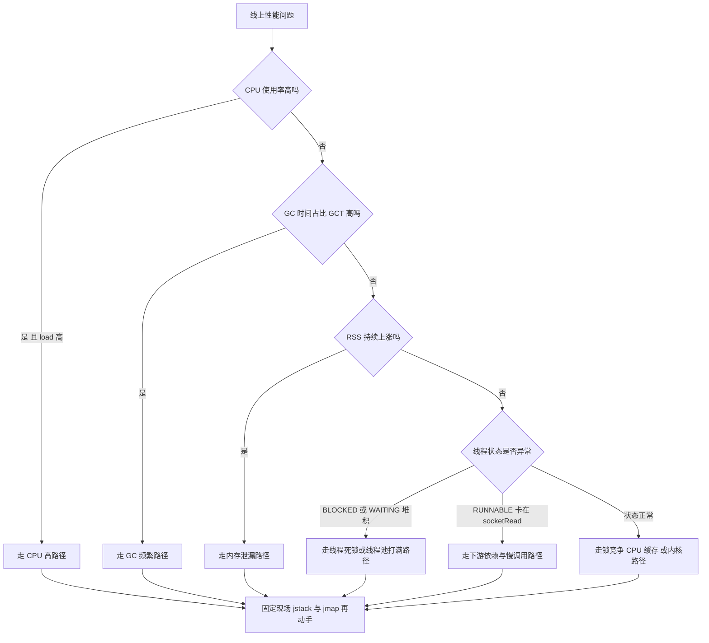
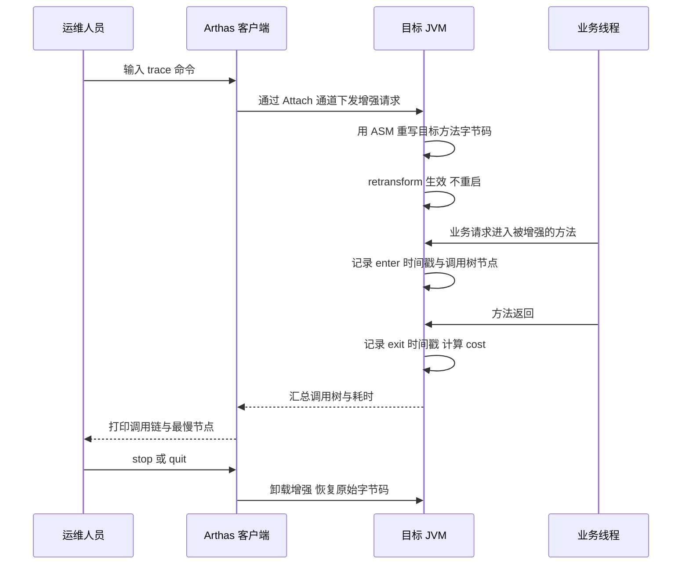
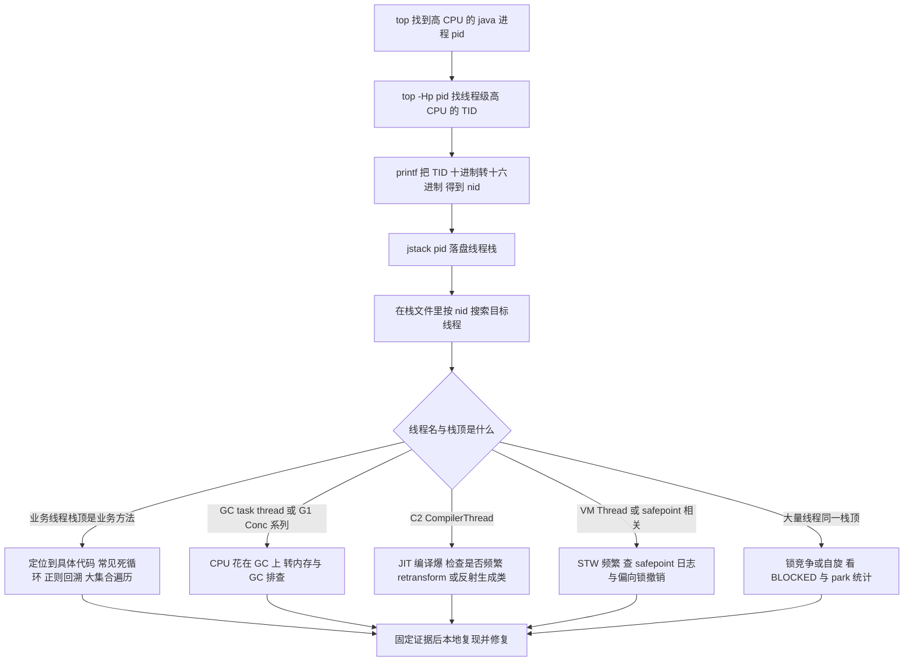
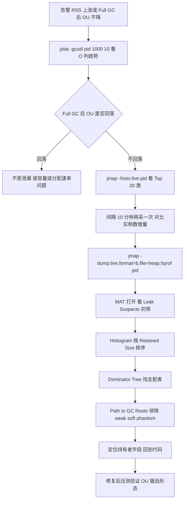
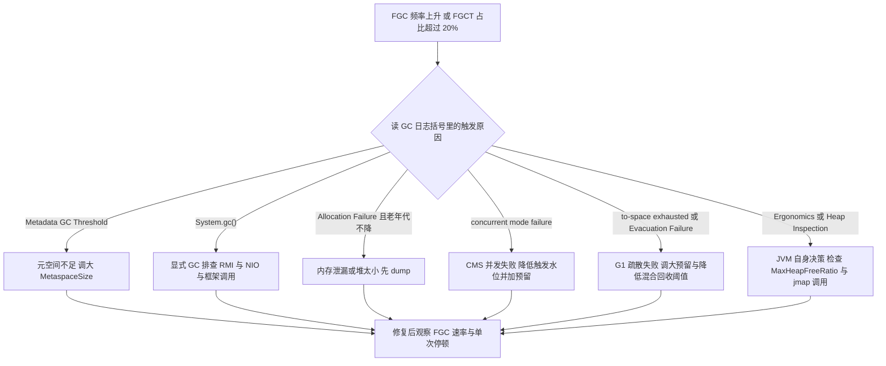
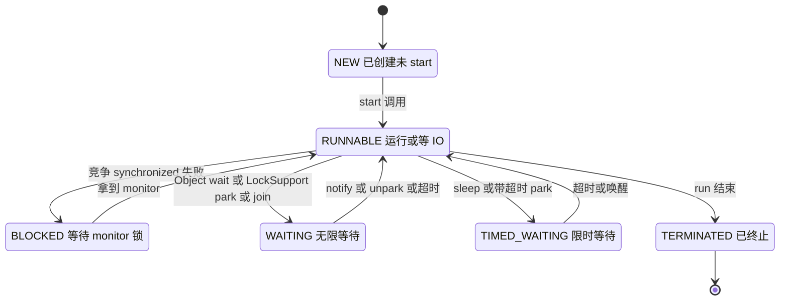
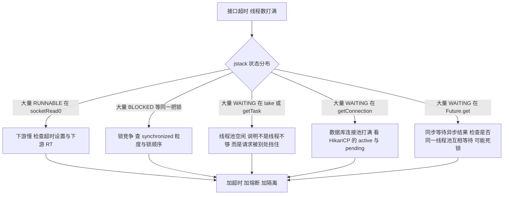
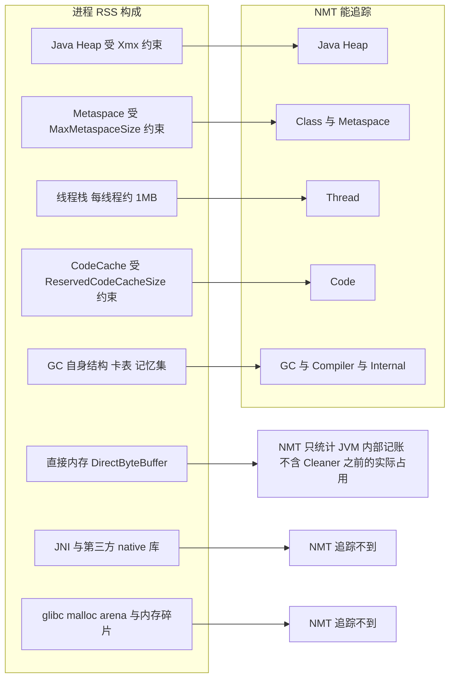
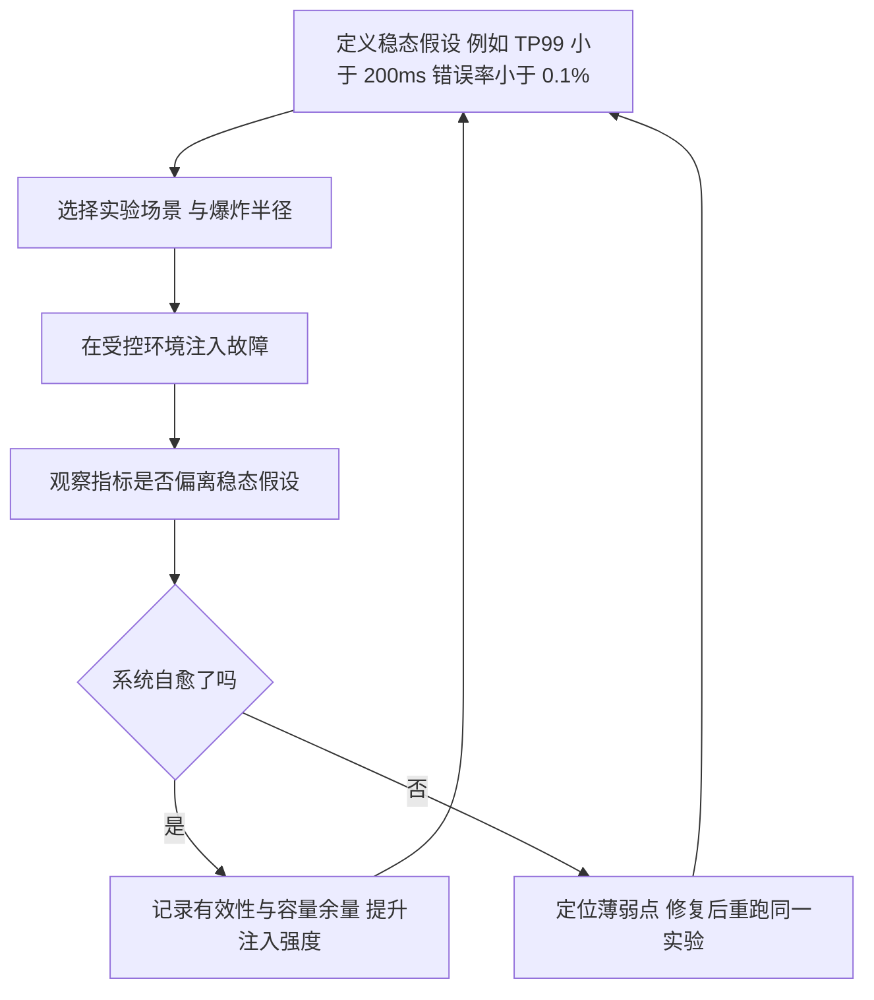

# 04 JVM 性能诊断与调优实战

> 一句话定位：调优不是背参数，而是"现象 → 指标 → 证据 → 根因 → 验证"的闭环，面试官问的全是这条链路上的断点 ｜ 面试权重 ★★★★★ ｜ 建议复习 70 分钟

## 本章大纲

- [一、性能问题分类与标准排查路径](#一性能问题分类与标准排查路径)
- [二、JDK 自带工具全景](#二jdk-自带工具全景)
- [三、Arthas 实战命令](#三arthas-实战命令)
- [四、MAT JProfiler async-profiler 与 JFR](#四mat-jprofiler-async-profiler-与-jfr)
- [五、CPU 100% 的完整定位过程](#五cpu-100-的完整定位过程)
- [六、内存泄漏定位](#六内存泄漏定位)
- [七、频繁 Full GC 排查](#七频繁-full-gc-排查)
- [八、线程死锁与线程池打满](#八线程死锁与线程池打满)
- [九、堆外内存问题](#九堆外内存问题)
- [十、JVM 参数模板 4C8G 与 8C16G](#十jvm-参数模板-4c8g-与-8c16g)
- [十一、线上禁止使用的危险参数](#十一线上禁止使用的危险参数)
- [十二、混沌工程与压测思路](#十二混沌工程与压测思路)
- [高级岗三问](#高级岗三问)
- [高频面试题](#高频面试题)
- [易错点与踩坑](#易错点与踩坑)
- [一句话速记](#一句话速记)

## 一、性能问题分类与标准排查路径

### 1.1 五类问题与第一现场指标

线上"性能问题"这个说法太粗。面试时要做的第一件事是**把模糊描述拆成可观测指标**。五类问题的第一现场指标不同，排查入口也不同。

| 问题类型 | 用户可感知现象 | 第一现场指标 | 首选入口 |
| --- | --- | --- | --- |
| CPU 高 | 整机负载高、RT 抖动、其他服务被拖慢 | `top` 的 `%CPU`、`load average`、`pidstat -u 1` | `top -Hp` + `jstack` |
| 内存高 | 容器 RSS 上涨、被 OOMKilled（exit 137） | `jstat -gcutil` 的 `O`、`M`；RSS 与堆的差值 | `jmap -histo:live` + `jmap -dump` |
| GC 频繁 | 周期性 RT 尖刺、吞吐下降 | `jstat -gcutil` 的 `YGC/FGC`、`FGCT/GCT` 占比 | GC 日志 + `jstat` |
| 响应慢 | TP99 飙升但 CPU/GC 正常 | 线程栈、下游 RT、连接池 `active/wait` | `jstack` + Arthas `trace` |
| 线程卡死 | 接口全部超时、线程数打满 | `jstack` 状态分布、`ThreadPoolExecutor#getActiveCount` | `jstack -l` + `thread -b` |

**顺序原则**：先看"是不是 GC 干的"，再看"是不是线程卡住的"，最后才看"代码慢"。因为前两者会造成全局性抖动，会把真正的根因淹没。



### 1.2 动手前的三条纪律

1. **先固定现场再分析**。任何"边跑边改"的操作都会破坏证据。第一条命令永远是 `jstack`（成本最低、信息量最大），第二条是 `jstat`，第三条才是 `jmap -dump`（会 STW）。
2. **`jmap -histo:live` 与 `jmap -dump:live` 都会触发一次 Full GC**（GC 原因分别是 `Heap Inspection Initiated GC` 与 `Heap Dump Initiated GC`），本身就是一次停顿时长不确定的操作。**`jcmd <pid> GC.heap_dump` 不带 `-all` 并不更稳**：它与 `jmap -dump:live` 是同一条路径，同样会先触发一次 Full GC（GCCause 同为 `Heap Dump Initiated GC`，本机 8u421 与 17.0.12 实测）——`:live`/不带 `-all` 的语义就是先做可达性分析、只 dump 存活对象，真正不触发 GC 的是 `-all`（`jcmd GC.heap_dump -all`，等价 `jmap -dump` 不带 `live`，dump 全量对象）。生产上 16G 以上的大堆必须评估后使用，稳妥做法是 `-XX:+HeapDumpOnOutOfMemoryError` 预先采集，或摘流量后再 dump。
3. **调优必须可回滚**。参数以启动参数文件（如 `JAVA_OPTS` 环境变量或 Dockerfile 的 `ENTRYPOINT`）形式固化并进版本库，不允许在生产上用 `jinfo -flag` 热改后不留记录（`jinfo` 只能改 `manageable` 标志，如 `PrintGC`、`HeapDumpOnOutOfMemoryError`、`MaxHeapFreeRatio`，且重启即失效）。

### 1.3 基线数据：没有基线就没有"慢"

调优的本质是**与自身历史对比**，所以必须提前落四类数据：

- **容量基线**：单机 QPS、TP99、CPU 水位、GC 频率（例如 4C8G、G1、4G 堆，压测基线为 800 QPS / TP99 80ms / YGC 2 次每分钟 / 无 Full GC）。
- **依赖基线**：DB、Redis、下游 RPC 的 RT 分布。响应慢的第一嫌疑永远是下游。
- **业务基线**：大促、批处理任务、定时任务的时间窗。很多"内存泄漏"其实是定时任务在堆里建索引。
- **变更基线**：发布记录、参数变更记录、依赖升级记录。90% 的线上性能突变发生在变更后 30 分钟内。

## 二、JDK 自带工具全景

所有第三方工具（Arthas、JProfiler）底层都是 Attach API + JVMTI + Serviceability Agent（SA）。把 JDK 自带工具吃透，等于掌握了所有工具的原语。

### 2.1 工具矩阵

| 工具 | 作用 | 常用命令 | 是否 STW | 版本备注 |
| --- | --- | --- | --- | --- |
| `jps` | 列出 JVM 进程 | `jps -lvm` | 否 | JDK 1.5 起；容器内需 `-q` 避免 attach 失败 |
| `jstat` | 采样 GC/类/编译统计 | `jstat -gcutil <pid> 1000 10` | 否 | JDK 1.5 起 |
| `jmap` | 堆直方图、堆 dump | `jmap -histo <pid>` | `:live` 会 STW | `-clstats` JDK 8 起 |
| `jstack` | 线程栈 | `jstack -l <pid>` | 会进 safepoint | `-F` 用于进程无响应 |
| `jinfo` | 查看/热改 VM 标志 | `jinfo -flags <pid>` | 否 | 只能改 manageable 标志 |
| `jcmd` | 统一入口，功能最全 | `jcmd <pid> help` | 视子命令 | JDK 7 起，JDK 9 后是首选 |
| `jhsdb` | SA 离线分析 core/dump | `jhsdb jmap --heap --pid <pid>` | 会 STW | JDK 9 起取代部分 `jmap -heap` 场景 |

### 2.2 jps

```bash
jps -lvm
# 输出示例
# 12345 com.example.OrderApplication --spring.profiles.active=prod -Xmx4g
```

容器里 `jps` 可能报 `Operation not permitted`，原因是 Attach 需要在 `/tmp` 下创建 `.java_pid<pid>` 套接字文件，而容器内 `/tmp` 被只读挂载或进程用户不同。解决方式：`-Djava.io.tmpdir=/data/tmp` 且保证运行用户对 `/data/tmp` 可写。

### 2.3 jstat：调优最常用的采样器

```bash
jstat -gcutil <pid> 1000 10     # 每秒一次 共 10 次 百分比视图
jstat -gc <pid> 1000            # 绝对值 单位 KB
jstat -gccapacity <pid>         # 各代容量与最大容量
jstat -gcnew <pid>              # 新生代细节 含 TTL 与 Desired Survivor
jstat -class <pid>              # 类加载与卸载数
jstat -compiler <pid>           # JIT 编译统计
```

JDK 8 实测输出（`jstat -gcutil`）：

```text
  S0     S1     E      O      M     CCS    YGC     YGCT    FGC    FGCT     GCT
  0.00   0.00  56.78   0.00  17.44  19.80      0    0.000     0    0.000    0.000
```

JDK 8 实测输出（`jstat -gc`，注意列名是 `MC/MU/CCSC/CCSU`，不是 `PC/PU`）：

```text
 S0C    S1C    S0U    S1U      EC       EU        OC         OU       MC     MU    CCSC   CCSU   YGC  YGCT  FGC  FGCT   GCT
10752.0 10752.0  0.0    0.0   65536.0  37470.6   175104.0     0.0     4480.0 781.5  384.0  76.0     0 0.000    0 0.000 0.000
```

列含义与判读：

| 列 | 含义 | 判读要点 |
| --- | --- | --- |
| `S0C/S1C`、`S0U/S1U` | Survivor 0/1 容量与使用量 | 两块应当交替有值；长期一块为 0 说明对象直接晋升 |
| `EC/EU` | Eden 容量与使用量 | `EU` 快速到顶是正常节奏，看增速 |
| `OC/OU` | 老年代容量与使用量 | **最关键的列**。`OU` 在每次 FGC 后回到低位 = 正常；回不去 = 泄漏或堆不足 |
| `MC/MU` | Metaspace 容量与使用量 | `MU` 持续上涨 = 类加载器泄漏或动态代理类爆炸 |
| `CCSC/CCSU` | 压缩类空间 | 与 `MC/MU` 同步观察 |
| `YGC/YGCT` | 年轻代 GC 次数与总耗时 | `YGCT/YGC` 是单次 Young GC 平均停顿 |
| `FGC/FGCT` | Full GC 次数与总耗时 | `FGCT/GCT > 20%` 基本可判定 GC 是瓶颈 |
| `GCT` | 总 GC 耗时 | 与进程运行时间比，超过 5% 就要警惕 |

**速率比绝对值重要**：连续采样 `jstat -gcutil <pid> 60000 10`，看 `FGC` 每分钟增加几次、`OU` 的斜率。一次 Full GC 本身不可怕，"每 3 分钟一次 Full GC"才可怕。

### 2.4 jmap

```bash
jmap -histo <pid> | head -30                 # 不触发 GC 的直方图 含垃圾对象
jmap -histo:live <pid> | head -30            # 只统计存活对象 会触发 Full GC
jmap -clstats <pid>                          # 类加载器统计 JDK 8 起
jmap -finalizerinfo <pid>                    # 等待 finalize 的对象
jmap -dump:live,format=b,file=/data/dump/heap.hprof <pid>
jmap -F -dump:format=b,file=/data/dump/heap.hprof <pid>   # 进程无响应时
```

直方图输出判读：

```text
 num     #instances         #bytes  class name
----------------------------------------------
   1:       3421567      547450720  [B          # byte 数组 占大头优先怀疑缓冲与报文
   2:        856234      136997440  com.example.OrderDTO
   3:        120338       38508160  java.util.HashMap$Node
```

`[B` 是 `byte[]`、`[C` 是 `char[]`、`[I` 是 `int[]`、`[Ljava.lang.Object;` 是对象数组。**`[B` 与 `java.lang.String` 排前两位是最常见的泄漏形态**，前者多为缓冲/报文/未关闭的流，后者多为缓存 key 或 `String.intern`。

`jmap -histo` 只能告诉你"哪类对象多"，**不能告诉你"谁持有它"**，这一步必须靠 MAT 的 GC Roots 路径。

### 2.5 jstack

```bash
jstack -l <pid> > /tmp/jstack_$(date +%s).log   # -l 额外打印 ownable synchronizer
jstack -F <pid>                                  # 进程挂死 强制输出
jstack -m <pid>                                  # 混合栈 含 native 帧
```

JDK 8 实测输出格式（注意 `nid` 是**十六进制**，`tid` 是 JVM 内部线程 id）：

```text
"http-nio-8080-exec-1" #23 daemon prio=5 os_prio=0 tid=0x00007f8a4c1d9000 nid=0x4a2b waiting on condition [0x00007f8a3b1e0000]
   java.lang.Thread.State: WAITING (parking)
        at sun.misc.Unsafe.park(Native Method)
        - parking to wait for  <0x000000076b2a1c40> (a java.util.concurrent.locks.AbstractQueuedSynchronizer$ConditionObject)
        at java.util.concurrent.LinkedBlockingQueue.take(LinkedBlockingQueue.java:442)
```

**`nid` 与 `top -Hp` 的对应关系是排查 CPU 高的唯一桥梁**，`top -Hp` 给的是十进制 TID，必须 `printf "%x"` 转换。

`jstack -l` 末尾会输出死锁检测结果（JDK 8 实测末尾格式）：

```text
JNI global references: 5
Found one Java-level deadlock:
=============================
"Thread-1":
  waiting to lock monitor 0x00007f8a4c0a1e08 (object 0x000000076b2a1c40, a java.lang.Object),
  which is held by "Thread-0"
```

### 2.6 jinfo 与 jcmd

```bash
jinfo -flags <pid>                  # 查看生效的 VM 标志
jinfo -flag MaxHeapSize <pid>       # 查看单个标志
jinfo -flag +HeapDumpOnOutOfMemoryError <pid>   # 热改 manageable 标志
jinfo -sysprops <pid>               # 系统属性
```

`jcmd` 是 JDK 9 之后的统一入口，JDK 8 已经具备大部分子命令（本机 8u421 实测 `jcmd <pid> help` 输出）：

| 子命令 | 用途 | 注意 |
| --- | --- | --- |
| `VM.version` / `VM.command_line` / `VM.flags` | 版本、启动命令、标志 | 排查"参数到底生效没有" |
| `VM.system_properties` | 系统属性 | 替代 `jinfo -sysprops` |
| `VM.uptime` | 运行时长 | 与 GC 次数算速率 |
| `GC.heap_info` | 各代容量与使用量 | 替代 `jmap -heap`，JDK 9 后官方推荐 |
| `GC.class_histogram` | 类直方图 | 等价 `jmap -histo` |
| `GC.heap_dump /path/x.hprof` | 堆 dump | 等价 `jmap -dump` |
| `GC.run` | 触发一次 GC | 等价 `System.gc()`，慎用 |
| `Thread.print` | 线程栈 | 等价 `jstack` |
| `VM.native_memory summary` | NMT 摘要 | 需 `-XX:NativeMemoryTracking=summary` |
| `VM.metaspace` | 元空间明细 | JDK 8 起可用 |
| `VM.classloader_stats` | 类加载器统计 | 排查 ClassLoader 泄漏 |
| `VM.class_hierarchy` | 类继承树 | 定位动态代理类 |
| `JFR.start` / `JFR.dump` / `JFR.stop` / `JFR.check` | 飞行记录 | JDK 8 需 `-XX:+UnlockCommercialFeatures`；JDK 11 起开源免费 |
| `VM.set_flag` | 热改标志 | 等价 `jinfo -flag` |

`jcmd` 相对 `jmap` 的关键优势：**同一条 TCP 通道完成多个动作，且对容器化部署更友好**（`jcmd <pid> GC.heap_dump /data/dump/x.hprof` 不需要额外挂载）。

## 三、Arthas 实战命令

Arthas 3.7.x / 4.x 是线上诊断的事实标准，原因是它**不需要重启、不需要改代码、不需要预埋 agent 参数**，靠 Attach API 动态挂载。启动方式：

```bash
curl -O https://arthas.aliyun.com/arthas-boot.jar
java -jar arthas-boot.jar --telnet-port 3658 --http-port 8563
```

### 3.1 命令速查

| 命令 | 典型用法 | 解决什么问题 |
| --- | --- | --- |
| `dashboard` | `dashboard -i 5000 -n 3` | 一屏看线程/内存/GC/运行环境 |
| `thread` | `thread -n 5`、`thread -b`、`thread --state BLOCKED` | 找最忙线程、找阻塞源头 |
| `sc` | `sc -d com.example.OrderService` | 确认类从哪个 jar 加载、是否被增强 |
| `jad` | `jad com.example.OrderService` | 反编译，确认线上代码版本 |
| `watch` | `watch com.example.OrderService query '{params,returnObj,throwExp}' -x 3 -b -f` | 看入参出参异常 |
| `trace` | `trace com.example.OrderService query -n 5 --skipJDKMethod true` | 看方法内部耗时分布 |
| `stack` | `stack com.example.OrderService query` | 谁调用了这个方法 |
| `monitor` | `monitor -c 5 com.example.OrderService query` | 周期性统计 RT 与成功率 |
| `tt` | `tt -t com.example.OrderService query` | 时空隧道，录制调用现场并重放 |
| `profiler` | `profiler start -e cpu` / `profiler stop --format html` | 生成火焰图（内置 async-profiler） |
| `heapdump` | `heapdump --live /data/dump/heap.hprof` | 生成堆 dump |
| `vmtool` | `vmtool --action getInstances --className com.example.Cache --limit 10` | 直接拿到堆里的对象实例 |
| `ognl` | `ognl '@com.example.Config@INSTANCE'` | 执行表达式，看静态字段 |
| `logger` | `logger -n com.example --level DEBUG` | 动态改日志级别 |
| `jvm` | `jvm` | 等价 `jinfo` 的汇总视图 |
| `memory` | `memory` | 各内存池使用量 |
| `options` | `options list` | 查看/热改 Arthas 自身开关 |

### 3.2 watch 与 trace 的差别（面试高频）

| 维度 | `watch` | `trace` |
| --- | --- | --- |
| 关注点 | 数据：参数、返回值、异常 | 时间：方法内部各调用耗时 |
| 是否改变行为 | 不改变（除非 `-b` 前置打断点会短暂挂起） | 不改变 |
| 输出结构 | 每次调用的观测表达式结果 | 调用树 + 每节点 `cost` |
| 性能开销 | 与 `-x` 展开深度成正比 | 与类增强的调用点数量成正比 |
| 典型场景 | "为什么这个订单状态不对" | "这 3 秒花在哪个子调用上" |
| 限制 | 无法看到内部实现 | 无法看到参数值，且**不能 trace JDK 方法** |

`watch` 常用参数：`-x 3` 控制展开层级（默认 1），`-b` 在方法执行前观测，`-f` 在方法结束后观测（默认），`-e` 只观测异常，`-s` 在方法返回后观测，`-n 5` 限制次数，`--exclude-class-pattern` 排除类。

`trace` 常用参数：`-n 5` 限制输出条数（默认 1），`--skipJDKMethod true`（默认 true，跳过 JDK 内部调用），`-E` 正则匹配多个类，`#cost > 100` 作为条件表达式只打印慢调用。



### 3.3 trace 的原理与代价

`trace` 用 **ASM 在方法入口与出口插入探针**，再通过 `Instrumentation#retransformClasses` 生效。由此推出三个结论：

1. **只能增强已经加载的类**。类还没加载时 `trace` 会提示 `Affect(class count: 0)`，需要先触发一次调用。
2. **不能增强 JDK 内部类**（`java.*` 由 bootstrap 加载，`--skipJDKMethod true` 就是为了避开这类调用点）。要看 `HashMap#get` 的耗时，得用 async-profiler 而不是 `trace`。
3. **有真实开销**。被 trace 的方法每次调用都要走探针，QPS 上万的热点方法上开 `trace` 可能让 RT 翻倍。生产上必须 `-n` 限量，用完立刻 `stop`。

`profiler` 命令底层就是 async-profiler，用法：

```bash
profiler start -e cpu -d 30 --interval 10ms
profiler start -e alloc              # 分配火焰图 定位"谁在疯狂分配"
profiler start -e lock               # 锁竞争火焰图
profiler start -e wall -t            # 墙钟时间 按线程 定位阻塞
profiler stop --format html --file /tmp/flame.html
```

## 四、MAT JProfiler async-profiler 与 JFR

### 4.1 工具定位对照

| 工具 | 输入 | 核心能力 | 适用场景 | 代价 |
| --- | --- | --- | --- | --- |
| MAT | hprof 堆 dump | Dominator Tree、GC Roots 路径、Leak Suspects | 内存泄漏根因定位 | 需 dump 与本地解析，大堆耗内存 |
| JProfiler | 在线 attach 或离线 agent | CPU 调用树、分配记录、实时内存 | 预发环境深度分析 | 商业授权，在线模式开销大 |
| async-profiler | 在线采样 | 火焰图（CPU/alloc/lock/wall） | 生产环境低开销性能剖析 | 需 `libasyncProfiler.so`，采样精度受 safepoint 影响 |
| JFR | 内置事件流 | 全维度事件（GC、线程、锁、IO、分配样本） | 长周期常态化采集 | 有固定开销，事件配置需裁剪 |
| Arthas profiler | 在线采样 | 火焰图（内置 async-profiler） | 无预埋的应急剖析 | 同上 |

### 4.2 MAT 的关键概念

| 概念 | 定义 | 用途 |
| --- | --- | --- |
| Shallow Size | 对象自身占用的字节数 | 判断单个对象大小 |
| Retained Size | 该对象被回收后能连带释放的总字节数 | **排序的主键**，找"大鱼" |
| Dominator Tree | 按支配关系组织的对象树，父节点支配子节点 | 一眼看出谁真正持有大量内存 |
| Path to GC Roots | 从对象反向到 GC Roots 的引用链 | 找到"谁让它活着的" |
| Leak Suspects | 自动报告 | 快速初筛，但会误报 |
| OQL | 类 SQL 查询对象 | `SELECT * FROM com.example.OrderDTO WHERE id = 1` |

**关键操作顺序**：打开 hprof（首次会生成 `.index` 文件，需保证磁盘空间约为 dump 的 1/3）→ `Histogram` 按 Retained Size 排序 → 右键 `Merge Shortest Paths to GC Roots` → 勾选 `exclude all phantom/weak/soft etc. references`（**不排除软引用会把缓存误判成泄漏**）→ 得到持有链。

### 4.3 async-profiler 火焰图判读

```bash
# 采集 CPU 30 秒
./profiler.sh -e cpu -d 30 -f /tmp/cpu.html <pid>
# 采集分配 只看谁在 new 对象
./profiler.sh -e alloc -d 60 -f /tmp/alloc.html <pid>
# 采集锁竞争
./profiler.sh -e lock -d 30 -f /tmp/lock.html <pid>
# 墙钟时间 按线程分栏 定位"不占 CPU 但很慢"
./profiler.sh -e wall -t -d 60 -f /tmp/wall.html <pid>
```

判读规则：

1. **看"平顶"不看"尖峰"**。火焰图里横向很宽的一层表示该栈帧占据了大量样本，是热点。
2. CPU 火焰图看栈顶是业务代码还是框架代码。栈顶全是 `G1 Evacuation` / `ParallelTaskTerminator` 说明 CPU 花在 GC 上，不是代码慢。
3. `-e wall -t` 出现大片 `socketRead0` / `park`，说明时间花在等待，属于"下游慢"或"锁等待"，不是 CPU 问题。
4. `-e alloc` 是排查 GC 频繁最有效的一张图，它直接回答"谁在制造垃圾"。
5. async-profiler 默认用 `AsyncGetCallTrace` 采样，能拿到 safepoint 之外的栈；建议加 `-XX:+DebugNonSafepoints` 让栈更精确（否则会出现大量 `[unknown]` 帧）。
6. JDK 9+ 上如果出现大量 `Interpreter` 帧，说明采样到了解释执行阶段，此时 `-XX:+DebugNonSafepoints` 与合适的采样间隔（`--interval`，默认 10ms）都很重要。

### 4.4 JFR

JFR 是**唯一内置于 JVM 且开销可控（默认配置下通常 1% 量级）的全维度采集器**，事件是结构化的，可以长期开启。

```bash
# 启动即开启 默认配置 保留 60 分钟
java -XX:StartFlightRecording=disk=true,maxsize=512m,dumponexit=true,filename=/data/jfr/app.jfr ...
# 生产配置（采样更密 适合排查）
java -XX:StartFlightRecording=settings=profile,duration=300s,filename=/data/jfr/app.jfr ...
# 运行期按需开启
jcmd <pid> JFR.start name=diag settings=profile duration=120s filename=/data/jfr/diag.jfr
jcmd <pid> JFR.check
jcmd <pid> JFR.dump name=diag filename=/data/jfr/diag.jfr
jcmd <pid> JFR.stop name=diag
# 离线分析
jfr summary /data/jfr/diag.jfr
jfr print --events jdk.ExecutionSample,jdk.GCPhasePause /data/jfr/diag.jfr
jfr view hot-methods /data/jfr/diag.jfr
```

常用事件与排查用途：

| 事件 | 说明 | 排查什么 |
| --- | --- | --- |
| `jdk.ExecutionSample` | 执行栈采样 | CPU 热点（等价火焰图数据源） |
| `jdk.NativeMethodSample` | native 栈采样 | 内核态与 native 耗时 |
| `jdk.ObjectAllocationSample` | 分配采样 | 谁在分配（JDK 16 起取代 `jdk.ObjectAllocationInNewTLAB`/`OutsideTLAB`） |
| `jdk.GCPhasePause` | GC 各阶段停顿 | GC 停顿归因 |
| `jdk.ThreadPark` / `jdk.JavaMonitorEnter` / `jdk.JavaMonitorWait` | 阻塞与锁 | 锁竞争、线程池排队 |
| `jdk.SocketRead` / `jdk.SocketWrite` | 网络耗时 | 下游依赖慢 |
| `jdk.FileRead` / `jdk.FileWrite` | 文件耗时 | 日志与本地 IO 抖动 |
| `jdk.ClassLoad` | 类加载 | 启动期与动态代理 |

版本要点：JDK 8 上 JFR 属于 Oracle JDK 商业特性，需 `-XX:+UnlockCommercialFeatures -XX:+FlightRecorder`；**JDK 11 起 JFR 开源并默认可用（JEP 328）**，`jcmd JFR.*` 无需解锁；JDK 14 起提供 `jdk.jfr.consumer` 事件流 API 做在线消费。

## 五、CPU 100% 的完整定位过程

### 5.1 标准六步



对应命令（可直接粘贴）：

```bash
# 1 找进程
top -c -o %CPU            # 或 ps -eo pid,pcpu,pmem,cmd --sort=-pcpu | head
# 2 找线程（-H 显示线程 -p 指定进程）
top -Hp 12345 -o %CPU
# 3 十进制 TID 转十六进制
printf "%x\n" 18987        # 输出 4a2b
# 4 落线程栈
jstack -l 12345 > /tmp/jstack_$(date +%s).log
# 5 定位
grep -n -A 30 "nid=0x4a2b" /tmp/jstack_*.log
```

补充命令：

```bash
# 一次性看全部线程 CPU（比 top -Hp 更适合脚本化）
pidstat -t -p 12345 1 3
# 看上下文切换（区分"CPU 忙"与"调度忙"）
pidstat -w -p 12345 1 3
# 看 native 栈（需要 -XX:+PreserveFramePointer 才有意义）
perf top -p 12345
# 直接生成火焰图 一步到位
./profiler.sh -e cpu -d 30 -f /tmp/cpu.html 12345
```

### 5.2 六种 CPU 高模式与特征

| 模式 | `top -Hp` 特征 | `jstack` 特征 | 根因与对策 |
| --- | --- | --- | --- |
| 业务死循环 | 1~2 个线程接近 100% | 栈顶稳定在同一业务方法，多次采样栈相同 | 循环退出条件写错、`while(true)` 无 `sleep` |
| 正则回溯 | 1 个线程接近 100% | 栈顶含 `java.util.regex.Pattern$Loop` / `Pattern$Curly` | 贪婪匹配 + 恶意长串，改原子组或限制输入长度 |
| 序列化/反序列化风暴 | 多个线程高 | 栈顶 `JSON.toJSONString` / `ObjectMapper.writeValue` | 大对象频繁序列化，改批量与缓存 |
| GC 线程 | `GC task thread#N` 全部高 | 栈里 GC 线程 RUNNABLE，`jstat` 的 `GCT` 占比高 | 堆不足或分配过快，见第六章 |
| JIT 编译爆 | `C2 CompilerThread` 高 | 栈顶 `CompileBroker` / `Compile::` | 大量动态类生成（CGLIB、Groovy、脚本引擎）、Arthas `trace` 频繁 retransform |
| 锁自旋 | 多线程高但 RT 也高 | 大量线程 `BLOCKED` 或 `park`，少量线程 RUNNABLE | 锁粒度过大，改用无锁结构或分段锁 |

**关键区分点**：CPU 高**且** RT 高 = 真的在算；CPU 高但吞吐下降 = 大概率在做无效工作（自旋、GC、编译）。`vmstat 1` 里 `us` 高是用户态计算，`sy` 高是系统调用/锁竞争，`r` 列大于核数说明有排队。

### 5.3 一个真实案例的完整推演

现象：8C16G 容器，CPU 打到 700%，接口 TP99 从 60ms 涨到 3s，QPS 从 1200 掉到 300。

1. `top -c -o %CPU` → java 进程 `%CPU=712`，`load average` 18（8 核，已超载）。
2. `top -Hp 12345 -o %CPU` → 6 个线程各占约 100%，名字都是 `http-nio-8080-exec-*`，另有 2 个 `G1 Conc#0/#1`。
3. `printf "%x\n" <TID>` 得到 6 个 nid，`jstack` 里对应线程栈顶全部是 `com.example.price.PriceCalculator.matchRule` 调用 `java.util.regex.Pattern$Loop.match`。
4. 结论：**正则回溯**。定位到代码里 `Pattern.compile("(a+)+b")` 这类嵌套量词，输入串长度超过 200 时指数级回溯。
5. 修复：改写成 `Pattern.compile("a+b")` 等价语义，并对输入做长度上限校验；同时把该正则预编译为 `static final Pattern` 避免重复编译。
6. 验证：同样压测下 TP99 回落到 65ms，CPU 降到 260%。

这个案例的三个加分点：**用 `printf %x` 打通了 `top` 与 `jstack`**；**看出是 6 个线程同时高而不是 1 个**（说明是并发触发的同一代码路径，而不是死循环）；**用 G1 Conc 线程的存在排除了纯 GC 问题**。

## 六、内存泄漏定位

### 6.1 泄漏与"内存不够"的区分

这是面试的必问分水岭：

| 特征 | 内存泄漏 | 堆容量不足（正常业务增长） |
| --- | --- | --- |
| `jstat -gcutil` 的 `O` 列 | 每次 Full GC 后**不下降或只降一点**，下一次更高 | 每次 Full GC 后明显下降，然后缓慢上涨 |
| `OU` 长期趋势 | 单调上升，斜率为正 | 锯齿形，均值稳定 |
| `FGC` 频率 | 逐渐变密，最后 Full GC 也回收不出空间 | 稳定在某个频率 |
| 最终结果 | `OutOfMemoryError: Java heap space` 或 GC overhead | 同样 OOM，但扩容后消失 |
| 验证方式 | dump 后 MAT 里同一对象集合被同一 GC Root 持有 | dump 里对象种类分散，无单一支配者 |
| 处置 | 改代码 | 扩堆或优化数据结构 |

**判别动作**：间隔 10~30 分钟做两次 `jmap -histo:live`，对比 `#instances` 增长。某个类实例数线性增长且 Full GC 不回收，就是泄漏。

### 6.2 定位流程



### 6.3 九类高频泄漏源

| 泄漏源 | 机制 | 典型栈/证据 | 修复 |
| --- | --- | --- | --- |
| `ThreadLocal` 未 `remove` | 线程池线程复用，`ThreadLocalMap` 的 Entry 随线程存活 | `Thread` → `threadLocals` → `Entry[]` → value | `try/finally` 里 `remove()`；JDK 8 的 `ThreadLocalMap.Entry` 是弱引用 key 但 value 强引用 |
| 静态集合当缓存 | `static Map` 无淘汰策略 | `HashMap$Node` 数量线性增长 | 换 Caffeine/Guava Cache 并设 `maximumSize` + `expireAfterWrite` |
| 监听器/回调未注销 | 注册中心持有业务对象 | `ConcurrentHashMap` → `CopyOnWriteArrayList` → 业务对象 | 生命周期结束时反注册 |
| 连接/流未关闭 | socket、`InputStream`、`ZipFile`、`Inflater` | `[B` 与 `java.util.zip.Inflater` 数量增长 | try-with-resources |
| 内部类持有外部引用 | 非静态内部类隐式持有 `this$0` | 对象图里有 `this$0` 字段 | 改静态内部类 |
| `ClassLoader` 泄漏 | 热部署/脚本引擎反复创建 ClassLoader，静态字段被 bootstrap 持有 | `jmap -clstats` 里 ClassLoader 数量增长 | 复用 ClassLoader，清空 `ThreadLocal`，JDK 8 需 `-XX:+CMSClassUnloadingEnabled` |
| 直接内存 | `DirectByteBuffer` 的 `Cleaner` 未触发 | RSS 高但堆正常 | 见第九章 |
| 线程池队列堆积 | 无界 `LinkedBlockingQueue` 里堆任务对象 | `LinkedBlockingQueue$Node` 数量增长 | 有界队列 + 拒绝策略 |
| `String.intern` 滥用 | 常量池（JDK 7 起在堆中）无限膨胀 | `java.lang.String` 实例数与 `[C` 同步增长 | 不用 `intern` 做去重，改本地缓存 |

### 6.4 MAT 实操要点

1. **打开大 dump 要给 MAT 自己配堆**：`MemoryAnalyzer.ini` 里改 `-Xmx8g`，否则 16G 堆的 dump 打不开。
2. 命令行生成索引，避免 GUI 卡死：`./ParseHeapDump.sh /data/dump/heap.hprof org.eclipse.mat.api:suspects`。
3. **`Dominator Tree` 的 `Retained Heap` 列按降序排**，第一行往往是"元凶"，但要注意 `java.lang.Thread` 也是常见的大支配者（每个线程 1MB 栈不在堆里，但线程持有的对象在堆里）。
4. **`Path to GC Roots` 必须排除弱引用族**，否则会得到一条 `WeakReference` 链，误判成泄漏。软引用（`SoftReference`）在内存充足时不会被回收，是"合法的内存占用"，但如果是无上限的软引用缓存，同样是泄漏。
5. `Histogram` 与 `Dominator Tree` 的分工：前者回答"什么对象多"，后者回答"谁把它们攥在手里"。
6. 线上禁止直接在生产大堆上跑 `jmap -dump:live`，正确做法是**摘流量后 dump**，或依赖 `-XX:+HeapDumpOnOutOfMemoryError` 的自动 dump。

## 七、频繁 Full GC 排查

### 7.1 第一步永远是看触发原因

GC 日志括号里的字符串就是触发原因，这是最快的分诊入口。



### 7.2 触发原因与日志特征对照

| 触发原因（日志原文） | 版本/收集器 | 含义 | 对策 |
| --- | --- | --- | --- |
| `Full GC (Metadata GC Threshold)` | JDK 8 全收集器；JDK 9+ 为 `Pause Full (Metadata GC Threshold)` | Metaspace 达到 `MetaspaceSize` 高水位，触发一次"顺便"的 Full GC | `-XX:MetaspaceSize=256m -XX:MaxMetaspaceSize=512m`，让高水位一次到位 |
| `Full GC (System.gc())` | 全版本 | 有人显式调用 `System.gc()` | 定位调用方；用 `-XX:+ExplicitGCInvokesConcurrent` 让它并发化，而不是简单 `DisableExplicitGC` |
| `Full GC (Allocation Failure)` | 全版本 | 分配失败，老年代/整个堆无法满足 | 区分泄漏与容量；`OU` 不降即泄漏 |
| `Full GC (Ergonomics)` | JDK 8 Parallel/CMS | JVM 自适应策略判定该做 Full GC（如 `MaxHeapFreeRatio` 未达标） | 检查 `-XX:MaxHeapFreeRatio`（默认 70）与堆抖动 |
| `Full GC (Heap Inspection Initiated GC)` | JDK 8+ | 被 `jmap -histo:live` / `jmap -dump:live` 触发 | **这条日志出现说明有人在做诊断**，排查时先排除自己 |
| `concurrent mode failure` | CMS | 并发回收期间老年代被填满，退化为单线程 Serial Old Full GC | `-XX:CMSInitiatingOccupancyFraction=70 -XX:+UseCMSInitiatingOccupancyOnly`，并加 `-XX:+CMSScavengeBeforeRemark` |
| `promotion failed` | CMS | Young GC 时晋升失败，Survivor 与老年代都放不下 | 调大 Survivor（`-XX:SurvivorRatio`）或降低晋升速度 |
| `to-space exhausted` / `Evacuation Failure` | G1 | 疏散时没有空闲 region 接收存活对象 | 增大堆预留、降低 `-XX:G1HeapWastePercent`、或调小 `-XX:G1MixedGCLiveThresholdPercent` |
| `Pause Full (G1 Compaction Pause)` | G1 JDK 9+ | G1 兜底 Full GC，会做整堆压缩，停顿最长 | 属于最后手段，出现即说明 G1 已退化，需查 humongous 与 IHOP |

### 7.3 JDK 8 与 JDK 9+ 日志格式对照

JDK 8（`-Xloggc:/data/logs/gc.log -XX:+PrintGCDetails -XX:+PrintGCDateStamps -XX:+PrintGCTimeStamps`）：

```text
2024-05-01T10:00:00.123+0800: 12.345: [Full GC (Metadata GC Threshold) [PSYoungGen: 1234K->0K(10240K)] [ParOldGen: 5678K->4321K(20480K)] 6912K->4321K(30720K), [Metaspace: 21000K->21000K(1056768K)], 0.0456789 secs] [Times: user=0.12 sys=0.00, real=0.05 secs]
```

JDK 9+（`-Xlog:gc*:file=/data/logs/gc-%t.log:time,uptime,level,tags:filecount=10,filesize=50M`）：

```text
[12.345s][info][gc] GC(12) Pause Full (Metadata GC Threshold) 1234M->567M(2048M) 345.678ms
[12.700s][info][gc] GC(13) Pause Young (Normal) (G1 Evacuation Pause) 512M->128M(2048M) 45.678ms
```

**迁移坑**：JDK 9 起 `-XX:+PrintGCDetails`、`-XX:+PrintGCDateStamps`、`-XX:+PrintGCTimeStamps`、`-XX:+PrintGCApplicationStoppedTime` 等被移除，JVM 只打印一行 `Ignoring option ...; support was removed in 9.0` 然后**不产生 GC 日志**。很多人升级 JDK 后以为"GC 变好了"，其实是日志没开。统一日志的等价配置是 `-Xlog:gc*`，停顿时长用 `-Xlog:safepoint`。

### 7.4 排查脚本模板

```bash
PID=12345
echo "== GC 速率（每 10 秒一次 共 6 次）=="
jstat -gcutil $PID 10000 6
echo "== 老年代与元空间 =="
jcmd $PID GC.heap_info
echo "== 元空间明细 =="
jcmd $PID VM.metaspace | head -40
echo "== 类加载器数量（ClassLoader 泄漏看这里）=="
jcmd $PID VM.classloader_stats | tail -5
echo "== 元凶初筛 =="
jmap -histo:live $PID | head -25
echo "== 显式 GC 调用者（需要 -XX:+DisableExplicitGC 或 Arthas 观测 System.gc）=="
grep -c "System.gc()" /data/logs/gc.log
```

判读经验值（8C16G、8G 堆、G1）：

- `YGCT/GCT > 95%` 且 `YGC` 每分钟 10 次以上：优先看分配速率（`-e alloc` 火焰图），而不是调 GC 参数。
- `FGCT/GCT > 20%`：GC 已是瓶颈，必须处理。
- 单次 Young GC 超过 `MaxGCPauseMillis` 的 2 倍：检查是否有 humongous 对象（G1 中大于 region 一半的对象直接进 humongous region）。
- `OU` 在 Full GC 后仍占堆 70% 以上：堆太小或泄漏。

## 八、线程死锁与线程池打满

### 8.1 线程状态与 jstack 特征



`jstack` 输出与状态的对应关系（这是排查的核心）：

| 状态 | jstack 原文特征 | 真实含义 |
| --- | --- | --- |
| `RUNNABLE` | `java.lang.Thread.State: RUNNABLE` | 可能在跑，**也可能阻塞在 native**，如 `socketRead0`、`epollWait`、`futex` |
| `BLOCKED` | `- waiting to lock <0x...> (a java.lang.Object)` | 抢 `synchronized` 失败，**有明确锁对象** |
| `WAITING` | `parking to wait for <0x...>` 或 `in Object.wait()` | 无限等待，如 `LinkedBlockingQueue#take` 空闲线程 |
| `TIMED_WAITING` | `sleeping` / `parking to wait for` / `waiting on condition` | 带超时，如 `Thread#sleep`、`Future#get(timeout)` |
| 死锁 | `Found one Java-level deadlock:` 段 | JVM 已自动检测，直接给结论 |

**最大的坑**：`jstack` 里看到大量 `RUNNABLE` 且栈顶是 `java.net.SocketInputStream.socketRead0`，不要以为 CPU 在忙——那是**在等下游响应**，CPU 反而是空闲的。必须结合 `top` 的 CPU 值一起看。

### 8.2 死锁排查

```bash
# 方法一 jstack 自带检测
jstack -l 12345 | grep -A 40 "Found one Java-level deadlock"
# 方法二 Arthas 直接找阻塞源头
thread -b
# 方法三 JMX / ThreadMXBean 代码化检测
# ThreadMXBean mx = ManagementFactory.getThreadMXBean();
# long[] ids = mx.findDeadlockedThreads();   // JDK 6 起；findMonitorDeadlockedThreads 仅检测 monitor 锁
# ThreadInfo[] infos = mx.getThreadInfo(ids, true, true);
```

`thread -b` 的局限要能说出来：它**只能给出"阻塞其他线程最多的那一个线程"**，在复杂场景下会漏。多线程互相持有多个锁时，必须以 `jstack -l` 的完整死锁段为准。

死锁的四个必要条件（互斥、持有并等待、不可剥夺、循环等待）里，工程上唯一好破坏的是**循环等待**：统一加锁顺序。其他三种手段：

| 手段 | 做法 | 代价 |
| --- | --- | --- |
| 统一加锁顺序 | 按对象 id 或业务主键排序后依次加锁 | 需要全局约定，重构成本高 |
| 超时放弃 | `ReentrantLock#tryLock(long, TimeUnit)` | 需处理失败分支与重试，可能活锁 |
| 减少锁粒度 | 用 `ConcurrentHashMap`、`LongAdder`、分段 | 逻辑变复杂，一致性边界要重设 |
| 单线程化 | 把共享状态收敛到单线程事件循环 | 吞吐受限 |

**高频死锁案例**：`ConcurrentHashMap#computeIfAbsent` 的 mappingFunction 里再去操作同一个 map，JDK 8 实现会在 bin 上加 `synchronized`，重入同一 bin 会死锁。JDK 9 起改为检测到递归更新直接抛 `IllegalStateException("Recursive update")`（JDK 11 源码 `ConcurrentHashMap.java:1739`），不再静默死锁。这是面试里非常常见的"你写过的死锁"。

### 8.3 线程池打满排查

现象：接口大面积超时、`RejectedExecutionException`、线程数逼近上限、CPU 不高。

```bash
# 1 数线程名分布（先看是哪类线程池在膨胀）
jstack 12345 | grep -o '"pool-[0-9]*-thread-[0-9]*"' | wc -l
jstack 12345 | grep '"' | sed 's/".*//' | sort | uniq -c | sort -rn | head -20
# 2 看状态分布
jstack 12345 | grep "java.lang.Thread.State" | sort | uniq -c
# 3 看线程都在等什么
jstack 12345 | grep -A 5 "State: WAITING" | grep "parking to wait for" | sort | uniq -c | sort -rn | head
# 4 Arthas 看线程池实例
vmtool --action getInstances --className java.util.concurrent.ThreadPoolExecutor --limit 20 -x 2
```

`ThreadPoolExecutor` 的关键字段与默认值（面试常问）：

| 字段/方法 | 含义 | 关键数字 |
| --- | --- | --- |
| `corePoolSize` | 核心线程数 | `Executors.newFixedThreadPool(n)` 固定为 n |
| `maximumPoolSize` | 最大线程数 | `newCachedThreadPool` 为 `Integer.MAX_VALUE` |
| `keepAliveTime` | 非核心线程空闲存活 | `newCachedThreadPool` 默认 60s |
| `workQueue` | 任务队列 | `newFixedThreadPool`/`newSingleThreadExecutor` 用 `LinkedBlockingQueue`，容量 `Integer.MAX_VALUE`（**无界**） |
| `allowCoreThreadTimeOut` | 核心线程是否可超时回收 | 默认 `false` |
| `getActiveCount()` | 正在执行任务的线程数估算值 | 监控核心指标 |
| `getQueue().size()` | 排队任务数 | 与 `activeCount` 一起判断"忙还是堵" |
| `getCompletedTaskCount()` | 已完成任务数 | 算吞吐 |
| `largestPoolSize` | 历史最大线程数 | 判断是否触顶 |
| `getRejectedExecutionHandler()` | 拒绝策略 | 默认 `AbortPolicy`（抛 `RejectedExecutionException`） |
| 线程创建时机 | 核心线程在**提交任务时**才创建 | `prestartAllCoreThreads()` 可预热 |

**判读口诀**：

- `activeCount` 满 + `queue.size()` 接近 0 = 真在忙，扩线程或扩实例。
- `activeCount` 满 + `queue.size()` 持续上涨 = 有任务卡住，去看栈顶在等什么（通常是下游或 DB 连接池）。
- `activeCount` 低 + `queue.size()` 高 = 线程池被"饿死"，检查是否有同步锁或 `CallerRunsPolicy` 造成的反馈。

**根因分类**：

1. 下游慢导致线程被占满 → 必须设超时（HTTP `connectTimeout`/`readTimeout`、JDBC `socketTimeout`、RPC `timeout`），超时是线程池的保命阀。
2. 无界队列导致 OOM → 换 `new ThreadPoolExecutor(core, max, 60L, TimeUnit.SECONDS, new ArrayBlockingQueue<>(2000), threadFactory, new ThreadPoolExecutor.CallerRunsPolicy())`。
3. 线程池未隔离，一个慢接口拖垮全部 → 按业务域拆池，核心与非核心隔离。
4. `Executors` 四个工厂方法的缺陷：`newFixedThreadPool`/`newSingleThreadExecutor` 无界队列、`newCachedThreadPool`/`newScheduledThreadPool` 最大线程数 `Integer.MAX_VALUE`（`newScheduledThreadPool` 的 `maximumPoolSize` 也是 `Integer.MAX_VALUE`）。阿里规约禁止直接用 `Executors`。



**特别注意"线程池互相等待"这种死锁**：线程池 A 的线程提交任务到线程池 B 并 `get()` 等待，线程池 B 的线程又提交到 A 并等待。两个池都满时全量卡死，`jstack` 里全是 `WAITING` 在 `FutureTask#get`。这是面试场景题的高频答案。

## 九、堆外内存问题

### 9.1 内存构成：RSS 为什么不等于堆



结论：**RSS = 堆 + 元空间 + 代码缓存 + 线程栈 + 直接内存 + GC 结构 + native 库 + malloc 开销 + 碎片**。当 RSS 远大于"堆 + 元空间"时，剩下的大概率是线程栈、直接内存或 glibc arena。

### 9.2 NMT 用法

```bash
# 启动参数 注意开销
-XX:NativeMemoryTracking=summary     # 开销约 5% 量级 适合常开
-XX:NativeMemoryTracking=detail      # 更细 开销更大 适合临时排查
# 使用
jcmd 12345 VM.native_memory summary
jcmd 12345 VM.native_memory baseline          # 打基线
jcmd 12345 VM.native_memory summary.diff      # 与基线对比 定位增量来源
jcmd 12345 VM.native_memory detail.diff
```

JDK 8 实测 NMT 输出（`-XX:NativeMemoryTracking=summary`，`-Xmx256m`）：

```text
Native Memory Tracking:

Total: reserved=1539163KB, committed=356683KB
-                 Java Heap (reserved=262144KB, committed=262144KB)
                            (mmap: reserved=262144KB, committed=262144KB)
-                     Class (reserved=1067136KB, committed=15232KB)
                            (classes #407)
                            (malloc=10368KB #167)
                            (mmap: reserved=1056768KB, committed=4864KB)
-                    Thread (reserved=43344KB, committed=43344KB)
                            (thread #22)
                            (stack: reserved=43260KB, committed=43260KB)
                            (malloc=64KB #116)
                            (arena=21KB #38)
-                      Code (reserved=133152KB, committed=2576KB)
-                        GC (reserved=21154KB, committed=21154KB)
-                  Compiler (reserved=136KB, committed=136KB)
-                  Internal (reserved=10485KB, committed=10485KB)
```

判读要点：

1. **`reserved` 是虚拟地址空间，`committed` 才是真实占用**。看到 `Class reserved=1067136KB`（约 1GB）不要慌，那是压缩类空间的保留区，`committed` 只有 15MB。
2. `Thread` 的 `stack: reserved` 除以 `thread #` 就是单线程栈大小（本例 43260KB ÷ 22 ≈ 2MB，实际值由 `-Xss` 决定，Linux x64 默认 1MB）。**线程数暴涨时这一项是 RSS 的主要增量**。
3. **`VM.native_memory baseline` + `summary.diff` 是定位增量的正确姿势**：先打基线，等 10 分钟，再 diff，增量出现在哪个分类就查哪个。
4. NMT 追踪不到的部分：未走 JVM 内存分配器的 native 分配、`mmap` 的第三方库、glibc 的 arena 与碎片。**NMT 合计远小于 RSS 时，问题就在追踪不到的区域**。

### 9.3 直接内存

```bash
# 查看当前直接内存上限与使用量
jcmd 12345 VM.info | grep -i direct
# 或用 JMX BufferPoolMXBean
# ManagementFactory.getPlatformMXBeans(BufferPoolMXBean.class) 的 getMemoryUsed()
```

关键事实：

- `-XX:MaxDirectMemorySize` 未显式设置时，**默认等于最大堆**（JDK 8 中 `Bits` 的上限来自 `Runtime.getRuntime().maxMemory()`）。也就是 `-Xmx4g` 且不设该参数时，直接内存可用上限也是 4G，RSS 可能是 8G 以上。
- 直接内存不足的报错是 `java.lang.OutOfMemoryError: Direct buffer memory`，由 `java.nio.Bits#reserveMemory` 抛出，**抛出前会先调用一次 `System.gc()` 尝试回收**，所以这类 OOM 前常能在 GC 日志里看到 `Full GC (System.gc())`。
- `DirectByteBuffer` 的释放依赖 `Cleaner`（JDK 8 是 `sun.misc.Cleaner`，JDK 9 起是 `jdk.internal.ref.Cleaner`），`Cleaner` 在 GC 时触发 `Deallocator#run` 调 `Unsafe#freeMemory`。**所以"堆没满但直接内存满"是常见形态**。
- 因此 **`-XX:+DisableExplicitGC` 与 NIO 是冲突的**：它让 `System.gc()` 变成空操作，`Bits#reserveMemory` 的兜底回收失效，直接内存 OOM 的概率显著上升。正确做法是用 `-XX:+ExplicitGCInvokesConcurrent` 把显式 GC 变成并发周期，而不是禁用。
- 常见泄漏源：Netty 的 `ByteBuf` 未 `release()`（`-Dio.netty.leakDetection.level=paranoid` 可定位）、`MappedByteBuffer` 未 `unmap`、`ZipFile`/`Inflater`/`Deflater` 未 `end()`。

### 9.4 gperftools 与 jemalloc

当 NMT 追踪不到（NMT 合计远小于 RSS）时，需要换用 **malloc 层的采样器**。

```bash
# gperftools：用 tcmalloc 替换 glibc malloc，并对分配做采样
yum install -y gperftools
export LD_PRELOAD=/usr/lib64/libtcmalloc.so
export HEAPPROFILE=/data/heapprof/heap
export HEAP_PROFILE_ALLOCATION_INTERVAL=1073741824   # 每分配 1GB 采样一次（默认值）
export HEAP_PROFILE_TIME_INTERVAL=60                 # 或每 60 秒采样一次
export HEAP_PROFILE_MMAP=1                           # 必须开启 JVM 大量使用 mmap
java -Xmx4g -jar app.jar
# 生成报告
pprof --text /path/to/java /data/heapprof/heap.0001.heap | head -40
pprof --pdf  /path/to/java /data/heapprof/heap.0001.heap > heap.pdf
```

```bash
# jemalloc + jeprof：更适合长期在线
export LD_PRELOAD=/usr/lib64/libjemalloc.so
export MALLOC_CONF="prof:true,prof_active:true,lg_prof_sample:19,prof_prefix:/data/jemalloc/jeprof"
# lg_prof_sample=19 表示平均每 512KB 采样一次
jeprof --show_bytes --text /path/to/java /data/jemalloc/jeprof.<pid>.*.heap
```

注意事项：

- **`HEAP_PROFILE_MMAP=1` 不能漏**。JVM 的堆、代码缓存、元空间都通过 `mmap` 分配，不开这个开关，报告里几乎什么都看不到。
- gperftools 会让 RSS 上升、启动变慢，属于临时手段，排查完必须摘掉。
- glibc 的 arena 问题可以不动工具就缓解：`export MALLOC_ARENA_MAX=4`（64 位 glibc 默认 arena 上限是 `8 * 核数`，每 arena 预留 64MB 虚拟空间；它主要推高 `VIRT`，在特定分配模式下也会推高 RSS）。这也是"容器 RSS 比堆大很多"的经典原因之一。
- **容器 OOMKilled 与 JVM OOM 是两回事**：前者是 cgroup 内存限制被突破，进程收到 `SIGKILL`，退出码 137，**不会产生 hs_err 也不会产生 heap dump**；后者是 JVM 抛 `OutOfMemoryError`，可以留证据。排查时要先看 `kubectl describe pod` 的 `Last State: Terminated, Reason: OOMKilled` 与 `dmesg | grep -i "killed process"`。

## 十、JVM 参数模板 4C8G 与 8C16G

### 10.1 设计原则

1. **`-Xms` 与 `-Xmx` 设为相同值**，避免运行期堆伸缩带来的额外 GC 与 RSS 抖动。
2. **用 G1 且不要设 `-Xmn`**。G1 靠 `-XX:MaxGCPauseMillis` 自适应调整年轻代大小，固定 `-Xmn` 会让自适应失效。只有 Parallel/CMS 才用 `-Xmn` 或 `-XX:NewRatio`。
3. **给堆留 40% 以上的机器内存**。8G 容器最多给 4~5G 堆，剩下的要留给元空间、直接内存、线程栈、GC 结构、native 库和页缓存。
4. **容器环境优先用 `-XX:MaxRAMPercentage`**（JDK 8u191+ / JDK 10+ 默认支持容器感知），避免把宿主机的内存当成自己的。默认 `MaxRAMPercentage=25.0`，`InitialRAMPercentage=1.5625`，`MinRAMPercentage=50.0`。
5. **GC 日志、OOM dump、hs_err 必须落盘到独立卷**，且设好轮转与大小上限，否则 dump 会把磁盘写满造成二次故障。

### 10.2 4C8G 模板（堆 4G）

```bash
# ===== 4C8G 容器 JDK 8 =====
-Xms4g -Xmx4g
-Xss1m
-XX:MetaspaceSize=256m -XX:MaxMetaspaceSize=512m
-XX:MaxDirectMemorySize=1g
-XX:ReservedCodeCacheSize=256m
# GC：G1（JDK 8 需显式开启；JDK 9+ 是默认）
-XX:+UseG1GC
-XX:MaxGCPauseMillis=200
-XX:InitiatingHeapOccupancyPercent=45
-XX:G1HeapRegionSize=2m
-XX:ParallelGCThreads=4
-XX:ConcGCThreads=1
-XX:+ParallelRefProcEnabled
# 诊断与保护
-XX:+HeapDumpOnOutOfMemoryError
-XX:HeapDumpPath=/data/dump
-XX:ErrorFile=/data/logs/hs_err_pid%p.log
-XX:+ExitOnOutOfMemoryError
-XX:NativeMemoryTracking=summary
-XX:+ExplicitGCInvokesConcurrent
# GC 日志（JDK 8 写法）
-Xloggc:/data/logs/gc-%t.log
-XX:+PrintGCDetails -XX:+PrintGCDateStamps -XX:+PrintGCTimeStamps
-XX:+UseGCLogFileRotation -XX:NumberOfGCLogFiles=10 -XX:GCLogFileSize=50M
```

```bash
# ===== 4C8G 容器 JDK 11/17/21 统一日志写法 =====
-Xms4g -Xmx4g
-Xss1m
-XX:MetaspaceSize=256m -XX:MaxMetaspaceSize=512m
-XX:MaxDirectMemorySize=1g
-XX:ReservedCodeCacheSize=256m
-XX:+UseG1GC -XX:MaxGCPauseMillis=200 -XX:InitiatingHeapOccupancyPercent=45
-XX:+HeapDumpOnOutOfMemoryError -XX:HeapDumpPath=/data/dump
-XX:ErrorFile=/data/logs/hs_err_pid%p.log
-XX:+ExitOnOutOfMemoryError
-XX:NativeMemoryTracking=summary
-Xlog:gc*,safepoint:file=/data/logs/gc-%t.log:time,uptime,level,tags:filecount=10,filesize=50M
```

### 10.3 8C16G 模板（堆 8G）

```bash
# ===== 8C16G 容器 JDK 8 =====
-Xms8g -Xmx8g
-Xss1m
-XX:MetaspaceSize=256m -XX:MaxMetaspaceSize=512m
-XX:MaxDirectMemorySize=2g
-XX:ReservedCodeCacheSize=256m
-XX:+UseG1GC
-XX:MaxGCPauseMillis=200
-XX:InitiatingHeapOccupancyPercent=45
-XX:G1HeapRegionSize=4m
-XX:G1NewSizePercent=10
-XX:G1MaxNewSizePercent=60
-XX:G1HeapWastePercent=5
-XX:G1MixedGCCountTarget=8
-XX:ParallelGCThreads=8
-XX:ConcGCThreads=2
-XX:+ParallelRefProcEnabled
-XX:+AlwaysPreTouch
-XX:+HeapDumpOnOutOfMemoryError
-XX:HeapDumpPath=/data/dump
-XX:ErrorFile=/data/logs/hs_err_pid%p.log
-XX:+ExitOnOutOfMemoryError
-XX:NativeMemoryTracking=summary
-XX:+ExplicitGCInvokesConcurrent
-Xloggc:/data/logs/gc-%t.log
-XX:+PrintGCDetails -XX:+PrintGCDateStamps -XX:+PrintGCTimeStamps
-XX:+UseGCLogFileRotation -XX:NumberOfGCLogFiles=10 -XX:GCLogFileSize=50M
```

```bash
# ===== 8C16G 容器 JDK 17 统一日志写法（容器感知 + 百分比内存）=====
-XX:MaxRAMPercentage=50.0 -XX:InitialRAMPercentage=50.0   # 16G 限额 -> 8G 堆
-XX:+UseG1GC -XX:MaxGCPauseMillis=200 -XX:InitiatingHeapOccupancyPercent=45
-Xss1m -XX:MetaspaceSize=256m -XX:MaxMetaspaceSize=512m
-XX:MaxDirectMemorySize=2g -XX:ReservedCodeCacheSize=256m
-XX:+HeapDumpOnOutOfMemoryError -XX:HeapDumpPath=/data/dump
-XX:+ExitOnOutOfMemoryError
-Xlog:gc*,safepoint:file=/data/logs/gc-%t.log:time,uptime,level,tags:filecount=10,filesize=50M
```

### 10.4 模板参数逐项说明

| 参数 | 取值 | 为什么是这个值 |
| --- | --- | --- |
| `-Xms`/`-Xmx` | 4g / 8g | 8G 容器给 4G，16G 容器给 8G，留 50% 给堆外 |
| `-Xss` | `1m` | Linux x64 默认 1MB（1024KB）。调小到 `256k` 易 `StackOverflowError`，调大到 `2m` 则 1000 线程多吃 1GB |
| `-XX:MetaspaceSize` | `256m` | **默认约 21MB（21807104 字节）**，Spring Boot 应用启动就会触发多次 `Full GC (Metadata GC Threshold)`。设为 256m 让高水位一次到位 |
| `-XX:MaxMetaspaceSize` | `512m` | 不设默认不限，类加载器泄漏会吃光内存且表现为 RSS 缓慢上涨 |
| `-XX:MaxDirectMemorySize` | `1g`/`2g` | 不设时默认等于 `-Xmx`，Netty/gRPC 场景实际占用可能很大 |
| `-XX:ReservedCodeCacheSize` | `256m` | 默认 240m（JDK 8 分层编译下 server 端约 240MB）；JIT 代码缓存满会打印 `CodeCache is full. Compiler has been disabled` 并导致性能下降 |
| `-XX:+UseG1GC` | 必开 | JDK 9+ 默认 G1；JDK 8 默认是 Parallel Scavenge + Parallel Old |
| `-XX:MaxGCPauseMillis` | `200` | G1 默认 200ms。这是**软目标**：设得过小（如 50）会让 G1 按目标反推更小的年轻代，Young GC 次数暴增，总 GC 时间反而上升（年轻代下限由 `G1NewSizePercent` 约束，默认 5%） |
| `-XX:InitiatingHeapOccupancyPercent` | `45` | G1 默认 45。触发并发标记的堆占用水位，调低更早开始标记、更少 Full GC，代价是更多并发 CPU 占用 |
| `-XX:G1HeapRegionSize` | `2m`/`4m` | 默认由堆大小推导：目标 `堆/2000`，取最接近的 2 的幂并在 1m~32m 之间。4G 堆约 2m，8G 堆约 4m。显式设置主要是为了控制 humongous 对象阈值 |
| `-XX:G1NewSizePercent` / `G1MaxNewSizePercent` | `10` / `60` | 默认 5 / 60，限定年轻代占堆比例的上下界 |
| `-XX:G1HeapWastePercent` | `5` | 默认 5，混合回收可容忍的垃圾占比；调大减少混合 GC 次数 |
| `-XX:G1MixedGCCountTarget` | `8` | 默认 8，一次并发周期内混合 GC 的目标次数 |
| `-XX:ParallelGCThreads` | `4`/`8` | 默认按 CPU 推导（8 核时通常为 8）。容器里若没开容器感知会拿到宿主机核数，导致 GC 线程过多 |
| `-XX:ConcGCThreads` | `1`/`2` | G1 默认约为 `ParallelGCThreads/4` |
| `-XX:+ParallelRefProcEnabled` | 开启 | 并行处理软/弱/虚引用，减少 `Reference#process` 阶段的停顿 |
| `-XX:+AlwaysPreTouch` | 8C16G 开启 | 启动时把所有堆页真实触碰，避免运行期缺页中断；代价是启动变慢、RSS 立刻到位。**容器里要确认 limit 足够** |
| `-XX:+ExplicitGCInvokesConcurrent` | 开启 | 把 `System.gc()` 变成并发周期（G1/CMS），避免一次 Full GC 停顿 |
| `-XX:+HeapDumpOnOutOfMemoryError` | 开启 | OOM 时自动 dump，**这是最重要的一个参数**，没有它绝大多数内存问题只能靠猜 |
| `-XX:HeapDumpPath` | `/data/dump` | 默认是进程工作目录，容器里可能是只读层，导致 dump 失败 |
| `-XX:+ExitOnOutOfMemoryError` | 开启 | JDK 8u92+。OOM 后立即退出，交给编排系统重启，避免"半死不活"地接流量 |
| `-XX:ErrorFile` | `/data/logs/...` | 默认在工作目录生成 `hs_err_pid<pid>.log`，崩溃时可能写不进去 |

### 10.5 非 G1 场景的参数调整

| 场景 | 参数 | 说明 |
| --- | --- | --- |
| 吞吐优先、可接受秒级停顿 | `-XX:+UseParallelGC -Xmn2g -XX:SurvivorRatio=8 -XX:MaxTenuringThreshold=15` | JDK 8 默认组合，批处理、离线任务首选 |
| 低延迟、堆 4~8G | `-XX:+UseG1GC -XX:MaxGCPauseMillis=100` | 停顿目标与吞吐的权衡 |
| 超低延迟、堆很大 | `-XX:+UseZGC`（JDK 15+ 生产可用，JDK 11/13 需 `-XX:+UnlockExperimentalVMOptions`） | 停顿与堆大小基本无关 |
| JDK 8 上的老系统 | `-XX:+UseConcMarkSweepGC -XX:CMSInitiatingOccupancyFraction=70 -XX:+UseCMSInitiatingOccupancyOnly -XX:+CMSParallelRemarkEnabled` | **CMS 在 JDK 9 被废弃，JDK 14 被移除（JEP 363）**，新项目不要选 |
| 容器内核 cgroup v2 | JDK 8u372+ / JDK 11.0.16+ / JDK 15+ | 老版本 JDK 在 cgroup v2 下会读到宿主机内存 |

## 十一、线上禁止使用的危险参数

| 参数 | 风险 | 正确做法 |
| --- | --- | --- |
| `-XX:PermSize` / `-XX:MaxPermSize` | JDK 8 已移除永久代，JVM 直接启动失败：`Unrecognized VM option 'PermSize'` | 换 `-XX:MetaspaceSize` / `-XX:MaxMetaspaceSize` |
| `-XX:+UseConcMarkSweepGC` | JDK 9 废弃、JDK 14 移除，启动失败 | JDK 8 之外改用 G1；必须用 CMS 就锁死 JDK 版本 |
| `-XX:+PrintGCDetails` / `-XX:+PrintGCTimeStamps` / `-XX:+UseGCLogFileRotation` | JDK 9+ 已移除，只打印 `Ignoring option ...; support was removed in 9.0`，**结果是没有 GC 日志** | 改用 `-Xlog:gc*:file=...:time,uptime,level,tags:filecount=10,filesize=50M` |
| `-XX:+AggressiveOpts` | JDK 11 移除，启动失败 | 删除；需要的优化已进默认值 |
| `-XX:+UnlockCommercialFeatures` / `-XX:+FlightRecorder` | JDK 9+ 无此概念（JFR 开源），JDK 8 上 Oracle 需授权 | JDK 11+ 直接用 `-XX:StartFlightRecording` |
| `-XX:+DisableExplicitGC` | 让 `System.gc()` 变空操作，`Bits#reserveMemory` 的兜底回收失效，**直接内存 OOM 概率上升** | 改用 `-XX:+ExplicitGCInvokesConcurrent` |
| `-XX:MaxDirectMemorySize` 设得过大 | 直接内存不受 GC 主动管理，只有 `Cleaner` 在 GC 时回收，超额分配会被 OOMKiller 杀掉 | 按实际用量设置（Netty/gRPC 场景 1~2G），并监控 `BufferPoolMXBean#getMemoryUsed` |
| `-Xmn` 与 G1 同时使用 | G1 的年轻代自适应失效，`MaxGCPauseMillis` 形同虚设 | G1 下删除 `-Xmn`，改用 `-XX:G1NewSizePercent`/`G1MaxNewSizePercent` |
| `-XX:MaxTenuringThreshold=0` | 所有存活对象直接晋升老年代，Full GC 频率暴涨 | 保持默认 15（CMS 默认 6），靠 `-XX:TargetSurvivorRatio=50` 调节 |
| `-XX:-UseCompressedOops` | 64 位下指针变 8 字节，堆占用增加 10%~20%，缓存命中率下降 | 堆小于 32G 时保持默认开启 |
| `-Xss` 设得极小（如 `128k`） | 递归、复杂框架调用链直接 `StackOverflowError`，且可能表现为难以复现的 crash | 保持 `1m`；线程数多时优先减少线程而不是压栈 |
| `-XX:MaxMetaspaceSize` 不设 | 类加载器泄漏时无限增长，直到被 cgroup OOMKilled（**没有 hs_err、没有 dump**） | 设 `512m`，让问题表现为可控的 `OutOfMemoryError: Metaspace` |
| `-XX:HeapDumpOnOutOfMemoryError` 不配 `HeapDumpPath` | dump 写到工作目录，16G 堆的 dump 可能直接把容器磁盘写满，引发二次故障 | 显式指定独立卷路径并预留空间（dump 约为堆存活对象的 1~1.5 倍） |
| `-XX:OnOutOfMemoryError="kill -9 %p"` | 命令在 OOM 时执行，写错会误杀；`kill -9` 直接丢证据 | 用 `-XX:+ExitOnOutOfMemoryError` 或 `-XX:+CrashOnOutOfMemoryError`（后者会产出 hs_err） |
| `-Xmx` 超过物理内存或容器 limit | 被内核 OOM Killer 杀掉，退出码 137，无任何 Java 层日志 | 容器内用 `-XX:MaxRAMPercentage`，并确保 `Xmx + MaxMetaspaceSize + MaxDirectMemorySize + 线程栈总量 < limit` |
| `-XX:MaxGCPauseMillis=10` | 目标不现实，G1 会把年轻代压到极小，Young GC 次数与总 GC 时间反而增加 | 从 200 起步，按实测逐步下调，单次目标不低于 50ms |
| `-XX:ParallelGCThreads=64`（小容器） | GC 线程数远超核数，上下文切换开销盖过并行收益 | 按核数设置，或依赖容器感知 |
| `-XX:+UseG1GC` 配 `-XX:+UseAdaptiveSizePolicy` 语义误解 | G1 有自己的自适应逻辑，调 `SurvivorRatio` 等 Parallel 参数基本无效 | 只调 G1 专属参数 |
| `-XX:+UseBiasedLocking` | JDK 15 起废弃并默认关闭（JEP 374），JDK 18 起该标志被标记为 obsolete | 不要显式开启 |
| G1 下继续调 Parallel 时代的参数（`-XX:SurvivorRatio`、`-XX:NewRatio`） | G1 有自己的自适应与存活判定逻辑，这些参数基本无效，会误导排查方向 | 只调 G1 专属参数（`G1NewSizePercent`、`IHOP`、`G1HeapWastePercent` 等） |

**通用纪律**：任何参数上生产前必须在预发用相同镜像、相同堆大小、相同流量模型验证；参数写入版本库并标注修改人与原因。

## 十二、混沌工程与压测思路

### 12.1 压测要压出什么

压测的目标不是"跑出最高 QPS"，而是**找到并验证容量水位与失效模式**。四类必测场景：

| 场景 | 做法 | 观察指标 | 通过标准 |
| --- | --- | --- | --- |
| 单机容量 | 固定并发阶梯加压（100/200/400/800 并发各 5 分钟） | QPS、TP99、CPU、YGC 次数、`OU` | 找到 TP99 拐点与 CPU 70% 水位 |
| 稳定性 | 70% 水位持续 8~24 小时 | 内存锯齿、线程数、连接池、FD 数 | 无 Full GC 上涨、无内存单调上涨、无 FD 泄漏 |
| 极限与恢复 | 加压到错误率 1%，然后立即降载 | 恢复时间、是否雪崩 | 降载后 1 分钟内 TP99 回到基线 |
| 依赖降级 | 注入下游超时、DB 慢查询 | 熔断是否生效、线程池是否被打满 | 故障不扩散到其他接口 |

**容量估算用利特尔法则**（Little's Law）：`并发数 L = QPS × RT`。例如目标 1000 QPS、平均 RT 80ms，则需要的并发线程数约为 `1000 × 0.08 = 80`。反过来说，一个 200 线程的池在 RT 80ms 时理论上限就是 `200 / 0.08 = 2500 QPS`，超过就只能排队。这个换算在面试里非常加分。

压测工具选型：JMeter 5.6（图形化、生态全）、wrk/wrk2（`wrk -t4 -c400 -d60s --latency`，轻量高并发）、Gatling、k6。**关键要求是压测端不能成为瓶颈**：压测机 CPU 要监控，且要用独立机器。

全链路压测的工程要点：

1. **流量染色**：请求头带 `X-Flow-Tag: shadow`，全链路透传。
2. **数据隔离**：影子表/影子库，避免压测数据污染生产数据；写操作要能识别并路由。
3. **旁路开关**：压测流量不触发真实短信、支付、风控等外部副作用。
4. **随时可停**：压测平台有一键止损。

### 12.2 混沌工程



ChaosBlade（阿里开源，Java 场景支持最好）常用命令：

```bash
# CPU 满载
blade create cpu load --cpu-percent 80
# 方法级延迟（需指定类与方法）
blade create jvm delay --time 3000 --classname com.example.OrderService --methodname query
# 方法级异常
blade create jvm throwCustomException --exception java.lang.Exception --classname com.example.OrderService --methodname query
# 堆内存 OOM
blade create jvm oom --area HEAP
# 网络延迟
blade create network delay --time 3000 --interface eth0 --local-port 8080
# 查看与销毁
blade status
blade destroy <experiment-id>
```

Chaos Mesh（Kubernetes 原生）的资源类型：`PodChaos`（pod-kill / pod-failure / container-kill）、`NetworkChaos`（delay / loss / duplicate / partition）、`StressChaos`（cpu / memory）、`IOChaos`（latency / fault）、`DNSChaos`、`JVMChaos`（基于 Byteman 的方法级故障注入）。

**必须演练的五个 Java 场景**：

| 场景 | 注入方式 | 期望表现 |
| --- | --- | --- |
| Full GC 长停顿 | `blade create jvm oom --area HEAP` 或压满堆 | 停顿可见、监控告警、请求超时而非错误 |
| 方法变慢 | `jvm delay --time 3000` | 熔断/降级生效，线程池不被打满 |
| 线程池打满 | 下游延迟 + 无超时 | 验证有超时与隔离时不会级联失败 |
| 直接内存泄漏 | 构造 `ByteBuf` 不 release | RSS 上涨被监控发现，而非静默 OOMKilled |
| 依赖不可用 | `NetworkChaos` partition | 熔断打开、恢复后自动关闭 |

**混沌实验的三个红线**：必须可一键终止、必须限制爆炸半径（先单实例、再单机房）、必须避开业务高峰与变更窗口。

## 高级岗三问

**1. 为什么这么设计？**

JVM 的诊断能力是"分层可观测"设计：`jstat` 是**计数器层**（几乎零开销、只给数字、不给归因）；`jstack` 是**线程快照层**（要进 safepoint，给状态与栈）；`jmap`/`jcmd GC.heap_dump` 是**对象图层**（要 STW、要磁盘、给完整引用关系）；JFR 是**事件流层**（结构化、低开销、可长开）；async-profiler 是**采样层**（无需 STW、靠 `AsyncGetCallTrace` 绕开 safepoint 偏置）。替代方案是"只上 APM"，代价是 APM 只告诉你"哪个接口慢"，无法告诉你"哪个对象被谁持有"，也无法在 JVM 内部故障（GC 退化、safepoint 风暴）时给出证据。所以生产环境必须**分层常开**：JFR/NMT 常开、GC 日志常开、dump 靠 OOM 自动触发、Arthas 应急挂载。

**2. 线上出问题怎么定位？**

固定顺序：`jstack` 落现场 → `jstat` 看 GC 速率 → `top -Hp` + `printf %x` 定位热点线程 → 需要对象图时 dump 到 MAT → 需要时间归因时用 async-profiler/JFR。**先固定证据，再改任何东西**。三个"先看"：先看 GC 日志的触发原因（成本最低、信息量最大）、先看线程状态分布（区分忙与等）、先看变更记录（90% 的突变有前因）。

**3. 规模变大后会怎样？**

- 堆从 4G 到 32G：Young GC 停顿随存活对象增长，G1 的 `MaxGCPauseMillis` 越来越难满足，Full GC 兜底时的停顿从百毫秒变成秒级；此时应转 ZGC 或分片部署而不是继续加堆。
- 节点从 10 到 1000：单机 JVM 参数不再是个体最优问题，而是**必须统一**，靠镜像与配置中心收敛；同时"摘一台 dump"的排查方式不可行，必须靠常态化的 JFR 与自动 dump。
- QPS 从 1000 到 10 万：瓶颈从 JVM 内部转移到"线程池 + 连接池 + 下游"，JVM 调优的收益迅速递减，架构层面的隔离、限流、异步化才是主线。
- 容器化后：`RSS` 与 cgroup limit 的关系比 `Xmx` 更重要，`OOMKilled` 成为第一大故障类型，NMT 与 `MALLOC_ARENA_MAX` 从"冷知识"变成"必备"。

## 高频面试题

### Q1. 线上 CPU 100%，说说你的完整排查过程？（排查类）

**答题框架（30 秒版）**：`top` 找进程 → `top -Hp` 找线程 → `printf %x` 转 nid → `jstack` 定位栈 → 按线程名与栈顶分类（业务代码 / GC 线程 / JIT 编译 / 锁自旋）→ 修复并压测验证。

**展开（2 分钟版）**：
1. `top -c -o %CPU` 找到 java 进程，同时看 `load average` 与核数。`load` 远大于核数说明有排队。
2. `top -Hp <pid> -o %CPU` 找到高 CPU 的 TID（十进制）。
3. `printf "%x\n" <tid>` 转十六进制，这就是 `jstack` 里的 `nid`。**这一步是整条链路的桥梁**。
4. `jstack -l <pid> > /tmp/jstack.log`，`grep -A 30 "nid=0x..."`。
5. 分类判断：栈顶是业务方法 → 死循环、正则回溯、大集合运算；线程名是 `GC task thread#N` → 转 GC 排查；`C2 CompilerThread` → JIT 编译爆（常见于频繁 retransform）；大量线程 `BLOCKED` 在同一把锁 → 锁竞争。
6. 采样要采 2~3 次（间隔 5 秒），**多次栈相同才能确认是持续热点**而不是瞬时抖动。
7. 补充证据：`pidstat -w` 看上下文切换，`perf top -p <pid>` 看 native 热点，`profiler.sh -e cpu -d 30` 直接出火焰图。

**追问**：如果 `jstack` 卡住不返回怎么办？答：进程可能处于长时间 safepoint 或 native 死循环，用 `jstack -F`（走 SA 强制 dump），或 `jcmd <pid> Thread.dump_to_file -format=json /tmp/d.json`（JDK 21 起支持 JSON 格式，对进程影响更小）；同时看 `-Xlog:safepoint` 确认是不是 STW 时间过长。

### Q2. 内存泄漏怎么定位？说说 MAT 里你具体看什么（排查类）

**答题框架（30 秒版）**：先用 `jstat -gcutil` 确认"Full GC 后 `OU` 不降"这个泄漏特征 → `jmap -histo:live` 两次对比找增长的类 → `jmap -dump:live` → MAT 按 Retained Size 排序 + Dominator Tree + Path to GC Roots（排除弱引用）→ 定位持有者字段。

**展开（2 分钟版）**：
1. **先区分泄漏与容量不足**：`jstat -gcutil <pid> 1000 10`，看 `O` 列在 Full GC 后是否回落。不回落且单调上升 = 泄漏。
2. `jmap -histo:live <pid> | head -30`，间隔 10 分钟再采一次，对比 `#instances`。线性增长的那个类就是嫌疑对象。
3. `jmap -dump:live,format=b,file=/data/dump/heap.hprof <pid>`。注意 `:live` 会触发 Full GC，大堆要评估停顿；更稳的是摘流量后 dump，或依赖 `-XX:+HeapDumpOnOutOfMemoryError`。
4. MAT 里：`Histogram` 按 `Retained Heap` 降序 → 找最大支配者 → `Dominator Tree` 确认支配关系 → 右键 `Merge Shortest Paths to GC Roots` → **勾选排除 weak/soft/phantom 引用**。
5. 得到持有链后，回到代码找对应字段。最常见的四种：`ThreadLocal` 未 `remove`（线程池复用线程）、`static Map` 无淘汰、监听器未反注册、非静态内部类持有外部实例。
6. 验证：修复后观察 `OU` 是否恢复锯齿形态，并做长稳压测。

**追问**：如果 MAT 打不开 16G 的 dump？答：改 `MemoryAnalyzer.ini` 的 `-Xmx`（建议 dump 大小的 1.5 倍以上）；或用命令行 `ParseHeapDump.sh` 只生成 suspects 报告；或先用 `jcmd <pid> GC.class_histogram` 做初筛，只在必要时才 dump。

### Q3. 频繁 Full GC 怎么排查？从哪下手最快？（排查类）

**答题框架（30 秒版）**：**GC 日志括号里的触发原因就是分诊台**。`Metadata GC Threshold` → 元空间；`System.gc()` → 显式 GC；`Allocation Failure` 且 `OU` 不降 → 泄漏；`concurrent mode failure` → CMS 水位；`to-space exhausted` → G1 疏散失败。

**展开（2 分钟版）**：
1. 先量化：`jstat -gcutil <pid> 10000 6`，算 `FGC` 每分钟增速和 `FGCT/GCT` 占比。超过 20% 就是瓶颈。
2. 读日志触发原因，按上面的对照表分诊。
3. 元空间类：`jcmd <pid> VM.metaspace`，看 `MetaspaceSize` 默认约 21MB 是否过低；Spring Boot 应用启动就常因此触发多次 Full GC。设 `-XX:MetaspaceSize=256m`。
4. 显式 GC 类：RMI 的 DGC 守护线程默认每 3600000ms（1 小时）调一次 `System.gc()`，NIO 的 `Bits#reserveMemory` 在直接内存不足时也会调。对策是 `-XX:+ExplicitGCInvokesConcurrent` 而不是 `-XX:+DisableExplicitGC`。
5. 泄漏类：转 Q2 流程。
6. G1 退化类：看是否有 humongous 对象（大于 region 一半）、`InitiatingHeapOccupancyPercent` 是否过高（默认 45）、并发标记是否来不及。日志里出现 `Pause Full (G1 Compaction Pause)` 就是兜底了。
7. 验证：调参后跑同一压测模型，对比 `FGC` 次数与单次停顿，而不只是看"没有 Full GC 了"。

**追问**：为什么不能直接加 `-XX:+DisableExplicitGC`？答：它让 `System.gc()` 变空操作，会让 NIO 直接内存的兜底回收失效，可能导致 `OutOfMemoryError: Direct buffer memory`，把 GC 问题换成更难查的内存问题。正确姿势是 `ExplicitGCInvokesConcurrent`。

### Q4. 接口大面积超时、线程数打满，怎么定位是哪一环卡住？（排查类）

**答题框架（30 秒版）**：`jstack` 状态分布 → 按栈顶等待对象分类（`socketRead0` = 下游、`getConnection` = DB 连接池、`Future.get` = 内部异步互等、`take`/`getTask` = 池空闲）→ 结合 `ThreadPoolExecutor` 的 `activeCount`/`queue.size()` 判断"忙"还是"堵"。

**展开（2 分钟版）**：
1. `jstack <pid> | grep "java.lang.Thread.State" | sort | uniq -c` 看状态分布。
2. 关键判读：**`RUNNABLE` 卡在 `java.net.SocketInputStream.socketRead0` 实际是在等下游**，不是 CPU 忙；`BLOCKED` 有明确锁对象；`WAITING` 的 `parking to wait for` 后面括号里的类名直接告诉你在等什么。
3. 数线程名：`jstack <pid> | grep -o '"pool-[0-9]*-thread-[0-9]*"' | wc -l`，看是哪类线程池膨胀。
4. `vmtool --action getInstances --className java.util.concurrent.ThreadPoolExecutor` 拿到实例，看 `getActiveCount()`、`getQueue().size()`、`getCompletedTaskCount()`、`largestPoolSize`。
5. 判断矩阵：`active` 满 + `queue` 接近 0 = 真在忙；`active` 满 + `queue` 涨 = 有任务卡住，看栈顶；`active` 低 + `queue` 高 = 池被饿死。
6. 特别警惕**线程池互相等待**：A 池线程 `Future.get()` 等 B 池，B 池线程又等 A 池，`jstack` 里全是 `WAITING` 在 `FutureTask#get`，两个池同时打满就永久卡死。
7. 治本：所有远程调用必须有超时（HTTP `connectTimeout`/`readTimeout`、JDBC `socketTimeout`、RPC `timeout`），线程池按业务域隔离，队列有界，拒绝策略明确。

**追问**：为什么超时是必须的？答：没有超时，一个慢下游会把线程池的线程全部占住，故障从"下游慢"升级为"本服务不可用"，即级联失败。超时是把故障限制在局部的最小成本手段。

### Q5. 为什么 JDK 9 之后默认用 G1？什么场景你还选 Parallel 或 ZGC？

**答题框架（30 秒版）**：G1 用 region 化堆 + 记忆集（RSet）+ 可预测停顿模型，在"停顿可控"和"吞吐尚可"之间取得平衡，适合大多数服务端；Parallel 在纯吞吐与批处理场景仍最优；ZGC 在超大堆与极低延迟场景胜出。

**展开（2 分钟版）**：
1. JDK 8 默认是 Parallel Scavenge + Parallel Old（吞吐优先，停顿不可控）；JDK 9 起默认 G1（JEP 248）。
2. G1 的核心：堆分成约 2048 个 region（`-XX:G1HeapRegionSize` 由堆大小推导，目标 `堆/2000`，范围 1m~32m）；每个 region 有 RSet 记录跨 region 引用，从而支持"只回收部分 region"；`-XX:MaxGCPauseMillis`（默认 200）作为软目标，通过预测模型选择回收集合（Collection Set）。
3. 代价：RSet 维护需要写屏障与额外内存（`-XX:G1RSetUpdatingPauseTimePercent` 默认 10，把 RSet 更新控制在停顿的 10% 内）；小堆（小于 4G）上 G1 相对 Parallel 无明显优势，甚至更差。
4. Parallel 仍适用的场景：离线批处理、大数据 ETL、对 TP99 不敏感但要求总吞吐最高；参数上 `-Xmn` + `SurvivorRatio` 仍有意义。
5. CMS 已被 JDK 9 废弃、JDK 14 移除（JEP 363），不要再作为新选型。
6. ZGC：JDK 11 实验（`-XX:+UnlockExperimentalVMOptions -XX:+UseZGC`）、JDK 15 生产可用、JDK 21 提供分代 ZGC。停顿与堆大小基本无关，适合几十 GB 到 TB 级堆；代价是吞吐略低、内存开销更大（需要染色指针与多重映射）。
7. 选型口诀：**默认 G1；吞吐优先选 Parallel；超大堆 + 极低延迟选 ZGC；CMS 只存在于历史包袱里**。

**追问**：G1 为什么"不能设 `-Xmn`"？答：G1 的年轻代大小是自适应的，由 `MaxGCPauseMillis` 与 `G1NewSizePercent`（默认 5）/`G1MaxNewSizePercent`（默认 60）共同约束。显式设 `-Xmn` 会固定年轻代，破坏自适应，使停顿目标形同虚设。

### Q6. `jstat` 里 `OU` 不降、`FGC` 一直涨，你怎么区分"内存泄漏"和"堆不够"？

**答题框架（30 秒版）**：看 Full GC **后**的 `OU` 值。回落明显但很快又涨 = 分配速率/容量问题；几乎不回落且单调上升 = 泄漏。再用两次 `jmap -histo:live` 对比实例数增量确认。

**展开（2 分钟版）**：
1. `jstat -gcutil <pid> 1000 20` 连续采样，记录每次 Full GC 前后的 `O` 值。
2. 泄漏特征：`O` 的**下包络线**（每次 GC 后的低点）持续抬升。容量不足特征：下包络线稳定，上包络线受分配速率影响。
3. 泄漏确认：`jmap -histo:live` 间隔 10 分钟两次，某类 `#instances` 线性增长。
4. 容量确认：`jcmd <pid> GC.heap_info` 看 `OU/OC` 比例。Full GC 后 `OU` 仍占 `OC` 的 60%~70%，说明存活集本身接近堆上限。
5. 泄漏处置是改代码，容量处置是扩堆或优化数据结构。**扩堆只会推迟泄漏的爆发时间，掩盖问题**——这一点要说出来。
6. 还有一个中间态：分配速率过高（短命大对象多）。特征是 `YGCT` 占比高、`YGC` 频繁但 `OU` 正常。对策是减少分配（`-e alloc` 火焰图定位），而不是调 GC 参数。

**追问**：如果 `OU` 不高但 RSS 很高呢？答：那说明泄漏在堆外，转 NMT（`-XX:NativeMemoryTracking=summary` + `jcmd VM.native_memory summary.diff`）、直接内存（`BufferPoolMXBean#getMemoryUsed`）、线程栈（线程数 × `-Xss`）和 glibc arena（`MALLOC_ARENA_MAX`）排查。

### Q7. Arthas `trace` 的原理是什么？为什么不能 trace 所有方法？

**答题框架（30 秒版）**：ASM 在方法入口/出口插探针 + `Instrumentation#retransformClasses` 动态重定义。限制有三：只能增强已加载的类、不能增强 bootstrap 加载的 JDK 类、有真实性能开销。

**展开（2 分钟版）**：
1. 原理：Arthas 通过 Attach API 挂载 agent，用 ASM 改写目标方法字节码，在方法体前后插入 `Spy` 调用，再用 `retransformClasses` 生效。`Spy` 记录 `enter`/`exit` 时间戳，汇总成调用树并算 `cost`。
2. 限制一：**只能增强已加载的类**。输出 `Affect(class count: 0)` 说明类没加载，先触发一次调用。
3. 限制二：**不能增强 JDK 内部类**。`java.*` 由 bootstrap ClassLoader 加载，`retransform` 对它们受限，所以 `--skipJDKMethod true` 是默认值。要看 `HashMap#get` 耗时得用 async-profiler。
4. 限制三：**开销真实存在**。每次调用都走探针，热点方法上开 `trace` 可能让 RT 翻倍。生产上必须 `-n 5` 限量并尽快 `stop`。
5. 补充：`trace` 会给目标类做增强，如果反复 trace/stop，会造成频繁的类重定义，可能引发 JIT 去优化与编译线程 CPU 升高。**这是"CPU 高但代码没变"的一个隐藏原因**。
6. 相关命令分工：看参数用 `watch`，看耗时用 `trace`，看谁调用用 `stack`，看统计用 `monitor`，看对象用 `vmtool`/`heapdump`，看火焰图用 `profiler`。

**追问**：`watch` 和 `trace` 同时开会不会互相影响？答：会。两者都对同一方法做增强，会叠加开销；而且 `watch -b` 的"前置断点"会让业务线程短暂挂起，热点方法上使用风险很高。

### Q8. 堆外内存泄漏怎么查？NMT 看不到的部分怎么办？（排查类）

**答题框架（30 秒版）**：先确认是堆外（RSS 高、堆正常）→ NMT `summary.diff` 看增量分类 → NMT 覆盖不到的用 `pmap`/`smaps` 看匿名映射 → 仍定位不了就用 gperftools/jemalloc 做 malloc 层采样。

**展开（2 分钟版）**：
1. 确认方向：`jstat -gcutil` 的 `O`/`M` 正常，但容器 RSS 持续上涨，或直接被 OOMKilled（退出码 137，无 hs_err、无 dump）。
2. `-XX:NativeMemoryTracking=summary` + `jcmd <pid> VM.native_memory baseline`，等 10 分钟后 `jcmd <pid> VM.native_memory summary.diff`。增量在哪个分类就查哪个：`Thread` → 线程数暴涨；`Class` → 类加载器泄漏；`GC` → 记忆集/card table 膨胀；`Internal`/`Arena Chunk` → JVM 内部与编译。
3. NMT 覆盖不到的部分：`pmap -x <pid> | sort -k3 -n | tail -20` 看 RSS 最大的匿名映射；`cat /proc/<pid>/smaps | grep -i rss` 汇总。
4. 直接内存专项：`BufferPoolMXBean` 的 `getMemoryUsed()`，或 `jcmd VM.info` 看 direct 相关；`-XX:MaxDirectMemorySize` 未设时默认等于 `-Xmx`，Netty 场景很容易超。
5. 仍定位不了：gperftools（`LD_PRELOAD=libtcmalloc.so` + `HEAPPROFILE` + **`HEAP_PROFILE_MMAP=1`**）或 jemalloc + jeprof，做 malloc 层采样。
6. 容器常见"假泄漏"：glibc arena（`MALLOC_ARENA_MAX=4` 缓解）、页缓存被计入 cgroup 内存、`VIRT` 与 `RSS` 混淆。

**追问**：为什么容器 OOMKilled 没有 hs_err 和 dump？答：`OOMKilled` 是 cgroup 内存超限后内核发 `SIGKILL`（退出码 137），进程被直接杀死，JVM 没有机会执行 OOM 处理逻辑，所以既没有 `OutOfMemoryError` 也没有 heap dump。必须靠 `kubectl describe pod` 的 `Last State` 和 `dmesg` 确认。

### Q9. 4C8G 的容器，你会怎么给 JVM 参数？为什么？

**答题框架（30 秒版）**：堆 4G（`-Xms4g -Xmx4g`），G1 + `MaxGCPauseMillis=200` + `IHOP=45`，元空间 `256m/512m`，直接内存 1G，`-Xss1m`，代码缓存 256m，OOM 自动 dump + 退出，GC 日志落独立卷并轮转，NMT 常开。

**展开（2 分钟版）**：
1. 内存账：8G 里给堆 4G，剩下 4G 分给元空间（≤512m）、直接内存（1G）、线程栈（200 线程 × 1MB = 200MB）、代码缓存（256m）、GC 结构（堆的 1%~3%）、native 库与页缓存。**留 40% 以上余量是铁律**。
2. 堆固定：`-Xms` = `-Xmx`，避免伸缩。
3. GC：JDK 9+ 默认 G1，JDK 8 要显式 `-XX:+UseG1GC`。`G1HeapRegionSize` 4G 堆约 2m（默认推导值，一般不用设）。**不要设 `-Xmn`**。
4. 元空间：`-XX:MetaspaceSize=256m` 是关键——默认约 21MB，Spring Boot 启动会连续触发多次 `Full GC (Metadata GC Threshold)`。
5. 诊断三件套：`-XX:+HeapDumpOnOutOfMemoryError -XX:HeapDumpPath=/data/dump`、`-XX:ErrorFile=/data/logs/hs_err_pid%p.log`、GC 日志（JDK 8 用 `-Xloggc` + `PrintGCDetails` 系列，JDK 9+ 用 `-Xlog:gc*:file=...:filecount=10,filesize=50M`）。
6. 保护：`-XX:+ExitOnOutOfMemoryError`（JDK 8u92+）让进程快速退出交给编排重启，避免带病接流量；`-XX:+ExplicitGCInvokesConcurrent` 而不是 `-XX:+DisableExplicitGC`。
7. 容器感知：JDK 8u191+ / JDK 10+ 默认开启 `-XX:+UseContainerSupport`；也可以用 `-XX:MaxRAMPercentage=50.0` 代替写死 `-Xmx`。

**追问**：为什么不用 `-XX:MaxRAMPercentage=75`？答：75% 在 8G 容器上等于 6G 堆，加上元空间、直接内存、线程栈，RSS 很容易突破 8G 被 cgroup OOMKilled。**JVM 的百分比参数只算堆，不算堆外**，这是最常见的误用。

### Q10. 让你设计一次容量验证：压测 + 混沌演练怎么做？（场景设计类）

**答题框架（30 秒版）**：先定稳态假设与容量目标 → 阶梯加压找 TP99 拐点与 CPU 70% 水位 → 70% 水位长稳 8~24 小时看内存/线程/FD 是否收敛 → 极限加压测恢复能力 → 混沌注入验证降级与自愈。

**展开（2 分钟版）**：
1. **定义稳态**：TP99 < 200ms、错误率 < 0.1%、CPU < 70%、无 Full GC、线程池 `queue.size()` 稳定。这是后续一切判断的基准。
2. **容量曲线**：并发 100/200/400/800 各跑 5 分钟，记录 QPS、TP99、CPU、YGC、`OU`。找到 TP99 明显拐点与 CPU 70% 对应的并发数。
3. **利特尔法则校核**：`并发 = QPS × RT`。若测得 800 QPS、RT 80ms，理论并发约 64；如果线程池实际用到 200 才扛住，说明有额外阻塞，要查。
4. **长稳**：70% 水位跑 8~24 小时，重点看 `OU` 是否锯齿（泄漏）、线程数是否单调增长（池泄漏）、FD 数是否增长（连接泄漏）。
5. **极限与恢复**：加到错误率 1%，立刻降载，看 1 分钟内是否回到基线。恢复不了说明有队列积压或熔断未恢复。
6. **混沌演练**：按 12.2 节的五个 Java 场景表注入（Full GC 长停顿、方法延迟、下游不可用、直接内存泄漏、线程池打满），验证熔断、限流、隔离、超时是否生效。
7. **数据隔离**：全链路压测用流量染色 + 影子表，关闭短信/支付等外部副作用，压测平台必须一键止损。
8. **结论落地**：产出"单机安全水位 = X QPS"、"扩容阈值 = CPU 60%"、"需要 N 台机器扛 Y QPS"，并把这些数字写进容量规划文档。

**追问**：压测时发现 TP99 上不去但 CPU 也不高，怎么查？答：典型的"等"而不是"算"。用 `profiler.sh -e wall -t` 出墙钟火焰图，或 `jstack` 看状态分布，重点查锁竞争、连接池等待、下游 RT、GC 停顿（`-Xlog:safepoint`）。

### Q11. `System.gc()` 什么时候会被触发？`-XX:+DisableExplicitGC` 有什么坑？

**答题框架（30 秒版）**：触发来源有四类——业务代码显式调用、RMI DGC 定时调用、NIO 直接内存分配失败的兜底调用、部分框架/中间件的自检。`DisableExplicitGC` 会让兜底失效，把 GC 问题换成直接内存 OOM。

**展开（2 分钟版）**：
1. 业务显式调用：最常见也最该删。日志特征 `Full GC (System.gc())`，JDK 9+ 是 `Pause Full (System.gc())`。
2. RMI DGC：`sun.rmi.dgc.server.gcInterval` / `sun.rmi.dgc.client.gcInterval`，**默认 3600000ms（1 小时）**，JMX、Hessian、部分 RPC 框架会用到，日志里每小时一次 `System.gc()` 就是这个。可调大到 86400000。
3. NIO 直接内存：`java.nio.Bits#reserveMemory` 在直接内存不足时会先调一次 `System.gc()` 再重试，失败才抛 `OutOfMemoryError: Direct buffer memory`。**所以看到 `Full GC (System.gc())` 紧跟着直接内存 OOM，顺序是对的**。
4. `-XX:+DisableExplicitGC` 的坑：它把 `System.gc()` 变成空操作，第 3 条的兜底回收失效，直接内存更容易 OOM；同时如果应用自己依赖 `System.gc()` 回收 `MappedByteBuffer`，会积累大量映射。
5. 正确做法：用 `-XX:+ExplicitGCInvokesConcurrent`（G1/CMS 下把显式 GC 变成并发周期，不停顿）；真正要禁的只是"业务代码里的 `System.gc()`"，靠代码审查而不是 JVM 参数。
6. 还有一种相关的停顿：JDK 10 之前 `System.gc()` 默认会卸载类；`-XX:+ClassUnloadingWithConcurrentMark` 在 G1 下默认开启。

**追问**：JDK 8 上 `System.gc()` 和 `-XX:+ExplicitGCInvokesConcurrentAndUnloadsClasses` 的关系？答：后者是前者的加强版，在并发执行的同时卸载类，避免为卸载类额外触发一次 Full GC；JDK 8 起 G1 下并发卸载默认已开启。

### Q12. 为什么 CPU 不高、GC 也正常，但接口偶尔卡顿好几秒？

**答题框架（30 秒版）**：这类"无 CPU、无 GC 痕迹"的停顿，优先怀疑 **safepoint（STW）**、**偏向锁批量撤销**、**JIT 去优化**、**页交换/缺页**、**磁盘或网络抖动**，用 `-Xlog:safepoint` 直接定位。

**展开（2 分钟版）**：
1. **safepoint**：JVM 做 GC、偏向锁撤销、`jstack`、`retransformClasses` 都要进 safepoint。日志 `-Xlog:safepoint`（JDK 9+）或 `-XX:+PrintGCApplicationStoppedTime`（JDK 8）能看到 `Total time for which application threads were stopped`。常见元凶是"进入 safepoint 的时间"远大于"停顿本身"，说明有线程迟迟到不了安全点——典型是**长计数循环**（`for (long i = 0; i < N; i++)` 无 safepoint poll，JDK 10 起用 `-XX:+UseCountedLoopSafepoints` 默认开启缓解）。
2. **偏向锁批量撤销**：`-XX:+PrintBiasedLockingStatistics` / 日志里的 `Bulk reavocation`，高并发下反复撤销会引发 safepoint 风暴。JDK 15 起偏向锁废弃并默认关闭（JEP 374）。
3. **JIT 去优化**：日志 `-XX:+PrintCompilation` 里出现大量 `made not entrant`，说明代码被反复重编译，热点方法跑在解释器上，表现为间歇性变慢。常见诱因是 Arthas 频繁 `trace`/`stop`。
4. **缺页与交换**：`vmstat 1` 的 `si/so` 非 0 说明在用 swap；`sar -B 1` 的 `majflt/s` 高说明缺页严重。容器里通常是内存 limit 太紧。
5. **IO 抖动**：`iostat -x 1` 的 `%util` 接近 100 且 `await` 高，日志写盘阻塞业务线程。GC 日志、业务日志、dump 写同一个卷是常见配置错误。
6. 排查顺序：先 `-Xlog:safepoint` 排除 STW，再看 `vmstat`/`iostat` 排除系统层，最后才怀疑代码。

**追问**：为什么加了 `-XX:+UseCountedLoopSafepoints` 还有长时间停顿？答：那说明停顿不是"进不了安全点"而是"安全点内做的事太长"，比如 CMS 的 remark、G1 的 Full GC、`System.gc()`、或者 `jmap -histo:live` 这类诊断操作本身。要结合 GC 日志与 `-Xlog:safepoint` 的停顿原因字段一起看。

### Q13. 你怎么做 JVM 层面的常态化监控？（设计类）

**答题框架（30 秒版）**：分四层——JVM 内部指标（GC、内存池、线程、类加载）、运行时事件（JFR/GC 日志/safepoint）、业务指标（线程池与连接池）、系统指标（RSS/CPU/FD）。用 Micrometer 暴露 `/actuator/metrics`，Prometheus 采集，告警落在速率而不是绝对值上。

**展开（2 分钟版）**：
1. **必须采集的 JVM 指标**：`jvm.gc.pause`（按 cause 分标签）、`jvm.gc.memory.promoted`、`jvm.memory.used`（按 area/id 分）、`jvm.threads.live`/`states`、`jvm.classes.loaded`/`unloaded`、`jvm.buffer.memory.used`（直接内存）、`process.cpu.usage`、`system.cpu.usage`。
2. **应用层指标**：`ThreadPoolExecutor` 的 `activeCount`/`queue.size()`/`completedTaskCount`、HikariCP 的 `hikaricp.connections.active`/`pending`/`timeout`、HTTP 客户端连接池、缓存命中率。
3. **告警规则要基于速率与比例**：`rate(jvm_gc_pause_seconds_count{action="end of major GC"}[5m]) > 0.2`（5 分钟内 Full GC 超过 1 次）、`jvm_gc_pause_seconds_sum / process_uptime_seconds > 0.05`（GC 时间占比超过 5%）、`jvm_threads_live` 环比突增 50%、`jvm_buffer_memory_used` 单调上涨。
4. **常态采集**：JFR 常开（`-XX:StartFlightRecording=disk=true,maxsize=512m,dumponexit=true`）+ GC 日志常开 + NMT summary 常开。这三样是"事后回溯"的唯一依靠。
5. **告警要可执行**：每条告警的 runbook 里写明"第一步跑哪个命令、第二步看哪个指标"，否则半夜被叫起来的人只能干瞪眼。
6. **避免告警疲劳**：Young GC 次数多不是问题，不要为它告警；要为"Full GC 速率"和"GC 时间占比"告警。

**追问**：为什么不用 JMX 直连采集？答：JMX RMI 在容器与网络策略下很容易不通（随机端口、服务发现困难），而且 RMI 的 DGC 还会定期调 `System.gc()`。用 Micrometer 暴露 HTTP 端点或 Prometheus 拉取是更稳的方式。

## 易错点与踩坑

| 易错点 | 正确理解 |
| --- | --- |
| 看到 `jstack` 里大量 `RUNNABLE` 就认为 CPU 忙 | `RUNNABLE` 包含阻塞在 native 的情况，`socketRead0`/`epollWait` 是等 IO。必须结合 `top` 的 CPU 值 |
| 把 `top -Hp` 的十进制 TID 直接拿去 grep `nid` | `jstack` 的 `nid` 是十六进制，必须 `printf "%x"` 转换 |
| 用 `jmap -histo`（不带 `:live`）判断泄漏 | 不带 `:live` 会把垃圾对象也算进去，实例数总是很大。判断泄漏要用 `:live` 或对比多次采样 |
| 认为 `jmap -dump` 无开销 | `:live` 会触发 Full GC，大堆上停顿不可控。生产优先用 OOM 自动 dump 或摘流量后 dump |
| 用 `-XX:+DisableExplicitGC` 消除 `System.gc()` | 会破坏 NIO 直接内存的兜底回收，可能换来 `OutOfMemoryError: Direct buffer memory`。应该用 `-XX:+ExplicitGCInvokesConcurrent` |
| G1 上设 `-Xmn` 想固定年轻代 | G1 的年轻代自适应会被破坏，`MaxGCPauseMillis` 失效 |
| `-XX:MaxRAMPercentage=75` 就以为安全 | 该参数只算堆，元空间/直接内存/线程栈/代码缓存都在堆外，RSS 会超 limit 被 OOMKilled |
| 认为 `MetaspaceSize` 默认很大 | 默认约 21MB（21807104 字节），Spring Boot 启动就会触发多次 `Full GC (Metadata GC Threshold)` |
| 升级 JDK 9+ 后沿用 `-XX:+PrintGCDetails` | 该参数已移除，JVM 只打印一行 `Ignoring option`，结果是**没有 GC 日志**，误以为"GC 变好了" |
| 认为容器 OOMKilled 会留下 heap dump | cgroup 超限是内核 `SIGKILL`（退出码 137），JVM 无机会处理，无 hs_err、无 dump |
| 把 MAT 的软引用路径当作泄漏链 | `Path to GC Roots` 必须排除 weak/soft/phantom，否则会把缓存误判为泄漏 |
| 认为 `thread -b` 能找出所有死锁 | 它只给"阻塞最多线程的那一个"，复杂多锁场景要以 `jstack -l` 的完整死锁段为准 |
| 用 `-XX:MaxGCPauseMillis=10` 追求低延迟 | 目标不现实会把年轻代压到极小，Young GC 次数暴增，总 GC 时间反而上升 |
| 认为 NMT 的 `reserved` 就是内存占用 | `reserved` 是虚拟地址空间，`committed` 才是真实占用。类空间的 `reserved` 常达 1GB |
| 只用 APM 不用 JVM 工具 | APM 只能告诉你"哪个接口慢"，无法回答"哪个对象被谁持有""为什么进了 Full GC" |
| 认为 `-Xss` 调小能支持更多线程 | 会引发 `StackOverflowError` 和难以复现的崩溃；线程多应该减少线程而不是压栈 |
| 认为 G1 下调 `SurvivorRatio` 有效 | G1 有自己的自适应与存活判定逻辑，Parallel/CMS 的参数在 G1 下基本无效 |
| 认为 `-XX:MaxDirectMemorySize` 设大更安全 | 直接内存只在 GC 触发 `Cleaner` 时回收，设得过大只是把 OOM 从 Java 层推迟到内核 OOMKiller |

## 一句话速记

- **排查顺序**：先固定现场（`jstack` + `jstat`），再谈分析；先看 GC 与线程，再看代码。
- **CPU 高链路**：`top` → `top -Hp` → `printf "%x"` → `jstack` grep `nid`，四步定位到代码行。
- **CPU 高分类**：业务代码（死循环/正则回溯）、GC 线程、`C2 CompilerThread`、锁自旋，四类各有对策。
- **泄漏判别**：看 Full GC **后**的 `OU` 下包络线是否抬升；抬升是泄漏，不抬升是容量。
- **MAT 三步**：Histogram 按 Retained Size 排序 → Dominator Tree 找支配者 → Path to GC Roots 排除弱引用族。
- **Full GC 分诊**：`Metadata GC Threshold` / `System.gc()` / `Allocation Failure` / `concurrent mode failure` / `to-space exhausted`，日志括号就是答案。
- **元空间默认约 21MB**，Spring Boot 应用必须把 `-XX:MetaspaceSize` 调到 256m。
- **线程状态**：`BLOCKED` 等锁、`WAITING` 无限等、`TIMED_WAITING` 限时等、`RUNNABLE` 可能在等 IO。
- **线程池判断**：`active` 满 + `queue` 空 = 真忙；`active` 满 + `queue` 涨 = 有任务卡住；`active` 低 + `queue` 高 = 池被饿死。
- **堆外内存**：RSS = 堆 + 元空间 + 代码缓存 + 线程栈 + 直接内存 + GC 结构 + native + 碎片；NMT 追踪不到的用 gperftools/jemalloc。
- **直接内存**：`-XX:MaxDirectMemorySize` 不设默认等于 `-Xmx`；`DisableExplicitGC` 会让兜底回收失效。
- **容器参数**：8G 给 4G 堆、16G 给 8G 堆，`-XX:MaxRAMPercentage` 只算堆不算堆外。
- **G1 默认值**：`MaxGCPauseMillis=200`、`InitiatingHeapOccupancyPercent=45`、`G1HeapWastePercent=5`、`G1MixedGCCountTarget=8`、region 约 `堆/2000`。
- **诊断三件套必开**：`-XX:+HeapDumpOnOutOfMemoryError` + `HeapDumpPath`、GC 日志轮转、NMT summary。
- **混沌红线**：可一键终止、限制爆炸半径、避开业务高峰。
