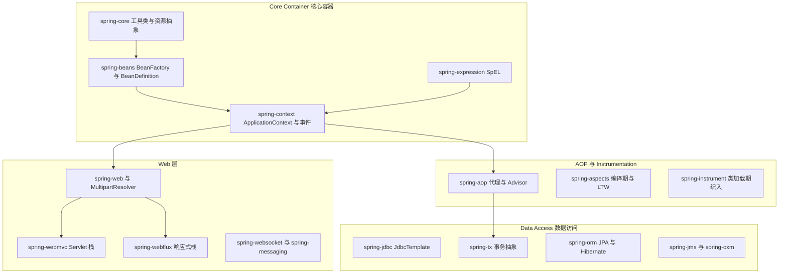
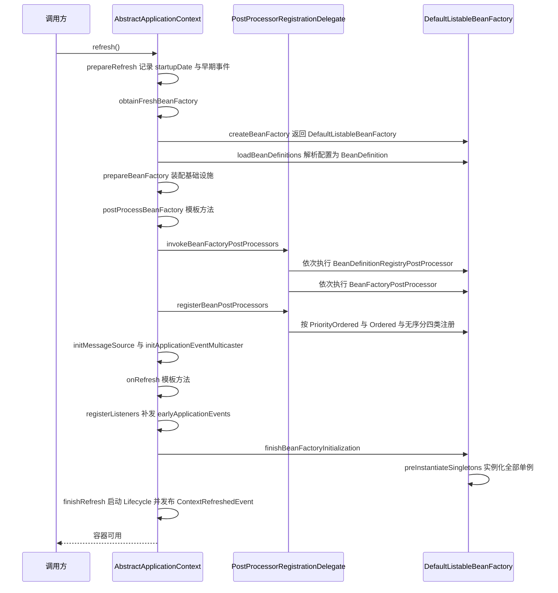
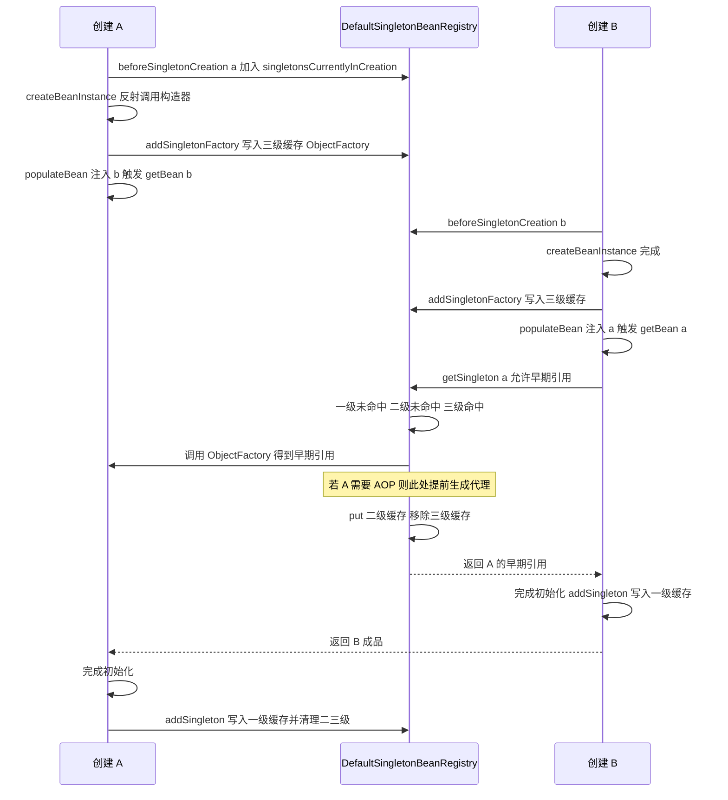
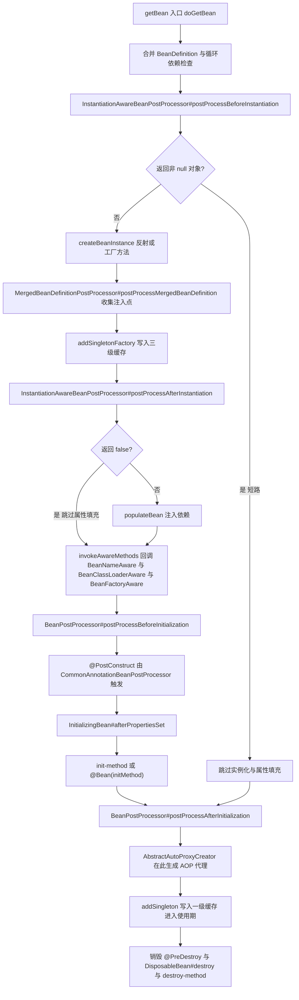
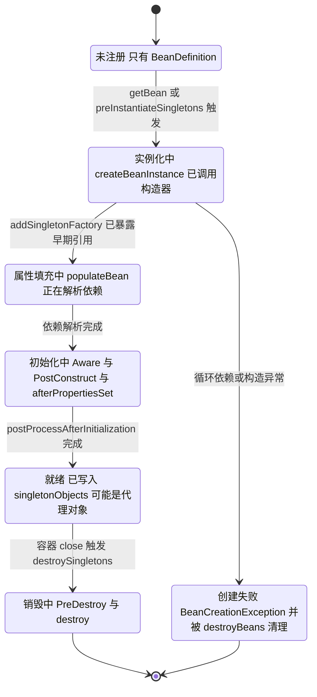
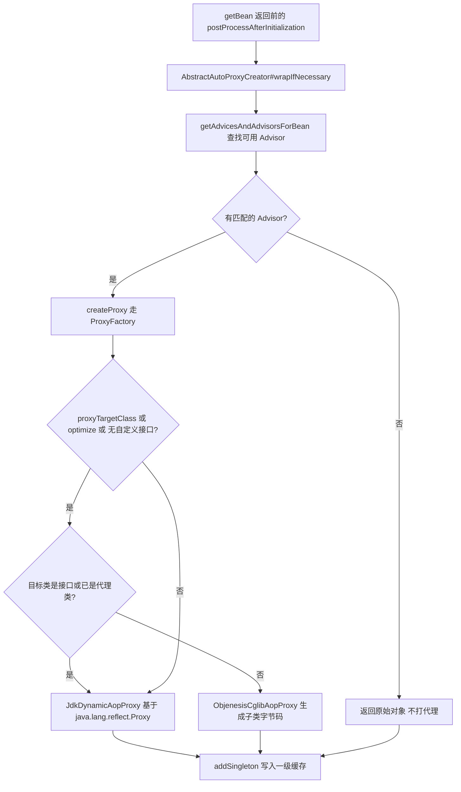
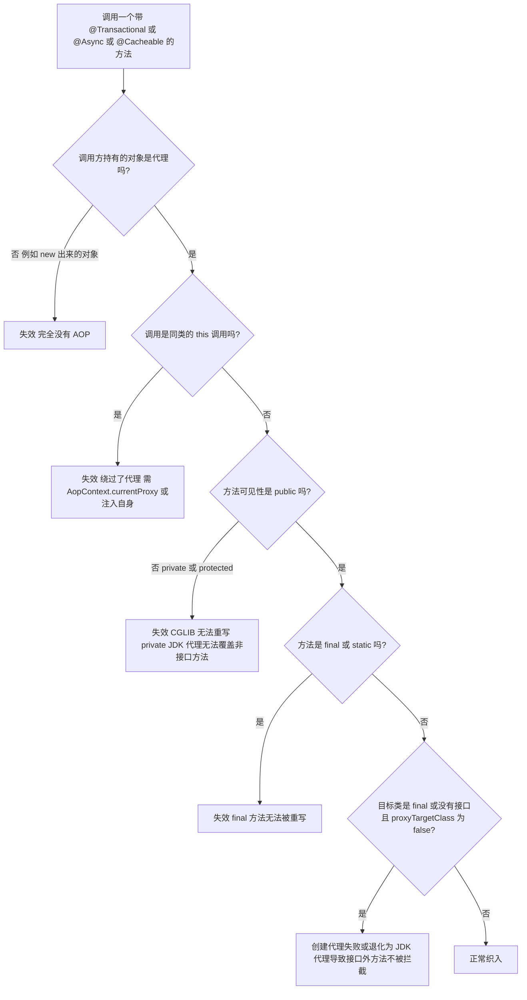
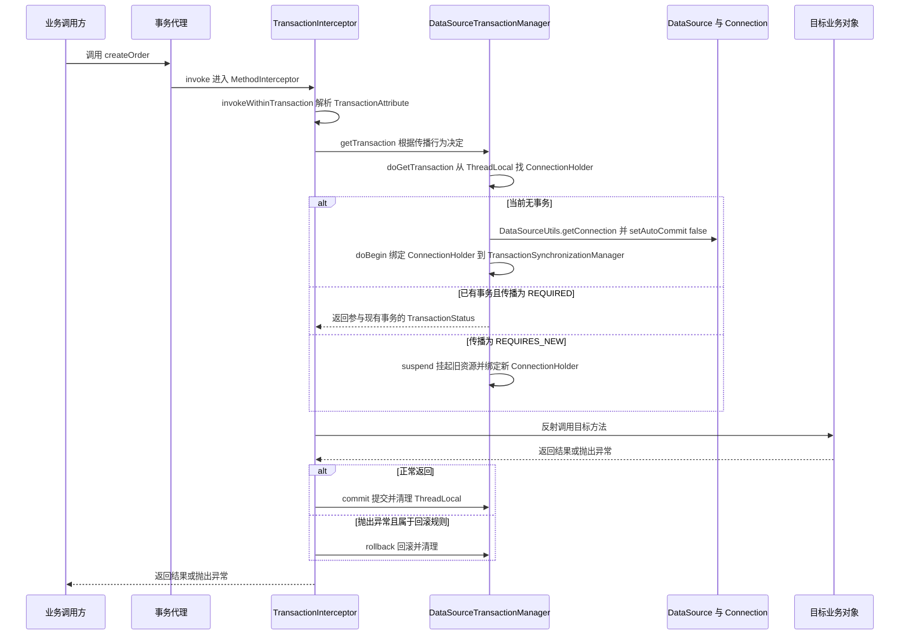

# 01 Spring IoC 与 AOP 原理

> 一句话定位：IoC 的十二步启动流程与 Bean 生命周期是 Spring 的地基，AOP 只是 BeanPostProcessor 的一个副作用；能把三级缓存为什么是三级、代理为什么失效讲透，才算摸到高级岗门槛 ｜ 面试权重 ★★★★★ ｜ 建议复习 60 分钟

## 本章大纲

- [一、Spring 整体架构与两大核心](#一spring-整体架构与两大核心)
- [二、IoC 容器启动流程：refresh 十二步](#二ioc-容器启动流程refresh-十二步)
- [三、BeanDefinition 与容器实现类族](#三beandefinition-与容器实现类族)
- [四、BeanFactory、FactoryBean、ApplicationContext](#四beanfactoryfactorybeanapplicationcontext)
- [五、依赖注入的三种方式](#五依赖注入的三种方式)
- [六、循环依赖与三级缓存](#六循环依赖与三级缓存)
- [七、Bean 生命周期全景与扩展点](#七bean-生命周期全景与扩展点)
- [八、Bean 作用域与线程安全](#八bean-作用域与线程安全)
- [九、@Autowired 与 @Resource 的匹配策略](#九autowired-与-resource-的匹配策略)
- [十、AOP 术语与代理创建机制](#十aop-术语与代理创建机制)
- [十一、AOP 失效场景全清单](#十一aop-失效场景全清单)
- [十二、事务、缓存、异步的 AOP 实现](#十二事务缓存异步的-aop-实现)
- [十三、BeanPostProcessor 与 BeanFactoryPostProcessor 对比](#十三beanpostprocessor-与-beanfactorypostprocessor-对比)
- [十四、生产实战：启动与代理问题排查手册](#十四生产实战启动与代理问题排查手册)
- [高级岗三问](#高级岗三问)
- [高频面试题](#高频面试题)
- [易错点与踩坑](#易错点与踩坑)
- [一句话速记](#一句话速记)

## 一、Spring 整体架构与两大核心

### 1.1 版本基线（写错版本比不写更糟）

| 版本 | JDK 要求 | 关键变化 |
| --- | --- | --- |
| Spring Framework 4.x | JDK 6+ | 支持 `@Conditional`、泛型依赖注入；`spring-core` 里内嵌的 CGLIB 是自 Spring 3.2 起重打包的 `org.springframework.cglib` |
| Spring Framework 5.0 | JDK 8+ | 引入 WebFlux、`@Nullable` 注解体系、Kotlin 支持 |
| Spring Framework 5.2 | JDK 8+ | `@Configuration` 新增 `proxyBeanMethods` 属性（默认 `true`；设 `false` 即 lite 模式，不做 CGLIB 增强） |
| Spring Framework 5.3.x | JDK 8+ | 最后一个 5.x 分支；Spring Boot 2.x 全线使用；引入 `BeanPostProcessorCache` |
| Spring Framework 6.0 | **JDK 17+** | Java EE 迁移到 Jakarta EE 9+，包名 `javax.*` 改 `jakarta.*`，如 `jakarta.annotation.Resource` |
| Spring Framework 6.1 | JDK 17+ | 支持 JDK 21 虚拟线程下的 `TaskExecutor` 适配 |

Spring Boot 的对应关系：Spring Boot 2.0~2.7 用 Spring Framework 5.0~5.3，JDK 8 起步；Spring Boot 3.0+ 用 Spring Framework 6.0+，**强制 JDK 17**。面试里说 `@Resource` 导入路径时，Spring 5 是 `javax.annotation.Resource`（JDK 11 起该包已从 JDK 移除，需额外引入 `javax.annotation-api`），Spring 6 是 `jakarta.annotation.Resource`。

### 1.2 模块分层



### 1.3 两大核心一句话说清

- **IoC（Inversion of Control）**：对象的创建、装配、生命周期由容器接管，业务代码只声明"我需要什么"。Spring 的实现叫 **DI（Dependency Injection）**，IoC 是思想，DI 是手段。
- **AOP（Aspect Oriented Programming）**：把横切关注点（事务、日志、缓存、权限）从业务逻辑里剥离，用代理在方法调用前后织入。**Spring AOP 只支持方法级连接点**，底层是运行时动态代理。

两者的关系容易被答反：**AOP 不是独立机制，它是 IoC 的一个扩展点**。具体说，AOP 靠 `AbstractAutoProxyCreator` 这个 `BeanPostProcessor` 在 `postProcessAfterInitialization` 里把普通 bean 替换成代理 bean 注册进容器。所以"AOP 失效"的问题，本质上都是"你以为在用代理，其实在用原始对象"。

### 1.4 为什么 Spring 要拆成这么细的模块

设计权衡：Core Container 里 `spring-core` 和 `spring-beans` **不依赖 `spring-context`**，也就是可以只用 `BeanFactory` 而不引入整个 ApplicationContext。这让 Android、批处理、嵌入式场景能用一个 1MB 级别的容器。代价是概念分裂——同一个"容器"有三层接口（`BeanFactory`、`ListableBeanFactory`、`ApplicationContext`），初学者容易混淆 `getBean` 到底走的哪条路径。

## 二、IoC 容器启动流程：refresh 十二步

入口是 `AbstractApplicationContext#refresh()`。整个方法用 `synchronized (this.startupShutdownMonitor)` 包裹，保证启动与 `close()` 互斥。Spring 5.3.x 的结构如下（方法名一个都不能错）：

```java
public void refresh() throws BeansException, IllegalStateException {
    synchronized (this.startupShutdownMonitor) {
        prepareRefresh();
        ConfigurableListableBeanFactory beanFactory = obtainFreshBeanFactory();
        prepareBeanFactory(beanFactory);
        try {
            postProcessBeanFactory(beanFactory);
            invokeBeanFactoryPostProcessors(beanFactory);
            registerBeanPostProcessors(beanFactory);
            initMessageSource();
            initApplicationEventMulticaster();
            onRefresh();
            registerListeners();
            finishBeanFactoryInitialization(beanFactory);
            finishRefresh();
        }
        catch (BeansException ex) {
            destroyBeans();
            cancelRefresh(ex);
            throw ex;
        }
        finally {
            resetCommonCaches();
        }
    }
}
```

### 2.1 十二步逐个说明

**第 1 步 `prepareRefresh()`**

- `this.startupDate = System.currentTimeMillis()`，记录启动时间戳。
- `this.closed.set(false)`、`this.active.set(true)`，重置状态位。
- `initPropertySources()`：空实现，供子类插入自定义 `PropertySource`（如 Web 环境插入 `servletConfigInitParams`）。
- `getEnvironment().validateRequiredProperties()`：校验所有 `setRequiredProperties` 声明的属性。
- 初始化 `earlyApplicationListeners`（`LinkedHashSet`，存的是 refresh 前的监听器快照，重复 refresh 时用来把 `applicationListeners` 复位）与 `earlyApplicationEvents`（`LinkedHashSet`）。后者的意义是：`refresh()` 早期还没有 `ApplicationEventMulticaster`，此时 `publishEvent` 的事件先攒着，第 10 步统一补发。

**第 2 步 `obtainFreshBeanFactory()`**

```java
protected ConfigurableListableBeanFactory obtainFreshBeanFactory() {
    refreshBeanFactory();
    return getBeanFactory();
}
```

`AbstractRefreshableApplicationContext#refreshBeanFactory()` 在 `synchronized (this.beanFactoryMonitor)` 内：

1. 若已有 beanFactory，先 `destroyBeans()` + `closeBeanFactory()`。
2. `createBeanFactory()` → `new DefaultListableBeanFactory(getInternalParentBeanFactory())`。
3. `beanFactory.setSerializationId(getId())`，供反序列化时找回容器。
4. `customizeBeanFactory(beanFactory)`：应用 `allowBeanDefinitionOverriding` 与 `allowCircularReferences`。
5. `loadBeanDefinitions(beanFactory)`：由具体子类实现，`XmlBeanDefinitionReader` 或 `ClassPathBeanDefinitionScanner` 解析配置。

注意 `GenericApplicationContext`（`AnnotationConfigApplicationContext` 与 Spring Boot 用的就是它）**重写了这个方法**：它不重新创建 BeanFactory，只校验"不能重复 refresh"，因为 beanFactory 是构造时 new 出来并由外部持有的。

**第 3 步 `prepareBeanFactory(beanFactory)`**

这是给容器装"基础设施"的一步，内容固定：

| 动作 | 具体内容 |
| --- | --- |
| 设置类加载器 | `beanFactory.setBeanClassLoader(getClassLoader())` |
| 设置 SpEL 解析器 | `new StandardBeanExpressionResolver(beanFactory.getBeanClassLoader())` |
| 注册属性编辑器 | `new ResourceEditorRegistrar(this, getEnvironment())` |
| 添加 BeanPostProcessor | `ApplicationContextAwareProcessor`、`ApplicationListenerDetector` |
| 忽略依赖接口 | `EnvironmentAware`、`EmbeddedValueResolverAware`、`ResourceLoaderAware`、`ApplicationEventPublisherAware`、`MessageSourceAware`、`ApplicationContextAware`、`ApplicationStartupAware`（5.3 新增） |
| 注册可解析依赖 | `BeanFactory`、`ResourceLoader`、`ApplicationEventPublisher`、`ApplicationContext` 四个接口直接注入当前容器 |
| 注册单例 | `environment`、`systemProperties`、`systemEnvironment`、`applicationStartup`（5.3 新增） |
| 按需注册 | 若存在名为 `loadTimeWeaver` 的 bean，注册 `LoadTimeWeaverAwareProcessor` 并设置 `ContextTypeMatchClassLoader` |

`ignoreDependencyInterface` 的作用：这些 Aware 接口的实现类**不通过** `@Autowired` 注入，而是由 `ApplicationContextAwareProcessor` 回调。如果不 ignore，`@Autowired ApplicationContext` 会走两个通道，产生歧义。

**第 4 步 `postProcessBeanFactory(beanFactory)`**

空实现模板方法。`AbstractRefreshableWebApplicationContext` 在这里注册 `ServletContextAwareProcessor` 与 `request`、`session`、`application`、`websocket` 四个作用域。

**第 5 步 `invokeBeanFactoryPostProcessors(beanFactory)`**（核心）

委托给 `PostProcessorRegistrationDelegate#invokeBeanFactoryPostProcessors`，执行顺序是**四轮**：

1. 先执行通过 `addBeanFactoryPostProcessor` 手工添加、且实现了 `BeanDefinitionRegistryPostProcessor` 的实例。
2. 从容器中按类型取出所有 `BeanDefinitionRegistryPostProcessor`，先执行 `PriorityOrdered` 组，再 `Ordered` 组，最后无序组。**每执行完一组要重新取一次 bean 名**，因为上一组的执行可能注册了新定义。
3. 再执行上述注册器自己的 `postProcessBeanFactory`。
4. 最后执行普通 `BeanFactoryPostProcessor`，同样 `PriorityOrdered` → `Ordered` → 无序。

典型实现：

- `ConfigurationClassPostProcessor`（实现 `BeanDefinitionRegistryPostProcessor`，`getOrder()` 返回 `Ordered.LOWEST_PRECEDENCE`）：解析 `@Configuration`、`@ComponentScan`、`@Import`、`@ImportResource`、`@Bean`、`@PropertySource`，把 `@Bean` 方法转成 `ConfigurationClassBeanDefinition`。这是"注解驱动"真正生效的地方。
- `PropertySourcesPlaceholderConfigurer`（实现 `BeanFactoryPostProcessor` + `EnvironmentAware`）：解析 `${}` 占位符。
- `EventListenerMethodProcessor`：处理 `@EventListener`。

**第 6 步 `registerBeanPostProcessors(beanFactory)`**

同样委托给 `PostProcessorRegistrationDelegate`。先把已有的（`addBeanPostProcessor` 手工加的）注册进去，然后从容器按类型取所有 `BeanPostProcessor`，分四类顺序注册：

1. `PriorityOrdered`
2. `Ordered`
3. 无序
4. `MergedBeanDefinitionPostProcessor`（追加到末尾，代表是 `AutowiredAnnotationBeanPostProcessor`、`CommonAnnotationBeanPostProcessor`）

答案是：`MergedBeanDefinitionPostProcessor` 之所以最后注册，是因为它要在所有普通 BPP 之后被调用，保证 `postProcessMergedBeanDefinition` 的执行时机在属性注入准备阶段最靠后，能覆盖前面 BPP 的修改。

**第 7 步 `initMessageSource()`**

bean 名为 `messageSource`（常量 `MESSAGE_SOURCE_BEAN_NAME`）不存在时：若父容器有则直接用父的，否则注册一个空的 `DelegatingMessageSource` 兜底。这就是 `getMessage()` 在没配置 `MessageSource` 时也不抛 NPE 的原因。

**第 8 步 `initApplicationEventMulticaster()`**

bean 名 `applicationEventMulticaster` 不存在时注册 `SimpleApplicationEventMulticaster`。可以自定义它并设置 `taskExecutor` 实现**异步事件**，但默认是同步广播——这也是"事件监听器里的异常会影响主流程"的原因。

**第 9 步 `onRefresh()`**

空实现模板方法，Spring Boot 的 `ServletWebServerApplicationContext` 在这一步 `createWebServer()` 启动内嵌 Tomcat。这就是"bean 全部就绪后、容器刷新完成前启动 Web 服务器"的挂载点。

**第 10 步 `registerListeners()`**

把 `ApplicationListener` 实例与 `ApplicationListener` 类型的 beanName 注册进 multicaster，然后补发第 1 步攒下的 `earlyApplicationEvents`。

**第 11 步 `finishBeanFactoryInitialization(beanFactory)`**（最耗时）

```java
if (beanFactory.containsBean(CONVERSION_SERVICE_BEAN_NAME) &&
        beanFactory.isTypeMatch(CONVERSION_SERVICE_BEAN_NAME, ConversionService.class)) {
    beanFactory.setConversionService(
            beanFactory.getBean(CONVERSION_SERVICE_BEAN_NAME, ConversionService.class));
}
if (!beanFactory.hasEmbeddedValueResolver()) {
    beanFactory.addEmbeddedValueResolver(strVal -> getEnvironment().resolvePlaceholders(strVal));
}
String[] weaverAwareNames = beanFactory.getBeanNamesForType(LoadTimeWeaverAware.class, false, false);
for (String weaverAwareName : weaverAwareNames) { getBean(weaverAwareName); }
beanFactory.setTempClassLoader(null);
beanFactory.freezeConfiguration();
beanFactory.preInstantiateSingletons();
```

`preInstantiateSingletons()` 的逻辑：拷贝一份 `beanDefinitionNames`，逐个判断 `bd.isAbstract()`、`bd.isSingleton()`、`bd.isLazyInit()`，跳过不符合的；是 `FactoryBean` 则用 `FACTORY_BEAN_PREFIX`（即 `&`）为前缀 `getBean`；**遍历结束后**再遍历一遍所有 bean，如果是 `SmartInitializingSingleton` 就调 `afterSingletonsInstantiated()`（Spring 4.1 引入；`EventListenerMethodProcessor`（处理 `@EventListener`）与 `CacheAspectSupport`（初始化 `CacheManager`）都实现了它——注意 `MapperScannerConfigurer` 是 `BeanDefinitionRegistryPostProcessor`、`WebServerStartStopLifecycle` 是 `SmartLifecycle`，都不走这条回调）。

**第 12 步 `finishRefresh()`**

```java
clearResourceCaches();
initLifecycleProcessor();
getLifecycleProcessor().onRefresh();
publishEvent(new ContextRefreshedEvent(this));
LiveBeansView.registerApplicationContext(this);
```

`initLifecycleProcessor()` 在 `lifecycleProcessor` bean 不存在时注册 `DefaultLifecycleProcessor`；它的 `onRefresh()` 调 `startBeans(true)`（手动调 `LifecycleProcessor#start()` 才是 `startBeans(false)`，会连 `isAutoStartup()` 为 false 的也启动），只启动 `isAutoStartup()` 为 true 的 `SmartLifecycle`，按 `getPhase()` **升序**执行，同 phase 内按依赖顺序。`SmartLifecycle#getPhase()` 默认返回 `DEFAULT_PHASE = Integer.MAX_VALUE`；Tomcat 启动的 `WebServerStartStopLifecycle#getPhase()` 返回 `Integer.MAX_VALUE - 1`。关闭时按 phase **降序**停止，这是"先停 Web 服务器收流量，再停业务组件"的实现依据。

### 2.2 完整时序



### 2.3 启动失败的顺序特征

`refresh()` 的 `try-catch` 只捕获 `BeansException` 及其子类。也就是说：

- `BeanDefinitionStoreException`、`BeanCreationException`、`NoSuchBeanDefinitionException` 都会触发 `destroyBeans()`（销毁已创建的单例）与 `cancelRefresh(ex)`（只把 `active` 置回 false，`closed` 要等 `close()` 才置位），然后**原样抛出**。
- `finally` 里的 `resetCommonCaches()` 会清掉 `ReflectionUtils`、`AnnotationUtils`、`ResolvableType`、`CachedIntrospectionResults` 的缓存，防止类加载器泄漏。
- 第 11 步抛出的异常绝大多数是"bean 创建失败"（`BeanCreationException`）；但第 5、6 步也要 `getBean` 出 `BeanFactoryPostProcessor`、`BeanPostProcessor` 自身，它们的创建失败同样是 `BeanCreationException`。第 5 步更常见的还是配置错误（如 `@Configuration` 类无法 CGLIB 增强）。

## 三、BeanDefinition 与容器实现类族

### 3.1 BeanDefinition 的关键字段

`BeanDefinition` 是配置的元数据抽象，`AbstractBeanDefinition` 里的核心字段：

| 字段 | 含义 | 默认值 |
| --- | --- | --- |
| `beanClass` / `beanClassName` | 类或类名 | 无 |
| `scope` | 作用域 | `""`，实际按 `singleton` 处理 |
| `lazyInit` | 是否延迟 | `false` |
| `primary` | 是否首选 | `false` |
| `abstractFlag` | 是否抽象定义 | `false` |
| `autowireMode` | 自动装配模式 | `AUTOWIRE_NO`（0） |
| `dependencyCheck` | 依赖检查 | `DEPENDENCY_CHECK_NONE`（0） |
| `initMethodName` | 初始化方法 | `null` |
| `destroyMethodName` | 销毁方法 | `null` |
| `factoryBeanName` | 工厂 bean 名 | `null` |
| `factoryMethodName` | 工厂方法名 | `null` |
| `dependsOn` | 强依赖前置 | `null` |
| `role` | 角色提示 | `ROLE_APPLICATION`（0） |
| `synthetic` | 是否合成 | `false` |

`ROLE_INFRASTRUCTURE`（2）用来标记 Spring 内部 bean，IDE 在展示 Bean 依赖图时会隐藏它们。

实现类族：

- `RootBeanDefinition`：可独立使用，容器内部最终统一转成它。
- `GenericBeanDefinition`：可设置 `parentName` 继承定义，最常用。
- `ChildBeanDefinition`：老式继承写法。
- `ScannedGenericBeanDefinition`：`ClassPathBeanDefinitionScanner` 扫描出来的，带 `AnnotationMetadata`。
- `AnnotatedGenericBeanDefinition`：`AnnotatedBeanDefinitionReader#register` 注册的。
- `ConfigurationClassBeanDefinition`：`@Bean` 方法生成的内部类（`ConfigurationClassBeanDefinitionReader` 的静态内部类）。

### 3.2 容器实现类

| 实现类 | 用途 | BeanFactory 类型 |
| --- | --- | --- |
| `ClassPathXmlApplicationContext` | 从 classpath 读 XML | `DefaultListableBeanFactory` |
| `FileSystemXmlApplicationContext` | 从文件系统读 XML | `DefaultListableBeanFactory` |
| `AnnotationConfigApplicationContext` | 注解驱动 | `DefaultListableBeanFactory` |
| `GenericApplicationContext` | 手动注册定义，Spring Boot 基类 | `DefaultListableBeanFactory` |
| `XmlWebApplicationContext` | SpringMVC 传统 XML 配置 | `DefaultListableBeanFactory` |
| `AnnotationConfigWebApplicationContext` | SpringMVC 注解配置 | `DefaultListableBeanFactory` |

`AnnotationConfigApplicationContext` 的构造流程值得记：构造时 new `DefaultListableBeanFactory` + new `AnnotatedBeanDefinitionReader` + new `ClassPathBeanDefinitionScanner`；`register()` 走 `AnnotatedBeanDefinitionReader`；`scan()` 走 `ClassPathBeanDefinitionScanner`（默认扫描 `@Component`、`@ManagedBean`、`@Named`，通过 `ClassPathScanningCandidateComponentProvider#isCandidateComponent` 判断，条件是 `AnnotationMetadata#isIndependent()` 为 true，且（是具体类，或者是抽象类但带有 `@Lookup` 标注的方法），因此**非静态内部类（inner class）不会被扫描为候选组件，静态嵌套类（static nested class）可以**）。

## 四、BeanFactory、FactoryBean、ApplicationContext

### 4.1 三者对比

| 维度 | BeanFactory | FactoryBean | ApplicationContext |
| --- | --- | --- | --- |
| 定位 | IoC 容器根接口 | 一种"能生产 bean 的 bean" | 面向应用的容器门面 |
| 核心方法 | `getBean`、`getType`、`isTypeMatch`、`containsBean` | `getObject()`、`getObjectType()`、`isSingleton()` | 继承 BeanFactory 全部能力 |
| 单例实例化时机 | 调用 `getBean` 时（懒） | 调用 `getBean` 时 | refresh 第 11 步**预实例化** |
| 国际化 | 不支持 | 不支持 | `MessageSource` |
| 事件 | 不支持 | 不支持 | `ApplicationEventPublisher` |
| 资源加载 | 不支持 | 不支持 | `ResourcePatternResolver` |
| Aware 自动注入 | 需手工实现 | 需手工实现 | `ApplicationContextAwareProcessor` 自动 |
| 注解支持 | 需手工注册 BPP | 无 | 默认注册全部注解 BPP |
| 典型场景 | 轻量容器、单测 | 整合第三方框架 | 业务应用 |

`ApplicationContext` 的继承关系：`ApplicationContext extends EnvironmentCapable, ListableBeanFactory, HierarchicalBeanFactory, MessageSource, ApplicationEventPublisher, ResourcePatternResolver`。

### 4.2 FactoryBean 的坑

```java
public interface FactoryBean<T> {
    String OBJECT_TYPE_ATTRIBUTE = "factoryBeanObjectType";
    T getObject() throws Exception;
    Class<?> getObjectType();
    default boolean isSingleton() { return true; }
}
```

- `getBean("myFactory")` 返回的是 `getObject()` 的结果，**不是** FactoryBean 本身。
- `getBean("&myFactory")` 才返回 FactoryBean 本身，`&` 常量是 `BeanFactory.FACTORY_BEAN_PREFIX`。
- `isSingleton()` 在 Spring 5.0 起变成 `default` 方法，默认返回 `true`（5.0 之前实现类必须自己提供）；上面代码里的 `OBJECT_TYPE_ATTRIBUTE` 常量则是 5.2 新增。
- `getObjectType()` 返回 `null` 时，`AbstractBeanFactory#getTypeForFactoryBean` 会尝试实例化 FactoryBean 来推断类型，可能触发提前初始化。
- 与 `BeanFactoryPostProcessor` 组合时极易踩坑：`PropertySourcesPlaceholderConfigurer` 如果被 FactoryBean 引用，会提前实例化并打出 "is not eligible for getting processed by all BeanPostProcessors (for example: not eligible for auto-proxying)" 的 INFO 日志，意味着这个 bean 拿不到 `@Autowired` 与 AOP 代理。

典型实现：`SqlSessionFactoryBean`、`MapperFactoryBean`（MyBatis）、`ProxyFactoryBean`、`LocalContainerEntityManagerFactoryBean`、`AbstractFactoryBean`（模板基类）、`TransactionProxyFactoryBean`。

## 五、依赖注入的三种方式

### 5.1 三种方式的横评

| 维度 | 构造器注入 | Setter 注入 | 字段注入（`@Autowired` 在字段上） |
| --- | --- | --- | --- |
| 语法位置 | 构造方法参数 | setter 方法参数 | 字段本身 |
| 不可变性 | 可 `final`，对象创建即完整 | 字段可变 | 字段可变（实际靠反射写入） |
| 循环依赖 | **不能解决**，直接抛异常 | 可解决 | 可解决 |
| NPE 风险 | 无 | 有（可能忘记调用） | 有（容器外 new 时字段为 null） |
| 单测友好 | 好，直接 new 传参 | 一般，需逐 set | 差，必须反射或容器 |
| 依赖显式性 | 强，构造器签名即依赖清单 | 中 | 弱，扫字段才知道 |
| Spring 官方推荐 | 强制依赖 | 可选依赖 | 不推荐 |
| 性能 | 一次反射 | 一次反射 | 每字段一次反射 + 可 `setAccessible` |

Spring 官方文档（Core Container 章节）明确写：构造器注入 + setter 注入组合使用，构造器注入强制依赖，setter 注入可选依赖。

### 5.2 构造器注入的解析细节

Spring 4.3 起，**只有一个构造器时可省略 `@Autowired`**。多个构造器时必须标注，否则用无参构造器。

解析入口是 `ConstructorResolver#autowireConstructor`：

1. 若 `mbd.getResolvedConstructorOrFactoryMethod()` 已缓存，直接用。
2. `determineConstructorsFromBeanPostProcessors(beanClass, beanName)` → 遍历 `SmartInstantiationAwareBeanPostProcessor#determineCandidateConstructors`，`AutowiredAnnotationBeanPostProcessor` 在这里按 `@Autowired(required)` 挑候选构造器。
3. 若没有候选且只有一个有参构造器 → 直接用它（Spring 4.3+ 行为）。
4. 若没有候选且有无参构造器 → 用无参。
5. 否则用 `ConstructorResolver#createArgumentArray` 逐个解析参数 `beanFactory.resolveDependency`。
6. 参数值与形参类型做 `TypeConverter` 转换（`resolveEmbeddedValue` 先解析占位符与 SpEL）。

`@Value` 也走这条路径：`DefaultListableBeanFactory#doResolveDependency` 里先 `getAutowireCandidateResolver().getSuggestedValue(descriptor)` 拿到注解上的原始字符串，再 `resolveEmbeddedValue` 解析 `${}` 占位符（之后还有 `evaluateBeanDefinitionString` 处理 SpEL），最后 `converter.convertIfNecessary` 转成目标类型。

### 5.3 可运行对比：三种注入在容器内外的真实差异

下面这段代码用 `spring-context 5.3.25` 实跑过（JDK 17），四组输出的差异正好对应表里的四行关键结论。

```java
@Component class Repo {}

@Component class CtorService {
    private final Repo repo;
    public CtorService(Repo repo) { this.repo = repo; }        // 构造器注入
    public Repo repo() { return repo; }
}

@Component class FieldService {
    @Autowired private Repo repo;                              // 字段注入
    public Repo repo() { return repo; }
}

// 循环依赖：构造器版
@Component class A { final B b; A(B b) { this.b = b; } }
@Component class B { final A a; B(A a) { this.a = a; } }

// 循环依赖：字段版
@Component class C { @Autowired D d; }
@Component class D { @Autowired C c; }
```

**① 容器内：三种方式都能注入成功**

```java
var ctx = new AnnotationConfigApplicationContext();
ctx.register(Repo.class, CtorService.class, FieldService.class, SetterService.class);
ctx.refresh();
ctx.getBean(CtorService.class).repo();   // Repo@28c4711c
ctx.getBean(FieldService.class).repo();  // Repo@28c4711c  ← 同一个实例
```

**② 容器外：字段注入直接变成 `null`**

```java
new FieldService().repo();    // null    ← 单测里直接 NPE
```

这就是"字段注入不可测试"的实证：它靠容器反射写入，一旦离开容器，`new` 出来的对象依赖全是 `null`。而构造器注入的 `new CtorService(repo)` 传什么就是什么，**不需要容器也能测**。

**③ 循环依赖（构造器版）：启动直接失败**

```text
UnsatisfiedDependencyException: Error creating bean with name 'a':
  Unsatisfied dependency expressed through constructor parameter 0;
  nested exception is ... UnsatisfiedDependencyException: Error creating bean with name 'b': ...
  nested exception is org.springframework.beans.factory.BeanCurrentlyInCreationException:
  Error creating bean with name 'a': Requested bean is currently in creation:
  Is there an unresolvable circular reference?
```

注意最后那句 `Is there an unresolvable circular reference?`——**构造器注入把循环依赖在启动期就暴露出来**，这是它最大的优点（fail-fast），而不是缺点。相反，字段注入：

**④ 循环依赖（字段版）：启动成功，问题被藏起来**

```java
C c = ctx.getBean(C.class);
c.d;          // D@75f9eccc
c.d.c == c;   // true   ← 两个半成品互相引用，构造器里的逻辑可能没执行完
```

**这就是"为什么 Spring Boot 2.6 起默认禁止循环引用"的动机**：`spring.main.allow-circular-references` 默认 `false`，遇到循环依赖直接启动失败，逼你从设计上解耦（拆 Bean、用 `@Lazy`、或引入事件），而不是靠三级缓存"带病运行"。

### 5.4 为什么官方推荐构造器注入（四条理由）

| 理由 | 具体表现 | 对应上面的哪段输出 |
| --- | --- | --- |
| **依赖不可变** | 字段可以 `final`，对象创建即完整，天然线程安全 | ① 中 `CtorService.repo` 是 final |
| **依赖显式** | 构造器签名就是依赖清单，被依赖方一目了然 | 看 `CtorService(Repo)` 就知道它依赖谁 |
| **可测试** | 单测直接 `new` 传 mock，不需要 Spring 容器 | ② 中字段注入 `new` 出来是 `null` |
| **fail-fast** | 循环依赖、缺失依赖在**启动期**报错，而不是运行期 NPE | ③ 的 `BeanCurrentlyInCreationException` |

**什么时候仍用 setter 注入**：可选依赖（有默认值、可以不配）、以及需要"先构造再补充配置"的场景（如 `DataSource` 的部分属性）。Spring 官方文档的说法是"构造器注入强制依赖，setter 注入可选依赖"，两者可以混用。

## 六、循环依赖与三级缓存

### 6.1 现象

```java
@Service
public class A { @Autowired private B b; }
@Service
public class B { @Autowired private A a; }
```

字段注入能启动成功；换成构造器注入：

```
BeanCurrentlyInCreationException: Error creating bean with name 'a':
Requested bean is currently in creation: Is there an unresolvable circular reference?
```

Spring Boot 2.6 起，**默认禁止循环依赖**：`spring.main.allow-circular-references=false`（在 `SpringApplication#prepareContext` 里把值写进 `DefaultListableBeanFactory#setAllowCircularReferences`），启动直接失败并给出定位提示。要恢复旧行为得显式打开。

### 6.2 三个缓存到底存什么

`DefaultSingletonBeanRegistry` 的关键字段（Spring 5.3.x）：

```java
private final Map<String, Object> singletonObjects = new ConcurrentHashMap<>(256);
private final Map<String, Object> earlySingletonObjects = new ConcurrentHashMap<>(16);
private final Map<String, ObjectFactory<?>> singletonFactories = new HashMap<>(16);
private final Set<String> registeredSingletons = new LinkedHashSet<>(256);
private final Set<String> singletonsCurrentlyInCreation = Collections.newSetFromMap(new ConcurrentHashMap<>(16));
```

| 级别 | 字段 | 内容 | 写入时机 |
| --- | --- | --- | --- |
| 一级 | `singletonObjects` | 完整成品（属性已填充、已初始化、已代理） | `addSingleton`，在 `doCreateBean` 返回后 |
| 二级 | `earlySingletonObjects` | 早期引用，可能是提前生成的代理 | 三级缓存的工厂被调用后 |
| 三级 | `singletonFactories` | `ObjectFactory` 延迟工厂 lambda | `addSingletonFactory`，紧跟 `createBeanInstance` 之后 |
| 辅助 | `registeredSingletons` | 注册顺序，用于销毁顺序 | 同样在 `addSingletonFactory` |
| 辅助 | `singletonsCurrentlyInCreation` | 正在创建的 bean 名 | `beforeSingletonCreation` |

三级缓存的 lambda 就是：

```java
addSingletonFactory(beanName, () -> getEarlyBeanReference(beanName, mbd, bean));
```

`AbstractAutowireCapableBeanFactory#getEarlyBeanReference`：

```java
protected Object getEarlyBeanReference(String beanName, RootBeanDefinition mbd, Object bean) {
    Object exposedObject = bean;
    if (!mbd.isSynthetic() && hasInstantiationAwareBeanPostProcessors()) {
        for (SmartInstantiationAwareBeanPostProcessor bp : getBeanPostProcessorCache().smartInstantiationAware) {
            exposedObject = bp.getEarlyBeanReference(exposedObject, beanName);
        }
    }
    return exposedObject;
}
```

`AbstractAutoProxyCreator#getEarlyBeanReference` 会先把这个 bean 记进 `earlyProxyReferences`（避免后面重复代理），然后 `wrapIfNecessary` 返回提前生成的代理。

### 6.3 getSingleton 的三级查找

```java
protected Object getSingleton(String beanName, boolean allowEarlyReference) {
    Object singletonObject = this.singletonObjects.get(beanName);
    if (singletonObject == null && isSingletonCurrentlyInCreation(beanName)) {
        singletonObject = this.earlySingletonObjects.get(beanName);
        if (singletonObject == null && allowEarlyReference) {
            synchronized (this.singletonObjects) {
                singletonObject = this.singletonObjects.get(beanName);
                if (singletonObject == null) {
                    singletonObject = this.earlySingletonObjects.get(beanName);
                    if (singletonObject == null) {
                        ObjectFactory<?> singletonFactory = this.singletonFactories.get(beanName);
                        if (singletonFactory != null) {
                            singletonObject = singletonFactory.getObject();
                            this.earlySingletonObjects.put(beanName, singletonObject);
                            this.singletonFactories.remove(beanName);
                        }
                    }
                }
            }
        }
    }
    return singletonObject;
}
```

注意 `allowEarlyReference`：属性注入时传 `true`，`doCreateBean` 结尾自检时传 `false`（只读一级和二级，不触发工厂）。

### 6.4 时序



### 6.5 为什么必须三级，二级行不行

这是本节的必答题。分三层说：

**第一层：二级缓存在"没有 AOP 代理"时完全够用。**

如果所有 bean 都不需要代理，那么"实例化完成"就等于"早期引用确定"，二级缓存（`singletonObjects` + 一个 `earlySingletonObjects`）能完整解决循环依赖。很多网上答案停在这里就错了。

**第二层：有 AOP 代理时，二级缓存无法保证正确性。**

代理对象的生成（`AbstractAutoProxyCreator#wrapIfNecessary`）需要拿到完整的 advisor 列表，而 advisor 列表本身可能依赖其他 bean。最关键的是：**代理必须在"属性填充之后、初始化之后"生成**，否则 `@Autowired` 注入到代理对象上的字段、`BeanPostProcessor#postProcessBeforeInitialization` 的语义都会错乱。如果只有二级缓存，那么要么：

- 方案 A：实例化一完成就把对象无条件放进二级缓存。此时若该 bean 需要代理，注入方拿到的是**原始对象**，而最终注册进一级缓存的是**代理对象**。于是 B 里持有的 A 与容器里的 A 不是同一个实例，事务、`@Async`、`@Cacheable` 全部失效——这正是 Spring 用 `allowRawInjectionDespiteWrapping=false` 主动抛错拦截的情况。
- 方案 B：实例化一完成就**无条件生成代理**放进二级缓存。这样虽然一致，但代价是每个 bean 都要在实例化后立刻判断是否需要代理，而无循环依赖的 bean 本可以等到 `postProcessAfterInitialization` 一次性处理；而且 `wrapIfNecessary` 在 `doCreateBean` 早期调用会触发 advisor bean 的连锁创建，显著放大循环依赖面，还会破坏 `postProcessAfterInitialization` 的调用次数契约。

**第三层：三级缓存用"延迟工厂"把决策推到真正需要的时刻。**

`singletonFactories` 存的不是对象而是 `ObjectFactory`，只有真的发生循环依赖、且调用链传了 `allowEarlyReference=true`，才会执行 `getEarlyBeanReference`。收益是：

- 无循环依赖时，`addSingleton` 会 `singletonFactories.remove(beanName)`，工厂**永远不会被调用**，零额外开销。
- 有循环依赖时才生成早期代理，且只生成一次（生成后立刻 `earlySingletonObjects.put` 并 `singletonFactories.remove`）。
- `AbstractAutoProxyCreator` 通过 `earlyProxyReferences` 记录，`postProcessAfterInitialization` 里做判断 `if (this.earlyProxyReferences.remove(cacheKey) != bean) { return wrapIfNecessary(...); } return bean;`，保证不重复代理。

一句话总结：**一级存成品，二级存提前曝光的半成品，三级存"要不要提前做代理"的延迟决策。** 二三级在 `addSingleton` 时都会被清掉：`this.singletonFactories.remove(beanName); this.earlySingletonObjects.remove(beanName); this.registeredSingletons.add(beanName);`

### 6.6 构造器循环依赖为什么解决不了

三级缓存的写入点是 `doCreateBean` 里 `createBeanInstance` **之后**的 `addSingletonFactory`。构造器注入要求先把依赖对象准备好才能调用构造器，此刻自身连实例都不存在，任何缓存里都没有东西可暴露。第二次递归进入 `getSingleton(beanName, true)` 时，`beforeSingletonCreation` 里的 `singletonsCurrentlyInCreation.add(beanName)` 返回 false，立刻抛：

```
BeanCurrentlyInCreationException: Error creating bean with name 'a':
Requested bean is currently in creation: Is there an unresolvable circular reference?
```

突破手段：

| 手段 | 原理 | 代价 |
| --- | --- | --- |
| 改用 setter / 字段注入 | 走三级缓存路径 | 失去不可变性 |
| 参数上加 `@Lazy` | `ContextAnnotationAutowireCandidateResolver#getLazyResolutionProxyIfNecessary` 返回懒代理，首次真正调用方法时才 `getBean` | 多一层代理，首调有延迟 |
| 注入 `ObjectProvider<T>` | 容器注入一个延迟提供者，`getObject()` 时才解析 | 代码可读性下降 |
| `@DependsOn` 调整顺序 | 只能改顺序，不能解开真正的环 | 环仍在则无效 |
| 重构拆出第三方 bean | 从根上消除环 | 需要改设计，通常才是正解 |

`@Lazy` 的实现细节：`buildLazyResolutionProxy` 用 `ProxyFactory` 生成代理，`TargetSource` 是匿名的，`getTarget()` 里调 `DefaultListableBeanFactory#doResolveDependency`。所以 `@Lazy` 注入的是代理，任何"对象是否已被初始化"的判断都会被绕过。

### 6.7 @Async 触发的特例报错

使用 `@Async` 时可能出现第二类报错：

```
BeanCurrentlyInCreationException: Bean with name 'a' has been injected into other beans [b]
in its raw version as part of a circular reference, but has eventually been wrapped.
This means that said other beans do not use the final version of the bean.
```

原因：`@Async` 的代理由 `AsyncAnnotationBeanPostProcessor` 生成，它继承自 `AbstractAdvisingBeanPostProcessor`（一个**普通** `BeanPostProcessor`），只在 `postProcessAfterInitialization` 阶段包代理，**不具备 `getEarlyBeanReference` 提前曝光代理的能力**。

所以流程是：A 实例化 → 写入三级缓存（工厂返回的是原始 A，因为 `@Async` 的 BPP 不参与提前代理）→ B 注入 A 得到 raw A → A 初始化时被 `AsyncAnnotationBeanPostProcessor` 包装成代理 A' → `doCreateBean` 结尾自检发现 `exposedObject != bean`，且 raw A 已被 B 持有，`allowRawInjectionDespiteWrapping` 默认 false，于是抛错。

对比：`@Transactional`、`@Cacheable` 的代理由 `AbstractAutoProxyCreator` 生成，它实现了 `SmartInstantiationAwareBeanPostProcessor`，能提前曝光代理，因此**不会**报这个错（B 拿到的是早期代理 A'，最终一致）。

修复方案：

1. 用 `@Lazy` 打断环（最省事）。
2. 把 `@Async` 方法拆到单独的 bean，避免它在环上。
3. 强制设置 `factory.setAllowRawInjectionDespiteWrapping(true)`（**不推荐**，结果是 B 里持有未代理的 A，`@Async` 静默失效）。
4. 开启 `spring.main.allow-circular-references=true` 只解决"默认禁止"的问题，不解决 raw 注入冲突。

`doCreateBean` 里的自检代码（记住方法名，面试常追问）：

```java
if (earlySingletonExposure) {
    Object earlySingletonReference = getSingleton(beanName, false);
    if (earlySingletonReference != null) {
        if (exposedObject == bean) {
            exposedObject = earlySingletonReference;
        }
        else if (!this.allowRawInjectionDespiteWrapping && hasDependentBean(beanName)) {
            String[] dependentBeans = getDependentBeans(beanName);
            Set<String> actualDependentBeans = new LinkedHashSet<>(dependentBeans.length);
            for (String dependentBean : dependentBeans) {
                if (!removeSingletonIfCreatedForTypeCheckOnly(dependentBean)) {
                    actualDependentBeans.add(dependentBean);
                }
            }
            if (!actualDependentBeans.isEmpty()) { throw new BeanCurrentlyInCreationException(...); }
        }
    }
}
```

`removeSingletonIfCreatedForTypeCheckOnly` 的作用：如果某个依赖者只是被 `getBeanNamesForType` 之类的类型检查临时创建过，就悄悄移除，不参与报错。

## 七、Bean 生命周期全景与扩展点

### 7.1 全景流程



### 7.2 逐阶段扩展点

| 序号 | 阶段 | 参与接口/方法 | 说明 |
| --- | --- | --- | --- |
| 1 | 实例化前 | `InstantiationAwareBeanPostProcessor#postProcessBeforeInstantiation` | 返回非 null 则短路，`AbstractAutoProxyCreator` 用它处理 `TargetSource` 场景 |
| 2 | 实例化 | `createBeanInstance` → `determineConstructorsFromBeanPostProcessors` | 构造器推断入口；`@Bean` 方法走 `instantiateUsingFactoryMethod` |
| 3 | 定义合并后 | `MergedBeanDefinitionPostProcessor#postProcessMergedBeanDefinition` | `AutowiredAnnotationBeanPostProcessor` 收集字段与方法的注入点，缓存为 `InjectionMetadata` |
| 4 | 提前曝光 | `addSingletonFactory` + `SmartInstantiationAwareBeanPostProcessor#getEarlyBeanReference` | 三级缓存写入；AOP 提前代理 |
| 5 | 属性填充前 | `InstantiationAwareBeanPostProcessor#postProcessAfterInstantiation` | 返回 false 则跳过整个 `populateBean` |
| 6 | 属性填充 | `InstantiationAwareBeanPostProcessor#postProcessProperties` | `AutowiredAnnotationBeanPostProcessor` 真正注入；5.1 起取代 `postProcessPropertyValues` |
| 7 | Aware 回调 | `BeanNameAware`、`BeanClassLoaderAware`、`BeanFactoryAware` | 由 `invokeAwareMethods` 直接调用，**不走 BPP** |
| 8 | Aware 回调 | `ApplicationContextAware` 等 | 由 `ApplicationContextAwareProcessor#postProcessBeforeInitialization` 回调 |
| 9 | 初始化前 | `BeanPostProcessor#postProcessBeforeInitialization` | `@PostConstruct` 也在这里面执行 |
| 10 | 初始化 | `InitializingBean#afterPropertiesSet` | 由 `invokeInitMethods` 调用 |
| 11 | 初始化 | `init-method` / `@Bean(initMethod=...)` | `invokeCustomInitMethod` |
| 12 | 初始化后 | `BeanPostProcessor#postProcessAfterInitialization` | **AOP 代理在这里产生** |
| 13 | 就绪后 | `SmartInitializingSingleton#afterSingletonsInstantiated` | 全部单例实例化完成后统一回调 |
| 14 | 销毁前 | `DestructionAwareBeanPostProcessor#postProcessBeforeDestruction` | `CommonAnnotationBeanPostProcessor` 在此执行 `@PreDestroy` |
| 15 | 销毁 | `DisposableBean#destroy` | `DisposableBeanAdapter#destroy` |
| 16 | 销毁 | `destroy-method` | 同上，`invokeCustomDestroyMethod` |

三条必须背下来的顺序：

- 初始化三连：`@PostConstruct` → `InitializingBean#afterPropertiesSet` → `init-method`。
- 销毁三连：`@PreDestroy` → `DisposableBean#destroy` → `destroy-method`。
- Aware 顺序：`BeanNameAware` → `BeanClassLoaderAware` → `BeanFactoryAware` → (`ApplicationContextAwareProcessor` 那一批) `EnvironmentAware` → `EmbeddedValueResolverAware` → `ResourceLoaderAware` → `ApplicationEventPublisherAware` → `MessageSourceAware` → `ApplicationContextAware`。

### 7.3 为什么 @PostConstruct 早于 afterPropertiesSet

`@PostConstruct` 由 `InitDestroyAnnotationBeanPostProcessor`（`CommonAnnotationBeanPostProcessor` 的父类）处理，它实现了 `BeanPostProcessor` 并在 `postProcessBeforeInitialization` 里执行标注方法的反射调用；而 `InitializingBean#afterPropertiesSet` 是在 `initializeBean` 里 `postProcessBeforeInitialization` 全部走完之后、由 `invokeInitMethods` 调用的。顺序由代码结构决定，不是配置能改的。

### 7.4 销毁的真实约束

`AbstractBeanFactory#registerDisposableBeanIfNecessary`：

```java
if (!mbd.isPrototype() && requiresDestruction(bean, mbd)) {
    if (mbd.isSingleton()) {
        registerDisposableBean(beanName, new DisposableBeanAdapter(bean, beanName, mbd, ...));
    }
    else {
        Scope scope = this.scopes.get(mbd.getScope());
        scope.registerDestructionCallback(beanName, new DisposableBeanAdapter(...));
    }
}
```

结论：**prototype 作用域的 bean 不走容器的销毁回调**，`@PreDestroy` 不生效，容器只负责创建不负责销毁，必须由业务自己释放（这也是"prototype 注入到 singleton 里是内存泄漏"说法的根源）。

`DefaultSingletonBeanRegistry#destroySingletons()` → `destroySingletons` → 对 `disposableBeans` 逆序遍历 `destroySingleton` → `destroyBean`，其中先 `dependentBeanMap` 里的依赖者后自身，保证**依赖方先销毁**。

### 7.5 Bean 状态机



## 八、Bean 作用域与线程安全

### 8.1 六种作用域

| 作用域 | 常量 | 生效条件 | 实例数量 | 备注 |
| --- | --- | --- | --- | --- |
| `singleton` | `ConfigurableBeanFactory.SCOPE_SINGLETON` | 默认 | 每容器 1 个 | 注册进 `singletonObjects` |
| `prototype` | `ConfigurableBeanFactory.SCOPE_PROTOTYPE` | 无 | 每次 `getBean` 新建 | 容器不管理销毁 |
| `request` | `WebApplicationContext.SCOPE_REQUEST` | Web 容器 | 每请求 1 个 | `RequestScope`，基于 `RequestAttributes` |
| `session` | `WebApplicationContext.SCOPE_SESSION` | Web 容器 | 每会话 1 个 | `SessionScope` |
| `application` | `WebApplicationContext.SCOPE_APPLICATION` | Web 容器 | 每 `ServletContext` 1 个 | `ServletContextScope` |
| `websocket` | `"websocket"` | 需注册 STOMP 消息代理 | 每 WebSocket 会话 1 个 | 由 Spring 的 WebSocket 消息配置注册该 `Scope` |

`request`/`session` 的底层是 `AbstractRequestAttributesScope#get`，从 `RequestContextHolder.currentRequestAttributes()` 里取；它依赖 `RequestContextListener` 或 `DispatcherServlet` 在请求进入时把 `RequestAttributes` 绑到 ThreadLocal。**在异步线程或定时任务里访问 request 作用域 bean 会抛 `IllegalStateException: No thread-bound request found`**，这是线上高频问题。

自定义作用域：实现 `org.springframework.beans.factory.config.Scope`（`get`、`remove`、`registerDestructionCallback`、`resolveContextualObject`、`getConversationId`），然后 `beanFactory.registerScope("myScope", scope)`。Spring Cloud 的 `RefreshScope` 就是这套机制的产物。

### 8.2 单例注入 prototype 的经典陷阱

```java
@Component
@Scope("prototype")
public class Task { }

@Component
public class TaskRunner {
    @Autowired private Task task;   // 只注入一次，永远是同一个 Task
}
```

`TaskRunner` 是单例，它的属性只在创建时注入一次。修复方式：

1. 字段上写 `@Scope(value = "prototype", proxyMode = ScopedProxyMode.TARGET_CLASS)`（等价 XML 的 `<aop:scoped-proxy/>`），Spring 会注入一个代理，每次调用方法时 `getBean`。
2. 注入 `ObjectProvider<Task>` 或 `ApplicationContext`，每次显式 `getBean`。
3. 用 `@Lookup` 方法（`LookupOverride`），Spring 通过 CGLIB 重写该方法，每次调用返回新实例。

### 8.3 线程安全结论

| 场景 | 是否线程安全 | 原因 |
| --- | --- | --- |
| 无状态单例（典型 Service） | 安全 | 无共享可变状态 |
| 单例 + 可变字段 | **不安全** | 多线程并发写同一字段 |
| 单例 + `SimpleDateFormat` 字段 | **不安全** | `SimpleDateFormat` 内部 `Calendar` 非线程安全 |
| 单例 + `ThreadLocal` 字段 | 安全但有泄漏风险 | 必须先 `remove()` |
| prototype | 每次新对象 | 仍需自行保证对象内引用共享问题 |

容器本身的并发安全：`singletonObjects` 是 `ConcurrentHashMap`；`singletonFactories` 是 `HashMap`，靠 `synchronized (this.singletonObjects)` 在 `addSingletonFactory`、`getSingleton`、`addSingleton`、`removeSingleton` 四个方法里保护。有一个容易被忽略的点：`getSingleton(beanName, ObjectFactory)` 把**整个创建过程**（`singletonFactory.getObject()`）都放在这把锁里，所以**单例的创建本质上是全局串行的**，启动期多线程 `getBean` 也快不起来——想缩短启动时间只能减少单例数量与依赖深度，或用 `spring.main.lazy-initialization` 把创建推迟到首次使用。prototype 走的是 `createBean` 直连路径，不经过这把锁。

## 九、@Autowired 与 @Resource 的匹配策略

### 9.1 对比表

| 维度 | `@Autowired` | `@Resource` |
| --- | --- | --- |
| 所属规范 | Spring 自有 | JSR-250（Spring 6 为 `jakarta.annotation`） |
| 默认匹配 | **byType** | **byName**，失败再 byType |
| 处理者 | `AutowiredAnnotationBeanPostProcessor` | `CommonAnnotationBeanPostProcessor` |
| 可标注位置 | 构造器、字段、setter、任意方法、方法参数、注解类型（自定义元注解）、`@Bean` 方法的参数 | 字段、任意单参数方法（静态方法或参数个数 ≠ 1 时直接抛 `IllegalStateException`，不要求是 setter） |
| `required` 属性 | 有，默认 `true` | 无该属性 |
| 找不到时 | 抛 `NoSuchBeanDefinitionException`（required=true） | 抛 `NoSuchBeanDefinitionException` |
| 多实现消歧 | `@Qualifier` / `@Primary` / 变量名兜底 | `name` 属性 / 变量名 |
| 顺序优先级 | 见 9.2 | 见 9.3 |

### 9.2 @Autowired 的解析顺序

`DefaultListableBeanFactory#doResolveDependency`：

1. 若 `descriptor` 有 `@Value` 建议值 → `resolveEmbeddedValue` 返回。
2. `findAutowireCandidates(beanName, type, descriptor)` 按类型找所有候选。
3. 候选为空：`isRequired(descriptor)` 为 true 抛异常；否则返回 null。
4. 候选为 1 个：直接返回。
5. 候选多个：`determineAutowireCandidate` 依序判断：
   - `@Primary` 标记的候选（`determinePrimaryCandidate`）唯一则选中。
   - `@Priority` 注解的优先级比较（`determineHighestPriorityCandidate` → `DefaultListableBeanFactory#getPriority` → `OrderComparator#getPriority`，默认实现落在 `AnnotationAwareOrderComparator#getPriority` → `OrderUtils#getPriority`，**只读 `@Priority`，不读 `Ordered`/`@Order`**，值越小优先级越高；Spring 5 读的是 `javax.annotation.Priority`，`jakarta.annotation.Priority` 是 Spring 6 的事。`Ordered`/`@Order` 不参与这里的单候选选择，只在集合注入排序时生效）。
   - 最后用**字段名/参数名**去匹配 beanName（`matchesBeanName`），这是"为什么变量名要跟 bean 名一致"的由来。
6. 都不满足 → 抛 `NoUniqueBeanDefinitionException`。

`@Qualifier` 在候选过滤阶段就生效，不是"候选定完之后再筛"：`findAutowireCandidates` 内部对每个候选名调 `isAutowireCandidate(candidate, descriptor)`，最终落到 `QualifierAnnotationAutowireCandidateResolver#checkQualifier`，按 `@Qualifier` 值匹配 bean 的 `qualifiers` 集合；`@Qualifier("wechatService")` 的值还能直接匹配 beanName 或别名（`checkQualifier` 里的 `bdHolder.matchesName(...)` 兜底）。所以第一轮候选过滤失败时，`findAutowireCandidates` 还会用 `fallbackDescriptor` 再找一轮，但对集合注入（多候选）只有带 `@Qualifier` 才会走这轮兜底。

集合注入走的是另一条分支 `DefaultListableBeanFactory#resolveMultipleBeans`：`@Autowired List<PayService>`、`PayService[]`、`Set<PayService>` 会把**所有**候选都注入进来，不做"多实现消歧"；`List` 与数组会按 `dependencyComparator`（注解驱动容器在 `AnnotationConfigUtils` 里设成 `AnnotationAwareOrderComparator`）排序，所以 **`@Order`/`Ordered` 真正起作用的地方是这里**；`Map<String, PayService>` 的 key 是 beanName，不做排序。想要"只注入一个"而不是全部，仍然要先靠 `@Primary` 或 `@Qualifier` 把候选过滤到唯一。

### 9.3 @Resource 的解析顺序

`CommonAnnotationBeanPostProcessor#buildResourceMetadata` → `ResourceElement#getResourceToInject`：

1. 显式写了 `name`（此时 `isDefaultName` 为 false）→ 交给 `resolveBeanByName(name, descriptor)`，即 `getBean(name, 期望类型)`。
2. 没写 `name`（`isDefaultName` 为 true）且字段名/属性名**不是**容器里的 bean 名（`!factory.containsBean(name)`）→ 按类型 `resolveDependency` 兜底，`type` 属性或字段类型在这里生效。
3. 没写 `name` 且字段名正好是 bean 名 → 按名字解析，类型不符会抛 `BeanNotOfRequiredTypeException`，**没有"名字找不到就静默回退类型"的 try-catch**。

所以 `@Resource` 的语义是"先按名字（显式 `name`，否则字段名/属性名），这个名字在容器里不存在时才按类型"，即 byName → byType。`@Resource(name = "orderServiceA")` 是显式指定。

### 9.4 三个注解的配合

```java
public interface PayService { }

@Service @Primary
public class AlipayService implements PayService { }

@Service
public class WechatService implements PayService { }

@Service
public class PayFacade {
    @Autowired @Qualifier("wechatService")
    private PayService payService;      // 结果为 WechatService，@Qualifier 优先于 @Primary
}
```

规则：`@Qualifier` 是"精确指定"，在候选过滤阶段就生效；`@Primary` 是"多个候选时的兜底默认"，在候选已确定之后才生效。所以 `@Qualifier` 永远赢。加上 `@Primary` 后，裸 `@Autowired PayService` 注入 `AlipayService`。

## 十、AOP 术语与代理创建机制

### 10.1 术语与 Spring 的对应实现

| 术语 | 含义 | Spring 中的类型 |
| --- | --- | --- |
| Aspect 切面 | 横切关注点的模块化 | `@Aspect` 类，或 `Advisor` |
| JoinPoint 连接点 | 可被织入的点 | `org.aspectj.lang.JoinPoint`，**Spring 只支持方法执行** |
| Pointcut 切点 | 匹配连接点的表达式 | `Pointcut`、`AspectJExpressionPointcut` |
| Advice 通知 | 在连接点做什么 | `MethodInterceptor`、`@Before`、`@Around` 等 |
| Target 目标对象 | 被代理的原始对象 | `TargetSource#getTarget` |
| Proxy 代理 | 织入后的对象 | `JdkDynamicAopProxy`、`CglibAopProxy` |
| Weaving 织入 | 把通知应用到目标的过程 | 运行时动态代理，或 `AspectJ` 的编译期/LTW |
| Introduction 引介 | 为类动态增加方法或字段 | `IntroductionAdvisor`、`@DeclareParents` |
| Advisor | Pointcut + Advice 的组合 | `PointcutAdvisor`、`DefaultPointcutAdvisor` |

Spring AOP 的能力边界：**不支持字段访问、构造器调用、静态初始化块的连接点**；`@Aspect` 里用 `execution(* *(..))` 只能拦方法。要拦字段必须用 `AspectJ` 编译期织入或加载期织入（`@EnableLoadTimeWeaving` + `-javaagent:aspectjweaver.jar`）。

### 10.2 代理创建流程



`DefaultAopProxyFactory#createAopProxy` 的判定条件（源码级）：

```java
if (config.isOptimize() || config.isProxyTargetClass() || hasNoUserSuppliedProxyInterfaces(config)) {
    Class<?> targetClass = config.getTargetClass();
    if (targetClass == null) { throw new AopConfigException("TargetSource cannot determine target class..."); }
    if (targetClass.isInterface() || Proxy.isProxyClass(targetClass)) {
        return new JdkDynamicAopProxy(config);
    }
    return new ObjenesisCglibAopProxy(config);
}
else {
    return new JdkDynamicAopProxy(config);
}
```

### 10.3 JDK 动态代理与 CGLIB 对比

| 维度 | JDK 动态代理 | CGLIB |
| --- | --- | --- |
| 实现方式 | 实现目标接口，生成 `$Proxy0` | 生成目标类的子类，重写非 final 方法 |
| 前置条件 | 目标必须实现接口 | 目标类非 final，方法非 final/private |
| 依赖 | `java.lang.reflect.Proxy` + `InvocationHandler` | `org.springframework.cglib`（Spring 3.2 起重打包在 `spring-core` 里） |
| 拦截范围 | 仅接口声明的方法 | 所有可重写方法（含 protected） |
| 创建速度 | 快 | 慢（需生成 ASM 字节码并定义类） |
| 调用速度 | JDK 8 起经 MethodHandle 优化，接近 CGLIB | 直接 invokevirtual，通常更快 |
| 类数量 | 每个接口组合一个代理类 | 每个目标类一个代理类 |
| 元空间占用 | 小 | 大（代理类 + FastClass 索引类） |
| 无法处理的场景 | 无接口的类 | final 类、final 方法、private 方法、静态方法 |
| Spring 默认 | 目标有接口且 `proxyTargetClass=false` | Spring Boot 2.x 起默认强制开启 |

`proxyTargetClass` 默认值：`ProxyConfig#proxyTargetClass = false`。但 **Spring Boot 2.x 的 `AopAutoConfiguration` 默认 `spring.aop.proxy-target-class=true`**，即 Boot 2.x 应用默认全走 CGLIB。Spring Boot 1.x 默认是 false。开启方式：`@EnableAspectJAutoProxy(proxyTargetClass = true)`、`@EnableTransactionManagement(proxyTargetClass = true)`。

`exposeProxy`：默认 `false`。设为 `true` 后，`JdkDynamicAopProxy#invoke` 与 `CglibAopProxy.DynamicAdvisedInterceptor#intercept` 会在调用前执行 `AopContext.setCurrentProxy(proxy)`，让 `AopContext.currentProxy()` 能取到当前代理——这是解决自调用失效的官方手段之一。

### 10.4 通知的执行顺序

`ReflectiveMethodInvocation#proceed` 把拦截器链当作递归链表执行。五个通知在同一个切面内的执行顺序：

```
@Around 前半段
  @Before
    目标方法
  @AfterReturning 或 @AfterThrowing
  @After 等价于 finally
@Around 后半段
```

注意 `@After` 与 `@AfterReturning` 的先后：`@After` 语义等价于 `finally`，`@AfterReturning` 在正常返回后、`finally` 之前执行。多个切面的顺序由 `@Order`/`Ordered` 控制，值**越小越先执行**，且**返回时倒序**（栈式）。同一个 `@Aspect` 类里，同类型通知的顺序在 Spring 5.3 中是未定义的，不应依赖。

## 十一、AOP 失效场景全清单

### 11.1 失效决策流程



### 11.2 AOP 失效场景全清单

| 场景 | 原因 | 修复 |
| --- | --- | --- |
| 同类 `this.method()` 自调用 | 调用的是原始对象，未经过代理 | `AopContext.currentProxy()`（需 `exposeProxy=true`）、注入自身（`@Lazy` 或 `ObjectProvider`）、拆成两个 bean |
| `private` 方法 | CGLIB 不能重写 private，JDK 代理只覆盖接口方法 | 改成 `public` |
| `protected`/包级方法 | 用 JDK 代理时不生效 | 改成 `public` 或强制 `proxyTargetClass=true` |
| `final` 方法 | 无法重写 | 去掉 final |
| `final` 类 | CGLIB 抛 `IllegalArgumentException: Cannot subclass final class` | 去掉 final 或抽出接口用 JDK 代理 |
| `static` 方法 | 与实例无关，代理无法拦截 | 把逻辑移到实例方法 |
| 手动 `new` 的对象 | 不经容器，无代理 | 从容器 `getBean` 获取 |
| `@Transactional` 在非 public 方法上 | `AnnotationTransactionAttributeSource` 的 `publicMethodsOnly` 默认 true，非 public 直接不符合，静默无视 | 改 public；要支持非 public 只能换掉 `TransactionAttributeSource`（`new AnnotationTransactionAttributeSource(false)`，该字段是 final，**没有 setter**） |
| `@Transactional` 异常被 `catch` 后未抛出 | 事务拦截器看不到异常 | 手动 `TransactionAspectSupport.currentTransactionStatus().setRollbackOnly()` |
| `@Transactional` 捕获了非 `RuntimeException` | 默认只对 `RuntimeException` 和 `Error` 回滚 | 加 `rollbackFor = Exception.class` |
| 切点表达式写错 | 不匹配任何方法 | 打开 `logging.level.org.springframework.aop=TRACE` 看 `Pointcut` 匹配日志 |
| 多个数据源未指定事务管理器 | 用了错误或默认的 `PlatformTransactionManager` | `@Transactional(transactionManager = "orderTxManager")` |
| `@Async` 方法与调用方同类 | 自调用失效 | 拆到独立 bean |
| `@Async` 方法返回值非 void/Future | 返回 `null` 或类型错误 | 返回 `CompletableFuture` 或 `void` |
| 切面类本身没被容器管理 | `@Aspect` 类不是 `@Component` | 加 `@Component` 或 `@Bean` 注册 |
| 通过代理对象读目标类注解 | 代理类不会继承目标类的注解，`bean.getClass().getAnnotation(X.class)` 多为 null | 用 `AopUtils.getTargetClass(bean)` 或 `AopProxyUtils.ultimateTargetClass(bean)` 再取注解 |
| `final` 的 `@Configuration` 类 | full 模式需要 CGLIB 子类化，`final` 类直接失败 | 去掉 `final`，或改用 `proxyBeanMethods = false` |

### 11.3 自调用失效的三种修复对比

| 方案 | 写法 | 优点 | 缺点 |
| --- | --- | --- | --- |
| `AopContext.currentProxy()` | `((UserService) AopContext.currentProxy()).doTx()` | 不改结构 | 需 `exposeProxy=true`，ThreadLocal 有开销，非代理环境报错；它存的是 `NamedThreadLocal`，**`@Async`/线程池里拿不到**（要手动把代理对象传进去） |
| 注入自身 | `@Autowired @Lazy private UserService self;` | 代码显式 | 需 `@Lazy` 否则循环依赖 |
| `ObjectProvider` | `provider.getObject().doTx()` | 无循环依赖风险 | 代码冗长 |
| 拆分 bean | 把事务方法放到 `TxService` | **最干净** | 需要重构 |

## 十二、事务、缓存、异步的 AOP 实现

### 12.1 @Transactional 的装配链

`@EnableTransactionManagement` → `TransactionManagementConfigurationSelector` → `ProxyTransactionManagementConfiguration` 注册三个 bean：

1. `AnnotationTransactionAttributeSource`：解析 `@Transactional` 的属性（`TransactionAttribute`）。
2. `TransactionInterceptor`：实现 `MethodInterceptor`，即 Advice。
3. `BeanFactoryTransactionAttributeSourceAdvisor`：`PointcutAdvisor`，组合上面前两者的一个切面。

调用链：



`TransactionDefinition` 的常量值（面试常问顺序）：

| 传播行为 | 常量 | 值 | 语义 |
| --- | --- | --- | --- |
| REQUIRED | `PROPAGATION_REQUIRED` | 0 | 有则加入，无则新建（**默认**） |
| SUPPORTS | `PROPAGATION_SUPPORTS` | 1 | 有则加入，无则以非事务执行 |
| MANDATORY | `PROPAGATION_MANDATORY` | 2 | 必须有，否则抛 `IllegalTransactionStateException` |
| REQUIRES_NEW | `PROPAGATION_REQUIRES_NEW` | 3 | 总是新建，挂起旧事务 |
| NOT_SUPPORTED | `PROPAGATION_NOT_SUPPORTED` | 4 | 挂起旧事务，非事务执行 |
| NEVER | `PROPAGATION_NEVER` | 5 | 有事务则抛异常 |
| NESTED | `PROPAGATION_NESTED` | 6 | 保存点（savepoint）；需事务管理器允许嵌套（`AbstractPlatformTransactionManager#nestedTransactionAllowed` 默认 false，`DataSourceTransactionManager`、`JtaTransactionManager` 在构造器里就置 true，所以不是只有前者支持），且只有 `useSavepointForNestedTransaction()` 为 true（默认，JTA 为 false）时才是真正的 savepoint 嵌套 |

隔离级别：`ISOLATION_DEFAULT = -1`、`READ_UNCOMMITTED = 1`、`READ_COMMITTED = 2`、`REPEATABLE_READ = 4`、`SERIALIZABLE = 8`。`TIMEOUT_DEFAULT = -1`。

`DefaultTransactionAttribute#rollbackOn` 的默认规则：

```java
public boolean rollbackOn(Throwable ex) {
    return (ex instanceof RuntimeException || ex instanceof Error);
}
```

即**只有 `RuntimeException` 与 `Error` 回滚，checked Exception 默认不回滚**。这是"抛了 `IOException` 事务没回滚"的根因。

`REQUIRES_NEW` 的资源挂起由 `AbstractPlatformTransactionManager#suspend` 完成：把当前 `ConnectionHolder` 从 `TransactionSynchronizationManager` 解绑，`resume` 时再绑回。**同一个 `DataSource` 上 `REQUIRES_NEW` 需要两个物理连接**，连接池开小了会在高并发下直接打满——这是生产血案。

### 12.2 @Cacheable 的装配链

`@EnableCaching` → `CachingConfigurationSelector` → `ProxyCachingConfiguration` → `BeanFactoryCacheOperationSourceAdvisor` + `CacheInterceptor`（继承 `CacheAspectSupport`）。

`CacheInterceptor#invoke` → `CacheAspectSupport#execute`：

1. `getCacheOperationMetadata` 解析注解为 `CacheOperationMetadata`。
2. `generateKey`：默认 `SimpleKeyGenerator`。规则是**无参用 `SimpleKey.EMPTY`；单参且非数组直接用该参数；多参用 `SimpleKey`（`Arrays.deepHashCode`）**。
3. `Cache#get(key)` 命中则直接返回——`unless` 不在命中路径上判断，它只决定"结果要不要写进缓存"（`CacheOperationContext#canPutToCache`）。
4. 未命中执行目标方法，再 `Cache#put(key, result)`。
5. `@CacheEvict` 的 `beforeInvocation` 默认 `false`，即**方法成功后才清除**；设为 `true` 则调用前清除。

默认 `CacheManager`：Spring Boot 在没有其他 `CacheManager` bean 时提供 `ConcurrentMapCacheManager`（`CacheAutoConfiguration` 的 `SimpleCacheConfiguration`），即本地 `ConcurrentHashMap`，**不淘汰、会无限增长**。生产必须显式配置 Redis 或 Caffeine。

常见坑：

- 自调用失效（同第 11 节）。
- `@Cacheable` 与 `@CacheEvict` 写在同一方法上，`@CacheEvict` 会在方法返回后才生效，导致"先查后删"的窗口期返回旧值。
- key 用了带时间戳或随机数的参数 → 缓存永不命中。
- 缓存对象未实现 `Serializable`（Redis 序列化器为 `JdkSerializationRedisSerializer` 时）→ 抛 `SerializationException`。
- 空值穿透：`unless = "#result == null"` 会让 null 结果永远不写缓存，命中率再高也挡不住"每次查不到都打数据库"；要缓存空值就不要加 `unless`，并确认所用的 `CacheManager` 没有禁用空值缓存。

### 12.3 @Async 的装配链

`@EnableAsync` → `AsyncConfigurationSelector` → `ProxyAsyncConfiguration` → 注册 `AsyncAnnotationBeanPostProcessor`。

- advisor 是 `AsyncAnnotationAdvisor`，advice 是 `AnnotationAsyncExecutionInterceptor`（继承 `AsyncExecutionInterceptor`）。
- `AsyncExecutionInterceptor#invoke` → `doSubmit` → `determineAsyncExecutor(targetClass)` 找执行器。
- 执行器查找顺序（`AsyncExecutionAspectSupport#getDefaultExecutor`）：容器中**唯一的 `TaskExecutor` bean** → 名为 `taskExecutor` 的 `Executor` bean → 都没有则 new `SimpleAsyncTaskExecutor`（**每次调用新建线程，不池化**）。
- Spring Boot 的 `TaskExecutionAutoConfiguration` 会提供名为 `applicationTaskExecutor` 的 `ThreadPoolTaskExecutor`，其默认值：`spring.task.execution.pool.core-size=8`、`queue-capacity=Integer.MAX_VALUE`、`max-size=Integer.MAX_VALUE`、`keep-alive=60s`。**无界队列 + 无界最大线程数意味着它不会拒绝任务，只会无限堆积**，高峰时内存被打爆。生产必须显式配置 `core-size`、`max-size`、`queue-capacity`、`rejectedExecutionHandler`。
- 异常处理：`AsyncUncaughtExceptionHandler`，默认 `SimpleAsyncUncaughtExceptionHandler` **只打印日志**，不传播给调用方。返回 `void` 的 `@Async` 方法抛异常会被静默吞掉，必须自定义 `AsyncConfigurer#getAsyncUncaughtExceptionHandler` 或改用 `CompletableFuture`。
- 返回值只能 `void` 或 `Future`/`CompletableFuture`（`ListenableFuture` 在 Spring 6 已废弃）。

## 十三、BeanPostProcessor 与 BeanFactoryPostProcessor 对比

### 13.1 对比表

| 维度 | `BeanFactoryPostProcessor` | `BeanPostProcessor` |
| --- | --- | --- |
| 操作对象 | `BeanDefinition`（元数据，尚未实例化） | Bean 实例 |
| 执行时机 | `refresh()` 第 5 步 | 每个 bean 的 `initializeBean` 前后 |
| 执行次数 | 每个容器一次 | 每个 bean 实例两次（before/after），prototype 每次创建都执行 |
| 排序分组 | `PriorityOrdered` → `Ordered` → 无序 | 同上，末尾追加 `MergedBeanDefinitionPostProcessor` |
| 能否拿到实例 | 一般不能（可以用 `getBean`，但会破坏 BPP 链） | 能 |
| 核心方法 | `postProcessBeanFactory`、`postProcessBeanDefinitionRegistry` | `postProcessBeforeInitialization`、`postProcessAfterInitialization` |
| 典型实现 | `ConfigurationClassPostProcessor`、`PropertySourcesPlaceholderConfigurer`、`EventListenerMethodProcessor` | `AutowiredAnnotationBeanPostProcessor`、`CommonAnnotationBeanPostProcessor`、`ApplicationListenerDetector`、`AnnotationAwareAspectJAutoProxyCreator` |
| 注册方式 | `invokeBeanFactoryPostProcessors` | `registerBeanPostProcessors` |
| 提前实例化风险 | 高（本身会被提前 new，拿不到 BPP 服务） | 低（BPP 自身被特殊处理） |

### 13.2 排序与优先级

`PriorityOrdered` 继承 `Ordered`，语义差异：`PriorityOrdered` 是"分组级"最先，`Ordered` 是"组内排序"。所以排序是两层：先按 `PriorityOrdered` → `Ordered` → 其余，再在组内按 `getOrder()` 升序。

`Ordered` 的常用值：`Ordered.HIGHEST_PRECEDENCE = Integer.MIN_VALUE`、`Ordered.LOWEST_PRECEDENCE = Integer.MAX_VALUE`。注解侧是 `@Order`：`OrderComparator` 只认 `Ordered` 接口，`AnnotationAwareOrderComparator` 才额外读 `@Order`（`findOrder`）与 `@Priority`（`getPriority`）——注解驱动的容器在 `AnnotationConfigUtils#registerAnnotationConfigProcessors` 里把 `dependencyComparator` 设成了它。

已知的具体值（Spring 5.3.x）：

- `AutowiredAnnotationBeanPostProcessor#getOrder()` 返回 `Ordered.LOWEST_PRECEDENCE - 2`。
- `CommonAnnotationBeanPostProcessor#getOrder()` 返回 `Ordered.LOWEST_PRECEDENCE - 3`。
- `ConfigurationClassPostProcessor#getOrder()` 返回 `Ordered.LOWEST_PRECEDENCE`（它实现 `PriorityOrdered`，所以仍然在最前一批）。

### 13.3 5.3 的性能优化

`AbstractBeanFactory` 在 5.3 引入 `BeanPostProcessorCache`：

```java
public BeanPostProcessorCache getBeanPostProcessorCache() {
    BeanPostProcessorCache cache = this.beanPostProcessorCache;
    if (cache == null) {
        cache = new BeanPostProcessorCache();
        for (BeanPostProcessor bp : getBeanPostProcessors()) {
            // 三个判断相互独立，同一个 BPP 可以同时落入多个分组
            if (bp instanceof InstantiationAwareBeanPostProcessor) {
                cache.instantiationAware.add((InstantiationAwareBeanPostProcessor) bp);
                if (bp instanceof SmartInstantiationAwareBeanPostProcessor) {
                    cache.smartInstantiationAware.add((SmartInstantiationAwareBeanPostProcessor) bp);
                }
            }
            if (bp instanceof MergedBeanDefinitionPostProcessor) {
                cache.mergedDefinition.add((MergedBeanDefinitionPostProcessor) bp);
            }
            if (bp instanceof DestructionAwareBeanPostProcessor) {
                cache.destructionAware.add((DestructionAwareBeanPostProcessor) bp);
            }
        }
        this.beanPostProcessorCache = cache;
    }
    return cache;
}
```

5.2 及以前，每次创建 bean 都要遍历整个 `beanPostProcessors` 列表做 `instanceof` 判断；有了分组缓存后，`AbstractAutowireCapableBeanFactory` 直接取 `getBeanPostProcessorCache().instantiationAware`，这是大容器启动加速的关键之一。副作用：**BPP 列表一旦被读过并缓存，之后再动态添加 BPP 不会反映到这个缓存里**，这也是"不要在运行时手工 `addBeanPostProcessor`"的原因。

### 13.4 那些"提前实例化"的 INFO 日志

如果把 `BeanFactoryPostProcessor` 当作依赖注入到某个 bean 里，Spring 会提前 `getBean` 这个 BPP，日志会出现：

```
Bean 'xxx' of type [com.foo.Xxx] is not eligible for getting processed by all
BeanPostProcessors (for example: not eligible for auto-proxying)
```

含义：这个 bean 在"所有 BPP 注册完成"之前就被创建了，因此拿不到 `@Autowired` 注入、拿不到 AOP 代理。常见触发点：

- 自定义 `BeanFactoryPostProcessor` 里注入了其他业务 bean。
- `@Configuration` 类里 `@Autowired` 了一个 BPP。
- `PropertySourcesPlaceholderConfigurer` 被其他 bean 依赖。

修复：让 `BeanFactoryPostProcessor` 只依赖 `Environment`，用 `@Bean static` 方式声明（`static` 方法让容器在不实例化配置类的情况下就能创建 BPP）。

## 十四、生产实战：启动与代理问题排查手册

### 14.1 启动慢排查

| 现象 | 排查手段 | 常见根因 |
| --- | --- | --- |
| 启动 30s 以上 | `java -jar app.jar --debug` 看自动配置报告 | `@ComponentScan` 扫到了过大的包（如 `com`） |
| 启动卡在某个 bean | `ApplicationStartup` + `BufferingApplicationStartup`（Boot 2.4+）记录 `StartupStep`，或用 arthas `trace` 卡住的 `getBean` | 某个 `@PostConstruct` 里做了远程调用 |
| 元空间持续增长 | `jcmd <pid> VM.metaspace` | CGLIB 代理类太多（`spring.aop.proxy-target-class` 强制 CGLIB） |
| JVM 启动就 OOM | `-XX:+HeapDumpOnOutOfMemoryError` | 全局懒加载关闭 + 大量 `prototype` 或被 `@PostConstruct` 缓存 |

全局懒加载开关：Spring Boot 2.2 起 `spring.main.lazy-initialization=true`。代价是把**启动期的配置错误推迟到运行期**（第一次请求才抛 `NoSuchBeanDefinitionException`），并且首次请求 RT 会飙升。生产上只在灰度或 Serverless 冷启动场景使用。

`ApplicationStartup` 的用法：

```java
SpringApplication app = new SpringApplication(MyApp.class);
app.setApplicationStartup(new BufferingApplicationStartup(2048));
app.run(args);
```

`BufferingApplicationStartup` 的容量参数是**步数**，必须显式传入（没有默认值）；容量用满后**新的 `StartupStep` 不再被记录**（已缓存的不会丢），再用 `drainBufferedTimeline()` 取出。

### 14.2 循环依赖排查

1. 看异常类型：`BeanCurrentlyInCreationException` 里会打印 `Requested bean is currently in creation`，直接给出 bean 名。
2. 看是哪种：raw version 报错说明是 `@Async` 一类"晚期代理"导致的；普通报错说明是构造器注入或 Boot 2.6+ 的默认禁止。
3. 定位环：arthas `trace` 或 IDEA 的 Spring Bean 依赖图插件；也可以用 `applicationContext.getBeanDefinitionNames()` 配合 `getDependentBeans(beanName)` 程序化输出环。
4. 临时手段：`spring.main.allow-circular-references=true`。**这只是把异常变成隐患**，正确的做法是用 `@Lazy` 打断或重构。

### 14.3 AOP 代理是否生效的自检

```java
Object bean = applicationContext.getBean("orderService");
System.out.println(bean.getClass().getName());
System.out.println(AopUtils.isAopProxy(bean));
System.out.println(AopUtils.isJdkDynamicProxy(bean));
System.out.println(AopUtils.isCglibProxy(bean));
System.out.println(Arrays.toString(AopUtils.getTargetClass(bean).getInterfaces()));
```

- 输出类名是 `com.sun.proxy.$ProxyXX` → JDK 动态代理。
- 输出类名含 `$$EnhancerBySpringCGLIB$$` 或 `$$SpringCGLIB$$`（Spring 6）→ CGLIB。
- 输出原始类名 → **没有代理，AOP 未生效**。

其他观察点：

- 打开 `logging.level.org.springframework.aop.framework.CglibAopProxy=DEBUG` 会打印"Unable to proxy method because it is final"这类提示。
- 打开 `logging.level.org.springframework.transaction.interceptor=TRACE` 可以看到"Getting transaction for method"与"Completing transaction for method"，用于确认事务拦截是否进入。
- `TransactionSynchronizationManager.isActualTransactionActive()` 在业务代码里判断当前是否真的在事务里，是排查"事务失效"最快的一行代码。

### 14.4 规模变大后的失效模式

| 维度 | 变化 | 失效模式 | 对策 |
| --- | --- | --- | --- |
| Bean 数量到 2000+ | 启动时 BPP 遍历成本上升 | 启动时间线性增长 | 用 `BeanPostProcessorCache`（5.3+）、减少全局 BPP、`@ComponentScan` 精确到包 |
| 单例依赖链变深 | 单个 bean 的创建时间放大 | 首个请求超时 | `spring.main.lazy-initialization` 或预热接口 |
| CGLIB 代理增多 | 生成类占用元空间 | `Metaspace OOM` | 提高 `-XX:MaxMetaspaceSize`，或改 `proxy-target-class=false` 用 JDK 代理 |
| `@Async` 并发上升 | 无界队列堆积 | `OutOfMemoryError: Java heap space` | 显式配置 `queue-capacity` 与拒绝策略 |
| `@Cacheable` key 发散 | 本地缓存无限增长 | Full GC 频繁 | 换 Caffeine 并设置 `maximumSize`、`expireAfterWrite` |
| 原型 bean 注入单例 | 对象无法回收 | 老年代持续增长 | 改 `ScopedProxyMode` 或 `ObjectProvider` |
| 容器数量变多（多 `ApplicationContext`） | 每个容器一份 BPP 与单例 | 重复创建、事件重复消费 | 明确父子容器边界，用 `HierarchicalBeanFactory` 的 `getParentBeanFactory` |

## 高级岗三问

### 问题一：为什么这么设计，替代方案是什么

| 设计点 | 为什么这么做 | 替代方案 | 代价 |
| --- | --- | --- | --- |
| `refresh()` 用模板方法拆分 12 步 | 子类只覆写关注点（`onRefresh`、`postProcessBeanFactory`） | 全部写在一个方法里 | 子类无法安全扩展 |
| 三级缓存 | 让"是否提前生成 AOP 代理"延迟到真正发生循环依赖时 | 二级缓存 + 实例化后立即代理 | 无循环依赖时也付出代理成本，破坏 BPP 时机 |
| `MergedBeanDefinitionPostProcessor` 最后注册 | 保证注入点收集在所有 BPP 之后 | 与普通 BPP 混排 | `@Autowired` 与自定义 BPP 顺序不可预测 |
| `ApplicationContext` 预实例化单例 | 把配置错误暴露在启动期 | 全懒加载 | 首次请求 RT 高，错误延后到运行期 |
| AOP 用运行时动态代理 | 无需编译期插件，普通 Java 即可 | AspectJ 编译期/LTW 织入 | 需要 `ajc` 编译器或 `-javaagent`，但支持字段与构造器连接点，性能也更好 |

### 问题二：线上出问题怎么定位

| 问题 | 第一步 | 第二步 | 第三步 |
| --- | --- | --- | --- |
| 事务没回滚 | 打 `TransactionInterceptor` TRACE 日志看是否进入拦截 | `TransactionSynchronizationManager.isActualTransactionActive()` | 检查 `rollbackFor` 与异常是否被 catch |
| `@Async` 不生效 | `AopUtils.isAopProxy(getBean("x"))` | 检查是否自调用、是否同类调用 | 检查线程池是否被 `SimpleAsyncTaskExecutor` 兜底 |
| 启动卡死 | `jstack` 看主线程栈，通常停在某个 `getBean` | `--debug` 看自动配置 | arthas `trace org.springframework.beans.factory.support.AbstractBeanFactory getBean` |
| 循环依赖 | 异常堆栈里的 bean 名 | `getDependentBeans` 输出环 | `@Lazy` 打断后确认 |
| 元空间涨 | `jcmd <pid> VM.metaspace show-classes` | 数 `$$EnhancerBySpringCGLIB$$` 类数量 | 关闭 `proxy-target-class` 或提高 `MaxMetaspaceSize` |

### 问题三：规模变大后会怎样

- **启动阶段**：Bean 数从 200 涨到 2000，`preInstantiateSingletons` 的耗时是近似线性的；真正的非线性来自循环依赖的连锁创建与 BPP 的重复遍历。
- **运行阶段**：单例越多，`singletonObjects` 的读放大越明显（一次 `getBean` 要查一级、可能查二级、还要 `isSingletonCurrentlyInCreation`）。Spring 5.3 的 `BeanPostProcessorCache` 与 `ConcurrentHashMap` 初值 256 都是为这个场景准备的。
- **代理阶段**：CGLIB 代理类数量与类加载器绑定，热部署（Spring Boot DevTools 的 `RestartClassLoader`）会不断产生新类加载器，旧的不释放就直接 Metaspace 泄漏。

## 高频面试题

### Q1. 讲一下 Spring 的启动流程，`refresh()` 里都做了什么？

**答题框架（30 秒版）**：`AbstractApplicationContext#refresh()` 里 12 个方法：`prepareRefresh`、`obtainFreshBeanFactory`、`prepareBeanFactory`、`postProcessBeanFactory`、`invokeBeanFactoryPostProcessors`、`registerBeanPostProcessors`、`initMessageSource`、`initApplicationEventMulticaster`、`onRefresh`、`registerListeners`、`finishBeanFactoryInitialization`、`finishRefresh`。核心是三段：第 2 步建 BeanFactory 并解析成 BeanDefinition，第 5 步执行 `BeanFactoryPostProcessor`（注解驱动真正生效），第 11 步实例化全部单例。

**展开（2 分钟版）**：

1. `prepareRefresh` 记启动时间、初始化早期事件集合。
2. `obtainFreshBeanFactory` → `DefaultListableBeanFactory` + `loadBeanDefinitions`。
3. `prepareBeanFactory` 注册 `ApplicationContextAwareProcessor`、忽略 Aware 接口、注册四个可解析依赖。
4. `invokeBeanFactoryPostProcessors` 分四轮：手工加的 `BeanDefinitionRegistryPostProcessor` → 容器内的 `BeanDefinitionRegistryPostProcessor`（按 `PriorityOrdered`/`Ordered`/无序）→ 它们的 `postProcessBeanFactory` → 普通 `BeanFactoryPostProcessor`。
5. `registerBeanPostProcessors` 按 `PriorityOrdered`/`Ordered`/无序/`MergedBeanDefinitionPostProcessor` 四批注册。
6. `finishBeanFactoryInitialization` 里 `freezeConfiguration()` 后 `preInstantiateSingletons()`。
7. `finishRefresh` 启动 `SmartLifecycle`（按 `getPhase()` 升序）并发布 `ContextRefreshedEvent`。

**追问**：`onRefresh` 有什么用？答：模板方法，Spring Boot 的 `ServletWebServerApplicationContext` 在这里 `createWebServer()` 启动 Tomcat。`SmartLifecycle#getPhase()` 默认是多少？答：`DEFAULT_PHASE = Integer.MAX_VALUE`。

### Q2. Bean 的生命周期说一下，扩展点有哪些？

**答题框架（30 秒版）**：实例化 → `postProcessMergedBeanDefinition` → 提前曝光（三级缓存）→ `postProcessAfterInstantiation` → `populateBean` → Aware 回调 → `postProcessBeforeInitialization`（含 `@PostConstruct`）→ `afterPropertiesSet` → `init-method` → `postProcessAfterInitialization`（AOP 在此代理）→ 使用 → 销毁。

**展开（2 分钟版）**：按第 7.2 节的表格逐阶段说，重点强调三个"顺序题"：初始化三连 `@PostConstruct` → `afterPropertiesSet` → `init-method`；销毁三连 `@PreDestroy` → `destroy` → `destroy-method`；Aware 顺序里 `BeanFactoryAware` 在 `ApplicationContextAware` 之前（前者由 `invokeAwareMethods` 直接调，后者由 `ApplicationContextAwareProcessor` 调）。

**追问**：为什么 prototype 的 `@PreDestroy` 不生效？答：`registerDisposableBeanIfNecessary` 里有 `!mbd.isPrototype()` 判断，prototype 不注册 `DisposableBeanAdapter`，容器只创建不销毁。

### Q3. 三级缓存分别存什么？为什么需要三级，二级行不行？

**答题框架（30 秒版）**：一级 `singletonObjects` 存完整成品；二级 `earlySingletonObjects` 存提前曝光的早期引用（可能已代理）；三级 `singletonFactories` 存 `ObjectFactory` 延迟工厂。二级在"无 AOP 代理"时够用，但无法正确处理"需要代理且发生循环依赖"的情况——注入方会拿到原始对象，与最终注册的代理对象不一致。三级用延迟工厂把这层决策推到真正发生循环依赖时才执行，兼顾性能与正确性。

**展开（2 分钟版）**：先讲 `getSingleton(beanName, allowEarlyReference)` 的三级查找；再讲 `AbstractAutoProxyCreator#getEarlyBeanReference` 会 `earlyProxyReferences.put` 后 `wrapIfNecessary`；再讲 `doCreateBean` 结尾的自检与 `allowRawInjectionDespiteWrapping`；最后说 `addSingleton` 会清理二三级缓存。

**追问**：`allowEarlyReference` 什么时候传 false？答：`doCreateBean` 结尾的自检，只读一级和二级，避免触发工厂造成副作用。

### Q4. 构造器循环依赖为什么解决不了？怎么排查？

**答题框架（30 秒版）**：三级缓存的写入点在 `createBeanInstance` 之后，构造器注入要求先拿到依赖才能调用构造器，此时自身连实例都没有，无处暴露引用。第二次递归时 `beforeSingletonCreation` 的 `singletonsCurrentlyInCreation.add(beanName)` 返回 false，抛 `BeanCurrentlyInCreationException`。

**展开（2 分钟版）**：给出异常文本；列出五种绕过方式（`@Lazy`、`ObjectProvider`、字段/setter 注入、拆 bean、Boot 的 `spring.main.allow-circular-references`），说明 `@Lazy` 的实现是 `ContextAnnotationAutowireCandidateResolver#getLazyResolutionProxyIfNecessary` 生成懒代理。

**追问**：Spring Boot 2.6 之后为什么启动直接失败？答：`spring.main.allow-circular-references` 默认 false，`SpringApplication#prepareContext` 把它写进 `DefaultListableBeanFactory#setAllowCircularReferences`。

### Q5. 场景题：用了 `@Async` 之后启动报 "has been injected into other beans in its raw version" 怎么修？

**答题框架（30 秒版）**：这是"晚期代理"导致的 raw 注入冲突。`AsyncAnnotationBeanPostProcessor` 继承 `AbstractAdvisingBeanPostProcessor`，是普通 `BeanPostProcessor`，只在 `postProcessAfterInitialization` 生成代理，不能像 `AbstractAutoProxyCreator` 那样通过 `getEarlyBeanReference` 提前曝光代理。于是循环依赖中对方拿到 raw 对象，最终 `exposedObject != bean` 且 raw 已被别人持有，`allowRawInjectionDespiteWrapping=false` 时抛错。

**展开（2 分钟版）**：

1. 复现结构：A 依赖 B，B 依赖 A，A 上有 `@Async`。
2. 为什么 `@Transactional` 不报同样的错：`AbstractAutoProxyCreator` 实现了 `SmartInstantiationAwareBeanPostProcessor`，能提前代理，B 拿到的是早期代理，最终一致。
3. 修复优先级：把 `@Async` 方法拆到独立 bean（最干净）→ 用 `@Lazy` 打断环 → 极端情况下才考虑 `setAllowRawInjectionDespiteWrapping(true)`，但要清楚后果是 B 里持有未代理对象、异步静默失效。

**追问**：为什么"提高 `@Async` 的 order"没用？答：问题不在顺序，在于该 BPP 根本不参与 `getEarlyBeanReference` 这条提前曝光路径。

### Q6. JDK 动态代理和 CGLIB 怎么选？Spring Boot 里默认是哪个？

**答题框架（30 秒版）**：`DefaultAopProxyFactory#createAopProxy` 判断 `config.isOptimize() || config.isProxyTargetClass() || hasNoUserSuppliedProxyInterfaces(config)`；若成立且目标类不是接口也不是已有代理类，用 `ObjenesisCglibAopProxy`，否则用 `JdkDynamicAopProxy`。`ProxyConfig#proxyTargetClass` 默认 false，但 **Spring Boot 2.x 的 `AopAutoConfiguration` 通过 `matchIfMissing = true` 把 `spring.aop.proxy-target-class` 默认设为 true**，所以 Boot 2.x 默认走 CGLIB。

**展开（2 分钟版）**：给对比表的 8 个维度；说明 JDK 代理只能拦接口方法、CGLIB 不能拦 final/private/static；说明 `org.springframework.cglib` 是 Spring 3.2 起重打包进 `spring-core` 的（不是 5.2）；说明 CGLIB 创建慢、调用快，且会额外占用元空间。

**追问**：接口上有 `@Transactional`，实现类上没有，能生效吗？答：**只有 JDK 代理时生效**。`AbstractFallbackTransactionAttributeSource#computeTransactionAttribute` 先查 `specificMethod`（最具体的方法），只有 `specificMethod != method` 时才回退去查原始方法与其声明类；JDK 代理传进来的 `method` 是接口方法，能回退找到接口上的注解，而 CGLIB 代理传进来的就是实现类方法，`specificMethod == method`，接口上的注解根本查不到。所以官方建议注解写在实现类上。

### Q7. AOP 有哪些失效场景？自调用怎么解决？

**答题框架（30 秒版）**：自调用、private/final/static 方法、手动 new 的对象、切点写错、切面类未被容器管理、`@Transactional` 加在非 public 方法上、异常被 catch 掉。自调用有四种解法：`AopContext.currentProxy()`（需 `exposeProxy=true`）、注入自身加 `@Lazy`、`ObjectProvider`、拆成两个 bean。推荐最后一种。

**展开（2 分钟版）**：按第 11.1 节的决策流程图逐层讲；补充 `exposeProxy` 的实现是 `JdkDynamicAopProxy#invoke` 与 `CglibAopProxy.DynamicAdvisedInterceptor#intercept` 里的 `AopContext.setCurrentProxy(proxy)`；补充 `AnnotationTransactionAttributeSource` 的 `publicMethodsOnly` 默认 true。

**追问**：`protected` 方法上的 `@Transactional` 用 CGLIB 能生效吗？答：技术上 CGLIB 能重写 protected 方法，但事务属性的获取仍然被 `publicMethodsOnly` 挡住，所以实际不生效。要生效只能换掉默认的 `TransactionAttributeSource`（`new AnnotationTransactionAttributeSource(false)`，该字段是 final，没有 setter）。

### Q8. 场景题：线上发现某个 `@Transactional` 方法抛异常后数据没回滚，怎么排查？

**答题框架（30 秒版）**：按"代理是否生效 → 拦截器是否进入 → 回滚规则是否匹配"三步排查。先 `AopUtils.isAopProxy(bean)` 确认是代理；再打开 `logging.level.org.springframework.transaction.interceptor=TRACE` 看有没有 "Getting transaction for method"；最后检查异常类型——`DefaultTransactionAttribute#rollbackOn` 默认只对 `RuntimeException` 和 `Error` 回滚。

**展开（2 分钟版）**：

1. 自调用：`this.method()` 直接走原始对象，日志里不会有 "Getting transaction"，此时看调用方是不是同一个类。
2. 非 public 方法：`AnnotationTransactionAttributeSource` 的 `publicMethodsOnly` 默认 true。
3. 异常被吞：`try { ... } catch (Exception e) { log.error(...) }` 后事务拦截器看不到异常，返回正常，于是提交。修复是 `TransactionAspectSupport.currentTransactionStatus().setRollbackOnly()`。
4. 异常类型：抛出的是 `IOException` 这类 checked 异常，需加 `rollbackFor = Exception.class`。
5. 事务管理器错配：多数据源场景没有指定 `transactionManager`。
6. 传播行为：内层用了 `REQUIRES_NEW`，内层回滚不影响外层，或被外层 catch 后提交。

**追问**：`REQUIRES_NEW` 会不会有连接池风险？答：会。`AbstractPlatformTransactionManager#suspend` 会挂起当前 `ConnectionHolder` 并申请新连接，同一数据源上嵌套时同时占用两个物理连接，连接池 10 个的配置下并发 6 就会开始等待。

### Q9. 场景题：容器启动时报 "not eligible for getting processed by all BeanPostProcessors"，是什么问题？

**答题框架（30 秒版）**：说明这个 bean 在"所有 `BeanPostProcessor` 注册完成之前"就被创建了，因此拿不到 `@Autowired` 注入和 AOP 代理。根因通常是 `BeanFactoryPostProcessor` 依赖了业务 bean，或者 `@Configuration` 类里注入了 BPP。

**展开（2 分钟版）**：

1. 时序原因：`invokeBeanFactoryPostProcessors` 在第 5 步，`registerBeanPostProcessors` 在第 6 步。如果在第 5 步里 `getBean` 了某个 bean，BPP 还没注册完。
2. 典型触发：自定义 `BeanFactoryPostProcessor#postProcessBeanFactory` 里 `beanFactory.getBean(SomeService.class)`。
3. 后果：这个 bean 的 `@Autowired` 字段是 null，`@Transactional` 不生效。
4. 修复：`BeanFactoryPostProcessor` 只依赖 `Environment`/`ResourceLoader`；把它声明成 `@Bean` 的 `static` 方法；需要操作 bean 实例时改用 `BeanPostProcessor` 或 `SmartInitializingSingleton`。

**追问**：为什么 `@Bean static` 方法能避免这个问题？答：容器可以在不实例化配置类的前提下调用静态方法生成 BPP，避免"为了造 BPP 而提前造配置类，配置类的其他依赖又被提前创建"的连锁。

### Q10. BeanFactory 和 FactoryBean 有什么区别？和 ApplicationContext 呢？

**答题框架（30 秒版）**：`BeanFactory` 是 IoC 容器根接口；`FactoryBean` 是一种特殊的 bean，用来生产其他 bean；`ApplicationContext` 是面向应用的门面，继承 `ListableBeanFactory`，额外提供国际化、事件、资源加载、Aware 自动注入，并且默认预实例化单例。

**展开（2 分钟版）**：给第 4.1 节的对比表；讲 `getBean("x")` 与 `getBean("&x")` 的区别（`BeanFactory.FACTORY_BEAN_PREFIX = "&"`）；讲 `FactoryBean#isSingleton()` 在 5.0 起有 default 实现返回 true；举 `SqlSessionFactoryBean`、`MapperFactoryBean`、`ProxyFactoryBean` 的例子。

**追问**：`getObjectType()` 返回 null 会怎样？答：`AbstractBeanFactory#getTypeForFactoryBean` 会尝试实例化 FactoryBean 来推断类型，可能触发提前初始化并打出 "not eligible" 日志。

### Q11. `@Autowired` 和 `@Resource` 有什么区别？多个实现类怎么选？

**答题框架（30 秒版）**：`@Autowired` 默认 byType，`@Resource` 默认 byName（失败回退 byType）；前者由 `AutowiredAnnotationBeanPostProcessor` 处理，后者由 `CommonAnnotationBeanPostProcessor` 处理；前者有 `required` 属性，默认 true。多个实现类时，`@Qualifier` 在候选过滤阶段就生效，优先级高于 `@Primary`，两者都没有时按字段名匹配 beanName。

**展开（2 分钟版）**：讲 `DefaultListableBeanFactory#doResolveDependency` 的六步解析；讲 `determineAutowireCandidate` 的 `@Primary` 与 `@Priority` 兜底（`Ordered`/`@Order` 不参与这两个分支）；讲 `@Resource` 在 `CommonAnnotationBeanPostProcessor#autowireResource` 里的两个分支（显式 `name` 或字段名命中 beanName → 按名字 `resolveBeanByName`；字段名不是 beanName → 按类型 `resolveDependency`）。

**追问**：`@Autowired` 能加在 `@Bean` 方法的参数上吗？答：能，`@Bean` 方法的参数由 `ConstructorResolver#createArgumentArray` 逐个调 `resolveDependency` 解析，与字段注入走同一条路径。顺带一提，"`@Autowired` 能标在注解类型上（自定义元注解）"与 5.0 无关——`@Target` 自 3.2 起就含 `ANNOTATION_TYPE`。

### Q12. `BeanPostProcessor` 和 `BeanFactoryPostProcessor` 有什么区别？

**答题框架（30 秒版）**：前者作用在 bean 实例上，后者作用在 `BeanDefinition` 元数据上；前者在 refresh 第 6 步注册、每个 bean 执行两次，后者在第 5 步执行、每个容器一次。前者能拿到实例，后者不能安全地拿实例。典型实现分别是 `AutowiredAnnotationBeanPostProcessor` 与 `ConfigurationClassPostProcessor`。

**展开（2 分钟版）**：给第 13.1 节的对比表；讲两层排序（`PriorityOrdered` → `Ordered` → 无序，组内按 `getOrder()`）；讲 `MergedBeanDefinitionPostProcessor` 被追加到最后；讲 Spring 5.3 的 `BeanPostProcessorCache` 优化及其"不能再动态添加 BPP"的副作用。

**追问**：一个 BPP 自己会被其他 BPP 处理吗？答：会，但都是普通 BPP 处理它，直到 `registerBeanPostProcessors` 完成。如果一个 BPP 依赖了某个业务 bean，那个业务 bean 就会被提前创建，同样会打出 "not eligible" 日志。

## 易错点与踩坑

| 易错点 | 正确理解 |
| --- | --- |
| "@Transactional 原理是动态代理"就完了 | 准确说法是 `BeanFactoryTransactionAttributeSourceAdvisor` + `TransactionInterceptor`，由 `@EnableTransactionManagement` 注册，走的是 AOP 的 `MethodInterceptor` 链 |
| "三级缓存是多余的，两级就够" | 无代理时两级够用；有代理且循环依赖时会注入 raw 对象，Spring 用 `allowRawInjectionDespiteWrapping=false` 主动抛错拦截 |
| "循环依赖都能被 Spring 解决" | 构造器注入的循环依赖解决不了；prototype 的循环依赖也不检查（`isSingletonCurrentlyInCreation` 只针对单例） |
| "AOP 能拦截所有方法" | 只能拦 public 且非 final、非 static 的实例方法，且必须经过代理调用 |
| "@Async 和 @Transactional 一样都能提前代理" | 不一样。`@Async` 的 BPP 是普通 `BeanPostProcessor`，不参与 `getEarlyBeanReference`，这是 raw 注入报错的根源 |
| "`@Resource` 也是 byType" | 默认 byName，`name` 未指定时用字段名，失败才回退 byType |
| "prototype 也会被容器销毁" | `registerDisposableBeanIfNecessary` 里有 `!mbd.isPrototype()`，prototype 不注册销毁回调，`@PreDestroy` 不执行 |
| "Spring Boot 默认用 JDK 动态代理" | Spring Boot 2.x 的 `AopAutoConfiguration` 把 `spring.aop.proxy-target-class` 默认置为 true，实际是 CGLIB |
| "`@Configuration` 就是一个 `@Component`" | full 模式（`proxyBeanMethods=true` 默认）会被 `ConfigurationClassEnhancer` CGLIB 增强，保证 `@Bean` 方法返回容器单例；lite 模式（false）不增强 |
| "`ApplicationContext` 和 `BeanFactory` 只是接口多少的区别" | 核心差异是**单例实例化时机**：ApplicationContext 在 `finishBeanFactoryInitialization` 预实例化，BeanFactory 懒加载 |
| "`@PostConstruct` 在 `afterPropertiesSet` 之后" | 顺序相反：`@PostConstruct` 在 `postProcessBeforeInitialization` 里执行，早于 `afterPropertiesSet` |
| "`BeanFactoryPostProcessor` 可以随意注入业务 bean" | 会导致目标 bean 提前实例化，拿不到 `@Autowired` 与 AOP 代理 |

## 一句话速记

- `refresh()` 十二步：准备 → 建工厂 → 装基础设施 → 子类回调 → 执行 BFPP → 注册 BPP → MessageSource → 事件广播器 → 子类 onRefresh → 注册监听器 → 预实例化单例 → 收尾。
- 三级缓存：一级成品、二级早期曝光、三级延迟工厂；三级的意义是把"要不要提前代理"推迟到真正发生循环依赖时。
- 构造器循环依赖无解，因为 `addSingletonFactory` 在 `createBeanInstance` 之后，环上根本没有可暴露的对象。
- AOP 是 `AbstractAutoProxyCreator` 这个 `BeanPostProcessor` 在 `postProcessAfterInitialization` 里替换 bean 的副作用，所以"没走代理"就等于"没有 AOP"。
- `@Async` 报 raw 注入冲突，是因为它的 BPP 不能提前曝光代理；`@Transactional` 不报，是因为 `AbstractAutoProxyCreator` 能。
- 初始化三连：`@PostConstruct` → `afterPropertiesSet` → `init-method`；销毁三连：`@PreDestroy` → `destroy` → `destroy-method`。
- `@Autowired` 按类型，`@Resource` 按名字；`@Qualifier` 永远赢 `@Primary`。
- Spring Boot 2.6 起默认禁止循环依赖，2.x 起默认 CGLIB 代理。
