# 02 Spring 事务与 Spring 进阶

> 一句话定位：事务是 AOP 最大的业务出口，也是线上事故最密集的地方；能把 7 种传播行为、`TransactionSynchronizationManager` 的 ThreadLocal 绑定、8 种失效场景和"提交后发消息"讲透，再补上事件机制、扩展点、条件装配与设计模式，Spring 这一块就闭环了 ｜ 面试权重 ★★★★★ ｜ 建议复习 55 分钟

## 本章大纲

- [一、版本基线与事务抽象层](#一版本基线与事务抽象层)
- [二、编程式事务与声明式事务](#二编程式事务与声明式事务)
- [三、@Transactional 属性逐项拆解](#三transactional-属性逐项拆解)
- [四、事务传播行为 7 种逐个举例](#四事务传播行为-7-种逐个举例)
- [五、事务失效的 8 种场景与原理](#五事务失效的-8-种场景与原理)
- [六、事务与 AOP 的代理顺序：@Transactional 撞上 @Async](#六事务与-aop-的代理顺序transactional-撞上-async)
- [七、TransactionSynchronization 与事务同步管理器](#七transactionsynchronization-与事务同步管理器)
- [八、循环依赖、代理与事务的交汇点](#八循环依赖代理与事务的交汇点)
- [九、从本地事务到分布式事务](#九从本地事务到分布式事务)
- [十、Spring 事件机制](#十spring-事件机制)
- [十一、Spring 扩展点全清单与实战用途](#十一spring-扩展点全清单与实战用途)
- [十二、条件装配 @Conditional 与自动配置](#十二条件装配-conditional-与自动配置)
- [十三、Spring 中的设计模式落地](#十三spring-中的设计模式落地)
- [十四、生产实战：事务问题排查手册](#十四生产实战事务问题排查手册)
- [高级岗三问](#高级岗三问)
- [高频面试题](#高频面试题)
- [易错点与踩坑](#易错点与踩坑)
- [一句话速记](#一句话速记)

## 一、版本基线与事务抽象层

### 1.1 版本基线（写错版本比不写更糟）

| 版本 | 关键变化 | 对本节的影响 |
| --- | --- | --- |
| Spring 2.0 | 引入 `@Transactional` 与 `AnnotationTransactionAttributeSource`、`<tx:annotation-driven/>` | 声明式事务的起点；`TransactionInterceptor` 至今未换骨架 |
| Spring 3.0 | `@Transactional` 可用于 `@Configuration` 类，引入 `TransactionManagementConfigurer` | 多数据源指定默认事务管理器的标准做法 |
| Spring 4.0 | 引入 `@Conditional` / `Condition` | 条件装配的起点，Spring Boot 自动配置的地基 |
| Spring 4.2 | 引入 `@EventListener`、`@TransactionalEventListener`；事件不再强制继承 `ApplicationEvent`；`@Transactional#transactionManager` 别名登场 | 事务与事件解耦的官方通道 |
| Spring 4.3 | 引入 `ObjectProvider`，构造器注入不再强制写 `@Autowired` | 循环依赖的官方破法之一 |
| Spring 4.3.7 | `DataSourceTransactionManager#setEnforceReadOnly(true)` 会真正下发 `SET TRANSACTION READ ONLY` | `readOnly=true` 从"提示"升级为"强制" |
| Spring 5.3.x | `@Transactional` 增加 `label` 与 `timeoutString` 属性；5.x 最后一个分支，Spring Boot 2.x 全线使用 | 本节默认以 5.3.x 源码为准 |
| Spring 6.0 | 强制 JDK 17+，`javax.*` 迁移到 `jakarta.*`，JTA 注解解析对应改为 `jakarta.transaction.Transactional` | `@Resource`、JTA `@Transactional` 的 import 路径全变 |
| Spring 6.1 | JDK 21 虚拟线程配套（Boot 3.2 起 `spring.threads.virtual.enabled=true`） | 事务本身仍是 ThreadLocal 绑定，虚拟线程下同样成立 |

Spring Boot 对应关系：Boot 2.0~2.7 用 Spring 5.0~5.3、JDK 8 起步；Boot 3.0~3.1 用 Spring 6.0；Boot 3.2 用 Spring 6.1，**都要求 JDK 17+**。

### 1.2 事务抽象三件套

`spring-tx` 只做三件事，其他所有事务框架（MyBatis、JPA、Hibernate、R2DBC）都是往这三个接口上套：

1. `TransactionDefinition`：描述"事务长什么样"——传播行为、隔离级别、超时、是否只读、名称、标签。`DefaultTransactionDefinition` 的默认值是 `PROPAGATION_REQUIRED`、`ISOLATION_DEFAULT`、`TIMEOUT_DEFAULT`、`readOnly=false`。
2. `PlatformTransactionManager`：只有三个方法 `getTransaction(TransactionDefinition)`、`commit(TransactionStatus)`、`rollback(TransactionStatus)`。真正的模板方法在 `AbstractPlatformTransactionManager`。
3. `TransactionStatus`：一次事务的运行时句柄，能 `setRollbackOnly()`、`isNewTransaction()`、`hasSavepoint()`、`createAndHoldSavepoint()`。

### 1.3 PlatformTransactionManager 类族

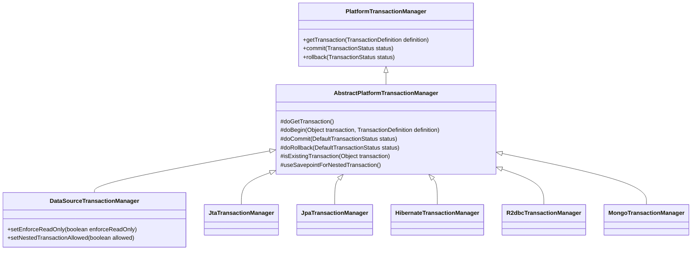

| 实现类 | 适用场景 | 关键默认值 / 注意点 |
| --- | --- | --- |
| `DataSourceTransactionManager` | 纯 JDBC、MyBatis、JdbcTemplate | 构造器里 `setNestedTransactionAllowed(true)`，因此支持 NESTED 保存点 |
| `JpaTransactionManager` | JPA / Hibernate 5.x+ | 复用同一个 `EntityManager`，避免"JPA 与 JDBC 双连接"问题 |
| `HibernateTransactionManager` | 原生 Hibernate API | 与 `SessionFactory` 绑定，同一事务内 `Session` 复用 |
| `JtaTransactionManager` | 多数据源、XA、应用服务器托管事务 | 容器 `UserTransaction` 优先；`NESTED` 一般退化为"嵌套 begin"而非保存点 |
| `R2dbcTransactionManager` | Spring 5.3+ 响应式 JDBC | 与 `@Transactional` 一起使用时方法必须返回 `Mono`/`Flux`，且注入的是 `ReactiveTransactionManager` |
| `MongoTransactionManager` | Spring Data MongoDB 2.1+，MongoDB 4.0+ 副本集 | 4.0 之前不支持多文档事务 |
| `ChainedTransactionManager` | 多数据源"尽力而为"串联 | 位于 `spring-data-commons`，Spring Data 2.5 起标记 `@Deprecated`，官方建议改用 XA 或 Saga |

### 1.4 ThreadLocal 绑定：事务到底存在哪儿

**事务不是一个对象，而是"一条物理连接 + 一组线程本地标记"。** `TransactionSynchronizationManager` 用 6 个 `ThreadLocal` 承载全部状态（Spring 5.3.39 源码字段）：

| 字段 | 类型 | 作用 |
| --- | --- | --- |
| `resources` | `ThreadLocal<Map<Object, Object>>` | key 是 `DataSource`，value 是 `ConnectionHolder`；这是"同一事务复用同一连接"的唯一依据 |
| `synchronizations` | `ThreadLocal<Set<TransactionSynchronization>>` | 提交/回滚时要回调的同步器集合，`registerSynchronization` 往里塞 |
| `currentTransactionName` | `ThreadLocal<String>` | `@Transactional(name=...)` 或 `TransactionDefinition#getName` |
| `currentTransactionReadOnly` | `ThreadLocal<Boolean>` | `readOnly` 标记，读写分离路由常读它 |
| `currentTransactionIsolationLevel` | `ThreadLocal<Integer>` | 只在显式指定隔离级别时非 null |
| `actualTransactionActive` | `ThreadLocal<Boolean>` | **判断"真的在事务里"的唯一权威标志** |

配套的判定与操作 API：

- `TransactionSynchronizationManager.isActualTransactionActive()`：真的有事务在跑。
- `TransactionSynchronizationManager.isSynchronizationActive()`：同步器机制已激活。注意二者不等价——`PROPAGATION_NOT_SUPPORTED` 会挂起事务并激活同步器，此时 synchronization 为 true 而 actual 为 false。**排查事务失效只需要打印这两个值**，比打任何断点都快。
- `bindResource(Object key, Object value)` / `unbindResource(Object key)`：绑定、解绑连接。
- `registerSynchronization(TransactionSynchronization sync)`：注册提交/回滚回调。
- `getCurrentTransactionReadOnly()` / `getCurrentTransactionName()`：`AbstractRoutingDataSource#determineCurrentLookupKey` 里做读写分离路由的常用依据。

`ConnectionHolder extends ResourceHolderSupport`，后者持有 `deadline`、`rollbackOnly`、`referenceCount` 三个关键状态：

- `setRollbackOnly()` / `isRollbackOnly()`：一旦置位，外层提交时 `AbstractPlatformTransactionManager` 会走 `isGlobalRollbackOnly()` 分支，抛 `UnexpectedRollbackException`。
- `setTimeoutInSeconds(int)` / `getTimeToLiveInSeconds()` / `hasTimeout()`：超时是"剩余时间"语义，而不是"总时长"。
- `ConnectionHolder.SAVEPOINT_NAME_PREFIX = "SAVEPOINT_"`，`savepointCounter` 从 0 自增，所以保存点名字形如 `SAVEPOINT_1`、`SAVEPOINT_2`。

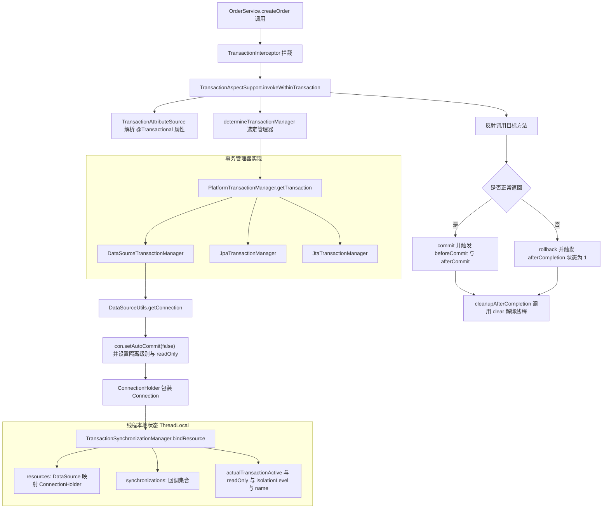

## 二、编程式事务与声明式事务

### 2.1 编程式事务的三种写法

| 写法 | 代码骨架 | 事务边界可见性 | 适用场景 |
| --- | --- | --- | --- |
| 裸用 `PlatformTransactionManager` | `getTransaction` / `try` / `commit` / `catch` / `rollback` | 完全显式，但样板代码多且易漏 | 基础设施代码、框架扩展 |
| `TransactionTemplate` | `transactionTemplate.execute(status -> {...})` | 显式且短，异常语义统一 | **推荐**：局部小事务、异步线程内开事务 |
| `TransactionCallbackWithoutResult` | 继承它实现 `doInTransactionWithoutResult` | 同上 | 无返回值场景，JDK 8+ 已无必要 |

`TransactionTemplate` 的关键源码行为（Spring 5.3.39 `TransactionTemplate#execute`）：

```java
public <T> T execute(TransactionCallback<T> action) throws TransactionException {
    Assert.state(this.transactionManager != null, "No PlatformTransactionManager set");
    if (this.transactionManager instanceof CallbackPreferringPlatformTransactionManager) {
        return ((CallbackPreferringPlatformTransactionManager) this.transactionManager).execute(this, action);
    }
    else {
        TransactionStatus status = this.transactionManager.getTransaction(this);
        T result;
        try {
            result = action.doInTransaction(status);
        }
        catch (RuntimeException | Error ex) {
            rollbackOnException(status, ex);
            throw ex;
        }
        catch (Throwable ex) {
            // 关键差异点：checked exception 也回滚，包装成 UndeclaredThrowableException 抛出
            rollbackOnException(status, ex);
            throw new UndeclaredThrowableException(ex, "TransactionCallback threw undeclared checked exception");
        }
        this.transactionManager.commit(status);
        return result;
    }
}
```

**这张对比必须记住**：`TransactionTemplate` 对 checked Exception 也回滚（`catch (Throwable)`），而 `@Transactional` 默认**不**对 checked Exception 回滚（`DefaultTransactionAttribute#rollbackOn` 只认 `RuntimeException` 与 `Error`）。同一个业务方法改成编程式后行为会变，这是灰度上线时的暗雷。

Spring Boot 会顺手送一个 `TransactionTemplate` bean：`TransactionAutoConfiguration.TransactionTemplateConfiguration` 上有 `@ConditionalOnSingleCandidate(PlatformTransactionManager.class)` + `@ConditionalOnMissingBean(TransactionOperations.class)`，所以直接 `@Autowired TransactionTemplate` 就能用。

### 2.2 声明式事务的装配链

`@EnableTransactionManagement` → `TransactionManagementConfigurationSelector` 按 `AdviceMode` 选中 `ProxyTransactionManagementConfiguration`，它注册三个基础设施 bean：

| Bean 名 / 类型 | 作用 |
| --- | --- |
| `AnnotationTransactionAttributeSource` | 解析 `@Transactional`（`SpringTransactionAnnotationParser`）与 `jakarta.transaction.Transactional`（`JtaTransactionAnnotationParser`），内部用 `ConcurrentHashMap(1024)` 缓存属性 |
| `TransactionInterceptor` | 实现 `MethodInterceptor`，即 Advice |
| `BeanFactoryTransactionAttributeSourceAdvisor` | `PointcutAdvisor`，把上面两个拼成一个切面，默认 `order = Ordered.LOWEST_PRECEDENCE` |

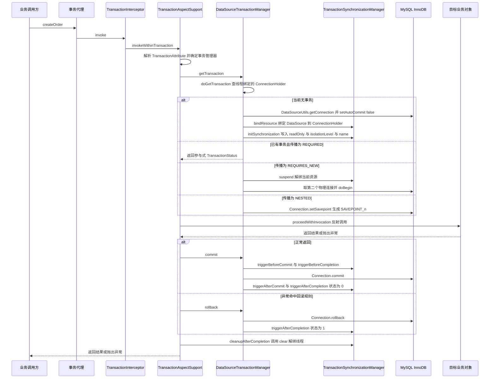

### 2.3 编程式与声明式对照

| 维度 | 声明式 `@Transactional` | 编程式 `TransactionTemplate` |
| --- | --- | --- |
| 事务边界 | 由方法签名决定，容易画大 | 由代码块决定，可精确到几行 |
| 失效风险 | 高：自调用、非 public、代理问题共 8 类 | 低：只有忘记传模板或线程切换问题 |
| 异常语义 | 默认只对 `RuntimeException`/`Error` 回滚 | 对 `Throwable` 全部回滚 |
| 可测性 | 需启动 Spring 上下文或 mock 代理 | 单元测试里直接注入事务管理器即可 |
| 长事务治理 | 靠拆方法，改动成本高 | 可把远程调用、MQ 发送移出事务块 |
| 嵌套控制 | 靠传播行为注解，跨类才生效 | `new TransactionTemplate(tm)` 想怎么配怎么配 |
| 可观测性 | 靠 `TransactionInterceptor` TRACE 日志 | 可在代码里直接打 `status` 与耗时 |

生产结论：**跨表写的业务方法用声明式保持可读性；事务里必须夹远程调用、发 MQ、批量循环的场景一律改成编程式**，把事务范围压到最小。

## 三、@Transactional 属性逐项拆解

### 3.1 全属性与默认值（Spring 5.3 `@Transactional`）

| 属性 | 类型 | 默认值 | 说明 |
| --- | --- | --- | --- |
| `value` / `transactionManager` | `String` | `""` | 指定 `PlatformTransactionManager` bean 名；多数据源必填 |
| `propagation` | `Propagation` | `REQUIRED` | 7 种，见第四章 |
| `isolation` | `Isolation` | `DEFAULT`（-1） | 只在**新建事务**时生效 |
| `timeout` | `int` | `TIMEOUT_DEFAULT`（-1） | 秒；-1 表示用底层系统默认 |
| `timeoutString` | `String` | `""` | Spring 5.3+，支持 `"30s"` 这类可读写法 |
| `readOnly` | `boolean` | `false` | 只读提示；参与已有事务时不重新设置 |
| `rollbackFor` | `Class<? extends Throwable>[]` | `{}` | 追加回滚异常类型 |
| `rollbackForClassName` | `String[]` | `{}` | 同上，字符串形式（避免类加载） |
| `noRollbackFor` | `Class<? extends Throwable>[]` | `{}` | 排除回滚类型 |
| `noRollbackForClassName` | `String[]` | `{}` | 同上 |
| `label` | `String[]` | `{}` | Spring 5.3+，给事务打标签供基础设施读取 |

属性来源优先级（`AbstractFallbackTransactionAttributeSource#computeTransactionAttribute`）：

1. 实现类上的**具体方法**（`AopUtils.getMostSpecificMethod`）。
2. 实现类上的**类级注解**。
3. 接口上的**方法**。
4. 接口上的**类级注解**。

也就是说：**接口与实现类同时标注时，实现类赢**。这个顺序是"接口上写了 `@Transactional(readOnly=true)`、实现类没写却生效"的唯一解释路径。

### 3.2 propagation：7 种传播行为

| 传播行为 | 常量 | 值 | 语义 | 典型用途 |
| --- | --- | --- | --- | --- |
| REQUIRED | `PROPAGATION_REQUIRED` | 0 | 有则加入，无则新建（**默认**） | 99% 的业务方法 |
| SUPPORTS | `PROPAGATION_SUPPORTS` | 1 | 有则加入，无则以非事务执行 | 查询方法，可被事务复用 |
| MANDATORY | `PROPAGATION_MANDATORY` | 2 | 必须有事务，否则抛 `IllegalTransactionStateException` | 内部强约束方法，防止被裸调 |
| REQUIRES_NEW | `PROPAGATION_REQUIRES_NEW` | 3 | 总是新建，挂起旧事务 | 审计日志、幂等表、失败不回滚主流程 |
| NOT_SUPPORTED | `PROPAGATION_NOT_SUPPORTED` | 4 | 挂起旧事务，非事务执行 | 大批量只读导出、调用外部长耗时接口 |
| NEVER | `PROPAGATION_NEVER` | 5 | 有事务则抛 `IllegalTransactionStateException` | 明确禁止在事务中执行的方法 |
| NESTED | `PROPAGATION_NESTED` | 6 | 保存点，内层失败只回滚到保存点 | 批量导入"每批独立成败" |

### 3.3 isolation：5 个常量与各库默认值

`ISOLATION_DEFAULT = -1`、`READ_UNCOMMITTED = 1`、`READ_COMMITTED = 2`、`REPEATABLE_READ = 4`、`SERIALIZABLE = 8`，数值与 `java.sql.Connection.TRANSACTION_*` 对齐。

| 数据库 | 默认隔离级别 | 说明 |
| --- | --- | --- |
| MySQL 5.5+ / 8.0 InnoDB | REPEATABLE READ | 靠 MVCC + Next-Key Lock 解决大部分幻读；`innodb_lock_wait_timeout` 默认 50 秒 |
| Oracle 11g+ | READ COMMITTED | 靠 SCN 一致性读，不实现 READ UNCOMMITTED |
| PostgreSQL 9.x+ | READ COMMITTED | SERIALIZABLE 采用 SSI 实现 |
| SQL Server | READ COMMITTED | 默认加共享锁，可用 RCSI 改为行版本 |
| H2 / Derby | READ COMMITTED | 嵌入式测试常见 |

两个易错点：

1. `isolation` 只在"新建事务"时应用到连接：`AbstractPlatformTransactionManager#handleExistingTransaction` 里参与已有事务的分支不会重新设置隔离级别。
2. 想校验参与方隔离级别是否一致，必须显式打开 `setValidateExistingTransaction(true)`，默认 `false`——所以"内层写了 `SERIALIZABLE` 却没生效"是正常行为，而不是 bug。

### 3.4 timeout：超时到底超了谁

- `AbstractPlatformTransactionManager#determineTimeout`：注解没写就用管理器默认（`setDefaultTimeout`，默认 `TIMEOUT_DEFAULT=-1`）。
- `DataSourceTransactionManager#doBegin` 里 `txObject.getConnectionHolder().setTimeoutInSeconds(timeout)`，落到 `ConnectionHolder#deadline`。
- 真正生效点在 `DataSourceUtils.applyTimeout(Statement, DataSource, int)`：若当前线程绑定的 `ConnectionHolder` 有超时，就用**剩余时间** `getTimeToLiveInSeconds()` 覆盖 `Statement#setQueryTimeout`。

```java
// Spring 5.3.39 DataSourceUtils#applyTimeout 核心逻辑
ConnectionHolder holder = (ConnectionHolder) TransactionSynchronizationManager.getResource(dataSource);
if (holder != null && holder.hasTimeout()) {
    stmt.setQueryTimeout(holder.getTimeToLiveInSeconds());  // 剩余时间优先
}
else if (timeout >= 0) {
    stmt.setQueryTimeout(timeout);
}
```

三个必须知道的结论：

1. `timeout` 只约束**后续创建的 Statement 的查询时间**，管不住 `innodb_lock_wait_timeout`（默认 50 秒）与获取连接池连接的时间。
2. 超时抛 `TransactionTimedOutException`，它继承 `TransactionException extends NestedRuntimeException`，因此是 **RuntimeException**，会触发回滚。
3. 事务超时只在方法执行期间检查（`ResourceHolderSupport#checkTransactionTimeout` 在 `getTimeToLiveInSeconds` 时才判定），方法内长时间不访问数据库时不会主动中断。

### 3.5 readOnly：从"提示"到"强制"

`DataSourceUtils#prepareConnectionForTransaction` 的行为：

```java
if (definition != null && definition.isReadOnly()) {
    try { con.setReadOnly(true); }   // 只是 hint，MySQL 驱动基本忽略
    catch (SQLException | RuntimeException ex) { /* read-only not supported -> ignore */ }
}
```

要真正生效必须打开 `DataSourceTransactionManager#setEnforceReadOnly(true)`（Spring 4.3.7+，默认 `false`），此时 `prepareTransactionalConnection` 会下发：

```java
if (isEnforceReadOnly() && definition.isReadOnly()) {
    try (Statement stmt = con.createStatement()) {
        stmt.executeUpdate("SET TRANSACTION READ ONLY");
    }
}
```

三个坑：

1. `SET TRANSACTION READ ONLY` 只对**当前事务**有效，之后的写操作会报 `ERROR 1792 (25006): Cannot execute statement in a READ ONLY transaction`——某些连接池在归还连接时不会重置该会话状态，配置不当会污染下一个使用者（Hikari 会 `rollback` + 重置，但自研池要小心）。
2. 参与已有事务（`REQUIRED` 且外层已有）时 `readOnly` 不生效：内层写 `readOnly=true` 外层写 `false`，实际按外层走。
3. 读写分离的正确姿势：在 `AbstractRoutingDataSource#determineCurrentLookupKey` 里读 `TransactionSynchronizationManager.getCurrentTransactionReadOnly()`，让"从库路由"与"事务只读标记"同源，否则会出现"读方法走了从库、事务却开启了写事务"的错配。

### 3.6 rollbackFor / noRollbackFor：匹配规则

默认规则写死在 `DefaultTransactionAttribute#rollbackOn`：

```java
public boolean rollbackOn(Throwable ex) {
    return (ex instanceof RuntimeException || ex instanceof Error);
}
```

一旦配置了 `rollbackFor`/`noRollbackFor`，注解解析成 `RuleBasedTransactionAttribute`，规则变为：

```java
// 只保留"继承深度最小"的那条规则，深度越小越具体
for (RollbackRuleAttribute rule : this.rollbackRules) {
    int depth = rule.getDepth(ex);
    if (depth >= 0 && depth < deepest) { deepest = depth; winner = rule; }
}
if (winner == null) { return super.rollbackOn(ex); }   // 无规则命中才回到默认
return !(winner instanceof NoRollbackRuleAttribute);   // 命中 NoRollback 就不回滚
```

因此：**同级时 `noRollbackFor` 胜出（因为 `NoRollbackRuleAttribute` 是最后判定）；但更具体的 `rollbackFor` 会压过更宽泛的 `noRollbackFor`**。例如 `noRollbackFor = Exception.class` 配 `rollbackFor = BizException.class`，抛 `BizException` 时深度为 0 的 `rollbackFor` 胜出，仍然回滚。业务里最稳的写法是：

```java
@Transactional(rollbackFor = Exception.class)
public void createOrder(OrderCmd cmd) throws IOException { ... }
```

## 四、事务传播行为 7 种逐个举例

### 4.1 一张图理解三种核心传播

```mermaid
flowchart TD
  subgraph Required["REQUIRED 默认"]
    R1["外层方法开启事务 T1"] --> R2["内层方法加入 T1"]
    R2 --> R3["内层抛异常被外层 catch"]
    R3 --> R4["ConnectionHolder 被标记 rollbackOnly"]
    R4 --> R5["外层 commit 时抛 UnexpectedRollbackException"]
  end
  subgraph RequiresNew["REQUIRES_NEW"]
    N1["外层事务 T1 绑定连接 C1"] --> N2["suspend 解绑 C1"]
    N2 --> N3["获取连接 C2 开启 T2"]
    N3 --> N4["内层提交或回滚 T2 后 resume C1"]
    N4 --> N5["最坏情况同时占用两个物理连接"]
  end
  subgraph Nested["NESTED 保存点"]
    S1["外层事务 T1 保持不变"] --> S2["Connection.setSavepoint 生成 SAVEPOINT_1"]
    S2 --> S3["内层失败 rollback 到 SAVEPOINT_1"]
    S3 --> S4["外层仍可继续提交"]
    S4 --> S5["外层回滚则内层必然一起回滚"]
  end
```

### 4.2 逐个例子

**REQUIRED（默认）**：`OrderService#createOrder` 调用 `StockService#deduct`，两者都是 `REQUIRED`。`deduct` 内部 `AbstractPlatformTransactionManager#handleExistingTransaction` 走"Participating in existing transaction"分支，直接用同一个 `ConnectionHolder`。此时若 `deduct` 抛异常被 `createOrder` catch 住，`TransactionAspectSupport#completeTransactionAfterThrowing` 已经调用 `status.setRollbackOnly()` → 落到 `ConnectionHolder#setRollbackOnly()`，外层提交时抛：

```
org.springframework.transaction.UnexpectedRollbackException: Transaction silently rolled back because it has been marked as rollback-only
```

这条报错在线上非常常见，根因几乎都是"内层异常被吞"。参数 `setGlobalRollbackOnParticipationFailure(false)` 可以让参与失败不再污染全局，但这是把问题藏起来，不推荐。

**REQUIRES_NEW**：审计日志、幂等记录、发送通知的典型用法——主流程回滚了，日志必须留下。挂起由 `AbstractPlatformTransactionManager#suspend` 完成：先从 `TransactionSynchronizationManager` 解绑当前 `ConnectionHolder`，再调用 `doSuspend`；`resume` 时反向执行。要点：

- **需要第二个物理连接**：同一个 `DataSource` 上 `REQUIRES_NEW` 与 `REQUIRED` 各持一个连接。连接池 `maximumPoolSize=10`、Tomcat `server.tomcat.threads.max=200` 的默认组合下，只要并发上来必然出现 `HikariPool-1 - Connection is not available, request timed out after 30000ms`。
- 内层事务提交后，外层如果回滚，内层数据**不会**回滚。这既是它的价值，也是"数据不一致"投诉的来源。
- 内层事务看不到外层未提交的数据（不同连接、不同事务），不要在 `REQUIRES_NEW` 里读外层刚写的行。

**NESTED**：批量导入 1000 行，每 100 行一个批次，某批失败只回滚该批。底层是 JDBC 保存点：

```java
// Spring 5.3.39 ConnectionHolder
public static final String SAVEPOINT_NAME_PREFIX = "SAVEPOINT_";
public Savepoint createSavepoint() throws SQLException {
    this.savepointCounter++;
    return getConnection().setSavepoint(SAVEPOINT_NAME_PREFIX + this.savepointCounter);
}
```

触发链：`AbstractPlatformTransactionManager#handleExistingTransaction` 的 `PROPAGATION_NESTED` 分支 → `isNestedTransactionAllowed()`（`DataSourceTransactionManager` 构造器里已 `setNestedTransactionAllowed(true)`）→ `useSavepointForNestedTransaction()` 默认 true → `DefaultTransactionStatus#createAndHoldSavepoint()` → `JdbcTransactionObjectSupport#createSavepoint()`，其中先校验 `conHolder.supportsSavepoints()`（即 `Connection.getMetaData().supportsSavepoints()`），不支持则抛：

```
org.springframework.transaction.NestedTransactionNotSupportedException: Cannot create a nested transaction because savepoints are not supported by your JDBC driver
```

| 对比项 | REQUIRED | REQUIRES_NEW | NESTED |
| --- | --- | --- | --- |
| 是否新连接 | 否 | **是（第二个物理连接）** | 否 |
| 内层回滚影响外层 | 内层异常若被吞则整体 rollback-only | 不影响 | 不影响（回滚到保存点） |
| 外层回滚影响内层 | 一起回滚 | **不一起回滚** | 一起回滚（保存点是外层事务的一部分） |
| 内层能否看到外层未提交数据 | 能（同一连接） | 不能 | 能 |
| 依赖条件 | 无 | 连接池余量 | JDBC 驱动支持 Savepoint，且事务管理器 `nestedTransactionAllowed=true` |
| 失败后能否继续用外层事务 | 不能 | 能 | 能 |

**SUPPORTS / NOT_SUPPORTED / MANDATORY / NEVER** 一句话区分：

- `SUPPORTS`：查询方法常用，有事务就搭车，没有也能跑。
- `NOT_SUPPORTED`：把外层事务挂起后执行，适合"事务里绝不能出现的长耗时操作"。注意它**挂起连接占用不释放**，并不会让连接池更轻松。
- `MANDATORY`：把"必须由上层开启事务"的约定写进代码，被裸调时抛 `IllegalTransactionStateException: No existing transaction found for transaction marked with propagation 'mandatory'`。
- `NEVER`：与 `MANDATORY` 相反，用于明确禁止在事务中执行的写日志、远程调用。

## 五、事务失效的 8 种场景与原理

### 5.1 排查决策树

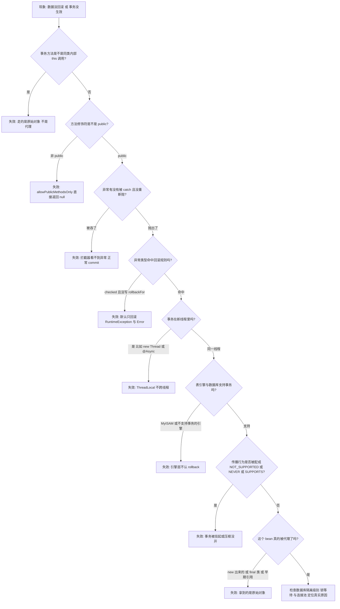

### 5.2 八种场景逐条拆解

| 序号 | 场景 | 根本原理 | 修复方式 | 线上定位手段 |
| --- | --- | --- | --- | --- |
| 1 | 同类内部 `this` 调用 | 代理只包住外部入口，`this.method()` 是原始对象调用 | 拆类 / `AopContext.currentProxy()` / `@Lazy` 自注入 / `TransactionTemplate` | TRACE 日志只看到 `createOrder` 的 Getting，没有内层的 |
| 2 | 方法非 public | `AbstractFallbackTransactionAttributeSource#computeTransactionAttribute` 首行 `allowPublicMethodsOnly() && !Modifier.isPublic` 直接返回 null | 改 public；或 `setPublicMethodsOnly(false)` + `proxyTargetClass=true` | 方法上打断点，代理类里搜不到该方法 |
| 3 | 异常被 catch 吞掉 | `completeTransactionAfterThrowing` 没被触发，正常走 commit | 重新抛；或 `TransactionAspectSupport.currentTransactionStatus().setRollbackOnly()` | 有 `UnexpectedRollbackException` 或数据没回滚 |
| 4 | 异常类型不匹配 | 默认只回滚 `RuntimeException` 与 `Error` | `rollbackFor = Exception.class` | 日志里是 `IOException` 之类的 checked 异常 |
| 5 | 多线程 / 线程池 / `@Async` | 6 个 `ThreadLocal` 不跨线程继承 | 在子线程内用 `TransactionTemplate` 自开事务；或事件 + `@TransactionalEventListener` | 子线程里 `isActualTransactionActive()` 为 false |
| 6 | 数据库引擎不支持 | MyISAM、部分分区表、MongoDB 4.0 之前的多文档写 | 换 InnoDB；`SHOW ENGINES` / `information_schema.TABLES.ENGINE` 自查 | DDL 语句与写操作混在一个事务里（DDL 隐式提交） |
| 7 | 传播行为配置错误 | `NOT_SUPPORTED`/`NEVER` 挂起事务；`SUPPORTS` 在无事务上下文时不开 | 改回 `REQUIRED`；`MANDATORY` 只在明确链路中使用 | 观察 `isActualTransactionActive()` 与 `isSynchronizationActive()` 的组合 |
| 8 | 类未被代理 | bean 由 `new` 创建、`final` 类、`final`/`static` 方法、早期引用暴露 | 交给容器管理；去掉 final；用 `@Lazy` 打破循环依赖 | 启动日志 `Could not generate CGLIB subclass of` 或 `... is not eligible for getting processed by all BeanPostProcessors` |

### 5.3 失效场景 1：自调用，最经典的失效

```java
@Service
public class OrderService {
    @Autowired private OrderMapper orderMapper;

    public void outer() {          // 没有事务
        this.inner();              // 直接调用原始对象，不经过代理
    }

    @Transactional(rollbackFor = Exception.class)
    public void inner() { orderMapper.insert(...); throw new IllegalStateException("boom"); }
}
```

四种修复方式与代价：

| 方案 | 代码 | 优点 | 代价 |
| --- | --- | --- | --- |
| `AopContext.currentProxy()` | `((OrderService) AopContext.currentProxy()).inner();` | 改动最小 | 需 `@EnableAspectJAutoProxy(exposeProxy = true)`；ThreadLocal 开销；无代理环境抛 `IllegalStateException: Cannot find current proxy: Set 'exposeProxy' property on Advised to 'true' to make it available...` |
| 自注入 + `@Lazy` | `@Autowired @Lazy private OrderService self;` | 无额外开关 | 多一层代理；忘记 `@Lazy` 会引发循环依赖启动失败 |
| `ObjectProvider` | `@Autowired ObjectProvider<OrderService> selfProvider;` | 天然延迟，无循环依赖 | 调用处略啰嗦 |
| 拆成独立 bean | 事务方法搬到 `OrderTxService` | **最干净，推荐** | 需要重构，要评估包依赖方向 |
| `TransactionTemplate` | 在方法内 `template.execute(...)` | 边界最清晰 | 失去声明式的一致性 |

### 5.4 失效场景 2：非 public 的真实拦截点

```java
// AbstractFallbackTransactionAttributeSource#computeTransactionAttribute 首段
if (allowPublicMethodsOnly() && !Modifier.isPublic(method.getModifiers())) {
    return null;   // 属性为 null，TransactionInterceptor 认为"这方法不需要事务"
}
```

`AnnotationTransactionAttributeSource` 的 `publicMethodsOnly` 默认 `true`（三个构造器都这么设）。注意：CGLIB 技术上能覆盖 `protected` 与包级方法，但属性解析阶段已经被挡掉，所以"换成 CGLIB 就好了"是错的。要放开必须同时满足：`AnnotationTransactionAttributeSource(false)` 与 `proxyTargetClass=true`。

### 5.5 失效场景 5：多线程必须讲清的三种情形

1. `new Thread` / `CompletableFuture.supplyAsync`：新线程的 `ThreadLocal` 是空的，`getResource(dataSource)` 返回 null，于是开启**新连接、新事务**——不是"事务失效"，而是"两个互不相干的事务"。
2. `@Async`：调用线程的事务不会传播，异步方法内部的 `@Transactional` 在**线程池线程**里开启新事务（详见第六章）。
3. `ThreadLocal` 传递型框架（`TransmittableThreadLocal`、`InheritableThreadLocal`）：`TransactionSynchronizationManager` 用的是普通 `ThreadLocal`，即使把 `ConnectionHolder` 继承过去也极其危险——两个线程共用一条连接会直接导致数据错乱。**不要尝试传递事务上下文。**

### 5.6 失效场景 6：引擎与 DDL 两类静默失效

- MySQL 5.5 之前默认引擎是 MyISAM，MyISAM 表**完全不支持事务**，`rollback` 是空操作。自查：`SHOW ENGINES;` 看 InnoDB 的 `Support` 是否为 `DEFAULT`，`SELECT TABLE_NAME, ENGINE FROM information_schema.TABLES WHERE TABLE_SCHEMA='order_db' AND ENGINE<>'InnoDB';`
- DDL 隐式提交：MySQL 执行 `CREATE TABLE`/`ALTER TABLE` 前后都会隐式提交当前事务；Oracle 的 DDL 同样隐式提交。所以"事务里改完数据再建索引"这种写法，回滚只会回滚建索引之后的部分。
- MongoDB 4.0 之前不支持多文档事务；4.0+ 需要副本集或分片集群，单机 `mongod` 直接报错。

### 5.7 失效场景 8：类未被代理的四种触发

| 触发点 | 现象 | 说明 |
| --- | --- | --- |
| `new` 出来的对象 | 完全无事务 | 不是 Spring bean，没有任何 `BeanPostProcessor` 处理 |
| `final` 类 / `final` 方法 | 启动或首次调用抛 `AopConfigException: Could not generate CGLIB subclass of class xxx: Common causes of this problem include using a final class or a non-visible class` | CGLIB 无法继承 |
| `private` / `static` 方法 | 静默失效 | 代理无法覆盖，且 `publicMethodsOnly` 也挡住 private |
| 循环依赖中的早期引用 | 注入方拿到原始对象，事务失效 | 见第八章；Spring 默认 `allowRawInjectionDespiteWrapping=false` 会直接抛 `BeanCurrentlyInCreationException` |

补充两个易被忽略的失效原因（第 9、10 种，面试加分）：

- **多数据源未指定 `transactionManager`**：`@Transactional` 默认按类型找唯一 `PlatformTransactionManager`，有两个以上时抛 `NoUniqueBeanDefinitionException`；配合 `@Primary` 或 `@Transactional(transactionManager = "orderTxManager")` 修正。
- **响应式方法用错管理器**：方法返回 `Mono`/`Flux` 但注入的是 `DataSourceTransactionManager` 时，`TransactionAspectSupport#invokeWithinTransaction` 会走 `ReactiveAdapterRegistry` 分支并抛 `IllegalStateException: Cannot apply reactive transaction to non-reactive return type`。

## 六、事务与 AOP 的代理顺序：@Transactional 撞上 @Async

### 6.1 Advisor 链的顺序规则

1. `BeanFactoryTransactionAttributeSourceAdvisor` 继承 `AbstractPointcutAdvisor`，其 `getOrder()` 逻辑是：显式 `order` → advice 的 `getOrder()` → `Ordered.LOWEST_PRECEDENCE`（`Integer.MAX_VALUE`）。
2. `@EnableTransactionManagement(order = 0)` 才会显式设置；默认是 `LOWEST_PRECEDENCE`。
3. `PostProcessorRegistrationDelegate#registerBeanPostProcessors` 的排序是：`PriorityOrdered` → `Ordered`（按 `getOrder()` 升序）→ 普通 BPP 按注册顺序。**`order` 越小越靠外层**。
4. 代理是"一层一层叠"的：谁先包住 bean，谁的拦截器就在外层。`AbstractAdvisingBeanPostProcessor` 的 `beforeExistingAdvisors` 默认 `false`，因此当 bean 已经是代理时，它会把 advisor **追加到已有链的尾部（内层）**；只有这样追加，`AsyncAnnotationBeanPostProcessor` 与 `AnnotationAwareAspectJAutoProxyCreator` 才不会互相覆盖。

### 6.2 @Async 的装配链

`@EnableAsync` → `AsyncConfigurationSelector` → `ProxyAsyncConfiguration#asyncAdvisor()` 注册 `AsyncAnnotationBeanPostProcessor`（`setProxyTargetClass(...)`、`setOrder(...)`）。它继承 `AbstractAdvisingBeanPostProcessor`，而 `AbstractAdvisingBeanPostProcessor extends ProxyProcessorSupport`，`ProxyProcessorSupport` 里有 `private int order = Ordered.LOWEST_PRECEDENCE`，这就是 `@EnableAsync(order = ...)` 的落点。

执行器选择顺序（`AsyncExecutionInterceptor#getDefaultExecutor`）：

1. 唯一一个 `TaskExecutor` bean；
2. 名为 `taskExecutor` 的 `Executor` bean；
3. 都没有则退化为 `new SimpleAsyncTaskExecutor()`——**每次调用新建线程、不复用、无上限**，生产环境必须显式配置 `ThreadPoolTaskExecutor`。

### 6.3 同时使用时的四个后果

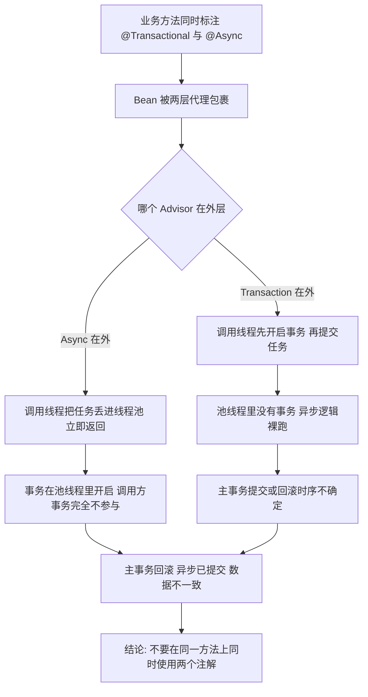

| 后果 | 机制 | 规避 |
| --- | --- | --- |
| 事务在错误的线程开启 | `TransactionSynchronizationManager` 的 `ThreadLocal` 不跨线程 | 让异步方法自己声明事务，接受"两个独立事务" |
| 调用方事务不传播 | 线程池任务没有事务上下文 | 用事件机制解耦，见第十章 |
| 异步先执行、主事务后提交/回滚 | 异步线程是独立事务，读不到未提交数据，也回滚不了 | 用 `@TransactionalEventListener(phase = AFTER_COMMIT)` 替代直接 `@Async` |
| 自调用 `@Async` 失效 | 与事务同理，`this.asyncMethod()` 不走代理 | 拆类或用 `selfProvider` |

**可验证的实操建议**：确实需要"事务提交后再异步处理"时，标准写法是

```java
@Component
public class OrderCreatedListener {

    @Async("bizExecutor")
    @TransactionalEventListener(phase = TransactionPhase.AFTER_COMMIT)
    public void onCommitted(OrderCreatedEvent event) {
        // 这里已经是提交之后，且运行在 bizExecutor 线程池里
    }
}
```

### 6.4 @Transactional 与 @Cacheable 的顺序陷阱

`@Cacheable`/`@CachePut` 由 `CacheInterceptor`（`CacheAspectSupport`）实现，其 advisor 同样默认 `LOWEST_PRECEDENCE`。典型故障链：

1. 事务方法内更新数据库并 `@CachePut` 写缓存；
2. 方法返回后事务提交**失败**（比如唯一索引冲突在 commit 时才暴露）；
3. 缓存里已经是新值，数据库还是旧值 → 缓存与库长期不一致。

修复优先级：把缓存写在事务提交成功的回调里（`TransactionSynchronization#afterCommit`），或使用 `TransactionAwareCacheDecorator` 包装 `CacheManager`，它会把 `put`/`evict` 延迟到事务提交后执行。Spring 5.3 的 `TransactionAwareCacheDecorator` 位于 `org.springframework.cache.transaction`，本质就是注册一个 `TransactionSynchronization`。

## 七、TransactionSynchronization 与事务同步管理器

### 7.1 八个回调与触发顺序

`TransactionSynchronization`（Spring 5.3）全部是 `default` 方法，共 8 个：

| 回调 | 触发时机 | 典型用途 |
| --- | --- | --- |
| `suspend()` | 事务被 `REQUIRES_NEW`/`NOT_SUPPORTED` 挂起前 | 暂停外部资源，如 `StopWatch`、租约续期 |
| `resume()` | 恢复挂起事务时 | 恢复资源 |
| `flush()` | 事务提交前由 ORM 调用（如 Hibernate） | 触发 `Session#flush` |
| `beforeCommit(boolean readOnly)` | `doCommit` 之前 | 校验、发本地事件、写审计（与业务同库同事务） |
| `beforeCompletion()` | 提交或回滚前都会调用 | 清理 ThreadLocal、关闭游标；**不能在此抛异常** |
| `afterCommit()` | `doCommit` 之后，`afterCompletion` 之前 | **提交后发 MQ、清缓存、发通知** |
| `afterCompletion(int status)` | 事务彻底结束后 | 按 `status` 分支做成功/失败统计 |
| （常量） | `STATUS_COMMITTED=0`、`STATUS_ROLLED_BACK=1`、`STATUS_UNKNOWN=2` | 与 `afterCompletion` 配合 |

提交路径（`AbstractPlatformTransactionManager#processCommit` 实际顺序）：

```
prepareForCommit
triggerBeforeCommit
triggerBeforeCompletion
doCommit                       // Connection.commit
triggerAfterCommit
triggerAfterCompletion(0)      // STATUS_COMMITTED
cleanupAfterCompletion         // TransactionSynchronizationManager.clear + 释放连接
```

回滚路径：`triggerBeforeCompletion` → `doRollback` → `triggerAfterCompletion(1)` → `cleanupAfterCompletion`；回滚时**不会**触发 `beforeCommit` 与 `afterCommit`。若提交阶段抛异常，则 `triggerAfterCompletion(2)`（`STATUS_UNKNOWN`）。

### 7.2 事务状态机

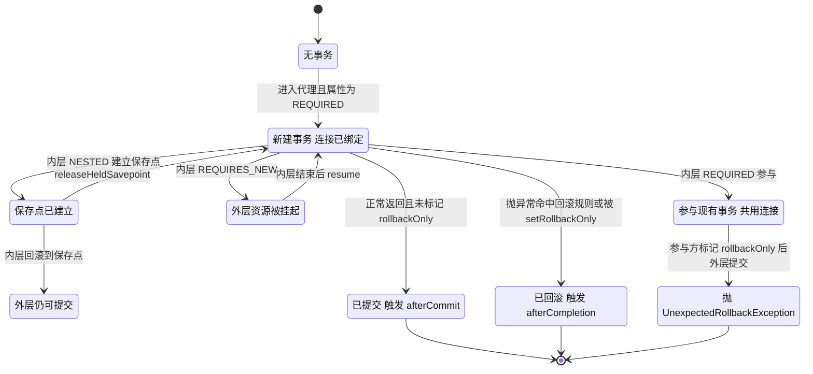

### 7.3 手写"提交后回调"的标准模板

```java
@Service
public class OrderService {

    private final JdbcTemplate jdbcTemplate;
    private final RocketMQTemplate mqTemplate;

    public OrderService(JdbcTemplate jdbcTemplate, RocketMQTemplate mqTemplate) {
        this.jdbcTemplate = jdbcTemplate;
        this.mqTemplate = mqTemplate;
    }

    @Transactional(rollbackFor = Exception.class)
    public void createOrder(Long orderId) {
        jdbcTemplate.update("insert into t_order(id, status) values (?, ?)", orderId, "CREATED");

        // 与业务同库同事务，afterCommit 才真正发送
        TransactionSynchronizationManager.registerSynchronization(new TransactionSynchronization() {
            @Override
            public void afterCommit() {
                mqTemplate.syncSend("ORDER_CREATED", orderId);
            }
        });
    }
}
```

三个必须知道的行为细节：

1. `afterCommit` 抛出的异常会从 `triggerAfterCommit` 向外传播（默认 `errorHandler` 为空），此时**事务已经提交**，调用方却收到异常；`isRollbackOnCommitFailure` 默认 `false`，因此不会尝试回滚。所以 `afterCommit` 里必须自行 try-catch 兜底。
2. `afterCommit` 与 `afterCompletion` 执行时连接**仍绑定在当前线程**（`cleanupAfterCompletion` 在它们之后才跑）。此连接已经 `commit` 过且 `autoCommit=false`，在这里直接写库**不会被提交**，连接释放时静默丢失。要写库必须开新事务：`@Transactional(propagation = REQUIRES_NEW)`。
3. `isSynchronizationActive()` 为 true 不代表真有事务。`@Transactional(propagation = NOT_SUPPORTED)` 下同步器是激活的（会触发回调），但 `isActualTransactionActive()` 为 false。判断"能不能注册事务回调"用前者，判断"是否在事务中"用后者。

### 7.4 @TransactionalEventListener 的判定分支

`TransactionalApplicationListenerMethodAdapter#onApplicationEvent`（Spring 5.3.39 源码）：

```java
if (TransactionSynchronizationManager.isSynchronizationActive() &&
        TransactionSynchronizationManager.isActualTransactionActive()) {
    TransactionSynchronizationManager.registerSynchronization(
            new TransactionalApplicationListenerSynchronization<>(event, this, this.callbacks));
}
else if (this.fallbackExecution) {
    if (getTransactionPhase() == TransactionPhase.AFTER_ROLLBACK && logger.isWarnEnabled()) {
        logger.warn("Processing " + event + " as a fallback execution on AFTER_ROLLBACK phase");
    }
    processEvent(event);
}
else {
    if (logger.isDebugEnabled()) {
        logger.debug("No transaction is active - skipping " + event);
    }
}
```

记忆点：`fallbackExecution` 默认 `false`，`phase` 默认 `AFTER_COMMIT`，四个阶段是 `BEFORE_COMMIT`、`AFTER_COMMIT`、`AFTER_ROLLBACK`、`AFTER_COMPLETION`。**没事务时默认静默丢弃**，只有 debug 日志——这是"本地测试有事件、线上没事件"的常见原因。

## 八、循环依赖、代理与事务的交汇点

### 8.1 三级缓存为什么是三级

`DefaultSingletonBeanRegistry` 里三个 Map：

| 名称 | 结构 | 放什么 |
| --- | --- | --- |
| `singletonObjects` | `Map<String, Object>` | 一级：完全初始化好的 bean |
| `earlySingletonObjects` | `Map<String, Object>` | 二级：提前暴露的**早期引用**（可能是代理） |
| `singletonFactories` | `Map<String, ObjectFactory<?>>` | 三级：`() -> getEarlyBeanReference(beanName, mbd, bean)` 的工厂 |

第三级存在的唯一理由：**让 AOP 能提前生成代理**。`AbstractAutowireCapableBeanFactory#getEarlyBeanReference` 会依次调用所有 `SmartInstantiationAwareBeanPostProcessor#getEarlyBeanReference`，`AbstractAutoProxyCreator` 就在这里提前完成代理创建并把结果放进二级缓存；若没有第三级，早期引用只能是原始对象，注入方拿到的就是"没有事务的 A"。

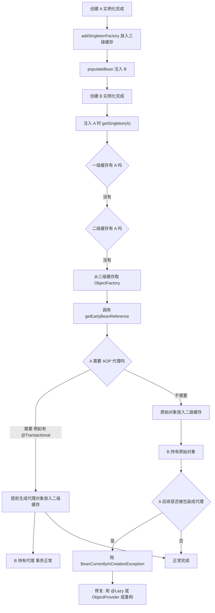

### 8.2 Spring 与 Spring Boot 的默认行为差异（高频考点）

| 版本 | 循环依赖 | 说明 |
| --- | --- | --- |
| Spring Framework 4.x / 5.x | `AbstractAutowireCapableBeanFactory#allowCircularReferences` 默认 `true` | 允许，靠三级缓存解决 setter/field 注入 |
| Spring Boot 2.5 及以前 | 未提供开关 | 沿用框架默认，允许 |
| Spring Boot 2.6+ | 新增 `spring.main.allow-circular-references`，**默认 `false`** | 启动直接失败，需显式打开或重构 |

这条差异是"升级 Boot 2.6 后项目起不来"最常见的根因。报错形如 `BeanCurrentlyInCreationException: Error creating bean with name 'orderService': Requested bean is currently in creation: Is there an unresolvable circular reference?`

### 8.3 循环依赖 + 事务的两种失败模式

**模式一：拿到原始对象，事务静默失效。** 只要 A 的早期引用被提前暴露，而 A 最终被包装成代理，`AbstractAutowireCapableBeanFactory` 会检查 `allowRawInjectionDespiteWrapping`（默认 `false`）并抛：

```
BeanCurrentlyInCreationException: Bean with name 'a' has been injected into other beans [b]
in its raw version as part of a circular reference, but has eventually been wrapped.
This means that said other beans do not use the final version of the bean.
This is often the result of over-eager type matching - consider using 'getBeanNamesForType'
with the 'allowEagerInit' flag turned off, for example.
```

注意这是"启动期就报错"的友好情况；把 `allowRawInjectionDespiteWrapping` 改成 true 会**让事务真正静默失效**，所以不要改。

**模式二：构造器注入 + 循环依赖，直接无解。** 构造器注入的实例化阶段还没完成，`singletonFactories` 里根本没有可用工厂，`BeanCurrentlyInCreationException` 立即抛出。`@Async` 场景尤其典型：`@Async` 代理依赖 `AsyncAnnotationBeanPostProcessor`，而构造器注入让容器连实例都造不出来。

| 解决方案 | 写法 | 适用性 | 代价 |
| --- | --- | --- | --- |
| `@Lazy` 注入点 | `@Autowired @Lazy private B b;` | 最常用，改动最小 | 每次调用多一层代理判断 |
| `@Lazy` 构造器参数 | `public A(@Lazy B b)` | 构造器注入友好 | 同上 |
| `ObjectProvider` | `private final ObjectProvider<B> bProvider;` | 框架级代码 | 调用处啰嗦 |
| 事件解耦 | A 发事件、B 监听 | 最干净 | 需要改造调用语义 |
| 重构分层 | 抽公共依赖 C | **架构上最正确** | 有时间成本 |
| 打开开关 | `spring.main.allow-circular-references=true` | 只作为升级过渡 | 埋下原始对象注入的隐患 |

**面试结论**：循环依赖不是"Spring 有 bug"，而是设计信号。**能解就解，解不了用 `@Lazy`，绝不用开关糊过去。**

## 九、从本地事务到分布式事务

### 9.1 本地事务的边界在哪里

`@Transactional` 只能覆盖**一个** `PlatformTransactionManager`、**一个**物理连接上的操作。一旦出现下面三种情况，本地事务直接失效：

1. 跨库（`order_db` + `stock_db` 两个 `DataSource`）；
2. 跨服务（Feign/Dubbo 调用）；
3. 跨存储（MySQL + Redis + MongoDB）。

`@Transactional` 遇到远程调用最危险的写法是"事务内发 HTTP 请求"：远程成功、本地回滚，或者本地成功、远程超时不知结果。**远程调用必须移出事务边界**，这是长事务治理的第一条铁律。

### 9.2 主流方案对照

| 方案 | 一致性 | 性能 | 业务侵入 | 代表实现 | 适用场景 |
| --- | --- | --- | --- | --- | --- |
| 2PC / XA | 强一致 | 差（同步阻塞、锁持有时间长） | 低 | `JtaTransactionManager` + Atomikos / Narayana | 同机房、参与方少、TPS 要求低 |
| TCC | 最终一致 | 好 | **高（要实现 Try/Confirm/Cancel 三个方法）** | Seata TCC、Hmily | 资金、库存等可拆分资源的强约束场景 |
| Saga | 最终一致 | 好 | 中（要有补偿接口） | Seata Saga、Temporal | 长流程、多步骤业务编排 |
| 本地消息表 | 最终一致 | 好 | 中 | 自研 `t_message` + 定时任务 | 只有 MQ 能参与的异步场景 |
| 事务消息 | 最终一致 | 好 | 中 | RocketMQ 半消息 + `RocketMQTransactionListener` | 已有 RocketMQ 的电商核心链路 |
| 最大努力通知 | 弱一致 | 最好 | 低 | 定时重试 + 对账 | 通知类、可容忍丢失的场景 |

### 9.3 Seata AT 模式两阶段

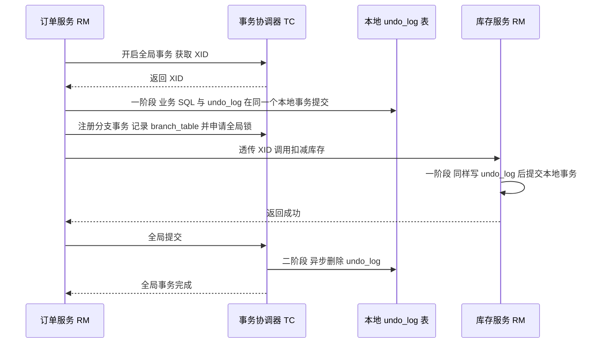

关键表与字段（Seata 1.x）：`global_table`（`xid`、`status`、`application_id`）、`branch_table`（`branch_id`、`xid`、`resource_id`）、`lock_table`（`row_key`、`xid`、`table_name`）、业务库的 `undo_log`（`branch_id`、`xid`、`rollback_info`、`log_status`、`log_created`）。`@GlobalTransactional` 与 `@Transactional` 经常叠加使用：**`@GlobalTransactional` 管全局，TD 内部每个本地写仍走 `@Transactional`**。

### 9.4 三个必须能说出来的坑

1. **XA 的锁与超时**：MySQL XA 事务在两阶段之间持有行锁，`innodb_lock_wait_timeout`（默认 50 秒）会被吃满，`xa_prepare` 后协调者宕机就会留下 `XA RECOVER` 里的悬挂事务。
2. **TCC 三大问题**：空回滚（Try 未执行却收到 Cancel）、悬挂（Cancel 先于 Try 到达）、幂等（重复 Confirm）。标准解法是"事务控制表 + 状态机 + 唯一索引"。
3. **本地事务与远程调用的顺序**：永远让"远程调用在本地事务提交之后"或"本地事务提交成功后再发消息"，否则一定出现数据不一致。

## 十、Spring 事件机制

### 10.1 核心 API 与装配链

| 组件 | 类 / 接口 | 说明 |
| --- | --- | --- |
| 发布者 | `ApplicationEventPublisher#publishEvent(Object)` | `ApplicationContext` 就实现了它，直接注入即可 |
| 事件 | `ApplicationEvent` 及其子类；Spring 4.2+ 任意对象都行 | 非 `ApplicationEvent` 会被包装为 `PayloadApplicationEvent<T>` |
| 监听器 | `ApplicationListener<E extends ApplicationEvent>` | 泛型参与事件类型过滤 |
| 广播器 | `ApplicationEventMulticaster`，默认 `SimpleApplicationEventMulticaster` | bean 名必须是 `applicationEventMulticaster` |
| 注解监听 | `@EventListener` | 由 `EventListenerMethodProcessor` 解析 |
| 事务监听 | `@TransactionalEventListener` | 由 `TransactionalEventListenerFactory` 解析，位于 `spring-tx` |

`@EventListener` 的装配时机：`EventListenerMethodProcessor` 实现 `SmartInitializingSingleton`，在 `afterSingletonsInstantiated()` 阶段扫描所有 bean，用 `DefaultEventListenerFactory`（`getOrder()` 返回 `Ordered.LOWEST_PRECEDENCE - 50`）把带注解的方法包装成 `ApplicationListenerMethodAdapter` 注册进广播器。

`SimpleApplicationEventMulticaster` 的两个关键默认值：

- `taskExecutor = null` → **同步执行**，监听器逻辑会阻塞发布方线程，也会被算进事务耗时。
- `errorHandler = null` → 监听器抛出的异常**原样向外传播**，在事务方法里发布事件时会导致整个事务回滚。

### 10.2 发布到消费的完整链路

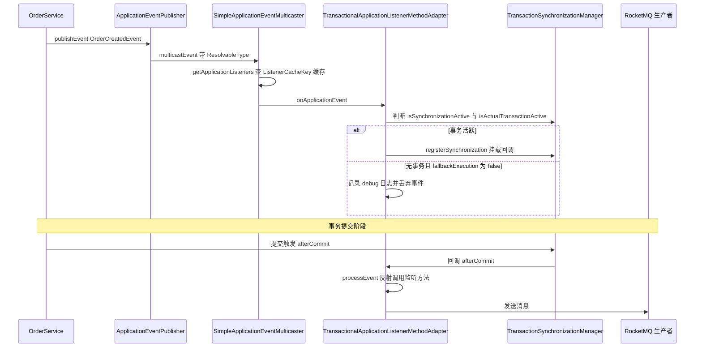

### 10.3 事件机制的实战规则

| 规则 | 原因 |
| --- | --- |
| 事务内发事件、监听器要读数据时，必须配 `@TransactionalEventListener(AFTER_COMMIT)` | 同步 `@EventListener` 在提交前执行，监听器用另一条连接读不到未提交数据 |
| AFTER_COMMIT 回调里写库要 `REQUIRES_NEW` | 此时原连接已提交，直接写不会提交（见 7.3） |
| 监听器要异步就加 `@Async`，不要改成线程池直接调 | `@Async` 与 `@TransactionalEventListener` 组合是官方支持路径 |
| 需要顺序就在监听器上标 `@Order` | `ApplicationListenerMethodAdapter` 用 `AnnotationAwareOrderComparator` 排序 |
| 事件对象尽量不可变、字段少 | 同步事件会在同一线程穿过多层监听器，大对象增加 GC 压力 |
| 自定义广播器时 bean 名必须叫 `applicationEventMulticaster` | `AbstractApplicationContext#initApplicationEventMulticaster` 按此名查找 |

## 十一、Spring 扩展点全清单与实战用途

### 11.1 按容器启动阶段排列

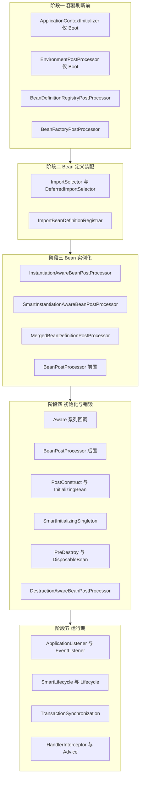

### 11.2 扩展点全清单

| 扩展点 | 触发时机 | 典型用途 | 注意事项 |
| --- | --- | --- | --- |
| `BeanDefinitionRegistryPostProcessor` | `refresh()` 第 5 步，最早 | 动态注册 bean，如 MyBatis `MapperScannerConfigurer` | 执行极早，不能依赖其他 bean |
| `BeanFactoryPostProcessor` | 第 5 步之后 | 修改已有 `BeanDefinition`，如 `PropertySourcesPlaceholderConfigurer` | 只能改定义，不能拿实例 |
| `ImportSelector` / `DeferredImportSelector` | 配置类解析期 | 批量导入配置，Boot 自动配置用 `DeferredImportSelector` | `Deferred` 在用户配置全部处理完之后才执行，这是 `@ConditionalOnMissingBean` 能生效的前提 |
| `ImportBeanDefinitionRegistrar` | 同上 | 编程式注册 bean，如 `AspectJAutoProxyRegistrar` | 与 `@Import` 搭配 |
| `BeanPostProcessor#postProcessBeforeInitialization` | 每个 bean 初始化前 | 属性校验、字段注入（`@Autowired`） | **`@Bean` 方法返回 BPP 会导致该配置类过早实例化**，出现 "is not eligible for getting processed by all BeanPostProcessors" 警告 |
| `BeanPostProcessor#postProcessAfterInitialization` | 初始化后 | AOP 代理生成的唯一入口 | `@Transactional`/`@Async`/`@Cacheable` 全在这层 |
| `InstantiationAwareBeanPostProcessor` | 实例化前后 | 属性注入定制、`postProcessProperties` | 注意 `postProcessPropertyValues` 已在 5.1 弃用 |
| `SmartInstantiationAwareBeanPostProcessor` | 实例化前后 + 循环依赖 | `getEarlyBeanReference` 提前暴露代理、`determineCandidateConstructors` | 三级缓存能力的来源 |
| `MergedBeanDefinitionPostProcessor` | 合并 BeanDefinition 后 | 缓存注入元数据 | 比反射更早拿到合并结果 |
| `DestructionAwareBeanPostProcessor` | 销毁前后 | `@PreDestroy` 的落地实现 | 容器关闭才触发，注意与优雅停机配合 |
| Aware 系列 | 实例化后、初始化前 | `ApplicationContextAware`、`EnvironmentAware`、`BeanNameAware` | 只用于基础设施 bean，业务 bean 别用 |
| `@PostConstruct` / `InitializingBean#afterPropertiesSet` | 属性注入完成后 | 缓存预热、参数校验 | `@PostConstruct` 优先于 `afterPropertiesSet` |
| `@PreDestroy` / `DisposableBean#destroy` | 容器关闭 | 释放线程池、关闭连接 | 需要 `registerShutdownHook` 或 Boot 的优雅停机 |
| `SmartInitializingSingleton#afterSingletonsInstantiated` | 所有单例创建完 | `@EventListener` 注册、缓存全量预热 | 此时不能再新增 bean 定义 |
| `ApplicationListener` / `@EventListener` | 运行期 | 业务解耦 | 同步会阻塞发布方 |
| `SmartLifecycle` | 容器 refresh 完成 / 关闭 | 启动消费者、优雅停机 | `getPhase()` 控制启停顺序；Boot `spring.lifecycle.timeout-per-shutdown-phase` 默认 30 秒 |
| `ApplicationRunner` / `CommandLineRunner` | 应用启动完成后 | 数据初始化、缓存预热 | `@Order` 控制顺序 |
| `HandlerInterceptor` | MVC 请求前后 | 鉴权、链路追踪、日志 | `postHandle` 在异常时不执行 |
| `RequestBodyAdvice` / `ResponseBodyAdvice` | 参数解析 / 结果写出 | 统一加解密、脱敏 | 与 `@RestControllerAdvice` 搭配 |
| `HandlerMethodArgumentResolver` | 参数绑定 | 自定义参数注解，如 `@CurrentUser` | 需要 `WebMvcConfigurer#addArgumentResolvers` |
| `Converter` / `Formatter` | 类型转换 | 枚举、日期、金额转换 | 注册到 `ConversionService` 全局生效 |
| `ApplicationContextInitializer` | Boot 刷新前 | 动态设置 `Environment` 属性 | 只能通过 `spring.factories` 或 `SpringApplication` 注册 |
| `EnvironmentPostProcessor` | Boot 环境准备期 | 加载自定义配置源 | 注册在 `META-INF/spring.factories` |
| `FailureAnalyzer` | 启动失败时 | 输出人类可读的失败原因 | Boot 专有，注册在 `spring.factories` |

### 11.3 三个最容易翻车的扩展点

1. **`BeanPostProcessor` 由 `@Bean` 方法返回**：该配置类会被"过早实例化"，导致其上的 `@Autowired`、`@Value` 延迟生效，日志出现 `Bean 'xxx' of type [...] is not eligible for getting processed by all BeanPostProcessors`。正确做法是用 `static @Bean` 方法或直接 `@Component`。
2. **`BeanDefinitionRegistryPostProcessor` 里 `getBean`**：会触发提前实例化，同样引发上面那条警告，甚至循环依赖失败。
3. **`SmartInitializingSingleton` 里想改 bean 定义**：此时 bean 已全部创建，改 `BeanFactory` 不会被感知，只能改实例状态。

## 十二、条件装配 @Conditional 与自动配置

### 12.1 @Conditional 的最小模型

```java
public interface Condition {
    boolean matches(ConditionContext context, AnnotatedTypeMetadata metadata);
}
```

`ConfigurationCondition extends Condition` 多了一个 `getConfigurationPhase()`：

| 阶段 | 常量值 | 时机 |
| --- | --- | --- |
| `PARSE_CONFIGURATION` | 0 | 解析配置类时判断，决定要不要读这个配置类 |
| `REGISTER_BEAN` | 1 | 注册 bean 时判断，可以看已有 bean 定义 |

`@ConditionalOnMissingBean` 属于 `REGISTER_BEAN` 阶段——这就是它"顺序敏感"的根本原因：**它只能看到此刻已经注册的 bean 定义**。

### 12.2 Spring Boot 条件注解清单

| 注解 | 判定依据 | 常见用途 |
| --- | --- | --- |
| `@ConditionalOnClass` | 类路径存在指定类 | 有 `DataSource` 才装配 `JdbcTemplate` |
| `@ConditionalOnMissingClass` | 类路径不存在 | 兜底实现 |
| `@ConditionalOnBean` | 容器已有指定 bean | 有 `PlatformTransactionManager` 才装配 `TransactionTemplate` |
| `@ConditionalOnMissingBean` | 容器没有指定 bean | **让用户配置覆盖默认实现** |
| `@ConditionalOnSingleCandidate` | 只有一个候选 bean 或有一个 `@Primary` | `TransactionAutoConfiguration` 里对事务管理器的判定 |
| `@ConditionalOnProperty` | 配置项值匹配 | `spring.aop.proxy-target-class=true` 选 CGLIB |
| `@ConditionalOnResource` | 资源存在 | classpath 下有 `logback.xml` 才配置日志 |
| `@ConditionalOnWebApplication` | Web 环境类型 | 区分 Servlet 与 Reactive |
| `@ConditionalOnNotWebApplication` | 非 Web | 批处理场景 |
| `@ConditionalOnExpression` | SpEL 表达式 | 灵活但有性能与可读性代价 |
| `@ConditionalOnJava` | JDK 版本 | 按版本选实现 |
| `@ConditionalOnCloudPlatform` | 云平台 | Kubernetes / Cloud Foundry |

### 12.3 自动配置的完整流水线

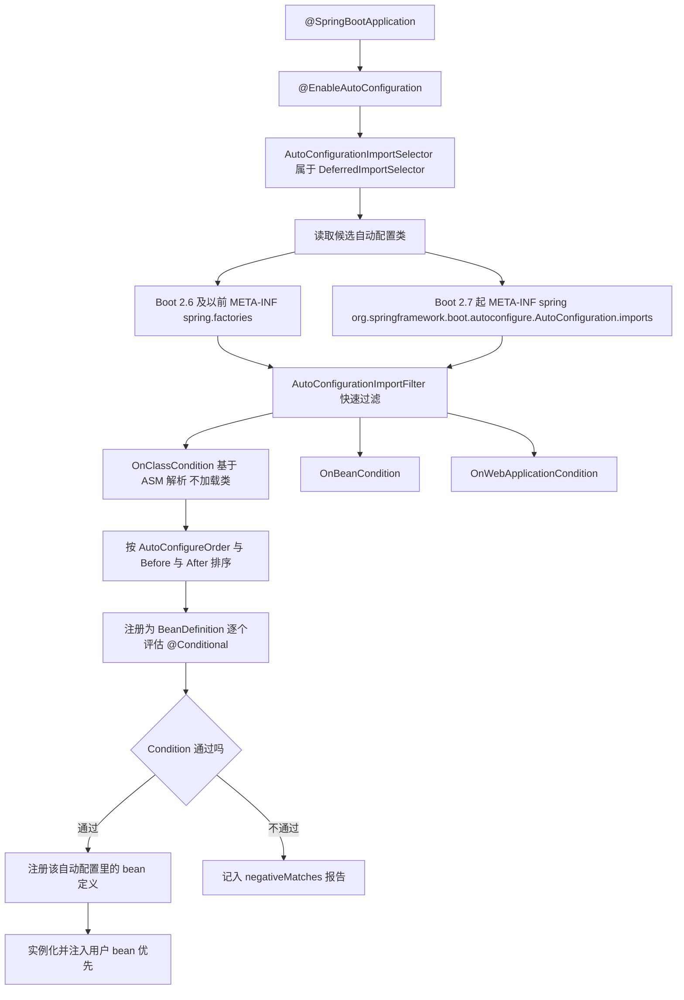

要点：

- `AutoConfigurationImportSelector` 是 `DeferredImportSelector`，在**所有用户配置类处理完之后**执行，这保证了用户自定义 bean 定义先于自动配置注册，`@ConditionalOnMissingBean` 才能正确让位。
- 两段式过滤：先由 `AutoConfigurationImportFilter`（`OnClassCondition` 用 ASM 读注解，不触发类加载）快速剔除，再由每个自动配置类上的 `@Conditional` 精确判定。
- Boot 2.7 起新增 `@AutoConfiguration`（等价于 `@Configuration(proxyBeanMethods = false)` + 只能出现在自动配置列表里），并通过 `AutoConfiguration.imports` 文件替代 `spring.factories`。
- 排序由 `@AutoConfigureOrder`、`@AutoConfigureBefore`、`@AutoConfigureAfter` 决定。**自己写两个互相依赖的自动配置时，必须显式声明 before/after，否则 `@ConditionalOnMissingBean` 的判定结果不确定。**

### 12.4 调试自动配置

| 手段 | 输出 |
| --- | --- |
| 启动加 `--debug` 或 `debug=true` | 控制台打印 `CONDITIONS EVALUATION REPORT`，含 `Positive matches`、`Negative matches`、`Exclusions`、`Unconditional classes` |
| `spring.autoconfigure.exclude=xxx` | 排除指定自动配置类 |
| Actuator `/actuator/conditions` | 与 debug 报告同源，可远程查看 |
| `ConditionEvaluationReportLoggingListener` | 上述报告的生成者，可自定义日志格式 |

两个经典坑：

1. `@ConditionalOnClass` 写在 `@Bean` 方法上时，**不要在方法签名里直接引用那个类**，否则 JVM 在解析方法签名时就抛 `NoClassDefFoundError`，条件根本没机会判断。用 `@ConditionalOnClass(name = "com.example.Foo")` 或把依赖类放到另一个嵌套配置类里。
2. `@ConditionalOnMissingBean` 判定的是"当前已注册的 bean 定义"，不是"运行时最终存在的 bean"。用户用 `@Bean` 注册同名 bean 时，定义覆盖顺序才决定胜负——这也是 `spring.main.allow-bean-definition-overriding`（Boot 2.1 起默认 `false`）会直接让启动失败的原因。

## 十三、Spring 中的设计模式落地

### 13.1 一张表答完"Spring 用了哪些设计模式"

| 模式 | Spring 中的代表类 | 落地要点 |
| --- | --- | --- |
| 模板方法 | `AbstractApplicationContext#refresh`、`AbstractPlatformTransactionManager`、`JdbcTemplate#execute`、`TransactionTemplate` | 骨架由父类定，`doBegin`/`doCommit`/`doRollback` 留给子类实现 |
| 策略 | `PlatformTransactionManager`、`InstantiationStrategy`、`ResourceLoader`、`HandlerMapping`、`CacheManager`、`BeanNameGenerator` | 通过类型注入 + `@Primary`/`@Qualifier` 在运行时切换 |
| 观察者 | `ApplicationEvent`、`ApplicationListener`、`ApplicationEventMulticaster` | 事件与监听器完全解耦，支持泛型过滤与顺序 |
| 工厂 | `BeanFactory`、`FactoryBean`、`ProxyFactory`、`SqlSessionFactoryBean` | `FactoryBean#getObject` 让复杂对象创建对容器透明 |
| 代理 | `JdkDynamicAopProxy`、`CglibAopProxy`、`ProxyFactory`、`AbstractAutoProxyCreator` | 静态代理由 `Advised` 描述，动态代理运行期生成字节码 |
| 适配器 | `AdvisorAdapter`（`MethodBeforeAdviceAdapter`/`AfterReturningAdviceAdapter`/`ThrowsAdviceAdapter`）、`HandlerAdapter`（`RequestMappingHandlerAdapter`/`SimpleControllerHandlerAdapter`/`HttpRequestHandlerAdapter`）、`HandlerMethodArgumentResolver` | 把不同接口形态统一成容器可调用的固定入口 |
| 责任链 | `MethodInterceptor` 链、`HandlerExecutionChain` + `HandlerInterceptor`、`Filter` 链 | 事务、缓存、异步、日志全部挂在同一条链上，顺序即语义 |
| 装饰器 | `TransactionAwareCacheDecorator`、`ScopedProxyFactoryBean`、`LazyInitTargetSource` | 在不改原实现的前提下增强行为，缓存与事务的组合典范 |
| 建造者 | `BeanDefinitionBuilder`、`ProxyFactory` 链式 API、`MockMvcBuilders` | 复杂对象分步构建 |
| 单例 / 原型 | `@Scope("singleton")`（默认）、`@Scope("prototype")`、`BeanDefinition.SCOPE_*` | 单例由 `singletonObjects` 缓存，原型每次 `createBean` |

### 13.2 模板方法：事务管理器是最标准的教科书

```java
public abstract class AbstractPlatformTransactionManager implements PlatformTransactionManager {
    // 固定骨架
    public final TransactionStatus getTransaction(TransactionDefinition definition) { ... }
    public final void commit(TransactionStatus status) { ... }
    public final void rollback(TransactionStatus status) { ... }

    // 可变部分留给子类
    protected abstract Object doGetTransaction();
    protected abstract void doBegin(Object transaction, TransactionDefinition definition);
    protected abstract void doCommit(DefaultTransactionStatus status);
    protected abstract void doRollback(DefaultTransactionStatus status);
    protected boolean isExistingTransaction(Object transaction) { return false; }
    protected boolean useSavepointForNestedTransaction() { return true; }
}
```

设计意图：**把"传播行为判定、挂起恢复、同步器触发、异常转换"这些与具体存储无关的逻辑一次性写完**，子类只需要实现四个存储相关方法。新增一种存储（R2DBC、MongoDB）只需要 200 行代码。代价是模板方法把控制流藏进了父类，调试时必须在 `AbstractPlatformTransactionManager` 下断点。

### 13.3 策略 + 适配器：MVC 的分发模型

`DispatcherServlet#doDispatch` 的核心四步是策略模式的集中体现：

1. `getHandler(request)` 从 `HandlerMapping` 列表（`RequestMappingHandlerMapping`、`SimpleUrlHandlerMapping`、`WelcomePageHandlerMapping`）里找 `HandlerExecutionChain`；
2. `getHandlerAdapter(handler)` 从 `HandlerAdapter` 列表里找**首个** `supports(handler)` 为 true 的适配器；
3. `mappedHandler.applyPreHandle(...)` 执行拦截器链；
4. `ha.handle(...)` 真正执行。

`HandlerAdapter` 的价值在于：`Controller`、`HttpRequestHandler`、`Servlet`、`@RequestMapping` 方法这四种完全不同的 handler 形态，都能被统一成 `handle(request, response, handler)` 一个签名。**适配器解决的是"接口不兼容"，策略解决的是"多实现可替换"，二者经常一起出现。**

### 13.4 责任链：为什么注解顺序真的会影响行为

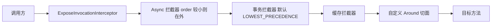

链上任意一环的 `order` 变化都会改变语义：事务在外层意味着"事务范围内包含异步提交动作"，事务在内层意味着"事务在新线程里开启"。**这条链是理解第六章所有问题的总纲。**

## 十四、生产实战：事务问题排查手册

### 14.1 打开哪几个开关

| 目的 | 配置 / 命令 | 关键输出 |
| --- | --- | --- |
| 看事务是否进入拦截 | `logging.level.org.springframework.transaction.interceptor=TRACE` | `Getting transaction for [com.x.OrderService.createOrder]`、`Completing transaction for [...]`、`No need to create transaction for [...]: This method is not transactional.`、`Skipping transactional joinpoint [...] because no transaction manager has been configured` |
| 看连接获取与挂起 | `logging.level.org.springframework.jdbc.datasource.DataSourceTransactionManager=DEBUG` | `Acquired Connection [HikariProxyConnection@...] for JDBC transaction`、`Switching JDBC Connection [...] to manual commit`、`Initiating transaction commit`、`Suspending current transaction` |
| 业务代码里判定 | `TransactionSynchronizationManager.isActualTransactionActive()` / `isSynchronizationActive()` | 最快的"是否真的在事务里"探针 |
| 看当前事务属性 | `TransactionAspectSupport.currentTransactionStatus().isNewTransaction()` / `isRollbackOnly()` | 参与还是新建、是否已被标记回滚 |
| 连接泄漏 | `spring.datasource.hikari.leak-detection-threshold=20000` | 超过 20 秒未归还打印 `Connection leak detection triggered for ...` 与堆栈 |
| 连接池指标 | `spring.datasource.hikari.maximum-pool-size` 与 Actuator `/actuator/metrics/hikaricp.connections.active`、`hikaricp.connections.pending` | `pending` 持续大于 0 就是池不够 |
| MySQL 长事务 | `SELECT trx_id, trx_state, trx_started, trx_mysql_thread_id, trx_query FROM information_schema.INNODB_TRX ORDER BY trx_started;` | 找出运行超过 1 秒的事务与其 SQL |
| MySQL 锁等待 | MySQL 8.0：`SELECT * FROM performance_schema.data_lock_waits;`、`SELECT * FROM performance_schema.data_locks;` | 谁在等谁的锁 |
| 死锁现场 | `SHOW ENGINE INNODB STATUS\G` 看 `LATEST DETECTED DEADLOCK` 段 | 两条互相等待的 SQL 与索引 |
| 事务超时 | `TransactionTimedOutException` 栈 | 是 `Statement#setQueryTimeout` 触发，不是锁等待超时 |

### 14.2 现象到根因的对照表

| 线上现象 | 高概率根因 | 定位路径 |
| --- | --- | --- |
| `UnexpectedRollbackException: Transaction silently rolled back because it has been marked as rollback-only` | 内层 `REQUIRED` 抛异常被外层 catch | TRACE 日志找内层 `Completing transaction ... with rollback-only` 与 `Rolling back transaction` |
| `Lock wait timeout exceeded; try restarting transaction`（MySQL 1205） | 长事务持锁、`innodb_lock_wait_timeout` 默认 50 秒被打满 | `INNODB_TRX` 找长事务，`data_lock_waits` 找等待关系 |
| `Deadlock found when trying to get lock; try restarting transaction`（MySQL 1213） | 两事务加锁顺序相反 | `SHOW ENGINE INNODB STATUS` 的 `LATEST DETECTED DEADLOCK`，统一加锁顺序 |
| `HikariPool-1 - Connection is not available, request timed out after 30000ms` | 连接泄漏、`REQUIRES_NEW` 翻倍占用、慢 SQL | 先看 `hikaricp.connections.active` 是否等于 `maximumPoolSize`，再看 `leak-detection-threshold` 输出 |
| 数据没回滚 | 8 种失效场景任一 | 按 5.1 决策树逐层排除，先看 TRACE 有没有 `Getting transaction` |
| `NoUniqueBeanDefinitionException: ... expected single matching bean but found 2: orderTxManager,stockTxManager` | 多数据源未指定 `transactionManager` | 加 `@Primary` 或显式指定 |
| 事件监听器没执行 | 无事务 + `fallbackExecution=false` 静默丢弃 | 打开 debug 看 `No transaction is active - skipping` |
| 缓存与库不一致 | 事务提交失败但缓存已写入 | 检查 `@CachePut` 与事务的先后，改用 `TransactionAwareCacheDecorator` |
| 异步线程里数据没写 | 事务在新线程、或主事务未提交 | 打印子线程的 `isActualTransactionActive()` |
| 启动报 `BeanCurrentlyInCreationException` | Boot 2.6+ 默认禁止循环依赖 | 按第八章方案一/二修，不要用 `allow-circular-references=true` |

### 14.3 长事务治理清单

1. **事务方法里只放数据库操作**：远程调用、发 MQ、文件 IO、Redis 调用全部移出，或在事务提交后通过 `afterCommit` 回调执行。
2. **批量写分批提交**：10000 行 `insert` 拆成 50 批，每批用独立 `TransactionTemplate`，避免 undo log 膨胀与锁持有时间过长。
3. **加超时兜底**：关键接口加 `@Transactional(timeout = 3, rollbackFor = Exception.class)`；同时确认 `innodb_lock_wait_timeout` 与业务 SLA 匹配。
4. **`REQUIRES_NEW` 数量做容量评估**：最坏连接占用 ≈ 并发线程数 × 嵌套层数。连接池大小必须 ≥ 该值，否则高并发下必然打满。
5. **监控 `INNODB_TRX` 的最长事务时长**，设阈值告警而不是等用户投诉。
6. **`readOnly` 真正打开**：报表类接口配 `@Transactional(readOnly = true, timeout = 30)` + `setEnforceReadOnly(true)`，并让它走从库。

### 14.4 关键默认值速查

| 项 | 默认值 | 来源 |
| --- | --- | --- |
| `@Transactional` 传播 / 隔离 / 超时 / 只读 | `REQUIRED` / `DEFAULT(-1)` / `TIMEOUT_DEFAULT(-1)` / `false` | `DefaultTransactionDefinition` |
| 默认回滚异常 | `RuntimeException`、`Error` | `DefaultTransactionAttribute#rollbackOn` |
| 事务 advisor 顺序 | `Ordered.LOWEST_PRECEDENCE` | `AbstractPointcutAdvisor#getOrder` |
| `allowCircularReferences`（FrameWork） | `true` | `AbstractAutowireCapableBeanFactory` |
| `spring.main.allow-circular-references`（Boot 2.6+） | `false` | `SpringApplication` |
| `spring.aop.proxy-target-class`（Boot 2.x） | `true`（CGLIB） | `AopAutoConfiguration` |
| `spring.lifecycle.timeout-per-shutdown-phase` | `30s` | `LifecycleProperties` |
| Hikari `maximumPoolSize` | `10` | HikariCP |
| Hikari `minimumIdle` | 等于 `maximumPoolSize` | HikariCP |
| Hikari `connectionTimeout` | `30000ms` | HikariCP |
| Hikari `idleTimeout` | `600000ms` | HikariCP |
| Hikari `maxLifetime` | `1800000ms` | HikariCP |
| Hikari `leakDetectionThreshold` | `0`（关闭） | HikariCP |
| `innodb_lock_wait_timeout` | `50` 秒 | MySQL |
| Tomcat `server.tomcat.threads.max` | `200` | Spring Boot |

## 高级岗三问

### 问题一：为什么这么设计？

- **为什么事务要用 ThreadLocal 而不是把连接当参数传？** 因为 AOP 是无侵入的，`@Transactional` 方法的签名里不能凭空多出 `Connection` 参数。ThreadLocal 用"隐式上下文"换来了"业务代码零感知"，代价是**上下文不可跨线程、不可跨异步边界**，这就是失效场景 5 的根源。
- **为什么默认只回滚 `RuntimeException`？** JDBC 与 EJB 的历史约定：checked exception 表示"可恢复的业务分支"，调用方应当处理；`RuntimeException` 表示"系统级故障"。Spring 选择保持与 EJB 一致，代价是所有业务自定义异常必须显式 `rollbackFor`。
- **为什么 `REQUIRES_NEW` 不共享连接？** 因为它要"独立提交/回滚"，语义上必须与外层隔离；如果共享同一条连接，内层 `commit` 会把外层未完成的工作一起提交。隔离性的代价就是连接数翻倍。
- **为什么 `NESTED` 用 Savepoint 而不是新连接？** 因为 NESTED 的语义是"外层失败内层必须一起失败"，这要求内层不能真正提交。Savepoint 正好提供"部分回滚"能力，代价是必须依赖 JDBC 驱动支持。

### 问题二：线上出问题怎么定位？

固定四步：

1. **确认事务有没有进拦截器**：TRACE 日志有没有 `Getting transaction for [...]`。没有 → 走 5.1 决策树查 8 种失效场景；有 → 进第 2 步。
2. **确认异常与回滚规则**：日志里有没有 `Completing transaction for [...]` 与 `Rolling back transaction`。有 `Completing` 但没有 `Rolling back` → 回滚规则不匹配（场景 3、4）。
3. **确认资源与并发**：`hikaricp.connections.active`、`INNODB_TRX`、`data_lock_waits`。连接池满或锁等待是"事务没失效但接口超时"的主因。
4. **确认线程**：异步链路里打印 `isActualTransactionActive()`，区分"没有事务"与"另一个线程的事务"。

配套的两行探针代码，建议长期留在基础设施里：

```java
log.info("tx active={}, sync active={}, name={}, readOnly={}",
        TransactionSynchronizationManager.isActualTransactionActive(),
        TransactionSynchronizationManager.isSynchronizationActive(),
        TransactionSynchronizationManager.getCurrentTransactionName(),
        TransactionSynchronizationManager.isCurrentTransactionReadOnly());
```

### 问题三：规模变大后会怎样？

- **TPS 上来**：`REQUIRES_NEW` 与长事务导致的连接占用被放大，`maximumPoolSize=10` 的默认值会先于数据库成为瓶颈；Hikari 的 `connectionTimeout=30000ms` 会让故障表现为"接口 30 秒后批量超时"。
- **数据量上来**：批量操作的事务变大，undo log 膨胀、锁范围扩大、`innodb_lock_wait_timeout` 命中率上升，必须分批提交。
- **节点变多**：单机事务模型不变，但"同一业务被多节点并发处理"会让乐观锁/唯一索引冲突变多；分布式事务方案的复杂度与协调器成为新的单点。
- **监听器变多**：同步事件在同一线程串行执行，监听器数量与单次耗时直接叠加到接口 RT，必须把非核心监听器改成 `@Async` 或 `@TransactionalEventListener(AFTER_COMMIT)`。

## 高频面试题

### Q1. `@Transactional` 的传播行为有哪 7 种？`REQUIRED`、`REQUIRES_NEW`、`NESTED` 的区别是什么？

**答题框架（30 秒版）**：7 种按 `TransactionDefinition` 常量值 0~6 排列是 REQUIRED、SUPPORTS、MANDATORY、REQUIRES_NEW、NOT_SUPPORTED、NEVER、NESTED。三者核心差异是**连接是否新增**与**回滚是否互相影响**：REQUIRED 共用连接、一起回滚；REQUIRES_NEW 新建连接并挂起外层，互不影响；NESTED 共用连接但用 Savepoint，内层可单独回滚而外层不受影响。

**展开（2 分钟版）**：

1. REQUIRED 走 `handleExistingTransaction` 的"Participating in existing transaction"分支，直接复用 `TransactionSynchronizationManager` 里绑定的 `ConnectionHolder`。
2. REQUIRES_NEW 走 `suspend` → `doBegin` → `resume`，最坏同时占用两个物理连接。
3. NESTED 由 `DefaultTransactionStatus#createAndHoldSavepoint` 生成保存点，名字是 `SAVEPOINT_1` 这类，需要 `nestedTransactionAllowed=true` 且驱动支持 `Savepoints`。
4. NESTED 与 REQUIRES_NEW 的关键差别：NESTED 内层提交时只是 `releaseHeldSavepoint`，真正的提交权在外层；REQUIRES_NEW 内层是真实 `Connection.commit`。

**追问**：内层 REQUIRED 抛异常被外层 catch 会怎样？答：`ConnectionHolder` 被置 `rollbackOnly`，外层提交时抛 `UnexpectedRollbackException: Transaction silently rolled back because it has been marked as rollback-only`。

### Q2. 为什么同类内部方法调用会让 `@Transactional` 失效？有哪几种修复方式？

**答题框架（30 秒版）**：因为事务能力挂在代理对象上，`this.inner()` 调用的是原始对象，压根不经过 `TransactionInterceptor`。修复方式按推荐度：拆成独立 bean > `TransactionTemplate` > `ObjectProvider` 自注入 > `@Lazy` 自注入 > `AopContext.currentProxy()`。

**展开（2 分钟版）**：

1. `AbstractAutoProxyCreator` 在 `postProcessAfterInitialization` 里把 bean 替换成代理，注入方拿到的是代理，类内部 `this` 引用的是原始对象。
2. `exposeProxy=true` 时才能用 `AopContext.currentProxy()`，否则抛 `IllegalStateException: Cannot find current proxy: Set 'exposeProxy' property on Advised to 'true' to make it available...`。
3. 自注入需要 `@Lazy`，否则在 Boot 2.6+ 会因循环依赖直接启动失败。

**追问**：`@Async` 的自调用呢？答：完全同理，也是走原始对象，而且没有 `AopContext` 这类优雅方案，只能拆类。

### Q3. `@Transactional` 在什么情况下不会回滚？

**答题框架（30 秒版）**：默认只对 `RuntimeException` 与 `Error` 回滚；异常被 catch 吞掉；事务在新线程里；传播行为是 `NOT_SUPPORTED`/`SUPPORTS`/`NEVER`；数据库引擎不支持事务；方法本身没被代理。

**展开（2 分钟版）**：

1. `DefaultTransactionAttribute#rollbackOn` 的判定是 `ex instanceof RuntimeException || ex instanceof Error`，所以 `IOException` 不回滚。
2. 显式规则由 `RuleBasedTransactionAttribute#rollbackOn` 处理，取"继承深度最小"的规则；无规则命中才回落到默认。
3. 吞异常的修复是 `TransactionAspectSupport.currentTransactionStatus().setRollbackOnly()`，它会把 `ConnectionHolder` 置 `rollbackOnly`。
4. `TransactionTemplate` 是例外：它对 `Throwable` 全部回滚，并包装成 `UndeclaredThrowableException`。

**追问**：`rollbackFor = Exception.class` 与 `rollbackFor = RuntimeException.class` 同时写会怎样？答：按具体度匹配，抛 `BizException extends RuntimeException` 时两条规则深度分别是 0 与 1，`Exception` 那条深度为 0 胜出，仍然回滚。

### Q4.（场景排查）线上接口偶发 `UnexpectedRollbackException`，但业务日志里没有任何异常堆栈，怎么定位？

**答题框架（30 秒版）**：这是"内层事务被标记 rollback-only，外层提交被拒"的典型症状。定位三步：开 `TransactionInterceptor` TRACE 日志、搜 `Rolling back transaction` 与 `rollback-only`、定位被 catch 掉异常的那个内层方法。

**展开（2 分钟版）**：

1. 打开 `logging.level.org.springframework.transaction.interceptor=TRACE`，日志会显示内层方法 `Completing transaction for [...]` 后跟 `with rollback-only`，外层显示 `Participating in existing transaction`。
2. 常见根因：内层方法 `try/catch` 只打日志不抛；或内层 `@Transactional` 方法与外层不是同一事务管理器。
3. 修复：内层异常重新抛出；或在内层 catch 里显式 `setRollbackOnly()`；或把内层改成 `REQUIRES_NEW` 让它独立成败。
4. 不要用 `setGlobalRollbackOnParticipationFailure(false)` 掩盖，那会让数据真的写进去而不回滚。

**追问**：如果连 TRACE 日志都没有呢？答：说明外层方法根本没进事务拦截，回到 Q2 的失效场景排查。

### Q5.（场景排查）压测时 `HikariPool-1 - Connection is not available, request timed out after 30000ms` 批量出现，怎么排查到 `REQUIRES_NEW`？

**答题框架（30 秒版）**：先看连接占用是"泄漏"还是"翻倍"。看 `hikaricp.connections.active` 是否长期等于 `maximumPoolSize`、`pending` 是否增长；开启 `leak-detection-threshold` 拿堆栈；再用 TRACE 日志搜 `Suspending current transaction`。

**展开（2 分钟版）**：

1. `Suspend` 只出现在 `REQUIRES_NEW`、`NOT_SUPPORTED` 与外层挂起场景，TRACE 日志里这是最直接的指纹。
2. 容量估算：`REQUIRES_NEW` 最坏占用 = 并发线程数 × 2，`maximumPoolSize=10` 而 Tomcat 线程 200 时必然打满。
3. 治理优先级：能不同步写审计日志就不要 `REQUIRES_NEW`；必须写就改用异步队列；实在要用就显式放大连接池并压测。
4. 同时确认没有连接泄漏：`leakDetectionThreshold` 超时打印的堆栈会指向忘记关闭的 `Connection`/`Statement`。

**追问**：为什么打印的是 30 秒？答：`connectionTimeout` 默认 30000ms。

### Q6.（场景设计）`@Transactional` 和 `@Async` 标在同一个方法上会发生什么？事务在哪个线程开启？

**答题框架（30 秒版）**：不推荐这么写。`@Async` 把方法提交到线程池执行，事务上下文是 ThreadLocal 的，不会传播到池线程；最终事务在**池线程**里开启，调用方线程没有事务，二者互不影响，回滚也互不影响。

**展开（2 分钟版）**：

1. 两者都是 `BeanPostProcessor` 织入的 Advisor：事务由 `AnnotationAwareAspectJAutoProxyCreator` 找到 `BeanFactoryTransactionAttributeSourceAdvisor` 织入，`@Async` 由 `AsyncAnnotationBeanPostProcessor` 织入。
2. `AbstractAdvisingBeanPostProcessor#beforeExistingAdvisors` 默认 `false`，bean 已是代理时 advisor 追加在尾部，因此先后顺序依赖 BPP 注册顺序，`@EnableAsync(order=...)` 与 `@EnableTransactionManagement(order=...)` 是唯一显式杠杆。
3. 最危险的组合是"主流程事务 + 异步写库"：主事务回滚了，异步线程的数据已经提交；或者异步线程读不到主事务未提交的数据。
4. 推荐：需要"提交后异步处理"就用 `@TransactionalEventListener(phase = AFTER_COMMIT)` 配 `@Async`；需要独立事务就在异步方法内用 `TransactionTemplate` 明确开启。

**追问**：`SecurityContext`、`RequestContextHolder` 会传播吗？答：也不会，需要 `DelegatingSecurityContextExecutor` 或 `TaskDecorator` 手动传递。

### Q7.（场景设计）如何实现"数据库提交成功后再发 MQ"？`afterCommit` 里写库为什么可能丢数据？

**答题框架（30 秒版）**：两种官方做法——`TransactionSynchronizationManager.registerSynchronization` 里的 `afterCommit`，或者 `@TransactionalEventListener(phase = AFTER_COMMIT)`。丢数据的原因是：`afterCommit` 执行时 `cleanupAfterCompletion` 还没跑，连接仍绑定线程，但该连接已经 `commit` 过且 `autoCommit=false`，此处再写不会提交，归还连接时被静默丢弃。

**展开（2 分钟版）**：

1. `processCommit` 的顺序是 `triggerBeforeCommit` → `triggerBeforeCompletion` → `doCommit` → `triggerAfterCommit` → `triggerAfterCompletion(0)` → `cleanupAfterCompletion`。
2. 要在 `afterCommit` 里写库必须开新事务，即 `@Transactional(propagation = REQUIRES_NEW)` 或 `TransactionTemplate`。
3. `afterCommit` 里抛异常会传播给调用方，但事务已提交且 `isRollbackOnCommitFailure` 默认 `false`，不会回滚，所以必须自带 try-catch 与重试。
4. 用 `@TransactionalEventListener` 时注意 `fallbackExecution` 默认 false，没有事务时事件会被静默丢弃（只有 debug 日志 `No transaction is active - skipping`）。

**追问**：MQ 发送失败怎么办？答：本地消息表或事务消息兜底，不能只靠 `afterCommit` 的一次调用。

### Q8. 循环依赖、AOP 代理与 `@Transactional` 一起出现时，什么情况下事务会失效或启动失败？

**答题框架（30 秒版）**：三级缓存的第三级就是为了提前生成代理。如果 A 需要代理而注入 B 时提前暴露的是代理，一切正常；如果暴露的是原始对象而 A 最终被包装成代理，Spring 默认 `allowRawInjectionDespiteWrapping=false` 会直接抛 `BeanCurrentlyInCreationException`。构造器注入的循环依赖无解。

**展开（2 分钟版）**：

1. `getEarlyBeanReference` 会调用 `SmartInstantiationAwareBeanPostProcessor`，`AbstractAutoProxyCreator` 在这里提前完成代理。
2. 报错信息关键词：`has been injected into other beans [...] in its raw version as part of a circular reference, but has eventually been wrapped`。
3. Spring Boot 2.6+ 默认 `spring.main.allow-circular-references=false`，升级后直接启动失败。
4. 修复优先级：重构分层 > 事件解耦 > `@Lazy`/`ObjectProvider` > 打开开关（不推荐）。

**追问**：为什么把 `allowRawInjectionDespiteWrapping` 改成 true 很危险？答：它会让原始对象真的注入到别的 bean 里，事务、缓存、异步全部静默失效，问题从启动期推迟到生产事故。

### Q9.（场景排查）线上反馈"事务没生效"，你如何在 5 分钟内定位是哪一种？

**答题框架（30 秒版）**：按决策树四步走——代理是否生效、方法是否 public、异常是否被吞、异常类型是否命中；再查线程、引擎、传播行为。

**展开（2 分钟版）**：

1. 第一步看 TRACE 有没有 `Getting transaction for [...]`，没有就是"没进拦截"，直接查自调用、非 public、类未代理、`new` 出来的对象。
2. 第二步看有没有 `Completing transaction` 与 `Rolling back` 的配对，缺 `Rolling back` 就是异常被吞或类型不匹配。
3. 第三步在业务代码里打印 `isActualTransactionActive()`，false 就直接定位为"没有事务上下文"，配合线程名判断是否异步链路。
4. 第四步查数据库侧：`SHOW ENGINES` 看引擎、`INNODB_TRX` 看长事务、错误码 1205/1213 看锁。
5. 常见干扰项：`@Transactional` 标在接口上而实现类覆盖了方法、多数据源没指定 `transactionManager`、`readOnly` 导致写被拒。

**追问**：怎么快速确认方法有没有被代理？答：`AopUtils.isAopProxy(bean)` 与 `AopUtils.getTargetClass(bean)`，或直接在启动日志里看有没有 `is not eligible for getting processed by all BeanPostProcessors`。

### Q10. `@Transactional(readOnly = true)` 有什么实际作用？为什么有时候不起作用？

**答题框架（30 秒版）**：默认只是把 `Connection` 的 read-only hint 打开，MySQL 驱动基本忽略；需要 `DataSourceTransactionManager#setEnforceReadOnly(true)` 才会下发 `SET TRANSACTION READ ONLY`。不生效的两大原因：参与已有事务时不重新设置；以及没开 `enforceReadOnly`。

**展开（2 分钟版）**：

1. `DataSourceUtils#prepareConnectionForTransaction` 里 `con.setReadOnly(true)` 失败会被静默忽略（"read-only not supported" 只是 hint）。
2. `enforceReadOnly` 打开后写操作会报 `Cannot execute statement in a READ ONLY transaction`，这是强约束，适合报表接口。
3. 参与已有事务（`REQUIRED` 且外层已开）时不会重新设置隔离级别与只读标记。
4. 真正的价值在于读写分离：在 `AbstractRoutingDataSource#determineCurrentLookupKey` 里读 `TransactionSynchronizationManager.isCurrentTransactionReadOnly()` 决定走主库还是从库。

**追问**：`readOnly` 能提升性能吗？答：能省掉 ORM 的脏检查（Hibernate `FlushMode.MANUAL`），但对 MySQL 本身的执行计划没有影响。

### Q11.（架构设计）Spring 扩展点有哪些？你在项目里用过哪些，解决了什么问题？

**答题框架（30 秒版）**：按阶段分五组——容器刷新前的 `BeanDefinitionRegistryPostProcessor`/`BeanFactoryPostProcessor`、定义装配期的 `ImportSelector`/`ImportBeanDefinitionRegistrar`、实例化期的 `BeanPostProcessor` 家族、初始化与销毁期的 Aware/`@PostConstruct`/`SmartInitializingSingleton`/`SmartLifecycle`、运行期的监听器与 MVC 扩展点。

**展开（2 分钟版）**：

1. `BeanDefinitionRegistryPostProcessor` 做动态注册：接入内部 RPC 框架时按配置扫描并注册代理 bean（MyBatis 的 `MapperScannerConfigurer` 就是这个套路）。
2. `BeanPostProcessor` 做增强：自研分布式锁注解、脱敏注解都在 `postProcessAfterInitialization` 里包一层代理。
3. `ImportSelector` 做条件装配：`AutoConfigurationImportSelector` 是官方范本，自研 starter 用自己的 selector 决定是否导入。
4. `SmartLifecycle` 做优雅停机：先停流量再停消费者，配 `spring.lifecycle.timeout-per-shutdown-phase=30s`。
5. 坑：`@Bean` 方法返回 `BeanPostProcessor` 会导致配置类过早实例化，出现 `is not eligible for getting processed by all BeanPostProcessors`。

**追问**：`BeanFactoryPostProcessor` 与 `BeanPostProcessor` 的本质区别？答：前者改"图纸"（BeanDefinition），在 `refresh()` 第 5 步执行；后者改"产品"（实例），在每个 bean 初始化前后执行。

### Q12.（场景设计）为什么自定义的 bean 有时候覆盖不了自动配置？`@ConditionalOnMissingBean` 有什么坑？

**答题框架（30 秒版）**：`@ConditionalOnMissingBean` 属于 `ConfigurationCondition` 的 `REGISTER_BEAN` 阶段，只能看到**已注册的 bean 定义**。它靠谱的前提是 `AutoConfigurationImportSelector` 作为 `DeferredImportSelector` 在所有用户配置之后执行；一旦两个自动配置互相判定，就必须用 `@AutoConfigureBefore/@AutoConfigureAfter` 固定顺序。

**展开（2 分钟版）**：

1. 用户 bean 名字与自动配置的 `@Bean` 方法名一致时，取决于 `spring.main.allow-bean-definition-overriding`（Boot 2.1 起默认 `false`），会直接抛 `BeanDefinitionOverrideException`。
2. 自定义 starter 里条件写在 `@Bean` 方法上时，不要在方法签名引用可选依赖类，否则 `NoClassDefFoundError` 让条件失效；用 `@ConditionalOnClass(name = "...")`。
3. 调试用 `--debug` 打印 `CONDITIONS EVALUATION REPORT`，或 Actuator `/actuator/conditions`。
4. Boot 2.7 起自动配置类改用 `META-INF/spring/org.springframework.boot.autoconfigure.AutoConfiguration.imports`，写错文件名会导致整个 starter 静默失效。

**追问**：为什么 `@ConditionalOnClass` 要用 ASM 而不是反射？答：避免类加载副作用与 `NoClassDefFoundError`，`OnClassCondition` 通过 ASM 读字节码判断注解，`AutoConfigurationImportFilter` 才能在两段式过滤的第一段就剔除。

### Q13. Spring 用到了哪些设计模式？各举一个类名并说明落地原因。

**答题框架（30 秒版）**：模板方法 `AbstractPlatformTransactionManager`、策略 `PlatformTransactionManager` 与 `HandlerMapping`、观察者事件机制、工厂 `FactoryBean`、代理 `CglibAopProxy`、适配器 `HandlerAdapter` 与 `AdvisorAdapter`、责任链 `MethodInterceptor` 链、装饰器 `TransactionAwareCacheDecorator`。

**展开（2 分钟版）**：

1. 模板方法的收益是"与存储无关的传播/挂起/异常逻辑写一次"，子类只实现 `doBegin/doCommit/doRollback/doGetTransaction`。
2. 适配器解决接口不兼容：`HandlerAdapter#supports` 把四种 handler 形态统一成 `handle`。
3. 责任链决定语义：Advisor 的 `order` 决定事务在异步外层还是内层。
4. 装饰器的经典价值：`TransactionAwareCacheDecorator` 把缓存写入推迟到事务提交之后。

**追问**：Spring 里哪个模式用得最"隐形"？答：责任链。`MethodInterceptor` 链把日志、事务、缓存、异步、限流串成一条链，任何顺序变化都是语义变化。

### Q14.（架构设计）本地事务加远程调用，如何保证一致性？为什么不直接用 XA？

**答题框架（30 秒版）**：先做边界设计——远程调用移出事务，用"本地消息表 / 事务消息 + 幂等消费 + 对账"实现最终一致。XA 的代价是同步阻塞、协调者单点、锁持有时间长、`innodb_lock_wait_timeout` 极易被打满，只在同机房、参与方少、TPS 低的场景才用。

**展开（2 分钟版）**：

1. 事务消息：RocketMQ 半消息 + `RocketMQTransactionListener#executeLocalTransaction` 回查本地事务状态。
2. 本地消息表：业务写与消息写同一本地事务，定时任务扫描未发送记录，至少一次投递 + 消费端幂等。
3. TCC：Try/Confirm/Cancel 三阶段，必须处理空回滚、悬挂、幂等三大问题。
4. Seata AT：一阶段本地提交并写 `undo_log`，二阶段异步删 `undo_log`，靠全局锁保证隔离性，`global_table`/`branch_table`/`lock_table` 是它的元数据。
5. 无论选哪种，都要有对账兜底：定时比对业务表与流水表，以流水为准修正。

**追问**：`@GlobalTransactional` 和 `@Transactional` 能一起用吗？答：能，`@GlobalTransactional` 管全局，每个本地写仍由 `@Transactional` 负责，且全局事务的 XID 通过上下文透传。

### Q15.（场景排查）事务里 `publishEvent` 发了事件，监听器却读不到刚插入的数据，为什么？

**答题框架（30 秒版）**：默认 `SimpleApplicationEventMulticaster` 的 `taskExecutor=null`，事件是**同步**执行的，`@EventListener` 在事务提交前就跑了；如果监听器用另一条连接查库，自然读不到未提交数据。要读到就改成 `@TransactionalEventListener(phase = AFTER_COMMIT)`，但要接受"监听器异常不影响主事务"。若完全没有收到事件，检查是不是没有事务导致事件被静默丢弃。

**展开（2 分钟版）**：

1. 同步事件还有一个副作用：监听器异常会向上抛给发布方，直接把事务标记回滚。
2. 想要异步就配 `taskExecutor` 或在监听器上加 `@Async`，注意线程池要显式声明，否则退化成 `SimpleAsyncTaskExecutor`（每次新建线程）。
3. 自定义广播器时 bean 名必须是 `applicationEventMulticaster`，否则不生效。
4. 监听器内部需要写库时用 `REQUIRES_NEW`，原因见 Q7。

**追问**：监听器执行顺序可控吗？答：可以，`ApplicationListenerMethodAdapter` 用 `AnnotationAwareOrderComparator`，加 `@Order` 即可。

## 易错点与踩坑

| 易错点 | 正确理解 |
| --- | --- |
| "`@Transactional` 加在 `protected` 方法上，改成 CGLIB 就生效" | 属性解析阶段 `allowPublicMethodsOnly` 已返回 null，与代理类型无关；必须同时放开 `publicMethodsOnly` |
| "`REQUIRES_NEW` 只是语义不同，不消耗额外连接" | 需要第二个物理连接，连接池容量必须按"并发 × 嵌套层数"评估 |
| "NESTED 等于 REQUIRES_NEW" | NESTED 共用连接靠 Savepoint，外层回滚内层必回滚；REQUIRES_NEW 是真实独立事务 |
| "`TransactionTemplate` 与 `@Transactional` 异常语义一样" | `TransactionTemplate` 对 `Throwable` 全部回滚，`@Transactional` 默认只回滚 unchecked |
| "`readOnly=true` 就能防止写" | 默认只是 hint；需 `setEnforceReadOnly(true)` 才真正 `SET TRANSACTION READ ONLY` |
| "内层异常被 catch 后设置 `setRollbackOnly()` 就没问题了" | 外层提交时仍会抛 `UnexpectedRollbackException`，要让上层感知 |
| "`afterCommit` 里可以继续用当前连接写库" | 连接已提交且 `autoCommit=false`，写入不会提交，必须开新事务 |
| "`@TransactionalEventListener` 无事务时会同步执行" | `fallbackExecution` 默认 false，事件被静默丢弃，只有 debug 日志 |
| "循环依赖打开 `allow-circular-references=true` 就好了" | 应优先重构或 `@Lazy`，打开开关只是把启动期错误推迟成线上事务失效 |
| "`@ConditionalOnMissingBean` 在任意位置都可靠" | 它只能看到已注册的定义，顺序由 `@AutoConfigureBefore/After` 与 `DeferredImportSelector` 决定 |
| "`@Async` 会自动传递事务与安全上下文" | ThreadLocal 不跨线程，事务、`SecurityContext`、`RequestContextHolder` 都需要显式传递 |
| "`BeanPostProcessor` 写在 `@Bean` 方法里无所谓" | 会导致配置类过早实例化，出现 "not eligible for getting processed by all BeanPostProcessors" |
| "Spring Boot 2.6 之后循环依赖行为没变" | 默认 `spring.main.allow-circular-references=false`，直接启动失败 |

## 一句话速记

- 事务的本质：一条 `Connection` + 一组 ThreadLocal 标记；`isActualTransactionActive()` 是唯一权威判据。
- `@Transactional` 默认：`REQUIRED` + `ISOLATION_DEFAULT(-1)` + `TIMEOUT_DEFAULT(-1)` + `readOnly=false` + 只回滚 `RuntimeException`/`Error`。
- 7 种传播按值 0~6：REQUIRED、SUPPORTS、MANDATORY、REQUIRES_NEW、NOT_SUPPORTED、NEVER、NESTED。
- REQUIRED 共用连接、REQUIRES_NEW 换连接、NESTED 打 `SAVEPOINT_n`。
- 事务失效先问三句：进代理了吗、异常抛了吗、在同一个线程吗。
- `UnexpectedRollbackException` = 有人把事务标成了 rollback-only 却憋着没说。
- 提交顺序：beforeCommit → beforeCompletion → commit → afterCommit → afterCompletion(0) → cleanup。
- 事务里发 MQ 用 `afterCommit` 或 `@TransactionalEventListener(AFTER_COMMIT)`，别在业务代码里直接发。
- 事务里写库三不要：不要夹远程调用、不要夹发消息、不要开大循环。
- `@Async` 与 `@Transactional` 同方法 = 事务跑在池线程，调用方事务与它无关。
- 三级缓存的第三级只为代理而生：`getEarlyBeanReference` 提前生成代理，否则就是原始对象注入。
- Boot 2.6 起循环依赖默认禁止，报 `BeanCurrentlyInCreationException`。
- 事件默认同步、异常外抛；自定义广播器 bean 名必须是 `applicationEventMulticaster`。
- `@ConditionalOnMissingBean` 是 `REGISTER_BEAN` 阶段条件，胜负靠注册顺序。
- 设计模式一句话：模板方法定骨架，策略换实现，适配器统一接口，责任链定顺序，装饰器加能力。
