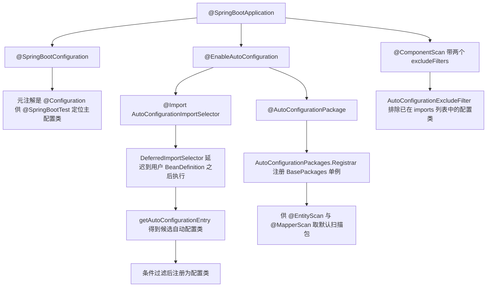
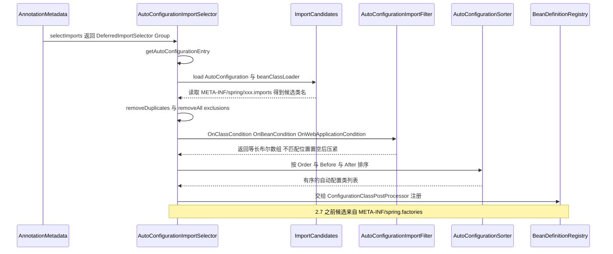
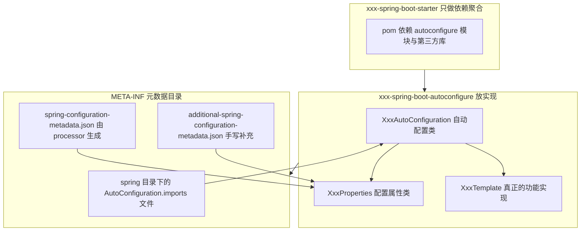
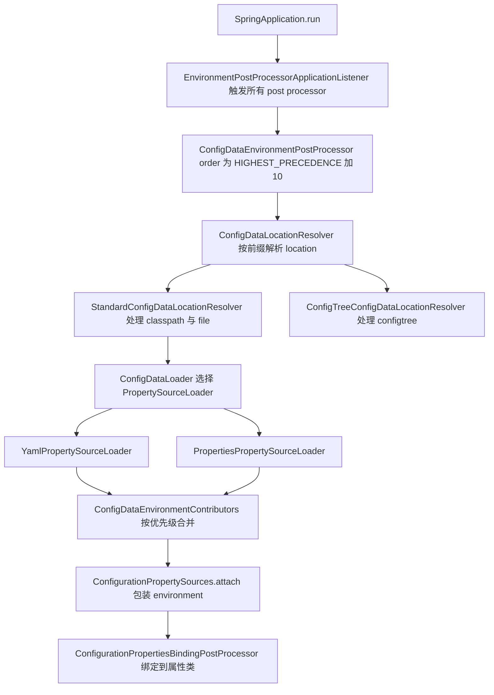
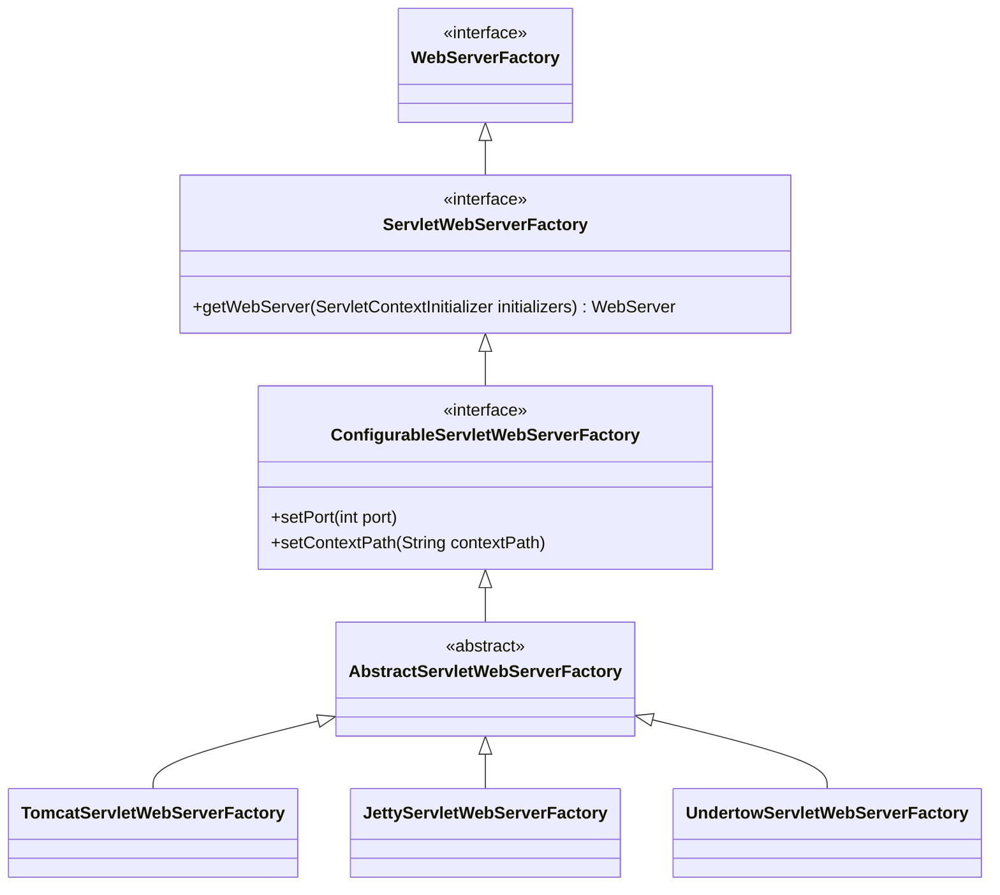
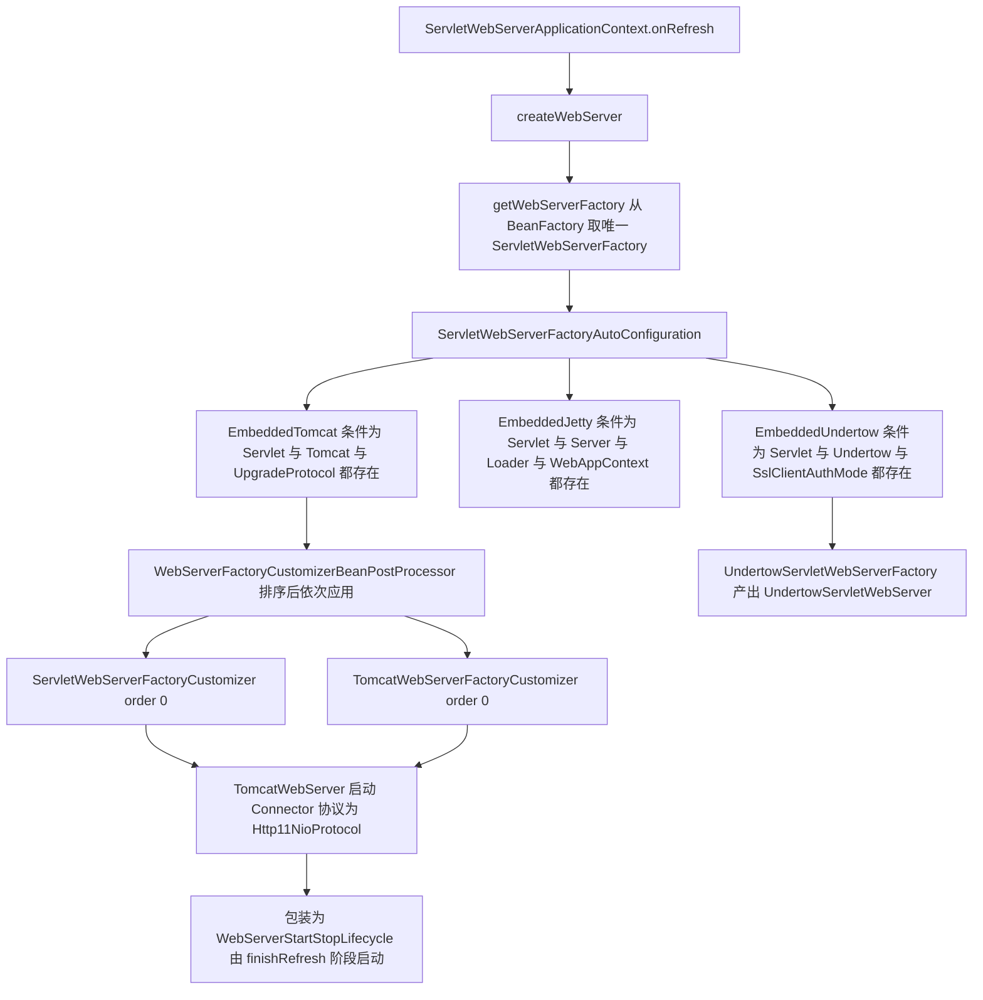
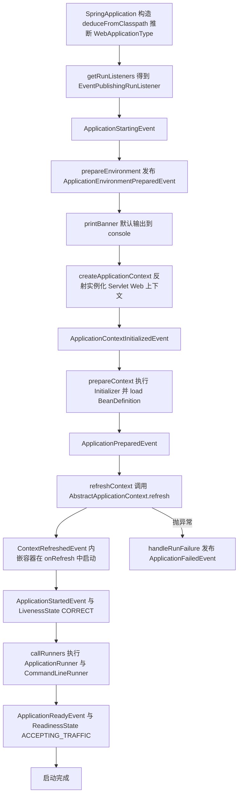
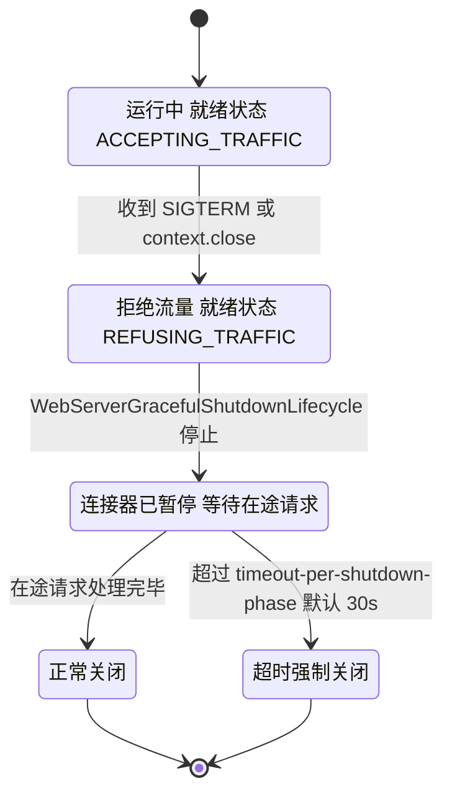
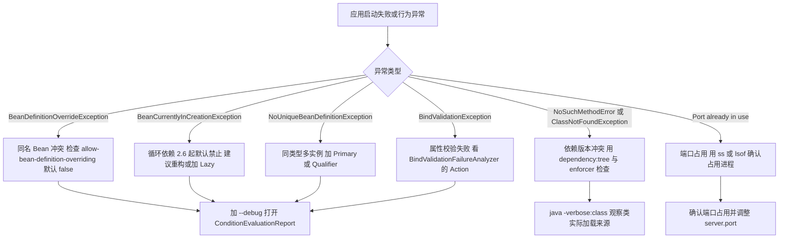

# 03 Spring Boot 原理与工程实践

> 一句话定位：Spring Boot 不是"新框架"，它是 Spring 的一层**约定 + 自动装配 + 内嵌容器**的工程壳；能把 `@SpringBootApplication` 拆到三个注解、把自动配置追到 `ImportCandidates` 与条件评估报告、把启动慢和 Bean 冲突定位到具体类，才算答到高级岗水准 ｜ 面试权重 ★★★★★ ｜ 建议复习 50 分钟

## 本章大纲

- [一、版本基线与 Spring Boot 到底解决了什么](#一版本基线与-spring-boot-到底解决了什么)
- [二、@SpringBootApplication 三层注解拆解](#二springbootapplication-三层注解拆解)
- [三、自动配置原理全链路](#三自动配置原理全链路)
- [四、条件注解体系](#四条件注解体系)
- [五、手写一个 starter 的完整步骤](#五手写一个-starter-的完整步骤)
- [六、配置加载优先级与 profile](#六配置加载优先级与-profile)
- [七、@ConfigurationProperties 与 @Value](#七configurationproperties-与-value)
- [八、配置加密与敏感信息管理](#八配置加密与敏感信息管理)
- [九、内嵌容器启动原理](#九内嵌容器启动原理)
- [十、SpringApplication.run 启动流程](#十springapplicationrun-启动流程)
- [十一、Actuator 与健康检查](#十一actuator-与健康检查)
- [十二、优雅停机](#十二优雅停机)
- [十三、日志体系与 logback 配置](#十三日志体系与-logback-配置)
- [十四、常见问题排查手册](#十四常见问题排查手册)
- [十五、Spring Boot 2.x 与 3.x 关键差异](#十五spring-boot-2x-与-3x-关键差异)
- [高级岗三问](#高级岗三问)
- [高频面试题](#高频面试题)
- [易错点与踩坑](#易错点与踩坑)
- [一句话速记](#一句话速记)

## 一、版本基线与 Spring Boot 到底解决了什么

### 1.1 版本对照表

下面这张表的数据来自本机 Maven 仓库中 `spring-boot-dependencies` 的 `<properties>` 段（不是背文档，是 BOM 实测值）。面试里只要说出"Spring Boot 3.x 强制 JDK 17、Servlet 命名空间换 Jakarta、Tomcat 换 10.1"，再补一两个精确版本号，可信度就够了。

| Spring Boot | Spring Framework | 最低 JDK | 内嵌 Tomcat | Logback | Micrometer | Servlet 规范 |
| --- | --- | --- | --- | --- | --- | --- |
| 2.5.12 | 5.3.18 | 8 | 9.0.60 | 1.2.11 | 1.7.10 | javax.servlet 4.0.1 |
| 2.7.18（2.x 末班车） | 5.3.31 | 8 | 9.0.83 | 1.2.12 | 1.9.17 | javax.servlet 4.0.1 |
| 3.2.8 | 6.1.11 | 17 | 10.1.26 | 1.4.14 | 1.12.8 | jakarta.servlet 6.0.0 |
| 3.3.13 | 6.1.21 | 17 | 10.1.42 | 1.5.18 | 1.13.15 | jakarta.servlet 6.0.0 |
| 3.4.12 | 6.2.14 | 17 | 10.1.49 | 1.5.21 | 1.14.13 | jakarta.servlet 6.0.0 |
| 3.5.6 | 6.2.11 | 17 | 10.1.46 | 1.5.18 | 1.15.4 | jakarta.servlet 6.0.0 |

两点必须说清楚，否则容易被追问翻车：

1. **同一个 minor 线内的 patch 版本会各自升级依赖**，所以 3.4.12 的 Spring Framework（6.2.14）比 3.5.6（6.2.11）还新，这属于正常现象，不要用"3.5 一定比 3.4 依赖新"去推断。
2. `spring-boot-starter-parent` 里的编译基线：Boot 2.x 是 `<java.version>1.8</java.version>` + `maven.compiler.source/target`；Boot 3.x 是 `<java.version>17</java.version>` + `maven.compiler.release`。`release` 比 `source/target` 更安全，因为它会同时校验 JDK API 使用范围，避免"用 JDK 21 编译出 target 17 的字节码但引用了 JDK 18 才有的 API"。

Undertow 与 Jetty 版本同样在 BOM 里：Boot 3.3.13 对应 Undertow 2.3.18.Final、Jetty 12.0.22；Boot 3.5.6 对应 Undertow 2.3.19.Final、Jetty 12.0.27。Boot 3.2.8 的 `native-build-tools-plugin.version` 是 0.9.28，Boot 3.4.12 是 0.10.6，这个值直接决定 GraalVM 原生镜像构建插件的行为。

### 1.2 Spring Boot 只做三件事

- **约定优于配置（Convention over Configuration）**：默认 `application.properties` 名字、默认 8080 端口、默认扫描启动类所在包及子包。代价是"隐式行为多"，出问题必须会看条件评估报告。
- **自动装配（Auto-configuration）**：把"类路径上有某个类就装配某个 Bean"的规则写成 `@ConditionalOnClass` + `@ConditionalOnMissingBean`，由 `AutoConfigurationImportSelector` 在启动时批量求值。
- **内嵌容器（Embedded Container）**：把 Tomcat 作为普通依赖打进 fat jar，`main` 方法直接启动，不再需要外置容器部署。

### 1.3 为什么不是"Spring + 一堆 XML"

XML 时代的痛点是**装配信息与代码分离**：改一个数据源参数要动 XML，编译期无法校验，IDE 无法跳转。Spring Boot 的解法是把装配信息搬回 Java（`@Configuration`）并加上条件判断。设计权衡是：**条件判断让装配路径变成运行期才确定**，所以"为什么这个 Bean 没生效"必须靠 `ConditionEvaluationReport` 而不是读代码。

面试可以这样收尾：Spring Boot 的收益是研发效率，代价是**可观测性成本**——你必须掌握 `--debug`、`/actuator/conditions`、`ApplicationStartup` 这三件工具，否则自动装配就是黑盒。

## 二、@SpringBootApplication 三层注解拆解

### 2.1 注解元数据（实测）

`org.springframework.boot.autoconfigure.SpringBootApplication` 自身带 `@Inherited`、`@Documented`、`@Retention(RUNTIME)`、`@Target(TYPE)`，并且组合了三个注解与一批 `@AliasFor`：

| 属性 | 类型 | 默认值 | 别名指向 |
| --- | --- | --- | --- |
| `exclude` | `Class<?>[]` | `{}` | `@EnableAutoConfiguration#exclude` |
| `excludeName` | `String[]` | `{}` | `@EnableAutoConfiguration#excludeName` |
| `scanBasePackages` | `String[]` | `{}` | `@ComponentScan#basePackages` |
| `scanBasePackageClasses` | `Class<?>[]` | `{}` | `@ComponentScan#basePackageClasses` |
| `nameGenerator` | `Class<? extends BeanNameGenerator>` | `BeanNameGenerator.class` | `@ComponentScan#nameGenerator` |
| `proxyBeanMethods` | `boolean` | `true` | `@Configuration#proxyBeanMethods` |

`proxyBeanMethods = true` 意味着启动类本身走 CGLIB 代理，方法间互相调用会走容器。**副作用**：启动类不能被 `final` 修饰，`main` 方法所在的类如果自己又定义了 `@Bean`，方法间调用会拿单例而不是新对象。

### 2.2 @SpringBootConfiguration

`@SpringBootConfiguration` 自己只标注了 `@Configuration`。它存在的唯一目的是**语义化 + 可被测试识别**：`@SpringBootTest` 会通过查找这个注解来定位主配置类，比直接找 `@Configuration` 更精确（避免误认业务里的某个配置类）。

### 2.3 @EnableAutoConfiguration

实测其元数据为：

```java
@AutoConfigurationPackage
@Import(AutoConfigurationImportSelector.class)
public @interface EnableAutoConfiguration {
    String ENABLED_OVERRIDE_PROPERTY = "spring.boot.enableautoconfiguration";
    Class<?>[] exclude() default {};
    String[] excludeName() default {};
}
```

两个关键点：

- `ENABLED_OVERRIDE_PROPERTY = "spring.boot.enableautoconfiguration"`，设为 `false` 可整体关闭自动配置。这个开关在生产上很少用，但面试里提一句能体现你读过源码。
- `@Import(AutoConfigurationImportSelector.class)` 导入的是一个 **`DeferredImportSelector`**。这是整个机制的关键：延迟导入意味着**所有用户自己定义的 `@Configuration` 与 `@Component` 先被注册**，自动配置类最后才处理。这正是 `@ConditionalOnMissingBean` 能"让位给用户 Bean"的前提。

### 2.4 @ComponentScan 的两个 excludeFilters

`@SpringBootApplication` 上的 `@ComponentScan` 带了两个自定义过滤器：

```java
excludeFilters = {
    @Filter(type = FilterType.CUSTOM, classes = TypeExcludeFilter.class),
    @Filter(type = FilterType.CUSTOM, classes = AutoConfigurationExcludeFilter.class)
}
```

- `TypeExcludeFilter`：让容器里所有 `TypeExcludeFilter` 类型的 Bean 参与扫描排除，是给测试框架（如 `@DataJpaTest`）留的扩展点。
- `AutoConfigurationExcludeFilter`：排除"既是 `@Configuration` 又在 `META-INF/spring/...AutoConfiguration.imports` 列表里"的类。**为什么需要它**？因为自动配置类物理上可能就放在启动类同包下（自研 starter 常见），如果不排除会被 `@ComponentScan` 扫到并当成普通配置类提前注册，条件判断顺序就乱了。

### 2.5 AutoConfigurationPackages.Registrar

`@AutoConfigurationPackage` 实测为 `@Import(AutoConfigurationPackages.Registrar.class)`。`AutoConfigurationPackages.Registrar` 做的事情非常小但很重要：把 `@SpringBootApplication` 所在包名注册成一个类型为 `AutoConfigurationPackages.BasePackages` 的单例，Bean 名是 `org.springframework.boot.autoconfigure.AutoConfigurationPackages`。

`AutoConfigurationPackages` 对外只暴露三个静态方法：`has(BeanFactory)`、`get(BeanFactory)`、`register(BeanDefinitionRegistry, String...)`。JPA 的 `@EntityScan`、MyBatis 的 `@MapperScan` 在没显式指定包时，默认值就来自这里。**排查口诀**：实体类或 Mapper 扫不到，先看启动类在哪个包，再看有没有把它挪到 `com.xxx` 之外的目录。



## 三、自动配置原理全链路

### 3.1 关键类清单

| 类 / 接口 | 所在模块 | 职责 |
| --- | --- | --- |
| `AutoConfigurationImportSelector` | spring-boot-autoconfigure | 收集候选自动配置类，去重、排除、过滤、排序 |
| `AutoConfigurationImportSelector.AutoConfigurationGroup` | 同上 | 实现 `DeferredImportSelector.Group`，把候选类作为 import 结果交给 `ConfigurationClassPostProcessor` |
| `AutoConfigurationImportFilter` | 同上 | 批量快速过滤接口，内置实现只有三个条件类 |
| `OnClassCondition` / `OnBeanCondition` / `OnWebApplicationCondition` | 同上 | 三个内置 `AutoConfigurationImportFilter`，从 `spring.factories` 加载 |
| `AutoConfigurationSorter` | 同上 | 按 `@AutoConfigureOrder`、`@AutoConfigureBefore`、`@AutoConfigureAfter` 拓扑排序 |
| `ImportCandidates` | spring-boot（`org.springframework.boot.context.annotation`） | 2.7 起负责读取 `META-INF/spring/<注解全名>.imports` |
| `ConditionEvaluationReport` | spring-boot-autoconfigure | 记录每个条件判定结果，Bean 名固定为 `autoConfigurationReport` |
| `AutoConfigurationImportListener` | 同上 | 装配前后事件回调，默认实现 `ConditionEvaluationReportAutoConfigurationImportListener` |

### 3.2 getAutoConfigurationEntry 的十步（按 2.5.x 字节码顺序）

`AutoConfigurationImportSelector#getAutoConfigurationEntry(AnnotationMetadata)` 是 `protected` 的，子类可覆写。字节码里的调用顺序是：

1. `isEnabled(annotationMetadata)` —— 读 `spring.boot.enableautoconfiguration`，为 `false` 直接返回空。
2. `getAttributes(annotationMetadata)` —— 取出 `exclude` 与 `excludeName`。
3. `getCandidateConfigurations(metadata, attributes)` —— 收集候选类名。2.5.x 走 `SpringFactoriesLoader.loadFactoryNames(getSpringFactoriesLoaderFactoryClass(), getBeanClassLoader())`，读 `META-INF/spring.factories` 的 `org.springframework.boot.autoconfigure.EnableAutoConfiguration` 键；3.x 走 `ImportCandidates.load(AutoConfiguration.class, classLoader)`，读 `META-INF/spring/org.springframework.boot.autoconfigure.AutoConfiguration.imports`。
4. `removeDuplicates(configurations)` —— 用 `LinkedHashSet` 去重并保持顺序。
5. `getExclusions(metadata, attributes)` —— 合并注解上的 `exclude`/`excludeName` 与属性 `spring.autoconfigure.exclude`。
6. `checkExcludedClasses(configurations, exclusions)` —— 排除了一个根本不存在的类会直接抛错，这是**故意设计**：避免拼错类名后静默失效。
7. `configurations.removeAll(exclusions)`。
8. `getConfigurationClassFilter().filter(configurations)` —— 先调用 `getAutoConfigurationImportFilters()` 拿到三个内置过滤器，再逐个 `match(candidates, autoConfigurationMetadata)` 得到等长 `boolean[]`，把不匹配位置置 `null` 后压紧成新列表。
9. `fireAutoConfigurationImportEvents(configurations, exclusions)` —— 发布 `AutoConfigurationImportEvent`，`ConditionEvaluationReportAutoConfigurationImportListener` 借此记录"哪些类被无条件排除"。
10. 构造 `AutoConfigurationEntry(configurations, exclusions)` 返回。

过滤这一步的实现细节值得说清楚（按 `AutoConfigurationImportSelector$ConfigurationClassFilter#filter` 的字节码）：它先把 `List<String>` 转成 `String[]`，然后逐个过滤器调用 `AutoConfigurationImportFilter#match(String[], AutoConfigurationMetadata)`，拿到一个**与候选数组等长的 `boolean[]`**，把 `false` 的位置置为 `null`，最后压紧成新的 `List`。所以它是"整批求值 + 打洞 + 压紧"，不是逐个类短路。

那性能靠什么保证？靠 `spring-autoconfigure-metadata.properties` 这个预索引文件（2.x 与 3.x 的 `spring-boot-autoconfigure.jar` 里都有）。`OnClassCondition` 先用它判断"这个自动配置类依赖的类是否存在"，避免为每个候选类都去反射调用 `ClassUtils.isPresent`。另外 `OnClassCondition` 内部会按类名分组，同一组只做一次类路径判断，这是它比"逐个类判断"快一个数量级的原因。

### 3.3 spring.factories 与 AutoConfiguration.imports

这是 2.x 与 3.x 最容易答错的地方，必须区分"自动配置"与"其它 SPI"。

| 版本 | 自动配置候选来源 | 其它 SPI 来源 |
| --- | --- | --- |
| 2.0 ~ 2.6 | `META-INF/spring.factories` 的 `EnableAutoConfiguration` 键 | 同一个 `spring.factories` |
| 2.7 | 新增 `META-INF/spring/org.springframework.boot.autoconfigure.AutoConfiguration.imports`，同时兼容旧键（旧键会打警告） | `spring.factories` |
| 3.0+ | **只认** `AutoConfiguration.imports`，`spring.factories` 里的 `EnableAutoConfiguration` 键被彻底移除 | `spring.factories` 仍然保留 |

实测数据可以佐证：`spring-boot-autoconfigure-2.5.12.jar` 的 `spring.factories` 里 `EnableAutoConfiguration` 键下有 131 个类；`spring-boot-autoconfigure-3.5.6.jar` 的 `META-INF/spring/org.springframework.boot.autoconfigure.AutoConfiguration.imports` 有 156 行，而它的 `spring.factories` 里**已经没有** `EnableAutoConfiguration` 键，只剩 `ApplicationContextInitializer`、`ApplicationListener`、`EnvironmentPostProcessor`、`AutoConfigurationImportListener`、`AutoConfigurationImportFilter`、`FailureAnalyzer`、`TemplateAvailabilityProvider` 等。

3.x 里仍在 `spring.factories` 的 SPI 包括（实测清单）：

- `org.springframework.boot.logging.LoggingSystemFactory`
- `org.springframework.boot.env.PropertySourceLoader`
- `org.springframework.boot.context.config.ConfigDataLocationResolver`
- `org.springframework.boot.context.config.ConfigDataLoader`
- `org.springframework.boot.ApplicationContextFactory`
- `org.springframework.boot.SpringApplicationRunListener`（默认 `EventPublishingRunListener`）
- `org.springframework.boot.diagnostics.FailureAnalyzer`
- `org.springframework.context.ApplicationContextInitializer`
- `org.springframework.context.ApplicationListener`
- `org.springframework.boot.env.EnvironmentPostProcessor`

另外 3.x 新增了 `META-INF/spring/aot.factories`，承载 AOT 阶段的 SPI：`RuntimeHintsRegistrar`、`BeanFactoryInitializationAotProcessor`、`BeanRegistrationAotProcessor`、`BeanRegistrationExcludeFilter`。实测 `spring-boot-autoconfigure-3.5.6.jar` 的 `META-INF/spring/aot.factories` 里注册了 `ConditionEvaluationReportLoggingProcessor`、`JacksonAutoConfiguration$JacksonAutoConfigurationRuntimeHints`、`TemplateRuntimeHints` 等。

3.5.x 还多了一个 `org.springframework.boot.autoconfigure.AutoConfiguration.replacements` 文件，用于在 AOT 处理时替换已废弃的自动配置类。

### 3.4 排序：@AutoConfigureOrder / Before / After

`AutoConfigurationSorter` 的排序规则优先级从高到低：

1. 显式 `@AutoConfigureOrder` 值（`Ordered` 语义，越小越前）。
2. `@AutoConfigureBefore` / `@AutoConfigureAfter` 声明的依赖关系。
3. 类名字母序作为稳定兜底。

**为什么字母序兜底很重要**：它保证了同一个 classpath 在不同机器上装配顺序一致，否则条件判断结果会随机漂移，产生"本地能启动、线上起不来"的经典问题。

### 3.5 打开条件评估报告

三种方式，按侵入性从小到大：

```bash
# 1. 启动参数，输出到日志，包含 Positive matches 与 Negative matches
java -jar app.jar --debug

# 2. 只开自动配置相关日志，噪音更小
java -jar app.jar --logging.level.org.springframework.boot.autoconfigure=DEBUG

# 3. 运行期从容器里取报告（需自行暴露，或用 actuator 的 /actuator/conditions）
ConditionEvaluationReport report =
    (ConditionEvaluationReport) ctx.getBean("autoConfigurationReport");
```

`ConditionEvaluationReport.BEAN_NAME` 的常量值实测就是字符串 `"autoConfigurationReport"`。报告里三块内容必须会看：

- `Positive matches`：哪些自动配置生效了，以及是哪个条件让它生效。
- `Negative matches`：哪些没生效，以及**第一个不匹配的条件**是什么。
- `Exclusions`：被 `exclude` 或 `spring.autoconfigure.exclude` 排除的类。
- `Unconditional classes`：没有任何 `@Conditional` 的配置类，通常说明你漏加条件了。



## 四、条件注解体系

### 4.1 条件注解全清单

所有条件注解都在 `org.springframework.boot.autoconfigure.condition` 包下，元注解都是 `@Conditional`。

| 注解 | 判定依据 | 典型用途 |
| --- | --- | --- |
| `@ConditionalOnClass` | 指定类存在于类路径 | 有 `DataSource` 才装配 JdbcTemplate |
| `@ConditionalOnMissingClass` | 指定类不存在 | 与前者互斥的兜底分支 |
| `@ConditionalOnBean` | 容器中已存在指定类型 Bean | 依赖其它自动配置的产物 |
| `@ConditionalOnMissingBean` | 容器中不存在指定类型 Bean | 给用户留覆盖口 |
| `@ConditionalOnSingleCandidate` | 指定类型 Bean 只有一个或有一个 `@Primary` | 避免多数据源场景误装配 |
| `@ConditionalOnProperty` | 配置项存在且值匹配 | 功能开关，如 `app.sms.enabled=true` |
| `@ConditionalOnResource` | 资源文件存在 | `classpath:logback-spring.xml` |
| `@ConditionalOnWebApplication` | 是 Web 应用（可指定 `Type.SERVLET`/`REACTIVE`） | Web 专属装配 |
| `@ConditionalOnNotWebApplication` | 不是 Web 应用 | 批处理场景 |
| `@ConditionalOnExpression` | SpEL 表达式为真 | 复杂组合条件 |
| `@ConditionalOnJava` | JDK 版本范围 | 按 JDK 分支实现 |
| `@ConditionalOnJndi` | JNDI 位置存在 | 传统容器部署 |
| `@ConditionalOnCloudPlatform` | 云平台（KUBERNETES、CLOUD_FOUNDRY 等） | 平台适配 |

`@ConditionalOnProperty` 的三个属性必须记牢：`name`/`value`（别名）、`havingValue`（默认空串）、`matchIfMissing`（默认 `false`）。语义细节：**当 `havingValue` 为空串时，只要属性存在且不等于 `"false"` 就匹配**；配了 `havingValue` 就必须等值。

### 4.2 @ConditionalOnMissingBean 的顺序陷阱

`@ConditionalOnMissingBean` 判定的是"**到此刻为止**容器里有没有这个 Bean"，所以它只在自动配置类里安全。三个经典陷阱：

1. **用户 Bean 定义在另一个自动配置类之后**：如果用户把覆盖用的 `@Bean` 也放进自动配置类，且排序在后，`@ConditionalOnMissingBean` 会判定"不存在"，两个 Bean 都注册 → 运行期 `NoUniqueBeanDefinitionException`。
2. **写在普通 `@Configuration` 上**：用户自己的配置类之间处理顺序不确定，条件结果不可预测。Spring Boot 官方明确说 `@ConditionalOnBean`/`@ConditionalOnMissingBean` 应当只用在自动配置类中。
3. **`@ConditionalOnMissingBean` 不写类型**：默认取方法返回类型。返回 `Object` 或接口父类型时，判定会过宽或过窄，必须显式写 `@ConditionalOnMissingBean(XxxTemplate.class)`。

还有一点常被忽略：`@ConditionalOnMissingBean` 的 `search` 默认是 `SearchStrategy.ALL`，也就是**会沿父容器层级往上找**。在父子容器场景（启用 `management.server.port` 后 Boot 建的 management 子上下文、Spring Cloud 的 bootstrap 上下文）里，父容器中的同类型 Bean 会让自动配置直接退让，表现为"子容器里查不到这个 Bean"。只想看当前容器时显式写 `search = SearchStrategy.CURRENT`——Boot 自己的 `EmbeddedTomcat`/`EmbeddedJetty`/`EmbeddedUndertow` 就是这么写的。

### 4.3 自定义 Condition

```java
public class OnLinuxCondition implements Condition {
    @Override
    public boolean matches(ConditionContext context, AnnotatedTypeMetadata metadata) {
        return System.getProperty("os.name", "").toLowerCase().contains("linux");
    }
}
```

用法 `@Conditional(OnLinuxCondition.class)`。要点：

- `matches` 里**不要做重活**（不要建连接、不要读远程配置），它会在启动阶段被反复调用。
- 需要拿到方法上的注解属性时，用 `metadata.getAllAnnotationAttributes(XXX.class.getName())`，别用 `instanceof MethodMetadata` 强转。
- 需要参与 `AutoConfigurationImportFilter` 批量过滤（性能优化）时，条件类要额外实现 `AutoConfigurationImportFilter#match(String[], AutoConfigurationMetadata)`，并在 `spring.factories` 的 `org.springframework.boot.autoconfigure.AutoConfigurationImportFilter` 键下注册（Boot 内置的三个就是这么来的）。别和 `ConfigurationCondition#getConfigurationPhase()` 混在一起——它管的是条件在"解析配置类"还是"注册 Bean"阶段求值，与批量过滤无关。

## 五、手写一个 starter 的完整步骤

### 5.1 模块划分与命名

Spring Boot 官方约定：**一个 starter 拆成两个 module**。

| 模块 | 命名 | 内容 | 依赖 |
| --- | --- | --- | --- |
| 聚合模块 | `xxx-spring-boot-starter` | 只有 pom，无代码 | 依赖 autoconfigure 模块 + 第三方库 |
| 实现模块 | `xxx-spring-boot-autoconfigure` | 自动配置类、属性类、模板类 | 依赖 `spring-boot-autoconfigure` |

**为什么要拆**：用户可能只想用你的属性类与条件注解，不想引入第三方库（例如自研 starter 内部用 Log4j2 但用户用 Logback）。拆开后 `optional` 依赖不会传染。如果项目小，合并成一个 module 也能跑，但面试时说出这个权衡会加分。

### 5.2 自动配置类

以短信发送为例（要求 Spring Boot 2.7+，因为用到 `@AutoConfiguration`）：

```java
package com.example.sms.autoconfigure;

import org.springframework.boot.autoconfigure.AutoConfiguration;
import org.springframework.boot.autoconfigure.condition.ConditionalOnClass;
import org.springframework.boot.autoconfigure.condition.ConditionalOnMissingBean;
import org.springframework.boot.autoconfigure.condition.ConditionalOnProperty;
import org.springframework.boot.context.properties.EnableConfigurationProperties;
import org.springframework.context.annotation.Bean;

@AutoConfiguration
@ConditionalOnClass(SmsClient.class)
@ConditionalOnProperty(prefix = "app.sms", name = "enabled", havingValue = "true", matchIfMissing = true)
@EnableConfigurationProperties(SmsProperties.class)
public class SmsAutoConfiguration {

    @Bean
    @ConditionalOnMissingBean
    public SmsTemplate smsTemplate(SmsProperties properties) {
        SmsClient client = new SmsClient(properties.getEndpoint(), properties.getTimeout());
        return new SmsTemplate(client, properties.getSignName(), properties.getRetry().getMaxAttempts());
    }
}
```

要点逐条解释：

- `@AutoConfiguration` 是 2.7 引入的，等价于 `@Configuration(proxyBeanMethods = false)` 并额外支持 `@AutoConfigureBefore`/`@AutoConfigureAfter`。**必须用 `proxyBeanMethods = false`**，因为自动配置类里方法间不需要互相调用，关掉代理能省掉一次 CGLIB 增强，启动更快。
- `@ConditionalOnClass(SmsClient.class)` 保证第三方库不在类路径时整类跳过，不会 `NoClassDefFoundError`。
- `@ConditionalOnMissingBean` 放在 `@Bean` 方法上，让用户自定义的 `SmsTemplate` 优先。
- 属性类用 `@EnableConfigurationProperties` 显式注册，而不是给属性类加 `@Component`。原因：自动配置类所在包通常不在用户 `@ComponentScan` 范围内，加 `@Component` 根本扫不到。

### 5.3 配置属性类

```java
package com.example.sms.autoconfigure;

import jakarta.validation.constraints.NotBlank;
import org.springframework.boot.context.properties.ConfigurationProperties;
import org.springframework.boot.convert.DataSizeUnit;
import org.springframework.boot.convert.DurationUnit;
import org.springframework.util.unit.DataSize;
import org.springframework.util.unit.DataUnit;
import org.springframework.validation.annotation.Validated;

import java.time.Duration;
import java.time.temporal.ChronoUnit;

@ConfigurationProperties(prefix = "app.sms")
@Validated
public class SmsProperties {

    @NotBlank
    private String endpoint;

    @NotBlank
    private String signName;

    @DurationUnit(ChronoUnit.SECONDS)
    private Duration timeout = Duration.ofSeconds(3);

    @DataSizeUnit(DataUnit.KILOBYTES)
    private DataSize maxPayload = DataSize.ofKilobytes(64);

    private final Retry retry = new Retry();

    public static class Retry {
        private int maxAttempts = 3;
        private Duration backoff = Duration.ofMillis(200);

        public int getMaxAttempts() {
            return this.maxAttempts;
        }

        public void setMaxAttempts(int maxAttempts) {
            this.maxAttempts = maxAttempts;
        }

        public Duration getBackoff() {
            return this.backoff;
        }

        public void setBackoff(Duration backoff) {
            this.backoff = backoff;
        }
    }

    public String getEndpoint() {
        return this.endpoint;
    }

    public void setEndpoint(String endpoint) {
        this.endpoint = endpoint;
    }

    public String getSignName() {
        return this.signName;
    }

    public void setSignName(String signName) {
        this.signName = signName;
    }

    public Duration getTimeout() {
        return this.timeout;
    }

    public void setTimeout(Duration timeout) {
        this.timeout = timeout;
    }

    public DataSize getMaxPayload() {
        return this.maxPayload;
    }

    public void setMaxPayload(DataSize maxPayload) {
        this.maxPayload = maxPayload;
    }

    public Retry getRetry() {
        return this.retry;
    }
}
```

四个细节：

- 前缀必须是 **kebab-case 小写**。`ConfigurationPropertyName` 会做规范化，`app.sms` 合法，`app.smsService` 在 2.0+ 会直接抛 `InvalidConfigurationPropertyNameException`。
- `@Validated` + JSR-303 约束在绑定时触发，失败抛 `BindValidationException`，由 `BindValidationFailureAnalyzer` 转成可读的启动失败报告。
- `Duration` 默认单位是毫秒，`DataSize` 默认单位是字节。写 `timeout: 3` 会被解释成 3 毫秒，这是线上事故高发点，所以推荐加 `@DurationUnit`/`@DataSizeUnit` 或直接写 `3s`、`64KB`。
- 嵌套对象用 `final` 字段 + 提供 getter，走 `JavaBeanBinder` 的嵌套绑定，不要给嵌套对象加 `@ConfigurationProperties`。

### 5.4 注册文件

2.7 及以后，在 `src/main/resources/META-INF/spring/` 下建文件，文件名就是注解全限定名加 `.imports`：

```
src/main/resources/META-INF/spring/org.springframework.boot.autoconfigure.AutoConfiguration.imports
```

内容一行一个类名：

```
com.example.sms.autoconfigure.SmsAutoConfiguration
```

2.6 及以前则写 `META-INF/spring.factories`：

```properties
org.springframework.boot.autoconfigure.EnableAutoConfiguration=\
com.example.sms.autoconfigure.SmsAutoConfiguration
```

**兼容写法**：同时提供两个文件。2.7 会把两份都读进来再合并去重（实测 `AutoConfigurationImportSelector#getCandidateConfigurations` 先 `SpringFactoriesLoader.loadFactoryNames` 读 `spring.factories`，再 `ImportCandidates.load` 读 `.imports`），旧版本只读 `spring.factories`，两边都不报错。但 3.0 起 `spring.factories` 那份就完全无效了，记得清理。

### 5.5 提示文件

给 IDE 补全用的元数据由 `spring-boot-configuration-processor` 在编译期生成到 `target/classes/META-INF/spring-configuration-metadata.json`。pom 里加：

```xml
<dependency>
    <groupId>org.springframework.boot</groupId>
    <artifactId>spring-boot-configuration-processor</artifactId>
    <optional>true</optional>
</dependency>
```

**必须加 `<optional>true</optional>`**，否则会传递到使用方，污染依赖树。

自动生成不了的内容（例如 `@ConditionalOnProperty` 才生效的属性、枚举的候选值描述）手写到 `src/main/resources/META-INF/additional-spring-configuration-metadata.json`：

```json
{
  "properties": [
    {
      "name": "app.sms.enabled",
      "type": "java.lang.Boolean",
      "description": "是否启用短信自动配置。",
      "defaultValue": true
    }
  ],
  "hints": [
    {
      "name": "app.sms.retry.max-attempts",
      "values": [
        { "value": 1, "description": "不重试。" },
        { "value": 3, "description": "默认值，适合大部分场景。" }
      ]
    }
  ]
}
```

### 5.6 测试与踩坑

| 踩坑现象 | 原因 | 解决 |
| --- | --- | --- |
| 属性类没被注册，`@ConfigurationProperties` 不生效 | 自动配置类没加 `@EnableConfigurationProperties` | 加上，或用 `@ConfigurationPropertiesScan` |
| IDE 不提示自定义属性 | 没加 configuration-processor 依赖 | 加依赖并重新编译 |
| 用户自定义 Bean 被覆盖 | 忘了 `@ConditionalOnMissingBean` | 在 `@Bean` 方法上加 |
| 应用启动报 `NoClassDefFoundError` | 自动配置类直接引用了可选依赖的类型 | 用 `@ConditionalOnClass` + 方法参数注入，或 `ObjectProvider` 延迟取 |
| 3.x 下 starter 完全不生效 | 只写了 `spring.factories` | 补 `.imports` 文件 |

验证自动配置的单元测试用 `ApplicationContextRunner`：

```java
private final ApplicationContextRunner runner = new ApplicationContextRunner()
        .withConfiguration(AutoConfigurations.of(SmsAutoConfiguration.class));

@Test
void backsOffWhenUserProvidesTemplate() {
    runner.withUserConfiguration(UserConfig.class)
          .run(ctx -> assertThat(ctx).hasSingleBean(SmsTemplate.class)
                  .getBean(SmsTemplate.class).isSameAs(UserConfig.TEMPLATE));
}
```



## 六、配置加载优先级与 profile

### 6.1 ConfigData API（2.4 起）

Spring Boot 2.4 用 `ConfigDataEnvironmentPostProcessor` 重写了配置加载，取代了旧的 `ConfigFileApplicationListener`。实测其 `ORDER` 字段值为 `-2147483638`，即 `Ordered.HIGHEST_PRECEDENCE + 10`——**它必须在 `SpringApplicationJsonEnvironmentPostProcessor` 等其它 post processor 之前跑**，否则 `SPRING_APPLICATION_JSON` 里的 `spring.config.import` 就来不及被解析。

参与这套机制的 SPI 都在 `spring.factories` 里注册：

| SPI | 内置实现 | 作用 |
| --- | --- | --- |
| `PropertySourceLoader` | `PropertiesPropertySourceLoader`、`YamlPropertySourceLoader` | 按扩展名决定用什么解析器 |
| `ConfigDataLocationResolver` | `StandardConfigDataLocationResolver`、`ConfigTreeConfigDataLocationResolver`、`SystemEnvironmentConfigDataLocationResolver` | 把 `file:`、`classpath:`、`configtree:` 前缀解析成资源 |
| `ConfigDataLoader` | 与上面一一对应 | 真正读取并产出 `PropertySource` |

`spring.config.use-legacy-processing=true` 可以回退到旧逻辑（2.4 引入，3.0 移除）。迁移期用它救火可以，长期必须改掉，因为新旧逻辑在 profile 处理上语义不同。

### 6.2 属性优先级全表

优先级从低到高，**后面覆盖前面**：

| 顺序 | 来源 | 说明 |
| --- | --- | --- |
| 1 | `SpringApplication.setDefaultProperties` | 代码里的默认值，最低优先级 |
| 2 | `@PropertySource` 注解 | 注意：它在 `refresh` 时才加入 Environment，对 `@ConfigurationProperties` 绑定可能太晚 |
| 3 | Config data（`application.properties`/`yml`） | 含 profile-specific 文件 |
| 4 | `RandomValuePropertySource` | 只能产生 `random.*` 值，不能被覆盖 |
| 5 | 操作系统环境变量 | `SPRING_DATASOURCE_URL` 会被映射为 `spring.datasource.url` |
| 6 | Java 系统属性 | `-Dspring.datasource.url=...` |
| 7 | JNDI 属性（`java:comp/env`） | 传统容器部署 |
| 8 | `ServletContext` 初始化参数 | war 部署 |
| 9 | `ServletConfig` 初始化参数 | war 部署 |
| 10 | `SPRING_APPLICATION_JSON` | 环境变量或系统属性形式的内联 JSON |
| 11 | 命令行参数 | `--server.port=9090`，容器化部署最常用 |
| 12 | 测试属性 | `@SpringBootTest(properties=...)`、`@DynamicPropertySource` |
| 13 | Devtools 全局配置 | `$HOME/.config/spring-boot/` 下的文件，仅开发期 |

**生产实践**：镜像里放 `application.yml` 作为基线，环境差异用环境变量或命令行参数覆盖。**不要**把密码写进镜像内的配置文件。

### 6.3 Config data 文件的位置与顺序

`spring.config.location` 不配置时，默认按下面顺序搜索，**后出现的位置优先级更高**：

| 顺序 | 位置 | 优先级 |
| --- | --- | --- |
| 1 | `classpath:/` | 最低 |
| 2 | `classpath:/config/` | 低 |
| 3 | `file:./` | 中 |
| 4 | `file:./config/` | 高 |
| 5 | `file:./config/*/` | 最高 |

同一位置内，**profile-specific 文件覆盖非 profile-specific 文件**；同名不同格式时，`.properties` 优先于 `.yml`。所以"本地 `application.yml` 改不动线上的值"这种问题，先看是不是 `file:./config/` 下有更高优先级的文件。

其它相关属性：

| 属性 | 默认值 | 说明 |
| --- | --- | --- |
| `spring.config.name` | `application` | 文件名前缀，可逗号分隔多个 |
| `spring.config.location` | 无 | 设置后**替换**默认搜索位置 |
| `spring.config.additional-location` | 无 | 追加位置，保留默认位置 |
| `spring.config.on-not-found` | `fail` | 找不到文件时抛异常，可设 `ignore` |
| `spring.config.import` | 无 | 2.4 起支持 `optional:`、`file:`、`classpath:`、`configtree:` 前缀 |

`spring.config.import` 的典型用法：

```yaml
spring:
  config:
    import:
      - optional:file:./local-override.yml
      - configtree:/etc/myapp/secrets/
```

`configtree:` 会把目录下每个文件当成一个属性，**文件名就是属性名，文件内容就是值**——这是 K8s Secret 挂载的标准接法，不需要写任何解析代码。

### 6.4 profile 机制

| 属性 | 默认值 | 行为 |
| --- | --- | --- |
| `spring.profiles.active` | 无 | 显式激活的 profile |
| `spring.profiles.default` | `default` | 没设置 active 时使用 |
| `spring.profiles.include` | 无 | 追加 profile，2.4 起只能出现在非 profile-specific 文档里 |
| `spring.profiles.group.<name>` | 无 | 给一组 profile 起别名，激活别名即激活整组 |

`spring.profiles.group` 示例：

```yaml
spring:
  profiles:
    group:
      prod: prod-db,prod-cache,prod-mq
```

之后 `--spring.profiles.active=prod` 等价于同时激活三个。**2.4 起 `spring.profiles.active` 不允许出现在 profile-specific 文档里**，否则抛 `InvalidConfigDataPropertyException`。这是升级 2.3 → 2.4+ 时最常见的报错。

那 profile-specific 文档怎么声明自己的生效条件？用 **`spring.config.activate.on-profile`**（2.4 起取代旧的 `spring.profiles` 键）：同一个 `application.yml` 里用 `---` 分隔多个文档，某个文档写 `spring.config.activate.on-profile: prod`，就只在 prod 下生效。在 profile-specific 文档里改激活列表是行不通的——那等于用配置决定"该读哪些配置"，Boot 只能直接报错。

代码里判断 profile 用 `Environment#acceptsProfiles(Profiles.of("prod"))`（`Profiles` 重载是 Spring Framework 5.1 起，对应 Boot 2.1；旧的 `String...` 重载自 5.1 起已废弃）。



## 七、@ConfigurationProperties 与 @Value

### 7.1 对照表

| 维度 | `@ConfigurationProperties` | `@Value` |
| --- | --- | --- |
| 定位 | 批量绑定一组相关配置 | 单个值注入 |
| 松散绑定 | 支持 `app.sms.sign-name`、`APP_SMS_SIGNNAME`、`app.sms.signName` 等多种写法 | 不支持，必须精确匹配 |
| SpEL | 不支持 | 支持，如 `@Value("#{systemProperties['x']}")` |
| JSR-303 校验 | 支持，配 `@Validated` | 不支持 |
| 复杂类型 | List、Map、嵌套对象、`Duration`、`DataSize` 都能绑 | 只能靠 `List<String>` 加 SpEL 或转换器 |
| IDE 提示 | 有元数据，自动补全 | 无 |
| 元数据文件 | configuration-processor 生成 | 无 |
| 绑定时机 | `ConfigurationPropertiesBindingPostProcessor` 在 `postProcessBeforeInitialization` 绑定 | `AutowiredAnnotationBeanPostProcessor` 处理 |
| 覆盖默认值 | 可整组覆盖，也支持 `@DefaultValue` 标注构造器参数（2.2 起） | 逐个覆盖 |

### 7.2 绑定原理

`ConfigurationPropertiesBindingPostProcessor` 实测 `getOrder()` 返回 `-2147483647`，即 `Ordered.HIGHEST_PRECEDENCE + 1`。**为什么必须这么早**：属性绑定要发生在 `@PostConstruct`、`InitializingBean#afterPropertiesSet` 之前，否则初始化逻辑会读到未绑定的字段。它同时实现了 `BeanPostProcessor`、`PriorityOrdered`、`ApplicationContextAware`、`InitializingBean`，是 Spring Boot 里优先级最高的 `BeanPostProcessor` 之一。

绑定链路：

1. `ConfigurationPropertySources.attach(environment)` 把一个名为 `configurationProperties` 的 `ConfigurationPropertySource` 插到 Environment 最前面。
2. `ConfigurationPropertiesBinder` 通过 `Binder` 按 `prefix` 收集所有匹配的属性名。
3. `JavaBeanBinder`（可变对象）或 `ValueObjectBinder`（构造器绑定 / record）把值写进实例。
4. 类型转换交给 `ApplicationConversionService`，它注册了 `StringToDurationConverter`、`StringToDataSizeConverter` 等。

### 7.3 松散绑定的规范形式

`ConfigurationPropertyName` 规定属性名的规范形式是 **kebab-case、全小写、字母数字与短横线**。绑定时的等价关系：

| 配置文件里写 | 环境变量里写 | 绑定到字段 |
| --- | --- | --- |
| `app.sms.sign-name` | `APP_SMS_SIGN_NAME` | `signName` |
| `app.sms.max-payload` | `APP_SMS_MAXPAYLOAD` | `maxPayload` |
| `app.sms.retry.max-attempts` | `APP_SMS_RETRY_MAXATTEMPTS` | `retry.maxAttempts` |

**环境变量的坑**：短横线要换成下划线，但下划线不会还原成短横线。`APP_SMS_MAX_PAYLOAD` 会被映射为 `app.sms.max.payload`（多了一层），绑不到 `maxPayload`。所以字段名尽量不要出现"一个单词里再分词"的情况，或者直接改名。

### 7.4 构造器绑定与 record

Spring Boot 2.2 起支持 `@ConstructorBinding`，3.0 起规则放宽：**只有一个有参构造器时不再需要 `@ConstructorBinding`**，有多个构造器才必须标注。

```java
@ConfigurationProperties(prefix = "app.sms")
public record SmsRecordProperties(String endpoint, String signName, Duration timeout) {
}
```

record 绑定是 AOT/原生镜像友好的写法，因为不需要反射写字段。

## 八、配置加密与敏感信息管理

### 8.1 三种方案对比

| 方案 | 密钥位置 | 优点 | 代价 |
| --- | --- | --- | --- |
| Jasypt（`jasypt-spring-boot-starter`） | 环境变量 / 启动参数 / K8s Secret | 接入成本最低，配置项仍写在 `application.yml` | 密钥与应用同机，泄露即全泄；字符串加密不是密钥管理 |
| Spring Cloud Config Server 加密 | Server 端 `encrypt.key` | 客户端拿到的是明文，密钥集中管理 | 引入 Config Server 组件；`{cipher}` 前缀容易配错 |
| Vault / KMS / K8s Secret + `configtree:` | 独立密钥系统 | 密钥可轮转、可审计，最贴近生产标准 | 运维复杂度最高 |

**面试结论口径**：加密解决的是"配置文件泄露"这一个风险面，不解决"主机被入侵"。生产上至少要做到密钥不进代码仓库、不进镜像，通过 K8s Secret 或 Vault 注入。

### 8.2 Jasypt 落地要点

```yaml
jasypt:
  encryptor:
    password: ${JASYPT_ENCRYPTOR_PASSWORD}
    algorithm: PBEWITHHMACSHA512ANDAES_256
    iv-generator-classname: org.jasypt.iv.RandomIvGenerator
```

```yaml
spring:
  datasource:
    password: ENC(密文字符串)
```

必须记住的三个点：

1. **默认算法是 `PBEWITHMD5ANDDES`，强度不足，必须显式换成 `PBEWITHHMACSHA512ANDAES_256`**。换了算法后要用新算法重新生成密文，旧密文解不开。
2. `PBEWITHHMACSHA512ANDAES_256` 要求 JDK 8 起支持无限强度加密策略（JDK 8u161 之后默认已开启，之前需要装 JCE Unlimited Strength）。
3. `jasypt.encryptor.password` 只能从环境变量或启动参数传入。**写在 `application.yml` 里等于没加密**，这一点面试官很爱追问。

### 8.3 Spring Cloud Config 的加密

服务端配 `encrypt.key` 后，配置仓库里写 `{cipher}密文`，客户端 `Environment` 里已经是明文。注意：

- 只有**通过 Config Server 拉取**的属性才会解密。本地 `application.yml` 里写 `{cipher}xxx` 不会被解密。
- `/encrypt` 与 `/decrypt` 端点在 2.x 起默认需要认证；生产必须关闭或加鉴权，否则等于开放了一个加解密 oracle。
- 密钥轮转时，旧密文需要重新加密；`spring.cloud.config.server.encrypt.enabled=false` 可以让服务端只做透传。

## 九、内嵌容器启动原理

### 9.1 createWebServer 时序

Web 应用的上下文是 `AnnotationConfigServletWebServerApplicationContext`，它在 `onRefresh()` 里调用 `createWebServer()`（实测源码：`onRefresh` 先调 `GenericWebApplicationContext.onRefresh()`，再调 `createWebServer()`）。这一步是**内嵌容器的创建点**，注意 `AbstractApplicationContext#refresh` 里的顺序是 `onRefresh()` → `registerListeners()` → `finishBeanFactoryInitialization()` → `finishRefresh()`，也就是它**发生在单例 Bean 实例化之前**（`webServer` 在这个阶段创建，Tomcat 对象在这里 `initialize()`）。另外，`ServletContextInitializer`（`selfInitialize`，把 `DispatcherServlet`、Filter 注册进容器）也是在这个阶段执行完的——`TomcatWebServer` 构造器里的 `initialize()` 会 `tomcat.start()` 把 context 启起来，`TomcatStarter` 就在那时跑完所有 initializer（Boot 启动日志里"Initializing Spring embedded WebApplicationContext"就夹在"Tomcat initialized with…"与"Tomcat started on…"之间）。真正绑定连接器端口、以及 `load-on-startup` Servlet 的 `init()`，才推迟到 `finishRefresh()` 阶段 `WebServerStartStopLifecycle#start()` 调 `WebServer#start()` 时。

`createWebServer()` 的逻辑：

1. 从 BeanFactory 取 `ServletWebServerFactory` 类型的 Bean。找不到时（2.5.12 实测）抛的是 `ApplicationContextException`，消息为 `Unable to start ServletWebServerApplicationContext due to missing ServletWebServerFactory bean`；2.7 起（`@since 2.7.0`，实测 2.7.18 已是）改成抛 `MissingWebServerFactoryBeanException`，并加了 `MissingWebServerFactoryBeanFailureAnalyzer`（`org.springframework.boot.web.context`）把它转成带 `Action` 的可读报告。**找到多个也是抛 `ApplicationContextException`**（两个版本都一样），消息里会列出所有 Bean 名。
2. 收集容器里所有 `ServletContextInitializer`（包括 `DispatcherServlet` 的注册器、Filter 注册器）。
3. 调用 `factory.getWebServer(initializers...)` 得到 `WebServer`。
4. 把 `WebServer` 分别包成 `webServerGracefulShutdown` 与 `webServerStartStop` 两个 `SmartLifecycle` 注册进容器；`ServletWebServerInitializedEvent` 不是在注册时发布的，而是在 `WebServerStartStopLifecycle#start()` 里发布（此时才拿得到真实端口）。

### 9.2 自动配置与条件

`ServletWebServerFactoryAutoConfiguration` 通过 `@Import` 引入 `ServletWebServerFactoryConfiguration` 的三个嵌套配置类，互斥靠每个类上都有的 `@ConditionalOnMissingBean(value = ServletWebServerFactory.class, search = SearchStrategy.CURRENT)`：

| 嵌套配置类 | 生效条件（类路径判断） | 产出 |
| --- | --- | --- |
| `EmbeddedTomcat` | `Servlet`、`Tomcat`、`UpgradeProtocol` 都存在 | `TomcatServletWebServerFactory` |
| `EmbeddedJetty` | `Servlet`、`Server`、`Loader`、`WebAppContext` 都存在 | `JettyServletWebServerFactory` |
| `EmbeddedUndertow` | `Servlet`、`Undertow`、`SslClientAuthMode` 都存在 | `UndertowServletWebServerFactory` |

条件里额外加了 `@ConditionalOnClass({ Servlet.class, Tomcat.class, UpgradeProtocol.class })` 这样的"防误判"组合——只判断 `Tomcat.class` 不够，因为其它库也可能带上 Tomcat 的部分类。



### 9.3 自定义器机制

`WebServerFactoryCustomizerBeanPostProcessor` 是一个 `BeanPostProcessor`，在 `ServletWebServerFactory` 实例化时把容器里所有 `WebServerFactoryCustomizer` 收集起来，`getCustomizers()` 里先 `List.sort(...)`（`AnnotationAwareOrderComparator`），再按顺序依次调用 `customize(factory)`。

**排序方向很关键**：升序调用意味着 **order 越大越晚生效，越能覆盖前面的值**。而 Spring Boot 自带的三个 customizer 的 `getOrder()` 实测都返回 `0`：

- `ServletWebServerFactoryCustomizer`（`org.springframework.boot.autoconfigure.web.servlet`）
- `TomcatWebServerFactoryCustomizer`（`org.springframework.boot.autoconfigure.web.embedded`）
- `UndertowWebServerFactoryCustomizer`（同上包）

所以自定义 customizer 想覆盖 `server.port` 之类的默认处理，`@Order` 要给**大于 0** 的值；给负数会被 Boot 的默认逻辑覆盖掉。这是很典型的一道追问。

### 9.4 Tomcat 关键参数与默认值

`TomcatServletWebServerFactory` 创建 `Connector` 时默认协议实测为 `org.apache.coyote.http11.Http11NioProtocol`。

| 属性 | 默认值 | 说明 |
| --- | --- | --- |
| `server.port` | `8080` | `0` 表示随机端口，配合 `ServletWebServerInitializedEvent` 取实际端口 |
| `server.servlet.context-path` | 无 | 应用路径前缀 |
| `server.tomcat.threads.max` | `200` | 工作线程上限，直接决定并发处理能力 |
| `server.tomcat.threads.min-spare` | `10` | 最小空闲线程，预热用 |
| `server.tomcat.max-connections` | `8192` | 最大连接数，超过后进入 accept-count 队列 |
| `server.tomcat.accept-count` | `100` | 等待队列长度，满了直接拒绝连接 |
| `server.tomcat.max-http-form-post-size` | `2MB` | 表单 POST 上限 |
| `server.max-http-request-header-size` | `8KB` | 请求头上限（3.x 新增的统一属性） |
| `server.tomcat.uri-encoding` | `UTF-8` | URI 解码字符集 |
| `server.tomcat.redirect-context-root` | `true` | 访问 `/` 是否重定向到 context-path |
| `server.tomcat.accesslog.enabled` | `false` | 访问日志开关 |
| `server.tomcat.accesslog.directory` | `logs` | 相对于 basedir |
| `server.tomcat.accesslog.prefix` | `access_log` | 文件名前缀 |
| `server.tomcat.accesslog.suffix` | `.log` | 文件名后缀 |
| `server.tomcat.accesslog.pattern` | `common` | 日志格式 |
| `server.http2.enabled` | `false` | 需要额外配置 SSL |
| `server.jetty.threads.max` | `200` | Jetty 线程上限 |
| `server.jetty.threads.min` | `8` | Jetty 线程下限 |
| `server.jetty.accesslog.retention-period` | `31` | Jetty 访问日志保留天数 |
| `server.undertow.max-http-post-size` | `-1B` | 负数表示不限制 |
| `server.undertow.max-cookies` | `200` | Cookie 数量上限 |
| `server.undertow.accesslog.prefix` | `access_log.` | 注意与 Tomcat 不同，带点号 |
| `server.undertow.accesslog.suffix` | `log` | 注意与 Tomcat 不同，不带点号 |

**排查线上"连接被拒"**：先看 `server.tomcat.max-connections` 与 `accept-count` 是否被打满，再看线程池是否耗尽。指标上关注 `tomcat.threads.busy`、`tomcat.connections.current`、`tomcat.global.error`。

### 9.5 换成 Undertow

三步：

```xml
<dependency>
    <groupId>org.springframework.boot</groupId>
    <artifactId>spring-boot-starter-web</artifactId>
    <exclusions>
        <exclusion>
            <groupId>org.springframework.boot</groupId>
            <artifactId>spring-boot-starter-tomcat</artifactId>
        </exclusion>
    </exclusions>
</dependency>
<dependency>
    <groupId>org.springframework.boot</groupId>
    <artifactId>spring-boot-starter-undertow</artifactId>
</dependency>
```

**必须显式排除 `spring-boot-starter-tomcat`**。三个嵌套类都带 `@ConditionalOnMissingBean(ServletWebServerFactory)`，按 `@Import` 的顺序求值（Tomcat → Jetty → Undertow）：Tomcat 的类路径条件先成立并注册 `TomcatServletWebServerFactory`，后两个看到容器里已经有 `ServletWebServerFactory` 就各自退让。所以只要 Tomcat 类还在类路径上就换不掉。只加 Undertow 依赖而不排除 Tomcat，是"换了没生效"的头号原因。

线程模型对照：

| 容器 | IO 线程 | 工作线程 | 默认值 |
| --- | --- | --- | --- |
| Tomcat（NIO） | acceptor + poller | `maxThreads` | 200 |
| Undertow | `server.undertow.threads.io` | `server.undertow.threads.worker` | 都不设时用 Undertow `Builder` 默认：io 为 `max(availableProcessors, 2)`，worker 为 `io * 8` |
| Jetty | acceptor + selector | `QueuedThreadPool` | max 200 / min 8 |

**Boot 3.2 起可以切虚拟线程**：`spring.threads.virtual.enabled=true`（还要求 JDK 21+，两个条件都满足才生效）。Tomcat 与 Jetty 在 3.2 起分别由 `TomcatVirtualThreadsWebServerFactoryCustomizer`（order 为 `TomcatWebServerFactoryCustomizer.ORDER + 1`，把 Connector 的 executor 换成 `VirtualThreadExecutor`）与 `JettyVirtualThreadsWebServerFactoryCustomizer` 切过去；Undertow 从 3.4 起才支持，做法是注册一个 `UndertowDeploymentInfoCustomizer` 把 `DeploymentInfo` 的 executor 换成 `VirtualThreadTaskExecutor`（实测 3.3.13 里还没有这个 Bean）。此时 `server.tomcat.threads.max`、`min-spare` 不再决定并发度（`ServerProperties` 里这两项直接注了"启用虚拟线程时无效"，Jetty 的 `threads.max`/`min` 同理；Undertow 的 `threads.worker` 没有这句注释，但请求执行已改由虚拟线程 executor 接管），容量规划要改成盯下游连接池与 CPU。

**什么时候换 Undertow**：内存敏感（Undertow 更省内存）、需要 HTTP/2 与长连接优化。**什么时候不换**：团队只熟悉 Tomcat、依赖 Tomcat 特有 API（如 `RemoteIpValve` 之外的 valve 定制）、排查工具链围绕 Tomcat 建立。性能差异在常规业务下不是决定因素，**不要为了换而换**。



## 十、SpringApplication.run 启动流程

### 10.1 构造阶段

`new SpringApplication(Class<?>... primarySources)` 做四件事：

1. `WebApplicationType.deduceFromClasspath()` 推断 `WebApplicationType`：类路径有 `org.springframework.web.reactive.DispatcherHandler`，且**没有** `org.springframework.web.servlet.DispatcherServlet` 与 Jersey 的 `org.glassfish.jersey.servlet.ServletContainer` → `REACTIVE`；否则逐个检查 `SERVLET_INDICATOR_CLASSES`（Boot 2.x 是 `javax.servlet.Servlet`，3.x 是 `jakarta.servlet.Servlet`，加上 `org.springframework.web.context.ConfigurableWebApplicationContext`），两个都在 → `SERVLET`，缺任意一个 → `NONE`。结果存在 `webApplicationType` 字段，可用 `spring.main.web-application-type` 或 `SpringApplication#setWebApplicationType` 强制覆盖。
2. `setInitializers(getSpringFactoriesInstances(ApplicationContextInitializer.class))`。
3. `setListeners(getSpringFactoriesInstances(ApplicationListener.class))`。
4. `deduceMainApplicationClass()` 通过构造栈找到 `main` 方法所在类，仅用于日志与 banner。

### 10.2 run 方法的关键节点

| 步骤 | 方法 | 关键动作 |
| --- | --- | --- |
| 1 | `configureHeadlessProperty` | 设 `java.awt.headless=true`，避免服务器上加载图形库 |
| 2 | `getRunListeners(args)` | 从 `spring.factories` 加载 `SpringApplicationRunListener`，默认只有 `EventPublishingRunListener` |
| 3 | `listeners.starting()` | 发布 `ApplicationStartingEvent` |
| 4 | `prepareEnvironment` | 创建 `StandardServletEnvironment`，触发所有 `EnvironmentPostProcessor`，发布 `ApplicationEnvironmentPreparedEvent` |
| 5 | `printBanner` | 按 `spring.main.banner-mode` 输出，默认 `console` |
| 6 | `createApplicationContext` | 反射实例化 `AnnotationConfigServletWebServerApplicationContext`（SERVLET）/ `AnnotationConfigReactiveWebServerApplicationContext`（REACTIVE）/ `AnnotationConfigApplicationContext`（NONE） |
| 7 | `prepareContext` | `postProcessApplicationContext`、`applyInitializers`、`listeners.contextPrepared`、`load` 注册 BeanDefinition，发布 `ApplicationContextInitializedEvent` 与 `ApplicationPreparedEvent` |
| 8 | `refreshContext` | 调用 `AbstractApplicationContext#refresh()`，内嵌容器在 `onRefresh` 里启动；`refresh(context)` 里注册 JVM 关闭钩子 |
| 9 | `afterRefresh` | 默认空实现，留给子类 |
| 10 | `listeners.started` + `callRunners` + `listeners.running` | 发布 `ApplicationStartedEvent`，执行所有 `ApplicationRunner` 与 `CommandLineRunner`，发布 `ApplicationReadyEvent` |

异常路径统一走 `handleRunFailure`：先调 `SpringBootExceptionReporter` 分析异常，再发布 `ApplicationFailedEvent`，最后 `context.close()`。

`ApplicationRunner` 与 `CommandLineRunner` 的区别：前者参数是 `ApplicationArguments`（能区分 option 与 non-option），后者是原始 `String[]`。多个 runner 用 `@Order` 排序。

### 10.3 事件与监听器

| 事件 | 触发时机 | 此时容器状态 | 能否用 `@EventListener` |
| --- | --- | --- | --- |
| `ApplicationStartingEvent` | run 最开始 | 无容器 | 不能，只能注册在 `spring.factories` 或 `SpringApplication#addListeners` |
| `ApplicationEnvironmentPreparedEvent` | Environment 就绪 | 无容器 | 不能 |
| `ApplicationContextInitializedEvent` | 容器创建完、BeanDefinition 未加载 | 容器存在 | 不能 |
| `ApplicationPreparedEvent` | BeanDefinition 已加载、未 refresh | 容器存在 | 不能 |
| `ContextRefreshedEvent` | refresh 完成 | 单例已实例化 | 能 |
| `ApplicationStartedEvent` | refresh 完成、runner 未执行 | 单例已实例化 | 能 |
| `ApplicationReadyEvent` | runner 执行完 | 完全就绪 | 能 |
| `ApplicationFailedEvent` | 启动失败 | 容器可能已关闭 | 能 |

**这是最容易答错的点**：`@EventListener` 标注的方法属于容器里的 Bean，只有在 refresh 之后才存在。想监听前面四个事件，必须实现 `ApplicationListener` 并通过 `spring.factories` 的 `org.springframework.context.ApplicationListener` 键注册，或者用 `SpringApplication#addListeners`。

同时事件顺序还与 `AvailabilityChangeEvent` 绑定：

- `ApplicationStartedEvent` 之后发布 `AvailabilityChangeEvent`，`LivenessState.CORRECT`。
- `ApplicationReadyEvent` 之后发布 `AvailabilityChangeEvent`，`ReadinessState.ACCEPTING_TRAFFIC`。

这就是 K8s 探针的语义基础：存活探针看 liveness（进程是否健康，失败应重启），就绪探针看 readiness（能否接流量，失败只摘流量）。

### 10.4 启动失败与 FailureAnalyzer

Spring Boot 把启动期异常交给 `FailureAnalyzer` 家族处理，输出"描述 + 动作建议"而不是裸栈。实测 `spring.factories` 中与排查最相关的几个：

| FailureAnalyzer | 处理的异常 |
| --- | --- |
| `BeanDefinitionOverrideFailureAnalyzer` | 同名 Bean 重复定义 |
| `BeanCurrentlyInCreationFailureAnalyzer` | 循环依赖 |
| `NoUniqueBeanDefinitionFailureAnalyzer` | 同类型多实例无法选择 |
| `NoSuchBeanDefinitionFailureAnalyzer` | 找不到依赖（在 spring-boot-autoconfigure 模块） |
| `PortInUseFailureAnalyzer` | 端口占用 |
| `ConnectorStartFailureAnalyzer` | Tomcat Connector 启动失败 |
| `BindValidationFailureAnalyzer` | 属性绑定校验失败 |
| `BindFailureAnalyzer` | 属性绑定失败 |
| `InvalidConfigurationPropertyNameFailureAnalyzer` | 属性名不合法 |
| `NoSuchMethodFailureAnalyzer` | 方法不存在（通常是依赖冲突） |
| `MissingParameterNamesFailureAnalyzer` | 编译未保留参数名，构造器绑定失败 |
| `AotInitializerNotFoundFailureAnalyzer` | AOT 模式下找不到生成的初始化器 |

**面试话术**：Spring Boot 启动失败先看日志里 `APPLICATION FAILED TO START` 之后的那段 `Description` 与 `Action`，那是 `FailureAnalyzer` 的输出，通常已经直接给出修法；不要一上来就看栈。



## 十一、Actuator 与健康检查

### 11.1 端点与暴露

引入 `spring-boot-starter-actuator` 后，端点通过 `management.endpoints.web.exposure.include` 控制暴露。**默认暴露面很小**：`spring-boot-actuator-autoconfigure-2.0.3.RELEASE.jar` 的元数据里该属性默认值是 `health,info`，后续版本进一步收紧（实测 2.5.12 与 3.5.6 都只剩 `health`）。JMX 侧 `management.endpoints.jmx.exposure.include` 在 2.x 默认是 `*`（全暴露），实测 3.3.13 起已收窄为 `health`。**生产上不要依赖默认值，显式声明**——默认口径在不同版本间变过，只有写死才可控。

| 属性 | 默认值 | 说明 |
| --- | --- | --- |
| `management.endpoints.web.base-path` | `/actuator` | 基础路径 |
| `management.endpoints.web.exposure.include` | 极小 | 建议显式写 `health,info,metrics,prometheus` |
| `management.endpoints.jmx.exposure.include` | 2.x 为 `*`，3.3 起收窄为 `health` | JMX 侧暴露面，3.x 不再全开 |
| `management.server.port` | 无 | 设为独立端口可与业务端口隔离 |
| `management.endpoint.shutdown.enabled` | `false` | 必须显式开启，且只接受 POST |
| `management.endpoint.health.show-details` | `never` | 可选 `always`、`when-authorized`、`never` |
| `management.endpoint.health.show-components` | `never` | 组件级明细 |
| `management.endpoints.web.cors.max-age` | `1800s` | CORS 预检缓存 |

常用端点：`/actuator/health`、`/info`、`/metrics`、`/loggers`（可运行期改日志级别）、`/env`、`/configprops`、`/beans`、`/mappings`、`/threaddump`、`/heapdump`、`/conditions`、`/startup`、`/prometheus`。

**安全红线**：`/env`、`/configprops`、`/heapdump`、`/threaddump` 会泄露配置与内存内容，必须放在独立管理端口并加鉴权（Spring Security 或网关白名单）。**千万不要**在公网暴露 `management.endpoints.web.exposure.include=*`。

### 11.2 health 与探针

`/actuator/health` 的 HTTP 状态码映射：`UP` → 200，`DOWN` → 503，`OUT_OF_SERVICE` → 503，`UNKNOWN` → 200。`DOWN` 返回 503 是负载均衡摘流量的依据。

健康检查分组用于区分探针：

```yaml
management:
  endpoint:
    health:
      probes:
        enabled: true
      group:
        liveness:
          include: livenessState,ping
        readiness:
          include: readinessState,db,redis
  health:
    livenessstate:
      enabled: true
    readinessstate:
      enabled: true
```

- `liveness` 组**只放进程自身状态**，绝不能包含数据库。否则数据库抖动会导致 K8s 重启所有 Pod，把一次故障放大成雪崩。
- `readiness` 组放外部依赖，依赖不可用时只摘流量。
- `management.endpoint.health.probes.enabled` 默认 `false`，但在 Kubernetes 环境会被自动置为 `true`。

自定义 `HealthIndicator`：

```java
@Component("sms")
public class SmsHealthIndicator implements HealthIndicator {
    @Override
    public Health health() {
        long start = System.nanoTime();
        try {
            client.ping();
            return Health.up()
                    .withDetail("latencyMs", (System.nanoTime() - start) / 1_000_000)
                    .build();
        } catch (Exception ex) {
            return Health.down(ex).build();
        }
    }
}
```

**必须给健康检查设超时**。默认实现是同步阻塞调用，外部依赖 hang 住会把 `/actuator/health` 一起拖死，进而让 K8s 探针超时。生产上要么在客户端设 connect/read timeout，要么用 `management.health.<name>.enabled=false` 关掉不可控的检查。

### 11.3 metrics 与 Prometheus

Boot 3.x 的指标由 Micrometer 提供，`/actuator/prometheus` 需要引入 `micrometer-registry-prometheus`。关键配置：

```yaml
management:
  metrics:
    tags:
      application: ${spring.application.name}
    distribution:
      percentiles-histogram:
        http.server.requests: true
      slo:
        http.server.requests: 50ms,100ms,300ms,1s
```

- `percentiles-histogram` 打开后才会输出 `http_server_requests_seconds_bucket`，Prometheus 才能算 P99。**不开这个，你在 Grafana 上画不出分位数**。
- 上面的 `slo` 不是 Boot 3.0 才有的：实测 `spring-boot-actuator-autoconfigure-2.5.12.jar` 里已经是 `management.metrics.distribution.slo`（配 `ServiceLevelObjectiveBoundary`），更早的 2.x（如 2.0.3）才叫 `sla`，从老项目迁移时不要漏改。
- 默认 `http.server.requests` 的 URI 维度会为每个路径建一个时间序列，动态路径多时会**打爆时间序列基数**。控制手段：`management.metrics.web.server.max-uri-tags`（默认 100）与 `MeterFilter` 重写 URI。
- Boot 3.x 用 `@Observed`（`io.micrometer.observation.annotation.Observed`）替代 `@Timed`，配套 `ObservationRegistry`；链路追踪用 Micrometer Tracing，`management.tracing.sampling.probability` 默认 `0.1`。

### 11.4 启动性能分析

Boot 2.4 起支持 `ApplicationStartup`：

```java
public static void main(String[] args) {
    SpringApplication app = new SpringApplication(MyApp.class);
    app.setApplicationStartup(new BufferingApplicationStartup(2048));
    app.run(args);
}
```

之后 `GET /actuator/startup` 会返回各阶段耗时（`spring.beans.instantiate`、`spring.context.refresh` 等）。这是定位"启动慢"最直接的证据链，比用 `-Xlog:class+load` 猜要靠谱得多。

## 十二、优雅停机

### 12.1 server.shutdown 的版本差异

| Spring Boot 版本 | `server.shutdown` 默认值 |
| --- | --- |
| 2.3 ~ 3.3 | `immediate` |
| 3.4 起 | `graceful` |

这个默认值变化是实测的：`spring-boot-autoconfigure` 的元数据里，3.3.13 是 `immediate`，3.4.12 与 3.5.6 都是 `graceful`。**面试里能说出"3.4 把默认值从 immediate 改成 graceful"是加分项**，但也要提醒：升级到 3.4 后如果 `spring.lifecycle.timeout-per-shutdown-phase` 没配，默认 30 秒，滚动发布时可能感觉"停得慢了"。

```yaml
server:
  shutdown: graceful
spring:
  lifecycle:
    timeout-per-shutdown-phase: 30s
```

### 12.2 生命周期相位（实测）

优雅停机靠两个 `SmartLifecycle` 协作，相位值决定了停止顺序：

| Bean | 相位（2.5.12 / 2.7.18 实测） | 相位（3.3.13 / 3.5.6 实测） | 停止时机 |
| --- | --- | --- | --- |
| `WebServerGracefulShutdownLifecycle`（`org.springframework.boot.web.context`） | `Integer.MAX_VALUE` = 2147483647 | `SmartLifecycle.DEFAULT_PHASE - 1024` = 2147482623 | 最先停 |
| `WebServerStartStopLifecycle`（`org.springframework.boot.web.servlet.context`） | `Integer.MAX_VALUE - 1` = 2147483646 | 上面再 `- 1024` = 2147482622 | 其次停 |

**相位值在 3.x 被整体下调过**（源码改成基于 `WebServerGracefulShutdownLifecycle.SMART_LIFECYCLE_PHASE` 计算），答题时只要说清"前者的相位永远比后者大（2.x 差 1，3.x 差 1024）、倒序停止所以先暂停连接器"就不会错，别硬背 `MAX_VALUE`。

`DefaultLifecycleProcessor#stopBeans` 按相位**倒序**停止，所以相位最大的 `WebServerGracefulShutdownLifecycle` 先执行：它调用 `WebServer#shutDownGracefully`——Tomcat 侧由 `org.springframework.boot.web.embedded.tomcat.GracefulShutdown` 实现，内部对每个 `Connector` 调 `pause()` 再 `closeServerSocketGraceful()`，等待在途请求结束或超时。等它停完，`WebServerStartStopLifecycle` 才真正 `stop()` 掉容器。注意 `ReadinessState.REFUSING_TRAFFIC` 不是这个 lifecycle 发的，而是 `ServletWebServerApplicationContext#doClose()` 在触发这套生命周期之前就发布了，所以 readiness 会比连接器暂停更早变成 503。

`GracefulShutdownResult`（`org.springframework.boot.web.server`）有三个枚举值：`REQUESTS_ACTIVE`、`IDLE`、`IMMEDIATE`，用于日志与判断是否超时。

### 12.3 与 K8s 的配合

完整的下线顺序必须是：

1. K8s 收到删除 Pod 请求，**同时**把 Pod 从 Service Endpoints 摘掉，并给容器发 `SIGTERM`。
2. 应用 `ReadinessState` 变为 `REFUSING_TRAFFIC`，`/actuator/health/readiness` 立刻返回 503。
3. 在途请求处理完（最多等 `timeout-per-shutdown-phase`）。
4. 应用退出，容器停止。

**坑点**：K8s 摘 Endpoints 与发 `SIGTERM` 是并行的，网关/Ingress 的路由规则更新有延迟。所以 `preStop` 里加一个 `sleep` 仍然是必要手段：

```yaml
lifecycle:
  preStop:
    exec:
      command: ["sh", "-c", "sleep 5"]
terminationGracePeriodSeconds: 45
```

`terminationGracePeriodSeconds` 必须**大于** `preStop sleep + timeout-per-shutdown-phase`，否则 K8s 会直接 `SIGKILL`，优雅停机白做。

### 12.4 异步任务不在优雅停机范围内

`@Async` 提交到 `ThreadPoolTaskExecutor` 的任务**不受 Web 容器优雅停机保护**。容器关闭时这些任务会被中断或直接丢失。要正确处理：

```yaml
spring:
  task:
    execution:
      shutdown:
        await-termination: true
        await-termination-period: 20s
```

实测默认值：`spring.task.execution.shutdown.await-termination` 是 `false`，`await-termination-period` 无默认值；`spring.task.execution.pool.core-size` 是 `8`，`keep-alive` 是 `60s`，`allow-core-thread-timeout` 是 `true`；`spring.task.scheduling.pool.size` 是 `1`。生产上必须显式把 `await-termination` 打开，并把周期设得小于 `terminationGracePeriodSeconds`。



## 十三、日志体系与 logback 配置

### 13.1 依赖与日志系统选择

`spring-boot-starter-logging` 包含 `logback-classic`、`log4j-to-slf4j`（把 Log4j2 API 桥接到 SLF4J）、`jul-to-slf4j`（把 JUL 桥接过来）。日志系统的选择由 `LoggingSystemFactory` SPI 决定，3.x 的 `spring.factories` 长这样——**注意文件里的行序不代表优先级**：

```
org.springframework.boot.logging.LoggingSystemFactory=\
org.springframework.boot.logging.java.JavaLoggingSystem$Factory,\
org.springframework.boot.logging.log4j2.Log4J2LoggingSystem$Factory,\
org.springframework.boot.logging.logback.LogbackLoggingSystem$Factory
```

真正决定顺位的是三个嵌套 `Factory` 上的 `@Order`：`SpringFactoriesLoader#loadFactories` 拿到列表后会做 `AnnotationAwareOrderComparator.sort`，再取第一个返回非 null 的实现。Logback 是 `Ordered.HIGHEST_PRECEDENCE + 1024`、Log4j2 是 `0`、Java 是 `Ordered.LOWEST_PRECEDENCE - 1024`，所以类路径上有 Logback 就用 Logback。2.5.12 的 `spring.factories` 里这三行的顺序正好相反（Logback 在最前），**别按文件顺序去背**。

**换成 Log4j2**：排除 `spring-boot-starter-logging`，引入 `spring-boot-starter-log4j2`。注意 `log4j-to-slf4j` 与 `log4j-slf4j-impl` 不能同时存在，否则会形成桥接环。

### 13.2 关键默认值（实测元数据）

| 属性 | 默认值 |
| --- | --- |
| `logging.level.root` | `INFO` |
| `logging.register-shutdown-hook` | `true` |
| `logging.file.name` | 无 |
| `logging.file.path` | 无 |
| `logging.charset.console` | 无（跟随 `file.encoding`） |
| `logging.logback.rollingpolicy.max-file-size` | `10MB` |
| `logging.logback.rollingpolicy.max-history` | `7` |
| `logging.logback.rollingpolicy.total-size-cap` | `0B`（不限） |
| `logging.logback.rollingpolicy.clean-history-on-start` | `false` |
| `logging.logback.rollingpolicy.file-name-pattern` | `${LOG_FILE}.%d{yyyy-MM-dd}.%i.gz` |
| `spring.main.log-startup-info` | `true` |
| `spring.output.ansi.enabled` | `detect` |

控制台默认格式（2.x 元数据里的 `logging.pattern.console` 值，3.x 由 `LoggingSystemProperties` 提供同样内容）：

```
%clr(%d{${LOG_DATEFORMAT_PATTERN:-yyyy-MM-dd HH:mm:ss.SSS}}){faint} %clr(${LOG_LEVEL_PATTERN:-%5p}) %clr(${PID:- }){magenta} %clr(---){faint} %clr([%15.15t]){faint} %clr(%-40.40logger{39}){cyan} %clr(:){faint} %m%n${LOG_EXCEPTION_CONVERSION_WORD:-%wEx}
```

`total-size-cap` 默认 `0B` 表示**不限制总量**。这是磁盘打满的常见原因：只配了 `max-history` 却把 `total-size-cap` 留成不限，日志量大时能吃掉整个磁盘。生产必须显式设置。

`logging.file.name` 与 `logging.file.path` 互斥：设了 `name` 就用它；只设 `path` 时文件名固定为 `spring.log`。两者同时设置时 `name` 生效。

### 13.3 logback-spring.xml 模板

**必须用 `logback-spring.xml` 而不是 `logback.xml`**。区别：`logback.xml` 由 Logback 自己加载，早于 Spring 环境准备，`<springProfile>` 与 `<springProperty>` 都不生效；`logback-spring.xml` 由 `LogbackLoggingSystem` 加载，支持这两个扩展标签。

```xml
<?xml version="1.0" encoding="UTF-8"?>
<configuration>
    <springProperty scope="context" name="APP_NAME" source="spring.application.name" defaultValue="unknown"/>
    <property name="LOG_HOME" value="${LOG_HOME:-./logs}"/>

    <springProfile name="dev">
        <appender name="CONSOLE" class="ch.qos.logback.core.ConsoleAppender">
            <encoder>
                <pattern>%d{yyyy-MM-dd HH:mm:ss.SSS} %-5level [%thread] %logger{39} - %msg%n</pattern>
                <charset>UTF-8</charset>
            </encoder>
        </appender>
        <root level="INFO">
            <appender-ref ref="CONSOLE"/>
        </root>
    </springProfile>

    <springProfile name="prod">
        <appender name="FILE" class="ch.qos.logback.core.rolling.RollingFileAppender">
            <file>${LOG_HOME}/${APP_NAME}.log</file>
            <rollingPolicy class="ch.qos.logback.core.rolling.SizeAndTimeBasedRollingPolicy">
                <fileNamePattern>${LOG_HOME}/${APP_NAME}.%d{yyyy-MM-dd}.%i.gz</fileNamePattern>
                <maxFileSize>100MB</maxFileSize>
                <maxHistory>30</maxHistory>
                <totalSizeCap>20GB</totalSizeCap>
            </rollingPolicy>
            <encoder>
                <pattern>%d{yyyy-MM-dd HH:mm:ss.SSS} %-5level [%thread] %logger{39} traceId=%X{traceId} - %msg%n</pattern>
                <charset>UTF-8</charset>
            </encoder>
        </appender>
        <appender name="ASYNC" class="ch.qos.logback.classic.AsyncAppender">
            <queueSize>1024</queueSize>
            <discardingThreshold>0</discardingThreshold>
            <neverBlock>false</neverBlock>
            <appender-ref ref="FILE"/>
        </appender>
        <root level="INFO">
            <appender-ref ref="ASYNC"/>
        </root>
    </springProfile>
</configuration>
```

`AsyncAppender` 的三个参数必须理解：

- `queueSize` 默认 `256`，队列满且 `neverBlock=false` 时**业务线程会被阻塞**。
- `discardingThreshold` 默认 `queueSize / 5`，表示队列剩余空间低于该值时丢弃 `TRACE`/`DEBUG`/`INFO` 级别日志。设成 `0` 表示不丢弃任何级别。
- `neverBlock` 默认 `false`。设 `true` 时队列满直接丢日志、不阻塞业务——**高并发场景下这是保护业务的正确选择**，但会丢日志，要评估。

### 13.4 运行期改级别与 MDC

`/actuator/loggers` 支持运行期调整：

```bash
curl -X POST http://localhost:8081/actuator/loggers/com.example.order \
  -H 'Content-Type: application/json' \
  -d '{"configuredLevel":"DEBUG"}'
```

排查线上问题时把某个包临时调到 `DEBUG`，比重新发版快得多。**记得排查完改回 `INFO`**，否则日志量会拖垮磁盘与 IO。

MDC 用于串联请求链路：

```java
try (MDC.MDCCloseable ignored = MDC.putCloseable("traceId", traceId)) {
    log.info("start handle order");
}
```

注意 MDC 是 `ThreadLocal` 实现，**线程池复用线程时必须清理**，否则会出现"日志里的 traceId 是上一个请求的"这种诡异问题。异步场景建议用 Micrometer Tracing 的 `Observation` 自动传播。

## 十四、常见问题排查手册

### 14.1 启动慢

排查顺序（从证据到猜测）：

1. **先量化**：接 `BufferingApplicationStartup` 看 `/actuator/startup`，定位是 `spring.context.refresh` 慢还是 `spring.beans.instantiate` 慢。
2. **看条件评估**：`--debug` 打开 `ConditionEvaluationReport`，`Unconditional classes` 太多说明扫描范围过大。
3. **看扫描范围**：`@ComponentScan` 的 basePackages 是否包住了测试代码、示例代码、第三方 SDK 的包。常见错误是把启动类放在 `com` 这种顶层包下。
4. **看 JIT 与类加载**：容器化环境下 `-XX:TieredStopAtLevel=1` 能显著缩短启动时间（代价是峰值吞吐下降，适合短生命周期任务）。`-Xshare:auto` 用 CDS 也能省几百毫秒。
5. **看 JMX**：`spring.jmx.enabled` 默认已经是 `false`（实测元数据），不用再动。但如果显式开了 MBean 导出，MBean 注册在启动阶段是串行阻塞的。
6. **看随机数熵池**：老镜像里 `/dev/random` 阻塞会让 SSL 初始化卡住，加 `-Djava.security.egd=file:/dev/./urandom`。
7. **看依赖**：`spring-boot-devtools` 绝不能在生产的 classpath 上，它会让重启逻辑参与启动。
8. **终极手段**：`spring.main.lazy-initialization=true`。实测默认 `false`。打开后启动能快 30% 以上，代价是**第一次请求变慢**、且**启动期的配置错误会延后到运行期才暴露**（因为 Bean 没被实例化，校验没跑）。生产上要谨慎，并配合健康检查预热。

### 14.2 Bean 冲突

**现象一：`BeanDefinitionOverrideException`**

```
Invalid bean definition with name 'smsTemplate' defined in file [...]:
Cannot register bean definition [...] for bean 'smsTemplate': There is already [...] bound.
```

根因是 `spring.main.allow-bean-definition-overriding` 默认 `false`（实测元数据确认）。2.1 起从"允许覆盖"改为"禁止覆盖"，就是为了避免隐式覆盖导致的诡异行为。三种修法，按推荐度排序：

1. 改 Bean 名，从根上消除冲突。
2. 自研 starter 里给 `@Bean` 加 `@ConditionalOnMissingBean`。
3. `spring.main.allow-bean-definition-overriding=true` 兜底。**不推荐**，它会让覆盖方向依赖注册顺序，是埋雷。

**现象二：`NoUniqueBeanDefinitionException`**

同类型多个实现。修法：`@Primary` 指定首选，或注入点加 `@Qualifier("beanName")`，或用 `@ConditionalOnSingleCandidate` 在自动配置里主动退让。

**现象三：Bean 找到了但类型不对**

`BeanNotOfRequiredTypeFailureAnalyzer` 会提示"期望 A 但实际是 B"。常见原因是 JDK 动态代理只能代理接口，按实现类注入会失败。解决：`spring.aop.proxy-target-class` 实测默认已是 `true`（CGLIB 优先），若被显式改成 `false` 就会踩这个坑。

### 14.3 循环依赖

Spring Boot **2.6 起 `spring.main.allow-circular-references` 默认 `false`**（实测元数据：2.5.12 里没有这个属性，3.5.6 里是 `false`）。报错信息会明确提示：

```
The dependencies of some of the beans in the application context form a cycle.
Relying upon circular references is discouraged and they are prohibited by default.
```

处理优先级：

1. **重构**：把双向依赖抽成第三个 Bean（通常是事件发布器或领域服务）。这是唯一"正确"的答案。
2. `@Lazy`：在注入点加 `@Lazy`，注入的是代理，第一次调用时才真正解析。**代价**：如果目标 Bean 上有 `@Transactional`、`@Async`、`@Cacheable`，代理叠加会出问题；`@Lazy` 代理与 AOP 代理嵌套时行为难预测。
3. `spring.main.allow-circular-references=true`：**只用于升级过渡**，长期必须改掉。

**注意**：构造器注入的循环依赖三级缓存救不了（构造器必须拿到真实实例），只能靠 `@Lazy` 或重构。字段注入（`@Autowired` 在字段上）才走三级缓存。

### 14.4 类加载与依赖冲突

| 现象 | 定位手段 |
| --- | --- |
| `NoSuchMethodError` | `mvn dependency:tree -Dverbose -Dincludes=groupId:artifactId`；看同一 groupId 下是否多版本共存 |
| `ClassNotFoundException` / `NoClassDefFoundError` | `java -verbose:class \| grep 类名`，看实际从哪个 jar 加载 |
| `LinkageError` / `IncompatibleClassChangeError` | 常见于 CGLIB、ASM、Netty 被多版本污染 |
| Spring 的 `spring.factories` 丢失 | 用了 `maven-shade-plugin` 但没加 `ServicesResourceTransformer` |
| fat jar 内类找不到 | `spring-boot-maven-plugin` 的 `repackage` 与 shade 混用导致结构错乱 |

`maven-enforcer-plugin` 的两条规则应该成为标配：

```xml
<rules>
  <dependencyConvergence/>
  <banDuplicateClasses>
    <findAllDuplicates>true</findAllDuplicates>
  </banDuplicateClasses>
</rules>
```

Boot 2.x 的可执行 jar 由 `org.springframework.boot.loader.JarLauncher` 启动，配合 `LaunchedURLClassLoader` 加载 `BOOT-INF/lib` 下的嵌套 jar；`spring-boot-loader` 模块在 3.2 做了重构（包结构调整到 `org.springframework.boot.loader.launch`，并引入 `nested:` URL 协议支持）。**实践影响**：3.2 之前某些依赖 `java.io.File` 读取自身资源的库（如某些模板引擎、扫描 `META-INF` 的库）在嵌套 jar 里会失败，必须靠 `spring-boot-maven-plugin` 的 `requiresUnpack` 解压。升级到 3.2+ 后这类问题减少，但自定义 URL 协议的代码需要回归验证。

### 14.5 端口与容器

| 现象 | 排查 |
| --- | --- |
| `Port 8080 was already in use` | `lsof -i :8080` 或 `ss -lntp \| grep 8080`；`PortInUseFailureAnalyzer` 会直接告诉你是哪个端口 |
| 容器里启动慢几十秒 | 检查是否在做 DNS 反查，`java.net.InetAddress` 反向解析超时；给 `/etc/hosts` 补主机名映射 |
| 端口随机导致探针失败 | `server.port=0` 时探针端口不固定，必须用固定端口或从 `ServletWebServerInitializedEvent` 读端口 |
| 健康检查端口与业务端口混用 | 用 `management.server.port` 分离 |
| 请求头过大被拒 | 调 `server.max-http-request-header-size`（默认 8KB），但更要检查是不是 Cookie 里塞了太多东西 |

### 14.6 版本兼容矩阵

| 依赖 | Boot 2.x 约束 | Boot 3.x 约束 |
| --- | --- | --- |
| JDK | 8 起（2.7 是最后支持 8 的线） | 17 起 |
| Spring Framework | 5.3.x | 6.x |
| Servlet API | `javax.servlet` | `jakarta.servlet` |
| Tomcat | 9.0.x | 10.1.x |
| JPA 注解 | `javax.persistence` | `jakarta.persistence` |
| 校验注解 | `javax.validation` | `jakarta.validation` |
| `@Resource` | `javax.annotation.Resource` | `jakarta.annotation.Resource` |
| 配置属性迁移 | 无 | `spring-boot-properties-migrator` 可扫描废弃属性 |

**最容易忽略的兼容坑**：JDK 11 起 `javax.annotation` 已从 JDK 移除，Boot 2.x 项目里用 `@PostConstruct` 需要额外引入 `javax.annotation-api`（Boot 2.x 通过 `jakarta.annotation-api` 传递进来了，但升级依赖时容易丢）。

### 14.7 启动失败排查决策树



## 十五、Spring Boot 2.x 与 3.x 关键差异

### 15.1 迁移清单

| 维度 | 2.x | 3.x | 迁移动作 |
| --- | --- | --- | --- |
| JDK | 8 起 | 17 起 | 先升 JDK，再升框架，不要一起改 |
| 命名空间 | `javax.*` | `jakarta.*` | 全局替换 import，注意 `@Resource`、`@PostConstruct`、`@PreDestroy` |
| 自动配置注册 | `spring.factories` | `AutoConfiguration.imports` | 自研 starter 必须补 `.imports` 文件 |
| `@ConfigurationProperties` 构造器绑定 | 必须标 `@ConstructorBinding` | 单构造器时自动识别 | 移除多余注解 |
| 配置加载 | `spring.config.use-legacy-processing` 可回退 | 该属性移除 | 提前在 2.7 上验证新逻辑 |
| 链路追踪 | Spring Cloud Sleuth | Micrometer Tracing | 换依赖与配置前缀 |
| 指标注解 | `@Timed`（Micrometer） | `@Observed`（Observation） | 逐步替换 |
| 安全配置 | `WebSecurityConfigurerAdapter` | 组件式 `SecurityFilterChain` | Spring Security 5.7 起就已废弃 |
| 优雅停机默认值 | `immediate` | 3.4 起 `graceful` | 检查停机时间是否符合发布窗口 |
| 原生镜像 | 实验性 | 一等公民 | 引入 native profile |

### 15.2 AOT 与 GraalVM 原生镜像

**AOT（Ahead-Of-Time）处理**在构建期完成两件事：

1. 生成 `BeanFactory` 的初始化代码（`BeanFactoryInitializationAotProcessor`），把运行期的反射/条件判断提前固化。
2. 生成 GraalVM 需要的 `RuntimeHints`（反射、资源、代理、序列化配置）。

构建入口是 `spring-boot-maven-plugin` 的 `process-aot` goal（实测 3.3.13 与 3.5.6 的插件目标清单里都有 `process-aot`、`process-test-aot`、`repackage`、`build-image`、`run`、`start`、`stop`）。原生镜像构建用 `org.graalvm.buildtools:native-maven-plugin`，版本由 BOM 管理（3.2.8 是 0.9.28，3.4.12 是 0.10.6）。

```xml
<profile>
  <id>native</id>
  <build>
    <plugins>
      <plugin>
        <groupId>org.graalvm.buildtools</groupId>
        <artifactId>native-maven-plugin</artifactId>
      </plugin>
      <plugin>
        <groupId>org.springframework.boot</groupId>
        <artifactId>spring-boot-maven-plugin</artifactId>
        <executions>
          <execution>
            <id>process-aot</id>
            <goals><goal>process-aot</goal></goals>
          </execution>
        </executions>
      </plugin>
    </plugins>
  </build>
</profile>
```

**运行时必须设置 `-Dspring.aot.enabled=true`**（或属性 `spring.aot.enabled`），否则 JVM 模式不会走 AOT 生成的代码路径。

自定义反射提示的三种方式：

```java
// 1. 在配置类上注册提示
@ImportRuntimeHints(MyRuntimeHints.class)
class MyConfig { }

class MyRuntimeHints implements RuntimeHintsRegistrar {
    @Override
    public void registerHints(RuntimeHints hints, ClassLoader classLoader) {
        hints.reflection().registerType(MyDto.class, MemberCategory.INVOKE_DECLARED_CONSTRUCTORS);
        hints.resources().registerPattern("messages/*.properties");
    }
}

// 2. 声明式注册反射绑定
@RegisterReflectionForBinding(MyDto.class)
class MyDtoConfig { }

// 3. 手写 META-INF/native-image/<groupId>/<artifactId>/reflect-config.json
```

**收益与代价（面试必答）**：

| 维度 | JVM 模式 | 原生镜像 |
| --- | --- | --- |
| 启动时间 | 秒级 | 数十毫秒级 |
| 内存占用 | 数百 MB 起 | 显著更低 |
| 峰值吞吐 | 高（JIT 充分优化） | 通常低于 JVM 模式 |
| 构建时间 | 秒级 | 分钟级 |
| 动态能力 | 任意反射、动态代理、运行期字节码生成 | 关闭世界假设，全部要构建期声明 |
| 排查难度 | 常规工具链 | 需要 GraalVM 特有诊断能力 |

**关键限制**：AOT 的"闭合世界假设"意味着**构建期确定的 Bean 定义在运行期不能变**。所以 `@Profile` 与运行期条件在原生镜像里受限——原生镜像里 `Environment` 相关的条件判断在构建期就固化了。需要多环境镜像时，标准做法是**按 profile 分别构建镜像**，而不是指望一个镜像跑所有环境。

### 15.3 升级步骤建议

1. 先升到 2.7.18，把所有 `spring.factories` 的自动配置迁到 `.imports`，把废弃 API 清干净。
2. 引入 `spring-boot-properties-migrator`，启动一次收集废弃属性告警，改完再移除该依赖。
3. 升 JDK 到 17，修编译错误（`javax` 替换成 `jakarta` 用 IDE 批量重构，注意不要误改第三方库的 import）。
4. 升 Boot 到 3.x，用 `mvn dependency:tree` 清理 Spring Cloud、MyBatis、ShardingSphere 等外围组件的版本，让 BOM 统一管理。
5. 回归验证：优雅停机时长、健康检查路径、actuator 暴露范围、`@ConfigurationProperties` 校验、AOT（如果要用原生镜像）。

## 高级岗三问

### 三问一：为什么这么设计，替代方案与代价

**为什么用 `DeferredImportSelector` 而不是普通 `ImportSelector`**：普通导入会在用户配置之前处理，`@ConditionalOnMissingBean` 就会误判"用户没定义"。延迟导入把自动配置放到最后，代价是**装配顺序对条件结果有强依赖**，所以必须引入 `AutoConfigurationSorter` 与字母序兜底来保证确定性。

**为什么用条件注解而不是配置文件开关**：开关需要人维护，条件注解靠类路径自动推断。代价是**行为隐式**，所以必须有 `ConditionEvaluationReport` 这个补偿机制。

**为什么 starter 要拆两个 module**：隔离可选依赖，代价是多一个 module 的维护成本。

### 三问二：线上出问题怎么定位

| 问题 | 第一手证据 | 命令 / 端点 |
| --- | --- | --- |
| 某个自动配置没生效 | 条件评估报告 | `--debug` 或 `/actuator/conditions` |
| 启动慢 | 启动阶段耗时 | `/actuator/startup` 配合 `BufferingApplicationStartup` |
| Bean 冲突 | FailureAnalyzer 输出 | 日志中 `APPLICATION FAILED TO START` 段落 |
| 依赖冲突 | 类实际加载来源 | `mvn dependency:tree -Dverbose`、`java -verbose:class` |
| 线程池打满 | Tomcat 指标 | `/actuator/metrics/tomcat.threads.busy` |
| 健康检查抖动 | 组件级明细 | `management.endpoint.health.show-details=always`（仅内网） |
| 停机丢请求 | 停机日志 | `GracefulShutdownResult` 相关日志与 `terminationGracePeriodSeconds` |

### 三问三：规模变大后会怎样

- **配置项爆炸**：单服务几百个配置项时，`@ConfigurationProperties` 必须按域拆成多个类，并靠 `spring.config.import` 分文件管理；否则一个 `application.yml` 没人敢改。
- **自动配置数量爆炸**：引入的 starter 越多，条件求值越慢。表现是启动时间线性增长。缓解手段是精简依赖、打开 `spring-autoconfigure-metadata.properties` 预索引（Boot 自带）、必要时用 `spring.autoconfigure.exclude` 显式砍掉。
- **时间序列基数爆炸**：`http.server.requests` 的 URI 维度在网关型服务上会产生几十万条序列。必须用 `MeterFilter` 做 URI 归一化，并把 `management.metrics.web.server.max-uri-tags` 调到合理值。
- **优雅停机窗口与发布节奏冲突**：实例数上百后滚动发布的总时长 = 实例数 / 批次 × （preStop + 停机超时）。`timeout-per-shutdown-phase` 设得越大，发布越慢，必须与 SRE 一起定这个值。
- **健康检查成为单点**：所有实例都同步探同一个数据库，探针本身变成压测。解法是探针只做轻量检查（连接池是否有可用连接），不做真实查询，或者用带缓存的 `HealthIndicator`。

## 高频面试题

### Q1. `@SpringBootApplication` 由哪几个注解组成，各自做什么？

**答题框架（30 秒版）**：它等于 `@SpringBootConfiguration` + `@EnableAutoConfiguration` + `@ComponentScan`。第一个本质是 `@Configuration`，供 `@SpringBootTest` 定位主配置类；第二个由 `@AutoConfigurationPackage` 与 `@Import(AutoConfigurationImportSelector.class)` 组成，负责注册默认扫描包与装配自动配置；第三个带 `TypeExcludeFilter` 与 `AutoConfigurationExcludeFilter` 两个排除过滤器，避免自动配置类被重复扫描。

**展开（2 分钟版）**：
1. `@SpringBootConfiguration` 只是语义化包装，让测试能精确找到主类，不会误认业务里的 `@Configuration`。
2. `@EnableAutoConfiguration` 的 `@Import` 导入了 `DeferredImportSelector`，延迟到用户 BeanDefinition 注册完之后才执行，这是 `@ConditionalOnMissingBean` 生效的前提。
3. `@AutoConfigurationPackage` 通过 `AutoConfigurationPackages.Registrar` 把启动类所在包注册成 `BasePackages` 单例，供 `@EntityScan`、`@MapperScan` 取默认值。
4. `@ComponentScan` 的 `AutoConfigurationExcludeFilter` 会排除"既是 `@Configuration` 又在自动配置清单里"的类，防止自研 starter 与启动类同包时被提前注册。

**追问**：`proxyBeanMethods` 默认是什么？答：`true`，所以启动类走 CGLIB 代理；自动配置类用的是 `@AutoConfiguration`，等价于 `@Configuration(proxyBeanMethods = false)`，关代理是为了启动性能。

### Q2. 自动配置的原理讲一下，2.7 前后有什么变化？

**答题框架（30 秒版）**：`AutoConfigurationImportSelector#getAutoConfigurationEntry` 负责收集候选类，做去重、排除、条件过滤、排序，然后交给 `ConfigurationClassPostProcessor` 注册。2.6 及以前候选来自 `META-INF/spring.factories` 的 `EnableAutoConfiguration` 键；2.7 起改为 `META-INF/spring/org.springframework.boot.autoconfigure.AutoConfiguration.imports`，通过 `ImportCandidates` 读取；3.0 起彻底不再读 `spring.factories` 的自动配置键。

**展开（2 分钟版）**：
1. 候选来源：2.5.12 的 `spring.factories` 里有 131 个类；3.5.6 的 `.imports` 文件有 156 行。
2. 去重与排除：`removeDuplicates` 用 `LinkedHashSet`；`getExclusions` 合并注解 `exclude`/`excludeName` 与属性 `spring.autoconfigure.exclude`；`checkExcludedClasses` 会在排除一个不存在的类时直接报错，避免拼错类名静默失效。
3. 条件过滤：`getAutoConfigurationImportFilters()` 加载三个内置 `AutoConfigurationImportFilter`——`OnClassCondition`、`OnBeanCondition`、`OnWebApplicationCondition`，每个返回与候选数组等长的 `boolean[]`，不匹配的位置被置空后压紧。真正的性能来源是 `spring-autoconfigure-metadata.properties` 预索引与 `OnClassCondition` 的按类名分组批量判断。
4. 排序：`AutoConfigurationSorter` 按 `@AutoConfigureOrder`、`@AutoConfigureBefore/After`、类名字母序。
5. 3.x 里 `spring.factories` 仍然承载其它 SPI：`LoggingSystemFactory`、`PropertySourceLoader`、`ConfigDataLocationResolver`、`SpringApplicationRunListener`、`EnvironmentPostProcessor`、`FailureAnalyzer` 等，别答成"3.0 删掉了 spring.factories"。

**追问**：怎么知道某个自动配置为什么没生效？答：`--debug` 打开 `ConditionEvaluationReport`，看 `Negative matches` 里第一个不匹配的条件；也可以用 `/actuator/conditions`。报告 Bean 名是 `autoConfigurationReport`。

### Q3. 手写一个 starter 需要哪些东西？有哪些坑？

**答题框架（30 秒版）**：两个 module（starter 做依赖聚合、autoconfigure 放实现）+ 自动配置类（`@AutoConfiguration` + `@ConditionalOnClass` + `@ConditionalOnMissingBean`）+ 属性类（`@ConfigurationProperties` + `@Validated` + `@EnableConfigurationProperties` 注册）+ `META-INF/spring/...AutoConfiguration.imports` 注册文件 + `spring-boot-configuration-processor` 生成 IDE 提示。

**展开（2 分钟版）**：
1. `@AutoConfiguration` 是 2.7 引入的，等于 `@Configuration(proxyBeanMethods = false)` 并支持 `@AutoConfigureBefore/After`。
2. 属性类不要加 `@Component`，因为它所在的包通常不在用户的 `@ComponentScan` 范围内，必须靠 `@EnableConfigurationProperties` 显式注册。
3. `spring-boot-configuration-processor` 依赖必须加 `<optional>true</optional>`，否则会传递到使用方。
4. 自动生成的元数据不够时，手写 `META-INF/additional-spring-configuration-metadata.json` 补 `properties` 与 `hints`。
5. 兼容写法是两个注册文件都给，但 3.0 起 `spring.factories` 那份无效。

**追问（坑）**：自动配置类里直接 `import` 可选依赖的类型会怎样？答：编译期没问题，但类加载时会 `NoClassDefFoundError`，因为 `@ConditionalOnClass` 判定发生在类加载之后。正确做法是让可选类型只出现在方法签名或 `ObjectProvider` 泛型里，或者把内层配置类拆成独立的 `@Configuration` 由 `@ConditionalOnClass` 保护。

### Q4. `@ConfigurationProperties` 和 `@Value` 怎么选？

**答题框架（30 秒版）**：一组相关配置用 `@ConfigurationProperties`，单个值用 `@Value`。前者支持松散绑定、JSR-303 校验、复杂类型、IDE 提示；后者支持 SpEL 但不支持松散绑定与校验。`@ConfigurationProperties` 不支持 SpEL，这是它唯一的硬伤。

**展开（2 分钟版）**：
1. 绑定时机：`ConfigurationPropertiesBindingPostProcessor#getOrder()` 返回 `-2147483647`，即 `HIGHEST_PRECEDENCE + 1`，保证绑定发生在 `@PostConstruct` 与 `afterPropertiesSet` 之前。
2. 松散绑定：`ConfigurationPropertyName` 规范形式是 kebab-case 小写。`app.sms.sign-name`、`APP_SMS_SIGN_NAME` 都能绑到 `signName`；但 `APP_SMS_MAX_PAYLOAD` 会被映射成 `app.sms.max.payload`，绑不到 `maxPayload`——环境变量里短横线换下划线不会还原。
3. 单位：`Duration` 默认毫秒、`DataSize` 默认字节，推荐用 `@DurationUnit`/`@DataSizeUnit` 或直接写 `3s`、`64KB`。
4. 不可变对象用构造器绑定：2.2 起要 `@ConstructorBinding`，3.0 起单构造器时自动识别，record 是 AOT 友好的写法。
5. 需要 SpEL 时只能用 `@Value` 或在代码里从 `Environment` 取值。

**追问**：为什么 `@ConfigurationProperties` 不支持 SpEL？答：因为它的绑定走 `Binder` + `ConversionService` 的批量路径，SpEL 是逐属性求值的语义，两者无法融合。要在属性类里做计算，用 getter 或 `@PostConstruct`。

### Q5. 配置加载优先级是怎样的？生产上怎么用？

**答题框架（30 秒版）**：从低到高：默认属性 → `@PropertySource` → 配置文件 → `random.*` → 环境变量 → 系统属性 → JNDI → ServletContext/ServletConfig 参数 → `SPRING_APPLICATION_JSON` → 命令行参数 → 测试属性 → devtools 全局配置。配置文件位置内部优先级从低到高是 `classpath:/` → `classpath:/config/` → `file:./` → `file:./config/` → `file:./config/*/`。

**展开（2 分钟版）**：
1. 2.4 起用 `ConfigDataEnvironmentPostProcessor` 重写加载逻辑，实测其 `ORDER` 是 `HIGHEST_PRECEDENCE + 10`，必须早于 `SpringApplicationJsonEnvironmentPostProcessor`。
2. SPI 有三个：`PropertySourceLoader`（Properties/Yaml）、`ConfigDataLocationResolver`（Standard/ConfigTree/SystemEnvironment）、`ConfigDataLoader`。
3. `spring.config.import` 支持 `optional:`、`file:`、`classpath:`、`configtree:` 前缀。`configtree:` 把目录下文件名当属性名、文件内容当值，是 K8s Secret 的标准接法。
4. 生产实践：镜像内放基线 `application.yml`，环境差异用环境变量或命令行参数覆盖，密码类配置通过 `configtree:` 或 Vault 注入，绝不进镜像。

**追问**：`@PropertySource` 为什么对 `@ConfigurationProperties` 可能太晚？答：`@PropertySource` 是在 `ConfigurationClassPostProcessor` 处理配置类时才把 `PropertySource` 加进 `Environment`，而属性绑定发生在 `BeanPostProcessor` 阶段。如果属性类被更早的 Bean 依赖，绑定时就看不到这些属性。所以推荐用 `spring.config.import` 而不是 `@PropertySource`。

### Q6. 内嵌 Tomcat 是怎么起来的？怎么换成 Undertow？

**答题框架（30 秒版）**：`ServletWebServerApplicationContext#onRefresh` 调 `createWebServer()`，从容器里取唯一的 `ServletWebServerFactory`（由 `ServletWebServerFactoryAutoConfiguration` 的三个嵌套配置类按类路径条件选择），调用 `getWebServer(...)` 得到 `WebServer`，再包装成 `WebServerStartStopLifecycle` 注册。换 Undertow 要排除 `spring-boot-starter-tomcat` 再加 `spring-boot-starter-undertow`。

**展开（2 分钟版）**：
1. `EmbeddedTomcat` 条件：`Servlet`、`Tomcat`、`UpgradeProtocol` 都在类路径；`EmbeddedJetty` 条件：`Servlet`、`Server`、`Loader`、`WebAppContext`；`EmbeddedUndertow` 条件：`Servlet`、`Undertow`、`SslClientAuthMode`。三者互斥靠 `@ConditionalOnMissingBean(ServletWebServerFactory)`，按 `@Import` 顺序（Tomcat → Jetty → Undertow）求值，所以 Tomcat 类还在类路径上就先命中，不排除就换不掉。
2. 默认协议实测是 `org.apache.coyote.http11.Http11NioProtocol`。
3. 定制走 `WebServerFactoryCustomizer`：`WebServerFactoryCustomizerBeanPostProcessor` 先排序再依次 `customize`。Boot 自带的 `ServletWebServerFactoryCustomizer`、`TomcatWebServerFactoryCustomizer`、`UndertowWebServerFactoryCustomizer` 的 `getOrder()` 实测都是 `0`，所以自定义 customizer 的 order 必须大于 0 才能覆盖它们。
4. Undertow 线程：`server.undertow.threads.io` 与 `threads.worker` 都不设时用 Undertow `Builder` 默认（io 为 `max(availableProcessors, 2)`，worker 为 `io * 8`）。
5. 关键默认值：`server.tomcat.threads.max=200`、`min-spare=10`、`max-connections=8192`、`accept-count=100`、`max-http-form-post-size=2MB`。

**追问**：什么时候不该换 Undertow？答：团队只熟悉 Tomcat、依赖 Tomcat 特有的 valve/自定义机制、排查工具链围绕 Tomcat 建立时不要换。常规业务下 Tomcat 与 Undertow 的性能差异不是决定因素。

### Q7. Spring Boot 的启动流程说一下，事件顺序是什么？

**答题框架（30 秒版）**：构造阶段 `deduceFromClasspath` 推断 Web 类型并加载 initializers 与 listeners；`run` 里依次是 `configureHeadlessProperty` → `getRunListeners` → `starting` → `prepareEnvironment` → `printBanner` → `createApplicationContext` → `prepareContext` → `refreshContext` → `afterRefresh` → `callRunners` → `running`。事件顺序是 `ApplicationStartingEvent` → `ApplicationEnvironmentPreparedEvent` → `ApplicationContextInitializedEvent` → `ApplicationPreparedEvent` → `ContextRefreshedEvent` → `ApplicationStartedEvent` → `ApplicationReadyEvent`，失败则 `ApplicationFailedEvent`。

**展开（2 分钟版）**：
1. `deduceFromClasspath` 的判定：有 `DispatcherHandler` 且没有 `DispatcherServlet` 与 Jersey 的 `ServletContainer` → `REACTIVE`；`Servlet` 与 `ConfigurableWebApplicationContext` 都在 → `SERVLET`；缺任意一个 → `NONE`。可用 `spring.main.web-application-type` 强制。
2. `createApplicationContext` 反射实例化：`AnnotationConfigServletWebServerApplicationContext`、`AnnotationConfigReactiveWebServerApplicationContext` 或 `AnnotationConfigApplicationContext`。
3. `refreshContext` 调用 `AbstractApplicationContext#refresh()`，内嵌容器在 `onRefresh` 里启动。
4. `callRunners` 执行 `ApplicationRunner`（参数是 `ApplicationArguments`）与 `CommandLineRunner`（参数是 `String[]`），可用 `@Order` 排序。
5. `ApplicationStartedEvent` 后发 `LivenessState.CORRECT`，`ApplicationReadyEvent` 后发 `ReadinessState.ACCEPTING_TRAFFIC`。

**追问**：想监听 `ApplicationStartingEvent` 能用 `@EventListener` 吗？答：不能。`@EventListener` 的方法属于容器里的 Bean，前四个事件发生时容器还不存在（或还没 refresh）。必须实现 `ApplicationListener` 并通过 `spring.factories` 的 `org.springframework.context.ApplicationListener` 键注册，或用 `SpringApplication#addListeners`。

### Q8. 场景题：线上服务滚动发布时总有几个请求 502，怎么定位和解决？

**答题框架（30 秒版）**：这是优雅停机没配好。先确认 `server.shutdown`（3.4 起默认 `graceful`，之前默认 `immediate`）、`spring.lifecycle.timeout-per-shutdown-phase`（默认 30s）、`preStop` 与 `terminationGracePeriodSeconds` 的关系，再看 `@Async` 任务是否被丢弃。

**展开（2 分钟版）**：
1. **确认停机方式**：`server.shutdown=immediate` 时容器直接关闭，在途请求被切断，必然 502。
2. **确认相位**：`WebServerGracefulShutdownLifecycle` 的相位总是比 `WebServerStartStopLifecycle` 大（2.x 是 `Integer.MAX_VALUE` 与 `MAX_VALUE - 1`，差 1；3.3.13 起整体下调为 `SmartLifecycle.DEFAULT_PHASE - 1024` 与再减 1024，差 1024），`DefaultLifecycleProcessor#stopBeans` 倒序停止，所以先暂停连接器再关容器。这是正确顺序的保证。
3. **确认 K8s 时序**：摘 Endpoints 与发 `SIGTERM` 并行，网关路由更新有延迟。`preStop` 加 `sleep 5` 是必要的，`terminationGracePeriodSeconds` 必须大于 `preStop sleep + timeout-per-shutdown-phase`（例如 5 + 30 = 35，配 45）。
4. **确认异步任务**：`spring.task.execution.shutdown.await-termination` 默认 `false`，`@Async` 任务不受 Web 容器保护，必须显式打开并设 `await-termination-period`。
5. **看日志**：`GracefulShutdownResult` 会区分正常完成与超时；如果日志显示超时，说明 30 秒不够，要么调大超时，要么排查慢请求。

**追问**：为什么 liveness 探针里不能放数据库检查？答：数据库抖动会让 liveness 失败，K8s 重启全部实例，把一次依赖故障放大成雪崩。liveness 只看进程自身，外部依赖放 readiness。

### Q9. 场景题：升级到 Spring Boot 3.x 后启动报 "Cannot register bean definition ... There is already ... bound"，怎么排查？

**答题框架（30 秒版）**：这是 `BeanDefinitionOverrideException`。`spring.main.allow-bean-definition-overriding` 从 2.1 起默认 `false`。升级过程中常见诱因是引入的 starter 在 3.x 版本新增了同名 Bean，或者自研 starter 少了 `@ConditionalOnMissingBean`。

**展开（2 分钟版）**：
1. 先看异常里的两个 `defined in` 位置：一个是业务类，一个是自动配置类或另一个 starter。定位到提供方就成功了一半。
2. 用 `--debug` 看 `ConditionEvaluationReport`，确认哪个自动配置在生效。如果是自己的自动配置，给 `@Bean` 补 `@ConditionalOnMissingBean`。
3. 如果是第三方 starter 之间的冲突，检查是否有两个版本的 starter 同时在类路径（`mvn dependency:tree -Dverbose -Dincludes=...`）。Boot 3.x 的 BOM 只管 Spring 官方组件，第三方组件版本要自己统一。
4. 万不得已才用 `spring.main.allow-bean-definition-overriding=true`。它的语义是"后注册的覆盖先注册的"，而注册顺序受排序影响，属于不可控行为。
5. 顺带检查 `spring.main.allow-circular-references`：2.6 起默认 `false`，升级后大量循环依赖会集中爆出来，别把它和 Bean 冲突混在一起。

**追问**：`BeanDefinitionOverrideFailureAnalyzer` 会给出什么？答：它会解析异常里的两个 Bean 定义来源，输出 `Description`（哪个 Bean 被重复定义、分别来自哪里）和 `Action`（建议改名或允许覆盖），通常在日志的 `APPLICATION FAILED TO START` 段。

### Q10. 场景题：应用启动要 90 秒，怎么系统性定位？

**答题框架（30 秒版）**：先量化再优化。接 `BufferingApplicationStartup` 看 `/actuator/startup`，区分是 refresh 阶段慢还是 Bean 实例化慢；再看条件评估报告判断扫描范围；最后才考虑 JIT、CDS、懒加载这些优化手段。

**展开（2 分钟版）**：
1. **量化**：`app.setApplicationStartup(new BufferingApplicationStartup(2048))`，然后 `GET /actuator/startup` 看各阶段耗时。
2. **看扫描范围**：`--debug` 看 `ConditionEvaluationReport` 的 `Unconditional classes` 数量，太多说明 `@ComponentScan` 范围过大。启动类不要放在 `com` 顶层包。
3. **看 Bean 实例化**：如果是 `spring.beans.instantiate` 慢，用 `ApplicationStartup` 的树形结构找最慢的 Bean，常见元凶是初始化时连外部服务、加载大字典、`@PostConstruct` 里做远程调用。
4. **看环境**：容器化 + 冷 JIT 时 `-XX:TieredStopAtLevel=1` 能明显提速（代价是峰值吞吐下降）；`-Xshare:auto` 用 CDS；老镜像加 `-Djava.security.egd=file:/dev/./urandom`。
5. **看依赖**：确认生产 classpath 上没有 `spring-boot-devtools`；检查是否有大量 starter 引入导致条件求值变慢。
6. **兜底手段**：`spring.main.lazy-initialization=true`（默认 `false`）能提速 30% 以上，但代价是首次请求变慢、启动期配置错误延后暴露。要用的话必须配合预热与健康检查。

**追问**：为什么懒加载会延后暴露配置错误？答：`@ConfigurationProperties` 的绑定与 `@Validated` 校验发生在 Bean 实例化时。懒加载让 Bean 在第一次被使用时才实例化，所以属性拼错、必填项缺失这类问题会在运行期第一次调用时才抛出来，而不是启动失败。

### Q11. 场景题：线上某接口偶发 502/超时，怀疑是线程池或连接数打满，怎么用 Actuator 定位？

**答题框架（30 秒版）**：暴露 `metrics` 与 `prometheus`，看 `tomcat.threads.busy`、`tomcat.threads.config.max`、`tomcat.connections.current`、`tomcat.connections.config.max`、`http.server.requests` 的分位数，再结合 `/actuator/threaddump` 看线程栈。

**展开（2 分钟版）**：
1. 线程：`tomcat.threads.busy` 持续等于 `server.tomcat.threads.max`（默认 200）说明线程耗尽，请求在排队。
2. 连接：`tomcat.connections.current` 逼近 `server.tomcat.max-connections`（默认 8192）时，新连接进入 `accept-count`（默认 100）队列，队列满直接拒绝。
3. 分位数：`http.server.requests` 必须打开 `management.metrics.distribution.percentiles-histogram.http.server.requests=true` 才能在 Prometheus 里算 P99，否则只有平均值，看不出长尾。
4. 线程栈：`/actuator/threaddump` 或 `jstack`，看 `http-nio-8080-exec-*` 卡在哪里。如果是卡在数据库调用，问题在连接池不在 Web 线程池。
5. 基数控制：URI 维度会为每个路径建序列，用 `MeterFilter` 归一化动态路径，并注意 `management.metrics.web.server.max-uri-tags`（默认 100）。

**追问**：线程数该调大吗？答：先看线程在等什么。如果是等 IO，调大 `threads.max` 有意义；如果是等锁或 CPU 打满，调大只会加重上下文切换。经验做法是把线程数与下游连接池上限对齐，避免"线程放行了但连接池排队"。

### Q12. 场景题：如何在不改代码的前提下排查"某个自定义 starter 的属性没绑定"？

**答题框架（30 秒版）**：按顺序查四件事——属性类有没有被注册成 Bean、属性名规范形式对不对、属性源的优先级、绑定时有没有校验失败被吞掉。

**展开（2 分钟版）**：
1. **查 Bean**：`GET /actuator/beans` 搜属性类名，或者用 `/actuator/configprops` 看它的 `prefix` 与已绑定的值。`configprops` 是专门为此设计的端点。
2. **查名字**：`ConfigurationPropertyName` 规范形式是 kebab-case 小写。`app.smsService` 这种驼峰会直接抛 `InvalidConfigurationPropertyNameException`（有 `InvalidConfigurationPropertyNameFailureAnalyzer`）。
3. **查优先级**：环境变量把短横线换成下划线，但 `APP_SMS_MAX_PAYLOAD` 会映射成 `app.sms.max.payload`，绑不到 `maxPayload`。用 `/actuator/env` 看该属性最终来自哪个 `PropertySource`。
4. **查绑定异常**：`@Validated` 失败会抛 `BindValidationException`，由 `BindValidationFailureAnalyzer` 输出到启动日志。如果应用能起来但值不对，多半是默认值生效而配置没绑上。
5. **查时序**：如果属性类被更早的 Bean 依赖，而属性源是 `@PropertySource` 添加的，会出现"绑定太早看不到属性"。改用 `spring.config.import`。

**追问**：`/actuator/configprops` 为什么能直接看到绑定结果？答：因为 `ConfigurationPropertiesBindingPostProcessor` 会把每个成功绑定的 Bean 记录到 `BoundConfigurationProperties` 里，`configprops` 端点读的就是这份记录，所以它反映的是**实际绑定后**的值，而不是配置源里的原始值。

## 易错点与踩坑

| 易错点 | 正确理解 |
| --- | --- |
| 3.0 把 `spring.factories` 删了 | 只删了 `EnableAutoConfiguration` 这一个键；`SpringApplicationRunListener`、`EnvironmentPostProcessor`、`FailureAnalyzer` 等仍走 `spring.factories` |
| `@ConditionalOnMissingBean` 写在业务 `@Configuration` 里也行 | 只在自动配置类里安全，业务配置类之间顺序不确定 |
| `@Value` 和 `@ConfigurationProperties` 可以互相替代 | `@ConfigurationProperties` 不支持 SpEL；`@Value` 不支持松散绑定与校验 |
| `@Component` 加在属性类上就能生效 | 属性类所在包通常不在用户扫描范围内，必须 `@EnableConfigurationProperties` |
| 只加 Undertow 依赖就能换容器 | 必须排除 `spring-boot-starter-tomcat`，否则 `EmbeddedTomcat` 先注册了 `ServletWebServerFactory`，后两个嵌套类因 `@ConditionalOnMissingBean` 退让 |
| `server.shutdown` 一直是 `immediate` | 3.4 起默认改为 `graceful` |
| 优雅停机保护所有异步任务 | `@Async` 任务不在 Web 容器保护范围内，要配 `spring.task.execution.shutdown.await-termination=true` |
| `logging.logback.rollingpolicy.max-history` 配了就安全 | `total-size-cap` 默认 `0B` 不限总量，磁盘仍可能被打满 |
| `logback.xml` 能用 `<springProfile>` | 必须用 `logback-spring.xml`，否则标签不生效 |
| `AsyncAppender` 不影响业务线程 | `queueSize` 默认 256，`neverBlock=false` 时队列满会阻塞业务线程 |
| `management.endpoints.web.exposure.include=*` 只是方便 | 会暴露 `/env`、`/heapdump`，属于严重安全风险 |
| liveness 探针里放数据库检查更可靠 | 会把依赖故障放大成全体重启，liveness 只看进程，readiness 看依赖 |
| 属性名可以写驼峰 | `ConfigurationPropertyName` 只接受 kebab-case 小写，驼峰直接报错 |
| `Duration` 不写单位就是秒 | 默认是毫秒，`timeout: 3` 是 3 毫秒 |
| 环境变量把下划线还原成短横线 | 不会还原，`APP_SMS_MAX_PAYLOAD` 变成 `app.sms.max.payload` |
| 原生镜像里 `@Profile` 能像 JVM 模式一样切换 | AOT 有闭合世界假设，条件在构建期固化，需按 profile 分别构建镜像 |
| 启动慢就上 `lazy-initialization` | 会把配置错误延后到运行期暴露，且首次请求变慢，要配合预热 |

## 一句话速记

- `@SpringBootApplication` = `@SpringBootConfiguration` + `@EnableAutoConfiguration`（含 `@AutoConfigurationPackage` 与 `@Import(AutoConfigurationImportSelector)`）+ `@ComponentScan`（两个 excludeFilters）。
- 自动配置是 `DeferredImportSelector`，所以用户 Bean 先注册，`@ConditionalOnMissingBean` 才能让位。
- 2.6 及以前读 `spring.factories` 的 `EnableAutoConfiguration` 键，2.7 起读 `META-INF/spring/...AutoConfiguration.imports`，3.0 起只认后者。
- 三个内置 `AutoConfigurationImportFilter`：`OnClassCondition`、`OnBeanCondition`、`OnWebApplicationCondition`。
- 条件评估报告 Bean 名是 `autoConfigurationReport`，入口是 `--debug` 与 `/actuator/conditions`。
- 属性优先级：默认属性 < 配置文件 < 环境变量 < 系统属性 < 命令行参数；配置文件位置 `classpath:/` < `classpath:/config/` < `file:./` < `file:./config/` < `file:./config/*/`。
- `ConfigDataEnvironmentPostProcessor` 的 order 是 `HIGHEST_PRECEDENCE + 10`。
- `ConfigurationPropertiesBindingPostProcessor` 的 order 是 `HIGHEST_PRECEDENCE + 1`。
- `ConfigurationPropertyName` 规范形式是 kebab-case 小写；`Duration` 默认毫秒，`DataSize` 默认字节。
- 内嵌容器在 `ServletWebServerApplicationContext#onRefresh` → `createWebServer()` 启动，默认协议 `Http11NioProtocol`。
- Boot 自带的三个 `WebServerFactoryCustomizer` 的 `getOrder()` 都是 `0`，自定义的要 order 大于 0 才能覆盖。
- Tomcat 默认 `threads.max=200`、`min-spare=10`、`max-connections=8192`、`accept-count=100`、`max-http-form-post-size=2MB`。
- `server.port` 默认 `8080`，`server.shutdown` 在 3.4 起默认 `graceful`，`spring.lifecycle.timeout-per-shutdown-phase` 默认 `30s`。
- 停机相位：`WebServerGracefulShutdownLifecycle` 总是比 `WebServerStartStopLifecycle` 大（2.x 是 `MAX_VALUE` 与 `MAX_VALUE - 1`，差 1；3.3.13 起是 `SmartLifecycle.DEFAULT_PHASE - 1024` 与再减 1024，差 1024），倒序停止。
- `spring.main.allow-bean-definition-overriding` 默认 `false`；`spring.main.allow-circular-references` 2.6 起默认 `false`。
- `logging.logback.rollingpolicy.max-file-size=10MB`、`max-history=7`、`total-size-cap=0B`、`clean-history-on-start=false`。
- `AsyncAppender` 的 `queueSize` 默认 256，`discardingThreshold` 默认 `queueSize/5`。
- Boot 2.x 是 JDK 8 起 + `javax.*` + Tomcat 9；Boot 3.x 是 JDK 17 起 + `jakarta.*` + Tomcat 10.1。
- AOT 构建入口是 `spring-boot-maven-plugin` 的 `process-aot`，运行期要设 `spring.aot.enabled=true`。
- 排查启动失败先看 `APPLICATION FAILED TO START` 后面的 `Description` 与 `Action`，那是 `FailureAnalyzer` 的输出。
