# 04 MyBatis 原理

> 一句话定位：MyBatis 的全部机制可以收敛成一句话——一个 JDK 动态代理把接口调用翻译成四大对象的模板方法调用；能把"接口没有实现类为什么能跑""SQL 怎么变成 PreparedStatement""一级缓存在 Spring 里为什么时灵时不灵"讲清楚，再补上插件代理链和失效条件，这一章就通关了 ｜ 面试权重 ★★★★☆ ｜ 建议复习 45 分钟

## 本章大纲

- [一、版本基线与整体架构](#一版本基线与整体架构)
- [二、四大对象与职责边界](#二四大对象与职责边界)
- [三、SqlSessionFactory 构建与 Configuration](#三sqlsessionfactory-构建与-configuration)
- [四、Mapper 接口没有实现类为什么能调用](#四mapper-接口没有实现类为什么能调用)
- [五、一次 SQL 执行的完整流程](#五一次-sql-执行的完整流程)
- [六、参数传递、预编译与 SQL 注入](#六参数传递预编译与-sql-注入)
- [七、动态 SQL 与 SqlNode 树](#七动态-sql-与-sqlnode-树)
- [八、ResultMap 与自动映射](#八resultmap-与自动映射)
- [九、一级缓存](#九一级缓存)
- [十、二级缓存](#十二级缓存)
- [十一、插件机制与四大对象的代理链](#十一插件机制与四大对象的代理链)
- [十二、PageHelper 分页原理](#十二pagehelper-分页原理)
- [十三、Spring 整合与 SqlSession 线程安全](#十三spring-整合与-sqlsession-线程安全)
- [十四、TypeHandler 与枚举映射](#十四typehandler-与枚举映射)
- [十五、批处理与性能优化](#十五批处理与性能优化)
- [十六、MyBatis-Plus 常用能力与坑](#十六mybatis-plus-常用能力与坑)
- [十七、生产实战：排查手册](#十七生产实战排查手册)
- [高级岗三问](#高级岗三问)
- [高频面试题](#高频面试题)
- [易错点与踩坑](#易错点与踩坑)
- [一句话速记](#一句话速记)

## 一、版本基线与整体架构

### 1.1 版本基线

| 组件 | 版本 | JDK 要求 | 关键变化 |
| --- | --- | --- | --- |
| MyBatis | 3.4.x | JDK 6+ | 引入 `Cursor`、`autoMappingBehavior` 稳定；`aggressiveLazyLoading` 默认值在 3.4.1 改为 false |
| MyBatis | 3.4.5 | JDK 6+ | 新增 `defaultEnumTypeHandler` 配置；补全 JSR-310 的 `LocalDateTimeTypeHandler` 等 |
| MyBatis | 3.5.0 | JDK 8+ | Mapper 方法可返回 `Optional`；`MapperMethod` 支持 `returnsOptional` |
| MyBatis | 3.5.5 | JDK 8+ | 新增 `shrinkWhitespacesInSql`；`DynamicContext` 改用 `StringJoiner` 拼接 |
| MyBatis | 3.5.6 | JDK 8+ | 新增 `defaultSqlProviderType`；`Plugin` 增加更严格的签名匹配 |
| MyBatis | 3.5.9 | JDK 8+ | 新增 `nullableOnForEach` |
| MyBatis | 3.5.10 | JDK 8+ | 内嵌 OGNL 升级到 3.3.4（修复表达式注入类问题）；新增 `argNameBasedConstructorAutoMapping` |
| mybatis-spring | 2.0.x | JDK 8+ | 适配 Spring 5.x，`MapperScannerConfigurer`、`SqlSessionTemplate` 稳定 |
| mybatis-spring | 3.0.x | JDK 17+ | 适配 Spring 6.x，包名不变但依赖 Spring 6 |
| MyBatis-Plus | 3.5.x | JDK 8+ | 3.4.0 起 `MybatisPlusInterceptor` 取代 `PaginationInterceptor`；3.5.3.2 起 `PaginationInnerInterceptor` 默认 `optimizeJoin=true` |
| PageHelper | 5.x | JDK 8+ | 5.2.0 起 `jsqlparser` 不再作为传递依赖，智能 count 需自行引入 |

Spring Boot 与 MyBatis 的常见组合：Spring Boot 2.x + `mybatis-spring-boot-starter` 2.3.x + MyBatis 3.5.x；Spring Boot 3.x 必须用 `mybatis-spring-boot-starter` 3.0.x（底层 Spring 6 + JDK 17）。面试里说版本时，最容易翻车的是把 `mybatis-spring` 3.0 说成"支持 JDK 8"——它在 Spring 6 上运行，而 Spring 6 强制 JDK 17。

### 1.2 三层架构

MyBatis 的源码包结构就是它的架构图，`org.apache.ibatis` 下：

| 层次 | 包 | 关键类 |
| --- | --- | --- |
| 接口层 | `session`、`binding` | `SqlSession`、`DefaultSqlSession`、`MapperProxy`、`MapperMethod` |
| 核心处理层 | `executor`、`mapping`、`scripting`、`plugin`、`cursor` | `Executor`、`StatementHandler`、`ParameterHandler`、`ResultSetHandler`、`MappedStatement`、`SqlSource`、`SqlNode` |
| 基础支撑层 | `datasource`、`transaction`、`type`、`reflection`、`cache`、`logging`、`io`、`parsing` | `DataSourceFactory`、`TransactionFactory`、`TypeHandlerRegistry`、`MetaObject`、`PerpetualCache`、`LogFactory`、`XPathParser` |

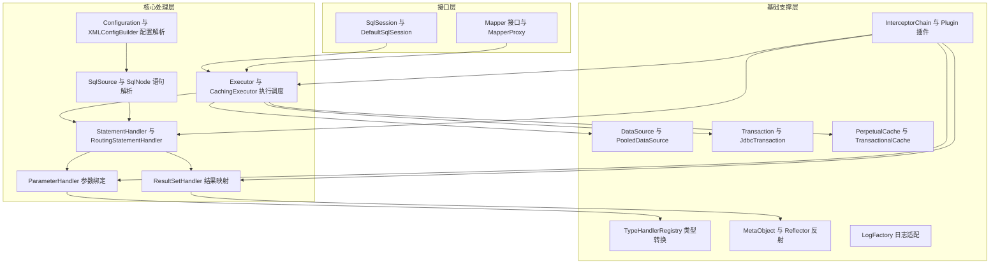

### 1.3 为什么是"半自动"ORM

对比 `Hibernate`（全自动，HQL 由框架生成）和 `JdbcTemplate`（纯手工，结果集手写映射）：

| 维度 | JdbcTemplate | MyBatis | Hibernate / JPA |
| --- | --- | --- | --- |
| SQL 控制权 | 完全手写 | 完全手写 | 框架生成，需调优 |
| 结果映射 | 手写 `RowMapper` | `ResultMap` 声明 + 自动映射 | 注解 / XML 元数据 |
| 缓存 | 无 | 一级 SqlSession、二级 namespace | 一级 Session、二级 SessionFactory，可接入 JPA 缓存 |
| 动态 SQL | 字符串拼接 | `SqlNode` 树，类型安全 | Criteria API |
| 学习曲线 | 最低 | 中 | 高 |
| 生产调优 | SQL 全在手里 | SQL 全在手里 | 需要理解脏检查、flush 时机 |

**设计权衡**：MyBatis 把"SQL 不变、参数与结果映射易变"作为假设。代价是数据库方言不可移植、SQL 散落在 XML 里难做静态检查。所以高并发交易系统偏爱 MyBatis，而业务字段频繁变更的后台系统偏爱 JPA。

## 二、四大对象与职责边界

四大对象指 `Executor`、`StatementHandler`、`ParameterHandler`、`ResultSetHandler`。它们的关系是**逐层持有**，不是平级的四个单例。

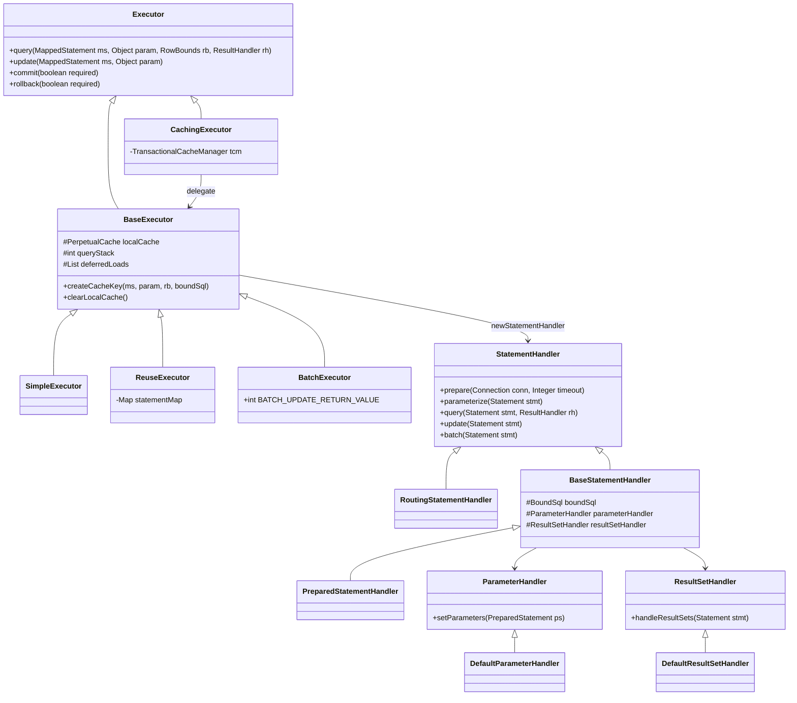

### 2.1 Executor：调度、缓存、事务

`Configuration#newExecutor(Transaction, ExecutorType)` 是唯一的构造入口，逻辑固定为三步：

```java
public Executor newExecutor(Transaction transaction, ExecutorType executorType) {
    executorType = executorType == null ? defaultExecutorType : executorType;
    executorType = executorType == null ? ExecutorType.SIMPLE : executorType;
    Executor executor;
    if (ExecutorType.BATCH == executorType) {
      executor = new BatchExecutor(this, transaction);
    } else if (ExecutorType.REUSE == executorType) {
      executor = new ReuseExecutor(this, transaction);
    } else {
      executor = new SimpleExecutor(this, transaction);
    }
    if (cacheEnabled) {
      executor = new CachingExecutor(executor);
    }
    executor = (Executor) interceptorChain.pluginAll(executor);
    return executor;
}
```

三个关键结论：

1. `Configuration#defaultExecutorType` 默认 `ExecutorType.SIMPLE`，`Configuration#cacheEnabled` 默认 `true`。
2. `CachingExecutor` 是装饰器，**二级缓存逻辑全在这里**，被装饰的 `BaseExecutor` 只管一级缓存和 JDBC。
3. `pluginAll` 在 `CachingExecutor` 之后执行，所以插件代理的是 `CachingExecutor` 这一层。这一点决定了 PageHelper 拦截 `Executor#query` 时看到的已经是缓存执行器。

`BaseExecutor` 用模板方法把流程固化，三个子类只实现抽象方法：

| 子类 | 抽象方法实现 | 适用场景 | 代价 |
| --- | --- | --- | --- |
| `SimpleExecutor` | 每次 `doQuery`/`doUpdate` 都 `new Statement` 并 `closeStatement` | 默认，最安全 | 语句不复用，解析开销大 |
| `ReuseExecutor` | `statementMap`（`Map<String, Statement>`）按 SQL 文本复用 `Statement` | 同一 SqlSession 内重复执行同一 SQL | 复用期间 `ResultSet` 必须关干净，否则连接泄漏 |
| `BatchExecutor` | 把 `addBatch` 攒在 `statementList`，`doFlushStatements` 一次提交 | 批量写 | 拿不到单条影响行数，`doUpdate` 返回哨兵值 |

`BatchExecutor` 的返回值是面试常考点：`public static final int BATCH_UPDATE_RETURN_VALUE = Integer.MIN_VALUE + 1002;`（即 `-2147482646`）。所以批量写入时 `mapper.insert()` 的返回值是负数，用它判断成功失败一定出错。

`BaseExecutor` 的其余字段也值得记：

```java
protected PerpetualCache localCache;          // 一级缓存，本质 HashMap
protected PerpetualCache localOutputParameterCache;
protected int queryStack;                     // 查询嵌套深度
private final List<DeferredLoad> deferredLoads; // 延迟加载队列
protected boolean closed;
```

### 2.2 StatementHandler：SQL 到 Statement

`RoutingStatementHandler` 是"路由器"，构造时按 `MappedStatement#getStatementType()` 决定委托对象，本身不写逻辑：

| `StatementType` | Handler | JDBC 调用 | 默认值 |
| --- | --- | --- | --- |
| `STATEMENT` | `SimpleStatementHandler` | `connection.createStatement()` | 否 |
| `PREPARED` | `PreparedStatementHandler` | `connection.prepareStatement(sql, ...)` | **是** |
| `CALLABLE` | `CallableStatementHandler` | `connection.prepareCall(sql)` | 否 |

`BaseStatementHandler` 持有关键字段：`configuration`、`executor`、`mappedStatement`、`parameterObject`、`rowBounds`、`boundSql`、`parameterHandler`、`resultSetHandler`、`typeHandlerRegistry`。构造时通过 `configuration.newParameterHandler(...)` 和 `configuration.newResultSetHandler(...)` 创建后两者——**这正是插件能分别代理到它们的原因**。

`PreparedStatementHandler#query` 的核心只有四行：`ps.execute()`、`resultSetHandler.handleResultSets(ps)`、`closeStatement`、返回 list。所有魔法都在 `ResultSetHandler` 里。

### 2.3 ParameterHandler：把 `?` 填上

`DefaultParameterHandler#setParameters(PreparedStatement)` 遍历 `BoundSql#getParameterMappings()`：

```java
for (int i = 0; i < parameterMappings.size(); i++) {
    ParameterMapping parameterMapping = parameterMappings.get(i);
    if (parameterMapping.getMode() != ParameterMode.OUT) {
        Object value;
        String propertyName = parameterMapping.getProperty();
        if (boundSql.hasAdditionalParameter(propertyName)) {
            value = boundSql.getAdditionalParameter(propertyName);
        } else if (parameterObject == null) {
            value = null;
        } else if (typeHandlerRegistry.hasTypeHandler(parameterObject.getClass())) {
            value = parameterObject;
        } else {
            MetaObject metaObject = configuration.newMetaObject(parameterObject);
            value = metaObject.getValue(propertyName);
        }
        TypeHandler typeHandler = parameterMapping.getTypeHandler();
        JdbcType jdbcType = parameterMapping.getJdbcType();
        if (value == null && jdbcType == null) {
            jdbcType = configuration.getJdbcTypeForNull();
        }
        typeHandler.setParameter(ps, i + 1, value, jdbcType);
    }
}
```

这段代码解释了三件事：

1. 为什么 `<foreach>` 生成的 `#{__frch_item_0.id}` 能取到值——值被塞进了 `BoundSql#additionalParameters`。
2. 为什么单个 `User` 参数可以直接写 `#{name}`——`typeHandlerRegistry.hasTypeHandler(User.class)` 为 false，走 `MetaObject` 反射取值；而单个 `String`/`Integer` 参数则被当作整体值。
3. 为什么 `jdbcTypeForNull` 默认 `OTHER` 会在 Oracle 上报 `ORA-17004: Invalid column type`——Oracle 的 `setNull` 需要明确的 `Types.NULL`，把该设置改成 `NULL` 或每个 `#{}` 显式写 `jdbcType=VARCHAR`。

### 2.4 ResultSetHandler：结果映射主战场

`DefaultResultSetHandler` 字段最多，也是 MyBatis 最复杂的一个类：`executor`、`configuration`、`mappedStatement`、`rowBounds`、`typeHandlerRegistry`、`objectFactory`、`objectWrapperFactory`、`reflectorFactory`、`resultMaps`、`mappedStatements`、`typeHandlerMap`、`nestedResultMaps`、`pendingRelations`、`unmappedColumnNames`。

入口方法 `handleResultSets(Statement stmt)` 的流程固定：

1. `stmt.getMoreResults()` 循环取多个 `ResultSet`（`multipleResultSetsEnabled` 默认 `true`）。
2. 每个结果集依次匹配 `MappedStatement#getResultMaps()`，多结果集靠 `@ResultMap`/`<resultMap>` 顺序对齐。
3. 调 `handleResultSet` → `handleRowValues` → `getRowValue`。
4. `getRowValue` 里先 `createResultObject` 造对象，再 `applyPropertyMappings`（显式映射）和 `applyAutomaticMappings`（自动映射）。
5. 收尾 `collapseSingleResultList`：结果只有一行且方法返回单对象时，`List` 会被压成单对象，此时如果 `resultOrdered` 或嵌套映射需要 `List`，就会踩坑。

**为什么这么设计？** 把"SQL 文本生成"（`SqlSource`）和"结果装配"（`ResultSetHandler`）彻底分开，是为了让同一份 `ResultMetaObject` 既能服务静态 SQL，也能服务存储过程和多结果集。代价是 `DefaultResultSetHandler` 这个类超过 1400 行，嵌套映射的状态机（`pendingRelations`、`nestedResultMap`、`rowKey`）极难调试——这也是"复杂 join 映射不如拆成两次查询"的根因。

## 三、SqlSessionFactory 构建与 Configuration

### 3.1 构建入口

```java
SqlSessionFactory factory = new SqlSessionFactoryBuilder().build(inputStream);
```

`SqlSessionFactoryBuilder#build` 内部创建 `XMLConfigBuilder`（解析 `mybatis-config.xml`）或 `XMLMapperBuilder`（解析单个 mapper），最终拿到 `Configuration`，再 `new DefaultSqlSessionFactory(configuration)`。

`Configuration` 是整个框架的"上帝对象"，核心字段：

| 字段 | 类型 | 作用 |
| --- | --- | --- |
| `environment` | `Environment` | id + `TransactionFactory` + `DataSource` |
| `mappedStatements` | `Map<String, MappedStatement>`（`StrictMap`） | 每条 SQL 一个，key 是 `namespace.id` |
| `resultMaps` | `Map<String, ResultMap>` | 结果映射定义 |
| `caches` | `Map<String, Cache>` | 二级缓存，key 是 namespace |
| `interceptorChain` | `InterceptorChain` | 插件链 |
| `typeHandlerRegistry` | `TypeHandlerRegistry` | 类型处理器注册表 |
| `typeAliasRegistry` | `TypeAliasRegistry` | 别名，如 `string` → `String` |
| `mapperRegistry` | `MapperRegistry` | Mapper 接口 → `MapperProxyFactory` |
| `languageRegistry` | `LanguageDriverRegistry` | 默认 `XMLLanguageDriver` |

`StrictMap` 是防呆设计：`put` 时若 key 冲突直接抛 `IllegalArgumentException`；取短名（不带 namespace）时若存在多个同短名，抛 `"The short name is ambiguous, which should be different from ..."`。这就是"两个 mapper 有同名 `selectById` 但 namespace 不同"为什么会报错的原因。

### 3.2 parseConfiguration 的顺序约束（启动报错第一名）

`XMLConfigBuilder#parseConfiguration` 的调用顺序与 DTD 定义的顺序严格一致：

```java
propertiesElement(root.evalNode("properties"));
Properties settings = settingsAsProperties(root.evalNode("settings"));
loadCustomVfs(settings);
loadCustomLogImpl(settings);
typeAliasesElement(root.evalNode("typeAliases"));
pluginElement(root.evalNode("plugins"));
objectFactoryElement(root.evalNode("objectFactory"));
objectWrapperFactoryElement(root.evalNode("objectWrapperFactory"));
reflectorFactoryElement(root.evalNode("reflectorFactory"));
settingsElement(settings);
environmentsElement(root.evalNode("environments"));
databaseIdProviderElement(root.evalNode("databaseIdProvider"));
typeHandlerElement(root.evalNode("typeHandlers"));
mapperElement(root.evalNode("mappers"));
```

DTD 规定的合法顺序是 `properties → settings → typeAliases → plugins → objectFactory → objectWrapperFactory → reflectorFactory → environments → databaseIdProvider → typeHandlers → mappers`。把 `<plugins>` 写在 `<mappers>` 后面，启动会直接抛 `The content of element type "configuration" must match ...`。同时注意 `settingsElement` 虽然在 `pluginElement` 之后调用，但 settings 的属性值在更早的 `settingsAsProperties` 就解析完了，所以插件拿到的 `Configuration` 已经是完整配置。

### 3.3 settings 默认值

| 配置项 | 默认值 | 影响 |
| --- | --- | --- |
| `cacheEnabled` | `true` | 全局开关，关闭后 `CachingExecutor` 不包装，二级缓存彻底失效 |
| `lazyLoadingEnabled` | `false` | 关闭时 `association`/`collection` 的 `fetchType="lazy"` 无效 |
| `aggressiveLazyLoading` | `false`（3.4.1 起） | 为 true 时调用任意方法都会加载全部延迟属性 |
| `lazyLoadTriggerMethods` | `equals,clone,hashCode,toString` | 这四个方法会触发延迟加载 |
| `defaultExecutorType` | `SIMPLE` | 决定 `newExecutor` 的默认分支 |
| `defaultStatementTimeout` | `null` | 单位秒，透传到 `Statement#setQueryTimeout` |
| `defaultFetchSize` | `null` | 不设置时依赖驱动默认 |
| `mapUnderscoreToCamelCase` | `false` | 关闭时 `user_name` 不会映射到 `userName` |
| `localCacheScope` | `SESSION` | 设为 `STATEMENT` 则每次查询后清空一级缓存 |
| `jdbcTypeForNull` | `OTHER` | Oracle 场景必须改 `NULL` |
| `useGeneratedKeys` | `false` | 全局默认，XML 里 `useGeneratedKeys="true"` 覆盖 |
| `useColumnLabel` | `true` | true 用 `ResultSetMetaData.getColumnLabel`，false 用 `getColumnName` |
| `useActualParamName` | `true` | 需编译期 `-parameters`，否则退化为 `arg0/arg1` |
| `callSettersOnNulls` | `false` | Map 结果不会包含 null 列 |
| `returnInstanceForEmptyRow` | `false` | false 时空行返回 null 而不是空对象 |
| `autoMappingBehavior` | `PARTIAL` | 只对没有嵌套 resultMap 的结果集自动映射 |
| `autoMappingUnknownColumnBehavior` | `NONE` | 可选 `WARNING`、`FAILING`，排查列名写错很有用 |
| `safeResultHandlerEnabled` | `true` | 使用自定义 `ResultHandler` 时禁止嵌套映射的某些优化 |
| `multipleResultSetsEnabled` | `true` | 允许存储过程返回多个结果集 |
| `logImpl` | 未指定 | 按 `SLF4J → COMMONS_LOGGING → LOG4J2 → LOG4J → JDK_LOGGING → NO_LOGGING` 自动探测 |
| `shrinkWhitespacesInSql` | `false` | 3.5.5+，压缩 SQL 空白，减少解析缓存 key 膨胀 |

### 3.4 生命周期与作用域

| 对象 | 作用域 | 是否线程安全 | 说明 |
| --- | --- | --- | --- |
| `SqlSessionFactoryBuilder` | 方法级 | 是 | 用完即弃，不要持有 |
| `SqlSessionFactory` | 应用级单例 | 是 | 构建昂贵（解析 XML + 建 `MappedStatement`），必须复用 |
| `SqlSession` | 请求 / 事务级 | **否** | `DefaultSqlSession` 持有 `Executor` 和 `dirty` 标志，绝不可共享 |
| `Mapper` 接口实例 | 应用级单例 | 是 | 内部是无状态代理，每次调用向 `SqlSession` 借会话 |
| `Configuration` | 应用级 | 构建期后只读 | 运行时修改 `mappedStatements` 会有可见性问题 |

`DefaultSqlSession` 的字段本身就说明了它为什么危险：

```java
private final Configuration configuration;
private final Executor executor;
private final boolean autoCommit;
private boolean dirty;                      // 是否有未提交的增删改
private List<Cursor<?>> cursorList;         // 未关闭的游标
```

`dirty` 一旦为 true，`close()` 会执行 `rollback`（`force` 为 false 时）；`cursorList` 里的 `Cursor` 如果没关，连接泄漏。

## 四、Mapper 接口没有实现类为什么能调用

### 4.1 三步链路

| 步骤 | 类/方法 | 产物 |
| --- | --- | --- |
| 1. 注册 | `MapperRegistry#addMapper(Class)` | `MapperProxyFactory` 放入 `knownMappers` |
| 2. 生成代理 | `MapperProxyFactory#newInstance(SqlSession)` | `Proxy.newProxyInstance(...)` 返回接口实例 |
| 3. 调用分发 | `MapperProxy#invoke` | `MapperMethod#execute` |

`MapperProxyFactory` 的核心三行：

```java
public T newInstance(SqlSession sqlSession) {
    final MapperProxy<T> mapperProxy = new MapperProxy<>(sqlSession, mapperInterface, methodCache);
    return newInstance(mapperProxy);
}
protected T newInstance(MapperProxy<T> mapperProxy) {
    return (T) Proxy.newProxyInstance(mapperInterface.getClassLoader(), new Class[] { mapperInterface }, mapperProxy);
}
```

### 4.2 MapperProxy#invoke 的三个分支

```java
public Object invoke(Object proxy, Method method, Object[] args) throws Throwable {
    try {
      if (Object.class.equals(method.getDeclaringClass())) {
        return method.invoke(this, args);
      } else {
        return cachedInvoker(method).invoke(proxy, method, args, sqlSession);
      }
    } catch (Throwable t) {
      throw ExceptionUtil.unwrapThrowable(t);
    }
}
```

| 分支 | 判定 | 行为 |
| --- | --- | --- |
| `Object` 方法 | `method.getDeclaringClass() == Object.class` | 直接 `method.invoke(this, args)`，即代理对象自己响应 `toString/hashCode/equals` |
| `default` 方法 | `method.isDefault()` | 返回 `DefaultMethodInvoker`，JDK 8 用 `MethodHandles.Lookup` 构造器，JDK 9+ 用 `MethodHandles.privateLookupIn` |
| 普通接口方法 | 其余 | 返回 `PlainMethodInvoker`，内部持有 `MapperMethod` |

两个容易忽略的结论：

1. **`equals` 比较的是代理对象引用本身**，不是"同一个 Mapper"。两个不同 `SqlSession` 生成的 Mapper 实例 `equals` 为 false。把 Mapper 当 Map key 或在 `Set` 里去重时要注意。
2. `methodCache` 是 `ConcurrentHashMap<Method, MapperMethodInvoker>`，`MapperMethod` 只创建一次，所以 `MapperMethod` 里不能存任何请求态数据——这也是它必须是线程安全的前提。

### 4.3 MapperMethod：SqlCommand + MethodSignature

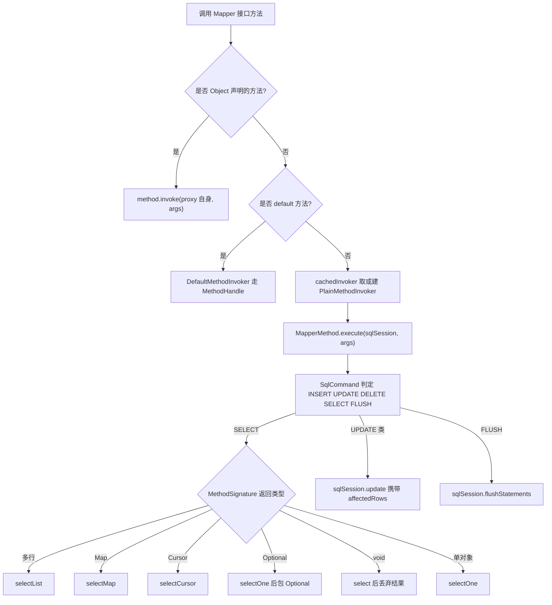

`SqlCommand` 决定 `MappedStatement` 的查找 key，方法是 `MapperMethod.SqlCommand#resolveMappedStatement`：先拼 `declaringClass.getName() + "." + method.getName()`，找不到再用 `mapperInterface.getName() + "." + name` 兜底，都没有就抛：

```
org.apache.ibatis.binding.BindingException: Invalid bound statement (not found): com.x.UserMapper.selectById
```

这个报错 90% 的场景是：XML 的 `namespace` 与接口全限定名不一致、`mapperLocations` 没扫到 XML、或者 XML 没被打进 `target/classes`。

`MethodSignature` 的几个字段决定了返回值怎么处理：`returnsMany`、`returnsMap`、`returnsCursor`、`returnsOptional`、`returnsVoid`、`mapKey`、`resultHandler`、`type`、`paramNameResolver`。

`ParamNameResolver` 的参数命名规则（面试高频）：

| 情况 | 可用的 `#{}` 名称 |
| --- | --- |
| 单个参数且无 `@Param`，且不是集合/数组 | 直接写属性名，如 `#{name}`、`#{id}` |
| 单个参数是 `Collection`/`List`/数组 | `collection`/`list`/`array`，以及 `param1` |
| 多个参数，有 `@Param` | `@Param` 指定的名字 + `param1..paramN` |
| 多个参数，无 `@Param` | `arg0..argN-1` + `param1..paramN`；若编译加 `-parameters` 则用真实参数名 |
| 3.5.x 传了 `ParamMap` 或 `Map` | 直接按 Map 的 key 取 |

`useActualParamName` 默认 `true`，但它依赖 `Method#getParameters()` 里的真实名字，而真实名字要 `javac -parameters` 才保留（Maven 用 `maven-compiler-plugin` 的 `<parameters>true</parameters>`，Spring Boot 的 `spring-boot-starter-parent` 默认开了）。没开就会看到：

```
BindingException: Parameter 'userId' not found. Available parameters are [arg0, arg1, param1, param2]
```

## 五、一次 SQL 执行的完整流程

### 5.1 全景时序

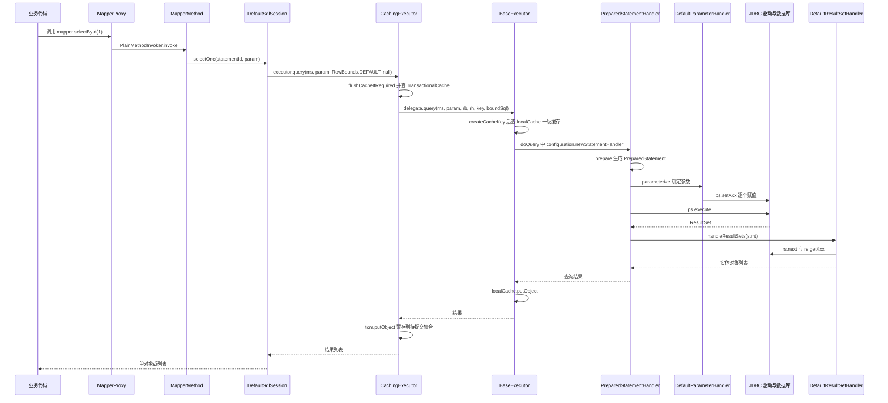

### 5.2 SimpleExecutor#doQuery 的真实代码

```java
public <E> List<E> doQuery(MappedStatement ms, Object parameter, RowBounds rowBounds,
                           ResultHandler resultHandler, BoundSql boundSql) throws SQLException {
    Statement stmt = null;
    try {
      Configuration configuration = ms.getConfiguration();
      StatementHandler handler = configuration.newStatementHandler(wrapper, ms, parameter,
          rowBounds, resultHandler, boundSql);
      stmt = prepareStatement(handler, ms.getStatementLog());
      return handler.query(stmt, resultHandler);
    } finally {
      closeStatement(stmt);
    }
}
```

注意 `newStatementHandler` 传入的是 `this`（一个 `Executor` 包装器 `ExecutorWrapper`），因为 `StatementHandler` 需要 `getConnection` 和 `isClosed` 能力。

`Configuration#newStatementHandler`：

```java
public StatementHandler newStatementHandler(Executor executor, MappedStatement mappedStatement,
        Object parameterObject, RowBounds rowBounds, ResultHandler resultHandler, BoundSql boundSql) {
    StatementHandler statementHandler = new RoutingStatementHandler(executor, mappedStatement,
        parameterObject, rowBounds, resultHandler, boundSql);
    statementHandler = (StatementHandler) interceptorChain.pluginAll(statementHandler);
    return statementHandler;
}
```

### 5.3 关键调用点清单（背下来能省很多排查时间）

| 阶段 | 方法 | 备注 |
| --- | --- | --- |
| 取连接 | `BaseExecutor#getConnection(Log)` | 内部 `transaction.getConnection()`，`SpringManagedTransaction` 从这里接入 Spring 事务 |
| 建 StatementHandler | `Configuration#newStatementHandler` | 此处 `pluginAll` |
| 建 ParameterHandler | `Configuration#newParameterHandler` | 此处 `pluginAll` |
| 建 ResultSetHandler | `Configuration#newResultSetHandler` | 此处 `pluginAll` |
| 建 Statement | `PreparedStatementHandler#instantiateStatement` | `useGeneratedKeys` 时传 `Statement.RETURN_GENERATED_KEYS` |
| 设置超时 | `BaseStatementHandler#setStatementTimeout` | 优先 `ms.getTimeout()`，否则 `configuration.getDefaultStatementTimeout()` |
| 设置 fetchSize | `BaseStatementHandler#setFetchSize` | 优先 `ms.getFetchSize()`，否则 `defaultFetchSize` |
| 执行更新 | `PreparedStatementHandler#update` | 之后触发 `KeyGenerator#processAfter` |
| 结果处理 | `DefaultResultSetHandler#handleResultSets` | 多结果集循环 |
| 关语句 | `BaseExecutor#closeStatement` | 最终 `statement.close()` |

## 六、参数传递、预编译与 SQL 注入

### 6.1 两种占位符的本质差异

`#{}` 在 `SqlSourceBuilder#parse` 阶段被 `ParameterMappingTokenHandler` 替换成 `?`，同时生成 `ParameterMapping`（记录 `property`、`javaType`、`jdbcType`、`mode`、`numericScale`、`typeHandler`）。`${}` 在 `TextSqlNode` / `DynamicSqlSource` 阶段被 `BindingTokenParser` 用 OGNL 求值后**直接拼进 SQL 字符串**。

```mermaid
flowchart TD
  X["mapper XML 中的 SQL"] --> D{"是否含 美元花括号 或动态标签?"}
  D -->|"否"| R1["RawSqlSource 启动时即静态化"]
  D -->|"是"| R2["DynamicSqlSource 运行时解析"]
  R1 --> P1["SqlSourceBuilder.parse"]
  R2 --> N1["SqlNode.apply 拼出动态 SQL"]
  N1 --> P1
  P1 --> T1["ParameterMappingTokenHandler 把 井号花括号 换成问号"]
  P1 --> T2["ParameterMapping 记录 property 与 TypeHandler"]
  N1 --> T3["BindingTokenParser 把 美元花括号 求值后直接拼接"]
  T1 --> BS["StaticSqlSource 与 BoundSql"]
  T2 --> BS
  T3 --> BS
  BS --> PS["PreparedStatement 预编译并绑定参数"]
```

### 6.2 对比表

| 维度 | `#{}` | `${}` |
| --- | --- | --- |
| 解析阶段 | `SqlSourceBuilder` 解析期 | `TextSqlNode` 运行时求值 |
| 生成物 | `?` + `ParameterMapping` | 原样字符串 |
| 是否走 PreparedStatement | 是 | 是（但 SQL 文本已含数据） |
| 类型处理 | 走 `TypeHandler`，自动 `setInt/setString` | 无类型转换，全靠 toString |
| 防注入 | 天然防注入 | 可注入 |
| 能否拼列名/表名 | 不能 | 能 |
| 能否用 `?` 替代的场景 | 参数值 | 标识符（列、表、`ORDER BY` 字段） |
| 执行计划缓存 | 同一 SQL 文本复用执行计划 | 每次拼接文本不同，执行计划无法复用 |

### 6.3 注入场景与正确写法

错误写法与攻击载荷：

| 错误写法 | 攻击载荷 | 后果 |
| --- | --- | --- |
| `ORDER BY ${orderBy}` | `id desc; drop table t_user -- ` | MySQL 需 `allowMultiQueries=true` 才会多语句执行，否则报语法错 |
| `WHERE name like '%${name}%'` | `' or '1'='1` | 全表返回 |
| `IN (${ids})` | `1) or (1=1` | 全表返回 |
| `LIMIT ${offset},${size}` | 任意数值 | 数据越权拉取 |

正确写法：

```xml
<!-- 参数值一律用 #{} ，like 用 CONCAT 或数据库函数 -->
<select id="listByName" resultType="User">
  select id, user_name, create_time from t_user
  where user_name like concat('%', #{name}, '%')
</select>

<!-- 集合用 foreach ，让 MyBatis 生成对应个数的 ? -->
<select id="listByIds" resultType="User">
  select id, user_name from t_user
  where id in
  <foreach collection="ids" item="id" open="(" separator="," close=")">#{id}</foreach>
</select>
```

必须用 `${}` 的场合（`ORDER BY`、动态表名、动态列名）只能配白名单：

```java
private static final Set<String> SORTABLE = Set.of("create_time", "id", "amount");
if (!SORTABLE.contains(sortField)) {
    throw new IllegalArgumentException("illegal sort field: " + sortField);
}
```

MyBatis-Plus 的 `QueryWrapper#orderByAsc(String...)` 传字符串时同样是 SQL 拼接，必须自己校验；用 `LambdaQueryWrapper` 通过 `SerializedLambda` 取字段名才是安全的。

### 6.4 `useActualParamName` 与集合参数的坑

| 场景 | 正确引用 |
| --- | --- |
| `List<User> list(List<Long> ids)` | `#{collection}` 或 `#{list}` |
| `int[] arr` | `#{array}` |
| `Map<String,Object>` | `#{key}` |
| `User query(User u)` | `#{userName}`（直接属性名） |
| 多参数 | `#{param1}`、`#{arg0}`，或加 `@Param("id")` |

`DefaultSqlSession#wrapCollection(Object)` 只在**参数个数为 1** 时生效：把集合包成 `StrictMap`，key 为 `collection`（`Collection`）、`list`（`List`）、`array`（数组），并额外放 `param1`。这就是"单个 List 参数用 `#{item}` 取不到值"的原因。

## 七、动态 SQL 与 SqlNode 树

### 7.1 SqlNode 组合模式

`SqlNode` 只有一个方法 `boolean apply(DynamicContext context)`，所有标签都是它的实现，形成组合模式：

| XML 标签 | 实现类 | 关键字段/行为 |
| --- | --- | --- |
| 纯文本 | `StaticTextSqlNode` | 直接 `context.appendSql(text)` |
| 含 `${}` | `TextSqlNode` | `BindingTokenParser` 求值；`isDynamic()` 判断是否包含 `${` |
| `<if>` | `IfSqlNode` | `ExpressionEvaluator.evaluateBoolean(test, context.getBindings())` |
| `<choose>/<when>/<otherwise>` | `ChooseSqlNode` | 逐个试 `IfSqlNode`，都 false 用 `defaultSqlNode` |
| `<foreach>` | `ForEachSqlNode` | `itemizeItem` 生成 `__frch_item_0`，写入 `additionalParameters` |
| `<trim>` | `TrimSqlNode` | `prefix`、`suffix`、`prefixOverrides`、`suffixOverrides` |
| `<where>` | `WhereSqlNode`（继承 `TrimSqlNode`） | `prefix="WHERE"`，`prefixesToOverride="AND \|OR \|AND\n\|OR\n..."` |
| `<set>` | `SetSqlNode`（继承 `TrimSqlNode`） | `prefix="SET"`，`suffixOverrides=","` |
| `<bind>` | `VarDeclSqlNode` | OGNL 求值后 `context.bind(name, value)` |
| `<sql>/<include>` | 由 `XMLIncludeTransformer` 在解析期拼接 | 支持 `<property name="x" value="y"/>` |

`MixedSqlNode` 把 `contents` 列表顺序遍历，这是"动态 SQL 靠一棵树的深度优先遍历生成最终 SQL"的本质。

### 7.2 DynamicContext 与 StringJoiner

MyBatis 3.5.5 起 `DynamicContext` 用 `StringJoiner`：

```java
public class DynamicContext {
  public static final String PARAMETER_OBJECT_KEY = "_parameter";
  public static final String DATABASE_ID_KEY = "_databaseId";
  private final ContextMap bindings;
  private final StringJoiner sqlBuilder = new StringJoiner(" ");
  public void appendSql(String sql) {
    sqlBuilder.add(sql);
  }
  public String getSql() {
    return sqlBuilder.toString().trim();
  }
}
```

`StringJoiner` 的分隔符是空格，所以 `<if>` 之间是否手写空格不影响最终 SQL 的正确性（这也是 3.5.5 之后"SQL 空白被规范化"的原因）。反过来，`shrinkWhitespacesInSql` 会把标签内部的多余空白也压掉，用于减少 `BoundSql` 字符串长度、降低 `CacheKey` 和 `MappedStatement` 的哈希开销。

`ContextMap` 继承 `HashMap` 并覆写 `get`：查不到时先看是否有 `_parameter` 的 `MetaObject`，再反射取属性。所以 `test="userName != null"` 这种写法在参数是 `Map` 或 JavaBean 时都能工作。

### 7.3 解析流程图

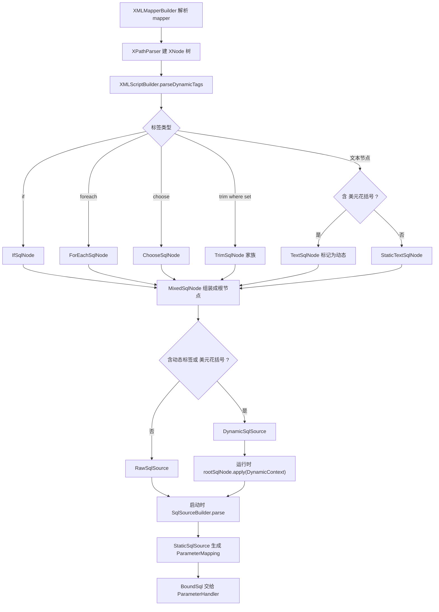

### 7.4 `<foreach>` 的两个实战约束

1. `collection` 属性写什么取决于入参形态（见 6.4）。用 `@Param("ids")` 最稳。
2. Oracle 的 `IN` 列表有 **1000 个元素上限**，超过报 `ORA-01795: maximum number of expressions in a list is 1000`。解法是按 1000 切片分批查，或在应用层拼 `union all`。
3. MySQL 的 `in (...)` 元素过多会让优化器放弃索引、并把 SQL 文本撑大触发 `max_allowed_packet`（默认 64MB，很多云数据库调到 1MB~16MB）。生产上单条 `IN` 控在几百个以内。

## 八、ResultMap 与自动映射

### 8.1 ResultMap 元素

| 元素 | 作用 | 关键属性 |
| --- | --- | --- |
| `<id>` | 主键列，决定行对象的唯一性 | `column`、`property`、`jdbcType`、`typeHandler` |
| `<result>` | 普通列映射 | 同上 |
| `<association>` | 一对一，映射为对象属性 | `property`、`javaType`、`select`、`fetchType`、`columnPrefix` |
| `<collection>` | 一对多，映射为集合属性 | `property`、`ofType`、`select`、`column`、`resultOrdered` |
| `<constructor>` | 用构造器装配 | `arg` 的 `name`/`column`/`javaType` |
| `<discriminator>` | 按列值选不同子 ResultMap | `column`、`javaType`、`case` |
| `extends` | 继承另一个 ResultMap | 复用基类字段 |
| `autoMapping` | 该 ResultMap 是否自动映射 | 覆盖全局 `autoMappingBehavior` |

### 8.2 自动映射的判定规则

自动映射发生在 `DefaultResultSetHandler#applyAutomaticMappings`，判定顺序：

1. `ResultMap#isAutoMapping()` 为 false 时，若 `autoMappingBehavior` 为 `NONE` → 跳过。
2. `autoMappingBehavior=PARTIAL`（默认）→ 只在**没有嵌套 resultMap**（即没有 `select` 属性的 association/collection）时才自动映射。
3. `autoMappingBehavior=FULL` → 无论是否嵌套都自动映射（`resultMap` 元素仍优先）。
4. 已出现在 `ResultMap#getMappedColumns()` 的列不再自动映射，避免覆盖显式配置。
5. 未匹配的列按 `autoMappingUnknownColumnBehavior` 处理：`NONE` 静默忽略、`WARNING` 打日志、`FAILING` 抛 `IllegalArgumentException`。

列名到属性名的转换由 `ResultSetWrapper` 与 `MetaClass` 完成：

- `mapUnderscoreToCamelCase=true` 时走 `configuration.isMapUnderscoreToCamelCase()` → `String#toUpperCase` 比较方式，`user_name` → `userName`。
- `useColumnLabel=true`（默认）用 `ResultSetMetaData#getColumnLabel`，所以 `select user_name as userName` 生效；设为 false 用 `getColumnName`，别名会失效。
- 属性有 `@Param` 无关，这里用的是 `MetaClass#findProperty(String name, boolean useCamelCaseMapping)`。

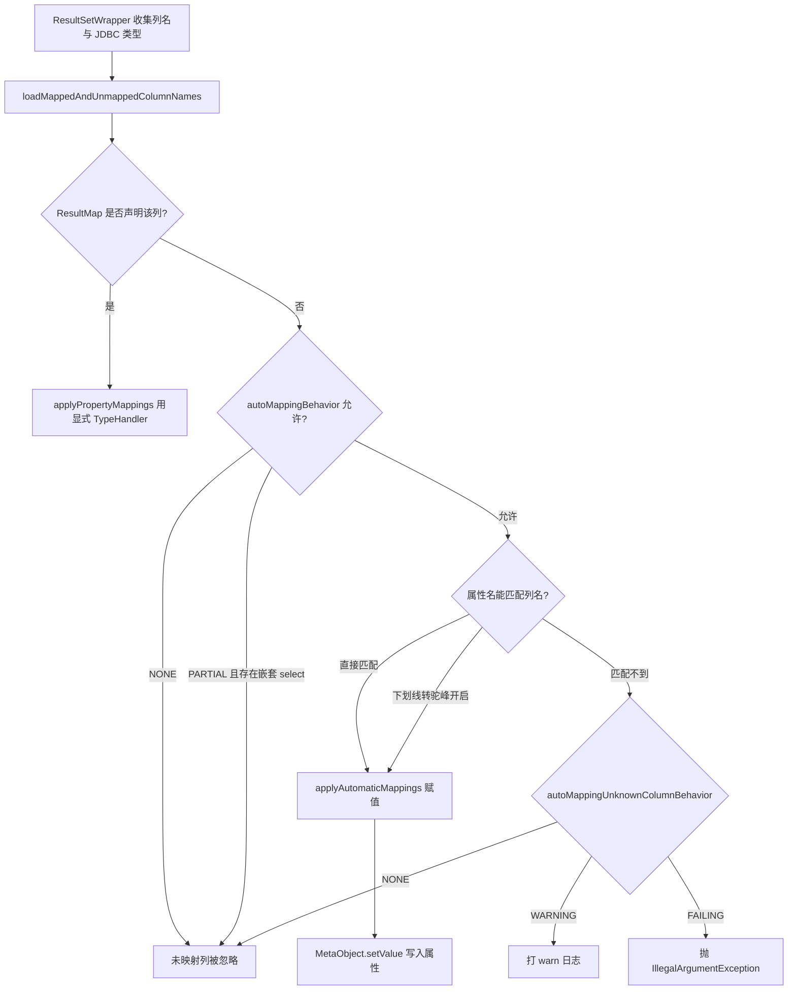

### 8.3 嵌套映射：两种实现与 N+1

| 方式 | 写法 | SQL 条数 | 内存 | 分页可用性 |
| --- | --- | --- | --- | --- |
| 嵌套结果（join） | `<collection>` 内直接写 `<id>/<result>` | 1 条 | 笛卡尔积在内存去重，行数放大数倍 | 分页是对 join 后的行分页，**会截断子集合** |
| 嵌套查询 | `<collection select="..."/>` | 1 + N 条 | 无放大 | 分页安全，但 N+1 |

N+1 的三种解法：

1. `fetchType="lazy"` + `lazyLoadingEnabled=true`，用不到就不查；但 `lazyLoadTriggerMethods`（默认 `equals,clone,hashCode,toString`）会意外触发全部加载，且在 JSON 序列化时必然触发。
2. 改成嵌套结果 + `resultOrdered="true"`，让同一父记录的子行连续，`DefaultResultSetHandler` 可以尽早释放上一组，降低内存。
3. 两段式查询：先查主表拿到 id 集合，再用一次 `IN` 查子表，在 Service 层组装。这是大列表接口的推荐做法。

**为什么默认 `lazyLoadingEnabled=false`？** 因为延迟加载需要 `javassist` 或 `cglib` 生成子类代理，`Configuration#lazyLoadingEnabled` 为 true 但没有代理工厂时会直接抛 `BuilderException("The 'lazyLoadingEnabled' setting is not compatible with ...")`。MyBatis 把默认值设成 false 是"默认不引入额外依赖"的保守选择。

## 九、一级缓存

### 9.1 作用域与数据结构

一级缓存也叫本地缓存（local cache），实现在 `BaseExecutor#localCache`，类型是 `PerpetualCache`：

```java
public class PerpetualCache implements Cache {
  private final String id;
  private final Map<Object, Object> cache = new HashMap<>();
  // putObject / getObject / removeObject / clear
}
```

`id` 是字符串 `"LocalCache"`。注意它是**无容量上限、无淘汰、非线程安全**的 `HashMap`——所以长事务里反复查询大结果集，一级缓存会成为 OOM 的直接原因。

作用域是 **SqlSession**，即 `SqlSession` 关闭/清空之前一直有效。

### 9.2 命中条件：CacheKey 的组成

```java
public CacheKey createCacheKey(MappedStatement ms, Object parameterObject, RowBounds rowBounds, BoundSql boundSql) {
    if (closed) throw new ExecutorException("Executor was closed.");
    CacheKey cacheKey = new CacheKey();
    cacheKey.update(ms.getId());
    cacheKey.update(rowBounds.getOffset());
    cacheKey.update(rowBounds.getLimit());
    cacheKey.update(boundSql.getSql());
    // 逐个 ParameterMapping 取值 update
    for (ParameterMapping parameterMapping : boundSql.getParameterMappings()) { ... }
    if (configuration.getEnvironment() != null) {
      cacheKey.update(configuration.getEnvironment().getId());
    }
    return cacheKey;
}
```

所以命中要求五个条件同时成立：

1. 同一个 `SqlSession`（即同一个 `Executor` 实例）。
2. 相同 `MappedStatement#getId()`（`namespace.id`）。
3. 相同 `RowBounds` 的 `offset` 与 `limit`（不是 `RowBounds` 对象相等）。
4. 相同 `BoundSql#getSql()`（动态 SQL 拼出的最终文本，含空白差异）。
5. 相同参数值序列 + 相同 `Environment#getId()`。

`CacheKey` 内部用数组保存 `update` 过的值，`hashcode` 起始 17、`multiplier` 为 37，`equals` 逐元素比较——所以参数是一个大对象时会退化成对每个属性取值的多次比较，参数别放超大对象。

### 9.3 失效条件

| 触发动作 | 代码位置 | 效果 |
| --- | --- | --- |
| 执行任意 insert/update/delete | `BaseExecutor#update` 首行 `clearLocalCache()` | 整个 SqlSession 缓存清空 |
| `commit` / `rollback` | `BaseExecutor#commit(boolean)`、`rollback(boolean)` 先 `clearLocalCache()` | 清空 |
| `close()` | `BaseExecutor#close` → `localCache.clear()` | 清空并标记 closed |
| `sqlSession.clearCache()` | `BaseExecutor#clearLocalCache` | 手动清空 |
| `localCacheScope=STATEMENT` | `BaseExecutor#query` 中 `queryStack == 0` 时 `clearLocalCache()` | 每次查询结束即清空 |
| SQL 上 `flushCache="true"` | `BaseExecutor#query` 中 `if (queryStack == 0 && ms.isFlushCacheRequired()) clearLocalCache()` | 该查询前清空 |
| 同 SqlSession 内两次 SQL 文本不同 | CacheKey 不同 | 不命中 |

注意 `<select>` 的 `flushCache` 默认是 `false`，而 `<insert>/<update>/<delete>` 默认 `flushCache="true"`；`useCache` 默认 `true`（只对二级缓存有意义）。

### 9.4 一级缓存判定流程

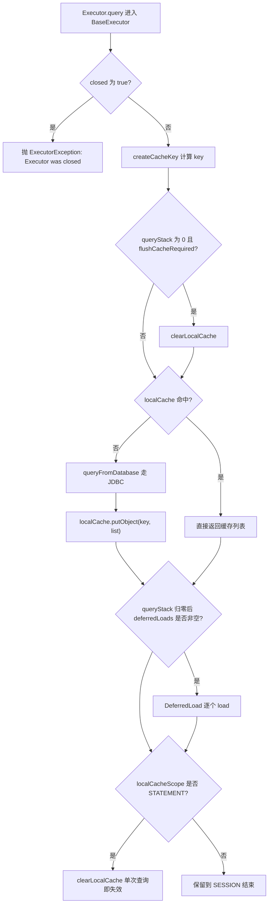

### 9.5 Spring 环境下"时灵时不灵"的真相

| 场景 | SqlSession 来源 | 一级缓存 |
| --- | --- | --- |
| 无 `@Transactional`，直接用 Mapper | `SqlSessionTemplate` 每次调用 `SqlSessionUtils.getSqlSession` 新建，用完 `commit(true)` + `close` | **等同关闭**，两次调用两个 SqlSession |
| 有 `@Transactional` | `SqlSessionHolder` 绑定到 `TransactionSynchronizationManager`，同一事务内复用 | 生效，同一事务内重复查询只打一次 SQL |
| 手动 `sqlSessionFactory.openSession()` | 自己 new | 生效，但要自己 close |
| 不同线程 | 各自独立 | 互不可见 |

所以"MyBatis 一级缓存默认开启"和"Spring 里感觉没生效"并不矛盾：一级缓存的作用域是 SqlSession，而 Spring 默认一个无事务的 Mapper 调用就是一个 SqlSession。

**脏读风险**：一级缓存不感知数据库的其他连接。事务 A 在读后、再读之前，事务 B 提交了更新，A 仍会命中缓存拿到旧值。在 `REPEATABLE READ` 下这符合隔离级别语义，但在 `READ COMMITTED`（Oracle、PostgreSQL 默认）或 `@Transactional` 混用 MyBatis 时，业务会认为"我明明改了却读不到"。

## 十、二级缓存

### 10.1 开启方式与作用域

- XML：`<mapper namespace="com.x.UserMapper"><cache/></mapper>`，或 `<cache-ref namespace="com.x.OtherMapper"/>` 共享。
- 注解：`@CacheNamespace` 或 `@CacheNamespaceRef`。
- 生效前提：`Configuration#cacheEnabled=true`（默认）+ 该 namespace 声明了 cache + `MappedStatement#isUseCache()` 为 true + 没有自定义 `ResultHandler` + SQL 没有 OUT 参数。

`<cache/>` 的默认值（`CacheBuilder`）：

| 属性 | 默认值 | 说明 |
| --- | --- | --- |
| `type` | `org.apache.ibatis.cache.impl.PerpetualCache` | 可换成 `RedisCache` |
| `eviction` | `LRU` | 可选 `FIFO`、`SOFT`、`WEAK` |
| `flushInterval` | `null` | 只在更新时清空，不做定时刷新 |
| `size` | `1024` | 引用数量上限 |
| `readOnly` | `false` | false 时用 `SerializedCache` 深拷贝 |
| `blocking` | `false` | true 时用 `BlockingCache` 加锁，防缓存击穿 |

`readOnly=false` 时 MyBatis 用 `SerializedCache` 包装，实体必须实现 `java.io.Serializable`，否则第一次写入就抛 `CacheException: Error serializing object`。代价是每次读写都要 JDK 序列化/反序列化，大对象场景 CPU 和网络（Redis）成本都很高。

`readOnly=true` 时不拷贝，直接返回**同一个 List 引用**。业务代码一旦 `list.get(0).setName("x")`，缓存就被污染，后续所有请求读到脏数据。这是"为了性能关闭深拷贝"必须付的代价。

### 10.2 缓存装饰链

`CacheBuilder#build` 按顺序包装：

```
ScheduledCache(flushInterval 非空)
  -> LoggingCache
    -> SynchronizedCache 或 BlockingCache
      -> SerializedCache(readOnly=false)
        -> LruCache / FifoCache / SoftCache / WeakCache
          -> PerpetualCache (delegate)
```

`LoggingCache` 负责打印 `Cache Hit Ratio`，日志级别为 DEBUG，类名 `org.apache.ibatis.cache.decorators.LoggingCache`。

### 10.3 事务边界：TransactionalCache

`CachingExecutor` 不直接操作 `Cache`，而是通过 `TransactionalCacheManager`：

```java
public class CachingExecutor implements Executor {
  private final Executor delegate;
  private final TransactionalCacheManager tcm = new TransactionalCacheManager();
}
```

`TransactionalCache` 的字段是关键：

```java
private final Cache delegate;
private final Map<Object, Object> entriesToAddOnCommit;
private final Set<Object> entriesMissedInCache;
private boolean clearOnCommit;
```

- `putObject` 只写 `entriesToAddOnCommit`，**不写 delegate**。
- `getObject` 先查 delegate，未命中则把自己加入 `entriesMissedInCache`（防缓存击穿用）；`clearOnCommit=true` 时直接返回 null。
- `commit` 时 `flushPendingEntries()` 把待提交条目刷进 delegate，再 `reset()`。
- `rollback` 时 `reset()` 丢弃，什么都不写。
- `flushCacheIfRequired(ms)` 在 `ms.isFlushCacheRequired()` 时调 `tcm.clear(cache)`，把 `clearOnCommit` 置 true，commit 时整片 namespace 缓存清空。

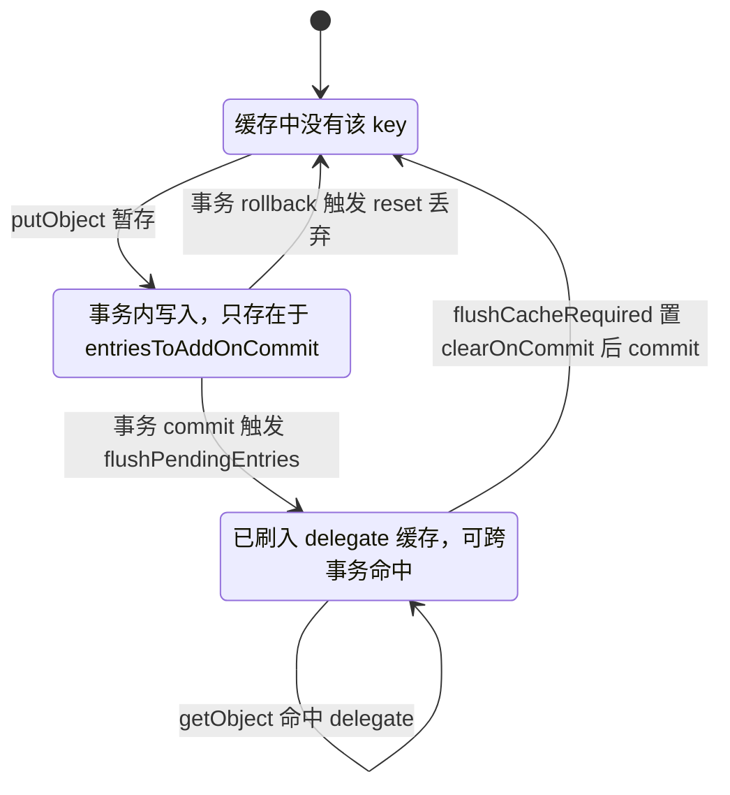

这张状态图解释了三个常被问到的现象：

1. **同一事务内刚 insert 完 select 不到缓存**——`putObject` 还没提交，`TransactionalCache#getObject` 也只在 delegate 里找。
2. **回滚后缓存没有脏数据**——`reset()` 直接丢弃 pending 条目。
3. **任何一条 `flushCache=true` 的语句会清空整个 namespace**，粒度是 namespace 而不是表。

### 10.4 二级缓存读写路径

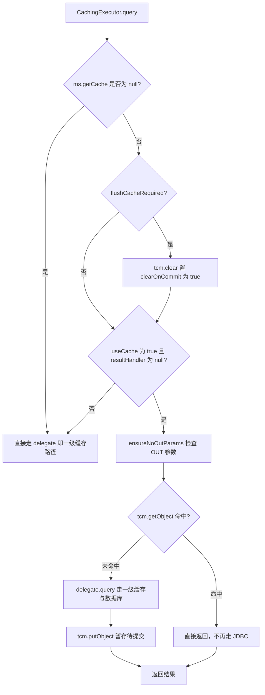

### 10.5 为什么不建议开二级缓存

| 风险 | 产生原因 | 现象 |
| --- | --- | --- |
| 跨 namespace 脏读 | 缓存按 namespace 隔离，两张表 join 时各自只清自己的缓存 | A 表更新后，B 表 namespace 里存的旧 join 结果仍返回 |
| 其他写入方不可见 | DBA、其他应用、存储过程、触发器直接改库 | 应用长时间读到旧值，重启才恢复 |
| 集群各节点独立 | 默认 `PerpetualCache` 是 JVM 内 `HashMap` | 节点 A 更新清了自己的缓存，节点 B 仍返回旧值，直到 `flushInterval` 或重启 |
| 序列化成本 | `readOnly=false` 走 `SerializedCache` | 大对象 CPU 高、Redis 带宽打满 |
| 引用污染 | `readOnly=true` 返回同一 List | 一处修改，全站脏数据 |
| 事务可见性错觉 | commit 才刷入 delegate | 同事务内写入后查不到，跨事务才命中，团队容易误判 |
| 内存不可控 | `size` 默认 1024，但每个 entry 的大小无上限 | 大结果集列表缓存导致 Full GC |

**正确定位**：MyBatis 二级缓存适合"单表、读多写极少、能接受秒级不一致、单机或可接受多副本不一致"的场景（如字典表、配置表）。互联网业务更常见的做法是**关掉二级缓存，把缓存放到 Service 层用 Redis 显式管理**，因为那里才能控制 key 设计、过期策略、更新顺序和分布式失效。

如果确实要用，必须同时做到：实体 `Serializable`；`flushInterval` 设一个较小值（如 60000ms）兜底；用 `<cache-ref>` 或 `@CacheNamespaceRef` 让共享表的 namespace 共用一个 cache；换成 `RedisCache` 并配 `TransactionAwareCacheDecorator` 保证事务提交后才写缓存。

## 十一、插件机制与四大对象的代理链

### 11.1 三个概念

```java
@Intercepts({
  @Signature(type = Executor.class, method = "query",
    args = {MappedStatement.class, Object.class, RowBounds.class, ResultHandler.class})
})
public class MyInterceptor implements Interceptor {
  @Override
  public Object intercept(Invocation invocation) throws Throwable {
    Object[] args = invocation.getArgs();
    // 前置逻辑
    Object result = invocation.proceed();
    // 后置逻辑
    return result;
  }
  @Override
  public Object plugin(Object target) {
    return Plugin.wrap(target, this);
  }
  @Override
  public void setProperties(Properties properties) { }
}
```

| 概念 | 作用 |
| --- | --- |
| `@Intercepts` + `@Signature` | 声明要拦截的类、方法名、参数类型数组。三者必须精确匹配，否则不生效 |
| `Interceptor#plugin(Object target)` | 默认实现就是 `Plugin.wrap(target, this)`；可以在这里判断 `target` 类型决定是否包装 |
| `Plugin#wrap` | 用 `getSignatureMap` 判断，命中则 `Proxy.newProxyInstance`，否则原样返回 |
| `Invocation` | 持有 `target`、`method`、`args`，`proceed()` 即 `method.invoke(target, args)` |

### 11.2 Plugin#invoke 的判定逻辑

```java
public Object invoke(Object proxy, Method method, Object[] args) throws Throwable {
    try {
      Set<Method> methods = signatureMap.get(method.getDeclaringClass());
      if (methods != null && methods.contains(method)) {
        return interceptor.intercept(new Invocation(target, method, args));
      }
      return method.invoke(target, args);
    } catch (Exception e) {
      throw ExceptionUtil.unwrapThrowable(e);
    }
}
```

注意 `signatureMap.get(method.getDeclaringClass())`：**接口类型必须完全匹配**。写 `@Signature(type = Executor.class, ...)` 时，`method.getDeclaringClass()` 就是 `Executor.class`，能命中；如果写成具体实现类 `SimpleExecutor.class`，由于调用走的是接口方法，`getDeclaringClass()` 是 `Executor`，就永远不命中。

### 11.3 代理链与执行顺序

`InterceptorChain#pluginAll`：

```java
public Object pluginAll(Object target) {
    for (Interceptor interceptor : interceptors) {
      target = interceptor.plugin(target);
    }
    return target;
}
```

注册顺序为 `interceptor1`、`interceptor2` 时：`target → P1(target) → P2(P1(target))`。最外层是 **最后注册的 P2**，所以**执行顺序是后注册的先执行**。

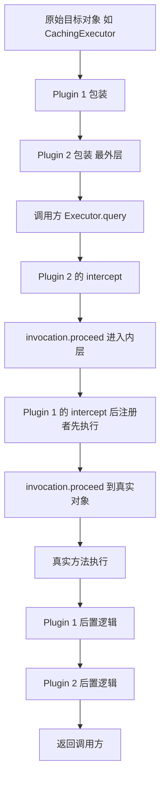

### 11.4 四大对象的包装点

`Configuration` 里四处的 `pluginAll` 调用：

| 位置 | 方法 | 被包装对象 |
| --- | --- | --- |
| `Configuration#newExecutor` | 最后一行 | `CachingExecutor`（若 `cacheEnabled`）或 `SimpleExecutor` 等 |
| `Configuration#newStatementHandler` | 创建 `RoutingStatementHandler` 后 | `RoutingStatementHandler` |
| `Configuration#newParameterHandler` | 创建 `DefaultParameterHandler` 后 | `DefaultParameterHandler` |
| `Configuration#newResultSetHandler` | 创建 `DefaultResultSetHandler` 后 | `DefaultResultSetHandler` |

`newExecutor` 的顺序有一个必须记住的细节：`CachingExecutor` 先包装 `BaseExecutor`，然后才 `pluginAll`。所以拦截 `Executor` 的插件看到的是 `CachingExecutor`，**拦截点在二级缓存之外**——PageHelper 正是利用这一点：它在 count 查询和分页查询时都直接操作 `Executor`，绕过一级/二级缓存需要自己处理。

### 11.5 用插件改 SQL 的正确姿势

```java
@Intercepts({@Signature(type = StatementHandler.class, method = "prepare",
    args = {Connection.class, Integer.class})})
public class SqlRewriteInterceptor implements Interceptor {
  @Override
  public Object intercept(Invocation invocation) throws Throwable {
    StatementHandler handler = (StatementHandler) invocation.getTarget();
    MetaObject metaObject = SystemMetaObject.forObject(handler);
    BoundSql boundSql = (BoundSql) metaObject.getValue("delegate.boundSql");
    String original = boundSql.getSql();
    if (original.contains("t_order")) {
      // 只替换表名等不改变 ? 个数的部分
      metaObject.setValue("delegate.boundSql.sql", original.replace("t_order", "t_order_2024"));
    }
    return invocation.proceed();
  }
}
```

三个约束：

1. **不能改变 `?` 的数量。** `parameterMappings` 已经在 `BoundSql` 里定好，SQL 里多一个 `?` 会导致运行时 `SQLException` 或参数错位。要新增参数只能用 `boundSql.setAdditionalParameter(name, value)` 并让 `#{name}` 出现在原始 SQL 里。
2. `metaObject.getValue("delegate.boundSql")` 走的是 `RoutingStatementHandler#getBoundSql` 的委托链；`delegate` 在 `Plugin` 包装后会变成 `Plugin` 实例，所以多层插件叠加时要用拆包工具。MyBatis 本身没有提供公开的拆包方法，MyBatis-Plus 提供了 `com.baomidou.mybatisplus.core.toolkit.PluginUtils#realTarget(Object)`。
3. 插件里做耗时统计必须放在 `try/finally` 里，否则异常路径漏统计。

### 11.6 性能代价

`Plugin` 是 JDK 动态代理，每次调用多一次 `InvocationHandler#invoke` + 一次 `Method#invoke` 反射。对于 QPS 上千的核心接口，一个"只打日志"的插件也会带来可观测的开销。生产建议：插件数量控制在 4 个以内；日志埋点用条件判断提前返回；不要在每个插件里都做 SQL 解析。

## 十二、PageHelper 分页原理

### 12.1 三段式流程

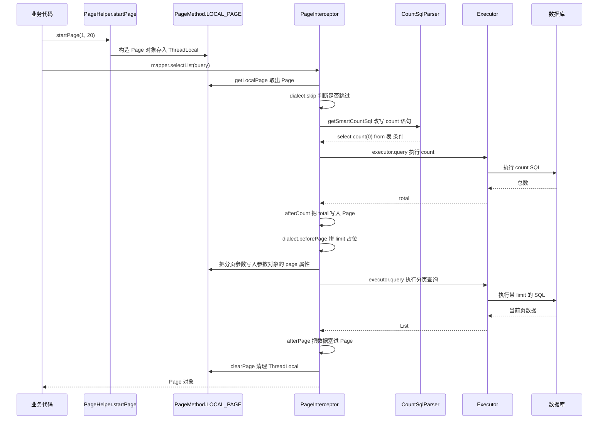

### 12.2 关键类与实现要点

| 组件 | 类名 | 说明 |
| --- | --- | --- |
| 入口 | `com.github.pagehelper.PageHelper#startPage(int, int)` | 内部委托 `PageMethod#startPage` |
| ThreadLocal | `PageMethod#LOCAL_PAGE` | 保存 `Page` 对象，用完必须清理 |
| 拦截器 | `com.github.pagehelper.PageInterceptor` | 实现 `Interceptor`，拦 `Executor#query` |
| 方言 | `com.github.pagehelper.dialect.AbstractHelperDialect` | MySQL 用 `MySqlDialect` 拼 `limit ?, ?` |
| count 解析 | `com.github.pagehelper.util.CountSqlParser` | 基于 jsqlparser，`getSmartCountSql` |
| 返回类型 | `com.github.pagehelper.Page<E>` | `extends ArrayList<E>`，额外持有 `pageNum`、`pageSize`、`total`、`pages` |
| 统计封装 | `com.github.pagehelper.PageInfo<T>` | 由 `Page` 计算 `total`、`pages`、`isFirstPage`、`hasNextPage` |

`Page` 继承 `ArrayList` 是 PageHelper 5.x 的设计（6.x 有调整）。好处是"分页结果可以直接当 `List` 用"；代价是 `Page` 对象本身就是结果集，一旦被业务当作普通 List 缓存下来，`pageNum/total` 等分页元信息会一起被缓存。

### 12.3 配置项与默认值

| 配置 | 默认值 | 说明 |
| --- | --- | --- |
| `helperDialect` | 自动探测 | 多数据源建议显式指定，如 `mysql` |
| `offsetAsPageNum` | `false` | true 时 `RowBounds` 的 offset 被当作页码 |
| `rowBoundsWithCount` | `false` | 使用 `RowBounds` 分页时是否查 count |
| `pageSizeZero` | `false` | true 且 `pageSize=0` 时返回全部结果 |
| `reasonable` | `false` | true 时 `pageNum<1` 查第一页，`pageNum>pages` 查最后一页 |
| `params` | `pageNum=pageNum;pageSize=pageSize;...` | 用 `supportMethodsArguments` 时从参数对象取值的字段名 |
| `supportMethodsArguments` | `false` | 允许从 Mapper 方法参数里自动识别分页参数 |
| `autoRuntimeDialect` | `false` | true 时每次按 `DataSource` 动态选方言 |
| `closeConn` | `true` | 自动获取方言时用完后关闭连接 |
| `aggregateFunctions` | 见默认值 | count 改写遇到聚合函数时的处理 |
| `countSqlParser` 依赖 | PageHelper 5.2.0 起不传递 | 缺 `jsqlparser` 会退化为 `select count(0) from (原 SQL) tmp` 或直接报错 |

### 12.4 生产坑清单

| 坑 | 现象 | 处理 |
| --- | --- | --- |
| `startPage` 与查询之间插了别的 SQL | 分页参数套到了错误的 SQL 上，返回结果诡异 | `startPage` 必须紧跟目标查询；中间不要插缓存判断、日志查询、多数据源切换 |
| ThreadLocal 未清理 | 后续请求莫名被分页，或 `total` 是上一次的 | `finally { PageHelper.clearPage(); }` |
| 深分页 | `limit 1000000, 20` 扫描 100 万行 | 游标分页 `where id > lastId order by id limit 20`，或先用覆盖索引取 id 再回表 |
| count 语句被 join 拖慢 | `select count(0) from (大 join) tmp` | 手写 count 语句，用 `PageHelper.startPage(...)` 后调 `PageHelper.count(() -> mapper.countXxx(q))` 或 MP 的 `optimizeJoin` |
| 与 MyBatis-Plus 分页插件同时存在 | 双重分页、SQL 语法错误 | 二选一，只保留 `PaginationInnerInterceptor` |
| jsqlparser 版本冲突 | `NoSuchMethodError` 或 `ClassNotFoundException` | 统一 `jsqlparser` 版本，与 MP 的依赖对齐 |
| 多数据源方言错 | 生成 `limit ? offset ?` 打到 SQL Server | 显式配 `helperDialect`，或开 `autoRuntimeDialect` |
| 分页查询走了一级缓存 | count 与实际数据不一致 | 分页查询前注意 `@Transactional` 内的一致性，必要时 `flushCache` |

## 十三、Spring 整合与 SqlSession 线程安全

### 13.1 核心类

| 类 | 包 | 作用 |
| --- | --- | --- |
| `SqlSessionFactoryBean` | `org.mybatis.spring` | `FactoryBean<SqlSessionFactory>`，把 Spring 的 `DataSource` 注入 `Configuration#environment` |
| `SqlSessionTemplate` | `org.mybatis.spring` | 线程安全的 `SqlSession` 实现，内部持有一个 `sqlSessionProxy` |
| `SqlSessionUtils` | `org.mybatis.spring` | `getSqlSession` / `closeSqlSession`，与 Spring 事务绑定 |
| `SqlSessionHolder` | `org.mybatis.spring` | 作为 `TransactionSynchronizationManager` 的 resource 保存 `SqlSession` |
| `MapperFactoryBean` | `org.mybatis.spring.mapper` | Mapper 接口的 `FactoryBean`，`checkDaoConfig` 里 `configuration.addMapper` |
| `MapperScannerConfigurer` | `org.mybatis.spring.mapper` | `BeanDefinitionRegistryPostProcessor`，扫描并注册 Mapper |
| `SpringManagedTransaction` | `org.mybatis.spring.transaction` | 从 `DataSourceUtils` 取连接，保证与 Spring 事务同一连接 |
| `MyBatisExceptionTranslator` | `org.mybatis.spring` | 把 `PersistenceException` 转成 Spring 的 `DataAccessException` 体系 |

### 13.2 为什么 SqlSessionTemplate 线程安全

关键在构造器和拦截器：

```java
public SqlSessionTemplate(SqlSessionFactory sqlSessionFactory, ExecutorType executorType,
                          PersistenceExceptionTranslator exceptionTranslator) {
    notNull(sqlSessionFactory, "Property 'sqlSessionFactory' is required");
    this.sqlSessionFactory = sqlSessionFactory;
    this.executorType = executorType;
    this.exceptionTranslator = exceptionTranslator;
    this.sqlSessionProxy = (SqlSession) newProxyInstance(
        SqlSessionFactory.class.getClassLoader(),
        new Class[] { SqlSession.class },
        new SqlSessionInterceptor());
}
```

`SqlSessionTemplate` 本身**不持有 SqlSession**，只持有一个无状态的 JDK 代理。每次调用都会进 `SqlSessionInterceptor#invoke`：

```java
SqlSession sqlSession = getSqlSession(SqlSessionTemplate.this.sqlSessionFactory,
    SqlSessionTemplate.this.executorType, SqlSessionTemplate.this.exceptionTranslator);
try {
  Object result = method.invoke(sqlSession, args);
  if (!isSqlSessionTransactional(sqlSession, SqlSessionTemplate.this.sqlSessionFactory)) {
    sqlSession.commit(true);
  }
  return result;
} catch (Throwable t) { ... } finally {
  if (sqlSession != null) {
    closeSqlSession(sqlSession, SqlSessionTemplate.this.sqlSessionFactory);
  }
}
```

`SqlSessionUtils#getSqlSession` 的逻辑：

1. `TransactionSynchronizationManager.getResource(sessionFactory)` 取 `SqlSessionHolder`。
2. 取到且 `holder.isSynchronizedWithTransaction()` → 校验 `executorType` 是否一致，一致就 `holder.requested()` 复用，不一致抛 `TransientDataAccessResourceException("Cannot change the ExecutorType when there is an existing transaction")`。
3. 取不到 → `sessionFactory.openSession(executorType)` 新建；若当前有 Spring 事务（`TransactionSynchronizationManager.isSynchronizationActive()`），注册 `SqlSessionSynchronization` 并把 holder 绑定到当前线程。

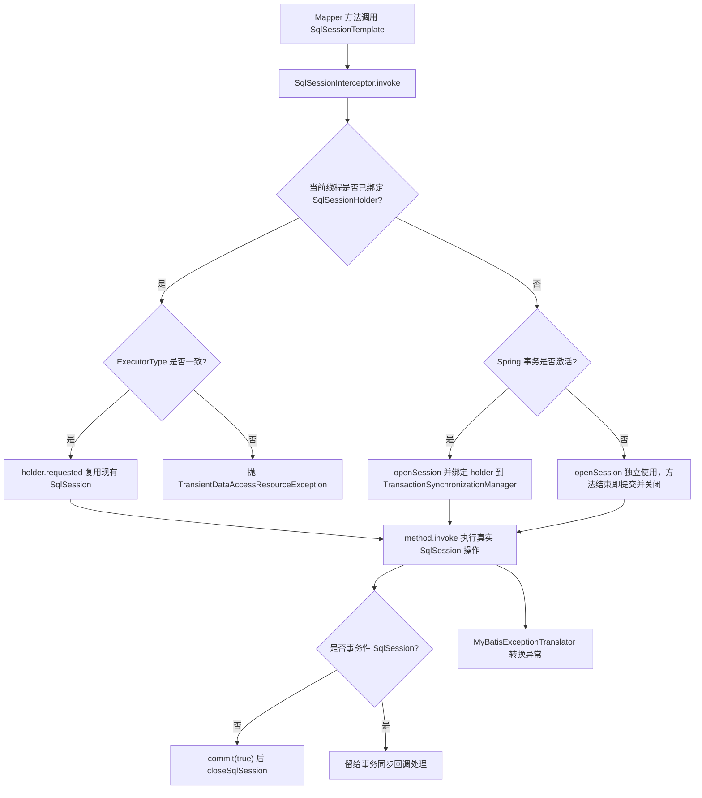

### 13.3 DefaultSqlSession 为什么不是线程安全

| 维度 | `DefaultSqlSession` | `SqlSessionTemplate` |
| --- | --- | --- |
| 是否持有 Executor | 是，`private final Executor executor` | 否，每次调用动态取 |
| 是否有可变状态 | `dirty`、`cursorList` | 无 |
| 一级缓存 | 自己持有 | 由当前绑定的 `DefaultSqlSession` 持有 |
| 事务提交 | 调用方 `commit` | 无事务自动 `commit(true)`，有事务交给 Spring |
| 并发调用后果 | 一级缓存 `HashMap` 并发写、`dirty` 竞态、连接错乱 | 安全 |

### 13.4 Spring Boot 自动配置

`mybatis-spring-boot-starter` 的 `MybatisAutoConfiguration` 条件：

- `@ConditionalOnClass({SqlSessionFactory.class, SqlSessionFactoryBean.class})`
- `@ConditionalOnSingleCandidate(DataSource.class)`——**多数据源时自动配置失效**，必须手动配 `SqlSessionFactoryBean`。
- `@AutoConfigureAfter({DataSourceAutoConfiguration.class, MybatisLanguageDriverAutoConfiguration.class})`

两个容易踩的点：

1. `mybatis.configuration` 与 `mybatis.config-location` 不能同时配置。`SqlSessionFactoryBean#buildSqlSessionFactory` 会抛 `IllegalStateException("Property 'configuration' and 'configLocation' can not specified with together")`。
2. `@MapperScan` 与 `MapperScannerConfigurer` 的 `addToConfig` 默认 `true`，重复扫描同一个接口会抛 `IllegalArgumentException: Mapped Statements collection already contains value for ...`。多个数据源时要把次要的设为 `addToConfig=false`。

## 十四、TypeHandler 与枚举映射

### 14.1 注册表与查找顺序

`TypeHandlerRegistry` 维护 `Map<JdbcType, TypeHandler<?>>` 和 `Map<Type, Map<JdbcType, TypeHandler<?>>>` 两套索引，并在 `getTypeHandler` 时按以下优先级查找：

1. `ParameterMapping#getTypeHandler()`（`#{}` 里显式写的 `typeHandler=...`）。
2. `(javaType, jdbcType)` 精确匹配。
3. `(javaType, null)`。
4. `(null, jdbcType)`。
5. `javaType` 的父类/接口注册的 handler。
6. 都没有 → `UnknownTypeHandler`，运行时用 `ResultSetMetaData` 探测。

自定义 handler 的注册三种方式：

| 方式 | 写法 | 作用范围 |
| --- | --- | --- |
| 配置包扫描 | `mybatis.type-handlers-package=com.x.handler` | 该包下所有带 `@MappedTypes` 的类 |
| XML 注册 | `<typeHandlers><typeHandler handler="com.x.FooHandler" javaType="com.x.Foo"/></typeHandlers>` | 全局 |
| 注解声明 | `@MappedTypes(Foo.class)`、`@MappedJdbcTypes(JdbcType.VARCHAR)` | 配合前两种 |

### 14.2 内置 handler 与 JSR-310

| Java 类型 | Handler | 备注 |
| --- | --- | --- |
| `String` | `StringTypeHandler` | 最常用 |
| `Integer/int` | `IntegerTypeHandler` | 基本类型有独立注册 |
| `BigDecimal` | `BigDecimalTypeHandler` | 金额必须用 |
| `java.util.Date` | `DateTypeHandler` | 走 `Timestamp` |
| `LocalDateTime` | `LocalDateTimeTypeHandler` | 3.4.5+，`setNonNullParameter` 用 `ps.setObject(i, parameter)`，依赖 JDBC 4.2 |
| `LocalDate`/`LocalTime` | `LocalDateTypeHandler`/`LocalTimeTypeHandler` | 同上 |
| `byte[]` | `ByteArrayTypeHandler` | 注意 `BlobTypeHandler` 走流 |
| `Object` | `ObjectTypeHandler`/`UnknownTypeHandler` | 兜底 |
| 枚举 | `EnumTypeHandler` | 存 `name()` |

`LocalDateTimeTypeHandler` 用 `ps.setObject` 而不是 `Timestamp.valueOf`，是 3.5.x 的行为。旧驱动（如 MySQL Connector/J 5.1.37 以下）对 `setObject(LocalDateTime)` 支持不完整，会抛 `SQLFeatureNotSupportedException`，需要降级写法或升级驱动。

### 14.3 枚举映射的三种方案

| 方案 | 存储值 | 优点 | 风险 |
| --- | --- | --- | --- |
| `EnumTypeHandler`（默认） | `Enum#name()` | 可读、加字段安全 | 改名即数据失配，无法重排 |
| `EnumOrdinalTypeHandler` | `Enum#ordinal()` | 省空间（tinyint） | **插入新枚举值到中间就全表错位**，生产禁用 |
| 自定义 `BaseTypeHandler` + 业务码 | 业务 `code` 字段 | 与前端/外部系统对齐 | 需要手写 handler 与注册 |

配置 `defaultEnumTypeHandler`（3.4.5+）可以全局改默认：

```xml
<settings>
  <setting name="defaultEnumTypeHandler" value="org.apache.ibatis.type.EnumOrdinalTypeHandler"/>
</settings>
```

自定义枚举 handler 的完整写法：

```java
@MappedTypes(OrderStatus.class)
@MappedJdbcTypes(JdbcType.TINYINT)
public class OrderStatusTypeHandler extends BaseTypeHandler<OrderStatus> {
    @Override
    public void setNonNullParameter(PreparedStatement ps, int i, OrderStatus parameter, JdbcType jdbcType)
            throws SQLException {
        ps.setInt(i, parameter.getCode());
    }
    @Override
    public OrderStatus getNullableResult(ResultSet rs, String columnName) throws SQLException {
        return OrderStatus.of(rs.getInt(columnName));
    }
    @Override
    public OrderStatus getNullableResult(ResultSet rs, int columnIndex) throws SQLException {
        return OrderStatus.of(rs.getInt(columnIndex));
    }
    @Override
    public OrderStatus getNullableResult(CallableStatement cs, int columnIndex) throws SQLException {
        return OrderStatus.of(cs.getInt(columnIndex));
    }
}
```

`BaseTypeHandler` 的四个抽象方法必须全实现：一个写、三个读（按列名、按列下标、从 `CallableStatement` 按下标）。继承 `BaseTypeHandler` 而不是直接实现 `TypeHandler`，是因为基类帮你处理了 null 分支（`setParameter` 里 null 走 `ps.setNull`，`getResult` 里 null 返回 null）。

**MyBatis-Plus 的枚举方案**：实现 `com.baomidou.mybatisplus.annotation.IEnum<T>` 并配置 `mybatis-plus.configuration.default-enum-type-handler: com.baomidou.mybatisplus.core.handlers.MybatisEnumTypeHandler`，MP 会自动处理实现了 `IEnum` 的枚举。注意该 handler 只对实现 `IEnum` 的枚举生效，普通枚举仍走 `EnumTypeHandler`。

## 十五、批处理与性能优化

### 15.1 三种 ExecutorType 对比

| 维度 | `SIMPLE` | `REUSE` | `BATCH` |
| --- | --- | --- | --- |
| 默认 | 是 | 否 | 否 |
| Statement 复用 | 不复用，每次新建并关闭 | 按 SQL 文本缓存在 `statementMap` | 按 (SQL, MappedStatement) 复用直到 flush |
| 影响行数 | 真实值 | 真实值 | `BATCH_UPDATE_RETURN_VALUE`（`Integer.MIN_VALUE + 1002`） |
| 主键回填 | 支持 | 支持 | 依赖驱动与 `Jdbc3KeyGenerator`，容易失败 |
| 查询行为 | 正常 | 正常 | `doQuery` 前先 `flushStatements`，且 `closed` 时抛 `ExecutorException` |
| 适用 | 通用 | 同一 SqlSession 内重复同一 SQL | 大批量 insert/update |

`BatchExecutor` 复用 `Statement` 的条件很严格：`sql.equals(currentSql) && ms.equals(currentStatement)`。所以"批量插入时中间夹了一条别的 SQL"会导致 batch 被切分成多段，性能骤降。这也是"批量方法里不要混 SQL"的原因。

### 15.2 JDBC 批处理的真实生效条件

即使开了 `ExecutorType.BATCH`，MySQL 默认仍会逐条发送，必须在连接串上开启：

```
jdbc:mysql://host:3306/db?rewriteBatchedStatements=true&useServerPrepStmts=false
```

`rewriteBatchedStatements=true` 后 Connector/J 会把同构的 `insert` 改写成 `insert into t (...) values (...),(...),(...)`。注意它的生效前提是**同一 PreparedStatement 的连续 addBatch**，与 MyBatis 的 `BatchExecutor` 分组条件一致。

### 15.3 fetchSize 与流式查询

| 数据库 | 流式查询条件 |
| --- | --- |
| MySQL | 连接串 `useCursorFetch=true` 且 `statement.setFetchSize(Integer.MIN_VALUE)`；MyBatis 里通过 `defaultFetchSize` 设不了 `Integer.MIN_VALUE` 的语义，需自定义 `ResultSetType.FORWARD_ONLY` + 自定义参数 |
| PostgreSQL | 必须 `autoCommit=false`（即必须在事务里）才启用游标；否则驱动会把整个结果集读进内存，`fetchSize` 被忽略 |
| Oracle | `defaultRowPrefetch` 默认 10，可调 |

MyBatis 侧的 `Cursor<T>` 是流式返回的入口：Mapper 方法返回 `Cursor<T>`，`MapperMethod` 走 `selectCursor`，`DefaultResultSetHandler` 用 `ResultSetType.FORWARD_ONLY` + `ResultHandler` 逐行处理。**`Cursor` 必须 close**，否则连接不释放，会出现在 `cursorList` 里。

### 15.4 MyBatis 自带连接池的默认值

生产不用 `PooledDataSource`（用 HikariCP 或 Druid），但面试会问默认值：

| 参数 | 默认值 |
| --- | --- |
| `poolMaximumActiveConnections` | 10 |
| `poolMaximumIdleConnections` | 5 |
| `poolMaximumCheckoutTime` | 20000 ms |
| `poolTimeToWait` | 20000 ms |
| `poolPingEnabled` | false |
| `poolPingQuery` | `NO PING QUERY SET` |
| `poolPingConnectionsNotUsedFor` | 0 |

### 15.5 性能优化清单

| 方向 | 措施 | 依据 |
| --- | --- | --- |
| 减少 SQL 条数 | 消灭 N+1，用 `IN` 批量或嵌套结果；或两段式查询 | `DefaultResultSetHandler` 的嵌套查询每条父行一次 `select` |
| 减少数据量 | 去掉 `select *`，只查需要列；分页用物理分页 | 网络 + `ResultSetWrapper` 列元数据开销 |
| 减少解析开销 | 静态 SQL 走 `RawSqlSource`；避免无意义 `<if>` | `RawSqlSource` 在启动时完成解析 |
| 减少缓存污染 | 长事务里手动 `sqlSession.clearCache()` 或缩短事务 | `PerpetualCache` 是 `HashMap`，无上限 |
| 批量写 | `ExecutorType.BATCH` + `rewriteBatchedStatements=true` + 每批 500~1000 条 | 单批过大触发 `max_allowed_packet` |
| 连接池 | HikariCP `maximumPoolSize` 按 `CPU 核数 × (1 + 等待时间/计算时间)` 估算，默认 10 往往不够 | HikariCP 的默认 `maximumPoolSize=10` |
| 超时 | 设 `defaultStatementTimeout`（秒）与 Druid 的 `queryTimeout` | 防止慢 SQL 拖垮连接池 |
| Statement 缓存 | MySQL 侧 `cachePrepStmts=true&prepStmtCacheSize=250&prepStmtCacheSqlLimit=2048` | 减少服务端解析 |
| 索引 | 唯一真正有效的优化；`explain` 看 `type`、`rows`、`Extra` | 与 ORM 无关 |

## 十六、MyBatis-Plus 常用能力与坑

### 16.1 版本与核心类

MyBatis-Plus 3.5.x（JDK 8+），坐标 `com.baomidou:mybatis-plus-boot-starter`（Boot 3 用 `mybatis-plus-spring-boot3-starter`）。

| 能力 | 类/注解 | 说明 |
| --- | --- | --- |
| 通用 CRUD | `BaseMapper<T>` | `selectById`、`selectList`、`insert`、`updateById`、`deleteById` 等 |
| Service 层 | `IService<T>` / `ServiceImpl<M, T>` | `save`、`saveBatch`、`getById`、`lambdaQuery` |
| 条件构造器 | `QueryWrapper`、`LambdaQueryWrapper`、`UpdateWrapper` | Lambda 版通过 `SerializedLambda` 取列名 |
| 分页 | `MybatisPlusInterceptor` + `PaginationInnerInterceptor` | 3.4.0 起取代 `PaginationInterceptor` |
| 乐观锁 | `@Version` + `OptimisticLockerInnerInterceptor` | 只在 `updateById`/带实体的 `update` 生效 |
| 逻辑删除 | `@TableLogic` | 默认 `logic-delete-value=1`、`logic-not-delete-value=0` |
| 自动填充 | `MetaObjectHandler` + `@TableField(fill=...)` | `FieldFill.INSERT`/`UPDATE`/`INSERT_UPDATE` |
| 防全表更新 | `BlockAttackInnerInterceptor` | 拦截无 where 的 update/delete |
| 多租户 | `TenantLineInnerInterceptor` + `TenantLineHandler` | 自动拼 `tenant_id` |
| 主键 | `@TableId(type = IdType.ASSIGN_ID)` | MP 3.x 默认，雪花算法 |

### 16.2 拦截器顺序（写错就是事故）

`MybatisPlusInterceptor#addInnerInterceptor` 的添加顺序决定 SQL 处理顺序，官方推荐：

1. 多租户 `TenantLineInnerInterceptor`
2. 动态表名 `DynamicTableNameInnerInterceptor`
3. 分页 `PaginationInnerInterceptor`
4. 乐观锁 `OptimisticLockerInnerInterceptor`
5. SQL 性能规范 `IllegalSQLInnerInterceptor`
6. 防全表更新与删除 `BlockAttackInnerInterceptor`

原因是分页需要先知道最终表名（多租户/动态表名要先改），而 count 改写必须发生在乐观锁加乐观版本字段之后、防全表删除之前。

`PaginationInnerInterceptor` 的关键参数：

| 参数 | 默认值 | 说明 |
| --- | --- | --- |
| `dbType` | null（自动探测） | 多数据源建议显式指定 `DbType.MYSQL` |
| `maxLimit` | null | 设为 500 可强制单页上限，防止 `pageSize=100000` 拉爆内存 |
| `overflow` | false | true 时页码超界回到首页 |
| `optimizeJoin` | true（3.5.3.2+） | count 时自动去掉不影响结果的 left join |

### 16.3 雪花主键参数

`com.baomidou.mybatisplus.core.toolkit.Sequence` / `DefaultIdentifierGenerator`：

| 参数 | 值 |
| --- | --- |
| 起始时间戳 `twepoch` | `1288834974657L`（2010-11-04 01:42:54 UTC） |
| `workerIdBits` | 5（最大 31） |
| `datacenterIdBits` | 5（最大 31） |
| `sequenceBits` | 12（每毫秒 4096 个） |
| 时间戳位数 | 41 位 |

实现类默认从网卡/主机名推导 `workerId` 和 `datacenterId`。**多实例部署时若容器主机名相同，可能生成重复 ID**，生产必须显式指定 `IdentifierGenerator` 或配置 `mybatis-plus.global-config.worker-id` / `datacenter-id`（3.4.x 起支持在 `GlobalConfig` 上设置）。

### 16.4 MyBatis-Plus 的坑

| 坑 | 原因 | 规避 |
| --- | --- | --- |
| 逻辑删除后唯一索引冲突 | `@TableLogic` 只是加 `deleted=0` 条件，物理行还在 | 唯一索引带 `deleted` 列，或用删除时间戳列 |
| `@Version` 在批量更新失效 | `OptimisticLockerInnerInterceptor` 只处理参数是实体的单条 update | 批量更新用 `wrapper.eq("version", v)` 手动实现 |
| `saveBatch` 性能不达预期 | 复用事务中已绑定的 `SqlSession`（SIMPLE 执行器），批量退化为逐条 | 用 `SqlSessionFactory.openSession(ExecutorType.BATCH)` 自己控制；或确认连接串开启 `rewriteBatchedStatements` |
| `saveBatch` 默认批次 1000 | `DEFAULT_BATCH_SIZE = 1000` | 大对象按 500 批更稳 |
| lambda 取列名拿不到 | 实体字段没有 `getter` 或用了 `@TableField(exist=false)` | 补齐 getter；`exist=false` 字段无法参与 lambda 条件 |
| `selectMaps` 返回列名大小写不定 | 依赖 `useColumnLabel` 与驱动，Oracle 返回大写 | 显式 `as` 别名或在应用层归一化 |
| MP 与 PageHelper 共存 | 两者的 `jsqlparser` 版本与分页拦截器冲突 | 只保留一个分页实现 |
| `IService#list()` 不带逻辑删除条件 | 用了自定义 XML SQL 而非 MP 生成的方法 | 自定义 SQL 里手写 `deleted = 0` |
| 分页 total 为 0 但数据存在 | count SQL 被 `optimizeJoin` 去掉的表影响了筛选 | 关闭 `optimizeJoin` 或手写 count |
| 自动填充不生效 | `MetaObjectHandler` 未注册为 Bean，或字段没有 `fill` | 加 `@Component` 并核对 `FieldFill` |

## 十七、生产实战：排查手册

### 17.1 高频故障与定位

| 现象 | 可能原因 | 定位方式 |
| --- | --- | --- |
| `Invalid bound statement (not found)` | namespace 不匹配、XML 未进 classpath、`@MapperScan` 包不对 | `Configuration#getMappedStatement` 抛异常；`ls target/classes/**/*.xml`；开 `logging.level.com.x.mapper=debug` |
| `Parameter 'x' not found. Available parameters are [arg0, param1]` | 没加 `@Param` 且未开 `-parameters` | 检查 `maven-compiler-plugin` 的 `<parameters>` |
| `TooManyResultsException: Expected one result to be returned by selectOne` | `selectOne` 返回多行 | 加 `limit 1` 或改 `selectList` |
| `Executor was closed` | `SqlSession` 被提前 close 后继续用 | 检查手动 `openSession` 的 try/finally |
| 接口偶发返回旧数据 | 一级缓存跨读、二级缓存脏读、事务隔离 | 见 17.2 |
| 接口变慢、CPU 低、DB 有大量同构 SQL | N+1 | 开 SQL 日志数同一次请求的 `Preparing` 条数；`select count(*)` 对比 |
| 大事务 OOM | 一级缓存 `HashMap` 存了大结果集 | `jmap -histo:live <pid> \| grep PerpetualCache` 看实例数，或 dump 后看 retained size |
| `ORA-01795` | `IN` 列表超过 1000 | 定位 `<foreach>` 的集合大小，按 1000 切片 |
| `PacketTooBigException` | `<foreach>` 拼出的 SQL 超过 `max_allowed_packet` | 减小批大小并开启 JDBC 批处理 |
| `Cannot change the ExecutorType when there is an existing transaction` | 事务中切换了 ExecutorType | 不要在 `@Transactional` 内混用 BATCH 与 SIMPLE |

### 17.2 "偶发返回旧数据"的排查路径

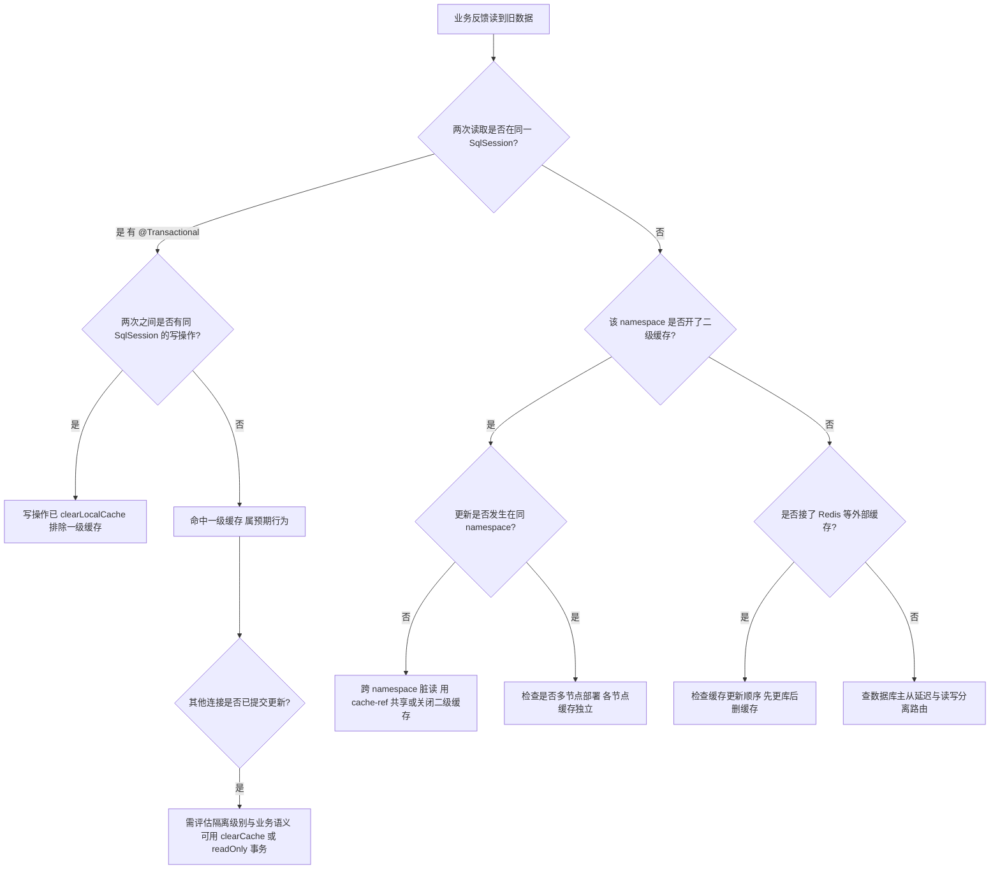

排查命令与手段：

1. 开 SQL 日志：`logging.level.com.x.mapper=debug`，看 `<== Total` 是否出现在第二次读取（出现说明没命中缓存，问题在数据库侧；没出现说明命中缓存）。
2. 打印 `Cache Hit Ratio`：`logging.level.org.apache.ibatis.cache=debug`，`LoggingCache` 会输出命中率。
3. 加临时开关：`mybatis.configuration.local-cache-scope=statement` 复现，若现象消失即一级缓存问题。
4. 直接查库比对：用 `mysql -e "select ... for update"` 或独立连接确认数据库真实值，区分"缓存旧"和"主从延迟"。
5. 检查 `TransactionSynchronizationManager` 的绑定：在 Mapper 调用前后打印 `TransactionSynchronizationManager.isActualTransactionActive()`。

### 17.3 SQL 耗时埋点插件的设计要点

面试常问"怎么做一个统计每个 SQL 耗时、执行次数、慢 SQL 告警的插件"。要点：

1. **拦截点选 `Executor#query`/`Executor#update` 的 4 参数签名**，一次请求只统计一次；不要拦 `StatementHandler#query`（会漏掉参数化阶段）也不要拦 `prepare`（一次查询可能多次）。
2. **用 `MappedStatement#getId()` + 归一化 SQL 做指纹**：把 `?` 之外的常量（`limit 10`、`in (1,2,3)`）归一化，否则指纹维度爆炸。
3. **必须用 `try/finally`**，异常也要统计，并区分异常类型。
4. **异步上报 + 有界队列**，绝不能同步写日志或发 MQ，否则插件本身成为瓶颈。
5. **采样**：核心链路全量、非核心 1%，避免高 QPS 下埋点成本超过业务。
6. **和 `MappedStatement#getTimeout()` 联动**：超时直接告警，别只统计平均值（平均值会掩盖长尾）。

## 高级岗三问

### 问一：为什么 MyBatis 要把 SQL 执行拆成四大对象？替代方案是什么？

**答**：拆分的动机是"变化点分离"。`SqlSource` 负责把 XML/注解变成 SQL 文本与参数描述；`StatementHandler` 负责 JDBC 交互；`ParameterHandler` 负责入参绑定；`ResultSetHandler` 负责出参映射。这样同一个 `StatementHandler` 可以服务任意 SQL，同一套 `TypeHandler` 可以服务入参与出参。

替代方案是像 `JdbcTemplate` 那样用一个类包办。代价是无法支持插件——插件能生效的前提是"每个对象都通过 `Configuration#newXxx` 创建，且创建后立刻 `pluginAll`"。如果只有一个大对象，就只能改源码。同时拆开后 `DynamicSqlSource` 与 `RawSqlSource` 可以在启动期决定是否预解析，这是纯粹的收益。

代价是对象数量多、调用链长。一次简单查询要经过 `MapperProxy → MapperMethod → SqlSession → CachingExecutor → BaseExecutor → RoutingStatementHandler → PreparedStatementHandler → DefaultParameterHandler → DefaultResultSetHandler`，9 层。这也是 MyBatis 比 `JdbcTemplate` 慢的部分原因，但相对网络与数据库执行时间可以忽略。

### 问二：线上 MyBatis 相关问题的定位工具链是什么？

| 层次 | 手段 | 能回答的问题 |
| --- | --- | --- |
| 应用日志 | `logging.level.<mapper包>=DEBUG` | SQL 文本、参数、返回行数、是否命中缓存（SQL 没打说明命中） |
| 缓存日志 | `logging.level.org.apache.ibatis.cache=DEBUG` | 二级缓存命中率 |
| 连接池 | HikariCP `metricRegistry`、Druid `StatFilter`、`SHOW PROCESSLIST` | 连接是否泄漏、活跃连接数、慢 SQL 排行 |
| 数据库 | `slow_query_log`、`long_query_time`、`EXPLAIN`、`performance_schema.events_statements_summary_by_digest` | 索引是否命中、扫描行数、同类 SQL 总耗时 |
| JVM | `jmap -histo:live`、`jstack`、`async-profiler` 火焰图 | 一级缓存 OOM、线程阻塞在 JDBC |
| 链路追踪 | SkyWalking/Pinpoint 的 MyBatis 插件、OpenTelemetry JDBC instrumentation | 单次请求内的 SQL 次数与耗时分布，直接暴露 N+1 |

### 问三：QPS 和数据量上来后，MyBatis 层的失效模式是什么？

| 规模变化 | 失效模式 | 对策 |
| --- | --- | --- |
| QPS 上升 | 插件反射开销累积；日志全量打印拖慢 | 限流采样、异步日志、插件数量收敛 |
| 单表数据量上升 | 深分页 `limit N, M` 变慢；count 全表扫描 | 游标分页、count 走缓存、业务上限制最大页数 |
| 结果集变大 | 一级缓存 `HashMap` 撑爆堆；`readOnly=false` 的二级缓存序列化成本高 | 关二级缓存、限制单次查询条数、流式 `Cursor` |
| 实例变多 | 二级缓存各节点独立导致不一致；雪花 ID 的 workerId 冲突 | 去掉 JVM 内缓存改集中式 Redis；显式分配 workerId |
| 事务变长 | 一级缓存持有大量对象、连接占用时间长 | 缩短事务、只读事务加 `readOnly=true`、批量拆批 |
| 分库分表 | `namespace` 与表名绑定导致缓存与分页都错 | 动态表名拦截器、`Mapper` 按库分组、`Configuration` 每数据源一份 |

## 高频面试题

### Q1. MyBatis 的四大对象分别做什么？为什么要有 RoutingStatementHandler？

**答题框架（30 秒版）**：`Executor` 管调度、缓存、事务；`StatementHandler` 管 JDBC 的 Statement 创建与执行；`ParameterHandler` 把参数按 `ParameterMapping` 绑定到 `?`；`ResultSetHandler` 把 `ResultSet` 映射成对象。`RoutingStatementHandler` 是路由，按 `MappedStatement#getStatementType()` 在 `SimpleStatementHandler`/`PreparedStatementHandler`/`CallableStatementHandler` 之间选一个，默认 `PREPARED`。

**展开（2 分钟版）**：

1. `Configuration#newExecutor` 决定 Executor 类型，默认 `SIMPLE`，`cacheEnabled=true` 时外面套 `CachingExecutor`，最后 `pluginAll`。
2. `BaseExecutor` 模板方法固化"查一级缓存 → 查库 → 回填缓存"，三个子类只实现 `doQuery`/`doUpdate`。
3. `BaseStatementHandler` 在构造时创建 `ParameterHandler` 和 `ResultSetHandler`，并持有 `BoundSql`。
4. `PreparedStatementHandler#query` 只有四步：`ps.execute()`、`resultSetHandler.handleResultSets(ps)`、关语句、返回。

**追问**：为什么 `RoutingStatementHandler` 不直接在 `Configuration` 里 if-else 选？答：因为它同时是插件拦截目标，做成一个"总是存在的门面"可以让插件只写一个签名就能拦到三种 Statement。

### Q2. Mapper 接口没有实现类，为什么能直接调用？

**答题框架（30 秒版）**：`MapperRegistry#addMapper` 时注册 `MapperProxyFactory`；`getMapper` 时用 `Proxy.newProxyInstance` 生成 JDK 动态代理；调用进 `MapperProxy#invoke`，非 `Object`、非 `default` 的方法交给 `MapperMethod#execute`，由它按 `SqlCommandType` 调 `SqlSession` 的对应方法。

**展开（2 分钟版）**：

1. `MapperProxy#invoke` 三个分支：`Object` 方法 `method.invoke(this, args)`；`default` 方法走 `DefaultMethodInvoker`（JDK 8 用 `MethodHandles.Lookup` 私有构造，JDK 9+ 用 `privateLookupIn`）；其余走 `PlainMethodInvoker`。
2. `MapperMethod` 拆成 `SqlCommand`（statementId + `SqlCommandType`）和 `MethodSignature`（`returnsMany/returnsMap/returnsCursor/returnsOptional/returnsVoid`）。
3. statementId 先按"声明类全限定名 + 方法名"找，找不到再用"接口全限定名 + 方法名"，都找不到抛 `BindingException: Invalid bound statement (not found)`。

**追问**：Mapper 能 `equals` 比较吗？答：`equals` 走 `Object` 分支，即 `this.equals` 的默认引用比较，两个不同 SqlSession 生成的代理不相等，不要用它做去重或 Map key。

### Q3. `#{}` 和 `${}` 的区别？怎么防 SQL 注入？

**答题框架（30 秒版）**：`#{}` 解析成 `?` 并生成 `ParameterMapping`，走 `PreparedStatement` 预编译，天然防注入；`${}` 在 `TextSqlNode`/`BindingTokenParser` 里用 OGNL 求值后直接拼进 SQL 文本，可注入。参数值一律用 `#{}`，`${}` 只用于列名、表名、`ORDER BY` 且必须白名单。

**展开（2 分钟版）**：

1. 解析时机不同：`#{}` 在 `SqlSourceBuilder#parse` 阶段被 `ParameterMappingTokenHandler` 替换；`${}` 在运行时 `DynamicSqlSource#getBoundSql` 阶段被 `BindingTokenParser` 求值。
2. 执行计划：`#{}` 的 SQL 文本稳定，数据库可复用执行计划；`${}` 每次文本都不同，执行计划缓存命中率低。
3. 正确写法：`like concat('%', #{name}, '%')`、`in <foreach ...>#{id}</foreach>`。
4. 必须拼接时用 `Set<String>` 白名单校验，或用 `LambdaQueryWrapper` 通过 `SerializedLambda` 取列名。

**追问**：`${}` 一定不安全吗？答：`${}` 本身只是"字符串拼接"，如果内容完全来自代码常量即为安全；风险来自"内容可控"。工程上应把 `${}` 收敛到少数几个接口并强制白名单。

### Q4. 一级缓存的作用域和失效条件？为什么在 Spring 里"感觉失效"？

**答题框架（30 秒版）**：一级缓存是 `BaseExecutor#localCache`（`PerpetualCache`，本质 `HashMap`），作用域是 **SqlSession**。失效条件：任意写操作、`commit`/`rollback`、`close`、`clearCache`、`localCacheScope=STATEMENT`、`flushCache=true`，以及 CacheKey 变化。

**展开（2 分钟版）**：

1. CacheKey 由 `ms.getId()`、`RowBounds` 的 offset/limit、`BoundSql#getSql()`、参数值序列、`Environment#getId()` 共同组成（源码见 `BaseExecutor#createCacheKey`，hashcode 起始 17、multiplier 37）。
2. `BaseExecutor#update` 第一行就是 `clearLocalCache()`，所以"先查再写再查"在同一个 SqlSession 里一定拿到新值。
3. Spring 下：无 `@Transactional` 时，`SqlSessionTemplate` 的每次调用都新建 SqlSession 并在 finally 里 close，一级缓存等于没用；有 `@Transactional` 时 `SqlSessionUtils.getSqlSession` 复用绑定在 `TransactionSynchronizationManager` 上的 SqlSession，一级缓存才生效。

**追问**：一级缓存的最大风险？答：`PerpetualCache` 是无上限 `HashMap`，长事务里反复查大结果集会导致堆内存膨胀；且它不感知其他连接的提交，存在读到旧值的可能。

### Q5. 二级缓存为什么不建议开？脏读是怎么产生的？

**答题框架（30 秒版）**：二级缓存是 namespace 级、跨 SqlSession 的 `Cache`，由 `CachingExecutor` + `TransactionalCacheManager` 驱动。不建议开的原因：跨 namespace 脏读、其他写入方不可见、集群各节点独立、序列化成本、`readOnly=true` 的引用污染。

**展开（2 分钟版）**：

1. `<cache/>` 默认 `eviction=LRU`、`flushInterval=null`、`size=1024`、`readOnly=false`；`readOnly=false` 走 `SerializedCache`，实体必须 `Serializable`。
2. `TransactionalCache` 的 `putObject` 只写 `entriesToAddOnCommit`，`commit` 才 `flushPendingEntries`；`rollback` 时 `reset()` 丢弃；`flushCacheIfRequired` 置 `clearOnCommit`，commit 时清空整个 namespace。
3. 脏读三大来源：join 查询涉及的多个 namespace 各自只清自己的缓存；DBA/其他应用直改库；多节点部署各节点缓存独立。
4. 结论：把缓存放到 Service 层用 Redis 显式管理，二级缓存只用于字典表这类"读多写极少、单表、可容忍不一致"的场景。

**追问**：如果一定要用，怎么降低风险？答：实体 `Serializable`；`flushInterval` 设小值兜底；共享表的 namespace 用 `<cache-ref>` 或 `@CacheNamespaceRef` 共用一个 cache；换 `RedisCache` 并保证事务提交后才写。

### Q6. 插件是怎么实现的？多个插件的执行顺序是什么？

**答题框架（30 秒版）**：实现 `Interceptor`，用 `@Intercepts` + `@Signature(type, method, args)` 声明拦截点；`Interceptor#plugin` 默认调 `Plugin.wrap`，用 `Proxy.newProxyInstance` 生成 JDK 代理；调用进 `Plugin#invoke`，签名命中才调 `interceptor.intercept(new Invocation(...))`，否则直接 `method.invoke`。`InterceptorChain#pluginAll` 顺序包裹，**后注册的在外层，先执行**。

**展开（2 分钟版）**：

1. `@Signature` 的 `type` 必须是接口类型（如 `Executor.class`），因为 `Plugin#invoke` 用 `method.getDeclaringClass()` 匹配。
2. 四个包装点：`Configuration#newExecutor`（包 `CachingExecutor`）、`newStatementHandler`、`newParameterHandler`、`newResultSetHandler`。
3. 改 SQL 要拦 `StatementHandler#prepare(Connection, Integer)`，用 `MetaObject` 改 `delegate.boundSql.sql`，且**不能改变 `?` 的个数**。
4. 多层插件叠加后 `delegate` 可能还是 `Plugin`，需要拆包工具（MyBatis-Plus 提供 `PluginUtils#realTarget`）。

**追问**：为什么 PageHelper 拦 `Executor` 就能拿到分页？答：因为 `pluginAll` 发生在 `CachingExecutor` 包装之后，插件在缓存层之外，能同时覆盖 count 查询和数据查询，并在改写 SQL 时用 ThreadLocal 里的 `Page` 对象。

### Q7. 为什么 `SqlSessionTemplate` 线程安全，`DefaultSqlSession` 不是？

**答题框架（30 秒版）**：`SqlSessionTemplate` 自己不持有 `SqlSession`，它持有一个 `sqlSessionProxy`（`SqlSessionInterceptor` 的 JDK 代理），每次调用通过 `SqlSessionUtils.getSqlSession` 按当前线程/事务动态取真实会话，用完按事务状态决定提交与关闭；没有可变共享状态。`DefaultSqlSession` 持有 `Executor`、`dirty`、`cursorList`，且有状态切换，不能并发。

**展开（2 分钟版）**：

1. `SqlSessionInterceptor#invoke` 逻辑：取会话 → `method.invoke(sqlSession, args)` → 非事务性会话 `commit(true)` → finally `closeSqlSession`。
2. `SqlSessionUtils.getSqlSession` 从 `TransactionSynchronizationManager` 取 `SqlSessionHolder`；有则校验 `executorType` 一致后 `requested()` 复用，不一致抛 `TransientDataAccessResourceException`。
3. 无 Spring 事务时每次新建会话，所以一级缓存在无事务场景下不起作用——这是"线程安全"的代价。

**追问**：为什么会有 "Cannot change the ExecutorType when there is an existing transaction"？答：因为事务内已经绑定了一个 SIMPLE 执行器的 SqlSession，此时要求 BATCH 会破坏一致性，框架直接拒绝而不是静默降级。

### Q8.（场景设计）让你做一个全站 SQL 治理插件，统计耗时、次数、慢 SQL 告警，怎么设计？

**答题框架（30 秒版）**：拦 `Executor#query` 和 `Executor#update` 的 4 参数签名；用 `MappedStatement#getId()` + SQL 归一化指纹做聚合维度；`try/finally` 统计耗时；异步有界队列上报；支持采样与阈值告警；慢 SQL 单独打全量参数。

**展开（2 分钟版）**：

1. 拦截点选择：`Executor` 层一次调用对应一次业务 SQL，`StatementHandler` 层会重复（批量 flush 多次），`prepare` 更是多次。选 `Executor` 4 参数签名即可覆盖。
2. 指纹归一化：把 `#{param}` 对应的值统一成 `?`（`BoundSql#getSql()` 本身就是带 `?` 的文本，天然适合做指纹），额外把 `limit`、`in` 的个数归一化，避免维度爆炸。
3. 线程模型：`RingBuffer` 或 `ArrayBlockingQueue` + 单线程消费，队列满直接丢弃并计数，绝不让埋点反压业务。
4. 慢 SQL 判定：`cost > threshold`（如 500ms）时打印完整 SQL + 参数 + 调用方堆栈（`new Throwable().getStackTrace()` 取前若干帧），便于定位是哪个业务。
5. 采样与开关：`ThreadLocalRandom` 1% 采样用于常态统计，超过阈值 100% 采样；提供动态开关（`volatile` 标志 + 配置中心推送）。
6. 与分页/多租户插件的顺序：埋点插件放最外层（最后注册），这样统计到的是包含 count 查询在内的真实耗时。

**追问**：如何区分"抖动"和"退化"？答：同时记录 P50/P95/P99 和超时次数，用滑动窗口（如 1 分钟）对比基线的 P99，只看平均值会被长尾掩盖。

### Q9.（场景设计）多租户 + 分页 + 逻辑删除 + 乐观锁，MyBatis 层怎么设计？

**答题框架（30 秒版）**：用 `MybatisPlusInterceptor` 串起 `TenantLineInnerInterceptor` → `PaginationInnerInterceptor` → `OptimisticLockerInnerInterceptor` → `BlockAttackInnerInterceptor`；逻辑删除用 `@TableLogic`；分页显式指定 `DbType` 并设 `maxLimit`。

**展开（2 分钟版）**：

1. 顺序不能乱：多租户要先于分页，否则 count SQL 改写后租户条件位置错乱；防全表更新放最后。
2. 租户字段不要只靠拦截器：写操作也要拼 `tenant_id`，并在唯一索引里带上租户列。
3. 逻辑删除的唯一索引问题：物理行还在，同一 `username` 删除后无法再插入，方案是唯一索引包含 `deleted` 或用时间戳删除值。
4. 乐观锁覆盖不到批量更新与自定义 XML，自定义 SQL 要手写 `version` 条件。
5. 分页一定要设 `maxLimit`（如 500），否则 `pageSize=100000` 直接把堆打满。

**追问**：租户过滤能不能用 MyBatis 的 `<if test="tenantId != null">` 替代拦截器？答：可以但不可靠，漏写一处就是越权；拦截器是"默认安全"设计，再叠加代码扫描规则兜底。

### Q10.（线上排查）接口偶发返回旧数据，怀疑缓存，怎么排查？

**答题框架（30 秒版）**：先分清是"缓存旧"还是"读到了从库/快照"。开 `<mapper包>` DEBUG 看第二次读取有没有打 SQL：没打就是缓存命中。再区分一级（同 SqlSession）还是二级（跨 SqlSession）。用 `localCacheScope=statement` 和临时关闭二级缓存做二分。

**展开（2 分钟版）**：

1. 记录两次读取是否在同一 `@Transactional` 里。同事务内：一级缓存，且该事务期间其他连接提交的更新不可见（RR 语义下正常，RC 下是"读旧"）。
2. 跨事务/跨请求：看 namespace 有没有 `<cache/>`。有的话检查更新是否发生在同一 namespace；跨 namespace 更新必须用 `<cache-ref>` 或干脆关掉。
3. 多节点：默认 `PerpetualCache` 是进程内的，节点 A 的更新不会清节点 B 的缓存。看日志里 `Cache Hit Ratio` 是否长期很高。
4. 排除数据库因素：用独立连接查真实值；如果有读写分离，检查主从延迟（`SHOW SLAVE STATUS` 的 `Seconds_Behind_Master`）。
5. 临时验证：`mybatis.configuration.local-cache-scope=statement` 若现象消失 → 一级缓存；`mybatis.configuration.cache-enabled=false` 若消失 → 二级缓存。

**追问**：能不能直接关掉一级缓存？答：MyBatis 没有提供"关闭一级缓存"的开关，只能设 `localCacheScope=STATEMENT`（每次查询后清空）做到近似效果。

### Q11.（线上排查）批量导入 10 万条，接口 30 分钟不返回、应用 CPU 低、数据库压力大，怎么定位和优化？

**答题框架（30 秒版）**：先看 SQL 条数与执行方式。CPU 低说明瓶颈在网络往返或 DB 侧。三个方向：是否 N+1 的单条 insert、是否用了 `ExecutorType.BATCH`、连接串有没有 `rewriteBatchedStatements=true`。

**展开（2 分钟版）**：

1. 定位：开 DEBUG 数一次请求打了多少条 `Preparing`；用 `SHOW FULL PROCESSLIST` 看 DB 侧在跑什么；用 `performance_schema.events_statements_summary_by_digest` 看同构 SQL 的次数与总耗时。
2. 常见根因一：`<foreach>` 拼 `insert into t values (...),(...)`，但一次拼 10 万条 → SQL 超过 `max_allowed_packet` 直接失败，或解析极慢；改成每批 500~1000。
3. 常见根因二：循环调 `mapper.insert` 且每条都自动提交 → 10 万次网络往返 + 10 万次事务。改成 `ExecutorType.BATCH` 或显式 `@Transactional` 包住。
4. 常见根因三：开了 BATCH 但没开 `rewriteBatchedStatements=true`，MySQL 仍逐条发送。
5. 常见根因四：表上有多个二级索引或有触发器，写入放大。
6. 验证：每批 `stopwatch` 打点，观察单批耗时是否稳定；对比 batch size 500/1000/2000 的吞吐拐点。

**追问**：批量插入时主键怎么拿？答：`BatchExecutor#doUpdate` 返回的是 `BATCH_UPDATE_RETURN_VALUE`，`useGeneratedKeys` 在批量下依赖 `Jdbc3KeyGenerator#processBatch` 与驱动支持。更稳的做法是用应用侧生成的雪花 ID。

### Q12.（线上排查）启动报 `Invalid bound statement (not found)`，怎么一步步定位？

**答题框架（30 秒版）**：这个异常的抛出点是 `MapperMethod.SqlCommand#resolveMappedStatement`。排查三步：接口全限定名 vs XML `namespace`；XML 是否被 classpath 扫描到；`MappedStatement` 是否注册进 `Configuration`。

**展开（2 分钟版）**：

1. 核对 `namespace`：必须是接口全限定名，包括大小写；XML 文件名不需要与接口同名，但建议一致。
2. 核对扫描：`mybatis.mapper-locations`（默认 `classpath*:/mapper/**/*.xml` 在 MP 的 starter 里）是否覆盖 XML 位置；`ls target/classes/com/x/*.xml` 确认 XML 被 copy 进 classpath（Maven 的 `resources` 配置漏了 `**/*.xml` 就会缺）。
3. 核对接口注册：`@MapperScan("com.x.mapper")` 的包路径是否正确；多数据源时 `MapperScannerConfigurer#setAddToConfig(false)` 是否误配。
4. 方法名与 id 是否一致；`<select>` 是否写在正确的 `<mapper>` 里（嵌套错了会挂到别的 namespace）。
5. 用自定义 `SqlSessionFactoryBean` 后置处理器打印 `configuration.getMappedStatements()` 的 key 集合，一比就知道缺哪条。

**追问**：为什么有时启动不报错、运行时才报？答：`MapperProxyFactory` 在容器启动时就注册了，但 `MappedStatement` 的查找发生在方法调用时。所以"接口能注入成功"不代表"SQL 存在"。

### Q13. 枚举字段怎么映射？`EnumOrdinalTypeHandler` 有什么坑？

**答题框架（30 秒版）**：默认走 `EnumTypeHandler`，存 `name()`；`EnumOrdinalTypeHandler` 存 `ordinal()`，一旦在枚举中间插入新值，历史数据全部错位，生产禁用。需要与外部系统对齐就用业务码 + 自定义 `BaseTypeHandler`。

**展开（2 分钟版）**：

1. 全局默认可用 3.4.5+ 的 `defaultEnumTypeHandler` 配置改。
2. 自定义 handler 要继承 `BaseTypeHandler<T>` 并实现四个方法（写一个、读三个），标注 `@MappedTypes`、`@MappedJdbcTypes`，通过 `type-handlers-package` 或 `<typeHandlers>` 注册。
3. MyBatis-Plus 场景实现 `IEnum<T>` 并配 `default-enum-type-handler: com.baomidou.mybatisplus.core.handlers.MybatisEnumTypeHandler`，注意它只对实现了 `IEnum` 的枚举生效。
4. 查询条件里的枚举也要走到 handler：`#{status}` 的 `TypeHandler` 由参数类型决定，若参数是 `String` 而列是 `int`，`EnumTypeHandler` 不会介入。

**追问**：`EnumTypeHandler` 存 name 有什么风险？答：枚举常量改名（重构时 IDE 会连带改）会导致历史数据失配，读出来抛 `IllegalArgumentException: No enum constant`。所以枚举名一旦上线就不能改。

### Q14. `<foreach>` 批量插入和 `ExecutorType.BATCH` 的本质区别？

**答题框架（30 秒版）**：`<foreach>` 是"把 N 条合成 1 条 SQL"，数据库只解析一次、一次往返，但 SQL 长度受 `max_allowed_packet` 限制，且主键回填依赖 `Jdbc3KeyGenerator`；`BATCH` 是"把 N 条 SQL 攒起来一次发送"，SQL 文本不变，需要驱动开启 `rewriteBatchedStatements=true` 才会真正合并。

**展开（2 分钟版）**：

| 维度 | `<foreach>` 多值插入 | `ExecutorType.BATCH` |
| --- | --- | --- |
| SQL 条数 | 1 | N（驱动可能合并为 1） |
| 网络往返 | 1 | 1（flush 时） |
| 单次 SQL 大小 | 与 N 成正比，易超包 | 每条独立，受包限制小 |
| 影响行数 | 正常 | `BATCH_UPDATE_RETURN_VALUE` |
| 主键回填 | `Jdbc3KeyGenerator` 按行回填 | 依赖 `processBatch` 与驱动 |
| 内存 | N 条数据在一条 SQL 的字符串里 | 攒在 `statementList` |
| 适用 | 单表、字段少的批量插入 | 混合 DML、超大批量 |

**追问**：为什么 `BATCH` 下 `insert` 返回值是负数？答：因为结果要等 `flushStatements` 才知道，`BatchExecutor` 用 `Integer.MIN_VALUE + 1002` 作为"尚未确定"的哨兵值。

### Q15.（线上排查）`limit 1000000, 20` 的分页查询越来越慢，怎么优化？

**答题框架（30 秒版）**：MySQL 的 `limit offset, size` 要扫描 offset+size 行再丢弃前面的，深分页必然退化。三种解法：游标分页（`where id > lastId order by id limit 20`）、延迟关联（先用覆盖索引取主键再回表）、业务限制最大页数。

**展开（2 分钟版）**：

1. 根因：`explain` 会看到 `rows` 接近总行数；`type` 最多到 `range`，无法避免回表前的扫描。
2. 游标分页：适合"下一页"式浏览，但不支持跳页；前端要改成无限下拉。
3. 延迟关联：`select t.* from t_order t join (select id from t_order where ... order by id limit 1000000, 20) x on t.id = x.id`，内层走覆盖索引，代价是必须在子查询里拿到有序主键。
4. 业务限制：`PageHelper` 或 `PaginationInnerInterceptor#setMaxLimit` 限制最大页数，超出直接返回错误或引导用户加筛选条件。
5. 顺带优化 count：`select count(0)` 在千万级表上也慢，可用近似值、缓存总数、或"查 20+1 条判断是否有下一页"来免掉 count。

**追问**：为什么 `PageHelper` 的 count 有时比主查询还慢？答：智能 count 会把原 SQL 包成 `select count(0) from (原 SQL) tmp`，如果原 SQL 有大量 join 和 `order by` 在子查询里，MySQL 无法消除排序，成本可能高于主查询本身。所以复杂查询建议手写 count。

## 易错点与踩坑

| 易错点 | 正确理解 |
| --- | --- |
| "MyBatis 一级缓存默认开启，所以同一个 Mapper 调用两次只发一次 SQL" | 作用域是 SqlSession。Spring 下无事务时每次 Mapper 调用都是新 SqlSession，缓存不生效；有 `@Transactional` 才生效 |
| "`${}` 只是性能差一点" | `#{}` 与 `${}` 是"预编译参数"与"字符串拼接"的区别，`${}` 直接等于 SQL 注入面 |
| "`RowBounds` 是分页" | `RowBounds` 是内存分页，`DefaultResultSetHandler` 逐行跳过，大数据量会 OOM；物理分页要靠 `limit` |
| "二级缓存开启后性能一定更好" | `readOnly=false` 需 JDK 序列化，CPU 成本高；`readOnly=true` 返回同一引用有污染风险；跨 namespace 有脏读 |
| "`flushCache` 只清当前语句" | `CachingExecutor#flushCacheIfRequired` 清的是**整个 namespace** 的二级缓存 |
| "开了 `ExecutorType.BATCH` 插入就快了" | 还需驱动层 `rewriteBatchedStatements=true`，且同批必须是同一条 SQL 才会复用 Statement |
| "批量插入的返回值是影响行数" | `BatchExecutor#doUpdate` 返回 `Integer.MIN_VALUE + 1002` |
| "`EnumOrdinalTypeHandler` 更省空间，可以用" | 枚举顺序变化导致历史数据全错，生产禁用 |
| "`defaultEnumTypeHandler` 改了，MP 的 `IEnum` 也会跟着变" | MP 的 `MybatisEnumTypeHandler` 需单独配置，且只对实现 `IEnum` 的枚举生效 |
| "`jdbcTypeForNull` 不用管" | 默认 `OTHER`，Oracle 上报 `ORA-17004`，必须改 `NULL` 或逐个写 `jdbcType` |
| "`Plugin#wrap` 里 `@Signature` 写实现类更精确" | `Plugin#invoke` 用 `method.getDeclaringClass()` 匹配，写实现类永不命中，必须写接口 |
| "多个插件按注册顺序执行" | `pluginAll` 顺序包裹，后注册的在外层，**先执行** |
| "插件里改 SQL 只要拼字符串" | 改变 `?` 个数会导致参数错位；新增参数必须用 `additionalParameter` |
| "`@Param` 可加可不加" | 未开 `-parameters` 时多参数只能用 `arg0/param1`，报 `BindingException: Parameter 'x' not found` |
| "单个 List 参数用 `#{ids}` 能取到" | 单集合参数被 `wrapCollection` 包成 `collection`/`list`/`array`，要写 `#{list}` 或加 `@Param` |
| "`SqlSession` 可以复用做性能优化" | `DefaultSqlSession` 非线程安全，且有 `dirty`/`cursorList` 状态；跨线程使用会出错 |
| "`SqlSessionTemplate` 就是 `DefaultSqlSession`" | 它是无状态代理，每次调用动态取会话，并负责事务提交与异常转换 |
| "`@Transactional` 里可以随便切 `ExecutorType`" | 已有绑定的 SqlSession 时会抛 `Cannot change the ExecutorType when there is an existing transaction` |
| "`Invalid bound statement` 是运行期偶发问题" | 它是映射没注册，属于配置问题，应在启动阶段用 `getMappedStatements()` 校验 |
| "`Cursor` 不用关" | `DefaultSqlSession#cursorList` 持有未关闭的游标，连接会泄漏 |
| "SQL 日志开 debug 没成本" | 全量打印 SQL 与参数会显著拖慢高 QPS 接口，应采样或按需开启 |
| "MyBatis-Plus 的 `saveBatch` 一定走批处理" | 它优先复用事务中已绑定的 SqlSession，执行器类型可能不是 BATCH，需实测 |
| "逻辑删除用 `@TableLogic` 就万无一失" | 自定义 XML SQL 不会自动加 `deleted=0`；唯一索引需要带删除标记列 |
| "雪花 ID 不会重复" | 多实例主机名相同会导致 workerId 相同，必须显式分配 |

## 一句话速记

- 架构一句话：`MapperProxy` 动态代理 → `SqlSession` → `Executor` → `StatementHandler` → `ParameterHandler` → JDBC → `ResultSetHandler`。
- 四大对象一句话：Executor 管调度与缓存，StatementHandler 管 Statement，ParameterHandler 管入参，ResultSetHandler 管出参；都由 `Configuration#newXxx` 创建并立刻 `pluginAll`。
- 默认执行器：`ExecutorType.SIMPLE`；`cacheEnabled` 默认 `true`；`localCacheScope` 默认 `SESSION`。
- 批量返回值：`BatchExecutor.BATCH_UPDATE_RETURN_VALUE = Integer.MIN_VALUE + 1002`。
- 一级缓存：`BaseExecutor#localCache`，`PerpetualCache` 包 `HashMap`，写操作/commit/rollback/close 全部清空。
- 一级缓存不生效的真相：无 `@Transactional` 时每个 Mapper 调用一个 SqlSession。
- 二级缓存：`CachingExecutor` + `TransactionalCache`，`putObject` 只暂存，`commit` 才生效，`flushCache` 清整片 namespace。
- `<cache/>` 默认：`LRU`、`size=1024`、`flushInterval=null`、`readOnly=false`（需 `Serializable`）。
- 插件执行顺序：后注册的在外层，先执行。
- 插件签名必须写接口类型，否则永不命中。
- 插件改 SQL：不能改变 `?` 个数，新增参数只能走 `additionalParameters`。
- `#{}` 是 `?` 加 `ParameterMapping`；`${}` 是 OGNL 求值后字符串拼接。
- 动态 SQL 本质：`SqlNode` 组合树 + `DynamicContext` 深度优先遍历，3.5.5 起用 `StringJoiner` 拼空格。
- `RawSqlSource` 启动时解析，`DynamicSqlSource` 每次调用解析。
- `<where>` = `TrimSqlNode(prefix="WHERE", prefixesToOverride="AND |OR |...")`；`<set>` = `TrimSqlNode(prefix="SET", suffixOverrides=",")`。
- 自动映射默认 `PARTIAL`，`mapUnderscoreToCamelCase` 默认 `false`，未知列默认 `NONE`。
- N+1 的本质是 `<collection select="..."/>` 的嵌套查询；解法是嵌套结果、延迟加载或两段式查询。
- `SqlSessionTemplate` 线程安全的根因：不持有 SqlSession，每次调用从 `TransactionSynchronizationManager` 取。
- `ExecutorType` 冲突异常：`Cannot change the ExecutorType when there is an existing transaction`。
- 枚举默认 `EnumTypeHandler` 存 `name()`；`EnumOrdinalTypeHandler` 存 `ordinal()`，生产禁用。
- `jdbcTypeForNull` 默认 `OTHER`，Oracle 必须改 `NULL`。
- 分页：`PageHelper` 靠 ThreadLocal + `Executor#query` 拦截 + 智能 count；用完必须 `clearPage()`。
- MyBatis-Plus 拦截器顺序：多租户 → 动态表名 → 分页 → 乐观锁 → SQL 规范 → 防全表更新。
- 雪花 ID：`twepoch=1288834974657L`，`workerIdBits=5`，`datacenterIdBits=5`，多实例必须显式分配。
- 排查三件套：`logging.level.<mapper包>=DEBUG` 看 SQL 条数与耗时、`org.apache.ibatis.cache=DEBUG` 看命中率、`explain` 看索引。
