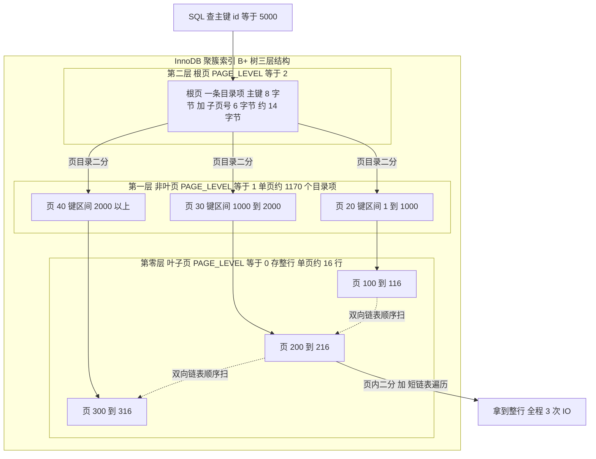
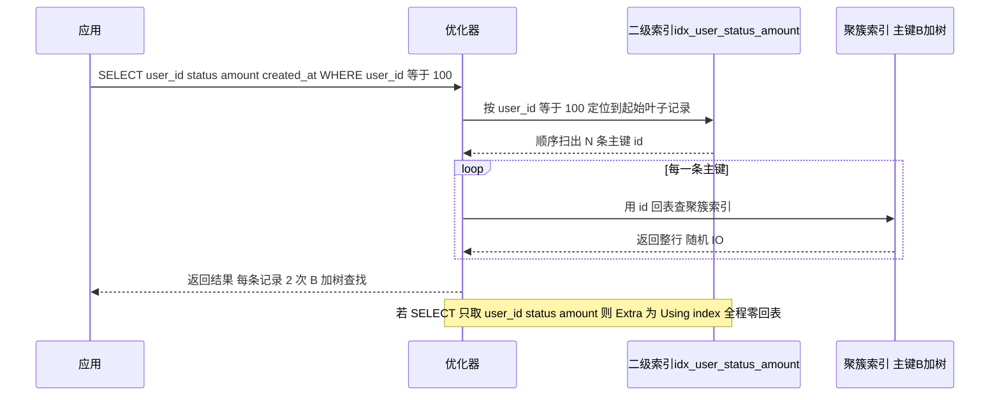
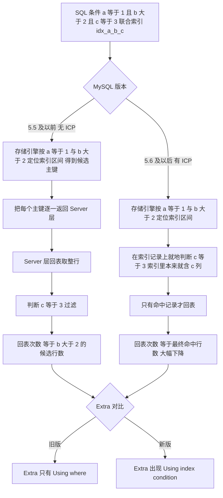
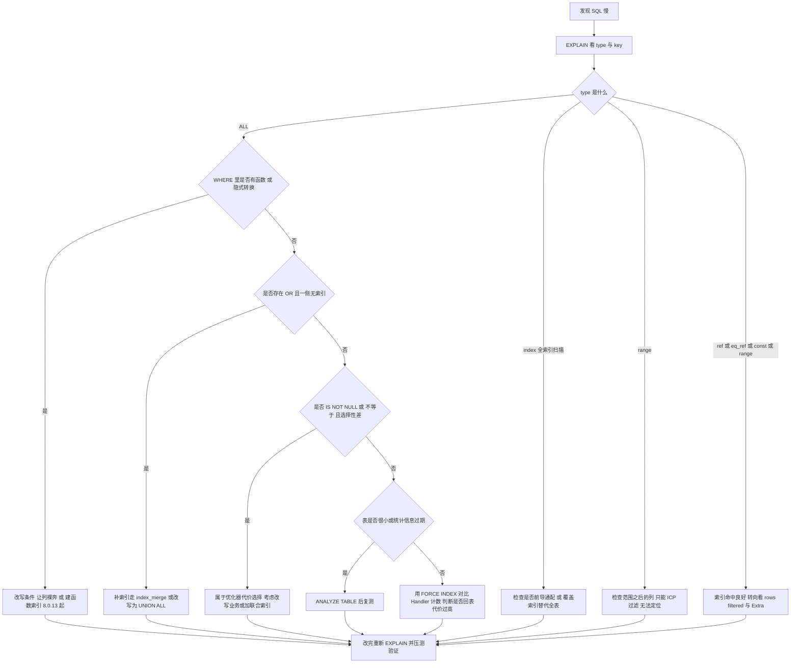
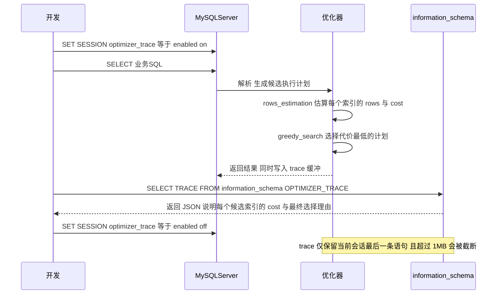
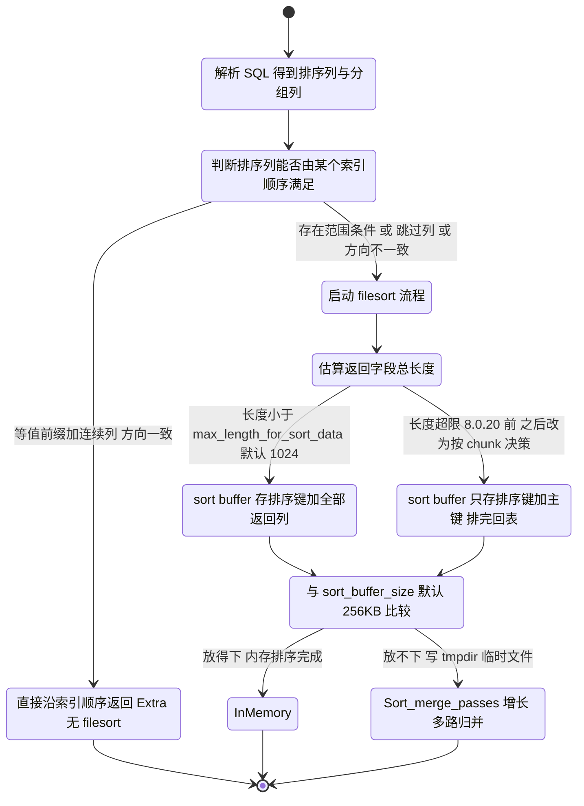
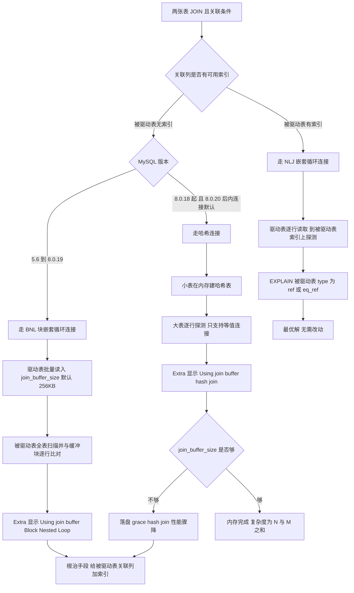
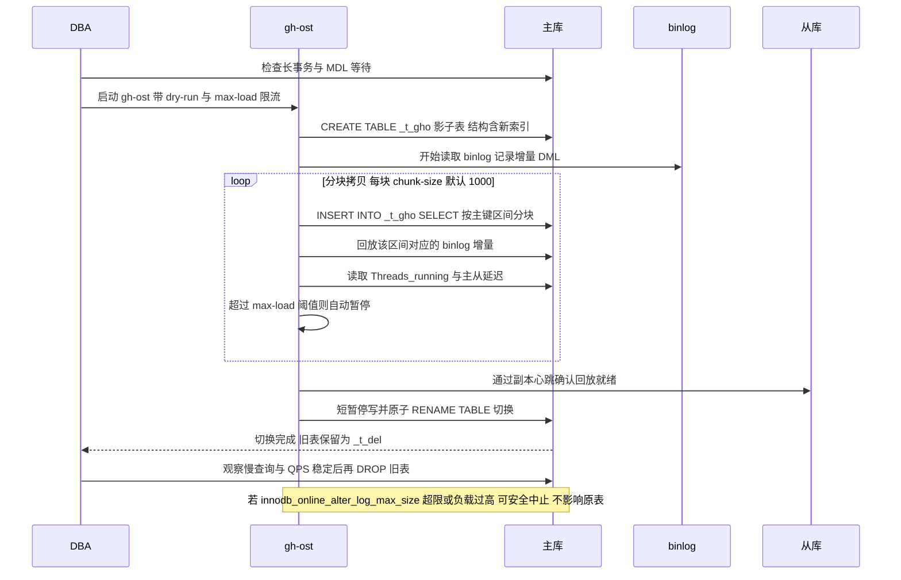
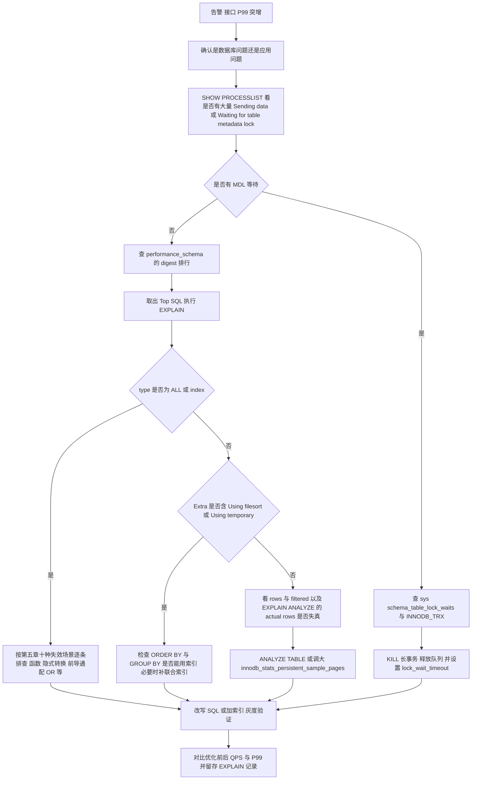

# 01 MySQL 索引与执行计划

> 一句话定位：索引是 MySQL 面试唯一无法回避的深水区，从页结构到优化器代价模型串起"为什么这么设计、慢了怎么定位、数据量涨了会怎样"三问 ｜ 面试权重 ★★★★★ ｜ 建议复习 60 分钟

本文以 **MySQL 8.0 InnoDB**（默认 `innodb_page_size=16384`，即 16KB）为基准，涉及 5.7 差异处会显式标注。MySQL 8.4 已移除部分旧变量，文中出现的废弃项会说明。

## 本章大纲

- [一、InnoDB 页结构与 B+ 树](#一innodb-页结构与-b-树)
- [二、聚簇索引、二级索引与回表](#二聚簇索引二级索引与回表)
- [三、索引类型全解](#三索引类型全解)
- [四、最左前缀原则与索引下推](#四最左前缀原则与索引下推)
- [五、索引失效的十种场景](#五索引失效的十种场景)
- [六、explain 与执行计划解读](#六explain-与执行计划解读)
- [七、order by 与 group by 的索引优化](#七order-by-与-group-by-的索引优化)
- [八、Join 算法与驱动表选择](#八join-算法与驱动表选择)
- [九、索引设计原则与冗余索引治理](#九索引设计原则与冗余索引治理)
- [十、count 的优化](#十count-的优化)
- [十一、大表加索引与在线 DDL](#十一大表加索引与在线-ddl)
- [十二、慢查询日志与 SQL 优化实战](#十二慢查询日志与-sql-优化实战)
- [十三、高级岗三问](#十三高级岗三问)
- [高频面试题](#高频面试题)
- [易错点与踩坑](#易错点与踩坑)
- [一句话速记](#一句话速记)

## 一、InnoDB 页结构与 B+ 树

### 1.1 磁盘读写的最小单位是页，不是行

InnoDB 与磁盘交互的最小单位是**页（page）**，默认 16KB，由 `innodb_page_size` 控制，可选 4KB / 8KB / 16KB / 32KB / 64KB，**建库后不可改**（改需要重新初始化实例）。这意味着：

1. 哪怕你只查一行，InnoDB 也要把这行所在的整页 16KB 读进内存。
2. 一次随机 IO 的代价远大于把 16KB 里的数据全部扫一遍的 CPU 代价，所以**减少随机 IO 次数**是索引结构设计的第一目标。
3. 操作系统预读（`innodb_read_ahead_threshold` 默认 56）会把相邻页一起读进来，顺序扫描的性价比远高于随机扫描。

一个 16KB 的 INDEX 页（`FIL_PAGE_INDEX`）内部布局如下（MySQL 8.0 源码 `page0page.h` 定义）：

| 区域 | 大小 | 作用 |
| --- | --- | --- |
| File Header | 38 字节 | 页号、上一页/下一页页号、页类型、LSN |
| Page Header | 56 字节 | 页内记录数、堆顶位置、页目录槽数、`PAGE_LEVEL`、`PAGE_N_DIR_SLOTS` |
| Infimum + Supremum | 26 字节 | 两条虚拟边界记录，页内记录的链表头尾 |
| User Records | 变长 | 真正的行记录，按索引键升序组成单向链表 |
| Free Space | 变长 | 未分配空间 |
| Page Directory | 变长 | 稀疏槽位（slot），每槽指向一条记录，槽间距 4~8 条记录，**支撑页内二分查找** |
| File Trailer | 8 字节 | 校验和，防止页写一半断电导致脏页 |

关键点：**页内记录是单向链表，但页目录提供了二分能力**。所以"页内查找"是"页目录二分 + 链表短距离遍历"，一次大约 3~4 次内存比较即可定位，不需要遍历整页。

`PAGE_LEVEL` 是理解 B+ 树层级的关键字段：**叶子页的 `PAGE_LEVEL = 0`，向上一层加 1**。根页的页号在数据字典里记录，初始聚簇索引根页通常是第 3 号页。

### 1.2 为什么是 B+ 树：四个替代方案的死因

这是面试官最爱问的"设计权衡"题。逐个说明为什么被淘汰：

| 结构 | 等值查找 | 范围查找 | 树高（2000 万行） | 淘汰原因 |
| --- | --- | --- | --- | --- |
| 哈希表 | O(1) | **不支持** | 1 | 无法范围扫描、无法排序、无法最左前缀；哈希冲突退化；扩缩容成本高 |
| 二叉搜索树 / 红黑树 | O(log2 N) | 中序可行 | 约 25 层 | 每层一次随机 IO，约 25 次；节点自旋平衡写放大 |
| B 树 | O(log N) | 差 | 3~4 层 | 非叶节点也存数据，扇出变小，树更高；范围查询要跨层回溯 |
| 跳表 | O(log N) | 好 | 无页概念 | 内存结构（Redis ZSet 用），没有"页"这个磁盘单位，无法利用预读 |
| **B+ 树** | O(log N) | **双向链表顺序扫** | 3~4 层 | 非叶节点只存键 + 子页号，扇出最大；叶子成链表，范围扫描不退化为随机 IO |

B 树与 B+ 树的核心差异有两条，必须说清楚：

1. **B 树的每个节点（页）都存完整数据行**，导致同样的 16KB 页只能放很少的键，扇出小、树高增加。B+ 树非叶节点只放 `<key, child_page_no>`，扇出能到上千。
2. **B+ 树的叶子节点用双向链表串起来**，`BETWEEN`、`ORDER BY`、`>` 这类范围操作可以沿链表顺序扫，只需第一次定位是随机 IO，之后都是顺序 IO。B 树做范围查询必须反复从根节点回溯，退化成大量随机 IO。

哈希索引也不是完全不存在：InnoDB 有**自适应哈希索引（AHI）**，由 `innodb_adaptive_hash_index`（MySQL 8.0 默认 `ON`）控制，`innodb_adaptive_hash_index_parts` 默认 8 个分区。它是 InnoDB 自己观察热点等值查询后自动建的，**用户无法手动创建**，也不支持 `HASH` 关键字。`Memory` 引擎才支持用户显式 `USING HASH`。

### 1.3 三层 B+ 树能存多少行：把估算过程说出来

这是最能体现"是不是真懂"的题。估算分两步。

**第一步：非叶节点能放多少个键。**

- 主键类型 `BIGINT` = 8 字节。
- 子页号（`FIL_PAGE_OFFSET`）= 4 字节。
- 记录头 `REC_N_NEW_EXTRA_BYTES` = 5 字节，再加变长字段长度列表与页目录槽的均摊。
- 工程上把"键之外的固定开销"合并估为 **6 字节**，即单条目录项 ≈ **8 + 6 = 14 字节**。这是业界通用口径，做数量级估算足够准确。
- 一页 16KB = 16384 字节，但页头页尾占掉约 200 字节，且 B+ 树非叶节点不填满（分裂后约 50% 填充率，实际长期运行趋近 15/16，即 `innodb_fill_factor` 默认 100 给索引页保留 1/16 空间）。

取保守值：`16384 / 14 ≈ 1170` 个键。业界习惯直接用 **1170** 这个数。

**第二步：叶子节点能放多少行。**

- 假设一行数据 1KB（含所有列 + 记录头 + 事务 ID 的 6 字节 `DB_TRX_ID` + 回滚指针 7 字节 `DB_ROLL_PTR`）。
- 单页可放 `16384 / 1024 = 16` 行。

**第三步：三层加总。**

```
第 1 层（根）  ：1 页
第 2 层（非叶）：1170 页
第 3 层（叶）  ：1170 × 1170 ≈ 1,368,900 页
总行数         ：1,368,900 × 16 ≈ 21,902,400 行 ≈ 2190 万行
```

所以标准答案是：**三层 B+ 树大约能存 2000 万行左右；两层约 1.8 万行；四层可到百亿级。**这也解释了为什么"单表 2000 万行"成为业界经验分界线——不是数据库的硬限制，而是**查询从 3 次 IO 变成 4 次 IO 的台阶**。

如果一行只有 200 字节，叶子能放 80 行，三层就能存 1 亿行。所以"单表不要超过 2000 万"更准确的说法是：**当数据量让 B+ 树高度从 3 变 4、或者 Buffer Pool 装不下热点数据时，性能出现台阶式下降。**



### 1.4 一次索引查找到底发生了几次 IO

必须区分"逻辑读"和"物理读"：

- **逻辑读**：页已经在 Buffer Pool 里，只是一次内存访问，`Innodb_buffer_pool_read_requests` 计数。
- **物理读**：页不在 Buffer Pool，需要从磁盘读，`Innodb_buffer_pool_reads` 计数。

命中率公式：`1 - Innodb_buffer_pool_reads / Innodb_buffer_pool_read_requests`。生产上应长期高于 99.9%。

`innodb_buffer_pool_size` 在 MySQL 8.0 默认 128MB（`134217728`），生产建议给到物理内存的 50%~70%。`innodb_buffer_pool_instances` 在 MySQL 8.0 默认 8，把缓冲池切成多份以减少互斥锁争用。

一旦 Buffer Pool 装不下热点数据，原本 3 次逻辑读的查询会退化成 3 次物理读，QPS 断崖式下跌——这就是"数据量涨了会怎样"的答案之一。

## 二、聚簇索引、二级索引与回表

### 2.1 聚簇索引的选主规则

InnoDB 是**索引组织表（Index Organized Table）**，数据行本身就存在 B+ 树的叶子节点上。这个 B+ 树就是聚簇索引（clustered index），它的键就是主键。选主规则按优先级：

1. 显式定义的 `PRIMARY KEY`。
2. 没有主键时，选**第一个所有列都 `NOT NULL` 的 `UNIQUE` 索引**。
3. 都没有时，InnoDB 生成一个 **6 字节的隐藏列 `DB_ROW_ID`** 作为聚簇索引键（源码里叫 `ROW_ID`）。这个隐藏列用户查不到、也用不了。

所以"表可以没有主键吗"答案是：物理上不可以，逻辑上可以。

### 2.2 二级索引叶子存的是主键，不是行地址

这是 InnoDB 与 MyISAM 最大的结构差异：

| 维度 | InnoDB | MyISAM |
| --- | --- | --- |
| 表结构 | 索引组织表，数据即聚簇索引叶子 | 堆表，`.MYD` 存数据，`.MYI` 存索引 |
| 二级索引叶子内容 | **索引列 + 主键值** | 索引列 + **行物理地址（offset）** |
| 主键查询 | 一次 B+ 树 | 一次索引 + 一次回表 |
| 二级索引查询 | 两次 B+ 树（回表） | 两次（回表） |
| 主键更新 | 可能引起二级索引全部重建（主键变了） | 只改行内数据 |
| 行迁移 | 由页分裂承担，行不移动 | `OPTIMIZE TABLE` 修复碎片 |

**二级索引叶子带主键**带来两个直接后果：

1. **主键越长，所有二级索引越大**。主键用 `BIGINT`（8 字节）而不用 `UUID`（36 字节），一个二级索引就能小 3 倍以上。
2. **主键更新 = 二级索引全量变更**。因为每个二级索引里都存着旧主键值，改主键意味着所有二级索引都要删旧插新。所以主键必须**不可变**。

### 2.3 回表与覆盖索引

**回表（bookmark lookup）**：通过二级索引找到主键值后，再拿主键去聚簇索引查一次完整的行。整个过程是"二级索引一次随机 IO + 聚簇索引一次随机 IO"，主键无序时第二次是纯随机 IO。

**覆盖索引（covering index）**：如果 `SELECT` 需要的列、`WHERE` 用到的列、`ORDER BY` 用到的列**全部**在同一个索引里，优化器就不再回表，`EXPLAIN` 的 `Extra` 显示 `Using index`。

```sql
-- 表结构
CREATE TABLE t_order (
  id          BIGINT UNSIGNED NOT NULL AUTO_INCREMENT,
  user_id     BIGINT UNSIGNED NOT NULL,
  status      TINYINT NOT NULL DEFAULT 0,
  amount      DECIMAL(12,2) NOT NULL,
  created_at  DATETIME(3) NOT NULL,
  remark      VARCHAR(255) DEFAULT NULL,
  PRIMARY KEY (id),
  KEY idx_user_status_amount (user_id, status, amount)
) ENGINE=InnoDB DEFAULT CHARSET=utf8mb4;

-- 回表：Extra 里没有 Using index，需要拿 id 回聚簇索引取 created_at
EXPLAIN SELECT user_id, status, amount, created_at FROM t_order WHERE user_id = 100 AND status = 1;

-- 覆盖索引：三列都在 idx_user_status_amount 里，Extra = Using index
EXPLAIN SELECT user_id, status, amount FROM t_order WHERE user_id = 100 AND status = 1;

-- 看似覆盖索引，实则不是：count(1) 用不到索引列，但优化器可以只扫索引
EXPLAIN SELECT COUNT(*) FROM t_order WHERE user_id = 100;
```

注意一个常见误区：**`SELECT *` 永远无法覆盖索引**，因为 `*` 包含所有列，不可能全在同一个二级索引里。



### 2.4 回表的代价与 MRR 优化

回表最怕两件事：

1. **主键无序**：`WHERE status = 1` 扫出 10 万个主键，每个主键在磁盘上分散，变成 10 万次随机 IO。
2. **返回行数太多**：优化器算完代价后干脆放弃索引，直接全表扫描（`type=ALL`），这就是"我明明建了索引却没走"的最常见原因。

**MRR（Multi-Range Read）** 是 MySQL 5.6 引入的优化，由 `optimizer_switch` 里的 `mrr=on`、`mrr_cost_based=on` 控制，`read_rnd_buffer_size` 默认 256KB。它把回表的主键先收集到 `read_rnd_buffer` 里排序，再按页号顺序批量回表，把随机 IO 变成近似顺序 IO。`EXPLAIN` 的 `Extra` 会显示 `Using MRR`。

## 三、索引类型全解

### 3.1 按逻辑功能分类

| 索引类型 | 语法 | 叶子内容 | 允许 NULL | 数量限制 | 典型用途 |
| --- | --- | --- | --- | --- | --- |
| 聚簇索引（主键） | `PRIMARY KEY (id)` | 整行 | 不允许 | 1 个 | 唯一标识，必须自增且短 |
| 唯一索引 | `UNIQUE KEY uk_x (x)` | 索引列 + 主键 | 允许（多行 NULL 不冲突） | 多个 | 业务唯一约束 |
| 普通索引 | `KEY idx_x (x)` | 索引列 + 主键 | 允许 | 多个 | 加速查询 |
| 联合索引 | `KEY idx (a,b,c)` | a,b,c + 主键 | 视列定义 | 多个 | 多条件组合查询 |
| 前缀索引 | `KEY idx (name(10))` | 前 10 字符 + 主键 | 允许 | 多个 | 长字符串列省空间 |
| 全文索引 | `FULLTEXT KEY ft (content)` | 倒排词表 | 允许 | 多个 | 文本检索 |
| 函数索引 | `KEY idx ((MONTH(created_at)))` | 表达式结果 + 主键 | 允许 | 多个 | MySQL 8.0.13 起支持 |
| 降序索引 | `KEY idx (a ASC, b DESC)` | 按声明方向排序 | 允许 | 多个 | MySQL 8.0 起真正生效 |
| 空间索引 | `SPATIAL KEY sp (geo)` | R 树 | 不允许 | 多个 | GIS，需 `SRID` |

### 3.2 前缀索引：用选择性决定前缀长度

前缀索引的取舍是：**省空间、减少 IO，但失去覆盖索引能力**（因为索引里没有完整列值，无法覆盖 `SELECT`），且无法用于 `ORDER BY col`。另外前缀索引的选择性不足时会引入更多回表。

计算选择性：

```sql
-- 目标：distinct 值尽量接近总行数，比值越接近 1 越好，一般要求 > 0.9
SELECT
  COUNT(DISTINCT LEFT(email, 6)) / COUNT(*) AS sel6,
  COUNT(DISTINCT LEFT(email, 8)) / COUNT(*) AS sel8,
  COUNT(DISTINCT LEFT(email, 10)) / COUNT(*) AS sel10,
  COUNT(DISTINCT LEFT(email, 12)) / COUNT(*) AS sel12,
  COUNT(DISTINCT email) / COUNT(*) AS sel_full
FROM t_user;
```

选择第一个 `sel >= 0.9` 的长度即可。经验值：邮箱 10~12 位、`UUID` 前 8 位基本无用（因为 `UUID` 前几位是时间戳，接近常量，应改用 `UUID_TO_BIN(uuid, 1)` 做时间高位重排）。

### 3.3 全文索引：中文要用 ngram

InnoDB 从 MySQL 5.6 起支持 `FULLTEXT`。默认分词器按空格切词，中文无效，必须用 ngram：

```sql
CREATE TABLE t_article (
  id BIGINT UNSIGNED NOT NULL AUTO_INCREMENT,
  title VARCHAR(200) NOT NULL,
  content TEXT NOT NULL,
  PRIMARY KEY (id),
  FULLTEXT KEY ft_content (title, content) WITH PARSER ngram
) ENGINE=InnoDB DEFAULT CHARSET=utf8mb4;

-- ngram_token_size 默认 2，即按 2 字切分
SELECT id, MATCH(title, content) AGAINST('索引优化' IN BOOLEAN MODE) AS score
FROM t_article
WHERE MATCH(title, content) AGAINST('索引优化' IN BOOLEAN MODE)
ORDER BY score DESC LIMIT 10;
```

关键参数：`ngram_token_size` 默认 **2**（只读，需重启时设置）；`innodb_ft_min_token_size` 默认 **3**（对 ngram 无效）；`innodb_ft_enable_stopword` 默认 `ON`。

### 3.4 不可见索引：安全删索引的唯一姿势

MySQL 8.0 引入不可见索引（invisible index）。优化器直接忽略它，但索引结构仍然维护，可以随时切回来验证。

```sql
ALTER TABLE t_order ALTER INDEX idx_user_status_amount INVISIBLE;
-- 观察一段时间，确认没有慢查询回归
ALTER TABLE t_order ALTER INDEX idx_user_status_amount VISIBLE;
-- 确认无用后再真删
ALTER TABLE t_order DROP INDEX idx_user_status_amount, ALGORITHM=INPLACE, LOCK=NONE;
```

这一步几乎零成本，但能避免"删了索引第二天线上炸了"的事故。**生产删索引必须先 `INVISIBLE`，再观测至少一个完整的业务周期（含月末/大促）。**

## 四、最左前缀原则与索引下推

### 4.1 最左前缀原则的真实含义

联合索引 `KEY idx (a, b, c)` 的 B+ 树是**按 `a` 排序，`a` 相同时按 `b` 排序，`a`、`b` 都相同时按 `c` 排序**。因此它等价于三个索引：`(a)`、`(a,b)`、`(a,b,c)`。

必须精确区分的三件事：

1. **能用于定位（access）的列**：必须是索引的连续前缀，且中间不能断。断了之后，后面的列无法再缩小扫描区间。
2. **能用于过滤（filter）的列**：MySQL 5.6 起，断了之后的列可以在索引上过滤（ICP），但**不能减少扫描的索引页数**。
3. **能用于排序的列**：必须是等值条件之后的连续列，且排序方向一致（或与索引声明的升降序完全匹配）。

| 查询条件 | 用到的索引列 | `type` | 说明 |
| --- | --- | --- | --- |
| `WHERE a=1` | a | `ref` | 正常 |
| `WHERE a=1 AND b=2` | a,b | `ref` | 正常 |
| `WHERE a=1 AND b=2 AND c=3` | a,b,c | `ref` | 全用上 |
| `WHERE b=2 AND c=3` | 无 | `ALL` | 跳过了最左列，失效 |
| `WHERE a=1 AND c=3` | a（c 在索引上过滤） | `ref` | 5.6 起 ICP 生效，`Using index condition` |
| `WHERE a=1 AND b>2 AND c=3` | a,b（c 过滤） | `range` | 范围之后的 c 不能定位，但可 ICP |
| `WHERE a>1 AND b=2` | a | `range` | b 不能定位，只能 ICP |
| `WHERE a=1 ORDER BY b` | a,b | `ref` | 排序可用索引，无 filesort |
| `WHERE a=1 ORDER BY c` | a | `ref` | 排序断在 c，`Using filesort` |
| `WHERE a=1 ORDER BY b DESC, c ASC` | a | `ref` | 方向不一致，MySQL 8.0 前必 filesort |

### 4.2 索引下推 ICP：5.5 与 5.6 的分水岭

**索引条件下推（Index Condition Pushdown, ICP）** 是 MySQL 5.6 引入的优化，由 `optimizer_switch` 的 `index_condition_pushdown=on` 控制（默认开启）。生产上不要关闭这个开关，关掉只会让扫描行数变多。

**没有 ICP（5.5 及以前）**：存储引擎按索引定位到记录后，把主键返回给 Server 层，Server 层回表取整行，再判断 `c = 3`。也就是说，**不满足条件的记录也要被回表**。

**有 ICP（5.6 起）**：存储引擎在索引上取出 `(a, b, c, 主键)` 后，**先在索引层用 `c = 3` 过滤**，只有通过的才回表。`EXPLAIN` 的 `Extra` 显示 `Using index condition`。

以 `WHERE a=1 AND b>2 AND c=3` 为例，假设 `a=1` 匹配 100 万行、`b>2` 匹配 10 万行、`c=3` 只匹配 100 行：

- 无 ICP：10 万次回表，过滤掉 99900 行。
- 有 ICP：100 次回表。

ICP 的适用边界：

- **只对二级索引有效**。聚簇索引的叶子已经是整行，没有"先过滤再回表"的概念。
- **只对 `WHERE` 中能用索引列的过滤条件有效**，对子查询、存储过程条件无效。
- **不能用于覆盖索引**（本来就不回表，没有可下推的意义）。



### 4.3 索引合并 Index Merge

MySQL 5.1 起引入索引合并，`optimizer_switch` 中的开关有 `index_merge`、`index_merge_intersection`、`index_merge_union`、`index_merge_sort_union`，默认全开。三种形态：

| `Extra` 形态 | 触发条件 | 机制 |
| --- | --- | --- |
| `Using intersect(a, b)` | `WHERE a=1 AND b=2`，两列各有独立索引 | 分别取主键集合，求交集 |
| `Using union(a, b)` | `WHERE a=1 OR b=2`，两列各有独立索引 | 分别取主键集合，求并集 |
| `Using sort_union(a, b)` | `WHERE a>1 OR b=2`，包含范围条件 | 先按主键排序再求并集 |

索引合并的代价是**要维护主键集合**，`range` 越宽内存开销越大，优化器经常因为代价高而放弃。所以更好的做法是**建联合索引 `(a, b)`**，而不是依赖索引合并。

一个典型的坑：`WHERE a=1 OR b=2`，如果 `b` 上没有索引，优化器无法使用 `idx_a`，直接 `type=ALL` 全表扫描。修复方式只有两种：给 `b` 加索引（走 `union`），或者改写成 `UNION ALL` 两个单条件查询。

### 4.4 索引跳跃扫描 Skip Scan

MySQL 8.0.13 引入索引跳跃扫描，`optimizer_switch` 的 `skip_scan=on`（默认开）。适用条件：

- 联合索引 `(a, b)`，`a` 的**基数极低**（比如 `a` 只有 3 个不同值）。
- 查询只用到 `b`，没有 `a` 的条件。

优化器会把 `a` 的每个不同值当作一次独立查询，把 `WHERE b = 5` 改写成 3 次 `WHERE a = v AND b = 5`。`EXPLAIN` 的 `Extra` 显示 `Using index for skip scan`。

**注意**：跳跃扫描不改变最左前缀原则，它是优化器对低基数列的补偿，代价是扫描次数 = 前导列基数。前导列基数高时不会启用。

## 五、索引失效的十种场景

这一节要求**每条都能说出机制和验证方法**，不能只背结论。

### 5.1 在索引列上做函数运算或表达式计算

```sql
-- 失效：created_at 被 DATE() 包裹
SELECT * FROM t_order WHERE DATE(created_at) = '2025-01-01';

-- 有效：改成范围条件
SELECT * FROM t_order WHERE created_at >= '2025-01-01 00:00:00'
                       AND created_at <  '2025-01-02 00:00:00';

-- MySQL 8.0.13 起可用函数索引（表达式必须加括号）
ALTER TABLE t_order ADD KEY idx_month ((MONTH(created_at)));
```

机制：B+ 树按**列的原始值**排序，`DATE(created_at)` 的结果不在索引里，优化器无法用二分定位。

同理失效的还有：`WHERE id + 1 = 100`、`WHERE LEFT(name, 3) = 'abc'`、`WHERE UPPER(code) = 'ABC'`、`WHERE amount * 2 > 100`、`WHERE created_at + INTERVAL 1 DAY > NOW()`。

### 5.2 隐式类型转换

```sql
-- phone 是 VARCHAR(11)，索引 idx_phone
-- 失效：参数是数字，MySQL 把列转成 DOUBLE 比较
SELECT * FROM t_user WHERE phone = 13800000000;
-- EXPLAIN 的 Extra 里会看到 WHERE 中有 cast(phone as double)

-- 有效：加引号
SELECT * FROM t_user WHERE phone = '13800000000';

-- 反过来：id 是 BIGINT，传字符串，索引仍然可用，因为是把字符串转成数字
SELECT * FROM t_user WHERE id = '123';   -- 走索引
```

机制：`=` 两边类型不同时，MySQL 会把**字符串侧转成数字**进行比较。若列是 `VARCHAR`，转换发生在列上，等价于 `CAST(phone AS DOUBLE) = 13800000000`，索引失效；若列是数字、参数是字符串，转换发生在常量上，索引仍可用。

**注意 `CAST` 的准确规则**：字符串与数字比较时按浮点数比较，`phone = 13800000000` 中常量被当作 `DOUBLE`，列被隐式 `CAST`。这个规则在 MySQL 8.0 与 5.7 一致。

### 5.3 字符集或排序规则不一致

```sql
-- a 表 utf8mb4，b 表 utf8（即 utf8mb3），JOIN 时索引失效
SELECT * FROM t_a a JOIN t_b b ON a.code = b.code;
```

机制：字符集不同时，MySQL 必须先把一侧转换成公共字符集，转换发生在被驱动表的列上，导致索引失效。这不是"有时候"，而是**必然**失效。

排查方法：

```sql
SHOW CREATE TABLE t_a;
SHOW CREATE TABLE t_b;
-- 或
SELECT TABLE_NAME, COLUMN_NAME, CHARACTER_SET_NAME, COLLATION_NAME
FROM information_schema.COLUMNS
WHERE TABLE_SCHEMA = 'your_db' AND COLUMN_NAME = 'code';
```

**统一用 `utf8mb4` + `utf8mb4_0900_ai_ci`（MySQL 8.0 默认）可以规避整类问题。**注意 MySQL 8.0 的默认字符集已从 `latin1` 改为 `utf8mb4`，默认排序规则是 `utf8mb4_0900_ai_ci`。

### 5.4 前导通配符 LIKE

```sql
SELECT * FROM t_user WHERE name LIKE '%张';      -- 失效，type=ALL
SELECT * FROM t_user WHERE name LIKE '%张%';     -- 失效
SELECT * FROM t_user WHERE name LIKE '张%';      -- 有效，type=range
```

机制：B+ 树按前缀排序，`'%张'` 没有确定的前缀，无法定位起点。

兜底方案：

1. 改成 `'张%'`。
2. 用**覆盖索引**让全索引扫描代替全表扫描（`SELECT name FROM t_user WHERE name LIKE '%张'`，`Extra=Using index`，比全表扫描轻）。
3. 引入全文索引或 ES。
4. 反向索引列：新增 `name_reverse` 存 `REVERSE(name)`，把后缀匹配变前缀匹配。代价是要多一列 + 一个索引。

### 5.5 OR 两侧不都有索引

```sql
-- a 有索引，b 没有
SELECT * FROM t WHERE a = 1 OR b = 2;   -- 全表扫描
```

机制：`OR` 要求两侧条件都必须被评估，只要一侧无法用索引缩小范围，整体就必须全表扫描。若两侧都有索引，则走 `index_merge` 的 `Using union`。

### 5.6 范围条件之后的列无法用于定位

```sql
-- 联合索引 (a, b, c)
SELECT * FROM t WHERE a = 1 AND b > 10 AND c = 5;
```

`b > 10` 是范围，`c` 无法再用于二分定位（因为 `b` 的取值范围内 `c` 不连续）。但 MySQL 5.6 起 `c` 可以 ICP 过滤。`EXPLAIN` 的 `type` 是 `range`。

**注意**：`IN` 在 MySQL 8.0 中经 `range_optimizer` 处理后**等价于多个等值**，所以 `a = 1 AND b IN (1,2,3) AND c = 5` 中 `c` **可以**用于定位。这一点 5.7 和 8.0 有差异，8.0 对 `IN` 的处理更激进。

### 5.7 不等于、NOT IN、NOT LIKE

```sql
SELECT * FROM t WHERE status != 1;
SELECT * FROM t WHERE status NOT IN (1, 2);
SELECT * FROM t WHERE name NOT LIKE '张%';
```

机制：这些条件**理论上可以用索引做范围扫描**，但优化器要判断代价。如果 `status != 1` 能过滤掉的比例很低（比如 90% 的行都是 `status != 1`），优化器会认为"扫描二级索引 + 回表"比"全表顺序扫描"更贵，直接选 `type=ALL`。**这不是语法失效，是代价选择。**

正确的面试回答是：**`!=` 不是必然失效，而是当过滤后剩余行数占比很高时会被优化器放弃。**验证方法是用 `FORCE INDEX` 对比 `Handler_read_*`。

### 5.8 IS NOT NULL 与 IS NULL

很多资料写"`IS NULL` 不走索引"，这是**错的**。

- `IS NULL` 可以用索引，`EXPLAIN` 的 `type` 是 `ref`，`Extra` 里可能同时出现 `Using index condition`。
- `IS NOT NULL` 也可以用索引，`type` 是 `range`。
- 是否真正走索引，仍然取决于**该条件的选择性**：如果表里 99% 的行 `col IS NOT NULL`，优化器就不会走索引。

关键区别在于：**索引里会记录 `NULL` 值**（B+ 树把 `NULL` 排在最小值位置），所以 `IS NULL` 有明确定位区间。唯一的例外是**联合索引中 `NULL` 列之后的列无法用于定位**，与普通列规则一致。

### 5.9 排序方向不一致或跳过列排序

```sql
-- 联合索引 (a, b)
SELECT * FROM t WHERE a = 1 ORDER BY b ASC, c DESC;   -- c 不在索引里，filesort
SELECT * FROM t ORDER BY a ASC, b DESC;               -- 8.0 前必 filesort
-- MySQL 8.0 可以建降序索引解决
ALTER TABLE t ADD KEY idx_a_b_desc (a ASC, b DESC);
```

MySQL 8.0 之前虽然语法接受 `DESC`，但**实际创建的都是升序索引**（`SHOW CREATE TABLE` 会看到 `DESC` 被忽略）。MySQL 8.0 起才真正支持降序索引。

### 5.10 优化器认为全表扫描更便宜

这是最容易被忽略的一条。触发原因包括：

1. **表太小**：只有几百行，全表扫描判一次页就完了，走二级索引反而要两次。
2. **统计信息过期**：`innodb_stats_persistent` 默认 `ON`，`innodb_stats_persistent_sample_pages` 默认 **20** 页采样。采样偏差会让优化器误判选择率。修复：`ANALYZE TABLE t;`。
3. **回表代价太高**：需要返回的行数占表比例超过约 20%~30% 时，回表成本超过顺序扫描。
4. **`eq_range_index_dive_limit`**：MySQL 8.0 默认 **200**（5.7 是 10）。当 `IN` 列表长度超过该值，优化器从"索引下潜（index dive）"精确估算退化为使用索引统计信息粗略估算，可能选错计划。
5. **`FORCE INDEX` 会关闭优化器自动选择**，可能让 MySQL 在参数变化后无法自适应。

```sql
-- 验证优化器估算与实际执行的差距
SHOW SESSION STATUS LIKE 'Handler_read%';
SHOW SESSION STATUS LIKE 'Last_query_cost';
```

`Handler_read_rnd_next` 很大说明在做全表扫描；`Handler_read_key` 是走索引的次数；`Handler_read_next` 是索引区间扫描的行数。



## 六、explain 与执行计划解读

### 6.1 explain 的三种输出格式

```sql
EXPLAIN SELECT ...;                          -- 传统表格，最常用
EXPLAIN FORMAT=JSON SELECT ...;              -- MySQL 5.6 起，含 cost 估算
EXPLAIN FORMAT=TREE SELECT ...;              -- MySQL 8.0.16 起
EXPLAIN ANALYZE SELECT ...;                  -- MySQL 8.0.18 起，真实执行 + 耗时
```

`EXPLAIN` 默认**不真正执行 SQL**（8.0.18 起 `EXPLAIN` 在 MySQL 8.0.18+ 可能触发部分优化阶段，但仍不返回数据）。`EXPLAIN ANALYZE` 会真正执行，**只能用于 `SELECT`，且会带来实际负载**，生产慎用。

### 6.2 各列含义

| 列 | 含义 | 关注点 |
| --- | --- | --- |
| `id` | 查询序号 | 相同 id 从上往下执行；不同 id 数字越大越先执行；`NULL` 表示 `UNION RESULT` |
| `select_type` | 查询类型 | `SIMPLE` / `PRIMARY` / `SUBQUERY` / `DEPENDENT SUBQUERY` / `DERIVED` / `UNION` / `UNION RESULT` / `MATERIALIZED` |
| `table` | 表名 | `<derived2>` 表示派生表，`<union1,2>` 表示合并结果 |
| `partitions` | 命中分区 | 分区表必看，避免全分区扫描 |
| `type` | 访问类型 | **最重要**，等级排序见 6.3 |
| `possible_keys` | 可能用的索引 | 只代表"候选"，不代表会用 |
| `key` | 实际用的索引 | 为 `NULL` 说明没走索引；`key` 不在 `possible_keys` 里说明用了覆盖索引优化 |
| `key_len` | 索引使用字节数 | 反推用了几列，见 6.4 |
| `ref` | 与索引比较的对象 | `const` / `func` / `库.表.列` |
| `rows` | 预估扫描行数 | **估算值**，不是真实值，误差可达数量级 |
| `filtered` | 预估过滤后剩余百分比 | `rows × filtered%` 才是与下一表 join 的行数；`100` 表示不过滤 |
| `Extra` | 补充信息 | 见 6.5 |

### 6.3 type 的等级排序

从最优到最差：

| 等级 | 含义 | 触发条件 | 备注 |
| --- | --- | --- | --- |
| `system` | 表中只有一行 | 系统表或只有 1 行的表 | 极少见 |
| `const` | 通过主键或唯一索引等值命中 1 行 | `WHERE id = 1` | 实际最快 |
| `eq_ref` | 被驱动表用主键/唯一索引等值匹配 | `JOIN ... ON a.id = b.id` | 连接场景最优 |
| `ref` | 用普通索引等值匹配，可能多行 | `WHERE idx_col = 'x'` | 最常见的好计划 |
| `fulltext` | 全文索引 | `MATCH ... AGAINST` | 与 `ref` 同级，顺序不定 |
| `ref_or_null` | 等值或 `IS NULL` | `WHERE col = 'x' OR col IS NULL` | |
| `index_merge` | 索引合并 | 见 4.3 | 需看 `Extra` 判断哪种 |
| `unique_subquery` | `IN` 子查询用唯一索引 | `WHERE id IN (SELECT pk ...)` | |
| `index_subquery` | `IN` 子查询用非唯一索引 | | |
| `range` | 索引范围扫描 | `>`, `<`, `BETWEEN`, `IN`, `LIKE 'x%'` | 可接受 |
| `index` | 全索引扫描 | 扫描整棵二级索引树 | 比 `ALL` 好，但仍需警惕 |
| `ALL` | 全表扫描 | | **必须优化** |

记忆口诀：`system > const > eq_ref > ref > fulltext > ref_or_null > index_merge > unique_subquery > index_subquery > range > index > ALL`。

实践判据：**在线业务查询的 `type` 至少要到 `range`，核心链路要到 `ref` 及以上。**

### 6.4 key_len 的计算

`key_len` 是"实际用于索引查找的字节数"，**可以反推索引用到了第几列**。规则（MySQL 8.0，`utf8mb4`）：

| 类型 | `key_len` |
| --- | --- |
| `TINYINT` | 1 |
| `SMALLINT` | 2 |
| `MEDIUMINT` | 3 |
| `INT` | 4 |
| `BIGINT` | 8 |
| `DATE` | 3 |
| `TIME(0)` | 3 |
| `DATETIME(0)` | 5 |
| `TIMESTAMP(0)` | 4 |
| `YEAR` | 1 |
| `CHAR(N)` | `N × 4` |
| `VARCHAR(N)` | `N × 4 + 2`（变长长度前缀 2 字节） |
| 所有类型为 `NULL` 时 | 再加 **1 字节**（NULL 标志位） |
| `DECIMAL(M,D)` | 每 9 位十进制数字占 4 字节 |

`utf8mb3` 时把上面的 4 换成 3；`latin1` 换成 1。

**完整算例**：表定义

```sql
CREATE TABLE t_k (
  a VARCHAR(10) NOT NULL,
  b INT DEFAULT NULL,
  c VARCHAR(20) DEFAULT NULL,
  KEY idx_abc (a, b, c)
) ENGINE=InnoDB DEFAULT CHARSET=utf8mb4;
```

| 查询 | 用到的列 | `key_len` 计算 | 结果 |
| --- | --- | --- | --- |
| `WHERE a = 'x'` | a | 10×4+2 | 42 |
| `WHERE a = 'x' AND b = 1` | a,b | 42 + 4 + 1 | 47 |
| `WHERE a = 'x' AND b = 1 AND c = 'y'` | a,b,c | 47 + 20×4+2+1 | 130 |

**注意**：二级索引的 `key_len` **不包含主键**。InnoDB 虽然在叶子节点附带了主键，但主键是"行定位"用途，不计入查找用的 `key_len`。

### 6.5 Extra 常见值（面试高频）

| Extra 值 | 含义 | 是否要处理 |
| --- | --- | --- |
| `Using index` | 覆盖索引，无需回表 | 好，优 |
| `Using where` | Server 层还要过滤 | 中性，配合 `rows` 看 |
| `Using index condition` | ICP 生效 | 好 |
| `Using index for skip scan` | 跳跃扫描（8.0.13+） | 好 |
| `Using index for group-by` | 松散索引扫描完成 GROUP BY | 很好 |
| `Using filesort` | 无法用索引排序，需额外排序 | **要处理** |
| `Using temporary` | 用了内部临时表 | **要处理**，常见于 GROUP BY / DISTINCT |
| `Using join buffer (Block Nested Loop)` | BNL 连接（5.6~8.0.19） | 要优化，被驱动表加索引 |
| `Using join buffer (hash join)` | 哈希连接（8.0.18+） | 需评估内存 |
| `Using MRR` | 多范围读优化回表 | 好 |
| `Range checked for each record` | 每行都要重新选索引 | **严重问题**，通常是关联列类型/索引不良 |
| `Using sort_union(...)` / `Using union(...)` / `Using intersect(...)` | 索引合并 | 评估是否改用联合索引 |
| `Select tables optimized away` | 优化器直接从索引元数据得结果 | 最好，如 `SELECT MIN(id)` |
| `Impossible WHERE` | `WHERE` 恒假 | 检查业务 SQL |
| `No tables used` | 无 FROM 子句 | 正常 |
| `Using index; Using temporary` | 覆盖索引 + 临时表 | 通常 GROUP BY 引起 |
| `Not exists` | 左连接被优化为半连接 | 中性 |

### 6.6 explain analyze：看真实行数而不是估算

MySQL 8.0.18 引入 `EXPLAIN ANALYZE`，输出 `TREE` 格式，每个节点包含：

- `cost`：优化器估算代价，来自 `records`/`pages` 统计。
- `rows`：**优化器估算行数**。
- `actual time=a..b rows=c loops=d`：**真实执行**，单位毫秒，`a` 是首行耗时，`b` 是全部行耗时，`c` 是该节点总行数（已乘以 loops），`d` 是循环次数。

判读方法：**当 `rows`（估算）与 `actual rows`（实际）差距超过一个数量级时，说明统计信息严重失真**，此时优化器选错索引的概率极高。修复手段是 `ANALYZE TABLE` 或调整 `innodb_stats_persistent_sample_pages`（默认 20，大表可提到 200~500）。

示例输出解读：

```
-> Filter: (t_order.status = 1)  (cost=1234 rows=9999) (actual time=0.05..812 rows=12 loops=1)
    -> Index lookup on t_order using idx_user (user_id=100)  (cost=1234 rows=9999) (actual time=0.04..700 rows=100000 loops=1)
```

`rows=9999` 是估算，`actual rows=100000` 是真实值，差 10 倍——典型统计信息过期。

### 6.7 optimizer_trace：看优化器为什么这么选

```sql
SET SESSION optimizer_trace = 'enabled=on';
SET SESSION optimizer_trace_max_mem_size = 1048576;  -- 默认 1048576 字节即 1MB
SET SESSION optimizer_trace_features = 'greedy_search=on,range_optimizer=on,dynamic_range=on,repeated_subselect=on';

SELECT * FROM t_order WHERE user_id = 100 AND status = 1;

SELECT TRACE FROM information_schema.OPTIMIZER_TRACE\G

SET SESSION optimizer_trace = 'enabled=off';
```

`OPTIMIZER_TRACE` 是**会话级**的，包含 `QUERY`、`TRACE`、`MISSING_BYTES_BEYOND_MAX_MEM_SIZE`、`INSUFFICIENT_PRIVILEGES` 四列。`TRACE` 是 JSON，重点看三段：

1. `rows_estimation`：每个索引的 `rows`、`cost`，直接告诉你"为什么没选 idx_b"。
2. `considered_execution_plans`：各计划的 `cost` 对比。
3. `attached_conditions_summary`：哪些条件下推到了存储引擎。

如果 `MISSING_BYTES_BEYOND_MAX_MEM_SIZE > 0`，说明 trace 被截断，需要调大 `optimizer_trace_max_mem_size`。

`SHOW SESSION STATUS LIKE 'Last_query_cost'` 可以直接拿到上一条查询的代价估算值，用来对比两种写法的代价差异。



## 七、order by 与 group by 的索引优化

### 7.1 能避免 filesort 的唯一条件

`ORDER BY` 想用上索引，必须同时满足：

1. `WHERE` 是**等值条件**（或没有 `WHERE`）。
2. `ORDER BY` 的列是索引中**紧接等值列之后的连续列**。
3. 所有列的排序方向**一致**，或者与你建的降序索引声明完全一致。
4. `ORDER BY` 中不能有表达式、函数、别名计算。

```sql
-- 索引 (a, b, c)
SELECT * FROM t WHERE a = 1 ORDER BY b, c;           -- 用索引，无 filesort
SELECT * FROM t WHERE a = 1 ORDER BY c;              -- filesort，跳过了 b
SELECT * FROM t WHERE a > 1 ORDER BY b;              -- filesort，a 是范围
SELECT * FROM t WHERE a = 1 ORDER BY b DESC, c ASC;  -- 8.0 前 filesort，8.0 可建 (a, b DESC, c ASC)
SELECT * FROM t WHERE a = 1 ORDER BY b + 1;          -- filesort
```

`a > 1` 时 `b` 无法用于排序，因为 `a` 在多个值上都要排序，全局看 `b` 不是有序的。**范围条件会打断排序能力，与打断定位能力是同一套原因。**

### 7.2 filesort 的两种算法

`sort_buffer_size` 默认 **256KB**（MySQL 8.0）。

**双路排序（two-pass / rowid 排序）**：`sort_buffer` 里只放 `<排序键, 主键>`，排完再按主键回表取 `SELECT` 的列。优点是不受行长限制，缺点是**多一次回表扫描，且是随机 IO**。

**单路排序（single-pass / 全字段排序）**：`sort_buffer` 里放排序键 + `SELECT` 需要的所有列，排完直接返回。优点是无回表，缺点是**每行更长，容易超过 `sort_buffer_size` 而落磁盘**。

选择逻辑（MySQL 8.0.20 之前）：比较 `SELECT` 需要返回的字段总长度与 `max_length_for_sort_data`（默认 **1024** 字节）。超过就用双路，不超过就用单路。**MySQL 8.0.20 起 `max_length_for_sort_data` 被标记废弃，8.4 已移除**，优化器改为按实际数据分块（chunk）决定，不再依赖该变量。

无论哪种算法，`sort_buffer_size` 不够时都会退化为**磁盘归并排序**：把每个 sort buffer 块排好序写到临时文件（`tmpdir`），最后做多路归并。这也是为什么 `ORDER BY` 慢的时候，`SHOW GLOBAL STATUS LIKE 'Created_tmp_disk_tables'` 会飙升。

调优手段：

```sql
-- 临时会话级调大（不要全局乱调，每连接都可能吃这么多内存）
SET SESSION sort_buffer_size = 4 * 1024 * 1024;
SET SESSION read_rnd_buffer_size = 2 * 1024 * 1024;   -- MRR 缓冲区，默认 256KB

-- 观察是否落盘
SHOW SESSION STATUS LIKE 'Sort%';           -- Sort_merge_passes 大于 0 说明发生磁盘归并
SHOW GLOBAL STATUS LIKE 'Created_tmp%';     -- Created_tmp_disk_tables
```

`Sort_merge_passes` 是**最关键的指标**：它每增加一次，就意味着一次磁盘归并。目标是让它保持为 0。

### 7.3 group by 的优化

`GROUP BY` 在语义上等价于"分组 + 聚合"，MySQL 的实现路线是：能走索引走索引（松散索引扫描 / 紧凑索引扫描），走不了就用临时表 + 排序。

```sql
-- 索引 (a, b)
SELECT a, COUNT(*) FROM t GROUP BY a;           -- 松散索引扫描（Loose Index Scan），Extra: Using index for group-by
SELECT a, b, COUNT(*) FROM t GROUP BY a, b;     -- 紧凑索引扫描
SELECT b, COUNT(*) FROM t GROUP BY b;           -- Using temporary + Using filesort，最差
SELECT c, COUNT(*) FROM t GROUP BY c;           -- 同样要临时表
```

**MySQL 8.0 的重要变化**：`GROUP BY` 不再隐式排序。MySQL 5.7 及以前，`GROUP BY` 的结果默认按分组列排序（可能触发 filesort）；8.0 起不再排序，需要显式 `ORDER BY`。这个变更会让从 5.7 升级到 8.0 的应用出现"结果顺序变了"的问题。

如果只需要去重后的分组，且不关心顺序，可以显式 `ORDER BY NULL`（5.7 语法），8.0 中这个写法已经无实际作用但仍兼容。

**`DISTINCT` 与 `GROUP BY` 的差异**：`SELECT DISTINCT a, b FROM t` 与 `SELECT a, b FROM t GROUP BY a, b` 在 MySQL 8.0 中会走几乎相同的执行计划，都可能 `Using temporary`。能用索引列直接满足时，`DISTINCT` 会走 `Using index`。



## 八、Join 算法与驱动表选择

### 8.1 三种连接算法

**NLJ（Nested-Loop Join，嵌套循环连接）**

驱动表每读一行，就拿关联列去被驱动表的索引上查一次。这是**最优的连接方式**，被驱动表的关联列必须有索引。

- `EXPLAIN` 中驱动表 `type=ALL` 或 `range`，被驱动表 `type=ref` 或 `eq_ref`。
- 扫描行数 ≈ 驱动表行数 × 被驱动表每次匹配行数。
- 复杂度 O(N log M)。

**BNL（Block Nested-Loop Join，块嵌套循环连接）**

被驱动表关联列**没有索引**时（MySQL 5.6 ~ 8.0.19）。把驱动表的一批行读入 `join_buffer_size`（默认 **256KB**），然后**全表扫描被驱动表**，把每一行与 join buffer 里的所有行比较。

- `EXPLAIN` 的 `Extra` 显示 `Using join buffer (Block Nested Loop)`。
- 复杂度 O(N × M)，被驱动表会被扫描 `N / buffer_rows` 次。
- MySQL 8.0.18 起引入哈希连接后，BNL 逐渐被替代；**MySQL 8.0.20 起，内连接中的 BNL 被哈希连接取代**，`optimizer_switch` 的 `block_nested_loop` 在 8.0.20 之后对内部连接不再生效。

**哈希连接（Hash Join）**

MySQL 8.0.18 引入，8.0.20 成为无索引等值连接的主流算法。把**较小的表**（驱动表）在内存里建哈希表（`join_buffer_size` 决定能建多大），然后扫描另一张表逐行探测。

- `EXPLAIN` 的 `Extra` 显示 `Using join buffer (hash join)`。
- 只支持**等值连接**（`=`），不支持 `>`、`<`、`BETWEEN`。非等值连接仍是 BNL。
- 内存不够时会做**磁盘溢出**（grace hash join），性能急剧下降。
- 由 `optimizer_switch` 的 `hash_join=on` 控制（默认开）。

| 算法 | 生效版本 | 前提 | `Extra` | 复杂度 | 优化手段 |
| --- | --- | --- | --- | --- | --- |
| NLJ | 一直 | 被驱动表关联列有索引 | `ref` / `eq_ref` | O(N log M) | 保证索引，选小表驱动 |
| BNL | 5.6~8.0.19 | 无索引，内连接 | `Using join buffer (Block Nested Loop)` | O(N × M) | **加索引**，或调大 `join_buffer_size` |
| Hash Join | 8.0.18+ | 等值连接，无索引也可 | `Using join buffer (hash join)` | O(N + M) | 调大 `join_buffer_size` 避免落盘 |
| Batched Key Access | 5.6+，需 `optimizer_switch` 的 `mrr=on,mrr_cost_based=off` | 有索引 | `Using join buffer (Batched Key Access)` | 介于 NLJ 与 BNL | 生产常开 `batched_key_access=off`（默认关） |

### 8.2 驱动表怎么选

原则：

1. **小表驱动大表**。这里的"小"指的是**过滤后参与连接的行数**，不是表的物理行数。`WHERE` 过滤后只剩 10 行的表，即使有 1 亿行，也是"小表"。
2. **被驱动表的关联列必须有索引**。这是比"谁驱动"重要一百倍的事——被驱动表没索引，10 万 × 100 万就是灾难。
3. **`LEFT JOIN` 左表是驱动表，`RIGHT JOIN` 右表是驱动表**，`INNER JOIN` 由优化器决定（可能重排顺序）。
4. **尽量把过滤条件写在 `WHERE` 而不是 `ON`**。对 `LEFT JOIN`，`ON` 里的被驱动表条件不影响驱动表行数，`WHERE` 里的条件会把 `LEFT JOIN` 退化成 `INNER JOIN` 并改变驱动表选择。

```sql
-- 优化器可能把小表重排到前面
EXPLAIN SELECT ... FROM big_table b JOIN small_table s ON b.sid = s.id;

-- 强制指定驱动表（谨慎使用，参数变化后可能变差）
SELECT /*+ JOIN_ORDER(s, b) */ ... FROM big_table b JOIN small_table s ON b.sid = s.id;
```

MySQL 8.0 支持**优化器提示（Optimizer Hints）**：`/*+ JOIN_ORDER(...) */`、`/*+ JOIN_PREFIX(...) */`、`/*+ JOIN_SUFFIX(...) */`、`/*+ INDEX(t idx_name) */`、`/*+ NO_INDEX(t idx_name) */`、`/*+ SET_VAR(sort_buffer_size=8M) */`。比 `FORCE INDEX` 更细粒度，推荐优先用。

### 8.3 Straight Join 与 Semi-Join

- `STRAIGHT_JOIN` 强制按 SQL 书写顺序确定驱动表，是 `JOIN_ORDER` 的粗粒度版本。
- `IN (SELECT ...)` 子查询在 MySQL 5.6 起会被优化为**半连接（semi-join）**，可选的策略：`FirstMatch`、`LooseScan`、`MaterializeLookup`、`DuplicateWeedout`、`Table pullout`。`EXPLAIN` 的 `select_type` 会出现 `MATERIALIZED` 或 `DEPENDENT SUBQUERY`。由 `optimizer_switch` 的 `semijoin=on`、`materialization=on`、`firstmatch=on`、`loosescan=on`、`duplicateweedout=on` 控制。
- `DEPENDENT SUBQUERY` 是最差的形态：**外层每行都要执行一次子查询**。遇到它必须改写成 `JOIN`。



## 九、索引设计原则与冗余索引治理

### 9.1 索引设计五条铁律

1. **主键必须短、有序、不可变**。用 `BIGINT UNSIGNED AUTO_INCREMENT` 或 `BIGINT` 雪花 ID。禁用 `UUID`（36 字节、随机插入导致页分裂）和业务字段作主键（可变、可能很长）。
2. **联合索引列顺序：等值在前，范围在后，排序列放最后**。选择性高的列尽量靠前（但要服从"等值优先"这个更强的规则）。
3. **单表索引数量控制在 5~6 个以内**。每个二级索引都会拖慢 `INSERT` / `UPDATE` / `DELETE`，因为要维护多棵 B+ 树；还有 change buffer（`innodb_change_buffer_max_size` 默认 25，即占 Buffer Pool 的 25%）的额外压力。
4. **优先建联合索引而不是多个单列索引**。多列索引能覆盖更多查询形态，减少回表。
5. **索引要覆盖高频查询的 `WHERE + ORDER BY + SELECT`**，让它成为覆盖索引。

### 9.2 冗余索引与未使用索引的识别

**冗余的定义**：如果索引 A 的列是索引 B 的前缀，那么 A 是冗余的（B 已经能承担 A 的功能）。例如：

| 现有索引 | 冗余判断 |
| --- | --- |
| `(a)` 与 `(a, b)` | `(a)` 冗余，可删 |
| `(a, b)` 与 `(a, c)` | 不冗余，前缀相同但后续不同 |
| `(a, b)` 与 `(b, a)` | 不冗余，但通常是设计混乱 |
| `PRIMARY (id)` 与 `KEY idx_id (id)` | `idx_id` 完全冗余 |
| `UNIQUE (a)` 与 `(a, b)` | `(a)` 冗余 |
| `(a, b, c)` 与 `(a, b)` | `(a, b)` 冗余 |

**注意**：唯一索引即使被前缀覆盖也不要随便删，因为它承担**唯一约束**语义。另外，如果被覆盖的短索引被大量高频查询使用，保留它反而减少索引页读取量，删除后可能变慢。

治理 SQL（依赖 sys schema，MySQL 5.7+ 自带）：

```sql
-- 冗余索引
SELECT * FROM sys.schema_redundant_indexes;

-- 从未被使用的索引（自 performance_schema 启动以来）
SELECT * FROM sys.schema_unused_indexes;

-- 全表扫描的语句 Top
SELECT * FROM sys.statements_with_full_table_scans LIMIT 20;

-- 单表索引数量排行
SELECT TABLE_SCHEMA, TABLE_NAME, COUNT(*) AS idx_cnt
FROM information_schema.STATISTICS
WHERE TABLE_SCHEMA NOT IN ('mysql','sys','information_schema','performance_schema')
GROUP BY TABLE_SCHEMA, TABLE_NAME
HAVING idx_cnt > 6
ORDER BY idx_cnt DESC;

-- 索引基数：Cardinality 明显偏离真实行数说明统计信息过期
SHOW INDEX FROM t_order;
```

**`sys.schema_unused_indexes` 有重要前提**：它基于 `performance_schema.table_io_waits_summary_by_index_usage`，而该表需要 `performance_schema` 开启，并且**在 MySQL 重启后清零**。所以要对一个完整业务周期（至少覆盖月末结算、大促）的数据下结论，不能看一天就删。

标准操作流程：

1. `sys.schema_unused_indexes` 找出候选。
2. `ALTER TABLE ... ALTER INDEX ... INVISIBLE`（MySQL 8.0）。
3. 观察 1~2 个完整业务周期，对比慢查询数量与 P99。
4. 确认无影响再 `DROP INDEX`，且**必须带 `ALGORITHM=INPLACE, LOCK=NONE`**，见第十一节。

### 9.3 索引的写入代价量化

一次 `INSERT` 要维护的 B+ 树数量 = 1（聚簇索引）+ N（二级索引数）。每次维护都可能触发：

- **页分裂**：随机插入时，目标页已满，需要拆成两页并更新父节点。顺序插入（自增主键）几乎不发生页分裂。
- **change buffer 写入**：非唯一二级索引的插入可以延迟合并（`innodb_change_buffering` 默认 `all`），但唯一索引必须立即读页校验唯一性，**无法使用 change buffer**。
- **redo log 写入**：每个索引页变更都要记 redo。

所以**唯一索引比普通索引写入更贵**，如果业务上能保证唯一性，用普通索引 + 应用层幂等更划算。

## 十、count 的优化

### 10.1 为什么 InnoDB 的 count(*) 慢

| 维度 | MyISAM | InnoDB |
| --- | --- | --- |
| 是否保存行数 | 是，`TABLE_ROWS` 精确 | 否，`TABLE_ROWS` 是估算值 |
| `SELECT COUNT(*)` 复杂度 | O(1) | O(N)，需要遍历 |
| 原因 | 表级锁，行数统计天然一致 | **MVCC**，不同事务看到的行数不同，无法维护全局计数 |

`information_schema.TABLES.TABLE_ROWS` 对 InnoDB 是**采样估算**，误差可达 30%~50%，**不能用于业务计数**。

### 10.2 count(*) / count(1) / count(col) 的区别

| 写法 | 语义 | 是否统计 NULL | 执行方式 |
| --- | --- | --- | --- |
| `COUNT(*)` | 统计行数 | 统计 | 优化器选**最小的二级索引**遍历 |
| `COUNT(1)` | 统计行数 | 统计 | 与 `COUNT(*)` 等价，优化器已统一处理 |
| `COUNT(col)` | 统计 `col` 非 NULL 行数 | **不统计 NULL** | 需要读 `col` 判断 NULL，无法用最小索引 |
| `COUNT(主键)` | 统计行数（主键非空） | 统计 | 遍历聚簇索引，代价最大 |
| `COUNT(DISTINCT col)` | 去重计数 | 不统计 NULL | 需要临时表或索引，代价高 |

**结论**：`COUNT(*)` 是最优写法。`COUNT(1)` 与它等价，`COUNT(列)` 更差。**"`COUNT(1)` 比 `COUNT(*)` 快"是错的**，MySQL 优化器对两者生成完全相同的计划（MySQL 8.0 源码中 `COUNT(*)` 会被转换为 `COUNT(0)`，再统一优化）。

### 10.3 优化手段

1. **利用最小二级索引**：优化器会自动选最小的二级索引（叶子只存索引列 + 主键）。如果表只有聚簇索引，`COUNT(*)` 必须扫整棵聚簇索引（每行是全行数据，页数最多）。
2. **并行读**：MySQL 8.0.14 起，`innodb_parallel_read_threads` 默认 **4**，对**不带 `WHERE` 的 `COUNT(*)`** 会启用并行扫描，可以调到 8~16（不超过 CPU 核数）。注意：只在"优化器判断只能全表扫且没有其他选择"时生效。
3. **加二级索引**：`ALTER TABLE t ADD KEY idx_min (status)`，哪怕这个索引业务上没用，也能让 `COUNT(*)` 走它。这属于"为了计数而加索引"的权衡。
4. **维护计数表**：

```sql
CREATE TABLE t_counter (
  biz_key VARCHAR(64) NOT NULL,
  cnt BIGINT NOT NULL DEFAULT 0,
  PRIMARY KEY (biz_key)
) ENGINE=InnoDB;

-- 同一个事务里更新业务表与计数表
BEGIN;
INSERT INTO t_order (...) VALUES (...);
INSERT INTO t_counter (biz_key, cnt) VALUES ('order_total', 1)
  ON DUPLICATE KEY UPDATE cnt = cnt + 1;
COMMIT;
```

5. **Redis 计数 + 异步兜底**：`INCR` 到 Redis，定期用 `COUNT(*)` 校准。缺点是 Redis 与 DB 不一致窗口，且 Redis 重启会丢（需 AOF + `appendfsync everysec` 或持久化补偿）。
6. **近似值**：展示层能接受模糊值时，用 `EXPLAIN SELECT COUNT(*)` 的 `rows` 列，或 `SHOW TABLE STATUS LIKE 't'` 的 `Rows` 字段。**绝对不能用于金额、库存等场景。**

```sql
-- 用 EXPLAIN 拿近似行数，成本极低
EXPLAIN SELECT COUNT(*) FROM t_order;
-- 或
SELECT TABLE_ROWS FROM information_schema.TABLES
WHERE TABLE_SCHEMA = 'your_db' AND TABLE_NAME = 't_order';
```

## 十一、大表加索引与在线 DDL

### 11.1 Online DDL 的三种算法

MySQL 5.6 引入 Online DDL，通过 `ALGORITHM` 和 `LOCK` 子句控制：

| 算法 | 是否重建表 | 是否允许并发 DML | 典型操作 |
| --- | --- | --- | --- |
| `ALGORITHM=COPY` | 是，创建临时表 + 复制数据 | 不允许 | 5.5 的行为；修改列类型、加主键（部分） |
| `ALGORITHM=INPLACE` | 否，在原有空间上修改 | 视操作而定 | 加/删二级索引、`ADD COLUMN`（部分）、改列默认值 |
| `ALGORITHM=INSTANT` | 否，只改元数据 | 允许 | MySQL 8.0.12 起 `ADD COLUMN` 到表末尾；8.0.29 起扩展到更多位置与 `DROP COLUMN` |

`LOCK` 取值：`NONE`（全并发读写）、`SHARED`（仅允许读）、`EXCLUSIVE`（全阻塞）、`DEFAULT`。

```sql
-- 加二级索引：MySQL 5.6 起支持 INPLACE + NONE
ALTER TABLE t_order ADD KEY idx_user_status (user_id, status), ALGORITHM=INPLACE, LOCK=NONE;
```

### 11.2 为什么"允许并发 DML"仍然可能把主库拖死

关键在 `innodb_online_alter_log_max_size`（默认 **128MB**）。

Online DDL 期间，所有对表的 DML（insert/update/delete）都要额外写入一份 **online DDL log**，用于 DDL 完成后**回放增量**。如果 DDL 持续时间很长（大表几小时），且写入量大，这个 log 会超过 128MB，**DDL 直接失败回滚**——此时几小时的扫描全部白费，还要承担回滚成本。

其它风险点：

1. **MDL 排他锁等待**：`INPLACE` 的最后阶段需要短暂持有 `MDL_EXCLUSIVE`。如果此时有长事务未提交，DDL 会等待，而后来的所有请求都会**排在 DDL 后面**，导致连接池瞬间打满。**这是最常见的"加索引把库打死"的根因。**
2. **IO 压力**：建索引需要完整扫描聚簇索引并排序，产生大量顺序 + 随机读，还会写 `tmpdir` 排序文件。
3. **Buffer Pool 污染**：扫描大表会把热点页挤出 Buffer Pool（LRU 淘汰）。

规避方案：

```sql
-- 设置锁等待上限，超时就失败而不是把后续请求全堵住
SET SESSION lock_wait_timeout = 5;      -- 默认 31536000 秒（1 年）
SET SESSION innodb_lock_wait_timeout = 5;  -- 默认 50 秒
SET SESSION innodb_online_alter_log_max_size = 512 * 1024 * 1024;

-- 确认没有长事务
SELECT trx_id, trx_state, trx_started, TIMESTAMPDIFF(SECOND, trx_started, NOW()) AS sec,
       trx_mysql_thread_id, trx_query
FROM information_schema.INNODB_TRX
ORDER BY trx_started;

-- MySQL 8.0 用 performance_schema 查 MDL 等待
SELECT * FROM sys.schema_table_lock_waits;
SELECT * FROM performance_schema.metadata_locks WHERE OBJECT_SCHEMA = 'your_db';
```

### 11.3 gh-ost 与 pt-online-schema-change

当表大到 `INPLACE` 也不安全（比如超过 1 亿行、或需要 `COPY` 类变更）时，用外部工具。

**pt-online-schema-change（Percona Toolkit）**

- 创建影子表 `_t_new`，执行 `ALTER`。
- 在原表上建 **3 个触发器**（INSERT / UPDATE / DELETE）把增量同步到影子表。
- 分块 `INSERT INTO _t_new SELECT ... FROM t` 拷贝历史数据。
- `RENAME TABLE` 原子切换。
- 关键参数：`--chunk-time=0.5`（每块耗时上限 0.5 秒）、`--max-lag=1`、`--critical-load`、`--dry-run`、`--print`。
- 缺点：**触发器开销大**，高写入表会明显掉性能；且**同一张表不能有其它触发器**；外键场景受限。

**gh-ost（GitHub）**

- 无触发器，通过**读取 binlog** 获取增量，副作用更小。
- 需要 `binlog_format=ROW`（MySQL 8.0 默认已经是 `ROW`）。
- 支持动态限流与暂停：`--max-load='Threads_running=50'`、`--critical-load='Threads_running=200'`、`--throttle-control-replicas`、`--chunk-size=1000`（默认）、`--max-lag-millis`。
- 支持 `--test-on-replica`（在从库演练，最后 `RENAME` 前后停止复制以保证一致）。
- 支持 `--execute`（真正执行）/ `--dry-run`（只演练）/ `--postpone-cut-over-flag-file`（拷贝完成但延迟切换）。

**选型建议**：

| 维度 | gh-ost | pt-osc |
| --- | --- | --- |
| 增量采集 | 读 binlog | 触发器 |
| 对主库额外写压力 | 低 | 高（触发器写影子表） |
| 依赖 | 需要 binlog + 复制信息 | 需要触发器权限 |
| 外键 | 支持差 | 支持差 |
| 切换可控性 | 强（可暂停、可延迟切换） | 一般 |
| 是否可中断续跑 | 可恢复 | 一般 |

**通用原则**：任何 Online DDL/工具都必须遵守

1. **业务低峰执行**，并且提前评估 DDL 期间的 QPS 承载。
2. **在从库先演练**，观察主从延迟（`Seconds_Behind_Master` / MySQL 8.0 的 `performance_schema.replication_applier_status_by_worker`）。
3. **必须可回滚**：记录 `SHOW CREATE TABLE` 原始 DDL，准备好反向 DDL。
4. **加索引前先 `INVISIBLE` 验证收益**，避免"加了却没人用"。
5. **`RENAME TABLE` 切换瞬间需要短暂停写**（gh-ost 用 `LOCK=NONE` 的原子 RENAME），必须接受毫秒级抖动。



### 11.4 各版本 Online DDL 能力对照

| 操作 | 5.5 | 5.6/5.7 | 8.0.12+ | 8.0.29+ |
| --- | --- | --- | --- | --- |
| 加二级索引 | COPY + 阻塞 | INPLACE + NONE | INPLACE + NONE | INPLACE + NONE |
| 删二级索引 | COPY | INPLACE + NONE | INPLACE + NONE | INPLACE + NONE |
| 末尾 `ADD COLUMN` | COPY | INPLACE + NONE（需重建） | **INSTANT + NONE** | INSTANT + NONE |
| 任意位置 `ADD COLUMN` | COPY | INPLACE | COPY/INPLACE | **INSTANT** |
| `DROP COLUMN` | COPY | INPLACE | INPLACE | **INSTANT** |
| 改列类型（`INT`→`BIGINT`） | COPY | COPY | COPY | COPY |
| 加 `VARCHAR` 长度（不跨 255 界限） | COPY | INPLACE | INPLACE | INPLACE |
| 加/删 `FULLTEXT`（5.6 前不支持） | 不支持 | INPLACE + SHARED | INPLACE | INPLACE |
| 加主键 | COPY | INPLACE + NONE（部分） | INPLACE | INPLACE |
| 修改 `AUTO_INCREMENT` 值 | INPLACE | INPLACE | INSTANT | INSTANT |
| 重命名列 | COPY | INPLACE | INSTANT | INSTANT |

## 十二、慢查询日志与 SQL 优化实战

### 12.1 慢查询日志配置

```sql
-- 动态开启（MySQL 8.0 支持运行时修改）
SET GLOBAL slow_query_log = ON;
SET GLOBAL long_query_time = 1;            -- 默认 10 秒，生产建议 0.5~1
SET GLOBAL slow_query_log_file = '/var/log/mysql/slow.log';
SET GLOBAL log_queries_not_using_indexes = ON;    -- 记录未走索引的 SQL
SET GLOBAL log_throttle_queries_not_using_indexes = 60;  -- 默认 0 不限制，建议限流防爆
SET GLOBAL min_examined_row_limit = 100;   -- 默认 0，扫描行数少于此值不记录
SET GLOBAL log_slow_admin_statements = ON; -- 记录慢 DDL
SET GLOBAL log_slow_extra = ON;            -- MySQL 8.0.14 起，记录更详细的字段
SET GLOBAL log_output = 'FILE,TABLE';      -- 可同时写文件和 mysql.slow_log 表
```

**注意**：`long_query_time` 支持小数（MySQL 5.1 起），且**修改只对新连接生效**，已存在的连接需要重连。

### 12.2 慢日志分析

```bash
# mysqldumpslow：MySQL 自带，按总耗时排序取前 10
mysqldumpslow -s t -t 10 /var/log/mysql/slow.log

# 按出现次数排序
mysqldumpslow -s c -t 10 /var/log/mysql/slow.log

# 只看包含 SELECT 的
mysqldumpslow -s t -t 10 -g 'SELECT' /var/log/mysql/slow.log

# pt-query-digest：Percona，报告更完整
pt-query-digest --limit 20% --order-by Query_time:sum /var/log/mysql/slow.log
```

`pt-query-digest` 报告里最关键的几栏：

- `Response time`：总耗时占比，**优先优化占比最高的**。
- `Calls` / `R/Call`：调用次数与单次平均耗时。
- `Rows examine` / `Rows sent`：**扫描行数与返回行数之比**，比值超过 100 基本就是索引问题。
- `Query_time distribution`：耗时分布直方图。

### 12.3 不落盘的在线诊断

生产上往往拿不到慢日志，用 `performance_schema` 更快：

```sql
-- Top 10 按总耗时排序的语句（MySQL 5.7 / 8.0）
SELECT
  DIGEST_TEXT,
  COUNT_STAR AS exec_cnt,
  ROUND(SUM_TIMER_WAIT / 1000000000, 2) AS total_ms,
  ROUND(AVG_TIMER_WAIT / 1000000, 2) AS avg_ms,
  SUM_ROWS_EXAMINED AS rows_examined,
  SUM_ROWS_SENT AS rows_sent,
  SUM_NO_INDEX_USED AS no_index_used,
  SUM_CREATED_TMP_DISK_TABLES AS disk_tmp
FROM performance_schema.events_statements_summary_by_digest
ORDER BY SUM_TIMER_WAIT DESC
LIMIT 10;

-- 扫描行数远大于返回行数的语句
SELECT DIGEST_TEXT, COUNT_STAR, SUM_ROWS_EXAMINED, SUM_ROWS_SENT
FROM performance_schema.events_statements_summary_by_digest
WHERE SUM_ROWS_SENT > 0
  AND SUM_ROWS_EXAMINED / SUM_ROWS_SENT > 100
ORDER BY SUM_ROWS_EXAMINED DESC
LIMIT 10;

-- 走全表扫描的语句
SELECT * FROM sys.statements_with_full_table_scans LIMIT 10;

-- 正在执行超过 5 秒的语句
SELECT id, user, host, db, command, time, state, LEFT(info, 200) AS sql_text
FROM information_schema.PROCESSLIST
WHERE command <> 'Sleep' AND time > 5
ORDER BY time DESC;
```

### 12.4 实战案例一：深分页

```sql
-- 慢：扫 1000010 行，返回 10 行
SELECT * FROM t_order ORDER BY id LIMIT 1000000, 10;
```

**原因**：`LIMIT offset, n` 的 `offset` 是**先取出再丢弃**，所以必须扫过前 100 万行。

**方案 A：延迟关联（deferred join）**

```sql
SELECT o.* FROM t_order o
INNER JOIN (
  SELECT id FROM t_order ORDER BY id LIMIT 1000000, 10
) x ON o.id = x.id;
```

内层只用主键索引扫 100 万行（覆盖索引，无需回表），外层只回表 10 次。提升通常 5~20 倍。

**方案 B：游标分页（推荐）**

```sql
-- 首页
SELECT * FROM t_order ORDER BY id LIMIT 10;
-- 下一页：带上上一页最后一个 id
SELECT * FROM t_order WHERE id > 1000000 ORDER BY id LIMIT 10;
```

复杂度 O(1)，前提是**排序键唯一且单调**（通常用主键或 `(created_at, id)` 组合）。缺点是不能跳页，只适合"下滑加载"。

**方案 C：业务限制**：产品层面禁止翻到第 100 页之后。

### 12.5 实战案例二：隐式类型转换全表扫描

**现象**：`t_user.phone` 是 `VARCHAR(11)` 且有索引，但接口 P99 从 30ms 涨到 2.5s。

**定位步骤**：

```sql
-- 1. 从 performance_schema 找到最耗时的 digest
SELECT DIGEST_TEXT, COUNT_STAR, SUM_ROWS_EXAMINED, SUM_ROWS_SENT
FROM performance_schema.events_statements_summary_by_digest
ORDER BY SUM_TIMER_WAIT DESC LIMIT 5;

-- 2. 拿到原始 SQL 后 EXPLAIN
EXPLAIN SELECT * FROM t_user WHERE phone = 13800000000;
-- 结果：type=ALL, key=NULL, rows=8000000, Extra=Using where

-- 3. 加引号对比
EXPLAIN SELECT * FROM t_user WHERE phone = '13800000000';
-- 结果：type=ref, key=idx_phone, rows=1, Extra=NULL

-- 4. 进一步确认：EXPLAIN 的 extra 或 warnings 会提示隐式转换
SHOW WARNINGS;
```

**根因**：MyBatis 的 `#{}` 占位符在参数类型为 `Long` 时会绑定成数字，列被 `CAST(phone AS DOUBLE)`。修复方式是**参数用 `String` 类型**，或把列类型改成 `BIGINT`（但要评估前导零、长度不足等业务语义）。

**推广**：所有"看起来是数字"的业务标识（手机号、订单号、身份证、卡号）都应该用字符串类型，且传入时保持字符串。

### 12.6 实战案例三：联合索引顺序错误

**现象**：表有 `KEY idx_a_b (status, user_id)`，但 `WHERE user_id = 100 AND status = 1 ORDER BY created_at` 依然慢。

**分析**：

1. `WHERE user_id = 100 AND status = 1` 是等值条件，**顺序无关**，优化器能自动调整，`idx_a_b` 可用。
2. 但 `ORDER BY created_at` 的 `created_at` 不在索引里，必然 `Using filesort`。
3. 修复：`ALTER TABLE t ADD KEY idx_u_s_c (user_id, status, created_at)`，让排序也用上索引。

**教训**：评估索引不能只看 `WHERE`，必须把 `ORDER BY` / `GROUP BY` / `SELECT` 的列一起画出来。

### 12.7 实战案例四：大表加索引引发雪崩

**现象**：凌晨 2 点执行 `ALTER TABLE t_order ADD KEY idx_x (x)`，2:05 应用大量 `Lock wait timeout exceeded`，连接池打满。

**定位**：

```sql
-- 看是否有 DDL 在等 MDL
SELECT * FROM performance_schema.metadata_locks
WHERE OBJECT_SCHEMA = 'your_db' AND LOCK_STATUS = 'PENDING';

-- 看谁占着 MDL
SELECT * FROM sys.schema_table_lock_waits;

-- 看长事务
SELECT trx_id, trx_mysql_thread_id, trx_started,
       TIMESTAMPDIFF(SECOND, trx_started, NOW()) AS sec, trx_query
FROM information_schema.INNODB_TRX ORDER BY trx_started;
```

**根因链**：DDL 进入"提交阶段"需要 `MDL_EXCLUSIVE` → 表上有一个跑了 10 分钟的只读长事务持有 `MDL_SHARED_READ` → DDL 排队等待 → **后续所有对该表的请求也排在 DDL 后面**（MDL 是公平队列，不允许插队）→ 连接池打满。

**修复**：

1. 立即 `KILL` 长事务（`KILL <trx_mysql_thread_id>`），DDL 完成后队列释放。
2. 长期：DDL 前 `SET SESSION lock_wait_timeout = 5`，超时快速失败；上线前置检查 `INNODB_TRX` 和 `schema_table_lock_waits`；用 gh-ost 做可控切换。

### 12.8 实战案例五：索引统计信息失真导致计划跳变

**现象**：同一条 SQL，参数不同时快时慢；用 `EXPLAIN` 看有时走 `idx_a` 有时全表。

**定位**：

```sql
-- 对比估算与实际（8.0.18+）
EXPLAIN ANALYZE SELECT ... ;

-- 看索引基数
SHOW INDEX FROM t_order;
SELECT * FROM mysql.innodb_index_stats WHERE table_name = 't_order';

-- 手动刷新统计
ANALYZE TABLE t_order;
SET GLOBAL innodb_stats_persistent_sample_pages = 200;  -- 默认 20
```

**根因**：`innodb_stats_persistent_sample_pages` 默认只采 20 页，对大表基数估算偏差大。当 `WHERE` 条件的实际选择率与估算差一个数量级时，优化器在 `idx_a` 与全表之间来回跳。

**长期方案**：对关键大表调大采样页数，并在数据批量变更后主动 `ANALYZE TABLE`（`innodb_stats_auto_recalc` 默认 `ON`，但触发条件是变更行数超过表 10%，小批量变更不会触发）。



## 十三、高级岗三问

### 13.1 为什么这么设计？

| 设计决策 | 替代方案 | 为什么选它 | 代价 |
| --- | --- | --- | --- |
| B+ 树而不是 B 树 | B 树、哈希、红黑树 | 非叶节点扇出最大；叶子链表支持范围扫描 | 点查必须走到叶子，比 B 树多一层 |
| 叶子节点互连 | 仅靠父节点导航 | 范围查询顺序 IO | 维护页链表指针 |
| 页固定 16KB | 可变页 | 与操作系统页、SSD 页对齐，可预读 | 小行浪费空间 |
| 二级索引存主键 | 存行物理地址（MyISAM） | 行移动不需要改二级索引 | 主键长会放大所有二级索引 |
| MVCC 不做计数缓存 | 维护全局行数（MyISAM） | 每个事务看到不同快照 | `COUNT(*)` 必须遍历 |
| 优化器基于代价 | 基于规则 | 自适应不同数据分布 | 依赖统计信息，会选错 |
| Online DDL 用 alter log | 直接加锁阻塞 | 允许并发 DML | `innodb_online_alter_log_max_size` 超限则失败 |

### 13.2 线上出问题怎么定位？

标准排查顺序：

1. **确认现象**：`SHOW PROCESSLIST` / `information_schema.PROCESSLIST` 看 `State` 分布。`Sending data` 多说明在扫描大结果集；`Waiting for table metadata lock` 说明有 DDL 卡住。
2. **定位语句**：`performance_schema.events_statements_summary_by_digest` 按 `SUM_TIMER_WAIT` 排序，或用 `sys.statements_with_full_table_scans`。
3. **看计划**：对 Top SQL 执行 `EXPLAIN`，重点看 `type`、`key`、`rows`、`filtered`、`Extra`。
4. **看真实执行**：`EXPLAIN ANALYZE`（8.0.18+）对比估算与实际行数；`SHOW SESSION STATUS LIKE 'Handler_read%'` 看真实访问次数。
5. **看优化器决策**：`optimizer_trace` 看候选索引的 cost 对比。
6. **看资源**：`Innodb_buffer_pool_read_requests` 命中率、`Threads_running`、`Threads_connected`、`Innodb_row_lock_waits`。
7. **看锁**：`sys.innodb_lock_waits`、`sys.schema_table_lock_waits`、`performance_schema.metadata_locks`。
8. **验证修复**：灰度后对比 P99、`Handler_read_rnd_next`、慢查询计数。

### 13.3 规模变大后会怎样？

| 规模变化 | 失效模式 | 应对 |
| --- | --- | --- |
| 单表 > 2000 万 | B+ 树 3 层变 4 层，多一次 IO | 归档历史数据、分区、或改分库分表 |
| QPS 上升 | 索引页竞争、Buffer Pool 命中率下降 | 加从库读、Redis 缓存、`innodb_buffer_pool_instances` 调优 |
| 索引数 > 6 | 写入 TPS 下降、change buffer 压力 | 治理冗余索引，用 `INVISIBLE` 验证后删 |
| 大表 DDL | 主从延迟、MDL 雪崩 | gh-ost 限流 + 低峰执行 + 从库演练 |
| 连接数上千 | `Threads_running` 高、CPU 软中断 | 连接池收敛、`thread_cache_size`、ProxySQL |
| 排序数据量上升 | filesort 落盘、`tmpdir` IO 打满 | 补排序索引、调 `sort_buffer_size`、限制返回行数 |
| 统计信息失真 | 执行计划跳变 | 调大 `innodb_stats_persistent_sample_pages`、定期 `ANALYZE TABLE` |

## 高频面试题

### Q1. InnoDB 为什么用 B+ 树，不用 B 树、哈希或者红黑树？

**答题框架（30 秒版）**：B+ 树非叶节点只存键和子页号，扇出可达上千，三层就能覆盖约 2000 万行；叶子节点用双向链表串联，范围查询只需一次随机 IO 定位后顺序扫描。哈希不支持范围和排序；红黑树高度约 25 层，每层一次随机 IO；B 树非叶节点也存数据，扇出小且范围查询要跨层回溯。

**展开（2 分钟版）**：

1. 磁盘最小读写单位是 16KB 的页（`innodb_page_size`），优化目标是**减少随机 IO 次数**，所以要比的是"树高 × 扇出"。
2. B+ 树非叶记录约 14 字节（`BIGINT` 8 字节 + 子页号 6 字节），单页约 1170 个目录项；叶子约 16 行/页（按 1KB/行）。三层约 1170 × 1170 × 16 ≈ 2190 万行。
3. B 树每层都要存行数据，扇出可能只有几百，树高增加一层就多一次 IO；且范围查询必须中序跨层遍历。
4. 哈希等值 O(1) 但不支持范围、排序、最左前缀；InnoDB 的 AHI 只对热点等值查询自动生效。
5. 红黑树 `log2(2000 万) ≈ 25` 层，25 次随机 IO，完全不可接受。

**追问**：三层 B+ 树具体能存多少？答：按 `BIGINT` 主键、1KB 行估算约 2190 万；行变小行数上升，所以"2000 万"是经验值而非硬限制。真正的台阶是**树高从 3 变 4**的那一刻。

### Q2. 什么是回表？覆盖索引为什么能消除回表？

**答题框架（30 秒版）**：InnoDB 二级索引叶子只存索引列 + 主键值。查非索引列时，必须拿主键再去聚簇索引查一次整行，这叫回表，第二次是随机 IO。如果 `SELECT`/`WHERE`/`ORDER BY` 需要的列全在同一个索引里，优化器就不回表，`Extra` 显示 `Using index`，这就是覆盖索引。

**展开（2 分钟版）**：

1. 一次回表 = 二级索引一次 B+ 树查找 + 聚簇索引一次 B+ 树查找，两次都可能触发物理 IO。
2. `WHERE status = 1` 命中 10 万行时，回表就是 10 万次随机 IO，优化器会因此放弃索引改走全表扫描——这是"建了索引却不走"的头号原因。
3. MRR（`optimizer_switch` 的 `mrr=on`，`read_rnd_buffer_size` 默认 256KB）可以把主键排序后批量回表，把随机 IO 变近似顺序 IO，`Extra` 显示 `Using MRR`。
4. `SELECT *` **永远无法**覆盖索引。
5. 覆盖索引的代价是索引变宽、写入变慢，所以只为高频查询定制。

**追问**：为什么 `key_len` 不包含主键？答：主键是行定位标识，不参与索引查找的区间比较，只存在于叶子记录的附属部分。二级索引的 `key_len` 只计算真正用于定位的索引列字节数。

### Q3. 最左前缀原则的原理是什么？

**答题框架（30 秒版）**：联合索引 `(a,b,c)` 的 B+ 树按 `a` 排序，`a` 相同按 `b`，`a`、`b` 相同按 `c`，所以它等价于 `(a)`、`(a,b)`、`(a,b,c)` 三个索引。跳过最左列或中间断裂，后续列就无法用于二分定位。

**展开（2 分钟版）**：

1. **定位（access）**：必须是连续前缀，中间不能断。`WHERE a=1 AND c=3` 只能用 `a` 定位。
2. **过滤（filter）**：MySQL 5.6 起 ICP 可以在索引层过滤 `c`，`Extra` 显示 `Using index condition`，但不减少扫描的索引页数。
3. **排序**：必须是等值条件之后的连续列，且方向一致（或与降序索引声明完全匹配）。范围条件会同时打断定位和排序。
4. 一个反直觉点：`WHERE b=2 AND c=3`（跳过 `a`）在 MySQL 8.0.13+ 若 `a` 基数极低，可能触发 `Using index for skip scan`，但这是优化器的额外补偿，**不改变最左前缀原则**。
5. `IN` 在 8.0 中被 range optimizer 展开为多个等值，所以 `a=1 AND b IN (1,2) AND c=3` 中 `c` **可以**参与定位，5.7 与 8.0 行为有差异。

**追问**：`WHERE a=1 AND b>2 AND c=3` 的 `key_len` 是多少？答：只累加到 `b`（因为它只能定位 `a` 和 `b`），`c` 通过 ICP 过滤，不计入 `key_len`。

### Q4. 索引下推 ICP 是什么？没有它会发生什么？

**答题框架（30 秒版）**：ICP 是 MySQL 5.6 引入的优化。没有它时，存储引擎只能按索引前缀定位，把每个候选主键都回表，再由 Server 层过滤剩余条件。有 ICP 后，不满足条件的记录在索引层就被过滤掉，**回表次数大幅下降**。`Extra` 显示 `Using index condition`。

**展开（2 分钟版）**：

1. 由 `optimizer_switch` 的 `index_condition_pushdown=on` 控制（默认开）；MySQL 8.0 已标记该开关废弃，行为恒开。
2. 只对**二级索引**有效，聚簇索引叶子已是整行，无"先过滤再回表"的意义。
3. 对**覆盖索引**无意义（本来就不回表）。
4. 举数字：`a=1` 匹配 100 万行，`b>2` 过滤到 10 万，`c=3` 只剩 100 行。无 ICP 要回表 10 万次，有 ICP 只回表 100 次。
5. 不能下推的条件：子查询、存储过程、非索引列的过滤。

**追问**：ICP 和 MRR 的区别？答：ICP 是**减少回表次数**（在索引层过滤），MRR 是**优化回表顺序**（排序主键后批量回表）。两者正交，可以同时生效。

### Q5. 索引失效有哪些场景？

**答题框架（30 秒版）**：函数运算、隐式类型转换、字符集不一致、前导通配、OR 一侧无索引、范围之后的列不能定位、`!=`/`NOT IN` 选择性差、排序方向不一致、优化器认为全表更便宜、统计信息过期。

**展开（2 分钟版）**：关键是要把"真失效"和"代价选择"分开。

**真失效（语法层面无法使用索引）**：

1. 索引列上做函数或运算：`DATE(created_at) = '2025-01-01'`、`id + 1 = 100`。MySQL 8.0.13+ 可建函数索引绕过。
2. 隐式类型转换：`VARCHAR` 列与数字比较，列被 `CAST` 成 `DOUBLE`。反方向（数字列比字符串）不影响。
3. 字符集/排序规则不一致的 JOIN，被驱动表列必然失效。
4. `LIKE '%x'` 前导通配。
5. 联合索引跳过最左列或中间断裂（后续列只能 ICP 过滤）。
6. `ORDER BY` 列不在索引中，或方向不一致（8.0 前）。

**代价选择（优化器可以走但选择不走）**：

7. `OR` 一侧无索引 → 只能全表扫描。
8. `!=` / `NOT IN` / `IS NOT NULL` 过滤后剩余比例过高。
9. 表太小、返回行数占比过大、统计信息过期（`innodb_stats_persistent_sample_pages` 默认 20）。
10. `eq_range_index_dive_limit`（8.0 默认 200）被超出，估算退化。

**追问**：`IS NULL` 会不会失效？答：不会。索引中会记录 `NULL`，`IS NULL` 的 `type` 通常是 `ref` 或 `range`。是否真正走索引取决于选择性。"`IS NULL` 不走索引"是流传很广的错误结论。

### Q6. 场景设计：一张 2 亿行的大表，业务高峰期要加一个索引，你怎么做？

**答题框架（30 秒版）**：绝不在高峰期直接 `ALTER TABLE`。先用 gh-ost 在从库演练，确认 `RENAME` 时的抖动与主从延迟可控；生产上设 `lock_wait_timeout=5` 快速失败，加限流（`--max-load`），分阶段推进。同时准备好回滚方案与 DDL 前检查长事务。

**展开（2 分钟版）**：

1. **前置检查**：`information_schema.INNODB_TRX` 看有没有跑很久的事务；`sys.schema_table_lock_waits` 看 MDL 等待；确认 `binlog_format=ROW`（8.0 默认）。
2. **评估收益**：先 `INVISIBLE` 一个索引验证？不行——2 亿行的表不能先建再验。改为在**预发/从库**上建好，跑真实查询验证 `EXPLAIN` 从 `ALL` 变 `ref`。
3. **选工具**：2 亿行下 `ALGORITHM=INPLACE` 建索引要几小时，`innodb_online_alter_log_max_size`（默认 128MB）很可能被击穿导致失败回滚。用 gh-ost 更稳。
4. **工具参数**：`--chunk-size=1000`、`--max-load='Threads_running=50'`、`--critical-load='Threads_running=200'`、`--max-lag-millis=1500`、`--throttle-control-replicas`，先 `--dry-run` 再 `--execute`。
5. **切换控制**：用 `--postpone-cut-over-flag-file` 让拷贝完成后不立即切换，挑业务最低谷执行 `RENAME`。
6. **切换瞬间**：`RENAME TABLE` 需要短暂的排他锁，保证 `lock_wait_timeout` 很小，避免请求堆积。
7. **收尾**：旧表改名保留（如 `_t_del`），观察 3~7 天确认无回滚需求再 `DROP`；`DROP TABLE` 用 `innodb_file_per_table=ON`（8.0 默认）直接删文件，比清空页快。
8. **应急预案**：出现连接池打满立刻 `KILL` gh-ost 进程（它设计的核心卖点就是**可随时中断且不影响原表**）。

**追问**：如果公司不允许引入外部工具呢？答：退化为 `ALGORITHM=INPLACE, LOCK=NONE`，但必须做到：`SET SESSION lock_wait_timeout=5`、调大 `innodb_online_alter_log_max_size` 到 512MB、选在最低谷、安排人力值守，并接受失败重试的成本。

### Q7. 场景设计：接口 P99 从 50ms 涨到 3s，你怎么一步步定位？

**答题框架（30 秒版）**：先分清是应用侧还是 DB 侧。DB 侧按"PROCESSLIST 看状态 → performance_schema/digest 找 Top SQL → EXPLAIN 看计划 → EXPLAIN ANALYZE 看真实行数 → optimizer_trace 看优化器决策 → 看锁与 Buffer Pool"的顺序逐层收敛。

**展开（2 分钟版）**：

1. **划边界**：应用侧看 APM 的 SQL 耗时占比。如果 DB 耗时占比上升，进入 DB 排查。
2. **看现场**：`SELECT * FROM information_schema.PROCESSLIST WHERE command <> 'Sleep'`。大量 `Sending data` 是扫描大结果集；`Waiting for table metadata lock` 是有 DDL 卡住；`Waiting for table level lock` 是 MyISAM 或备份工具。
3. **找语句**：
   ```sql
   SELECT DIGEST_TEXT, COUNT_STAR, ROUND(AVG_TIMER_WAIT/1000000,2) AS avg_ms,
          SUM_ROWS_EXAMINED, SUM_ROWS_SENT, SUM_NO_INDEX_USED
   FROM performance_schema.events_statements_summary_by_digest
   ORDER BY SUM_TIMER_WAIT DESC LIMIT 10;
   ```
4. **看计划**：`EXPLAIN` 看 `type`、`key`、`rows`、`filtered`、`Extra`。`rows × filtered%` 是与下一表 join 的真实估算行数。
5. **看真实执行**：`EXPLAIN ANALYZE`（8.0.18+），对比 `rows`（估算）与 `actual rows`。差一个数量级说明统计信息失真。
6. **看真实计数**：`SHOW SESSION STATUS LIKE 'Handler_read%'`。`Handler_read_rnd_next` 高 = 全表扫描；`Handler_read_next` 高 = 索引区间扫了很多行。
7. **看优化器**：开 `optimizer_trace` 看 `rows_estimation` 里每个候选索引的 cost。
8. **看资源与锁**：Buffer Pool 命中率 `1 - Innodb_buffer_pool_reads / Innodb_buffer_pool_read_requests`；`Threads_running`；`sys.innodb_lock_waits`。
9. **常见根因排名**：新数据分布变化导致计划跳变 > 隐式类型转换（代码变更引入）> 跳过联合索引前列 > 深分页 > 统计信息过期 > MDL 阻塞。
10. **验证**：灰度 1% 流量对比 P99 与 `Handler_read_rnd_next` 下降幅度。

**追问**：如果是"白天正常、凌晨变慢"呢？答：典型是**统计信息/Buffer Pool 冷启动**或**凌晨定时任务**。查 `performance_schema.events_statements_summary_by_digest` 按 `FIRST_SEEN` / `LAST_SEEN` 排序，确认是否同一 digest 在特定时段出现。

### Q8. 场景设计：深分页 `LIMIT 1000000, 10` 怎么优化？

**答题框架（30 秒版）**：`LIMIT offset, n` 会先取出前 `offset` 行再丢弃，所以必须扫过 100 万行。三种方案：延迟关联（内层只扫主键索引）、游标分页（`WHERE id > last_id`）、业务限制翻页深度。首选游标分页，它把复杂度从 O(offset) 降到 O(1)。

**展开（2 分钟版）**：

1. **延迟关联**：内层子查询 `SELECT id FROM t ORDER BY id LIMIT 1000000, 10` 只走主键索引（覆盖索引，无回表），外层只回表 10 次。通常提升 5~20 倍。
2. **游标分页**：`WHERE id > 1000000 ORDER BY id LIMIT 10`。前提是排序键唯一单调，否则要用 `(created_at, id)` 组合做游标：`WHERE (created_at, id) > (?, ?)`（MySQL 8.0 支持行构造器比较，且能走索引）。
3. **业务限制**：产品侧限制最多翻到第 100 页，或只允许"加载更多"。
4. **注意**：`ORDER BY` 的列必须唯一或加唯一列兜底，否则重复值会导致翻页漏数据。
5. **不要**用 `LIMIT` 加很大的 `offset` 配 `FORCE INDEX`，那只是让优化器用索引扫，扫描量并未减少。

**追问**：如果 `ORDER BY` 是 `created_at DESC` 且 `created_at` 有重复怎么办？答：改成 `ORDER BY created_at DESC, id DESC`，并建联合索引 `(created_at, id)`，游标用 `WHERE created_at < ? OR (created_at = ? AND id < ?)`，或者用 8.0 的行构造器写法 `WHERE (created_at, id) < (?, ?)` 让优化器走 range。

### Q9. explain 的 type 有哪些等级？线上看到哪种必须优化？

**答题框架（30 秒版）**：从好到差是 `system > const > eq_ref > ref > fulltext > ref_or_null > index_merge > unique_subquery > index_subquery > range > index > ALL`。在线业务至少要到 `range`，核心链路要 `ref` 以上。看到 `ALL` 或 `index` 必须处理。

**展开（2 分钟版）**：

1. `const` / `eq_ref` 来自主键或唯一索引等值，是这个等级里最快的。
2. `ref` 是普通索引等值，最常见的好计划。
3. `range` 是范围扫描，可接受，但要看 `rows` 是否过大。
4. `index` 是**全索引扫描**，虽然比 `ALL` 少读数据，但仍然扫完整棵树，通常意味着索引没被有效利用（例如 `ORDER BY` 用了索引但 `WHERE` 没用）。
5. `ALL` 是全表扫描，必须优化。
6. **不要只看 `type`**：`type=ref` 但 `rows=500 万`、`filtered=1%` 同样很慢。要综合看 `rows × filtered%` 才是真实参与 join 的行数。

**追问**：`index` 和 `ALL` 哪个快？答：一般 `index` 快，因为二级索引页只存索引列 + 主键，单页能放更多行，同样的行数扫描的页更少。但如果查询需要回表，`index` 后接大量随机回表反而比 `ALL` 顺序扫描更慢。

### Q10. key_len 怎么算？给你一个场景，怎么用 key_len 判断索引用到了第几列？

**答题框架（30 秒版）**：`key_len` = 所有用于索引查找的列的长度之和 + 每列 1 字节的 NULL 标志（可空时）+ 变长列 2 字节长度前缀。utf8mb4 下 `VARCHAR(N) = 4N + 2`，`CHAR(N) = 4N`，`BIGINT = 8`，`INT = 4`，`DATETIME(0) = 5`，`DATE = 3`。二级索引的 `key_len` 不含主键。用 `key_len` 反推能定位到第几列。

**展开（2 分钟版）**：以 `KEY idx_abc (a VARCHAR(10) NOT NULL, b INT NULL, c VARCHAR(20) NULL)`、`utf8mb4` 为例：

| 查询 | key_len |
| --- | --- |
| `WHERE a='x'` | 42 |
| `WHERE a='x' AND b=1` | 47 |
| `WHERE a='x' AND b=1 AND c='y'` | 130 |

- 看到 42 → 只用 `a`。
- 看到 47 → 用到 `a`、`b`。
- 看到 130 → 三列全用。

**排查用途**：如果预期 `key_len` 是 130，实际只有 42，说明 `b`、`c` 的条件没生效，常见原因是隐式转换、函数包裹、或前导列被范围条件截断。

**追问**：为什么 `utf8mb4` 一个字符算 4 字节？答：`utf8mb4` 最大需要 4 字节表示一个字符（MySQL 8.0 默认字符集，能存 emoji）。`utf8mb3` 是 3 字节，`latin1` 是 1 字节。这也是"`utf8mb4` 索引比 `latin1` 大 4 倍"的原因——**长 `VARCHAR` 列做索引时可能超过 InnoDB 单列索引 3072 字节上限**（`DYNAMIC` 行格式、`innodb_large_prefix` 在 8.0 中已默认开启）。

### Q11. 为什么 `ORDER BY` 会出现 `Using filesort`？怎么优化？

**答题框架（30 秒版）**：`filesort` 表示无法用索引顺序直接产出有序结果。触发条件是：`ORDER BY` 的列不在索引里、跳过了索引列、前面有范围条件、排序方向与索引不一致、或排序字段上有表达式。优化手段是建匹配的联合索引（8.0 可建降序索引），否则只能调 `sort_buffer_size` 减少落盘。

**展开（2 分钟版）**：

1. 索引 `(a,b,c)` 下：`WHERE a=1 ORDER BY b,c` 无 filesort；`ORDER BY c` 或 `WHERE a>1 ORDER BY b` 有 filesort。
2. `filesort` 有两种算法：**单路排序**（sort buffer 放排序键 + 全部返回列）与**双路排序**（只放排序键 + 主键，排完回表）。选择依据是 MySQL 8.0.20 之前的 `max_length_for_sort_data`（默认 1024 字节）；8.0.20 起该变量废弃，8.4 移除，改为按 chunk 决策。
3. `sort_buffer_size` 默认 256KB。不够就写 `tmpdir` 做多路归并，`Sort_merge_passes` 会增长——**目标是让它保持 0**。
4. `SHOW GLOBAL STATUS LIKE 'Created_tmp_disk_tables'` 也能反映临时表落盘情况。
5. **MySQL 8.0 降序索引**：`KEY idx (a ASC, b DESC)` 才真正生效，5.7 及以前 `DESC` 会被忽略。
6. **`GROUP BY` 同理**，且 MySQL 8.0 移除了 `GROUP BY` 的隐式排序，需要显式 `ORDER BY`。

**追问**：`ORDER BY` 加了 `LIMIT 10` 会不会变快？答：不会消除 filesort，但优化器可能改用**优先队列排序（priority queue）**，只需要维护 10 个元素（堆），内存占用大幅降低，通常明显更快。这是 `ORDER BY ... LIMIT n` 的一个真实优化点。

### Q12. `COUNT(*)` 为什么慢？怎么优化？

**答题框架（30 秒版）**：InnoDB 因为 MVCC 无法维护一个全局精确行数，`COUNT(*)` 必须遍历索引。优化方向是让遍历更便宜（走最小的二级索引、开并行读）或干脆不遍历（计数表、Redis、近似值）。

**展开（2 分钟版）**：

1. `COUNT(*)` 与 `COUNT(1)` 完全等价，优化器统一处理。`COUNT(col)` 需要判断 `NULL`，更慢。`COUNT(主键)` 要走聚簇索引，最慢。
2. 优化器会自动选**最小的二级索引**做遍历。如果表只有聚簇索引，可以专门加一个窄的二级索引。
3. MySQL 8.0.14 起 `innodb_parallel_read_threads` 默认 **4**，对无 `WHERE` 的 `COUNT(*)` 启用并行扫描，可调到 8~16（不超过核数）。
4. 计数表方案：在**同一个事务**里更新业务表和计数表，保证一致性。缺点是与业务表竞争行锁，高并发下 `t_counter` 那一行会成为热点。
5. Redis 计数：`INCR` 快，但有丢失窗口，需定期 `COUNT(*)` 校准。
6. 近似值：`EXPLAIN SELECT COUNT(*)` 的 `rows` 或 `information_schema.TABLES.TABLE_ROWS`（对 InnoDB 是采样估算，误差可达 30%~50%），**只能用于展示，不能用于金额/库存**。

**追问**：`information_schema.TABLES.TABLE_ROWS` 为什么不准？答：InnoDB 的统计信息来自对索引页的随机采样（`innodb_stats_persistent_sample_pages` 默认 20 页），是估算值而非精确行数。`ANALYZE TABLE` 可以刷新但仍是采样。

### Q13. 场景设计：JOIN 查询慢，你怎么判断驱动表和加索引？

**答题框架（30 秒版）**：先看被驱动表的关联列有没有索引——这是第一优先级。再看 `EXPLAIN` 里哪张表在 outer（驱动）哪张在 inner（被驱动），以及 `Extra` 是 `Block Nested Loop` 还是 `hash join`。原则是"小表驱动大表"，但被驱动表关联列有索引比谁驱动重要得多。

**展开（2 分钟版）**：

1. `EXPLAIN` 输出的**第一行是驱动表**（`id` 相同时从上往下），第二行是被驱动表。
2. 被驱动表 `type=ALL` + `Extra=Using join buffer (...)` 说明关联列没索引，这就是性能杀手，**必须先加索引**。
3. `INNER JOIN` 的驱动顺序由优化器决定，可能重排；`LEFT JOIN` 左表一定是驱动表；`RIGHT JOIN` 右表是驱动表。
4. **过滤条件写 `WHERE` 而不是 `ON`**。对 `LEFT JOIN`，`ON` 里针对被驱动表的条件不会减少驱动表行数；写到 `WHERE` 会把 `LEFT JOIN` 退化为 `INNER JOIN`，改变语义与驱动表选择。
5. **MySQL 8.0.18+ 的哈希连接**：等值连接且无索引时 `Extra=Using join buffer (hash join)`，复杂度 O(N+M)，比 BNL 的 O(N×M) 好得多，但要确保 `join_buffer_size`（默认 256KB）够大，否则会 grace hash join 落盘。
6. **`STRAIGHT_JOIN` 或优化器提示 `/*+ JOIN_ORDER(...) */`** 只在明确知道数据分布时使用，参数变化后可能变差。
7. **`DEPENDENT SUBQUERY`** 是最差形态，外层每行执行一次子查询，必须改写成 `JOIN`。

**追问**：`LEFT JOIN` 时把被驱动表的条件写到 `WHERE` 会怎样？答：会把 `LEFT JOIN` 语义变成 `INNER JOIN`（因为 `NULL` 行不满足 `WHERE`），驱动表行数减少，可能反而变快，但**结果是错的**——这是最容易引发业务 bug 的 SQL 写法。

### Q14. 场景设计：主从延迟突然从 0 涨到 300 秒，怎么排查？

**答题框架（30 秒版）**：先看延迟的**类型**——是真的回放不过来（apply 慢），还是网络/IO 慢（fetch 慢），还是大事务/DDL 造成的长尾。用 `SHOW SLAVE STATUS` 的 `Seconds_Behind_Master`、`Relay_Log_Pos`、`Read_Master_Log_Pos`、`Exec_Master_Log_Pos` 三个位置判断卡在哪一段。

**展开（2 分钟版）**：

1. **判断卡点**：
   - `Read_Master_Log_Pos` 落后 → IO 线程拉 binlog 慢（网络、主库 binlog 量大）。
   - `Exec_Master_Log_Pos` 落后于 `Read_Master_Log_Pos` → SQL 线程回放慢。
   - 二者都追平但 `Seconds_Behind_Master` 仍大 → 主库没有新写入，或大事务在提交瞬间才更新位点。
2. **最常见根因：大事务**。一个 `DELETE FROM huge_table WHERE ...` 删 500 万行，在从库是单线程回放（或按 `binlog_group_commit` 分组），可能跑几十分钟。**`Seconds_Behind_Master` 在大事务执行期间会显示为主库当前时间与最后提交时间之差，会突然很大。**
3. **DDL**：`ALTER TABLE` 在从库同样要执行，大表 DDL 会把回放堵死。这也是为什么 gh-ost 要配合 `--throttle-control-replicas` 限流。
4. **并行复制**：MySQL 5.7 起用 `slave_parallel_type` / `slave_parallel_workers`，MySQL 8.0.26 起官方术语改为 `replica_parallel_type` / `replica_parallel_workers`（旧名仍兼容）。并行粒度由 `binlog_transaction_dependency_tracking` 决定，MySQL 8.0 默认 `COMMIT_ORDER`，改成 `WRITESET`（MySQL 5.7.22 起可用）能让同一组内更多事务并行回放。**单个大事务内部无法并行**，这是主从延迟最常见的成因。
5. **排查命令**：
   ```sql
   SHOW SLAVE STATUS\G          -- 5.7；8.0 也可用 SHOW REPLICA STATUS\G
   SELECT * FROM performance_schema.replication_applier_status_by_worker;
   SELECT * FROM sys.session WHERE conn_id IN (SELECT thd_id FROM sys.processlist WHERE command = 'Query');
   SHOW PROCESSLIST;            -- 看从库上正在回放哪条 SQL
   ```
6. **应急**：`KILL` 从库上回放的慢 SQL 会打断复制（需谨慎）；更安全的是等它跑完，同时**立刻在主库禁止新的大事务**（改代码 / DBA 拦截）。
7. **根治**：所有批量删除/更新**分片执行**（每批 500~1000 行 + `sleep`），DDL 走 gh-ost，`binlog_row_image=minimal`（8.0 默认 `full`）减小 binlog 体积。

**追问**：`Seconds_Behind_Master` 为 0 就一定没有延迟吗？答：不一定。它是"从库当前时间 - 从库最后执行事务在 binlog 中的时间戳"，当主库停止写入时它会变成 0，但实际可能还有未回放的 relay log。更可靠的是对比 `Read_Master_Log_Pos` 与 `Exec_Master_Log_Pos`，或用 `pt-heartbeat` 打时间戳测量真实延迟。

### Q15. 怎么治理一张表上过多的索引？

**答题框架（30 秒版）**：先用 `sys.schema_redundant_indexes` 和 `sys.schema_unused_indexes` 找候选；对每个候选先 `INVISIBLE`（MySQL 8.0）而不是直接 `DROP`；观察一个完整业务周期确认无回归后再删；删除必须带 `ALGORITHM=INPLACE, LOCK=NONE`。

**展开（2 分钟版）**：

1. **冗余判断**：索引 A 的列是索引 B 的前缀则 A 冗余，例如 `(a)` 与 `(a,b)`。但 `UNIQUE` 索引不能随便删（承担唯一约束），高频短索引也要评估（它扫描的索引页更少）。
2. **未使用判断**：`sys.schema_unused_indexes` 基于 `performance_schema.table_io_waits_summary_by_index_usage`，**MySQL 重启后清零**，必须覆盖完整业务周期（月末结算、大促、年度报表）才能下结论。
3. **验证手段**：`ALTER TABLE t ALTER INDEX idx INVISIBLE`，优化器忽略但结构保留，可秒级切回。
4. **删除**：`ALTER TABLE t DROP INDEX idx, ALGORITHM=INPLACE, LOCK=NONE`。加 `lock_wait_timeout=5` 防止被长事务阻塞引发雪崩。
5. **代价评估**：每个二级索引都拖慢写入（`INSERT` 要维护 N+1 棵树），并占用 Buffer Pool。InnoDB 的 change buffer（`innodb_change_buffer_max_size` 默认占 Buffer Pool 的 25%）能缓解非唯一二级索引的写入，但**唯一索引必须立即读页校验，无法使用 change buffer**。
6. **治理目标**：单表索引数量控制在 5~6 个以内；确保关键查询都有覆盖索引；消除重复前缀。
7. **长期机制**：把"新增索引必须走评审 + 说明对应 SQL + 预估选择性"写进上线流程，并在 CI 里用 `pt-index-usage` 或自研脚本扫描慢日志做索引建议。

**追问**：为什么唯一索引无法使用 change buffer？答：change buffer 的机制是"把不在内存中的二级索引页变更缓存起来，等页被读入时再合并"。唯一索引插入前必须读取索引页确认没有重复值，这个读操作会强制把页载入内存，change buffer 就失去了意义，所以 InnoDB 对唯一索引的插入直接走"读页 + 就地修改"。

## 易错点与踩坑

| 易错点 | 正确理解 |
| --- | --- |
| "加了索引就一定会走" | 优化器基于代价选择，返回行数占比高、表太小、统计信息过期时都会放弃索引 |
| "`IS NULL` 不走索引" | 索引中记录 `NULL`，`IS NULL` 可以走索引（`type=ref` 或 `range`），是否走取决于选择性 |
| "`!=` 一定失效" | 属于代价选择，过滤后剩余比例低时仍可能走索引；用 `FORCE INDEX` 对比 `Handler_read_*` 验证 |
| "`COUNT(1)` 比 `COUNT(*)` 快" | 两者完全等价，优化器生成相同计划；`COUNT(列)` 才更慢（要判断 NULL） |
| "`utf8` 就是 UTF-8" | MySQL 的 `utf8`（即 `utf8mb3`）最多 3 字节，存不了 emoji；8.0 默认已是 `utf8mb4` |
| "MySQL 8.0 里 `DESC` 索引还是无效的" | 8.0 起 `DESC` 索引真正生效；5.7 及以前语法被接受但实际按升序建 |
| "`key_len` 包含主键" | 二级索引的 `key_len` 只算用于查找的索引列，不含附带的主键 |
| "`rows` 是真实扫描行数" | `rows` 是优化器估算值，误差可达数量级；真实值要看 `EXPLAIN ANALYZE` 的 `actual rows` 或 `Handler_read_*` |
| "Online DDL 就绝对不锁表" | 最后阶段需要短暂的 `MDL_EXCLUSIVE`；`innodb_online_alter_log_max_size` 默认 128MB 超限会导致 DDL 失败回滚 |
| "删索引直接 `DROP` 就行" | 必须先 `INVISIBLE` 观测完整业务周期，否则可能删掉低频但关键的索引 |
| "`sys.schema_unused_indexes` 是权威结论" | 它依赖 `performance_schema`，**MySQL 重启清零**，必须覆盖完整业务周期 |
| "`max_length_for_sort_data` 还决定排序算法" | MySQL 8.0.20 起该变量废弃，8.4 移除；改为按 chunk 决策 |
| "`block_nested_loop` 在 8.0 仍然生效" | MySQL 8.0.20 起内连接中的 BNL 被哈希连接取代，该开关对内部连接不再生效 |
| "`FORCE INDEX` 是稳妥方案" | 它强制固化计划，数据分布变化后可能变差，优先用优化器提示或改写 SQL |
| "主键用 `UUID` 也没问题" | 36 字节放大所有二级索引，且随机插入造成页分裂与索引碎片 |
| "`ALTER TABLE` 加索引虽然没有 DML 锁就可以随时做" | DDL 期间的 alter log 会因写入量大而溢出失败，且 long-running DDL 会污染 Buffer Pool |
| "`eq_range_index_dive_limit` 是一个小值" | MySQL 8.0 默认 **200**（5.7 是 10），超出后估算从 index dive 退化为统计信息估算 |
| "`information_schema.TABLES.TABLE_ROWS` 可以用来分页计数" | 对 InnoDB 是采样估算，误差 30%~50%，只能用于展示 |

## 一句话速记

- InnoDB 页固定 16KB，B+ 树非叶节点约 1170 个目录项，叶子按 1KB/行约 16 行，三层约 2000 万行；树高从 3 变 4 是性能台阶。
- B+ 树赢在两点：非叶节点扇出最大、叶子双向链表支持顺序范围扫描。
- 聚簇索引叶子存整行，二级索引叶子存"索引列 + 主键"，所以主键必须短、有序、不可变。
- 回表 = 两次 B+ 树查找；覆盖索引让 `Extra` 出现 `Using index`；`SELECT *` 永远无法覆盖。
- 联合索引 = 前缀索引集合，定位要连续前缀，过滤可以靠 ICP，排序要在等值列之后且方向一致。
- 十种"失效"要分两类：语法层面真失效（函数、隐式转换、字符集、前导通配、断前缀），和优化器代价选择（`!=`、`OR` 无索引、表太小、统计过期）。
- `type` 顺序：`system > const > eq_ref > ref > fulltext > ref_or_null > index_merge > unique_subquery > index_subquery > range > index > ALL`。
- `key_len` 反推用了几列：`utf8mb4` 下 `VARCHAR(N) = 4N+2`，可空再加 1。
- `Extra` 里 `Using filesort` / `Using temporary` / `Using join buffer` 是三个必须处理的信号。
- `EXPLAIN ANALYZE`（8.0.18+）看估算与真实的偏差；`optimizer_trace`（`optimizer_trace_max_mem_size` 默认 1MB）看优化器为什么这么选。
- `ORDER BY ... LIMIT n` 会启用优先队列排序；`Sort_merge_passes > 0` 说明排序落盘了。
- InnoDB 无索引等值连接：5.6~8.0.19 是 BNL，8.0.18 起是哈希连接，8.0.20 起内连接默认哈希连接。
- `COUNT(*)` = `COUNT(1)`，走最小二级索引，8.0.14 起 `innodb_parallel_read_threads` 默认 4 可并行。
- 大表 DDL 三条命门：`lock_wait_timeout`（默认 1 年，必须调小）、`innodb_online_alter_log_max_size`（默认 128MB）、MDL 公平队列导致的雪崩。
- 删索引流程固定为：`sys.schema_unused_indexes` → `INVISIBLE` → 观测完整业务周期 → `DROP INDEX ... ALGORITHM=INPLACE, LOCK=NONE`。
- 慢查询三件套：`performance_schema.events_statements_summary_by_digest` 找 Top SQL、`EXPLAIN` 看计划、`Handler_read_*` 看真实执行次数。
- 深分页首选游标分页 `WHERE id > last_id`，次选延迟关联，不要靠 `FORCE INDEX` 硬扛。
