# 02 MySQL 事务、锁与 MVCC

> 一句话定位：事务、锁与 MVCC 是 MySQL 面试的"深水区"，能把 Read View 的四个字段、加锁规则五原则、两阶段提交的崩溃恢复判断讲清楚，基本就跨过了高级岗的门槛 ｜ 面试权重 ★★★★★ ｜ 建议复习 60 分钟

## 本章大纲

- [一、事务 ACID 与实现手段](#一事务-acid-与实现手段)
- [二、并发异常与四种隔离级别](#二并发异常与四种隔离级别)
- [三、undo log 与版本链](#三undo-log-与版本链)
- [四、Read View 与可见性判断算法](#四read-view-与可见性判断算法)
- [五、快照读、当前读与 RR 下的幻读](#五快照读当前读与-rr-下的幻读)
- [六、InnoDB 锁体系全景](#六innodb-锁体系全景)
- [七、行锁的四种形态](#七行锁的四种形态)
- [八、加锁规则五原则推导](#八加锁规则五原则推导)
- [九、死锁、锁等待与线上排查](#九死锁锁等待与线上排查)
- [十、redo log、WAL 与两阶段提交](#十redo-logwal-与两阶段提交)
- [十一、一条 update 的完整执行链路](#十一一条-update-的完整执行链路)
- [十二、长事务的危害与治理](#十二长事务的危害与治理)
- [十三、MySQL 8.0 对锁与事务的改进](#十三mysql-80-对锁与事务的改进)
- [十四、高级岗三问](#十四高级岗三问)
- [高频面试题](#高频面试题)
- [易错点与踩坑](#易错点与踩坑)
- [一句话速记](#一句话速记)

## 一、事务 ACID 与实现手段

### 1.1 ACID 不是四个并列的机制，而是"三加一"

面试里最常见的错误回答是"原子性靠 undo log、一致性靠 ..."。**一致性（Consistency）没有独立的实现机制**，它是由原子性、隔离性、持久性三者共同支撑，再加上数据库约束（主键、唯一索引、外键、CHECK）和业务逻辑共同保证的。所以正确的表述是"ACID 里 A、I、D 各有机制，C 是结果不是手段"。

版本基线：本章内容以 **MySQL 8.0.x + InnoDB** 为主，差异处标注 MySQL 5.7.x。InnoDB 页大小默认 `innodb_page_size = 16384`（16KB），这是理解行锁与 MVCC 开销的基本单位。

| 特性 | 实现手段 | 关键对象/日志 | 失效场景 |
| --- | --- | --- | --- |
| 原子性 Atomicity | 回滚日志，语句/事务失败时按 undo log 逆操作回滚 | `undo log`、`trx_undo_report_row_operation` | 事务内做了外部副作用（发 MQ、调 RPC），回滚不了 |
| 一致性 Consistency | 上述三者 + 约束 + 业务校验，无独立机制 | 主键/唯一索引/外键/CHECK | 业务代码先发消息后提交事务，出现"消息已发、事务回滚" |
| 隔离性 Isolation | MVCC（快照读）+ 锁（当前读） | `ReadView`、行锁、间隙锁 | 用了非事务引擎表；跨库操作无分布式事务 |
| 持久性 Durability | WAL：先写 redo log 再写数据页 | `redo log`、`innodb_flush_log_at_trx_commit` | `innodb_flush_log_at_trx_commit=0` 或 2 时进程/OS 崩溃丢数据 |

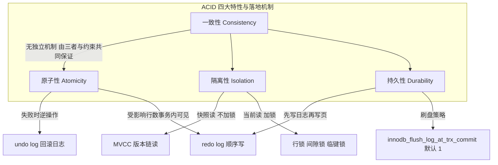

### 1.2 WAL：为什么必须先写日志

InnoDB 的持久化不是"提交时把数据页写回磁盘"，而是 **Write-Ahead Logging**：先把变更写进 redo log（顺序追加写，成本接近内存写），数据页留在 Buffer Pool 里标记为脏页，由后台 page cleaner 线程在 checkpoint 时异步刷盘。

理由只有一个字：**随机写 vs 顺序写**。一个 16KB 的数据页随机写到磁盘，是一次随机 IO；而 redo log 只有少量字节，顺序追加到 redo log buffer（`innodb_log_buffer_size` 默认 16MB），再批量 fsync。事务提交要保证持久性，就必须保证 redo log 已落盘，所以 `innodb_flush_log_at_trx_commit` 直接决定"提交时到底 fsync 几次"。

| 取值 | 提交时行为 | 数据库进程崩溃 | OS/主机崩溃 | 适用 |
| --- | --- | --- | --- | --- |
| 0 | 不刷，只写 log buffer，后台每秒 fsync | 丢最多 1 秒事务 | 丢最多 1 秒事务 | 只追求吞吐、可容忍丢数据的日志类业务 |
| 1（默认） | 每次提交都 fsync | 不丢 | 不丢 | 金融、订单等强一致场景 |
| 2 | 提交时 write 到 OS page cache，每秒 fsync | 不丢 | 丢最多 1 秒事务 | 想省 fsync 但能防进程崩溃 |

`sync_binlog` 与它配对：MySQL 5.7.7 起默认值从 0 改为 1。生产上"双一"（`innodb_flush_log_at_trx_commit=1` + `sync_binlog=1`）是最强保障，也是 TPS 的直接上限。

### 1.3 事务的状态迁移

InnoDB 的事务对象是 `trx_t`（`storage/innobase/include/trx0trx.h`），核心状态在 `trx->state` 字段。理解状态机是理解两阶段提交与崩溃恢复的前提。

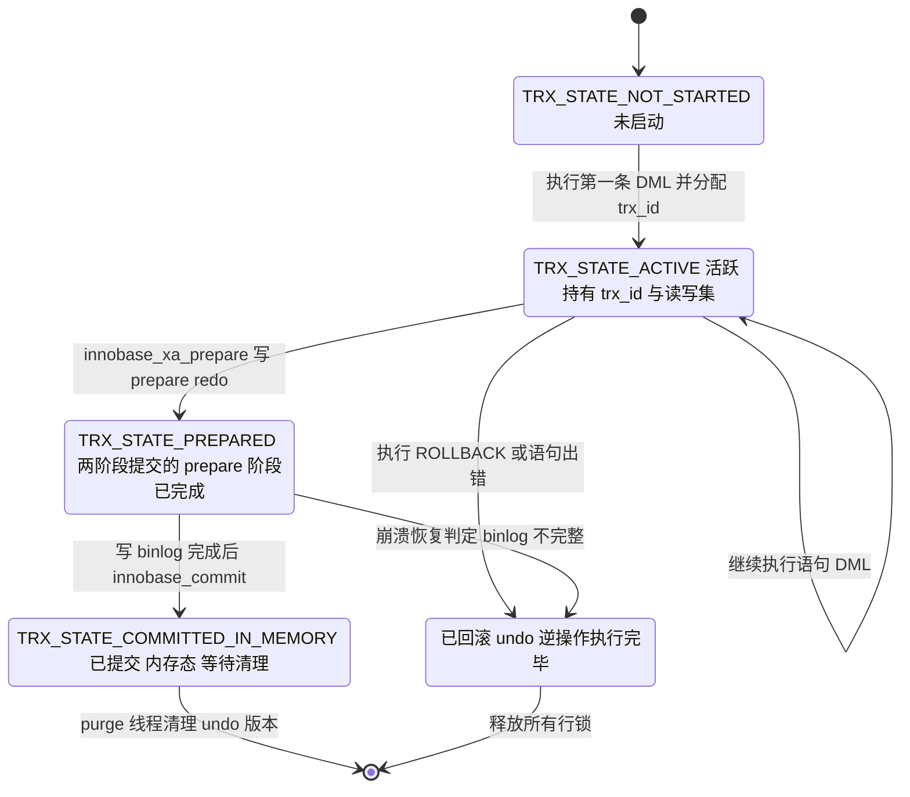

三个必须记住的点：

1. **`trx_id` 是"写事务"才分配的**。只读事务（autocommit 下的一条普通 SELECT）不分配 `trx_id`，这也是为什么 `m_ids` 里只有读写事务。源码上 `trx_assign_id` 只在事务第一次修改数据时被调用。
2. **行锁在事务结束时才释放**，不是语句结束时释放。这是"长事务"危害的根源。`innodb_rollback_on_timeout` 默认为 `OFF`，意味着发生锁等待超时时**只回滚当前语句**，整个事务仍在活跃状态，锁还持有。
3. **PREPARED 状态是崩溃恢复的关键信息**。崩溃重启后 InnoDB 扫描 redo log，遇到 prepare 状态的事务，就去 binlog 里找对应的 XID 判断该提交还是回滚。

## 二、并发异常与四种隔离级别

### 2.1 三种读现象的准确定义

| 现象 | 定义 | 根因 | 举例 |
| --- | --- | --- | --- |
| 脏读 Dirty Read | 读到了其他事务**未提交**的数据 | 读不加锁且不做版本控制 | T1 更新余额为 0 未提交，T2 读到 0，T1 回滚 |
| 不可重复读 Non-Repeatable Read | 同一事务内两次读**同一行**，结果不同 | 期间其他事务提交了该行的 UPDATE/DELETE | T1 两次 `SELECT` 余额，T2 在中间提交了 UPDATE |
| 幻读 Phantom Read | 同一事务内两次读**同一范围**，行数不同 | 期间其他事务提交了 INSERT | T1 查 `WHERE c > 5` 得 2 行，T2 插入 1 行并提交，T1 再查得 3 行 |

注意"不可重复读"针对的是**已存在行的值变化**，"幻读"针对的是**结果集行数的变化**。面试官经常用"更新同一行算不算幻读"来卡人，答案是"算不可重复读，不算幻读"。

### 2.2 SQL 标准与 InnoDB 实际实现的差异

| 隔离级别 | 脏读 | 不可重复读 | 幻读（SQL 标准） | InnoDB 实际表现 | 实现手段 |
| --- | --- | --- | --- | --- | --- |
| READ UNCOMMITTED | 可能 | 可能 | 可能 | 同标准 | 快照读直接读最新版本（`trx_assign_read_view` 返回 nullptr） |
| READ COMMITTED | 不可能 | 可能 | 可能 | 同标准 | 每条 SELECT 重新生成 Read View + 记录锁 |
| REPEATABLE READ | 不可能 | 不可能 | 可能 | **快照读下幻读被消除**；当前读靠临键锁消除 | 事务首个快照读生成 Read View 并复用 + 临键锁 |
| SERIALIZABLE | 不可能 | 不可能 | 不可能 | 同标准 | 所有普通 `SELECT` 隐式转成 `SELECT ... FOR SHARE` |

这里有个高频考点：**InnoDB 在 RR 级别下大部分消除了幻读，但 SQL 标准并不要求它这么做**。这是 InnoDB 的"超额实现"，原因是它的 MVCC 快照是语句无关的、事务级的，顺手就把快照读的幻读解决了；当前读的幻读则要靠临键锁，而临键锁并不总是能挡住插入。

### 2.3 隔离级别的查看与设置

变量名在 MySQL 5.7.20 起从 `tx_isolation` 改为 `transaction_isolation`（`tx_isolation` 保留为废弃别名）。

```sql
-- 查看当前会话与全局隔离级别
SELECT @@transaction_isolation;
SELECT @@global.transaction_isolation;
SHOW VARIABLES LIKE 'transaction_isolation';

-- 会话级设置（默认 REPEATABLE-READ）
SET SESSION TRANSACTION ISOLATION LEVEL READ COMMITTED;
-- 只对下一个事务生效
SET TRANSACTION ISOLATION LEVEL READ COMMITTED;

-- 每个事务查看自己的 trx_id（8.0 只读事务返回很大值表示未分配）
SELECT trx_id, trx_state, trx_started, trx_isolation_level
FROM information_schema.innodb_trx WHERE trx_mysql_thread_id = CONNECTION_ID();
```

**从 RR 改成 RC 是很多互联网公司的默认动作**，理由：RC 不需要间隙锁（除唯一键冲突检测和外键检查），锁范围小、死锁概率低、`binlog_format=ROW` 下语义安全。代价是失去"事务内可重复读"，需要业务自己接受"同一事务两次读可能不一致"。

## 三、undo log 与版本链

### 3.1 InnoDB 隐藏列

InnoDB 的聚簇索引叶子节点上，每条记录除了用户定义的列，还有三个隐藏列。这是 MVCC 的物理基础。

| 隐藏列 | 长度 | 作用 | 生成规则 |
| --- | --- | --- | --- |
| `DB_TRX_ID` | 6 字节 | 最近一次插入或修改该行的事务 ID | 每次写操作更新为当前事务 `trx_id` |
| `DB_ROLL_PTR` | 7 字节 | 回滚指针，指向 undo log 中该行的上一个版本 | 每次写操作写入新 undo 记录的地址 |
| `DB_ROW_ID` | 6 字节 | 隐藏主键，单调递增的全局计数器 | 仅当表**没有主键**且**没有非空唯一索引**时创建 |

`DB_ROW_ID` 的存在解释了一个经典问题：**没有主键的表为什么"更慢"且"主从可能不一致"**。没有显式主键时 InnoDB 用全局共享的 `DB_ROW_ID` 计数器生成主键值，这个值是全局递增的，在主从并行复制下同一批 INSERT 在主库和从库拿到的 `row_id` 可能不同，导致基于该隐藏主键的更新/删除在主从上影响行数不一致。所以规范要求：**每张表必须有显式主键**。

### 3.2 两类 undo log

| 类型 | 来源 | 用途 | 何时可清理 |
| --- | --- | --- | --- |
| insert undo log | `INSERT` | 仅用于回滚（删除刚插入的记录） | 事务提交后**立即**可删除，因为插入的记录对其他事务不可见 |
| update undo log | `UPDATE`、`DELETE` | 回滚 + **MVCC 快照读** | 事务提交后不能立即删，必须等到没有 Read View 需要它，由 purge 线程清理 |

这就是"长事务导致 undo 表空间膨胀"的直接原因：update undo log 的生命周期不是"事务结束"，而是"没有任何活跃 Read View 还需要它"。

### 3.3 版本链的结构

对一行 `id = 1, name = 'A'` 依次执行 `UPDATE ... SET name='B'`（trx 100）和 `SET name='C'`（trx 200），版本链如下。


版本链的正确描述是：**从聚簇索引记录出发，顺着 `DB_ROLL_PTR` 一路往回走**，每经过一个版本就用 Read View 判断可见性，第一个可见的版本就是快照读返回的数据。注意 `DELETE` 在 InnoDB 里不是真删，而是把记录标记 `deleted_flag`（delete mark），undo 记录里保存的是"未删除"的旧版本。

### 3.4 purge 与历史链表长度

- purge 线程由 `innodb_purge_threads` 控制，默认 4（MySQL 5.7/8.0）。
- `SHOW ENGINE INNODB STATUS` 输出中的 `History list length` 就是 `trx_sys->rseg_history_len`，即尚未被 purge 的 update undo 记录数量。**正常情况下应该在几百以内**，如果持续几千甚至几万，说明有长事务把 Read View 钉住了，purge 无法推进。
- `innodb_max_purge_lag` 默认为 0（不限制）；设置非 0 后，当 history list 超过该值会给 DML 语句主动加延迟，等同于"用 DML 限流保住 purge"。相关参数 `innodb_max_purge_lag_delay` 默认 0（单位微秒）。

## 四、Read View 与可见性判断算法

### 4.1 Read View 的字段

`ReadView` 类定义在 `storage/innobase/include/read0types.h`。中文资料常说的"四个字段"对应源码里的这四个成员：

| 字段名 | 类型 | 含义 | 通俗叫法 |
| --- | --- | --- | --- |
| `m_ids` | `ids_t`，即 `std::vector<trx_id_t>` | 生成 Read View 时，系统中所有**活跃（已启动未提交）的读写事务** ID 列表，升序 | 活跃事务列表 |
| `m_up_limit_id` | `trx_id_t` | `m_ids` 中的最小值；若 `m_ids` 为空则等于 `m_low_limit_id` | 低水位 |
| `m_low_limit_id` | `trx_id_t` | 生成 Read View 时的"下一个待分配事务 ID"，即 `max_trx_id` | 高水位 |
| `m_creator_trx_id` | `trx_id_t` | 创建该 Read View 的事务 ID | 当前事务 |

**命名陷阱**：源码里 `m_low_limit_id` 语义上其实是**高水位**（"low limit" 指的是"可见性下界以上一律不可见"的边界，从"不该看见"的角度命名）。面试时被追问"InnoDB 里 `low_limit_id` 是高水位还是低水位"，正确答案是"语义上是高水位，命名反直觉"。主动说出这一点是加分项。

此外还有一个成员 `m_low_limit_no`（`trx_id_t`），表示"小于它的 undo log 都可以被 purge 掉"所对应的 **LSN 下界**，服务于 purge 而不是可见性判断。把这个第 5 个字段讲出来能明显区分深度。

### 4.2 changes_visible：可见性判断算法

核心函数是 `ReadView::changes_visible(trx_id_t id, const table_name_t &name)`（MySQL 8.0 签名，5.7 为 `changes_visible(trx_id_t id)`）。判断一个版本的事务 ID 是否对当前 Read View 可见：

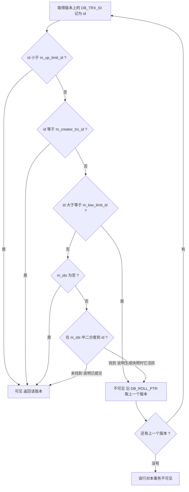

逐步解释每一步的设计意图：

1. `id < m_up_limit_id`：这个版本对应的事务在快照生成前就已经提交了，必然可见。
2. `id == m_creator_trx_id`：自己改的东西自己能看见（否则 `UPDATE` 后紧跟 `SELECT` 会读不到自己的修改）。
3. `id >= m_low_limit_id`：这个版本是快照生成**之后**才开始的事务写的，对快照不可见。
4. `m_ids` 为空：快照生成时刻没有任何活跃事务，那么小于高水位的全部已提交，可见。
5. `m_ids` 二分查找：找到说明该事务在快照生成时还活跃（未提交），不可见；找不到说明它已提交，可见。

`m_ids` 用 `std::lower_bound` 做二分查找，因为写入时保证升序。这也是为什么活跃事务数量极多时（例如 `innodb_deadlock_detect` 场景下几千并发）可见性判断会变慢。

### 4.3 RC 与 RR 的根本差异：Read View 的生成时机

这是 MVCC 最核心的一条，值得单独成图。

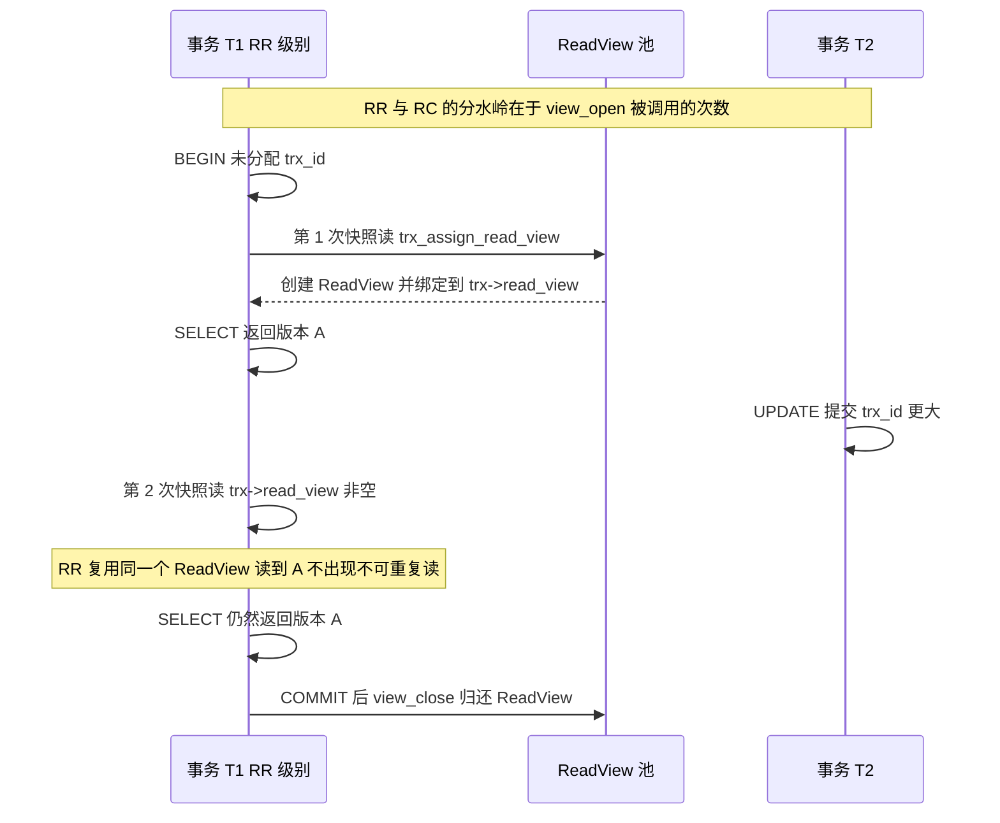

| 维度 | READ COMMITTED | REPEATABLE READ |
| --- | --- | --- |
| Read View 生成时机 | **每条 SELECT 语句开始时** | **事务内第一次快照读时** |
| 生成次数 | 一条语句一次 | 一个事务一次 |
| 实现入口 | `MVCC::view_open` 在语句开始重新获取 | `trx_assign_read_view(trx)` 在 `trx->read_view == nullptr` 时创建，之后直接复用 |
| 快照读的一致性 | 语句级一致 | 事务级一致 |
| 不可重复读 | 存在 | 不存在 |
| 间隙锁 | 一般不用（唯一键冲突检测、外键检查除外） | 广泛使用 |
| 半一致性读 | 自动启用 | 不启用 |
| binlog 兼容性 | 需 `binlog_format=ROW`（或在 5.6+ 用 `rc` 下也必须 ROW） | `STATEMENT` 也安全 |

`trx_assign_read_view` 在 `row_search_mvcc`（`storage/innobase/row/row0sel.cc`）中被调用，条件是 `prebuilt->select_lock_type == LOCK_NONE`，也就是"这次查询是快照读"。

### 4.4 半一致性读：RC 减少锁范围的另一个机制

RC 级别下 `UPDATE` 启用 **semi-consistent read**：InnoDB 先读最新的已提交版本，如果该行不满足 WHERE 条件，**立即释放锁并跳到下一行**；如果满足，再返回给 MySQL Server 层重新判断并加锁。

效果：`UPDATE t SET c = c + 1 WHERE d = 100` 在 RC 下只锁真正被改动的行，在 RR 下会把扫描路径上所有记录都锁住。MySQL 5.6 起 `innodb_locks_unsafe_for_binlog` 被废弃（8.0 已移除），因为 RC 下该行为默认启用。

## 五、快照读、当前读与 RR 下的幻读

### 5.1 两类读的划分

| 读类型 | 英文 | 语句 | 是否加锁 | 读到什么 |
| --- | --- | --- | --- | --- |
| 快照读 | consistent nonlocking read | 普通 `SELECT` | 不加锁 | Read View 判定的历史可见版本 |
| 当前读 | locking read | `SELECT ... FOR UPDATE`、`SELECT ... FOR SHARE`、`UPDATE`、`DELETE`、`INSERT` | 加锁 | 最新已提交版本，并加临键锁 |

MySQL 8.0 的语法变化：`SELECT ... LOCK IN SHARE MODE` 被 `SELECT ... FOR SHARE` 取代（旧语法仍可用但已废弃）；8.0.1 起支持 `FOR UPDATE NOWAIT` 和 `FOR UPDATE SKIP LOCKED`。`SKIP LOCKED` 是"用数据库表实现队列"的关键语法，能让多个消费者跳过被别人锁住的行而不阻塞。

`INSERT` 也被算作当前读，因为它要做唯一键冲突检测——发现重复键时会去读最新版本；同时插入前要在目标间隙上加插入意向锁。

### 5.2 RR 下幻读的三种真实场景

结论先行：**在 InnoDB 的 RR 下，幻读在"纯快照读"路径上被消除；在"当前读"路径上被临键锁大部分消除；但混用、无索引、唯一键等场景下仍会出现。**

| 场景 | 是否幻读 | 原因 |
| --- | --- | --- |
| 事务内全是快照读 | 不会 | 复用一个 Read View，新插入的行 `trx_id >= m_low_limit_id` 不可见 |
| 事务内全是当前读（有索引的范围查询） | 一般不会 | 范围上加临键锁，其他事务的插入意向锁被挡住 |
| 先快照读，另一事务插入并提交，再当前读 | **会** | 当前读读的是最新已提交版本，能看到新行。这是"同一事务内前后读结果不一致"的真实来源 |
| `WHERE` 条件字段**没有索引** | **会**（且锁全表） | 全表扫描逐行加临键锁，锁范围覆盖全部间隙，但插入若不在扫描路径的间隙上仍可能成功；另外锁表本身是灾难 |
| 唯一索引等值查询命中记录 | 不会（同一等值条件） | 临键锁退化为记录锁，不锁间隙；但插入**别的值**本来也不在该查询范围内 |
| 唯一索引等值查询未命中记录 | 不会（同一等值条件） | 退化为间隙锁，插入该间隙被挡 |

必须讲清楚的"特例"：`SELECT * FROM t WHERE id = 5 FOR UPDATE` 在主键等值命中时只加**记录锁**，不加间隙锁。此时另一个事务插入 `id = 6` 是允许的。很多人由此认为"RR 没能解决幻读"，这是误读：这条语句的查询条件是 `id = 5`，`id = 6` 的插入不构成该语句的幻影。**只有当条件本身是范围（或等值未命中导致需要锁间隙）时，才需要用间隙锁挡插入。**

### 5.3 RC 下也会加间隙锁的两种例外

RC 基本不用间隙锁，但有两处例外（面试加分点）：

1. **唯一键冲突检测**：`INSERT` 遇到唯一键冲突时，需要在冲突记录上加 `S` 型 next-key lock，用于检测是否存在删除标记（delete-marked）的同键记录。
2. **外键约束检查**：外键约束的父表检查需要间隙锁语义。

这两个例外也是 RC 下仍然会死锁的原因之一（经典案例：两个事务插入相同唯一键的不同值，互相等待对方的间隙锁）。

## 六、InnoDB 锁体系全景

### 6.1 自顶向下的锁分类

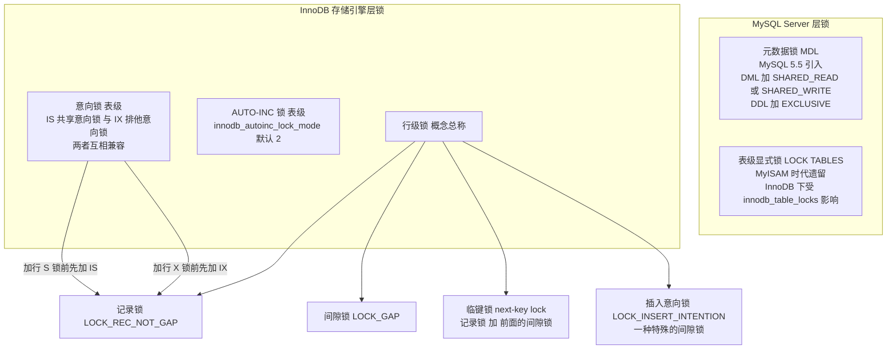

### 6.2 表级锁：元数据锁 MDL

MDL 是 **MySQL Server 层的锁，与存储引擎无关**，MySQL 5.5 引入。关键规则：

| 操作 | 申请的 MDL 类型 | 持续时间 |
| --- | --- | --- |
| 普通 `SELECT` | `SHARED_READ` | 语句级（`autocommit` 下）或事务级 |
| `INSERT`/`UPDATE`/`DELETE` | `SHARED_WRITE` | 事务级 |
| `ALTER TABLE`、`DROP TABLE` | `EXCLUSIVE` | 语句级 |
| 显式 `LOCK TABLES` | `SHARED_UPGRADABLE` 等 | 显式 |

MDL 类型的完备集合包括 `SHARED_READ`、`SHARED_WRITE`、`SHARED_READ_ONLY`、`SHARED_NO_READ_WRITE`、`SHARED_UPGRADABLE`、`INTENTION_EXCLUSIVE`、`EXCLUSIVE`。`LOCK_DURATION` 有 `STATEMENT`、`TRANSACTION`、`EXPLICIT`、`SESSION`。

**DDL 阻塞风暴的机制**（这是高级岗必考的场景题）：MDL 的等待队列是**先进先出**的，不会插队。

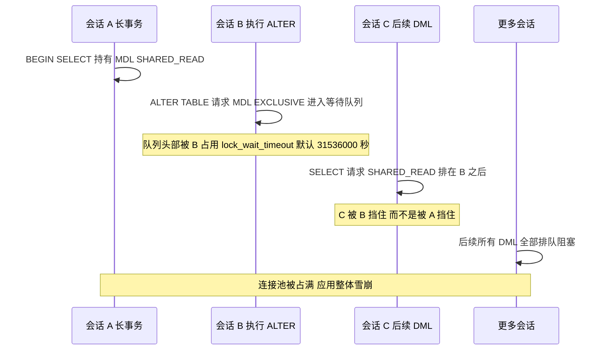

注意关键数字：**MDL 的等待时间由 `lock_wait_timeout` 控制，默认值 31536000 秒（即 1 年）**，而不是 `innodb_lock_wait_timeout` 的 50 秒。所以 DDL 会一直挂着不超时。防护手段：

```sql
-- DDL 前先设一个短的 MDL 等待时间，让它快速失败
SET SESSION lock_wait_timeout = 5;
ALTER TABLE t ADD INDEX idx_c (c);

-- 8.0 查询当前 MDL 持有与等待情况
SELECT OBJECT_TYPE, OBJECT_SCHEMA, OBJECT_NAME, LOCK_TYPE, LOCK_DURATION,
       LOCK_STATUS, OWNER_THREAD_ID
FROM performance_schema.metadata_locks
WHERE OBJECT_SCHEMA = 'your_db' AND OBJECT_NAME = 't'\G
```

`performance_schema.metadata_locks` 表在 MySQL 5.7.4 引入，8.0 保留。注意依赖 `performance_schema = ON`（默认 ON）且 `metadata_locks` 的 instrument 已启用（默认启用）。

### 6.3 意向锁：为什么能加速表锁判断

意向锁是**表级锁**，作用是"声明表中某行将被加锁"，从而让表级锁请求不必逐行扫描判断冲突。

| 请求\持有 | IS | IX | S 表锁 | X 表锁 |
| --- | --- | --- | --- | --- |
| IS | 兼容 | 兼容 | 兼容 | 冲突 |
| IX | 兼容 | 兼容 | 冲突 | 冲突 |
| S 表锁 | 兼容 | 冲突 | 兼容 | 冲突 |
| X 表锁 | 冲突 | 冲突 | 冲突 | 冲突 |

核心点：**IS 与 IX 互相兼容**。两个事务分别要改不同的行，都加 IX，互不阻塞。只有遇到表级 S/X 锁（如 `LOCK TABLES ... WRITE`、`ALTER TABLE`）时才需要判断冲突，此时只需看意向锁是否存在，O(1) 完成。

### 6.4 AUTO-INC 锁的三种模式

自增列的值由表级 `AUTO-INC` 锁保护。模式由 `innodb_autoinc_lock_mode` 控制，这是版本差异必须记准的参数：

| 取值 | 名称 | 行为 | 自增值连续性 | 默认版本 |
| --- | --- | --- | --- | --- |
| 0 | traditional | 每语句持有表级 AUTO-INC 锁直到语句结束 | 单语句内连续 | 5.6 之前 |
| 1 | consecutive | "simple inserts"（行数可预知）用内存互斥量分配；"bulk inserts"（如 `INSERT ... SELECT`，行数不可预知）仍用语句级表锁 | simple inserts 连续 | **MySQL 5.7 默认** |
| 2 | interleaved | 所有 insert 都只用内存级互斥量，不持有表锁 | 同一语句内可能不连续 | **MySQL 8.0 默认** |

模式 2 性能最好但有代价：同一 `INSERT` 语句内分配的自增值可能不连续（多个语句交叉插入）。这在 `binlog_format=STATEMENT` 下会导致主从自增序列不一致，所以模式 2 要求 `binlog_format=ROW`。MySQL 5.7.7 起 `binlog_format` 默认就是 `ROW`，8.0 保持，因此 8.0 把默认值改为 2 是安全的。

经典的"自增主键不连续"也来自这里：事务回滚、`INSERT ... ON DUPLICATE KEY UPDATE`、唯一键冲突失败都会消耗掉自增值，自增值**不会回退**。

## 七、行锁的四种形态

### 7.1 四种行锁的准确定义

| 锁类型 | 源码常量 | 锁住什么 | 典型产生条件 |
| --- | --- | --- | --- |
| 记录锁 Record Lock | `LOCK_REC_NOT_GAP` | 单条索引记录本身 | 唯一索引等值命中、`UPDATE ... WHERE pk = 1` |
| 间隙锁 Gap Lock | `LOCK_GAP` | 两条索引记录之间的开区间 | 等值查询未命中、临键锁的间隙部分 |
| 临键锁 Next-Key Lock | 记录锁 + 间隙锁的组合 | 左开右闭区间 `(a, b]` | RR 下范围查询的默认加锁单位 |
| 插入意向锁 Insert Intention Lock | `LOCK_INSERT_INTENTION` | 一种特殊的间隙锁，表示"即将在某间隙插入" | `INSERT` 之前 |

要点：

1. **锁加在索引上，不是加在行数据上**。如果 `WHERE` 条件用不到索引，InnoDB 走聚簇索引全表扫描，会对扫描到的**每一条记录**加临键锁，效果等同于锁全表。这是"没索引的 UPDATE 把库锁死"的机制。
2. **间隙锁之间不冲突**。两个事务可以在同一个间隙上加间隙锁，它们唯一的作用是阻止"插入意向锁"。所以间隙锁不会造成互相阻塞，但会造成"两个事务都持有间隙锁，然后都想插入"的死锁。
3. **插入意向锁与间隙锁冲突**。一个事务持有 `(5, 10)` 的间隙锁时，另一个事务要插入 `id = 7` 就会先加插入意向锁，然后被挡住等待。
4. **临键锁是"左开右闭"**。对 `c = 5` 加上临键锁，锁的是 `(0, 5]`，即"不许插入 1~4，也不许改 5"。

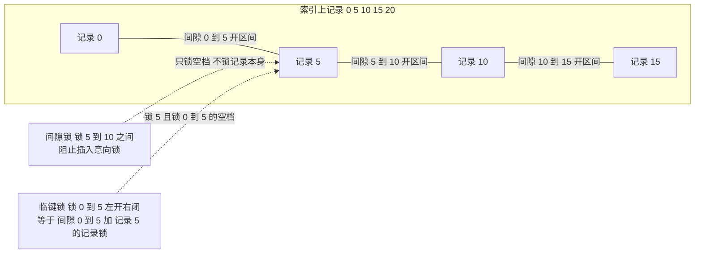

### 7.2 用 performance_schema 看真实的锁

MySQL 8.0 中 `information_schema.innodb_locks` 和 `innodb_lock_waits` **已被移除**，改用 `performance_schema.data_locks` 和 `performance_schema.data_lock_waits`（5.7 是旧表）。

```sql
-- 8.0 查看当前所有行锁，重点看 LOCK_MODE 与 LOCK_DATA
SELECT ENGINE_TRANSACTION_ID, THREAD_ID, OBJECT_SCHEMA, OBJECT_NAME,
       INDEX_NAME, LOCK_TYPE, LOCK_MODE, LOCK_STATUS, LOCK_DATA
FROM performance_schema.data_locks
WHERE OBJECT_SCHEMA = 'your_db'\G
```

`LOCK_MODE` 的取值与锁类型的对应关系（这是"看图识锁"的核心技能）：

| `LOCK_MODE` | 含义 |
| --- | --- |
| `X` | 行级排他临键锁（RR 下范围查询最常见） |
| `S` | 行级共享临键锁 |
| `X,REC_NOT_GAP` | 排他记录锁 |
| `S,REC_NOT_GAP` | 共享记录锁 |
| `X,GAP` | 排他间隙锁 |
| `S,GAP` | 共享间隙锁 |
| `X,INSERT_INTENTION` | 插入意向锁，等待中通常伴随 `LOCK_STATUS = WAITING` |
| `X,GAP,INSERT_INTENTION` | 插入意向锁（8.0 中在该间隙已有 `GAP` 锁时的表现） |
| `IS` / `IX` | 表级意向锁，`LOCK_TYPE = TABLE` |
| `LOCK_TYPE = TABLE` 且 `LOCK_MODE` 为空 | 表级 `X` 锁（如 `LOCK TABLES ... WRITE`） |

**MySQL 5.7 与 8.0 的排查表对照**（面试高频对照）：

| 用途 | MySQL 5.7 | MySQL 8.0 |
| --- | --- | --- |
| 活动事务 | `information_schema.innodb_trx` | `information_schema.innodb_trx`（保留） |
| 行锁明细 | `information_schema.innodb_locks` | `performance_schema.data_locks` |
| 锁等待关系 | `information_schema.innodb_lock_waits` | `performance_schema.data_lock_waits` |
| 元数据锁 | `performance_schema.metadata_locks` | `performance_schema.metadata_locks` |
| 友好视图 | `sys.innodb_lock_waits` | `sys.innodb_lock_waits` |

## 八、加锁规则五原则推导

这是 InnoDB 锁最难也最能体现水平的一节。规则最早由丁奇在《MySQL 实战 45 讲》第 20~21 讲系统总结，被称为"两个原则、两个优化、一个 bug"。

### 8.1 五条规则

| 编号 | 类型 | 内容 |
| --- | --- | --- |
| 原则 1 | 原则 | 加锁的基本单位是 **next-key lock**，即"左开右闭区间" |
| 原则 2 | 原则 | 查找过程中**访问到的对象**才会加锁（没扫到的记录不加锁） |
| 优化 1 | 优化 | 索引上的**等值查询**，若命中**唯一索引**（含主键），next-key lock 退化为**记录锁** |
| 优化 2 | 优化 | 索引上的**等值查询**，向右遍历时最后一个值不满足等值条件，next-key lock 退化为**间隙锁** |
| bug | 历史行为 | **唯一索引上的范围查询，会访问到第一个不满足条件的值**，导致多锁一个区间（`> =` 与 `<` 组合时最典型） |

### 8.2 实验表与推导

```sql
CREATE TABLE t (
  id INT NOT NULL,
  c  INT DEFAULT NULL,
  d  INT DEFAULT NULL,
  PRIMARY KEY (id),
  KEY idx_c (c)
) ENGINE=InnoDB DEFAULT CHARSET=utf8mb4;

INSERT INTO t VALUES (0,0,0),(5,5,5),(10,10,10),(15,15,15),(20,20,20),(25,25,25);
```

以下结论均在 `RR` 隔离级别下，事务未提交时观察 `performance_schema.data_locks` 得到。

| SQL | 加锁范围 | 推导依据 |
| --- | --- | --- |
| `SELECT * FROM t WHERE id = 10 FOR UPDATE` | `id = 10` 上的记录锁 | 原则 1 加临键锁，优化 1 退化为记录锁 |
| `SELECT * FROM t WHERE id = 7 FOR UPDATE` | `(5, 10)` 间隙锁 | 等值查询未命中，优化 2 退化为间隙锁 |
| `SELECT * FROM t WHERE c = 5 FOR UPDATE` | `(0, 5]` 临键锁 + `(5, 10)` 间隙锁 | 非唯一索引等值：命中的记录加临键锁，向右遍历到 10 不满足，退化为间隙锁 |
| `SELECT * FROM t WHERE c = 10 FOR UPDATE` | `(5, 10]` 临键锁 + `(10, 15)` 间隙锁 | 同上，注意 c 索引上还要回表，主键索引也加锁 |
| `SELECT * FROM t WHERE c = 25 FOR UPDATE` | `(20, 25]` 临键锁 | `c = 25` 是最后一个值，无右侧不满足条件的记录，优化 2 不适用 |
| `SELECT * FROM t WHERE id >= 10 AND id < 11 FOR UPDATE` | `id = 10` 记录锁 + `(10, 15]` 临键锁 | bug：范围查询访问到第一个不满足条件的 15 |
| `SELECT * FROM t WHERE d = 5 FOR UPDATE` | 所有记录加临键锁，等效锁全表 | d 无索引，走全表扫描，原则 2 覆盖所有扫描到的记录 |
| `UPDATE t SET c = c + 1 WHERE id = 10` | `id = 10` 记录锁 | 与 `FOR UPDATE` 同理，UPDATE 一定是当前读 |

关于最后一条"bug"的准确表述：**唯一索引上的范围查询会一直向右扫描到第一个不满足条件的记录为止，并对该记录也加临键锁**。所以 `id >= 10 AND id < 11` 会把 `(10, 15]` 也锁上，插 `id = 12` 会被阻塞——尽管 `12` 显然不满足 `id >= 10 AND id < 11`。这是 MySQL 5.7/8.0 均存在的既有行为，属于"范围边界确定"的实现代价而非缺陷修复对象。

### 8.3 推导流程模板

面试时被问"某条语句加了什么锁"，用下面这个流程现场推导，比背结论可靠得多。

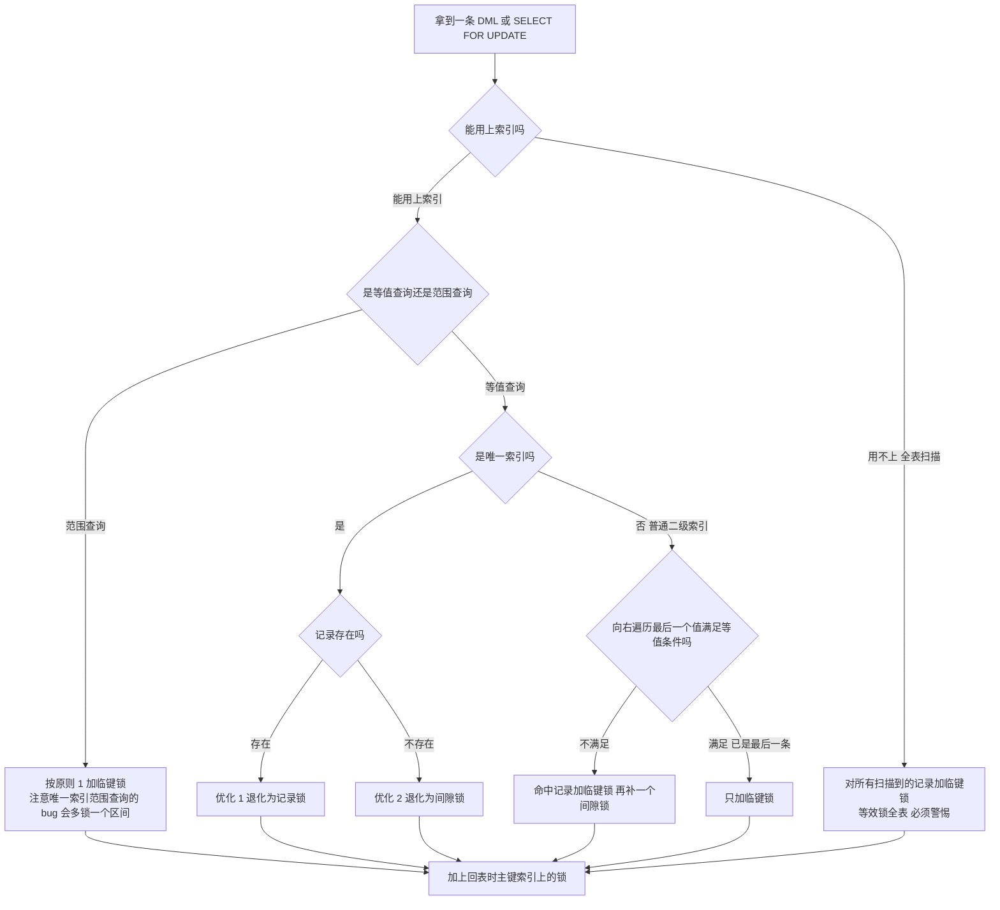

## 九、死锁、锁等待与线上排查

### 9.1 死锁的四个必要条件与 InnoDB 的具体表现

死锁的必要条件：互斥、持有并等待、不可抢占、循环等待。**数据库能打破的是"循环等待"——通过回滚其中一个事务来解开环。**

InnoDB 的做法：死锁检测发现环后，选择**回滚代价最小的事务**（`trx_weight` 最小的，权重近似等于该事务修改的行数加锁数量），并抛出错误：

```text
ERROR 1213 (40001): Deadlock found when trying to get lock;
try restarting transaction
```

关键区别：**死锁会立即被检测并回滚（毫秒级），不会等 `innodb_lock_wait_timeout`；而普通锁等待会一直等到超时（默认 50 秒）才报错 `ERROR 1205 (HY000): Lock wait timeout exceeded; try restarting transaction`。**

| 参数 | 作用 | 默认值 | 备注 |
| --- | --- | --- | --- |
| `innodb_lock_wait_timeout` | 行锁等待超时（秒） | 50 | 动态，会话级可改 |
| `innodb_deadlock_detect` | 是否开启死锁检测 | `ON` | MySQL 5.7 系列引入，8.0 保留；动态变量 |
| `lock_wait_timeout` | 元数据锁等待超时（秒） | 31536000 | 动态；与行锁超时是两套 |
| `innodb_print_all_deadlocks` | 是否把所有死锁写入 error log | `OFF` | 排查时建议临时开启 |
| `innodb_rollback_on_timeout` | 锁等待超时是否回滚整个事务 | `OFF` | 默认只回滚当前语句 |

### 9.2 死锁检测的代价与"检测风暴"

死锁检测的算法是：每当一个事务需要等待锁，就遍历"等待图"判断加入这条边是否形成环。等待图规模为 n 时，单次检测接近 O(n²)。当活跃事务数达到几千、且每条语句都要等锁时，检测本身会把 CPU 打满。

**这就是"高并发下 MySQL CPU 100% 但 QPS 很低"的经典成因之一。** 官方给出的建议是：并发度很高时如果死锁不是主要问题，可以关闭死锁检测（`innodb_deadlock_detect = OFF`），让锁等待退化为超时（由 `innodb_lock_wait_timeout` 兜底），把 CPU 从检测中解放出来。代价是死锁不再被立即发现，只能等超时。配套要把 `innodb_lock_wait_timeout` 调小（例如 5 秒）。

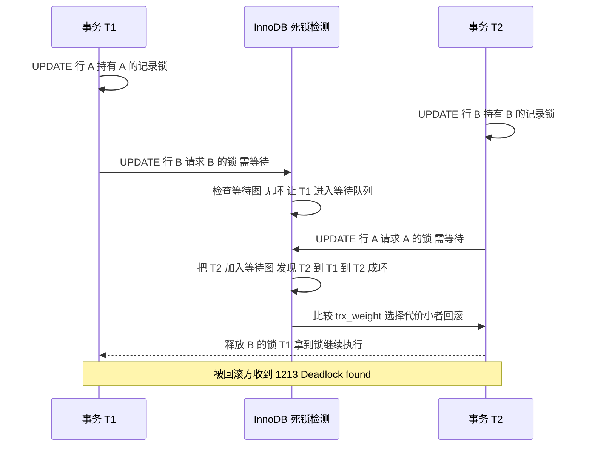

### 9.3 线上锁等待排查的标准动作

第一步，找出谁在等、谁在挡。MySQL 8.0 用 `sys.innodb_lock_waits`（最省事）：

```sql
SELECT * FROM sys.innodb_lock_waits\G
```

输出中直接可用的是 `sql_kill_blocking_query` 和 `sql_kill_blocking_connection` 两列，分别对应 `KILL QUERY <id>` 和 `KILL <id>`。

第二步，手工关联 `performance_schema.data_lock_waits` 与 `information_schema.innodb_trx`：

```sql
SELECT
  r.trx_id                AS waiting_trx_id,
  r.trx_mysql_thread_id   AS waiting_thread,
  r.trx_query             AS waiting_query,
  TIMESTAMPDIFF(SECOND, r.trx_started, NOW()) AS waiting_trx_age_sec,
  b.trx_id                AS blocking_trx_id,
  b.trx_mysql_thread_id   AS blocking_thread,
  b.trx_query             AS blocking_query,
  TIMESTAMPDIFF(SECOND, b.trx_started, NOW()) AS blocking_trx_age_sec,
  b.trx_rows_locked       AS blocking_rows_locked
FROM performance_schema.data_lock_waits w
JOIN information_schema.innodb_trx r
     ON r.trx_id = w.REQUESTING_ENGINE_TRANSACTION_ID
JOIN information_schema.innodb_trx b
     ON b.trx_id = w.BLOCKING_ENGINE_TRANSACTION_ID;
```

**坑点**：`information_schema.innodb_trx.trx_id` 的类型是 `varchar(18)`（5.7 起就是字符串），与 `data_lock_waits.REQUESTING_ENGINE_TRANSACTION_ID`（`bigint unsigned`）比较时会发生隐式类型转换。数据量大时这会让查询变慢，必要时显式 `CAST(w.REQUESTING_ENGINE_TRANSACTION_ID AS CHAR)`。

第三步，找出所有"老龄化"事务，识别长事务源头：

```sql
SELECT trx_id, trx_state, trx_started,
       TIMESTAMPDIFF(SECOND, trx_started, NOW()) AS age_sec,
       trx_mysql_thread_id, trx_rows_locked, trx_rows_modified,
       trx_isolation_level, trx_query
FROM information_schema.innodb_trx
ORDER BY trx_started ASC;
```

第四步，把 `trx_mysql_thread_id` 对应的 `SHOW PROCESSLIST` 记录找出来，确认是哪个应用、哪条 SQL，再决定是 `KILL QUERY`（只杀语句，保留连接）还是 `KILL`（杀连接，触发事务回滚）。

```sql
SHOW PROCESSLIST;
SELECT ID, USER, HOST, DB, COMMAND, TIME, STATE, INFO
FROM information_schema.PROCESSLIST
WHERE ID IN (12345, 12346);
```

第五步，看死锁历史。`SHOW ENGINE INNODB STATUS\G` 的 `LATEST DETECTED DEADLOCK` 段给出完整现场：

```text
------------------------
LATEST DETECTED DEADLOCK
------------------------
2024-05-20 10:31:07 0x700008a1b000
*** (1) TRANSACTION:
TRANSACTION 4213891, ACTIVE 3 sec starting index read
mysql tables in use 1, locked 1
LOCK WAIT 3 lock struct(s), heap size 1136, 2 row lock(s), undo log entries 1
MySQL thread id 12345, OS thread handle 123145421234176, query id 998877 localhost app updating
UPDATE account SET balance = balance - 100 WHERE id = 1
*** (1) HOLDS THE LOCK(S):
RECORD LOCKS space id 30 page no 4 n bits 72 index PRIMARY of table `demo`.`account`
LOCK_MODE: X,REC_NOT_GAP
*** (1) WAITING FOR THIS LOCK TO BE GRANTED:
RECORD LOCKS ... LOCK_MODE: X,REC_NOT_GAP
*** (2) TRANSACTION:
...
*** WE ROLL BACK TRANSACTION (2)
```

从这段文本里能直接读到：两个事务各自的 `trx_id`、`ACTIVE` 时长、正在执行的 SQL、已持有的锁（`HOLDS THE LOCK(S)`）、正在等待的锁（`WAITING FOR THIS LOCK TO BE GRANTED`）、以及最后被回滚的是谁（`WE ROLL BACK TRANSACTION (n)`）。**排查死锁时优先看这一段的"两条 SQL 是否以相反顺序访问同一组资源"。**

### 9.4 死锁的典型形态与规避

| 形态 | 例子 | 规避 |
| --- | --- | --- |
| 相反顺序更新 | T1 改 A 再改 B，T2 改 B 再改 A | **固定加锁顺序**，如按主键升序批量更新 |
| 唯一键插入冲突 | 两事务插入相同唯一键的不同值，各持间隙锁 | 插入前先 `SELECT ... FOR UPDATE` 检查，或用 `INSERT IGNORE` |
| 间隙锁 + 插入意向锁 | `SELECT ... FOR UPDATE` 范围查询后又插入 | 精确化 WHERE 条件、加合适索引避免锁无关区间 |
| RR 的临键锁放大 | 无索引 UPDATE 锁全表，与任意事务冲突 | 补索引；迁移到 RC |
| 事务内两种资源顺序不一 | 先锁 A 表行再锁 B 表行，另一事务反之 | 统一跨表访问顺序；拆小事务 |
| 死锁检测缺失 | 主从切换、`ON DELETE CASCADE` 与外键混用 | 开启 `innodb_print_all_deadlocks`，定期分析 error log |

## 十、redo log、WAL 与两阶段提交

### 10.1 redo log 的物理组织与循环写

redo log 是**物理逻辑日志**，记录的是"在某个数据页的某个偏移量做了什么修改"，格式由 `mtr`（mini-transaction）产生。

| 参数 | MySQL 5.7 | MySQL 8.0 |
| --- | --- | --- |
| 单个文件大小 | `innodb_log_file_size` 默认 48MB | 8.0.30 起 `innodb_log_file_size` 被废弃，改用 `innodb_redo_log_capacity`，默认 100MB |
| 文件数量 | `innodb_log_files_in_group` 默认 2，文件名 `ib_logfile0`、`ib_logfile1` | 由 `innodb_redo_log_capacity` 自动拆成 32 个文件，存放于数据目录的 `#innodb_redo` 下 |
| 写入缓冲 | `innodb_log_buffer_size` 默认 16MB | 同左 |
| 提交刷盘 | `innodb_flush_log_at_trx_commit` 默认 1 | 同左 |
| 写线程 | 无独立日志线程参数 | `innodb_log_writer_threads` 默认 `ON`（8.0.22 引入），用独立线程组做组提交 |

redo log 的循环写模型：文件被当作一个环形缓冲区，`write pos` 是当前写入位置，`checkpoint` 是"这个位置之前的数据页已刷盘、redo 可以覆盖"的位置。两者之间的空间就是可用于预留的空间。**如果 `write pos` 追上 `checkpoint`，InnoDB 必须停下来强制刷脏页**——这就是"redo log 太小导致 TPS 抖动"的机制。

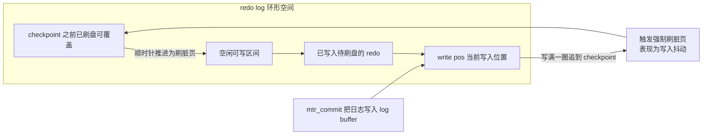

### 10.2 binlog 的三种格式

| 格式 | 记录内容 | 优点 | 缺点 | 默认版本 |
| --- | --- | --- | --- | --- |
| `STATEMENT` | 原始 SQL 语句 | 日志量最小 | `NOW()`、`UUID()`、`RAND()`、`LIMIT` 无 `ORDER BY` 等不确定语句会导致主从不一致 | 5.7.7 之前默认 |
| `ROW` | 每行的前镜像与后镜像 | 语义确定，主从强一致；可用 `binlog_row_image` 精简 | 日志量大，批量 `UPDATE` 放大 N 倍 | **MySQL 5.7.7 起默认** |
| `MIXED` | 由 Server 判断，不确定的语句用 `ROW` | 折中 | 判断规则不易掌握，排查麻烦 | 无 |

相关默认值：

- `binlog_format` 默认 `ROW`（MySQL 5.7.7 起）。
- `binlog_row_image` 默认 `FULL`，可设 `minimal`（只记被改动的列）或 `noblob`。
- `sync_binlog` 默认 `1`（MySQL 5.7.7 起），每次提交 fsync binlog。
- `binlog_cache_size` 默认 32768（32KB）；超过则落临时文件，`Binlog_cache_disk_use` 状态变量会增长。
- `binlog_expire_logs_seconds` 默认 2592000（30 天），MySQL 8.0.0 引入；旧参数 `expire_logs_days` 默认 0（不自动删）在 8.0 被废弃。
- `binlog_order_commits` 默认 `ON`。

### 10.3 两阶段提交：为什么必须要有

问题是这样的：一次事务提交要同时写两份日志——InnoDB 的 redo log 和 Server 层的 binlog。如果不做协调，会出现两种不一致：

1. **先写 redo 再写 binlog，binlog 写失败**：主库有新数据（redo 已提交），但从库/备份按 binlog 恢复时没有这条数据 → 主从不一致且备份丢数据。
2. **先写 binlog 再写 redo，redo 写失败**：从库按 binlog 重放多出一条数据，主库没有 → 从库数据"多"出来。

所以引入两阶段提交：把 redo log 的写入拆成 `prepare` 和 `commit` 两步，中间插入 binlog 的写入。

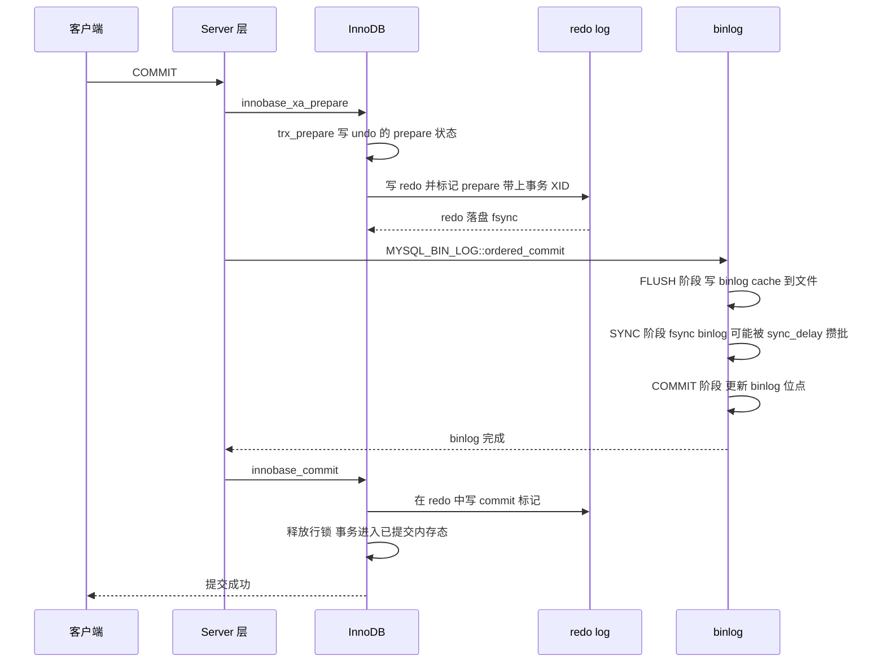

崩溃恢复的判断规则（这是面试的标准答案）：

| redo log 中事务状态 | binlog 是否完整（能按 XID 定位到该事务） | 恢复动作 |
| --- | --- | --- |
| `prepare` | 完整 | **提交**（binlog 已落盘，从库会有这条数据，主库必须也有） |
| `prepare` | 不完整或不存在 | **回滚**（binlog 没有，主库不能有） |
| 已写 `commit` 标记 | 无关 | 事务已完成，无需处理 |
| 无 `prepare` 标记（只写了部分 redo） | 无关 | 回滚 |

源码入口：`ha_commit_trans` → `innobase_xa_prepare` → `trx_prepare`（`trx0trx.cc`）；binlog 侧是 `MYSQL_BIN_LOG::ordered_commit`（`sql/binlog.cc`），内部三个阶段枚举为 `COMMIT_STAGE_FETCH_AND_FLUSH`、`COMMIT_STAGE_SYNC`、`COMMIT_STAGE_COMMIT`。

### 10.4 组提交：把 fsync 攒起来

**组提交（group commit）**解决的是"每次提交都要 fsync，fsync 是磁盘操作，TPS 上不去"的问题。机制是：把多个并发事务的日志攒成一批，一次 fsync 落盘，然后一起返回。

binlog 侧的三个阶段各有优化：

| 阶段 | 动作 | 攒批参数 | 默认值 |
| --- | --- | --- | --- |
| FLUSH | 每个事务把自己 binlog cache 写入 binlog 文件（不 fsync） | 无（但多事务一次写） | - |
| SYNC | 对 binlog 文件做 fsync | `binlog_group_commit_sync_delay`（微秒） | 0 |
| COMMIT | 按顺序让存储引擎提交 | `binlog_group_commit_sync_no_delay_count`（事务数） | 0 |

调优示例：`binlog_group_commit_sync_delay = 1000`（等 1 毫秒）配合 `binlog_group_commit_sync_no_delay_count = 100`，能显著提升写入 TPS，代价是每个事务最坏多等 1 毫秒延迟。这是"延迟换吞吐"的经典取舍。

redo 侧的组提交由 `innodb_log_writer_threads`（8.0.22 起默认 `ON`）与日志写线程实现：多个事务的 redo 记录被一个 writer 线程批量写入、一个 flusher 线程批量 fsync。

## 十一、一条 update 的完整执行链路

把本节完整讲出来，基本能覆盖"MySQL 一条 SQL 怎么执行"的追问。以 `UPDATE t SET c = c + 1 WHERE id = 2;` 为例。

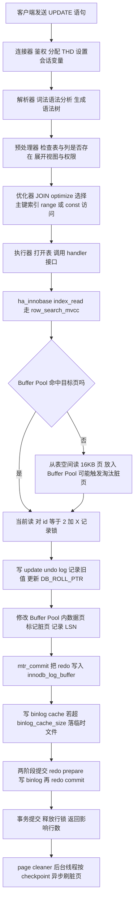

关键节点展开说明：

1. **优化器阶段**决定走哪个索引，直接影响加锁范围。`WHERE id = 2` 走主键 `const` 访问，只锁一行；如果 `WHERE c = 2` 而 `c` 无索引，就变成全表扫描加锁。
2. **加锁发生在读的过程中，不是修改时**。入口是 `row_search_mvcc`（`storage/innobase/row/row0sel.cc`）内的 `lock_clust_rec_read_check_and_lock`（聚簇索引）或 `lock_sec_rec_read_check_and_lock`（二级索引）。
3. **undo 先写、数据页后改**。函数链：`ha_innobase::update_row` → `row_update_for_mysql`（`row0mysql.cc`）→ `trx_undo_report_row_operation` 写 undo → `btr_cur_update_in_place` 或 `btr_cur_optimistic_update` 改页。
4. **redo 在 mtr 提交时写入**，不是事务提交时。`mtr_commit` 把 mini-transaction 的日志拷到 `innodb_log_buffer`（默认 16MB，`innodb_log_buffer_size`）。事务提交时再由 `trx_flush_log_if_needed` 触发 `log_write_up_to(lsn, flush=true)`。
5. **锁在事务提交/回滚时才释放**，所以"一条 UPDATE 后不提交，把库锁住"是真实可复现的。
6. **数据页刷盘与事务提交无关**。提交成功只保证 redo 落盘，页可能还在内存里。这就是"掉电后 InnoDB 能恢复"的原理，也是为什么 `innodb_buffer_pool_size` 默认 128MB 时大量写入会频繁刷脏页。

## 十二、长事务的危害与治理

### 12.1 六条危害链

| 危害 | 机制 | 可观测指标 |
| --- | --- | --- |
| 锁持有时间过长 | 行锁在事务结束才释放，长事务期间热点行不可写 | `trx_rows_locked`、锁等待数、`Innodb_row_lock_time_avg` |
| undo 版本链变长 | Read View 钉住 undo，purge 无法推进，快照读要沿更长的链回溯 | `History list length` 持续增长 |
| 磁盘膨胀 | undo tablespace 无法回收，`ibdata` 或 `undo_001`/`undo_002` 持续变大 | 数据目录文件大小 |
| redo 无法覆盖 | 未提交事务的 redo 不能覆盖，压缩了循环空间 | 强制刷脏页频繁、写抖动 |
| purge 积压 | purge 线程追不上产生速度，history list 进一步增长 | `Innodb_purge_...` 状态、purge lag |
| 主从延迟 | 大事务在从库要么串行 apply 要么长时间持有锁，`Seconds_Behind_Master` 飙升 | `SHOW REPLICA STATUS` |
| DDL 被阻塞 | 长事务持 MDL 读锁，DDL 排队并阻塞后续所有 DML | `performance_schema.metadata_locks` |

### 12.2 发现长事务

```sql
-- 找出运行超过 60 秒的事务，按持续时间倒序
SELECT trx_id,
       trx_state,
       trx_started,
       TIMESTAMPDIFF(SECOND, trx_started, NOW()) AS age_sec,
       trx_mysql_thread_id,
       trx_rows_locked,
       trx_rows_modified,
       trx_isolation_level,
       trx_query
FROM information_schema.innodb_trx
WHERE TIMESTAMPDIFF(SECOND, trx_started, NOW()) > 60
ORDER BY trx_started ASC;

-- 没有提交的只读事务也要找出来，它们同样钉住 Read View
SELECT trx_id, trx_started, trx_mysql_thread_id
FROM information_schema.innodb_trx
WHERE trx_state = 'RUNNING' AND trx_rows_modified = 0;

-- 检查 history list length
SHOW ENGINE INNODB STATUS\G   -- 查看 History list length 字段
```

### 12.3 治理清单

1. **事务里不允许有远程调用**。HTTP/RPC/MQ 发送必须放在事务提交之后（用 `TransactionSynchronizationManager.registerSynchronization` 的 `afterCommit`，或本地消息表 + 定时补偿）。
2. **批量操作拆分**。一次 `UPDATE` 影响 100 万行就拆成 1000 批，每批 1000 行并提交，避免大事务与长锁。
3. **`autocommit` 保持开启（默认 `ON`）**。应用框架误把连接设成 `autocommit=0` 又不提交，是"没有业务逻辑却大量长事务"的常见原因。
4. **设置事务超时**并区分"语句超时"和"事务超时"。Spring 的 `@Transactional(timeout = 5)` 在 `DataSourceTransactionManager` 下最终通过 `DataSourceUtils.applyTimeout` 落到 `Statement.setQueryTimeout(5)`，**它约束的是单条语句的执行时间，不是事务从 `BEGIN` 到 `COMMIT` 的总时长**，更管不住"事务开着但应用在等下游"。要真正限制事务时长，必须在业务层加超时/熔断，或使用连接池的 `leakDetectionThreshold`（HikariCP 默认 0，即关闭）。
5. **读写分离**。把报表类、导出类的大范围读放到只读实例，避免主库只读事务钉住 Read View。
6. **`max_execution_time` 限制只读语句**。该参数（毫秒，默认 0 表示不限制）只对 `SELECT` 生效，`SELECT /*+ MAX_EXECUTION_TIME(1000) */` 也可用。
7. **监控告警**：对 `information_schema.innodb_trx` 中 `age_sec > 60` 的事务数做监控；对 `History list length > 10000` 告警；对 `Innodb_row_lock_current_waits > 0` 持续 10 秒告警。

## 十三、MySQL 8.0 对锁与事务的改进

| 改进项 | 版本 | 内容 | 对锁与事务的影响 |
| --- | --- | --- | --- |
| 事务性数据字典 | 8.0.0 | 数据字典存进 InnoDB（`mysql.ibd`），移除 `.frm`、`.opt` 等文件 | DDL 具备原子性（atomic DDL），崩溃后不再出现"表定义丢了但表空间还在" |
| 锁信息表迁移 | 8.0.0 | 移除 `information_schema.innodb_locks` / `innodb_lock_waits` | 排查脚本必须改用 `performance_schema.data_locks` / `data_lock_waits`，5.7 的老脚本直接报错 |
| `NOWAIT` / `SKIP LOCKED` | 8.0.1 | `SELECT ... FOR UPDATE NOWAIT`、`FOR UPDATE SKIP LOCKED` | 队列消费场景不再用"抢锁失败即重试"；`NOWAIT` 立即报错而不等待 |
| AUTO-INC 锁默认值 | 8.0.0 | `innodb_autoinc_lock_mode` 默认 1 改为 2 | 并发插入性能提升；依赖 `binlog_format=ROW`（8.0 默认 ROW） |
| redo log 容量管理 | 8.0.30 | `innodb_redo_log_capacity` 默认 100MB，替代 `innodb_log_file_size` | redo 文件数自动管理，`#innodb_redo` 目录下 32 个文件；不再需要手工删除 `ib_logfile` |
| 日志写线程 | 8.0.22 | `innodb_log_writer_threads` 默认 `ON` | redo 组提交由独立线程完成，高并发下 fsync 更少 |
| 独立 doublewrite 文件 | 8.0.20 | `innodb_doublewrite_files` 默认 2，文件为 `#ib_16384_0.dblwr` | 减少 doublewrite buffer 对共享表空间的争用 |
| INSTANT ADD COLUMN | 8.0.12 | `ALTER TABLE ... ALGORITHM=INSTANT` 支持加列，只改数据字典 | DDL 持有 MDL 写锁的时间从分钟级降到毫秒级 |
| 任意位置 INSTANT 加列 | 8.0.29 | `ALGORITHM=INSTANT` 支持列加在任意位置、支持删列后立即加列 | 进一步降低 MDL 阻塞风险 |
| 并行读线程 | 8.0.14 | `innodb_parallel_read_threads` 默认 4，用于 `SELECT COUNT(*)` 等 | 只影响无锁扫描，不改变加锁语义 |
| `SELECT ... FOR SHARE OF tbl` | 8.0 | 支持指定表别名 | 多表 JOIN 加锁更精确 |
| redo 归档 | 8.0.17 | `innodb_redo_log_archive_start` 等函数 | 支持备份工具直接消费 redo，替代部分 binlog 场景 |
| 死锁检测开关 | 5.7 系列引入，8.0 保留 | `innodb_deadlock_detect` 默认 `ON` | 高并发下可关闭以规避 O(n²) 检测开销 |

**必须强调一点：MySQL 8.0 的默认隔离级别仍然是 `REPEATABLE READ`**，`binlog_format` 仍然是 `ROW`，`innodb_flush_log_at_trx_commit` 仍然是 1。不要因为"8.0 很新"就臆测这些默认值变了。

`ALGORITHM` 的取值与 MDL 的关系，是 DDL 场景题的答案骨架：

| `ALGORITHM` | 是否需要重建表 | MDL 写锁持有时间 | 8.0 支持范围 |
| --- | --- | --- | --- |
| `INSTANT` | 否，只改数据字典 | 极短（毫秒级） | 加列（8.0.12）、任意位置加列（8.0.29）、改默认值等 |
| `INPLACE` | 否，原地修改（可能重建） | 全程持有，末尾短暂升级为排他 | 加索引、改列类型（部分） |
| `COPY` | 是，建临时表拷数据 | 全程持有，时长与数据量成正比 | 兜底方案，最慢 |
| `DEFAULT` | 由 MySQL 自行选择 | 不确定 | 默认行为 |

## 十四、高级岗三问

### 14.1 为什么这么设计？

**为什么 MVCC 要引入 undo log 而不是直接保留多份数据行？**

- 替代方案 A：每行保留多个历史版本在数据页里。代价是数据页膨胀、写放大，且无法容忍"一次事务改很多行只回滚几行"的语义。
- 替代方案 B：读时加共享锁（纯锁实现隔离）。代价是读阻塞写，读多写少场景下写几乎无法进行。
- InnoDB 选择 undo log，好处是**只有被修改过的行才有历史版本，且历史版本是顺序写的**，代价是快照读要沿链表回溯、purge 线程要持续清理。这是一个"用读时的链表遍历换写时的存储与并发"的取舍。

**为什么 RR 用"事务级"快照而 RC 用"语句级"快照？**

- RR 的目标是让同一个事务内的读自洽，便于业务做"先读后写"的推理。
- RC 的目标是让读尽量看到最新已提交数据，适配 Oracle/PostgreSQL 的默认习惯，且配合 `ROW` 格式 binlog 时主从安全。
- 代价：RR 的快照更"旧"，undo 链更长、purge 压力更大；RC 需要更多"重读"，但锁范围小。

### 14.2 线上出问题怎么定位？

| 现象 | 第一步 | 关键命令 | 常见结论 |
| --- | --- | --- | --- |
| 大量请求超时，报 1205 | 看锁等待 | `SELECT * FROM sys.innodb_lock_waits\G` | 有长事务持锁，先 `KILL QUERY` 或 `KILL` 阻塞方 |
| 报 1213 死锁 | 看死锁现场 | `SHOW ENGINE INNODB STATUS\G` 的 `LATEST DETECTED DEADLOCK` | 两条 SQL 以相反顺序访问资源 |
| 所有 DML 卡住，DDL 也在等 | 看 MDL 队列 | `performance_schema.metadata_locks` | 长事务持 MDL 读锁 + DDL 排队，后续 DML 全被挡 |
| CPU 100% 但 QPS 下降 | 排查死锁检测 | `innodb_deadlock_detect`、活跃事务数 | 检测风暴，考虑关闭检测 + 调小 `innodb_lock_wait_timeout` |
| 磁盘持续增长 | 看 history list | `SHOW ENGINE INNODB STATUS` 的 `History list length` | 长事务导致 purge 停滞 |
| 主从数据不一致 | 看 binlog 格式与 2PC | `SHOW VARIABLES LIKE 'binlog_format'` | 用了 `STATEMENT` 且有不确定函数 |

### 14.3 规模变大后会怎样？

- **热点行更新**（如秒杀库存扣减）在 1000 QPS 下会形成行锁排队，单行 `UPDATE` 的 QPS 上限通常在几百到几千。方案：库存分片（把一行拆成 N 行，随机路由）、Redis 预扣减 + 异步落库、`UPDATE ... WHERE stock >= n` 的乐观扣减。
- **死锁检测成本**随并发数平方增长，从 100 并发到 1000 并发，检测开销涨约 100 倍。
- **Read View 数量**随长事务数量增长，活跃事务 5000 个时，`m_ids` 二分查找与 `changes_visible` 调用会显著拖慢查询。这也是要控制"同时活跃的写事务数"的原因。
- **间隙锁范围**随数据页分裂而扩大。高频插入导致 B+ 树页分裂后，原本紧凑的区间变得稀疏，全表扫描型加锁的代价更大。
- **表变大后 DDL 不可行**。1000 万行加索引即使 `INPLACE` 也要数分钟，MDL 写锁会阻塞业务，此时必须用 gh-ost 或 pt-online-schema-change。

## 高频面试题

### Q1. 事务的 ACID 分别是怎么实现的？

**答题框架（30 秒版）**：原子性靠 undo log 回滚，持久性靠 redo log 的 WAL 与 `innodb_flush_log_at_trx_commit=fync`，隔离性靠 MVCC 加快照读、锁加当前读；**一致性没有独立机制**，是 A、I、D 加上主键/唯一索引/外键等约束共同保证的结果。

**展开（2 分钟版）**：
1. 原子性：`trx_undo_report_row_operation` 把旧值写进 undo log，回滚时逆操作；`insert undo log` 提交后即可删，`update undo log` 要给 MVCC 用。
2. 持久性：WAL 先写日志再刷页，随机写变顺序写；`innodb_flush_log_at_trx_commit=1`（默认）时每次提交 fsync。
3. 隔离性：快照读走 MVCC（`ReadView` + `DB_TRX_ID`/`DB_ROLL_PTR` 版本链），当前读走锁（记录锁/间隙锁/临键锁）。
4. 一致性：`BEGIN` 前 `SET` 的约束、业务校验、跨系统的一致性由分布式事务或最终一致性方案解决。

**追问**：`innodb_flush_log_at_trx_commit=2` 什么时候能用？答：能接受"主机掉电丢 1 秒事务"但要求"MySQL 进程崩溃不丢"的场景，比如可重放的日志类写入；订单、支付不能用。

### Q2. Read View 有哪几个字段？怎么做可见性判断？

**答题框架（30 秒版）**：`ReadView` 在 `read0types.h` 里，四个关键字段是 `m_ids`（活跃读写事务列表）、`m_up_limit_id`（低水位，取 `m_ids` 最小值）、`m_low_limit_id`（高水位，下一个待分配 trx_id）、`m_creator_trx_id`（自己）。

**展开（2 分钟版）**：可见性判断在 `ReadView::changes_visible`：
1. `trx_id < m_up_limit_id` → 可见；
2. `trx_id == m_creator_trx_id` → 可见；
3. `trx_id >= m_low_limit_id` → 不可见；
4. `m_ids` 为空 → 可见，否则在 `m_ids` 里二分查找，找到不可见、找不到可见；
5. 不可见就沿 `DB_ROLL_PTR` 回溯上一个版本，重复判断。

**追问**：`m_low_limit_id` 命名反直觉怎么解释？答：它的语义是"从这个 ID 起一律不可见"的高水位，命名是从"不该看见"的角度来的；另外还有个 `m_low_limit_no` 是给 purge 用的 LSN 下界，不参与可见性判断。

### Q3. RC 和 RR 的区别，本质在哪？

**答题框架（30 秒版）**：本质在 Read View 的生成时机。RC 每条 SELECT 都新建一个 Read View，所以有不可重复读；RR 只在事务第一次快照读时创建并全程复用，所以没有不可重复读。锁上 RC 基本不用间隙锁，RR 广泛用临键锁。

**展开（2 分钟版）**：
1. 实现入口：`trx_assign_read_view(trx)` 在 `trx->read_view == nullptr` 时调用 `MVCC::view_open`；RC 下每次语句开始都会重新获取。
2. 现象差异：RC 有不可重复读、有幻读；RR 没有不可重复读，快照读无幻读、当前读靠临键锁挡幻读。
3. 锁差异：RC 只加记录锁（唯一键冲突检测与外键检查例外，会加间隙锁），RR 大面积使用临键锁；RC 还自动启用半一致性读。
4. 工程取舍：互联网业务通常选 RC，因为锁范围小、死锁少、`binlog_format=ROW` 下主从安全；金融类要求事务内可重复读时选 RR。

**追问**：为什么 RC 下也要 `binlog_format=ROW`？答：RC 的语句级快照在 `STATEMENT` 格式下，主从执行时刻不同会读到不同快照，导致不一致；MySQL 5.6 起 RC 也被强制要求 `ROW`。

### Q4. 说说 InnoDB 的加锁规则（五原则）？

**答题框架（30 秒版）**：两个原则、两个优化、一个 bug。原则 1 加锁单位是临键锁（左开右闭）；原则 2 只锁访问到的对象；优化 1 唯一索引等值命中退化为记录锁；优化 2 等值查询向右遍历最后一个不满足条件的值退化为间隙锁；bug 是唯一索引范围查询会访问到第一个不满足条件的值。

**展开（2 分钟版）**：用表 `t(id PK, c KEY, d)` 数据 `0,5,10,15,20,25` 现场推：
1. `WHERE id = 10 FOR UPDATE` → 记录锁（优化 1）；
2. `WHERE id = 7 FOR UPDATE` → `(5,10)` 间隙锁（优化 2）；
3. `WHERE c = 5 FOR UPDATE` → `(0,5]` 临键锁 + `(5,10)` 间隙锁；
4. `WHERE id >= 10 AND id < 11 FOR UPDATE` → `id=10` 记录锁 + `(10,15]` 临键锁（bug，15 本不满足条件却被锁）；
5. `WHERE d = 5 FOR UPDATE` → 无索引，全表所有记录加临键锁，等效锁表。

**追问**：为什么唯一索引等值命中是记录锁？答：等值命中时该值唯一，不需要锁前面的间隙就能保证"不会有第二个相同的值"（唯一约束本身保证），所以退化；而等值未命中必须锁住那个间隙，防止别的事务插入这个值。

### Q5. RR 下幻读到底解决了没有？

**答题框架（30 秒版）**：分路径。纯快照读：解决了，因为复用一个 Read View，新插入行的 `trx_id >= m_low_limit_id` 不可见。当前读：靠临键锁挡住了范围内插入，但有几个真实漏洞——混用快照读与当前读、WHERE 无索引、以及"等值命中只加记录锁"时插入相邻值（但这不算该语句的幻影）。

**展开（2 分钟版）**：
1. 快照读无幻读是 MVCC 的副产品，不是专门设计。
2. 当前读用临键锁 + 间隙锁挡住插入意向锁。
3. 混合场景是真实漏洞：事务先 `SELECT`（快照读）计数 = 2，另一个事务插入并提交，本事务再 `SELECT ... FOR UPDATE`（当前读）会看到 3 行。
4. SQL 标准并不要求 RR 消除幻读，InnoDB 已经超标准实现。

**追问**：怎么避免混合场景的幻读？答：读出与判断之间不要夹当前读；需要强一致时统一用当前读（`FOR UPDATE`）从头到尾；或者把关键判断交给原子 UPDATE（`UPDATE ... WHERE stock >= n`）而不是"先查后改"。

### Q6. 当前读和快照读分别有哪些语句？

**答题框架（30 秒版）**：快照读只有普通 `SELECT`（不加 `FOR UPDATE`/`FOR SHARE`）。当前读包括 `SELECT ... FOR UPDATE`、`SELECT ... FOR SHARE`（8.0 新语法，替代 `LOCK IN SHARE MODE`）、`UPDATE`、`DELETE`、`INSERT`（因为要做唯一键冲突检测）。

**追问**：`INSERT` 为什么算当前读？答：插入前要在目标间隙上加插入意向锁，遇到重复键还要读最新版本判断是否存在 delete-marked 记录（此时加 `S` 型 next-key lock），所以它必须看到最新已提交数据。

### Q7. 【场景设计】线上大量请求报 `Lock wait timeout exceeded`，你怎么排查和治理？

**答题框架（30 秒版）**：先止血（找到阻塞方 `KILL`），再定位根因（长事务/无索引 UPDATE/MDL 队列），最后做常态化治理（事务瘦身、索引补齐、超时参数、监控告警）。

**展开（2 分钟版）**：
1. 止血：`SELECT * FROM sys.innodb_lock_waits\G` 直接拿到 `waiting_pid`、`blocking_pid`、`sql_kill_blocking_query`。若阻塞方是业务长事务，`KILL <blocking_pid>`（回滚事务）；若只是慢 SQL，`KILL QUERY` 更温和。
2. 定位：`information_schema.innodb_trx` 按 `trx_started` 排序找最老事务；`performance_schema.data_locks` 看 `LOCK_MODE` 和 `LOCK_DATA`，判断是记录锁还是间隙锁、锁在哪个索引上。
3. 常见根因：a) 应用开了事务后等 RPC，事务几分钟不提交；b) `UPDATE` 的 `WHERE` 字段没索引，锁全表；c) DDL 请求 MDL 排到队首，`lock_wait_timeout` 默认 31536000 秒，把后续所有 DML 挡住；d) 批量任务一次改大量行。
4. 治理：事务内禁止远程调用、给 `WHERE` 字段补索引、DDL 用 `ALGORITHM=INSTANT` 或 gh-ost、`innodb_lock_wait_timeout` 从 50 调到 5~10、对 `age_sec > 60` 的事务数做监控。
5. 兜底：在上层加熔断与降级，避免数据库锁等待直接打穿到用户端。

**追问**：为什么 `innodb_lock_wait_timeout` 从 50 调到 5 是安全的？答：绝大多数正常业务 SQL 不会等 5 秒；调小能让故障快速暴露而不是把连接池撑满。要配合重试机制（注意重试要幂等）。

### Q8. 【线上排查】MySQL CPU 跑到 100%，QPS 反而下降，怀疑死锁检测，怎么确认？

**答题框架（30 秒版）**：先看活跃写事务数量和锁等待数量，再看 `SHOW ENGINE INNODB STATUS` 的锁相关计数，最后用 `perf top` 或 `pt-pmp` 确认火焰图里是死锁检测路径。

**展开（2 分钟版）**：
1. 查并发度：`SELECT COUNT(*) FROM information_schema.innodb_trx`；`SHOW GLOBAL STATUS LIKE 'Innodb_row_lock_current_waits';`。
2. 查死锁次数：`SHOW GLOBAL STATUS LIKE 'Innodb_deadlocks';`。
3. 看当前等待：`SELECT * FROM performance_schema.data_locks WHERE LOCK_STATUS='WAITING';` 若数量多且集中在少数几行，说明存在热点行争抢。
4. 确认 CPU 花在哪：`perf top -p <mysqld_pid>`，如果热点在 `lock_deadlock_detect` 相关的调用栈，可以确认。
5. 处置：`SET GLOBAL innodb_deadlock_detect = OFF;` 并把 `innodb_lock_wait_timeout` 调到 5；同时从业务侧消除热点行（库存分片、队列串行化、Redis 扣减）。
6. 长期：不要在高并发之后才想起这个问题，压力测试时就要把"热点行写"作为容量规划的一部分。

**追问**：关掉死锁检测有什么风险？答：真死锁不再被立即发现，只能靠 `innodb_lock_wait_timeout` 超时释放。所以要保证 `innodb_lock_wait_timeout` 足够小（5 秒以内），否则一个死锁会挂 50 秒。

### Q9. 【线上排查】一条 `ALTER TABLE` 让整个库的请求全部超时，为什么？

**答题框架（30 秒版）**：MDL 队列 FIFO。DDL 请求 MDL 排他锁，被前面的长事务挡住后停在队首；后续所有 DML 的 MDL 共享锁请求排在它后面，于是全部阻塞。`lock_wait_timeout` 默认 31536000 秒，DDL 不会自己超时，故障会持续到有人 `KILL`。

**展开（2 分钟版）**：
1. 确认：`SELECT OBJECT_NAME, LOCK_TYPE, LOCK_STATUS, OWNER_THREAD_ID FROM performance_schema.metadata_locks WHERE OBJECT_NAME='t'\G`，能看到 `EXCLUSIVE` 处于 `PENDING`。
2. 找到持锁者：用 `OWNER_THREAD_ID` 关联 `performance_schema.threads` 得到 `PROCESSLIST_ID`，再看 `information_schema.innodb_trx` 确认它是不是长事务。
3. 处置：`KILL` 掉长事务让 DDL 完成，或者 `KILL` 掉 DDL 会话（注意 DDL 的 `KILL` 可能触发回滚，也要时间）。
4. 预防：a) DDL 前 `SET SESSION lock_wait_timeout = 5`，让 DDL 快速失败而不是无限等待；b) 用 gh-ost / pt-online-schema-change 做影子表切换；c) MySQL 8.0 上用 `ALGORITHM=INSTANT`（加列在 8.0.12+、任意位置加列在 8.0.29+）；d) DDL 放业务低峰期并配合监控。

**追问**：`ALGORITHM=INPLACE` 就不阻塞了吗？答：不是。`INPLACE` 仍然全程持有 MDL 写锁，只是不需要建临时表和拷数据。真正能极大缩短持锁时间的是 `INSTANT`。

### Q10. 【场景设计】秒杀库存扣减，单行热点更新把数据库打死，怎么设计？

**答题框架（30 秒版）**：先承认"单行 `UPDATE` 是串行的"，再给四层方案：SQL 层原子扣减 + 库存分片 + Redis 预扣减 + 异步落库。

**展开（2 分钟版）**：
1. SQL 层：`UPDATE stock SET num = num - 1 WHERE sku_id = ? AND num >= 1`，用单条原子语句代替"先 `SELECT` 再 `UPDATE`"，避免行锁持有时间变长，也避免超卖（`num >= 1` 条件在同一行的锁内判定）。
2. 分片：把一条库存记录拆成 N 条（`stock_1..stock_N`），请求按 `userId % N` 路由，把单行锁竞争降到 1/N；缺点是余量展示、库存回滚逻辑变复杂。
3. 缓存：Redis 的 `DECR` 做第一道闸门，只放行成功扣减的请求到数据库；Redis 与 DB 的一致性用"库存流水 + 定时对账"兜底。
4. 异步：把"创建订单"改成 MQ 削峰，DB 只负责最终落库与幂等校验。
5. 兜底：`innodb_lock_wait_timeout` 调小 + 快速失败返回"活动太火爆"，比让请求排队 50 秒体验更好。

**追问**：分片库存会不会超卖？答：单分片内不成问题（`num >= 1` 是原子的），但总量展示与"最后一件给谁"需要额外逻辑；通常做法是每片预留冗余，最后统一回收到总池。

### Q11. 【排查】主从数据不一致，或者崩溃恢复后数据对不上，用两阶段提交解释。

**答题框架（30 秒版）**：redo log 和 binlog 是两份独立日志，不做协调会有"主库有从库没有"或"从库有主库没有"。两阶段提交把 redo 拆成 prepare 和 commit，中间写 binlog；崩溃恢复时按"redo 处于 prepare 且 binlog 完整则提交，否则回滚"决定。

**展开（2 分钟版）**：
1. 写 redo 成功但 binlog 失败：主库有数据、从库没有，且备份恢复会丢数据。
2. 写 binlog 成功但 redo 失败：从库重放多出一条，主库没有。
3. 2PC 流程：`innobase_xa_prepare` 写 prepare redo（带 XID）→ `MYSQL_BIN_LOG::ordered_commit` 的 flush/sync/commit 三阶段写 binlog → `innobase_commit` 写 commit 标记。
4. 恢复规则：prepare + binlog 完整 → 提交；prepare + binlog 不完整 → 回滚。
5. 现场排查：`SHOW VARIABLES LIKE 'binlog_format'` 确认是 `ROW`；查 error log 是否有 `InnoDB: ... in prepared state` 之类信息；比对 `SHOW MASTER STATUS` 的 `Executed_Gtid_Set`。

**追问**：为什么 binlog 里也要带 XID？答：崩溃恢复时 InnoDB 需要一个 key 去 binlog 里"查这个事务到底提交没提交"，XID 就是这个关联键。

### Q12. 【场景设计】长事务治理方案怎么落地？

**答题框架（30 秒版）**：三层——发现（监控 `information_schema.innodb_trx` 的 `trx_started`）、阻断（事务超时 + 连接泄漏检测 + 禁止事务内远程调用）、预防（代码规范 + 批量拆分 + 读写分离）。

**展开（2 分钟版）**：
1. 发现：每分钟采样 `SELECT trx_id, trx_mysql_thread_id, TIMESTAMPDIFF(SECOND, trx_started, NOW()) FROM information_schema.innodb_trx`，对超过 60 秒的告警；同时监控 `History list length`。
2. 阻断：HikariCP 的 `leakDetectionThreshold`（默认 0，关闭）设为略大于最长正常事务的时间（如 10000 毫秒）；`@Transactional(timeout=...)` 只能约束单条语句，必须靠业务层超时；对 DDL 设 `lock_wait_timeout=5`。
3. 预防：事务方法里禁止 `@Transactional` 包住 HTTP/RPC/MQ；用 `afterCommit` 回调发消息（`TransactionSynchronizationManager.registerSynchronization`）；批量任务分页提交。
4. 观测：把 `Innodb_row_lock_time_avg`、`Innodb_row_lock_current_waits`、`Innodb_deadlocks`、`History list length` 纳入 SRE 大盘。

**追问**：`@Transactional(timeout = 5)` 真的能限制事务时长吗？答：不能完全。在 `DataSourceTransactionManager` 下它通过 `DataSourceUtils.applyTimeout` 变成 `Statement.setQueryTimeout(5)`，只约束单条语句；而且事务"开着但不执行 SQL"的时间它完全管不到。

## 易错点与踩坑

| 易错点 | 正确理解 |
| --- | --- |
| "一致性靠某种机制实现" | 一致性是结果，由 A、I、D 加约束共同保证，没有独立的"一致性日志" |
| "RR 彻底解决了幻读" | 只在快照读路径彻底解决；当前读靠临键锁大部分解决；混用与无索引仍会幻读 |
| "间隙锁会互相阻塞" | 间隙锁之间不冲突，它们只阻塞插入意向锁 |
| "行锁锁的是行数据" | 锁加在索引记录上。`WHERE` 无索引时全表扫描、等价锁全表 |
| "MySQL 8.0 默认 RC" | MySQL 8.0 默认仍是 `REPEATABLE READ` |
| "`tx_isolation` 是现在的变量名" | MySQL 5.7.20 起改为 `transaction_isolation`，旧名是废弃别名 |
| "锁等待超时 50 秒也会作用于 DDL" | DDL 等的是 MDL，由 `lock_wait_timeout` 控制，默认 31536000 秒 |
| "死锁会等 50 秒才报错" | 死锁由检测立即发现并回滚（报 1213）；50 秒是普通锁等待超时（报 1205） |
| "`innodb_autoinc_lock_mode` 默认 1" | 5.7 默认 1，MySQL 8.0 默认 2（interleaved） |
| "`innodb_log_file_size` 默认 48MB 一直有效" | 8.0.30 起被废弃，改用 `innodb_redo_log_capacity`，默认 100MB |
| "自增值回滚后会重用" | 自增值不回退，回滚/冲突失败的号会永久跳过 |
| "undo log 在事务提交后立刻清理" | 只有 `insert undo log` 可以；`update undo log` 要等 purge 线程确认没有 Read View 需要 |
| "`innodb_locks_unsafe_for_binlog` 可以关半一致性读" | 5.6 起已废弃，8.0 移除；RC 下自动启用半一致性读 |
| "`@Transactional(timeout)` 能限制事务总时长" | 只映射到单条语句的 `Statement.setQueryTimeout` |
| "`SKIP LOCKED` 是老语法" | MySQL 8.0.1 才引入，用于队列消费场景跳过被锁行 |
| "`information_schema.innodb_locks` 一直在" | MySQL 8.0 已移除，改用 `performance_schema.data_locks` |
| "`trx_id` 是数字可以直接 join" | `information_schema.innodb_trx.trx_id` 是 `varchar(18)`，与 `bigint` 比较有隐式转换 |
| "binlog 用 STATEMENT 更省空间所以更好" | `STATEMENT` 遇 `NOW()`、`UUID()`、`LIMIT` 等不确定语句会导致主从不一致，5.7.7 起默认 `ROW` |

## 一句话速记

- ACID 里 A 靠 undo、D 靠 redo + WAL、I 靠 MVCC + 锁，**C 不是机制是结果**。
- 隔离级别的分水岭只有一个：**Read View 是每条语句生成（RC）还是整个事务复用（RR）**。
- Read View 四字段：`m_ids`、`m_up_limit_id`、`m_low_limit_id`、`m_creator_trx_id`；判断口诀"低于低水位可见、等于自己可见、高于高水位不可见、在活跃列表里不可见"。
- 加锁规则：**两个原则、两个优化、一个 bug**；加锁单位是临键锁，左开右闭。
- 锁加在索引上，**没索引就等于锁全表**。
- 间隙锁不互相阻塞，只挡插入意向锁。
- 死锁立即报 1213，锁等待超时才是 1205（默认 50 秒）；MDL 等待由 `lock_wait_timeout` 管，默认 31536000 秒。
- 排查锁等待第一站：`SELECT * FROM sys.innodb_lock_waits\G`；8.0 用 `performance_schema.data_locks`，5.7 用 `information_schema.innodb_locks`。
- 两阶段提交的意义：**崩溃恢复时用 binlog 里有没有这个 XID 决定 redo 是提交还是回滚**。
- 组提交把 fsync 攒批，`binlog_group_commit_sync_delay` + `binlog_group_commit_sync_no_delay_count` 是延迟换吞吐。
- 长事务的头号危害不是锁，是**钉住 Read View 让 purge 停摆**，表现为 `History list length` 持续增长。
- MySQL 8.0 默认值保持：`REPEATABLE READ`、`binlog_format=ROW`、`innodb_flush_log_at_trx_commit=1`、`innodb_autoinc_lock_mode=2`。
