# 03 MySQL 高可用、主从复制与分库分表

> 一句话定位：主从复制是"数据不丢"的下限，高可用切换是"服务不断"的下限，分库分表是"写扩散"的最后一招；能讲清 dump/IO/SQL 三线程、半同步 AFTER_SYNC、并行复制依赖序列，再能说清分片键选择与在线扩容的完整步骤，就是高级岗与架构师岗的分界 ｜ 面试权重 ★★★★★ ｜ 建议复习 60 分钟

## 本章大纲

- [一、高可用全景与可用性指标](#一高可用全景与可用性指标)
- [二、binlog 与主从复制原理](#二binlog-与主从复制原理)
- [三、复制模式：异步、半同步与组复制](#三复制模式异步半同步与组复制)
- [四、主从延迟：原因、度量与解决方案](#四主从延迟原因度量与解决方案)
- [五、GTID 与故障切换](#五gtid-与故障切换)
- [六、主从一致性陷阱：级联复制与双主](#六主从一致性陷阱级联复制与双主)
- [七、分库分表的时机与拆分维度](#七分库分表的时机与拆分维度)
- [八、分片键选择与路由实现](#八分片键选择与路由实现)
- [九、全局唯一 ID 方案](#九全局唯一-id-方案)
- [十、跨库 JOIN、分页、排序、聚合](#十跨库-join分页排序聚合)
- [十一、分库分表下的分布式事务](#十一分库分表下的分布式事务)
- [十二、在线扩容与数据迁移](#十二在线扩容与数据迁移)
- [十三、ShardingSphere 核心概念](#十三shardingsphere-核心概念)
- [十四、中间件与架构选型对比](#十四中间件与架构选型对比)
- [十五、分库分表后的运维痛点与回归单库](#十五分库分表后的运维痛点与回归单库)
- [十六、高级岗三问](#十六高级岗三问)
- [高频面试题](#高频面试题)
- [易错点与踩坑](#易错点与踩坑)
- [一句话速记](#一句话速记)

## 一、高可用全景与可用性指标

### 1.1 MySQL 高可用要解决的是三个不同的问题

面试里很多人把"高可用"和"主从复制"混为一谈。它们不是一回事：

| 目标 | 技术手段 | 达不到时的现象 |
| --- | --- | --- |
| 数据不丢（RPO=0） | 半同步复制、组复制、`innodb_flush_log_at_trx_commit=1` + `sync_binlog=1`（俗称双 1） | 主库宕机后从库少最后 N 个事务 |
| 服务不断（RTO 最小） | VIP + MHA / Orchestrator / MySQL Router / ProxySQL / MGR 自动选主 | 主库挂后人工切换，业务中断数分钟到数十分钟 |
| 读扩展（吞吐） | 一主多从 + 读写分离 | 从库延迟导致读到旧数据 |

RPO（Recovery Point Objective，能容忍丢多少数据）与 RTO（Recovery Time Objective，能容忍停多久）是两个独立指标。**半同步解决 RPO，不解决 RTO，也不解决主从延迟**——这是最常被搞混的一点。

### 1.2 版本基线与关键默认值

本章以 **MySQL 8.0.x + InnoDB** 为主线，5.7.x 差异处单独标注。几个必须先记住的默认值：

| 参数 | MySQL 5.7 默认 | MySQL 8.0 默认 | 作用 |
| --- | --- | --- | --- |
| `binlog_format` | `ROW`（5.7.7 起） | `ROW` | 复制与恢复的安全底线 |
| `binlog_row_image` | `FULL` | `FULL` | ROW 格式记录完整前后镜像 |
| `max_binlog_size` | 1073741824（1GB） | 1073741824（1GB） | 单个 binlog 文件上限 |
| `innodb_flush_log_at_trx_commit` | 1 | 1 | redo 每次提交 fsync |
| `sync_binlog` | 1 | 1 | binlog 每次提交 fsync |
| `gtid_mode` | OFF | OFF | 是否启用 GTID |
| `binlog_expire_logs_seconds` | 不存在 | 2592000（30 天） | binlog 保留时长 |
| `expire_logs_days` | 0 | 已废弃（0） | 旧版保留天数 |
| `replica_parallel_workers`（旧名 `slave_parallel_workers`） | 0 | 0 | 并行复制工作线程数 |
| `log_replica_updates`（旧名 `log_slave_updates`） | OFF | ON | 从库是否把回放写进自己的 binlog |
| `replica_preserve_commit_order`（旧名 `slave_preserve_commit_order`） | 5.7 有，默认 OFF | 默认 OFF（MGR 要求 ON） | 并行回放是否保持提交顺序 |

MySQL 8.0.22 起 `SHOW SLAVE STATUS` 被 `SHOW REPLICA STATUS` 取代，8.0.23 起 `CHANGE MASTER TO` 被 `CHANGE REPLICATION SOURCE TO` 取代，8.0.26 起 `slave_*` 系列变量新增 `replica_*` 同义名。新项目一律用新语法，但在简历上被问"怎么做主从搭建"时，说出"8.0.23 之后是 CHANGE REPLICATION SOURCE TO，参数从 MASTER_HOST 变成 SOURCE_HOST"是加分项。

### 1.3 高可用拓扑的演进路线

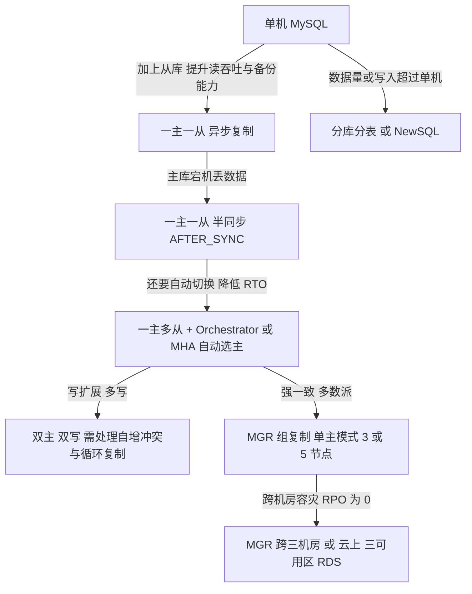

选型结论：**绝大多数业务用"一主两从 + 半同步 + Orchestrator/云 RDS 高可用版"就够了**；MGR 只在需要自动选主且能接受写性能下降（多数派确认）时使用；分库分表是在单机写入打满、单表行数过亿之后才考虑的方案。

## 二、binlog 与主从复制原理

### 2.1 binlog 的三种格式与选择

| 格式 | 记录内容 | 优点 | 缺点 | 适用 |
| --- | --- | --- | --- | --- |
| `STATEMENT` | SQL 原文 | 日志量小 | `NOW()`、`UUID()`、`RAND()`、`LIMIT` 无 ORDER BY 等不确定语句导致主从不一致 | 几乎不用 |
| `ROW` | 每行变更的前后镜像 | 确定性强，主从一致 | 日志量大（一条 update 改 10 万行就写 10 万行） | 默认，生产必须 |
| `MIXED` | 自动在两者间切换 | 折中 | 行为不透明，排查困难 | 遗留系统 |

MySQL 5.7.7 起 `binlog_format` 默认 `ROW`。用 ROW 格式的两个衍生参数要知道：

- `binlog_row_image=FULL`（默认）：更新时记录所有列的新旧值；
- `binlog_row_image=MINIMAL`：只记录主键与被改列，日志量小，但 Canal/Maxwell 这类基于 ROW binlog 的 CDC 工具拿不到完整行，会踩坑。

ROW 格式下 `binlog_rows_query_log_events=ON` 可以把原始 SQL 也写进 binlog（只作调试，不影响回放），排查"这条 binlog 是哪条 SQL 写的"时有用。

### 2.2 复制链路的三个线程与两类日志

MySQL 复制是**拉模型**：主库不推送，从库主动连过去拉。

- **主库 `Binlog Dump` 线程**：每个从库连接对应一个。从库 IO 线程发 `COM_BINLOG_DUMP`（或 GTID 模式下 `COM_BINLOG_DUMP_GTID`），dump 线程从指定位置读 binlog 发给从库。`SHOW PROCESSLIST` 里看到 `Command=Binlog Dump`、`State=Master has sent all binlog to slave; waiting for more updates`（8.0.22 后文案是 `Source has sent all binlog to replica`）。
- **从库 IO 线程**：连接主库、接收 binlog event、写入 **relay log**，并更新 `mysql.slave_master_info` 里的位点。
- **从库 SQL 线程**：读 relay log，解析成 event 后在从库重放，更新 `mysql.slave_relay_log_info`。

5.7 与 8.0 的一个重要差异：**5.7 的复制元数据仓库默认是文件**（`master.info`、`relay-log.info`，由 `relay_log_info_repository=FILE` 控制），**8.0 一律使用 InnoDB 表**（`mysql.slave_master_info`、`mysql.slave_relay_log_info`），位点更新与事务提交在同一个本地事务里，天然 crash-safe。5.7 要用 FILE 仓库时，必须靠 `sync_master_info=10000`、`sync_relay_log=10000`、`sync_relay_log_info=10000`（默认值就是 10000）来降低丢失概率——这也是 5.7 从库异常重启后出现"位点回退、重复执行"的根因。

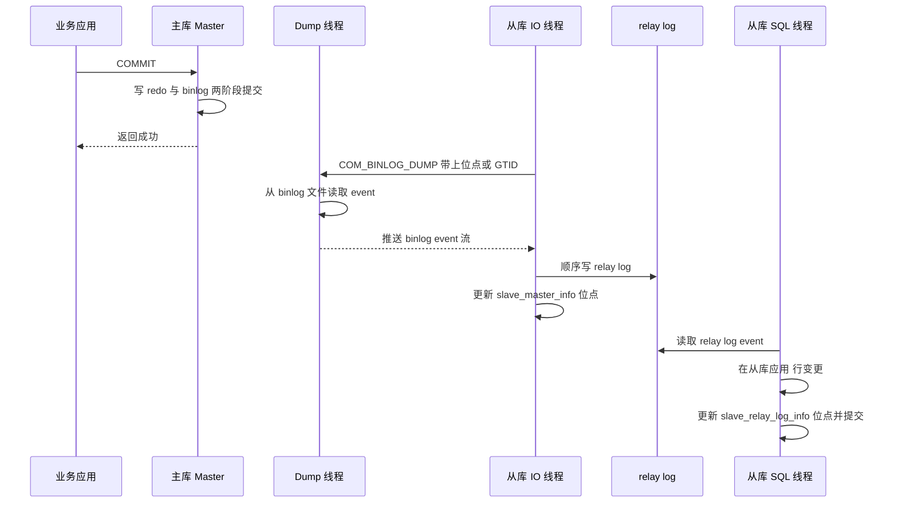

### 2.3 半同步复制之前的"落后窗口"在哪

从上面时序图可以看出，从库落后主库的时间 = `主库提交到 dump 发送` + `网络传输` + `IO 线程写 relay log` + `SQL 线程回放`。异步复制下，主库在返回 `App` 成功时**完全不知道从库收没收到**。这就是 RPO 不为 0 的来源。

主库 binlog 落盘时机由 `sync_binlog` 控制：`sync_binlog=1` 表示每次提交都 fsync binlog 到磁盘；`sync_binlog=0` 表示交给 OS 刷盘，性能高但 OS 崩溃会丢。`sync_binlog=N` 表示累积 N 个事务才 fsync 一次。生产建议 `sync_binlog=1` + `innodb_flush_log_at_trx_commit=1`。

### 2.4 relay log 的清理与 relay_log_recovery

- `relay_log_purge=ON`（默认）：SQL 线程执行完的 relay log 自动删除。
- `relay_log_recovery=ON`：从库崩溃重启时，丢弃本地所有未执行的 relay log，重新从主库拉。**开了半同步或对一致性要求高的场景必须设为 ON**，否则从库可能在"已经把部分事务写进 relay log 但还没提交"的状态下重启，导致重复执行或数据错乱。

## 三、复制模式：异步、半同步与组复制

### 3.1 三种模式的本质区别是"提交的确认条件"

| 模式 | 主库何时返回成功 | RPO | 写延迟 | 是否需要额外组件 |
| --- | --- | --- | --- | --- |
| 异步（默认） | 本地事务提交后立即返回 | 不为 0 | 最低 | 无 |
| 半同步 | 至少 N 个从库 ACK 收到 binlog 后返回 | 0（AFTER_SYNC） | +1 个 RTT | 主从都要装插件 |
| 组复制 MGR | 多数派节点认证并写入 relay log 后返回 | 0 | 明显上升（Paxos 多数派） | 需要插件与额外端口 |

### 3.2 半同步复制的两个等待点：AFTER_COMMIT 与 AFTER_SYNC

半同步复制在 MySQL 5.7 由 `rpl_semi_sync_master` / `rpl_semi_sync_slave` 插件提供，8.0.26 起插件名与参数改为 `rpl_semi_sync_source` / `rpl_semi_sync_replica` 系列（`rpl_semi_sync_source_timeout` 等）。两个核心参数：

- `rpl_semi_sync_master_enabled=ON`（8.0.26 起 `rpl_semi_sync_source_enabled`）
- `rpl_semi_sync_master_timeout=10000`：单位毫秒，默认 **10000ms = 10s**。等待超时后**自动降级为异步复制**，这是半同步最容易造成"数据悄悄丢"的地方。

等待点由 `rpl_semi_sync_master_wait_point` 决定，5.7.2 起默认 `AFTER_SYNC`：

| 等待点 | 主库流程 | 问题 |
| --- | --- | --- |
| `AFTER_COMMIT`（5.6 行为） | 提交 → 等 ACK → 返回客户端 | 其它会话此时已能看到该事务并读到，若主库崩溃且从库未收到，会出现"幻读式丢数据" |
| `AFTER_SYNC`（5.7+ 默认） | 写 binlog 并 fsync → 等 ACK → 存储引擎提交 → 返回客户端 | 等待期间其它会话看不到该事务，主从切换无数据不一致 |

所以 `AFTER_SYNC` 被称为"无损半同步（lossless semi-sync）"。真正的无损还需要 `rpl_semi_sync_master_wait_for_slave_count`（等待几个从库 ACK，默认 1）与 `rpl_semi_sync_master_wait_no_slave`（默认 ON，即使从库掉线也继续等，直到 timeout）。

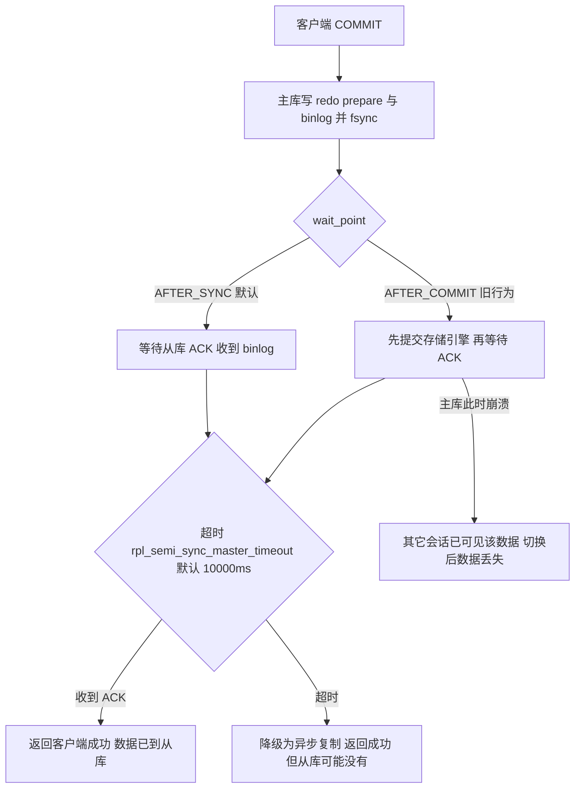

**面试要点**：半同步不是"多数派"，默认只需 1 个从库 ACK 就返回；超时会静默降级；`AFTER_SYNC` 才真正解决主从切换丢数据。生产上必须给 `rpl_semi_sync_master_status`（8.0.26 起 `rpl_semi_sync_source_status`）做监控，值变为 `OFF` 就说明已在异步模式。

**生产现象**：从库宕机或网络抖动时，主库的写请求会被阻塞最长一个 `rpl_semi_sync_master_timeout`（默认 10s）才降级返回，业务侧表现为写 RT 出现 10 秒级尖刺、连接池被迅速打满——这是半同步最常见的线上故障形态。所以生产上通常把 timeout 调小（如 1000ms），宁可更快降级到异步，也不要把写请求拖住 10 秒。

### 3.3 组复制 MGR

MGR（MySQL Group Replication）5.7.17 起 GA，基于 Paxos 变种（XCom）实现。要点：

- 默认单主模式（`group_replication_single_primary_mode=ON`），另有 `group_replication_enforce_update_everywhere_checks` 支持多主。
- 成员数建议 **3 或 5**（奇数，容忍 (N-1)/2 个故障）；官方建议单组不超过 9 个成员。
- 认证阶段（Certification）做**写写冲突检测**：两个节点并发改同一行，后认证的会被回滚并报 `ERROR 3101`。这是 MGR 与异步复制最本质的区别——异步复制没有冲突检测。
- `group_replication_consistency` 控制读一致性级别：`EVENTUAL`（默认）、`BEFORE_ONLINE`、`BEFORE_COMMIT`、`AFTER`、`BEFORE_AND_AFTER`。默认 `EVENTUAL` 意味着**MGR 的读也不保证读到最新**。
- MGR 要求 `binlog_format=ROW`、`log_replica_updates=ON`、`gtid_mode=ON`、`enforce_gtid_consistency=ON`、`binlog_checksum=NONE`、表必须有主键或非空唯一键。
- 流控（Flow Control）由 `group_replication_flow_control_mode` 控制：**MySQL 8.0 默认 `AUTO`**（基于成员队列自动调整），5.7 默认是 `QUOTA`（按 `group_replication_flow_control_applier_threshold` 与 `group_replication_flow_control_certifier_threshold` 两个阈值，5.7 默认 25000）。慢节点会拖慢整个组——这是 MGR 最典型的线上故障模型。

## 四、主从延迟：原因、度量与解决方案

### 4.1 延迟的四个来源

| 来源 | 具体表现 | 判断依据 |
| --- | --- | --- |
| 主库写入并发度高于从库单线程回放能力 | SQL 线程 100% 利用仍追不上 | `SHOW PROCESSLIST` 看 SQL 线程一直 `executing`；`SHOW REPLICA STATUS` 的 `Seconds_Behind_Master` 持续增长 |
| 大事务 | 一个事务回放 30 秒，期间 `relay_log` 堆积 | binlog 里有超大事务，`SHOW BINLOG EVENTS` 单个 event 巨大 |
| DDL 与锁 | 从库上执行 `ALTER TABLE` 阻塞 SQL 线程 | 从库有长查询阻塞回放 |
| 网络与 IO 线程 | IO 线程落后，relay log 拉不过来 | 主库 `SHOW MASTER STATUS` 的 `File`/`Position` 与从库 `Master_Log_File`/`Read_Master_Log_Pos` 差距大，而 `Relay_Master_Log_File`/`Exec_Master_Log_Pos` 已与后者一致（说明 relay log 已回放完） |

### 4.2 `Seconds_Behind_Master` 是个坑，别信它

`Seconds_Behind_Master`（SBM）的计算方式：SQL 线程当前执行 event 的时间戳与从库当前时间的差。三种情况它都会失真：

1. **IO 线程延迟时 SBM 可能显示 0**：SBM 只衡量 SQL 线程在已收到 relay log 内的进度，relay log 一被消费完它就报 0，根本不知道主库还有多少没传过来，此时从库可能落后主库很多。判断真实落后量，要拿主库 `SHOW MASTER STATUS` 的 `File`/`Position` 与从库的 `Master_Log_File`/`Read_Master_Log_Pos` 比；只有判断 SQL 线程自身是否落后，才比 `Master_Log_File`/`Read_Master_Log_Pos` 与 `Relay_Master_Log_File`/`Exec_Master_Log_Pos`。
2. **SQL 线程停止时 SBM 为 NULL**（IO 线程停止同样为 NULL）。
3. **主库长时间空写**：SBM 无参考意义。

工业级做法是 **`pt-heartbeat`**（Percona Toolkit）：在主库上每 `--interval`（默认 1s）更新一张心跳表的 `ts` 字段为 `NOW(6)`，从库上读该表与当前时间比对，得到真实的复制延迟秒数。命令示例：

```bash
# 主库上更新心跳
pt-heartbeat --update --interval=1 --host=master --database=percona \
  --table=heartbeat --create-table --daemonize

# 从库上监控延迟
pt-heartbeat --monitor --host=slave --database=percona --table=heartbeat
```

MySQL 8.0 还可以用 `performance_schema.replication_applier_status_by_worker` 看每个 worker 的最后应用事务时间与 `WAIT_FOR_COMMIT` 状态，用 `performance_schema.replication_group_member_stats` 看 MGR 的 flow control。

### 4.3 并行复制：从按库到按组提交到 WRITESET

从库单 SQL 线程是延迟的根本原因。MySQL 的并行复制演进：

| 版本 | 方案 | 并行依据 | 并行度上限 |
| --- | --- | --- | --- |
| 5.6 | 按库并行（schema-based） | 不同 database 的事务可并行 | 库数量少时几乎无效 |
| 5.7 | `replica_parallel_type=LOGICAL_CLOCK` | 主库**同一组提交（group commit）内**的事务可并行回放 | 取决于主库组提交并发度 |
| 5.7.22+ / 8.0 | `binlog_transaction_dependency_tracking=WRITESET` | 通过行级**写集合（writeset）哈希**判断事务之间是否冲突，无交集即可并行 | 显著高于 LOGICAL_CLOCK |

关键参数：

- `replica_parallel_workers`（旧名 `slave_parallel_workers`）：默认 **0**（即关闭并行，只有一个 SQL 线程），最大 1024。生产常设 4~16。
- `replica_parallel_type`：默认 `DATABASE`，要开逻辑时钟并行必须显式设为 `LOGICAL_CLOCK`（8.0 中 MGR 成员由系统自动管理）。
- `binlog_transaction_dependency_tracking`：默认 `COMMIT_ORDER`，可选 `WRITESET`、`WRITESET_SESSION`。
- `replica_preserve_commit_order`（旧名 `slave_preserve_commit_order`）：默认 OFF。开启后并行回放仍保持与主库一致的提交顺序，**主从切换时才能按位点安全切换**；MGR 强制要求 ON。
- `transaction_write_set_extraction`（默认 `XXHASH64`）：控制 writeset 的哈希算法，`WRITESET` 依赖它。
- `replica_checkpoint_group`（默认 512）、`replica_checkpoint_period`（默认 300ms）：控制位点持久化粒度。

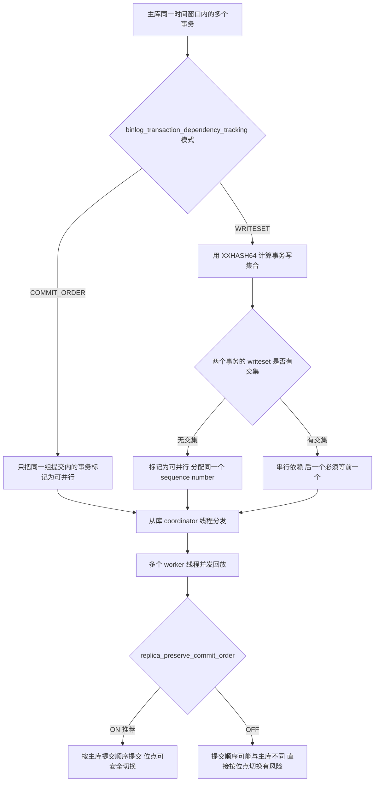

**面试要点**：并行复制的前提是"主库自己并发度高"。如果主库是单线程串行写（比如全表更新、大批量导入），从库再多的 worker 也没用。另外 `WRITESET` 对大事务会有限制，`binlog_transaction_dependency_history_size`（默认 25000）控制历史 writeset 保留条数。

### 4.4 业务层的延迟兜底方案

并行复制把延迟从"分钟级"降到"毫秒到秒级"，但**不消灭延迟**。业务层必须兜底：

| 方案 | 做法 | 代价 |
| --- | --- | --- |
| 读己之写（read-your-writes） | 用户自己刚写的请求强制走主库一段窗口（如 1s）或按用户 ID sticky | 主库压力上升，需要路由框架支持 |
| 写后主库读 N 条 | 简单粗暴，写操作后固定时间内该会话走主 | 同上 |
| GTID 位点校验 | 写后把 `gtid_executed` 存到 Cookie，读时如果从库的 `gtid_executed` 不包含 Cookie 则走主库，或执行 `WAIT_FOR_EXECUTED_GTID_SET(gtid_set, timeout)` | 需要在从库上执行函数，多一次等待 |
| 关键读走主库 | 支付、订单详情、库存等强一致读直接路由主库 | 主库读压力增大 |
| ShardingSphere Hint | 用 `HintManager.getInstance().setPrimaryRouteOnly()` 强制当前线程走主库 | 需要改动业务代码，记得 `close()` |

`HintManager.setPrimaryRouteOnly()` 在 ShardingSphere-JDBC 5.x 中生效范围是当前线程，必须在 finally 里 `hintManager.close()`，否则 ThreadLocal 泄漏会污染线程池里的后续请求——这是线上事故的常见原因。

Spring 侧的常见实现是 `AbstractRoutingDataSource` + `@Transactional(readOnly = true)`，用 AOP 根据方法上的注解或 `TransactionSynchronizationManager.isCurrentTransactionReadOnly()` 决定数据源。**注意 `@Transactional(readOnly = true)` 只有在事务代理真正生效时才读得到**，如果 @Transactional 未生效（同类内部调用、private 方法、方法被 `final` 修饰），`isCurrentTransactionReadOnly()` 恒为 false，读请求会全部打到主库，读写分离直接失效。

### 4.5 延迟排查决策树

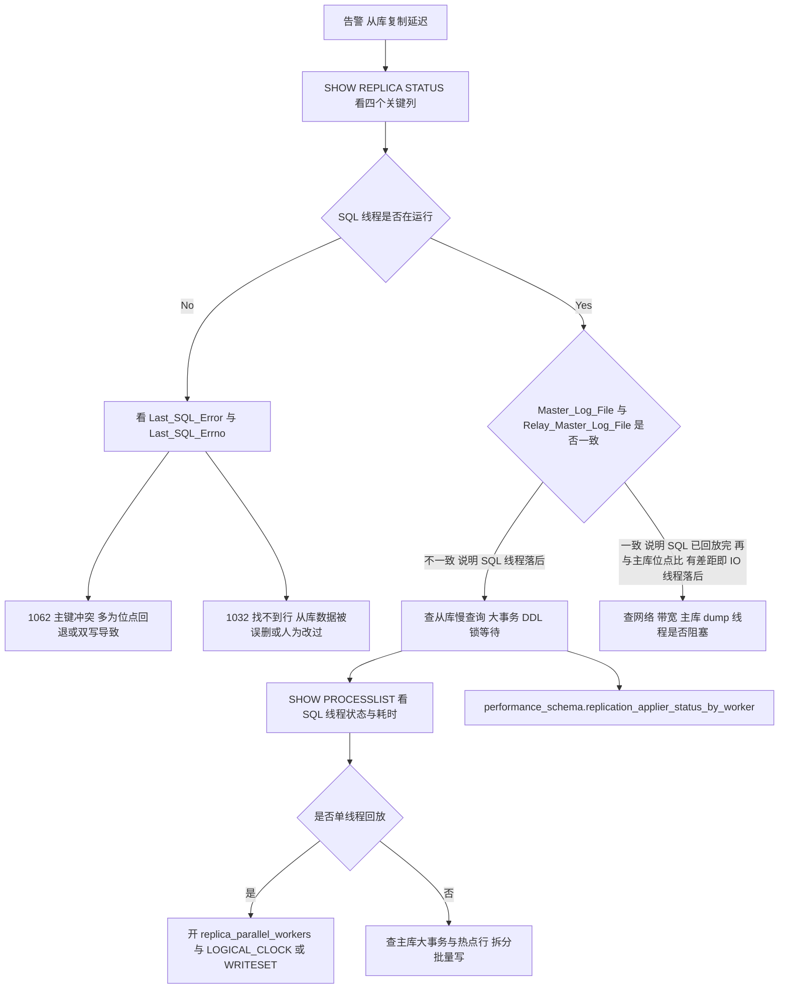

## 五、GTID 与故障切换

### 5.1 GTID 是什么，解决什么

GTID（Global Transaction Identifier）格式固定为 `source_id:transaction_id`，如 `3E11FA47-71CA-11E1-9E33-C80AA9429562:23`。每个事务在提交时被分配一个全局唯一编号，从库记录"已执行过哪些 GTID"。

它解决的是**位点（file + position）定位困难**的问题：异步复制下，主库切换后你无法仅凭 `MASTER_LOG_FILE`/`MASTER_LOG_POS` 知道新主库该从哪个位置接着复制，容易重复或漏。GTID 下用 `MASTER_AUTO_POSITION=1`（8.0.23 起 `SOURCE_AUTO_POSITION=1`），从库自动计算"我有哪些、主库有哪些、差集是什么"，缺什么补什么。

关键系统变量与函数：

| 名称 | 含义 |
| --- | --- |
| `gtid_mode` | 默认 OFF，可选 OFF/`OFF_PERMISSIVE`/`ON_PERMISSIVE`/ON，必须按顺序切换 |
| `enforce_gtid_consistency` | 默认 OFF，开启 GTID 前必须设为 ON/WARN |
| `gtid_executed` | 已执行的 GTID 集合（全局） |
| `gtid_purged` | 已从 binlog 中清除、但已执行的 GTID 集合 |
| `GTID_SUBSET(set1, set2)` | set1 是否为 set2 子集，用于判断从库是否已追上 |
| `GTID_SUBTRACT(set1, set2)` | 差集，判断从库缺什么 |
| `WAIT_FOR_EXECUTED_GTID_SET(gtid_set, timeout)` | 阻塞等待直到从库执行到指定 GTID，实现"写后读一致" |

`WAIT_FOR_EXECUTED_GTID_SET` 是读己之写的优雅解：写事务提交后拿到主库的 `gtid_executed`，读从库前先调用它，超时再回退到主库。代价是每个读可能多等一个复制 RTT。

### 5.2 GTID 下不能用的语句

开启 `enforce_gtid_consistency=ON` 后，以下语句会被拒绝（因为它们无法被分配单一 GTID）：

- `CREATE TABLE ... SELECT`（8.0 已部分支持，但历史上是典型限制）
- 在同一事务里同时更新事务表（InnoDB）与非事务表（MyISAM）
- `CREATE TEMPORARY TABLE` 与 `DROP TEMPORARY TABLE` 在事务内
- 使用 `sql_replica_skip_counter`（GTID 模式下不允许，必须用 `SET GTID_NEXT` 空事务跳过）

GTID 模式下跳过失败事务的标准做法：

```sql
-- 1. 停止回放
STOP REPLICA SQL_THREAD;
-- 2. 查出出错事务的 GTID
SHOW REPLICA STATUS\G   -- 看 Retrieved_Gtid_Set 与 Executed_Gtid_Set 的差集
-- 3. 注入空事务
SET GTID_NEXT='3E11FA47-71CA-11E1-9E33-C80AA9429562:100';
BEGIN; COMMIT;
SET GTID_NEXT='AUTOMATIC';
-- 4. 恢复
START REPLICA SQL_THREAD;
```

### 5.3 故障切换的完整步骤

以 Orchestrator 或云 RDS 高可用版为例，自动切换的判定与执行分为：

1. **探测**：主库失联（连接超时、`SELECT 1` 失败），且多数从库都报失联，排除网络抖动导致的误判。
2. **选主（election）**：在可用从库中按 `Exec_Master_Log_Pos` 最大者优先，并列时看 GTID 集合包含关系、延迟、机房位置。GTID 时代的正确规则是"候选主库的 `gtid_executed` 必须是所有候选的超集"，否则会丢事务。
3. **补齐（recovery）**：把其它从库重新指向新主库，执行 `CHANGE REPLICATION SOURCE TO ... SOURCE_AUTO_POSITION=1`；GTID 会自动补齐差异事务（前提是差异事务的 binlog 还在新主库上）。
4. **切换流量**：更新 VIP / ProxySQL 后端 / MySQL Router 路由表；客户端连接池需要处理"连接被 kill"的错误，并做重连。
5. **旧主处理**：原主库恢复后必须**先以从库身份重新加入**（`RESET REPLICA ALL` 后指向新主库），绝不能直接启动服务对外提供写。这是"脑裂"的唯一防线。

切换过程中"谁的数据最新"这个判断，在 GTID 下用 `GTID_SUBSET` 做，在异步复制无 GTID 时代用的是位点比较，位点比较在多级级联和双主场景下不可靠。

### 5.4 MHA 与 Orchestrator 的差异

| 维度 | MHA（Master High Availability） | Orchestrator |
| --- | --- | --- |
| 语言 | Perl | Go |
| 拓扑感知 | 一般，主要为"一主多从" | 强，支持任意复制拓扑（级联、双主、多主） |
| 自动选主 | 支持 | 支持，且可编排更复杂的拓扑修复 |
| 对 MySQL 8.0 支持 | 官方已基本停更，8.0 兼容性差 | 持续维护，8.0 可用 |
| 与 Proxy 集成 | 依赖 VIP 脚本 | 有 API，可对接 ProxySQL、Consul、Kubernetes |
| 结论 | 5.7 时代的主流方案 | 8.0 时代的主流方案 |

"MySQL 8.0 用什么做高可用"的正确答案：**Orchestrator + ProxySQL（或云托管 RDS），或 MGR，或 MySQL Router 配合 MGR**。答 MHA 会被追问"8.0 上 MHA 还能用吗"。

## 六、主从一致性陷阱：级联复制与双主

### 6.1 级联复制

拓扑：`A（主） -> B（中间从库，开启 log_replica_updates=ON） -> C（叶子从库）`。

- **好处**：A 上只需要维护一个 dump 线程（对应 B），减少主库网络与 CPU 开销；跨机房时只拉一条链路。
- **坏处**：延迟叠加。C 的延迟 ≈ B 回放延迟 + B 到 C 的传输与回放延迟。
- **必要条件**：B 必须开 `log_replica_updates=ON`（8.0 默认已是 ON），否则 C 拿不到数据。
- **一致性风险**：C 上看到的数据依赖 B，B 一旦损坏或延迟抖动，C 无法察觉。监控必须按链路分层做（A→B、B→C 各自的心跳表）。

### 6.2 双主（双写）为什么容易出事

双主常见于"两地双写"或"平滑切换"。它有三个必须处理的问题：

1. **自增冲突**：两个主库都用 `AUTO_INCREMENT` 会插入相同值导致主键冲突。解决靠 `auto_increment_increment`（默认 1）与 `auto_increment_offset`（默认 1）：两主分别设 `increment=2, offset=1` 和 `increment=2, offset=2`。但这对分库分表场景不适用，最终还是要外部发号器。
2. **循环复制**：A 的变更同步到 B，B 又把该变更写进自己的 binlog 并回传给 A。MySQL 靠 binlog event 里的 `server_id` 过滤：SQL 线程发现 event 的 `server_id` 等于本机 `server_id` 就跳过。**所以两主必须配置不同的 `server_id`**，且不能用 0。
3. **写写冲突**：两个主库同时改同一行，后同步过来的那个会覆盖先前的（ROW 格式下按行覆盖）。异步/半同步复制**没有冲突检测**，数据会静默不一致。只有 MGR 的认证阶段会拒绝冲突事务。

结论：**双主只适合"一主一备，备库平时不写"的形态**；真正的双写必须靠业务层拆分流量（按用户 ID 分片写入不同主库）来规避冲突。

### 6.3 一致性校验工具

| 工具 | 作用 | 原理 |
| --- | --- | --- |
| `pt-table-checksum` | 主从数据一致性校验 | 在主库分块计算 `BIT_XOR(CAST(CRC32(CONCAT_WS(...)) AS UNSIGNED))`，结果写 `percona.checksums` 表，通过复制传播到从库后比对 |
| `pt-table-sync` | 修复差异 | 依据 checksum 结果生成反向 SQL，需 `--print` 先看再 `--execute` |
| `pt-heartbeat` | 复制延迟度量 | 心跳表 |
| `pt-slave-delay` | 故意制造延迟 | 用于"从库延迟 N 秒"做误删数据恢复窗口 |

`pt-table-checksum` 的注意事项：默认会对大表加锁或产生高负载，要用 `--chunk-size`、`--max-load`、`--set-vars`（如 `innodb_lock_wait_timeout=1`）限制影响；从库不是主库的下级（比如已经切换过）时会算出假差异。

MySQL 自带的**延迟复制**比 `pt-slave-delay` 更省事：`CHANGE REPLICATION SOURCE TO SOURCE_DELAY=N`（8.0.23 之前的写法是 `MASTER_DELAY`，单位秒），从库会稳定落后主库至少 N 秒。典型做法是专门留一个延迟 1 小时的从库，误删或 `DROP TABLE` 之后还有窗口期把数据捞回来。

## 七、分库分表的时机与拆分维度

### 7.1 什么时候才该分

分库分表是**有明确代价的最后手段**。判断顺序应该是：

1. **先优化**：加索引、去掉全表扫描、消灭 N+1 查询、加缓存（Redis）、加读写分离、归档冷数据。这些能解决 80% 的"数据库慢"。
2. <strong>再看单表容量</strong>：InnoDB B+ 树三层大约能装多少行？非叶子节点每页存约 1000 个指针（16KB 页 / 约 14 字节的"主键 + 页号"），三层即约 10^6 个叶子页；叶子页能装多少行取决于行宽。行宽 1KB 时每页约 15 行，合计约 1500 万行；行宽 200 字节时每页约 80 行，合计约 8000 万行。所以<strong>"2000 万行"不是魔法数字，而是"行宽 1KB、主键 bigint"下的经验分界线</strong>。
3. **再看写入能力**：单机 MySQL 写入（`sync_binlog=1` + `innodb_flush_log_at_trx_commit=1`）在普通 SSD 上大约几千 TPS，NVMe 上能到上万，但加上索引维护与从库放大后，稳定值通常在 **几千 TPS**。当写入持续超过这个数值，才考虑分库。
4. **能用 NewSQL 就别手写分片**：TiDB、OceanBase、PolarDB-X 对业务透明，代价是运维体系与延迟特性变化。

### 7.2 拆分的四个维度

| 维度 | 含义 | 例子 | 代价 |
| --- | --- | --- | --- |
| 垂直分库 | 按业务域拆到不同库/实例 | 用户库、订单库、商品库 | 跨域 JOIN 与事务消失 |
| 垂直分表 | 把宽表按冷热/大小字段拆开 | `user_base` + `user_ext`（大 text 字段） | 查询要 JOIN，或冗余 |
| 水平分库 | 同一张表的数据按分片键分散到多个实例 | `order_0..order_3` 分布在 4 个实例 | 路由、跨库聚合、扩容 |
| 水平分表 | 同一实例内按分片键拆成多张表 | `order_0..order_63` 在一个实例 | 单实例写入瓶颈仍在 |

工程上常组合使用：**先垂直分库，再水平分表，最后水平分库**。只做水平分表不分库，解决的是单表大小问题，解决不了单实例 IO/CPU 瓶颈。

### 7.3 拆分的执行顺序与回滚预案

正确顺序是"先做能回滚的，再做不能回滚的"：

1. 加缓存、加索引、读写分离（可回滚）。
2. 垂直拆表（字段拆开，双写过渡，可回滚）。
3. 垂直拆库（按域拆实例，跨域用服务化替代 JOIN，可回滚但成本高）。
4. 水平拆分（数据迁移 + 路由改造，**基本不可回滚**）。

第 4 步必须提前准备好：新旧表双写、数据迁移工具、一致性校验、灰度切流、老表保留期限与回滚开关。

## 八、分片键选择与路由实现

### 8.1 分片键的五个评判标准

一个好的分片键必须同时满足：

1. **高基数**：取值足够分散，避免数据倾斜。用 `status`（只有几个值）做分片键是最典型的错误。
2. **分布均匀**：热点不能集中在少数分片。用 `user_id` 分片时，大 V 用户会造成热点；用 `order_id` 分片时，自增 ID 会让新数据全落到最后一个分片（写热点），所以要么用"雪花 ID + 取模"，要么用"order_id 的后 N 位"。
3. **能覆盖绝大多数查询**：80% 以上的高频查询能带上这个键，否则每次都要广播到所有分片。
4. **不可变**：分片键一旦确定，更新它意味着跨分片搬迁数据。所以**分片键必须选不会变更的字段**。
5. **路由可计算**：能纯函数式地从值算出分片，不依赖额外查询。

### 8.2 常见拆分策略对比

| 策略 | 路由方式 | 优点 | 缺点 | 适用 |
| --- | --- | --- | --- | --- |
| 范围（Range） | 按 ID 或时间区间 | 范围查询高效、扩容简单（加一个新区间） | 容易热点，最新的区间总是被打爆 | 日志、账单、历史流水 |
| 哈希取模（Hash Mod） | `hash(key) % N` | 分布均匀 | **扩容时要重新分布几乎全部数据** | 分片数固定的场景 |
| 一致性哈希 | 哈希环 + 虚拟节点 | 扩容只迁移 1/N | 需要额外元数据，实现复杂 | 缓存类、弹性伸缩 |
| 时间 + 哈希 | 先按月分，月内哈希 | 冷热分离 + 均匀 | 跨月查询要路由多个分片 | 订单、交易流水 |
| 基因法（Genes） | 把分片键的基因编码进业务 ID | `order_id` 也能直接路由 | 需要改造 ID 生成 | 订单号可按 userId 路由 |

**基因法**是值得展开的实战技巧：订单按 `user_id` 分片，但订单号 `order_id` 也要能直接路由（否则按订单号查要广播）。做法是把 `user_id` 哈希后的低 K 位（如低 4 位，对应 16 个分片）拼进 `order_id` 的低位。这样既保证了"同一用户的订单在同一分片"，又保证了"用 order_id 能直接算分片"。代价是 ID 里混入了分片信息，业务上要接受。

### 8.3 路由的实现层次

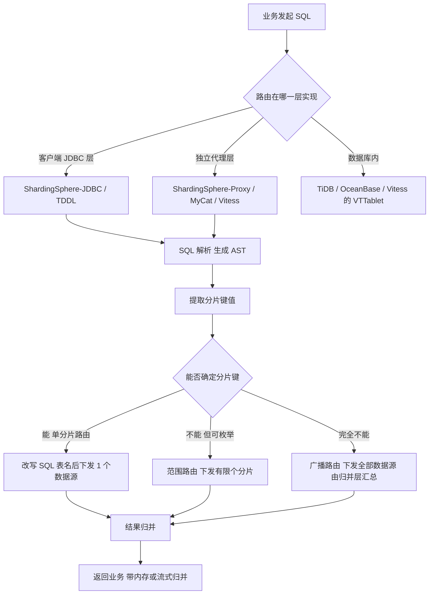

三层实现的关键权衡：

| 层次 | 代表 | 优点 | 缺点 |
| --- | --- | --- | --- |
| 客户端 | ShardingSphere-JDBC | 无中间跳数、性能损耗小（约 5%~15%）、无单点 | 与语言/框架绑定，Java 用得多；升级需要所有应用发布 |
| 代理 | ShardingSphere-Proxy、MyCat、Vitess | 语言无关、统一治理、对业务零侵入 | 多一跳网络、Proxy 需要高可用、SQL 兼容性有边界 |
| 数据库 | TiDB、OceanBase | 业务无感知、弹性扩缩容 | 不是 MySQL 语义的完全实现，运维体系不同 |

### 8.4 分片算法的 ShardingSphere 命名

ShardingSphere 5.x 中分片算法（`ShardingAlgorithm`）分四类：

- `INLINE`（`INLINE` 类型，`algorithm-expression` 写 `order_${order_id % 4}`）：简单取模/范围，配置化，不写代码。
- `STANDARD`（标准分片）：单分片键，自定义 `doSharding`，可支持范围查询 `BETWEEN`。
- `COMPLEX`（复合分片）：多分片键组合。
- `HINT`：不由 SQL 的列决定，而由外部传入的 Hint 值决定（如按租户 ID 强制路由）。

ShardingSphere 5.0 起配置从 4.x 的 `sharding.jdbc.config.sharding.tables.xxx` 迁移到 `rules[].sharding` 结构，4.x 与 5.x 的 YAML 不兼容——这是升级时的实际痛点。

## 九、全局唯一 ID 方案

### 9.1 为什么分库分表后不能用 AUTO_INCREMENT

`AUTO_INCREMENT` 只在单实例内保证唯一。分片后：

- 各分片的 `order_id` 会重复；
- 用 `auto_increment_increment` 错开只适用于少量实例，分片多了不现实；
- 更需要的是"趋势递增"而不是"自增"——因为 B+ 树对**单调递增**友好（只在最右侧页分裂），对**无序**主键极不友好。

### 9.2 五种方案对比

| 方案 | 长度 | 有序性 | 性能 | 依赖 | 主要问题 |
| --- | --- | --- | --- | --- | --- |
| UUID（`UUID.randomUUID()`） | 128 位 / 36 字符 | 完全无序 | 本地生成，极快 | 无 | 主键随机 → 每次插入都可能触发页分裂与随机 IO；占空间；不可读 |
| 数据库自增表 | 64 位 | 严格递增 | 每次一次 DB 写（含事务） | DB | 单点、瓶颈、DB 挂了发号全停 |
| 号段模式（DB/Redis） | 64 位 | 趋势递增 | 本地分配，极高 | DB/Redis | 号段浪费（重启丢弃未用完的号）；DB 短时不可用可容忍（双 buffer） |
| 雪花算法 Snowflake | 64 位（`long`） | 趋势递增（按毫秒） | 本地生成，极高 | 需要 workerId | 时钟回拨；workerId 管理 |
| Redis `INCR`/`INCRBY` | 64 位 | 严格递增 | 高 | Redis | 依赖 Redis 可用性；集群下要用 hash tag 保证同一 slot |

`UUID.randomUUID()` 是 version 4（随机），`UUID.nameUUIDFromBytes` 是 version 3（MD5，确定性）。JDK 没有内置 RFC 9562 的 UUIDv7（时间有序）实现，想要有序 UUID 只能引第三方库或自己拼。另外 Java 的 `UUID#compareTo` 是**有符号 long 比较**，而 `UUID.toString()` 的字典序是无符号位序，两者顺序不一致——同一批 UUID 在 Java 里排序、在 MySQL 里按字符串排序，结果可能不同。

### 9.3 雪花算法的位分配与时钟回拨

Twitter Snowflake 的结构（64 位有符号 long，最高位恒为 0）：

| 段 | 位数 | 含义 | 上限 |
| --- | --- | --- | --- |
| 符号位 | 1 | 恒为 0，保证正数 | — |
| 时间戳 | 41 | 当前毫秒 - 自定义起始纪元 | 约 69 年（2^41 ms ≈ 69.7 年） |
| 数据中心 ID | 5 | `datacenterId` | 32 |
| 机器 ID | 5 | `workerId` | 32 |
| 序列号 | 12 | 同毫秒内自增 | 4096/ms |

单个 worker 的理论上限：4096 × 1000 = **409 万 ID/秒**（同一毫秒最多 4096 个）。Twitter 的起始纪元是 2010-11-04 01:42:54.657 UTC（`1288834974657L`），这个值是 Twitter 项目里写死的，自己实现时必须定义自己的纪元。


时钟回拨（NTP 校时、虚拟机迁移、闰秒处理）的处理策略：

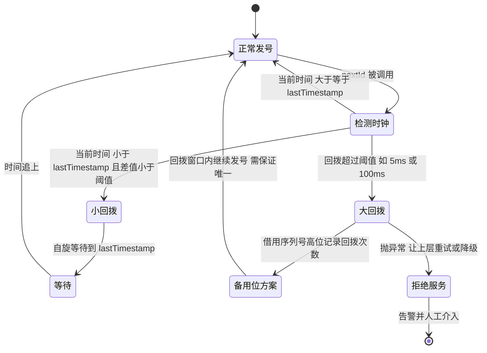

工程上四种做法：

1. **等待**：小回拨（几毫秒）时自旋等待到 `lastTimestamp`。实现最简单，但会阻塞调用线程。
2. **抛异常**：大回拨直接抛，让上层重试或降级到号段模式。安全性最高。
3. **备用位**：把序列号拆出一部分（如高位 2~3 位）记录回拨序号，回拨窗口内用备用位区分，保证不重复。百度 UidGenerator 的 `CachedUidGenerator` 引入了 `RingBuffer` 预生成 ID，用 `boostPower` 等参数控制，并在检测到时钟回拨时用"借用未来时间"的方式处理。
4. **外部协调**：用 Zookeeper 或数据库记录每个 workerId 的最后发号时间，回拨时校验。美团 Leaf-snowflake 的做法是用 Zookeeper 分配 workerId 并周期性上报时间戳，服务启动时校验本机时间是否落后于 ZK 记录的时间。

### 9.4 号段模式（Leaf-segment）的细节

核心表结构：

```sql
CREATE TABLE leaf_alloc (
  biz_tag     VARCHAR(128) NOT NULL DEFAULT '',
  max_id      BIGINT       NOT NULL DEFAULT 1,
  step        INT          NOT NULL,
  description VARCHAR(256) DEFAULT NULL,
  update_time TIMESTAMP    NOT NULL DEFAULT CURRENT_TIMESTAMP ON UPDATE CURRENT_TIMESTAMP,
  PRIMARY KEY (biz_tag)
) ENGINE=InnoDB;
```

流程：应用启动时按 `biz_tag` 取一个号段（`UPDATE leaf_alloc SET max_id = max_id + step WHERE biz_tag = ?`，再 `SELECT max_id`，在同一个事务里），本地内存里用 `AtomicLong` 发号；当下发到 `maxId - step * 0.1`（10% 水位）时，**异步**去取下一个号段（双 buffer），保证取号不阻塞业务。

优点：DB 压力从"每次 ID 一次写"降到"每 step 个 ID 一次写"；step 可配置，常见 1000~100000。缺点：号段浪费（重启丢未用号）、ID 不是严格递增而是段内递增段间跳跃。

### 9.5 Redis 方案的两个坑

- **持久化**：用 `INCR` 时若 Redis 重启且未开 AOF/RDB，计数会回退 → ID 重复。要用 `INCRBY` 配合持久化，或者接受"重启后从上次最大 ID 开始"（用 `SETNX` 初始化 + 定期写回 DB）。
- **集群**：Redis Cluster 下 `INCR` 只作用于单个 key，本身没问题；但如果你用多个 key 分片发号再拼装，需要 `{idgen}` 这样的 hash tag 保证落在同一 slot，否则跨 slot 操作会报 `CROSSSLOT`。

## 十、跨库 JOIN、分页、排序、聚合

### 10.1 跨库 JOIN 的五种解法

| 方案 | 做法 | 适用 | 代价 |
| --- | --- | --- | --- |
| 字段冗余 | 把关联表需要展示的字段冗余进主表 | 关联表变更极少（如商品名、店铺名） | 冗余字段更新要同步 |
| 广播表（小表） | 把字典表/配置表在每个分片都存一份 | 数据量小、变更少 | 变更要写所有分片 |
| 绑定表（ER 分片） | 关联表用同一个分片键且分片数相同，路由到同一分片后再 JOIN | 订单 + 订单明细 | 必须同分片键 |
| 内存归并 | 应用或中间件把两个库的结果拉回来在内存 JOIN | 结果集小（几十到几千行） | 大结果集 OOM、网络放大 |
| 离线宽表 / 搜索引擎 | ETL 到数仓或同步到 ES 提供查询 | 报表、搜索 | 数据有延迟，实时性差 |

ShardingSphere 的 `BindingTable`（绑定表）与 `BroadcastTable`（广播表）就是第 3、2 种方案的框架化实现。注意绑定表的前提是"分片规则完全一致"——`order` 与 `order_item` 都按 `order_id` 分 4 片才行；如果一个是 4 片一个是 8 片，绑定关系失效。

### 10.2 深分页的正确姿势

分片下 `LIMIT 1000000, 20` 会在**每个分片**都返回 1000020 行（因为不知道全局排序下第 100 万行在哪），然后归并，内存与网络都会爆。

三种方案：

1. **改写成下推 + 归并**：把 `LIMIT offset, size` 改写成每个分片 `LIMIT 0, offset + size`，中间件做流式归并，只保留前 `offset + size` 行。ShardingSphere 的归并引擎就是这么做的，内存占用大幅下降，但深分页的**扫描量**依然大。
2. **二次查询法**（业务侧手工实现，适合按有序主键分页）：
   - 第一轮：每个分片执行 `SELECT ... ORDER BY id LIMIT 0, offset+size`，取各分片第 `offset+1` 条记录的 `id`，得到全局候选下界 `minId = min(各分片的第 offset+1 条 id)`。
   - 第二轮：每个分片执行 `SELECT ... WHERE id <= minId ORDER BY id DESC LIMIT size`，补齐第一轮被截掉的数据。
   - 合并两轮结果按 `id` 升序取第 `offset` 到 `offset+size` 条。
3. **游标分页（推荐）**：不让前端传 `page`，而是传上一页最后一条的 `id`（或 `create_time + id` 组合键），SQL 变成 `WHERE id > #{lastId} ORDER BY id LIMIT size`。每个分片只需返回 `size` 行，归并后取前 `size` 行，复杂度从 O(offset) 降到 O(size)。这是唯一在分片下真正可扩展的方案。

### 10.3 排序与聚合的归并行为

| 场景 | 归并方式 | 风险 |
| --- | --- | --- |
| `ORDER BY id LIMIT 20` | 各分片取 20 行做流式归并 | 正确，开销小 |
| `ORDER BY create_time LIMIT 20` | 同上，但 `create_time` 需有索引，否则各分片全表排序 | 各分片产生大排序 |
| `COUNT(*)` | 各分片求和 | `COUNT(DISTINCT)` 不能简单求和，要各分片返回 DISTINCT 值后内存去重 |
| `AVG(x)` | 改写成 `SUM(x)/COUNT(x)` 分别求和后计算 | 不能对 AVG 再求平均 |
| `MAX/MIN` | 各分片取极值再取极值 | 正确 |
| `GROUP BY` | 各分片分组后内存归并同组 | 分组基数大时内存压力大 |
| `HAVING` | 归并后在中间件过滤 | 与 `WHERE` 下推的区别要分清 |
| 多表 `JOIN` 再聚合 | 需要内存归并或流式归并，ShardingSphere 5.x 有 Federation 执行引擎 | 复杂 SQL 性能不可控，建议改写成多次单表查询 |

ShardingSphere 的归并引擎有三类：**流式归并**（`StreamMergedResult`，用于有序结果集，逐条比较）、**内存归并**（`MemoryMergedResult`，用于分组、去重、聚合）、**装饰归并**（`DecoratorMergedResult`，用于分页装饰）。归并方式由路由结果的排序信息决定，写 SQL 时保持 `ORDER BY` 与分片键一致能让归并走流式。

### 10.4 唯一性约束的失效

分库分表后，**跨分片的 `UNIQUE` 约束无法由数据库保证**。比如"手机号全局唯一"：

- 单库时靠 `UNIQUE KEY(phone)`。
- 分片后每个分片只能保证本分片唯一，同一个手机号可能落到两个分片造成重复注册。

工业解有三种：

1. **用唯一键做分片键**（如按 `phone` 哈希分片）：约束变成分片内约束，绝对可靠。代价是其它维度的查询要广播。
2. **独立的唯一性校验表/Redis**：注册前 `SETNX phone:<phone>`，成功才继续。要处理"注册失败但 key 已占"的补偿（设置过期时间或失败后 `DEL`）。
3. **布隆过滤器 + 定期对账**：适合海量、允许极小误判的场景，布隆过滤器只能判断"一定不存在"，存在误判为存在。

## 十一、分库分表下的分布式事务

### 11.1 先问：事务真的跨分片了吗

分片后事务的正确设计原则是<strong>"让事务落在单分片内"</strong>：

- 按 `user_id` 分片时，把"用户 + 用户资产 + 用户订单"都按 `user_id` 分片，则单用户的操作天然是单库事务；
- 只有"跨用户"的操作（转账、库存扣减与订单创建）才真正需要分布式事务。

**90% 的分库分表项目不需要分布式事务**，需要的是重新设计分片键与业务边界。这一句是面试官最想听到的。

### 11.2 四种方案的对比

| 方案 | 一致性 | 侵入性 | 性能 | 适用场景 | 主要缺陷 |
| --- | --- | --- | --- | --- | --- |
| 2PC / XA | 强一致 | 低（数据库层） | 差，prepare 后持锁到 commit | 内部系统、低并发、短事务 | 同步阻塞、协调者单点、`XA RECOVER` 悬挂事务需人工处理 |
| TCC | 最终一致（业务补偿） | 高，要写 Try/Confirm/Cancel 三个接口 | 好 | 资金、库存等核心链路 | 空回滚、悬挂、幂等三座大山 |
| 本地消息表 | 最终一致 | 中 | 好 | 异步、可容忍延迟（发货、通知） | 需要定时任务与对账，消息表本身在业务库 |
| Seata AT | 最终一致（全局隔离级别默认**读未提交**） | 低，加注解即可 | 中（全局锁竞争） | 快速接入的通用场景 | 全局锁、脏写检测失败需人工、跨分片后 RM 数量放大 |
| 事务消息（RocketMQ） | 最终一致 | 低 | 好 | 已有 MQ 的异步链路 | 依赖 MQ 的事务消息能力 |
| 最大努力通知 | 最终一致 | 低 | 最好 | 对账、回调通知 | 不保证成功，必须对账 |

### 11.3 XA 与 2PC 在 MySQL 下的实际情况

MySQL 的 XA 由存储引擎实现，语法是 `XA START 'xid'` / `XA END` / `XA PREPARE` / `XA COMMIT` / `XA ROLLBACK` / `XA RECOVER`。要点：

- 5.7 有 `innodb_support_xa` 参数（默认 ON），8.0 已移除，XA 恒为可用。
- **XA 事务与 binlog 的两阶段提交不是一回事**。前者是跨资源的分布式提交协议，后者是同一实例内 redo 与 binlog 的一致性协议，两者在 InnoDB 内部分别处理。
- prepare 阶段落盘的 XA 事务若协调者崩溃，会一直持有锁，只能靠 `XA RECOVER` 查出后手动 `XA COMMIT`/`XA ROLLBACK`。**这就是"生产事故要人工介入"的来源。**
- MyISAM 等非事务引擎不支持 XA。

### 11.4 TCC 的三个必须处理的问题

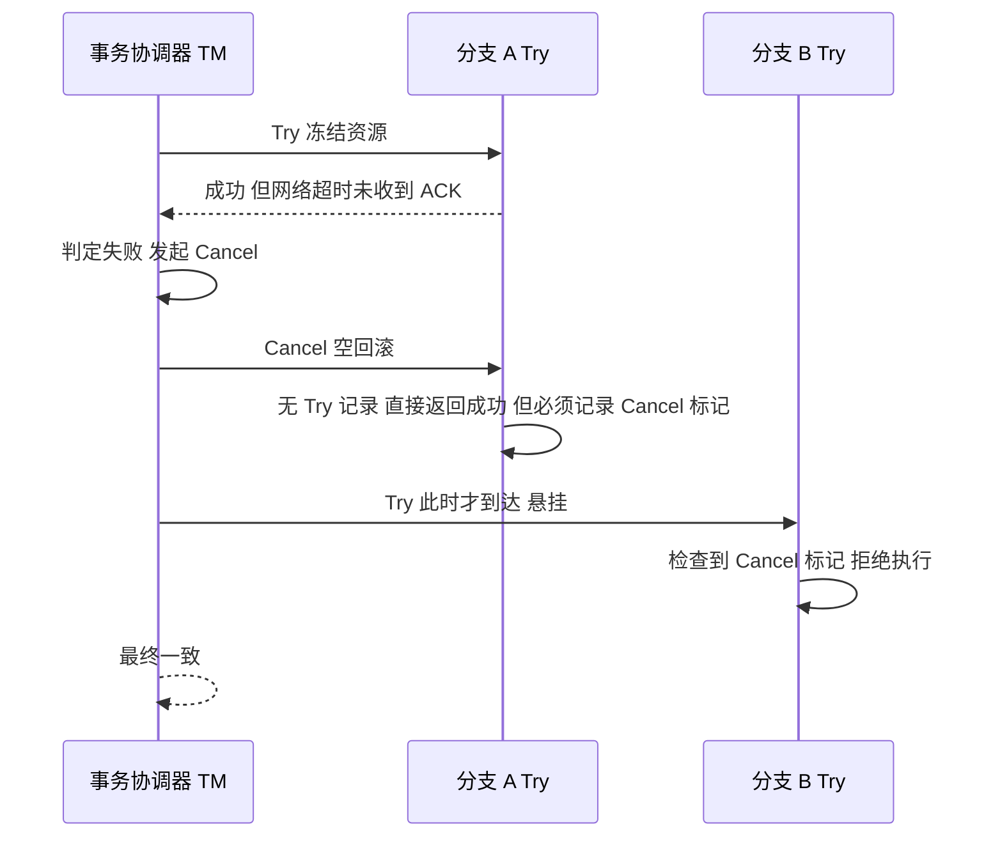

- **空回滚**：Try 未执行（或未收到），Cancel 先到达。处理：Cancel 时若查不到 Try 记录，直接返回成功；但**必须往事务控制表插入一条"已 Cancel"记录**，否则后续到达的 Try 无法识别。
- **悬挂**：Cancel 比 Try 先执行，之后 Try 又到达并真的执行了，导致资源被冻结但永远不会被释放。处理：Try 执行前检查事务控制表，若已存在该全局事务的 Cancel 记录则拒绝执行。
- **幂等**：Cancel/Confirm 可能重复投递，必须靠事务控制表的唯一键（如 `UNIQUE(xid, branch_id)`）实现幂等；Confirm 是"空实现"（直接返回成功）也要求幂等。

事务控制表典型结构：

```sql
CREATE TABLE tcc_transaction (
  xid          VARCHAR(128) NOT NULL,
  branch_id    VARCHAR(128) NOT NULL,
  status       TINYINT      NOT NULL COMMENT '1=TRY 2=CONFIRM 3=CANCEL',
  gmt_create   DATETIME     NOT NULL DEFAULT CURRENT_TIMESTAMP,
  gmt_modified DATETIME     NOT NULL DEFAULT CURRENT_TIMESTAMP ON UPDATE CURRENT_TIMESTAMP,
  PRIMARY KEY (xid, branch_id)
) ENGINE=InnoDB;
```

### 11.5 Seata AT 模式的机制与代价

Seata 的三种角色：TC（`seata-server`，事务协调者）、TM（`@GlobalTransactional` 标注的发起方）、RM（被代理的数据源）。AT 模式的核心：

1. 业务方用 `DataSourceProxy` 包装真实数据源（`@Bean public DataSource dataSource(DataSource druidDataSource) { return new DataSourceProxy(druidDataSource); }`）。
2. 一阶段：拦截 SQL，在执行前查"前镜像"（before image），执行后查"后镜像"（after image），与业务 SQL 一起在**同一个本地事务**里写入 `undo_log` 表，并向 TC 注册分支、申请**全局锁**（`lock_table`）。
3. 二阶段提交：TC 通知各 RM，RM 异步删除对应 `undo_log` 记录，释放全局锁。
4. 二阶段回滚：RM 用 `xid + branch_id` 查出 `undo_log`，用后镜像回滚前镜像生成反向 SQL 执行；执行前会**校验当前数据是否等于后镜像**（防脏写），不一致则抛 `RollbackRetryTimeoutException` 或记录需人工处理。

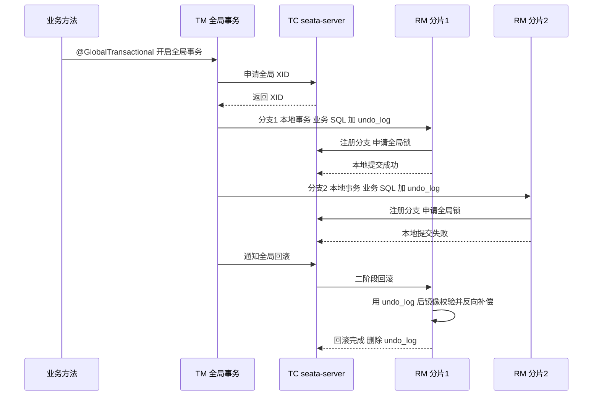

**在分库分表下用 AT 的三个现实问题**：

1. **RM 数量放大**：64 个分片意味着最多 64 个分支事务，每个都要注册、申请全局锁、写 `undo_log`，二阶段协调开销成倍上升。
2. **全局锁竞争**：`lock_table` 是 TC 侧的集中式锁，热点行（如库存）会让全局锁成为新瓶颈，比单库行锁慢一个数量级。
3. **undo_log 表要在每个分片建**：`undo_log` 需要按分片建表，且 ShardingSphere 的 `shardingsphere-transaction-base-seata-at` 支持有限，常需要手工配置。

**结论**：分库分表下优先"把事务收敛到单分片"；确实跨分片时，金融核心链路用 TCC，异步链路用本地消息表/事务消息，AT 只适合"快速接入、并发不高"的场景。

## 十二、在线扩容与数据迁移

### 12.1 为什么扩容这么难

哈希取模路由下，分片数从 4 变成 8，`hash % 8` 与 `hash % 4` 只有一半情况结果相同，即**约一半数据要迁移**（如果新旧分片数不是整数倍关系，几乎全部数据都要迁移）。所以：

- **一开始就分够**（如一次分 64 片，先放在 4 个实例上，后续把表搬到新实例即可）。ShardingSphere 支持"逻辑分片数不变、物理数据源增加"，扩容时用 `ShardingSphere-Scaling` 或 `ShardingSphere-Proxy` 的迁移能力搬表，业务 SQL 不用改。
- **用范围/时间分片**，扩容只需新增区间，老数据不动。
- **用一致性哈希**，扩容只迁移 1/N。

### 12.2 双写 + 迁移 + 灰度切流的完整流程

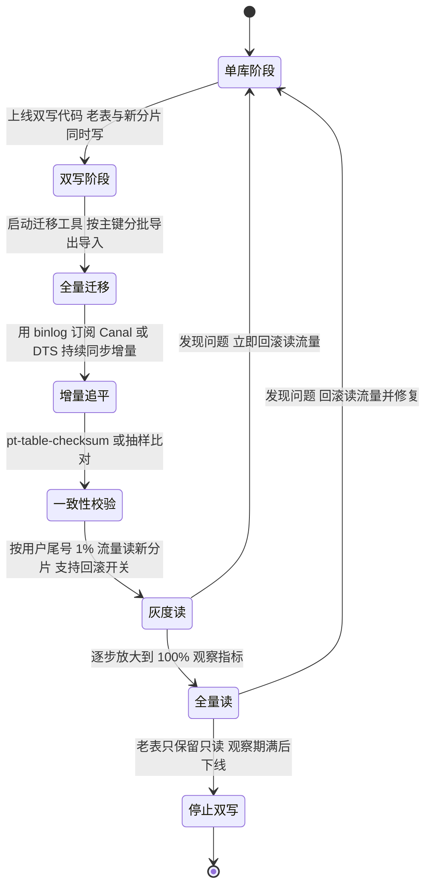

每一步的要点：

1. **双写阶段**：写新表**不能放在同一个本地事务**（跨实例），要在业务事务提交后异步双写，或放在同一事务但接受新表写失败（用重试 + 对账兜底）。双写要幂等（`INSERT ... ON DUPLICATE KEY UPDATE`）。
2. **全量迁移**：用 `SELECT ... WHERE id > ? ORDER BY id LIMIT 1000` 分批游标拉取，不要用 `LIMIT offset, size`。工具侧限流（每秒 QPS、`--max-load`），避免打爆线上。`mysqldump --single-transaction` 适合小表，大表用 `mydumper`/`dumpling` 多线程导出。
3. **增量追平**：用 Canal（解析 binlog，伪装为从库）、Maxwell、Debezium 或云 DTS。要记录迁移开始时的位点（`mysqldump --master-data=2` 会写入 binlog 位点），保证"全量 + 增量"无缝衔接。
4. **一致性校验**：`pt-table-checksum` 分块计算 CRC32，或在应用侧按 `id` 区间比对 `COUNT(*)` 与 `SUM(CRC32(CONCAT_WS(...)))`，差异行再逐条修。
5. **灰度读**：按 `user_id % 100 < N` 的比例路由到新表，N 从 1 逐步放大到 100。**必须有开关，能在秒级把读流量切回老表**。
6. **停止双写**：全量读稳定运行至少 1~2 周（覆盖业务低峰与月末结算），再停双写，老表保留只读一段时间后归档。

### 12.3 迁移期的几个细节陷阱

- **自增主键冲突**：老表还在写入时，新表的自增 ID 可能重复。要么迁移时用显式 ID 写入（`INSERT ... (id, ...) VALUES (...)`），要么新表改用发号器。
- **`updated_at` 与乐观锁**：双写时老表与新表的 `version` 字段必须同步递增，否则乐观锁会失效。
- **软删除数据**：`is_deleted=1` 的行也要迁，否则历史查询会丢。
- **大字段与 binlog**：迁移大 TEXT 行会导致 binlog 暴增，触发主从延迟。分批时控制单批字节数而不只是行数。
- **DDL 与迁移并发**：迁移期间不能对老表做大 DDL，否则锁表阻塞迁移。

## 十三、ShardingSphere 核心概念

### 13.1 概念清单

| 概念 | 英文/类名 | 含义 |
| --- | --- | --- |
| 逻辑表 | LogicTable | SQL 里写的表名，如 `t_order` |
| 真实表 | ActualTable | 物理表名，如 `t_order_0`、`t_order_1` |
| 数据节点 | DataNode | `数据源名.真实表名`，如 `ds0.t_order_0` |
| 分片键 | ShardingColumn | 用于分片的列，如 `order_id` |
| 分片算法 | `ShardingAlgorithm` / `StandardShardingAlgorithm` / `ComplexKeysShardingAlgorithm` / `HintShardingAlgorithm` | 路由计算逻辑 |
| 分片策略 | `ShardingStrategy` | 分片键 + 算法的组合 |
| 强制路由 | `HintManager` | 不走 SQL 解析，直接指定分片或主库 |
| 广播表 | BroadcastTable | 每个数据源都有同一份表的全量数据 |
| 绑定表 | BindingTable | 分片规则一致的多张表，路由后可在同库 JOIN |
| 单表 | SingleTable | 不参与分片、每个库都有但数据不同的表 |
| 分布式主键 | `KeyGenerateAlgorithm` | `SNOWFLAKE`、`UUID`、`LEAF` 等内置实现 |

### 13.2 SQL 执行流程

ShardingSphere 的执行链路是固定的五段：

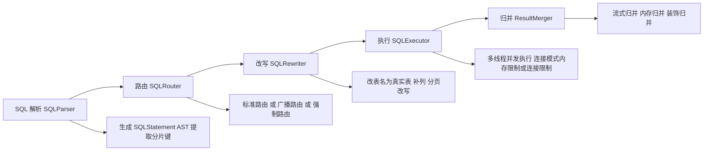

- **解析**：`SQLParserEngine` 把 SQL 变成 AST（5.x 支持 `MySQL`、`PostgreSQL`、`SQLServer`、`Oracle`、`openGauss` 等方言）。
- **路由**：`ShardingRouter` 产出 `RouteUnit` 集合。不能确定分片键时退化为广播路由，**这是最危险的性能场景**。
- **改写**：`SQLRewriter` 把逻辑表名换成真实表名，补 `ORDER BY`/`GROUP BY` 需要的列，把 `LIMIT offset, size` 改写为 `LIMIT 0, offset+size`。
- **执行**：`SQLExecutor` 用线程池并发执行，有 `ConnectionMode.MEMORY_STRICTLY`（限制内存）与 `CONNECTION_STRICTLY` 两种模式。
- **归并**：`ResultMerger` 做流式/内存/装饰归并。

### 13.3 ShardingSphere-JDBC 的接入要点

- Spring Boot 5.x starter：`shardingsphere-jdbc-core-spring-boot-starter`，配置在 `spring.shardingsphere.rules[].sharding` 下，或使用 YAML 文件。
- 分片算法可不写代码：`INLINE` 类型的 `algorithm-expression: t_order_${order_id % 4}`。
- 强制路由：`HintManager hintManager = HintManager.getInstance(); hintManager.addDatabaseShardingValue("t_order", 1); hintManager.setPrimaryRouteOnly();` 必须在 finally 里 `close()`。
- **SQL 兼容性边界**：不支持跨分片的子查询、不支持部分函数的归并、不支持存储过程与部分 DDL。上线前必须做 SQL 兼容性扫描（ShardingSphere 有 `SQLParser` 的测试集）。

## 十四、中间件与架构选型对比

| 方案 | 类型 | 语言/协议 | 分片能力 | 分布式事务 | 弹性扩缩容 | 适用场景 |
| --- | --- | --- | --- | --- | --- | --- |
| ShardingSphere-JDBC 5.x | 客户端库 | Java / JDBC | 强，四种分片算法 | 支持 XA/Seata AT | 需要搬迁 | Java 技术栈、追求低延迟 |
| ShardingSphere-Proxy 5.x | 代理 | 独立进程，MySQL/PG 协议 | 强，与 JDBC 同一内核 | 同 JDBC | 需要搬迁 | 多语言、统一治理 |
| MyCat 1.6 / MyCat2 | 代理 | Java | 中 | 弱 | 需要搬迁 | 遗留系统 |
| DBLE | 代理 | Java（MyCat 分支） | 中 | 支持 XA | 需要搬迁 | 国内存量 |
| Vitess | 代理 + 控制面 | Go，面向 Kubernetes | 强，有 VReplication | 有限 | 原生支持 resharding | 云原生、K8s 环境 |
| TiDB | NewSQL 数据库 | Go + Rust，MySQL 协议 | 自动（Region 分裂） | 原生分布式事务（Percolator） | 自动 | 不想手写分片、需要 HTAP |
| OceanBase | 分布式数据库 | C++，MySQL/Oracle 兼容 | 自动（分区 + Paxos） | 原生 | 自动 | 金融级强一致、高并发 |
| PolarDB-X | 云原生分布式 | 阿里云 | 自动（计算存储分离） | 原生 | 自动 | 云上、电商场景 |
| 原生分库分表 | 直接手写 | 业务代码 | 自定义 | 需自研 | 需自研 | 分片规则极特殊、团队有强运维能力 |

选型结论（可直接背）：

1. **Java 单体架构、想最小改动** → ShardingSphere-JDBC。
2. **多语言、要统一治理、可接受多一跳** → ShardingSphere-Proxy。
3. **团队运维能力弱、不想碰分片规则** → TiDB/OceanBase/PolarDB-X，用钱换复杂度。
4. **K8s 云原生、已有 Vitess 经验** → Vitess。
5. **只在同一个业务域内、数据量没到亿级** → 别分库分表，读写分离 + 归档 + 分区表。

## 十五、分库分表后的运维痛点与回归单库

### 15.1 十个必然会遇到的运维问题

1. **连接数爆炸**：64 个分片 × 每个应用 20 连接 = 1280 个连接，加上从库翻倍。必须限制应用侧连接池（HikariCP `maximumPoolSize`）并做连接复用，代理模式下要在 Proxy 侧限流。
2. **DDL 要在 N 个分片执行**：`ALTER TABLE` 需要在所有分片执行，且要保证进度可追踪、失败可重试。用脚本批量 + `gh-ost`/`pt-online-schema-change` 逐库执行，或用 ShardingSphere 的 `DistSQL`。
3. **慢查询分散**：慢查询日志分散在 N 个实例，需要统一的采集（`pt-query-digest` 汇总、Prometheus + `mysqld_exporter`）。
4. **备份恢复时间线不一致**：各分片备份点不同，恢复后可能数据错乱。MGR/Paxos 类系统有全局一致性快照，普通分片只能靠 GTID 与全量备份策略约束。
5. **唯一性约束失效**（见 10.4）。
6. **跨分片统计不可做**：BI/报表要离线数仓（Canal 到 Kafka 到 Hive/ClickHouse）。
7. **扩容后再也无法简单回滚**：数据分布已变，回滚需要反向迁移。
8. **事务边界被破坏**：原本一个 `@Transactional` 的方法现在跨了多个数据源，`DataSourceTransactionManager` 不再生效，要么引入分布式事务，要么重构成单分片事务。
9. **监控与告警维度爆炸**：从 1 个实例变成 N 个实例，告警规则要集中管理，否则每天几百条告警。
10. **测试环境搭建成本高**：本地起 8 个 MySQL 实例，CI 时间暴涨。可用 `Testcontainers` 或 Docker Compose 编排，或用 H2 做 sharding 逻辑的单测（注意 H2 与 MySQL 的 SQL 语义差异）。

### 15.2 什么时候应该"回归单库"

出现下面任意两条，就该认真评估回退：

| 判断维度 | 回归单库的信号 |
| --- | --- |
| 数据量 | 单表实际只有几百万行，离 B+ 树三层上限还很远 |
| 写入 QPS | 峰值写入低于单机稳定能力（几千 TPS），瓶颈其实在慢 SQL |
| 一致性要求 | 业务需要强一致跨表事务，分布式事务补偿成本高于收益 |
| 团队能力 | 没有专职 DBA、缺少分片中间件排障经验 |
| 运维成本 | 分片带来的运维/开发成本已超过扩容收益（人力占比 > 30%） |
| 有替代方案 | 可用 TiDB/云原生分布式数据库透明承接，或冷热分离 + 归档就够 |
| 查询模式 | 大量的跨分片 JOIN、复杂聚合、模糊查询 |

回归单库的替代手段（按成本从低到高）：

1. 冷热分离：热数据留 MySQL，冷数据归档到历史库/ClickHouse/OSS。
2. 分区表：`PARTITION BY RANGE` 按时间分区，配合定期 `DROP PARTITION` 做归档（注意 InnoDB 分区表在 MySQL 8.0 的行为，分区裁剪才能命中）。
3. 读写分离 + 缓存：把读压力移出主库。
4. 换引擎/换数据库：TiDB（MySQL 协议兼容）、OceanBase。
5. 只对超大表做水平拆分，其余保持单库（**混合架构**：核心大表分片，普通表单库，通过服务层组合）。

## 十六、高级岗三问

### 16.1 为什么这么设计

- **为什么主从复制是拉模型而不是推模型**：从库主动拉，主库不需要维护"每个从库发到哪了"的状态，从库可以随时上下线；代价是延迟不可避免，且主库要维护 N 个 dump 线程。
- **为什么半同步默认只等 1 个从库**：等多数派会把写延迟抬到网络 RTT 的整数倍，多数业务承受不了；等 1 个是在 RPO 与延迟之间的折中。要真正的多数派就该用 MGR。
- **为什么并行复制要按"提交组"或"写集合"而不是按主键**：从库只有 binlog，没有主库的锁信息，唯一能用的依赖信息是主库生成的"这些事务互不冲突"的标记。WRITESET 靠行级哈希判断冲突，精度高于组提交。
- **为什么分片键必须是不可变的**：改分片键等于物理搬迁数据，是一个跨实例的分布式写，成本与风险都不可接受。
- **为什么 ShardingSphere 不自己实现 JOIN**：跨库 JOIN 无法在不知道对方数据分布的情况下做代价估算，强行实现会导致不可控的网络放大，所以只提供绑定表/广播表这类"让 JOIN 落在单分片"的手段。

### 16.2 线上出问题怎么定位

| 现象 | 第一站命令 | 常见根因 |
| --- | --- | --- |
| 从库延迟告警 | `SHOW REPLICA STATUS\G` 看 `Seconds_Behind_Master`、`Master_Log_File/Relay_Master_Log_File`、`Read_Master_Log_Pos/Exec_Master_Log_Pos` | 大事务、主库并发高、SQL 线程单线程、从库慢查询 |
| 延迟显示 0 但读到旧数据 | `pt-heartbeat --monitor` | `Seconds_Behind_Master` 失真 |
| 复制中断 | `SHOW REPLICA STATUS` 的 `Last_SQL_Error`/`Last_SQL_Errno` | 1062 主键冲突、1032 行不存在 |
| 主库切换后数据丢 | 比对 `gtid_executed` | `rpl_semi_sync_master_status=OFF`（已降级异步） |
| 分片查询变慢 | ShardingSphere 的 `SQLParser` 日志与路由日志；打开 SQL 日志看是否广播 | 分片键没带上、`OR` 条件、`!=`/`NOT IN` 导致全路由 |
| 分片内存溢出 | 看归并阶段内存；jstack 看归并线程 | 无 `ORDER BY` 的 `GROUP BY` 走内存归并、深分页 |
| 分片自增主键冲突 | 看 `AUTO_INCREMENT` 与发号器日志 | 未统一用发号器 |
| 写入热点 | `performance_schema.table_io_waits_summary_by_table`；分片流量监控 | 分片键分布倾斜、自增 ID 分片 |

打开 ShardingSphere 的路由日志（logback 里把 `org.apache.shardingsphere` 调到 `DEBUG`）是排查"为什么走了广播路由"最快的手段，能看到解析出的 `ShardingCondition` 与最终 `RouteUnit` 列表。

### 16.3 规模变大后会怎样

| 规模变化 | 失效模式 | 应对 |
| --- | --- | --- |
| QPS 翻 10 倍 | 主库写满、Proxy 成为瓶颈、连接池打满 | 垂直拆分 + 分片键重设计；Proxy 水平扩展与无状态化 |
| 数据量翻 10 倍 | 单分片内单表再次超过阈值 | 二次分片（分片数从 64 扩到 256）或按时间滚动分表 |
| 节点数翻 10 倍 | 全局锁/分布式事务协调成本剧增；监控告警风暴 | 收敛事务到单分片；集中式监控与分级告警 |
| 跨机房 | 复制延迟按 RTT 放大、双写冲突 | 同城双活用 MGR/半同步，异地只做只读 |
| 业务需求变化 | 分片键与新查询模式不匹配 | 双写新分片 + 迁移（回到第 12 章流程） |

## 高频面试题

### Q1. 描述一下 MySQL 主从复制的完整流程，涉及哪几个线程？

**答题框架（30 秒版）**：从库 IO 线程连主库，主库起一个 `Binlog Dump` 线程从指定位点读 binlog 发给它；IO 线程把 event 顺序写进 relay log 并更新 `mysql.slave_master_info`；从库 SQL 线程读 relay log 在从库重放，更新 `mysql.slave_relay_log_info`。8.0 起这两个元数据表都是 InnoDB 表，位点更新与事务提交同事务，天然 crash-safe。

**展开（2 分钟版）**：
1. 主库侧：`SHOW PROCESSLIST` 看到 `Command=Binlog Dump`，每个从库一个线程。GTID 模式下用的是 `COM_BINLOG_DUMP_GTID`。
2. 从库 IO 线程：收到 event 后写 relay log，`sync_relay_log` 默认 10000，即每 10000 次才 fsync 一次 relay log（但 crash-safe 由 `relay_log_recovery=ON` 兜底，重启后丢弃未执行的 relay log 重新拉）。
3. 从库 SQL 线程：单线程是默认行为（`replica_parallel_workers=0`）。
4. 5.7 与 8.0 的差异：5.7 复制元数据默认是文件（`master.info`、`relay-log.info`），8.0 恒为 InnoDB 表。

**追问**：从库异常重启后会不会重复执行事务？答：8.0 靠 `mysql.slave_relay_log_info` 的事务性保证不会；5.7 用 FILE 仓库时有理论风险，需要 `relay_log_recovery=ON` + `sync_relay_log_info` 调小。

### Q2. 半同步复制的 `AFTER_SYNC` 与 `AFTER_COMMIT` 有什么区别？超时会怎样？

**答题框架（30 秒版）**：`AFTER_COMMIT` 是先提交存储引擎再等从库 ACK，等待期间其他会话已能看到该数据，主库此时崩溃且从库没收到就会丢数据。`AFTER_SYNC` 是先等 ACK 再提交存储引擎，期间数据对其他会话不可见，所以叫无损半同步。5.7.2 起默认 `AFTER_SYNC`。超时由 `rpl_semi_sync_master_timeout` 控制，默认 10000ms，超时后**自动降级为异步复制**。

**展开（2 分钟版）**：
1. 无损的前提还有 `rpl_semi_sync_master_wait_for_slave_count`（默认 1）与 `rpl_semi_sync_master_wait_no_slave`（默认 ON）。
2. 降级后监控 `rpl_semi_sync_master_status` 会变成 OFF，必须告警，否则"以为有半同步，其实早就异步了"。
3. 8.0.26 起插件与变量改名为 `rpl_semi_sync_source_*`。

**追问**：半同步能解决主从延迟吗？答：不能。半同步保证"binlog 到了从库的 relay log"，业务层读到的从库可能还没回放完。

### Q3. 主从延迟怎么排查和优化？

**答题框架（30 秒版）**：先看 `SHOW REPLICA STATUS` 的四个位点列，区分是 IO 线程落后还是 SQL 线程落后；延迟度量别信 `Seconds_Behind_Master`，用 `pt-heartbeat`。优化分四层：并行复制（`replica_parallel_workers` + `LOGICAL_CLOCK`/`WRITESET`）、拆大事务、从库减少额外开销（关 `log_replica_updates`、`innodb_flush_log_at_trx_commit=2`）、业务层读己之写兜底。

**展开（2 分钟版）**：
1. 判断依据：`Master_Log_File`/`Read_Master_Log_Pos`（IO 线程已拉到哪）与 `Relay_Master_Log_File`/`Exec_Master_Log_Pos`（SQL 线程已回放到哪）差距大说明 SQL 线程慢；两者一致但与主库 `SHOW MASTER STATUS` 的 `File`/`Position` 有差距说明 IO 线程慢。
2. WRITESET 需要 `binlog_transaction_dependency_tracking=WRITESET` + `transaction_write_set_extraction=XXHASH64`（默认）配合，主库设置，从库受益。
3. `replica_preserve_commit_order=ON` 保证主从切换安全，MGR 强制要求。
4. 业务层：`HintManager.setPrimaryRouteOnly()`、`WAIT_FOR_EXECUTED_GTID_SET`、用户维度 sticky。

**追问**：`Seconds_Behind_Master=0` 一定表示从库是最新的吗？答：不是。IO 线程延迟时它可能仍为 0。

### Q4. GTID 解决了什么问题？开启 GTID 有哪些限制？

**答题框架（30 秒版）**：GTID 给每个事务一个全局唯一编号 `uuid:seq`，让从库能自动算出与主库的差集（`SOURCE_AUTO_POSITION=1`），解决了基于 file+position 的位点在主库切换后无法准确定位的难题。限制：必须 `enforce_gtid_consistency=ON`，禁止 `CREATE TABLE ... SELECT`、事务内混用事务表与非事务表、事务内建临时表；GTID 模式下不能用 `sql_replica_skip_counter`，要用 `SET GTID_NEXT` 注入空事务跳过。

**追问**：怎么判断一个从库能不能安全提升为主库？答：候选主库的 `gtid_executed` 必须是其它候选的超集，用 `GTID_SUBSET(candidate, others)` 判断。

### Q5. 双主复制为什么会死循环？自增主键怎么办？

**答题框架（30 秒版）**：A→B 同步后 B 会把变更写进自己的 binlog 并通过 B→A 回传，A 又会回传给 B。MySQL 用 binlog event 里的 `server_id` 过滤，SQL 线程遇到 `server_id` 等于自己的 event 就跳过，所以两主必须配不同的 `server_id` 且 `log_replica_updates=ON`。自增冲突靠 `auto_increment_increment` 与 `auto_increment_offset` 错开，如两主分别 `(2,1)` 与 `(2,2)`。

**追问**：双主能解决写扩容吗？答：不能，异步复制没有冲突检测，同一行并发写会静默覆盖。真正的多写要么业务按维度拆分流量，要么上 MGR。

### Q6. 什么情况下该分库分表？怎么判断已经到了临界点？

**答题框架（30 秒版）**：先排除"慢 SQL、缺索引、没缓存、没读写分离、没归档"这些因素。真正的信号有三个：单表行数接近 B+ 树三层容量上限（行宽 1KB 时约 2000 万行）、单机写入持续接近上限、单实例磁盘/连接数成为瓶颈。三个都满足才分，否则优先优化与垂直拆分。

**展开（2 分钟版）**：
1. 给出 B+ 树三层容量的估算方法：非叶子节点每页约 1000 个指针，三层约 10^6 个叶子页，乘以每页行数（16KB / 行宽）。
2. 单机写入的稳定值通常在几千 TPS（双 1 配置下），NVMe 更高但受从库放大与索引维护制约。
3. 如果能接受 NewSQL，优先 TiDB/OceanBase，避免手写分片。

**追问**：只做水平分表不分库能解决问题吗？答：不能解决单实例的 IO/CPU/连接数瓶颈，只解决单表大小问题。

### Q7. 分片键怎么选？如果业务有两种查询维度怎么办？

**答题框架（30 秒版）**：分片键要满足高基数、分布均匀、覆盖多数查询、不可变、路由可计算五条。两种查询维度的标准解法是**基因法**：把分片键哈希值的低 K 位编码进业务 ID 的低 K 位（这样才能用 `order_id % 分片数` 直接路由），使得第二维度也能直接路由。典型例子是订单按 `user_id` 分片，同时把 `user_id` 的低 4 位拼进 `order_id`，这样按 `order_id` 也能算出分片。

**展开（2 分钟版）**：
1. 基因法的代价：ID 结构被改造，需要自定义发号器；基因位数的选择要等于分片数的位数（16 片用 4 位）。
2. 备选方案：用 ES/ClickHouse 承接非分片键维度的查询，MySQL 只做点查。
3. 绝不能做的事：分片键可更新；用低基数列（状态、性别）分片；用会变化的列分片。

**追问**：用自增 ID 做分片键有什么问题？答：写热点集中在最后一个分片，且分片间数据量随时间倾斜。要配合哈希或雪花 ID。

### Q8. 跨分片深分页 `LIMIT 1000000, 20` 怎么优化？

**答题框架（30 秒版）**：分片下每个分片都要返回 1000020 行才能保证全局有序，内存与网络都会爆。三种方案：改写成下推归并（各分片取 `LIMIT 0, offset+size` 后流式归并，ShardingSphere 的做法）、二次查询法（先取各分片第 offset+1 条求全局下界，再回查补齐）、以及最优的游标分页（`WHERE id > lastId LIMIT 20`），复杂度从 O(offset) 降到 O(size)。

**追问**：游标分页有什么限制？答：不能跳页，前端要改成"下一页"式交互；排序键必须唯一（`create_time` 不唯一时要拼上 `id` 组成联合游标）。

### Q9. 【场景设计】一个 4 亿行、写入峰值 8000 TPS 的订单表，如何设计分片方案？

**答题框架（30 秒版）**：先确认优化空间已用尽；按 `user_id` 分 64 片（8 实例 × 8 表），订单号用雪花 ID + 基因法保证按 `order_id` 也能路由；明细表按同一分片键做绑定表；历史订单按时间归档；跨分片统计走 Canal 到数仓；分布式事务收敛到单分片（同用户的订单与明细同片）。

**展开（2 分钟版）**：
1. 分片数为什么取 64：2 的幂便于后续按 2 倍扩；一次分够，后续只搬数据源不改路由规则。
2. 分片键选 `user_id` 而不是 `order_id`：`order_id` 是自增/雪花，写入会集中在最新分片；`user_id` 分布均匀且覆盖"我的订单"这类高频查询。
3. 基因法解决 `order_id` 查询：`order_id` 低位嵌入 `hash(user_id) % 64`。
4. 明细表 `order_item` 与 `order` 绑定（同 `order_id` 同规则），JOIN 落在单分片。
5. 商品、店铺等字典表做成广播表。
6. 分页用游标；报表走离线。
7. 事务：创建订单只在单分片内（用户 + 订单 + 明细同片）；扣减库存跨片，用本地消息表或 TCC。
8. 扩容预案：一开始 64 片放 8 个实例，扩容是把分片从旧实例搬到新实例，路由规则不变。

**追问**：大促期间热点用户（单用户几万订单）怎么办？答：单独为热点用户加二级分片（`user_id + 日期`），或把该用户的读流量引导到缓存/只读副本；极端情况人工限制单用户下单频率。

### Q10. 【场景设计】分库分表后"手机号注册唯一性"怎么保证？

**答题框架（30 秒版）**：分片后数据库无法保证跨分片的唯一约束。三种做法：把手机号作为分片键（约束变成分片内约束，最可靠）；用 Redis `SETNX` 做占位并设置合理过期时间；或者独立的唯一性校验表（在固定分片上，如 `phone % 1` 单表）。同时必须加对账任务，定期扫描 `phone` 重复。

**展开（2 分钟版）**：
1. Redis 方案的坑：`SETNX` 成功后业务失败要 `DEL`；进程崩溃留下的 key 要靠 TTL 兜底，TTL 要大于最长业务耗时。
2. 校验表方案：把手机号作为分片键的单表，`UNIQUE(phone)`，注册前先插入，失败即重复；事务上与用户表不在同一分片，所以需要补偿（用户表写入失败要删校验表记录）。
3. 布隆过滤器只适合"判断不存在"，不能用于强唯一。

**追问**：如果用手机号做分片键，那"按用户 ID 查"怎么办？答：同样用基因法把手机号哈希位嵌入 `user_id`，或对 `user_id` 再建一张冗余的映射表（按 `user_id` 分片）。

### Q11. 【线上排查】凌晨收到告警"从库延迟 3000 秒"，你的排查步骤？

**答题框架（30 秒版）**：第一步 `SHOW REPLICA STATUS\G` 看 IO 线程与 SQL 线程状态、四个位点、`Last_SQL_Error`；第二步区分是 IO 落后还是 SQL 落后；第三步如果是 SQL 落后，看从库 `SHOW PROCESSLIST` 与 `performance_schema.replication_applier_status_by_worker` 定位阻塞；第四步查主库同时段有没有大事务（`SHOW BINLOG EVENTS` 或分析 binlog 大小）；第五步临时止血（从库加索引、杀阻塞查询、必要时接受延迟并让核心业务读主库）。

**展开（2 分钟版）**：
1. 常见根因排序：大事务（批量 update/delete）、DDL、从库缺索引导致回放全表扫描、从库上有长查询持有锁、并行复制关闭。
2. 大事务定位：`SHOW BINARY LOGS` 看单个文件增长速度；用 `mysqlbinlog --base64-output=DECODE-ROWS -v` 分析具体事务；主库 `performance_schema` 找长事务。
3. 止血：从库上 `STOP REPLICA SQL_THREAD` 会影响延迟进一步扩大，慎用；对缺索引的表在从库单独加索引（注意与主库结构差异），或临时把读切主。
4. 长期治理：主库拆分大事务（每批 500~1000 行并 sleep）、开启 WRITESET 并行复制、从库关闭 `log_replica_updates`、半同步只读从库不参与。

**追问**：为什么从库加了索引，主库不加是危险的？答：主从表结构不一致会在主库执行该 SQL 时（比如主库缺索引导致更新慢）以及后续主从切换时出问题，且 `pt-table-checksum` 只比数据不比结构。正确做法是在低峰期用 `gh-ost` 在主库也加。

### Q12. 【线上排查】分片后某个查询突然从毫秒变成几十秒，怎么定位？

**答题框架（30 秒版）**：打开 ShardingSphere 的路由日志（`org.apache.shardingsphere` 调 DEBUG），看这条 SQL 是否从单分片路由退化成了广播路由；常见触发是 `OR`、`NOT IN`、`!=`、`LIKE '%x'`、函数包裹分片键（`WHERE DATE(create_time)=?`）、`UNION`、子查询。其次是看是否走了内存归并（无 `ORDER BY` 的 `GROUP BY`/`COUNT(DISTINCT)`）导致大结果集。

**展开（2 分钟版）**：
1. 分片键被函数包裹是最高频的原因：`WHERE order_id + 0 = 123` 无法提取分片值。
2. 跨分片 `ORDER BY` 非索引列时，各分片要全表排序。
3. 深分页。
4. 定位工具：ShardingSphere 的 `SQLParser` 输出、`EXPLAIN`（ShardingSphere-Proxy 支持 `EXPLAIN` 但看到的是改写后的单分片计划）、以及各分片的慢查询日志汇总（`pt-query-digest`）。
5. 修复：改写 SQL 让分片键以裸值出现在 `WHERE` 中；或用 `HintManager` 强制路由；或把该查询迁到 ES/数仓。

**追问**：`IN (1,2,3)` 会广播吗？答：不会，会做"范围路由/多分片路由"，只在 3 个分片执行，但如果分片键算出的分片覆盖了全部，就等于广播。

## 易错点与踩坑

| 易错点 | 正确理解 |
| --- | --- |
| "半同步是多数派确认" | 半同步默认只等 `rpl_semi_sync_master_wait_for_slave_count=1` 个从库；多数派是 MGR |
| "开了半同步就不会丢数据" | `rpl_semi_sync_master_timeout` 默认 10000ms，超时静默降级为异步；且 `AFTER_COMMIT` 下仍会丢 |
| "`Seconds_Behind_Master` 是准确延迟" | 它在 IO 线程落后、SQL 线程停止、主库空写等情况下都会失真，工业界用 `pt-heartbeat` |
| "并行复制开了就不延迟了" | 并行度受主库并发度与依赖序列限制；主库单线程串行写时 worker 再多也没用 |
| "`replica_parallel_workers` 默认是 4" | 默认是 **0**，即不开启并行复制 |
| "`slave_parallel_type` 默认 LOGICAL_CLOCK" | 默认 `DATABASE`，要为 `LOGICAL_CLOCK` 显式设置 |
| "GTID 下可以随便 `sql_slave_skip_counter`" | GTID 模式禁止使用，必须用 `SET GTID_NEXT` 注入空事务跳过 |
| "`gtid_mode` 可以一键 ON" | 必须按 `OFF -> OFF_PERMISSIVE -> ON_PERMISSIVE -> ON` 顺序切换，且先 `enforce_gtid_consistency=ON` |
| "双主能线性扩展写" | 异步复制无冲突检测，同一行并发写会静默覆盖；只能靠业务维度拆分流量 |
| "级联复制不增加延迟" | 延迟逐级叠加；且中间节点必须开 `log_replica_updates=ON` |
| "MySQL 8.0 用 MHA 做高可用" | MHA 已基本停更，8.0 上兼容性差；应用 Orchestrator + ProxySQL 或 MGR |
| "从库崩溃重启不会重复执行事务" | 8.0 靠 InnoDB 表存位点保证；5.7 FILE 仓库时有风险，要开 `relay_log_recovery=ON` |
| "分库分表能解决单实例写入瓶颈" | 只水平分表不分库，单实例 IO/CPU/连接数瓶颈仍在 |
| "单表 2000 万行是硬性红线" | 它是"行宽 1KB、主键 bigint"下的经验值，行宽小可到几千万行，行宽大可能几百万行就慢 |
| "分片键可以更新" | 更新分片键等于跨分片搬迁数据，必须选不可变字段 |
| "UUID 做主键只是占空间" | 随机主键导致 B+ 树频繁页分裂与随机 IO，写入性能显著下降；且 `UUID#compareTo` 按有符号 long 比较，与字符串（无符号位序）的排序结果不一致 |
| "雪花算法只能等时钟回拨过去" | 还有抛异常、借用序列号备用位、外部协调（Leaf-snowflake 用 ZK 记录 workerId 与时间戳） |
| "号段模式每次发号都要查库" | 一次取一个号段（step 通常 1000~100000）在本地内存发号，靠双 buffer 在水位线前异步预取 |
| "跨分片 `UNIQUE` 还能用" | 数据库无法跨分片保证唯一，必须靠分片键设计、Redis、独立校验表或对账 |
| "分片下 `COUNT(DISTINCT)` 可以各分片求和" | 必须各分片返回 DISTINCT 值后在内存去重；`AVG` 也要改写成 `SUM/COUNT` 再归并 |
| "分片下深分页加索引就好" | 每个分片都要返回 `offset+size` 行，索引救不了扫描量；要用游标分页或二次查询 |
| "ShardingSphere 的 `HintManager` 不用关" | `HintManager` 基于 ThreadLocal，不 `close()` 会污染线程池后续请求（如强制走主库一直生效） |
| "ShardingSphere 4.x 的 YAML 能直接升 5.x" | 5.0 起配置结构改为 `rules[]`，不兼容，需要重写 |
| "分库分表只影响查询性能" | 还影响事务边界、唯一约束、DDL、备份恢复、监控告警、测试环境搭建 |
| "Seata AT 在分片下没有代价" | 每分片一个 RM 分支，全局锁集中在 TC，热点行竞争会放大；`undo_log` 要每分片建表 |
| "TCC 的 Cancel 直接返回成功就行" | 必须落"已 Cancel"标记，否则后到的 Try 会悬挂；且 Confirm/Cancel 都要幂等 |
| "XA 和 binlog 的两阶段提交是一回事" | XA 是跨资源的分布式提交协议（`XA PREPARE`/`XA COMMIT`），两阶段提交是 redo 与 binlog 的实例内一致性协议 |
| "双写可以在同一个本地事务里" | 跨实例无法同事务，必须幂等 + 对账 + 重试 |
| "灰度切流不需要回滚开关" | 必须能在秒级切回老表，否则出问题只能靠迁移反向数据 |
| "分片后必须上分布式事务" | 先重新设计分片键让事务落在单分片，90% 的场景根本不需要分布式事务 |
| "`log_slave_updates` 在 8.0 默认还是 OFF" | MySQL 8.0 起 `log_slave_updates`（`log_replica_updates`）默认 **ON** |

## 一句话速记

- 复制三线程：主库 `Binlog Dump`、从库 IO 线程写 relay log、SQL 线程回放；8.0 复制元数据存 `mysql.slave_master_info` / `mysql.slave_relay_log_info` 两张 InnoDB 表，天然 crash-safe。
- 5.7 与 8.0 的复制元数据差异是"文件 vs InnoDB 表"，这是 crash-safe 的分水岭。
- 半同步 5.7.2 起默认等待点 `AFTER_SYNC`（无损），`AFTER_COMMIT` 是旧行为；`rpl_semi_sync_master_timeout` 默认 **10000ms**，超时**静默降级为异步**。
- MGR 5.7.17 GA，基于 XCom 的多数派，有写写冲突检测（`ERROR 3101`），`group_replication_consistency` 默认 `EVENTUAL`，成员数建议 3 或 5。
- 并行复制三级跳：5.6 按库 → 5.7 `LOGICAL_CLOCK` 按提交组 → 5.7.22+ `WRITESET` 按写集合哈希。`replica_parallel_workers` 默认 **0**。
- 延迟别信 `Seconds_Behind_Master`，用 `pt-heartbeat`；读己之写用 `WAIT_FOR_EXECUTED_GTID_SET` 或 `HintManager.setPrimaryRouteOnly()`（记得 `close()`）。
- GTID 格式 `uuid:seq`，`SOURCE_AUTO_POSITION=1` 自动补差；跳过事务用 `SET GTID_NEXT` 注入空事务，不能用 `sql_replica_skip_counter`。
- 双主：不同 `server_id`（防循环复制）、`auto_increment_increment/offset` 错开（防冲突）、无冲突检测（真正的双写必须业务拆分）。
- 该不该分：先优化索引/缓存/归档/读写分离，再看单表 B+ 树三层容量（行宽 1KB 约 2000 万行）与单机写入上限（几千 TPS）。
- 分片键五条标准：高基数、分布均匀、覆盖多数查询、不可变、路由可计算；第二查询维度用**基因法**。
- 深分页在分片下必须改成游标分页（`WHERE id > lastId LIMIT size`），二次查询是备选，`LIMIT offset` 越深越不可救。
- 分片后 `UNIQUE` 跨分片失效，唯一性靠分片键设计或 Redis/校验表 + 对账。
- 分布式事务优先级：把事务收敛到单分片 > 本地消息表/事务消息 > TCC > Seata AT > XA。XA 有 `XA RECOVER` 悬挂事务要人工介入。
- Seata AT 两阶段：一阶段本地事务 + `undo_log` + 全局锁，二阶段提交删 `undo_log`，回滚用后镜像校验 + 反向补偿。
- 在线扩容 = 双写 + 全量迁移 + binlog 增量追平 + 一致性校验（`pt-table-checksum`）+ 灰度切流 + 可秒级回滚；分片数一次分够（每实例放多个分片），扩容只搬数据源。
- ShardingSphere 五段链路：解析 → 路由 → 改写 → 执行 → 归并；归并分流式、内存、装饰三类，写 SQL 时保持 `ORDER BY` 与分片键一致可走流式归并。
- 选型一句话：Java 单体选 ShardingSphere-JDBC，多语言选 Proxy，不想运维选 TiDB/OceanBase/PolarDB-X，K8s 选 Vitess，数据量没到亿级别就别分。
