# 04 Redis 数据结构、线程模型与持久化

> 一句话定位：Redis 的高性能来自"单线程命令执行 + 内存 + 精调编码 + 渐进式 rehash"，而它的可靠性来自"RDB 快照 + AOF 日志"两套互相补位的持久化，本章把这两条主线的源码级细节与生产故障串起来 ｜ 面试权重 ★★★★★ ｜ 建议复习 60 分钟

本文以 **Redis 7.2** 为默认基线（系列版本 7.0 / 7.2 / 7.4 通用），涉及 **Redis 3.2 / 4.0 / 5.0 / 6.0 / 6.2 / 7.0** 的行为差异处会显式标注。文中出现的结构体字段名来自 Redis 源码（`src/sds.h`、`src/dict.h`、`src/t_zset.c`、`src/quicklist.h`、`src/listpack.c`、`src/rdb.c`、`src/aof.c`、`src/evict.c`、`src/expire.c`），配置项默认值以 `redis.conf`（7.2 分支）为准。

## 本章大纲

- [一、Redis 为什么快](#一redis-为什么快)
- [二、对象编码与底层数据结构](#二对象编码与底层数据结构)
- [三、五种基本类型与扩展类型](#三五种基本类型与扩展类型)
- [四、过期删除与内存淘汰](#四过期删除与内存淘汰)
- [五、RDB 与 AOF 持久化](#五rdb-与-aof-持久化)
- [六、大 key、热 key、内存碎片与批量操作](#六大-key热-key内存碎片与批量操作)
- [七、慢查询日志与 latency monitor](#七慢查询日志与-latency-monitor)
- [八、高级岗三问](#八高级岗三问)
- [高频面试题](#高频面试题)
- [易错点与踩坑](#易错点与踩坑)
- [一句话速记](#一句话速记)

## 一、Redis 为什么快

面试官问"Redis 为什么快"，只答"因为它是单线程"会直接被判定为背题。正确的拆法是四个独立原因 + 两个"被误解的原因"：

| 原因 | 具体机制 | 量化 |
| --- | --- | --- |
| 纯内存操作 | 所有读写都在 jemalloc 管理的用户态内存，命令路径上没有磁盘 IO 与 `read()`/`write()` 之外的系统调用 | 内存随机访问约 100ns，SSD 随机读约 100us，差 3 个数量级 |
| 单线程执行命令 | 无锁、无竞争、无上下文切换、无 CPU 缓存失效，事件循环内部数据结构（`list`、`dict`）全部可以非线程安全 | 一次 `GET` 的执行成本约为数十纳秒级 |
| IO 多路复用 | `aeEventLoop` + `epoll_wait` 一次系统调用拿回一批 fd 事件，单线程管理上万连接 | 1 万连接下 `epoll_wait` 仍是 O(就绪 fd) |
| 高效底层编码 | SDS、intset、listpack、quicklist、dict、skiplist 针对各自场景做过内存与 CPU 的取舍 | 小对象内存放大从 100+ 字节降到 10 字节级 |
| 协议简单 | RESP（Redis Serialization Protocol）文本/二进制混合，解析器是手写状态机，不做 Schema 校验 | 解析一条命令是常数次指针移动 |

被误解的两个原因：

1. **"Redis 是单线程"是错的**。Redis 6.0 起有 IO 线程，一直有 `bio` 后台线程（处理 `close(fd)`、AOF `fsync`、`lazyfree`），`serverCron` 里还有 `fork()` 出来的子进程做 RDB/AOF 重写，jemalloc 自身也有后台 purge 线程。准确说法是：**命令的解析与执行是单线程串行的**。
2. **"单线程所以快"是倒因为果**。单线程是"用简单性换性能"的工程选择（避免锁的成本），不是性能来源本身；真正让单线程可行的前提是"内存操作足够快 + 事件驱动不阻塞"。

### 1.1 事件循环：一条命令的完整生命周期

`src/ae.c` 的 `aeMain()` 是一个死循环，每轮做三件事（顺序非常关键）：

1. `aeApiPoll()`：底层是 `epoll_wait()`（Linux 用 `ae_epoll.c`，macOS 用 `ae_kqueue.c`，Solaris 用 `ae_evport.c`，兜底 `ae_select.c`）。`epoll_wait` 的第 4 个参数就是 `beforeSleep()` 里计算出的最近定时事件超时时间。
2. 处理所有已就绪的文件事件 `aeProcessEvents()`，读事件走 `readQueryFromClient()`，写事件走 `sendReplyToClient()`。
3. 处理定时事件 `serverCron()`，默认 `hz 10`，即每秒 10 次，5.0 起 `dynamic-hz yes` 会在客户端变多时动态提高频率（上限 `hz` 的 10 倍）。

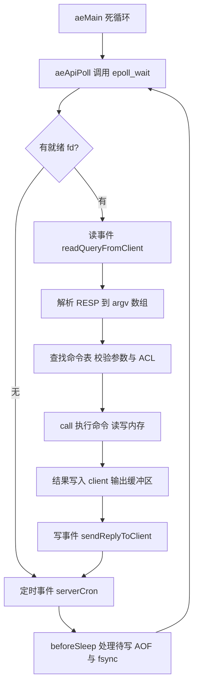

关键点：**一次事件循环里，命令执行、AOF 缓冲写盘、回复发送全部串行完成**。任何一个环节耗时过长，后面的客户端全部排队——这就是"慢命令会拖垮整个实例"的根因。

### 1.2 单线程的代价与边界

| 维度 | 单线程模型的表现 |
| --- | --- |
| 单命令复杂度 | `O(N)` 命令（`KEYS *`、`HGETALL` 大 hash、`SMEMBERS` 大 set、`ZRANGE` 全量）会阻塞所有连接 |
| 单实例吞吐上限 | 官方压测与生产经验约为 8 万 ~ 12 万 QPS（value 小、pipeline 适度），CPU 单核打满 |
| 数据量上限 | 受单机内存限制；官方建议单个实例不超过 10GB~20GB，超过则 fork 慢、RDB 慢、全量同步慢 |
| 扩展方式 | 纵向换核无用（除非用 IO 线程分担网络），只能横向 **Redis Cluster 分片** |
| 失效模式 | 一个热点 key 打满单分片；一个大 key 的删除/过期引发秒级卡顿 |

所以"Redis 单线程"的工程含义是：**把复杂度从并发控制转移到"不要写慢命令"和"分片"上**。

### 1.3 IO 多路复用到底复用了什么

"多路复用"复用的是**线程**，不是连接。传统 `BIO`（blocking IO）模型下 1 万连接需要 1 万个线程或 1 万个阻塞点；`epoll` 把"哪些 fd 就绪"这件事变成一次内核查询：

- `epoll_create1()` 创建 epoll 实例，内核维护红黑树（fd 集合）+ 就绪链表。
- `epoll_ctl(EPOLL_CTL_ADD)` 注册 fd，只在注册时复制一次 `struct epoll_event`（`select` 每次调用都要把整个 fd 集合拷进内核，且有 `FD_SETSIZE=1024` 上限，这是 `select` 被淘汰的直接原因）。
- `epoll_wait()` 返回就绪链表长度，复杂度 O(就绪数)。

Redis 用的是 **LT（水平触发）+ 非阻塞 fd**：读事件里循环 `read()` 直到 `EAGAIN`，这样即使一次没读完，下次 `epoll_wait` 还会通知。

### 1.4 6.0 的多线程 IO：边界在哪里

Redis 6.0 引入 `io-threads`，但**只把 socket 的读解析与写回放到 IO 线程**，命令执行仍然是主线程串行。这是刻意的边界设计：数据结构不需要加锁，语义不变。

| 配置 | 默认值 | 说明 |
| --- | --- | --- |
| `io-threads` | `1` | 为 1 时不启用；官方建议 8 核机器设 4（不超过 8，上限 128） |
| `io-threads-do-reads` | `no` | 6.0 默认不卸载读取，需要显式打开（读路径涉及解析，收益取决于协议解析比重） |

IO 线程的同步方式是**自旋等待**（`io_threads_pending` 计数 + 忙等），不是条件变量，因为线程数少、等待时间短，避免 `pthread_cond_wait` 的上下文切换。主线程在 `handleClientsWithPendingReadsUsingThreads()` 中把 `clients_pending_read` 队列按客户端取模分给 IO 线程。

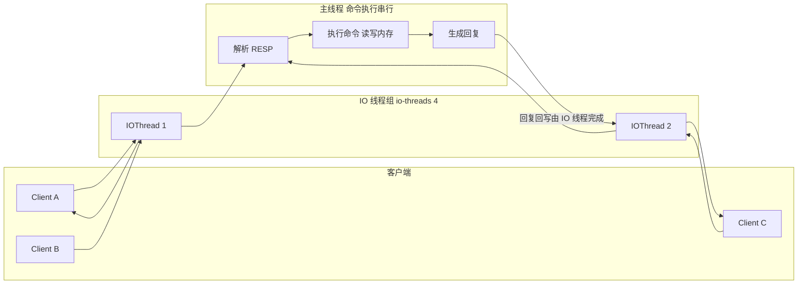

**什么时候不该开 IO 线程**：如果瓶颈是命令执行本身（慢命令、大 key、Lua 脚本），加 IO 线程完全无效；`io-threads` 只解决"网络读写占用主线程 CPU"的问题。判断方法：`INFO commandstats` 看平均耗时，`SLOWLOG` 看慢命令，`redis-cli --latency` 看网络往返。

**7.0 的相关变化**（其余见后文各节）：

- 客户端输出缓冲区从"链表"改为"链表 + `reply` 独立 buffer 的链式结构"，写回逻辑在 7.0 被重写（`addReply*` 系列），大回复的内存峰值更可控。
- `maxmemory-clients`（7.0 新增，默认 `0` 表示不限制）可以对**客户端占用内存总量**做淘汰，防止 pub/sub 慢消费者把实例撑爆。
- hash / zset 的小对象编码由 ziplist 全面切换到 listpack（7.0），quicklist 的节点内部也在 7.2 换成 listpack。

### 1.5 跳表：为什么不用红黑树

zset 的 `ZRANGEBYSCORE` / `ZRANK` 需要**有序 + 范围 + 排名**三件事。候选结构对比：

| 结构 | 范围查询 | 排名查询 | 实现复杂度 | 内存开销 |
| --- | --- | --- | --- | --- |
| 平衡树（红黑树/AVL） | O(log N) 但范围要中序回溯 | 需额外维护 size 字段才能算 rank | 高（旋转、删除的 5 种情况） | 每节点 3 指针 + 颜色位 |
| B+ 树 | 优秀，但适合块设备 | 中等 | 高（分裂合并） | 页内浪费；Redis 是内存结构，不需要它 |
| 跳表 skiplist | O(log N)，`level[0]` 就是有序链表，范围只需顺序走 | `span` 字段直接累加排名 | 低（插入/删除就是链表操作） | 平均 1/(1-p)=1.33 个指针（p=0.25） |

Redis 选择跳表的三个理由：

1. **实现简单**，插入删除不需要旋转，代码量约 300 行（`t_zset.c`）。
2. **范围查询友好**，找到起点后沿 `level[0]` 顺序遍历即可，天然支持无界 `ZRANGEBYSCORE`。
3. **并发/持久化友好**（历史上考虑过加锁与部分重写），指针结构容易做无锁读。

关键常量：`ZSKIPLIST_MAXLEVEL = 32`、`ZSKIPLIST_P = 0.25`（`t_zset.c`）。节点晋升概率 1/4，期望层数 1/(1-0.25) ≈ 1.33。每个 `zskiplistLevel` 有 `forward` 与 `span` 两个字段，`span` 表示"从当前节点跳到 forward 跨越了多少个节点"，`ZRANK` 就是一路累加 `span` 得到的。


图中只画了 `forward`，没有画 `span`：`span` 表示沿该层 `forward` 跳一步跨越了多少个节点，`forward` 为 NULL 的那一层在查找时不会被累加。

### 1.6 渐进式 rehash：为什么不能让 rehash 阻塞

`dict` 扩容需要把 `ht[0]` 的所有元素重新计算 bucket 搬到 `ht[1]`。10 亿 key 的实例如果一次性 rehash 会卡死数秒。Redis 的做法是把 rehash 拆成**每处理一次请求搬一个桶**（`_dictRehashStep`）+ **`serverCron` 里最多搬 1ms**（`dictRehashMilliseconds(d, 1)`，`activerehashing yes` 默认开启）。

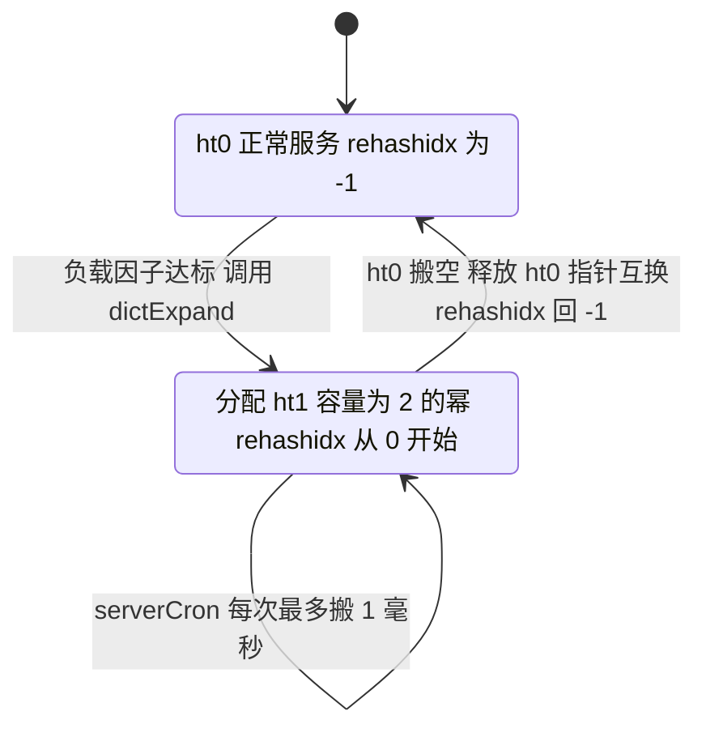

渐进式 rehash 期间的**三条铁律**：

1. **查找**要同时查 `ht[0]` 和 `ht[1]`（`dictFind` 里判断 `dictIsRehashing`）。
2. **新增**只写到 `ht[1]`，保证 `ht[0]` 中的元素只减不增，最终一定搬完。
3. **`SCAN` 游标**用 reverse binary iteration（`dictScan`）实现，即使期间发生了两次扩容/收缩也不会漏元素（可能重复，需业务幂等）。

触发条件（`dict.c`）：`used >= size` 且 `dict_can_resize` 为真（有 `fork()` 子进程时会被临时置否，避免 COW 放大），或者 `used / size > dict_force_resize_ratio`（值为 5）时强制扩容。收缩的条件是 `ht_used[0] < size/10` 且用了 `dictResize` 调用路径（`htNeedsResize`）。

## 二、对象编码与底层数据结构

Redis 每个 value 都是一个 `redisObject`（server.h 中定义）：

```c
typedef struct redisObject {
    unsigned type:4;        /* 5 种基本类型 + OBJ_MODULE 等 */
    unsigned encoding:4;    /* 11 种编码，见下表 */
    unsigned lru:24;        /* LRU 时间戳或 LFU 计数器+衰减时间 */
    int refcount;           /* 引用计数，共享整数 0~9999 */
    void *ptr;              /* 指向真正的底层结构 */
} robj;
```

固定 16 字节。`OBJECT ENCODING key` 就是读这个字段；`OBJECT REFCOUNT key`、`OBJECT FREQ key`（LFU 专用）、`OBJECT IDLETIME key` 分别读后三个字段。

| 编码常量 | 底层结构 | 触发场景 |
| --- | --- | --- |
| `OBJ_ENCODING_INT` | 无（直接存指针位） | 可用 `long` 表示的字符串 |
| `OBJ_ENCODING_EMBSTR` | SDS，与 robj 同一次 malloc | 字符串长度 ≤ 44 |
| `OBJ_ENCODING_RAW` | SDS，独立 malloc | 字符串长度 > 44 或从 embstr 被修改 |
| `OBJ_ENCODING_HT` | dict | hash / set 超过小对象阈值 |
| `OBJ_ENCODING_LISTPACK` | listpack | 小 hash、小 set、小 zset（7.0+） |
| `OBJ_ENCODING_ZIPLIST` | ziplist | 7.0 之前的 hash / zset；老的 RDB 载入后仍是它 |
| `OBJ_ENCODING_INTSET` | intset | 全整数且元素数 ≤ `set-max-intset-entries` |
| `OBJ_ENCODING_QUICKLIST` | quicklist（节点为 listpack） | list（3.2 起） |
| `OBJ_ENCODING_SKIPLIST` | dict + skiplist | zset 超过小对象阈值 |
| `OBJ_ENCODING_STREAM` | rax + listpack | Stream |
| `OBJ_ENCODING_LISTPACK_EX` | listpack + 元数据 | 7.4 的带 TTL 字段的 hash |

### 2.1 SDS：Redis 为什么不用 C 字符串

C 字符串的问题：`strlen` 是 O(N)、不二进制安全（遇 `\0` 截断）、`strcat` 可能溢出、每次修改都要 `realloc`。

`src/sds.h` 定义了 5 种 header：`sdshdr5`（只用于静态常量，键不会用）、`sdshdr8`、`sdshdr16`、`sdshdr32`、`sdshdr64`，头部分别占 1/3/5/9/17 字节。

```c
struct __attribute__ ((__packed__)) sdshdr8 {
    uint8_t len;          /* 已使用字节数，不含结尾 \0 */
    uint8_t alloc;        /* 已分配字节数，不含 header 与结尾 \0 */
    unsigned char flags;  /* 低 3 位是类型 SDS_TYPE_8，高 5 位保留 */
    char buf[];           /* 柔性数组，真实数据，末尾额外写一个 \0 */
};
```

四个设计点：

1. **O(1) 取长度**：`sdslen(s) = s[-1]` 的 flags 定位 header 后读 `len`。
2. **二进制安全**：不依赖 `\0` 判断结束，`\0` 只是为兼容 C 字符串 API 而多分配的 1 字节。
3. **空间预分配**：`sdsMakeRoomFor` 在扩容时，如果 newlen < `SDS_MAX_PREALLOC`（1MB）就按 `2 * newlen` 分配，否则多分配 1MB，把后续 append 的 `realloc` 次数从 N 次降到 log 次。
4. **惰性释放**：`sdsclear` / `sdsrange` 只改 `len` 不释放内存，注意大 SDS 缩短后内存不会立刻归还。

### 2.2 intset

```c
typedef struct intset {
    uint32_t encoding;   /* INTSET_ENC_INT16 / INT32 / INT64 */
    uint32_t length;     /* 元素个数 */
    int8_t contents[];   /* 有序紧凑数组 */
} intset;
```

- 有序 + 连续内存 → **二分查找 O(log N)**，`intsetFind` 用 `intsetSearch`。
- 三种宽度：`int16_t`（-32768~32767）、`int32_t`、`int64_t`。
- **升级不可逆**：插入一个超出当前宽度的整数会调用 `intsetUpgradeAndAdd` 把整个数组按新宽度重排（O(N)），且**永远不降级**。这就是"往 intset 里加一个大整数后，删掉它内存也不会降回来"的原因。
- 触发编码转换的出口之一是 `set-max-intset-entries`（默认 512）：元素超过 512 个转为 `OBJ_ENCODING_LISTPACK`（6.2+）或 `OBJ_ENCODING_HT`。
- 一旦插入非整数成员，intset 立即整体转成 listpack（6.2+）/ hashtable。

### 2.3 ziplist 与 listpack：连锁更新是 ziplist 的致命伤

**ziplist**（7.0 之前 hash/zset 的小对象编码，3.2 之前 list 的编码）：

| 字段 | 字节 | 说明 |
| --- | --- | --- |
| `zlbytes` | 4 | 整个 ziplist 的字节数 |
| `zltail` | 4 | 最后一个 entry 的偏移，支持 O(1) 尾插 |
| `zllen` | 2 | entry 个数，**最大 65535，超过则需遍历** |
| entries | 变长 | `prevlen` + `encoding` + `content` |
| `zlend` | 1 | 固定 `0xFF` 结束标记 |

`prevlen` 记录**前一个 entry 的总长度**，用于从后往前遍历：前一个 entry 长度 < 254 时占 1 字节，否则占 5 字节（首字节 `0xFE` + 4 字节长度）。

**连锁更新（cascade update）**：如果所有 entry 长度都在 250~253 之间，插入一个稍大的 entry 使后续 entry 的 `prevlen` 从 1 字节变 5 字节，这个 entry 自身长度又跨过 254 阈值，导致再下一个 entry 的 `prevlen` 也要扩……最坏情况每次插入都是 O(N²)。这就是 Redis 7.0 用 listpack 替换 ziplist 的核心动机。

**listpack**（5.0 为 Stream 引入，7.0 起成为 hash/zset/set 和 quicklist 节点的默认小对象编码）：

| 字段 | 字节 | 说明 |
| --- | --- | --- |
| `total-bytes` | 4 | 总字节数 |
| `num-elements` | 2 | 元素个数，**超过 65535 时固定为 65535**，需 `lpLength` 遍历计数 |
| entries | 变长 | `encoding` + `content` + `backlen` |
| `0xFF` | 1 | 结束标记 |

差异在 entry 尾部：listpack 的 `backlen` 记录**当前 entry 的长度**（倒序变长编码，最多 5 字节），从后往前遍历时读自己的 `backlen` 即可回退，**不需要记录前一个 entry 的长度，因此不存在连锁更新**。代价是每个 entry 多 1~5 字节。

### 2.4 quicklist：链表 + 小数组的分层结构

3.2 起 list 的编码是 `OBJ_ENCODING_QUICKLIST`，7.2 起节点内部是 listpack（此前是 ziplist）。

```c
typedef struct quicklist {
    quicklistNode *head;
    quicklistNode *tail;
    unsigned long count;    /* 所有节点里的元素总数 */
    unsigned long len;      /* 节点数 */
    signed int fill : 16;   /* list-max-listpack-size */
    unsigned int compress : 16; /* list-compress-depth */
} quicklist;

typedef struct quicklistNode {
    struct quicklistNode *prev;
    struct quicklistNode *next;
    unsigned char *entry;   /* listpack */
    size_t sz;
    unsigned int count : 16;    /* 本节点元素数，上限 65535 */
    unsigned int encoding : 2;  /* QUICKLIST_NODE_ENCODING_RAW / LZF */
    unsigned int container : 2; /* PLAIN / PACKED */
    unsigned int recompress : 1;
} quicklistNode;
```

设计权衡：**纯链表**每元素两个指针（内存放大 + 缓存不友好），**纯数组**中间插入是 O(N)。quicklist 用"多个小数组串成双向链表"取中间值：头尾 push/pop 是 O(1)，`LINSERT` 只需移动一个节点内的元素，遍历的缓存局部性也好。

`list-compress-depth`（默认 `0`，不压缩）：设为 N 表示两端各 N 个节点不压缩、中间的节点用 LZF 压缩（`encoding` 变 LZF）。这是"用 CPU 换内存"的开关，冷数据（老列表）值得开。

### 2.5 dict（hashtable）与 dictEntry

见 1.6 的渐进式 rehash。这里补充结构细节：

```c
typedef struct dictEntry {
    void *key;
    union { void *val; uint64_t u64; int64_t s64; double d; } v;
    struct dictEntry *next;   /* 链地址法解决冲突 */
} dictEntry;
```

- 初始容量 `DICT_HT_INITIAL_SIZE = 4`，扩容后容量是第一个大于等于 `used*2` 的 2 的幂。
- 哈希函数是 SipHash（`siphash.c`，Redis 4.0 起默认；更早是 MurmurHash2）。SipHash 是**带密钥（seed）的哈希**：攻击者不知道 seed，就无法构造大量哈希冲突的 key 把 dict 退化成链表（DoS）。用哪个变体由 `dictType` 的 `hashFunction` 决定——用户数据（如 hash、set 的成员）走 `dictGenHashFunction`（`siphash`），`COMMAND` 命令表走 `dictGenCaseHashFunction`（`siphash_nocase`），原因只是**命令名匹配要求大小写不敏感**，与 seed 无关。
- 扩容时 `ht_used` 超过 `size` 的一倍即触发，负载因子上限约为 1（Redis 用一个桶平均 1 个元素作为阈值，其他实现常用 0.75）。

### 2.6 embstr 与 raw：44 这个数字怎么来的

- `OBJ_ENCODING_EMBSTR_SIZE_LIMIT = 44`（`object.c`）。
- 一次 `malloc` 分配 `sizeof(redisObject) + sizeof(sdshdr8) + len + 1`，全部落在**同一条 64 字节 CPU cache line** 内，访问只需一次内存寻址，且释放只要一次 `free`。
- 计算：64（cache line）− 16（redisObject）− 3（sdshdr8 的 len/alloc/flags）− 1（结尾 `\0`）= 44。
- embstr 是**只读的**：`APPEND`、`SETRANGE`、`GETRANGE`+修改等写操作会先把它转成 raw（`dbUnshareStringValue` → `tryObjectEncoding`），因为 raw 的 SDS 和 robj 分开分配，扩容时不用搬 robj。
- 编码优先级：先尝试 `long` 范围（`OBJ_ENCODING_INT`，共享 `0~9999` 的整数对象），失败再按 44 字节分流。

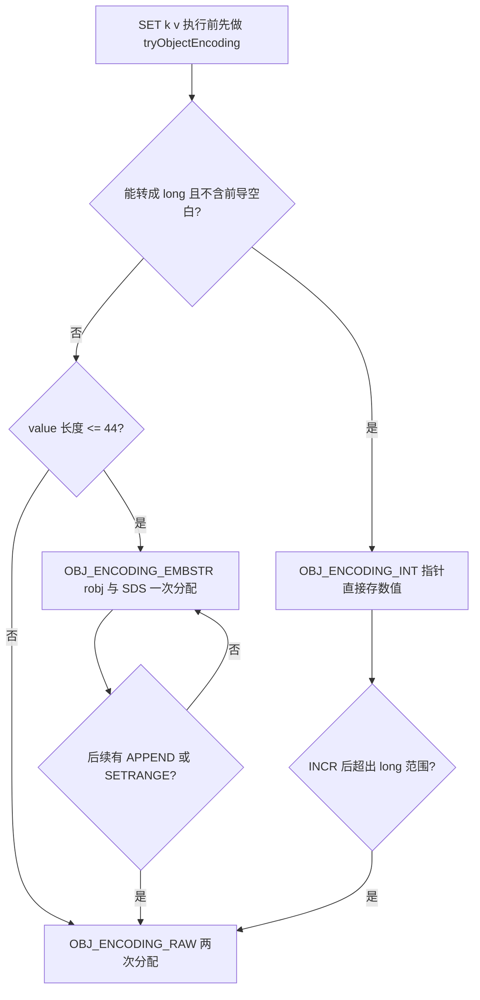

### 2.7 小对象编码阈值总表（7.2 默认值）

| 配置项 | 默认值 | 生效类型 | 超过阈值后转为 |
| --- | --- | --- | --- |
| `hash-max-listpack-entries` | `128` | hash | `OBJ_ENCODING_HT` |
| `hash-max-listpack-value` | `64` | hash | `OBJ_ENCODING_HT` |
| `zset-max-listpack-entries` | `128` | zset | `OBJ_ENCODING_SKIPLIST` |
| `zset-max-listpack-value` | `64` | zset | `OBJ_ENCODING_SKIPLIST` |
| `set-max-intset-entries` | `512` | set（全整数） | `OBJ_ENCODING_LISTPACK` |
| `set-max-listpack-entries` | `128` | set（含非整数） | `OBJ_ENCODING_HT` |
| `set-max-listpack-value` | `64` | set | `OBJ_ENCODING_HT` |
| `list-max-listpack-size` | `128` | list | 每个 quicklist 节点最多多少元素 |
| `list-compress-depth` | `0` | list | 0 表示不压缩 |

`list-max-listpack-size` 的特殊语义：**正数表示每个节点的元素个数上限，负数表示内存上限**：

- `-1` = 4KB，`-2` = 8KB，`-3` = 16KB，`-4` = 32KB，`-5` = 64KB（`-5` 是下限，超过按 `-5` 处理）。
- Redis 3.2~6.2 该项名为 `list-max-ziplist-size`，7.0 起改名并兼容旧名。
- 判断"是否超过阈值"只看**单个 quicklist 节点的元素数**，不是整个 list 的元素数——一个 list 有 100 万元素仍然可以是 quicklist 编码。

7.0 前后配置名对照（`hash-max-ziplist-*` / `zset-max-ziplist-*` 在 7.0 起是废弃别名，仍可用但不推荐）：

| 老名字（≤6.2） | 新名字（7.0+） | 默认值 |
| --- | --- | --- |
| `hash-max-ziplist-entries` | `hash-max-listpack-entries` | 128 |
| `hash-max-ziplist-value` | `hash-max-listpack-value` | 64 |
| `zset-max-ziplist-entries` | `zset-max-listpack-entries` | 128 |
| `zset-max-ziplist-value` | `zset-max-listpack-value` | 64 |
| `list-max-ziplist-size` | `list-max-listpack-size` | 128 |

**编码转换是不可逆的（单向的）**：一旦转成 hashtable / skiplist，即使后来把元素删到只剩 1 个，`OBJECT ENCODING` 仍然是 `hashtable` / `skiplist`。要恢复小编码，必须 `DEL` 后重建。这是线上"内存莫名变大"的常见原因之一。

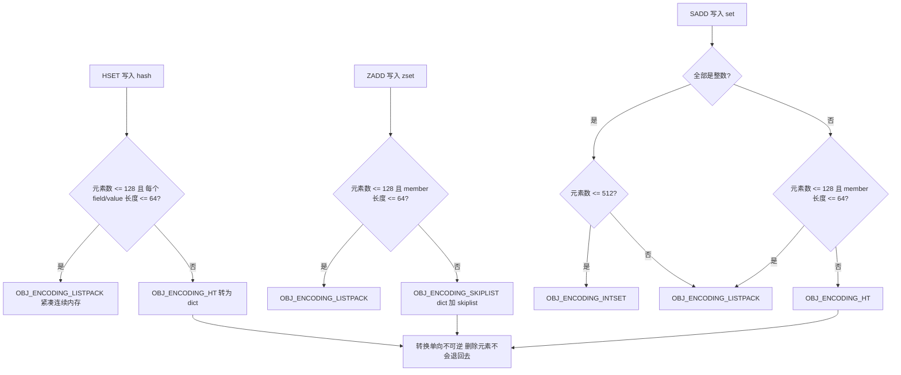

## 三、五种基本类型与扩展类型

### 3.1 类型与编码、命令复杂度总表

| 类型 | 可选编码 | 常用命令 | 时间复杂度 | 典型场景 |
| --- | --- | --- | --- | --- |
| string | int / embstr / raw | `SET` `GET` `INCR` `SETNX` `SETEX` `APPEND` `MSET` | 单 key O(1)，`APPEND` 均摊 O(1)，`SETRANGE` O(1)（可能 realloc O(N)） | 缓存对象、计数器、分布式锁、限流 |
| list | quicklist | `LPUSH` `RPUSH` `LPOP` `RPOP` `BRPOP` `LRANGE` `LINSERT` `LTRIM` | push/pop O(1)，`LRANGE` O(S+N)，`LINSERT` O(N)，`LINDEX` O(N) | 栈/队列、最新 N 条、简单消息队列 |
| hash | listpack / hashtable | `HSET` `HGET` `HMGET` `HGETALL` `HINCRBY` `HDEL` `HRANDFIELD` | 单 field O(1)，`HGETALL` O(N)，`HRANDFIELD` 6.2 起 O(N) 抽样 | 对象存储、购物车、配置表 |
| set | intset / listpack / hashtable | `SADD` `SISMEMBER` `SINTER` `SUNION` `SRANDMEMBER` `SPOP` `SINTERCARD` | 单元素 O(1)，`SINTER` O(N*M)（N 为最小集合大小），`SMEMBERS` O(N) | 标签、去重、共同好友、抽奖、UV 近似 |
| zset | listpack / skiplist | `ZADD` `ZSCORE` `ZRANGE` `ZRANGEBYSCORE` `ZRANK` `ZINCRBY` `ZREMRANGEBYRANK` | `ZADD`/`ZSCORE`/`ZRANK` O(log N)，`ZRANGEBYSCORE` O(log N + M) | 排行榜、延时队列、滑动窗口限流、优先级队列 |
| bitmap | string（`SETBIT`） | `SETBIT` `GETBIT` `BITCOUNT` `BITOP` `BITFIELD` `BITPOS` | `SETBIT`/`GETBIT` O(1)，`BITCOUNT` O(N) | 签到、活跃用户、布隆过滤器底座 |
| HyperLogLog | string（dense/sparse） | `PFADD` `PFCOUNT` `PFMERGE` | `PFADD` O(1)，`PFCOUNT` O(1)（单 key）/ O(N)（合并多 key） | 百万级 UV 基数统计 |
| GEO | zset（score = geohash） | `GEOADD` `GEODIST` `GEOPOS` `GEOSEARCH` `GEOSEARCHSTORE` | `GEOADD` O(log N)，`GEOSEARCH` O(N + log M) | 附近的人、门店距离排序 |
| Stream | rax + listpack | `XADD` `XREAD` `XRANGE` `XLEN` `XGROUP` `XACK` `XPENDING` `XAUTOCLAIM` | `XADD` O(1)，`XRANGE` O(N) | 消息队列（含消费组、ACK、重投） |

### 3.2 string 的三个使用范式与陷阱

**缓存对象**：序列化 JSON 或 `MSET` 拆字段。判断"要不要拆成 hash"的标准是**是否需要单独更新/读取部分字段**——只读整体就存 string，要局部更新就存 hash。

**分布式锁**：`SET lock value NX PX 30000`。要点：

- `SETNX` + `EXPIRE` 两条命令不是原子的（中间崩溃就死锁），必须用 `SET` 的 `NX` `PX` 选项（Redis 2.6.12 起支持）。
- 解锁必须校验 value（唯一 UUID/线程 id）并原子删除，用 Lua：
  `if redis.call('GET', KEYS[1]) == ARGV[1] then return redis.call('DEL', KEYS[1]) else return 0 end`
- 锁续期（watchdog）与 Redlock 的争议见 06 分布式章节。

**计数器**：`INCR` / `INCRBY` / `INCRBYFLOAT` / `HINCRBY`。`INCR` 的上限是 `long`（64 位），溢出会报 `ERR increment or decrement would overflow`。`INCR` 是原子但**不是幂等**，重试会多计数。

**限流**：固定窗口用 `INCR` + `EXPIRE`（注意两条命令的原子性，用 `MULTI` 或 Lua）；滑动窗口用 zset（score 存时间戳，`ZREMRANGEBYSCORE` 清理 + `ZCARD` 计数）；令牌桶用 Lua 脚本。

### 3.3 list：为什么 3.2 换成 quicklist

3.2 之前的小 list 用 ziplist，大 list 用 linkedlist，存在两个问题：**编码转换要一次性拷贝全部元素**（大 list 转换会卡顿），**linkedlist 每元素 2 指针 + 独立 malloc 的内存放大**。quicklist 用"固定大小的 listpack 串成双向链表"把两个问题都抹平：转换只发生在单个节点内部，且不存在一次遍历全表的操作。

生产上常见用法与陷阱：

- **最新 N 条**：`LPUSH` + `LTRIM key 0 99`。注意 `LTRIM` 是 O(N)（N 为被删元素数），不要每秒对百万元素的 list 做 `LTRIM 0 99`——它其实只删 N 个，复杂度是 O(被删数量)，但如果 list 长期不裁剪会持续增长。
- **简单队列**：`LPUSH` + `BRPOP`。缺点：无 ACK、无消费组、无重投，"取出来就没了"，消费者崩溃会丢消息。要可靠性请用 Stream 或专业 MQ。
- **`LRANGE key 0 -1` 在大 list 上返回巨量数据会撑爆客户端输出缓冲区**（`client-output-buffer-limit normal 0 0 0` 默认不限制普通客户端，只会把 Redis 内存打高），必须分页。

### 3.4 hash：小对象最省内存的容器

`HSET user:1 name a age 18` 在小规模时是 listpack，一份连续内存里的 key-value 序列，内存放大极小（每个 entry 几个字节的头）。收益与代价：

| 维度 | listpack（≤128 field，value ≤64 字节） | hashtable（超过阈值） |
| --- | --- | --- |
| 查找 | O(N) 顺序扫描（N ≤ 128，常数极小） | O(1) 均摊 |
| 内存 | 极低 | 每 entry 至少 24 字节 dictEntry + 指针 |
| `HGETALL` | 顺序读，缓存友好 | 遍历桶数组，跳指针 |

**实践建议**：用 hash 存对象时把 field 数量控制在 128 以内、单个 value 控制在 64 字节以内，能把内存压到 string 存 JSON 的 1/3~1/5。反例是把用户 ID 当 field 全塞进一个大 hash（分桶反而更好，比如 `user:{id%100}`）。

**7.4 新能力**：`HEXPIRE` / `HPEXPIRE` / `HTTL` / `HGETEX` / `HGETDEL` 支持**单个 field 设置 TTL**，编码变为 `OBJ_ENCODING_LISTPACK_EX`（listpack + TTL 元数据）。7.2 及以前整个 hash 只能共用一个 key 级 TTL。

### 3.5 set 的三种编码与集合运算

- `SINTER` 的实现（`t_set.c` `sinterGenericCommand`）会**先按基数排序，用最小的集合做驱动**，逐个元素去其他集合 `setTypeIsMember`，所以复杂度是 O(N*M) 中的 N 是最小集合。
- `SINTERCARD numkeys key1 key2 LIMIT n`（7.0 新增）可以在达到 LIMIT 时提前退出，适合"是否存在交集"这类判断。
- `SPOP` 是随机弹出，`SRANDMEMBER` 只返回不删除；`SPOP key count` 在 3.2 起支持批量。
- 大 set 的 `SMEMBERS` 同样会阻塞，用 `SSCAN`（游标，保证不漏、可能重复）或 `SRANDMEMBER key count` 抽样。
- 抽奖场景注意：`SRANDMEMBER` 返回的 count 大于集合大小时，**如果 count 为正数，返回不重复的元素且最多返回全部**；负数允许重复。

### 3.6 zset：排行榜与延时队列

- 底层是 **dict（member → score）+ skiplist（score 有序）** 双结构。dict 提供 `ZSCORE` 的 O(1)，skiplist 提供范围与排名。
- `ZADD` 支持 `NX`（只新增不更新）、`XX`（只更新不新增）、`GT`、`LT`、`CH`（返回变更个数而非新增个数）等选项（Redis 3.0.2 起支持 `NX`/`XX`/`CH`/`INCR`）。
- 分数相同则按 member 字典序排列（`zslInsert` 里 `sdscmp` 决定）。
- **排行榜**：`ZINCRBY board 1 user:1` + `ZREVRANGE board 0 9 WITHSCORES` + `ZREVRANK board user:1`。注意 `ZREVRANGE` 在 6.2 起被 `ZRANGE ... REV` 取代（旧命令仍可用）。
- **延时队列**：score 存"投递时间戳"，消费者用 `ZRANGEBYSCORE key 0 now LIMIT 0 1` 轮询，配合 Lua 原子取出+删除。缺点是轮询有延迟、无 ACK；生产更常用 Stream（`XADD` + `XREADGROUP` + `XAUTOCLAIM`）。

### 3.7 bitmap：按位操作省内存的极致

bitmap 不是独立类型，**就是 string**，`SETBIT key offset value` 直接操作 SDS 的某个 bit。关键约束：

- `offset` 取值 `0 ~ 2^32-1`（`4 294 967 295`），即单个 bitmap 最大 512MB。
- `BITCOUNT key [start end [BYTE|BIT]]`，`BYTE`/`BIT` 选项 7.0 起支持。
- `BITOP AND|OR|XOR|NOT destkey key...` 用于多天活跃用户的"连续活跃"计算。
- 稀疏 bitmap 极端浪费：只签到 1 个 offset=1 亿 的用户会立刻分配 12MB。


### 3.8 HyperLogLog：12KB 统计亿级 UV

原理：基于**概率计数**（LogLog 家族的调和平均改进版）。Redis 的实现：

- `2^14 = 16384` 个桶（register），每个桶 6 bit 存"哈希值尾部连续 0 的个数 + 1"，最大值 **51**（`HLL_Q = 64 - 14 = 50`，计数上限 `Q + 1`；6 bit 字段本身能表示到 63，但用不到）。
- 内存：`16384 * 6 / 8 = 12288` 字节，即 **12KB**（dense 编码）；稀疏编码更小。
- 标准误差 **0.81%**（公式 `1.04/sqrt(16384)`）。
- 两种编码：`sparse`（稀疏，初始状态，使用 opcode 编码零值桶，达到 `hll-sparse-max-bytes` 默认 `3000` 字节后转 dense）与 `dense`（固定 12KB）。`PFDEBUG ENCODING key` 可查看。
- `PFADD` 会**改变 value**（和 `PFCOUNT` 只读不同），因此 `PFADD` 不能用在只读副本语义的场景。
- 基数统计**不可逆**：HLL 只能给近似基数，不能列成员、不能删除单个元素（`PFMERGE` 只能并集）。
- 与 bitmap 的取舍：UV 精确统计用 bitmap（内存 = 最大 offset/8），亿级用 HLL（固定 12KB，误差 0.81%）。

### 3.9 GEO：站在 zset 上的地理位置

GEO 没有独立类型，**底层就是 zset**，member 是位置名，score 是 52 位 geohash 整数（内部用 `GEO_STEP_MAX = 26`，经纬度各 26 位，交错成 52 位，正好放进 double 的 52 位尾数，不丢精度）。

- `GEOADD key 116.40 39.90 "天安门"`：经纬度范围有限制，经度 ±180、纬度 ±85.05112878（超出报错 `invalid longitude,latitude pair`）。
- `GEODIST` 用 Haversine 公式计算球面距离，可选 `m|km|mi|ft`。
- `GEOSEARCH`（6.2 新增）替代 `GEORADIUS` / `GEORADIUSBYMEMBER` 的读语义，支持 `FROMMEMBER` / `FROMLONLAT` + `BYRADIUS` / `BYBOX`，配合 `ASC`/`DESC`/`COUNT`/`WITHCOORD`/`WITHDIST`。
- 因为底层是 zset，**可以直接用 `ZREM` 删位置、用 `ZCARD` 数个数，也能被 `ZRANGE` 误用**（但按 score 排不等于按距离排）。
- geohash 前缀 + 9 个邻居块的思路：`GEOSEARCH` 的实现是先算出覆盖范围对应的 geohash 区间（9 个邻居块），再对每个区间做 zset 范围扫描，最后按真实距离过滤并排序。所以它不需要遍历所有元素。

### 3.10 Stream：唯一带 ACK 的内置消息结构

5.0 引入，底层是 **rax（基数树）+ listpack**：rax 按消息 ID（`毫秒时间戳-序号`）索引，每个 rax 节点（一个"宏节点"）内部是一个 listpack，存储该 ID 区间的字段与值。

| 概念 | 命令 | 说明 |
| --- | --- | --- |
| 追加 | `XADD key [NOMKSTREAM] [MAXLEN ~ n] id field value` | `*` 表示自动生成 ID |
| 读取 | `XREAD [BLOCK ms] [COUNT n] STREAMS key id` | 无消费组，`$` 表示只读新消息 |
| 消费组 | `XGROUP CREATE key group id [MKSTREAM]` | 每个消息只会投递给组内一个消费者 |
| 消费 | `XREADGROUP GROUP g c COUNT n STREAMS key >` | `>` 表示未被投递过的消息 |
| 确认 | `XACK key group id` | 未确认的进入 PEL（Pending Entries List） |
| 查看待处理 | `XPENDING key group` | 汇总 + `IDLE` 过滤 |
| 转移所有权 | `XAUTOCLAIM key group consumer min-idle-time start`（6.2 新增） | 替代 `XCLAIM` 的批量版本，处理消费者崩溃后的重投 |
| 裁剪 | `XTRIM key MAXLEN ~ 1000` / `XADD ... MAXLEN` | `~` 表示近似裁剪，按节点粒度 |

配置项：`stream-node-max-bytes` 默认 `4096`，`stream-node-max-entries` 默认 `100`——它们控制一个 rax 宏节点里 listpack 的大小，超过就分裂。

**Stream vs 专业 MQ（Kafka/RocketMQ）**：

| 维度 | Redis Stream | Kafka |
| --- | --- | --- |
| 持久化 | RDB/AOF，重启可能丢少量数据 | 独立日志段，持久可靠 |
| 堆积能力 | 受内存限制，堆积即涨内存 | 磁盘堆积，可存 TB |
| 分区/并行 | 单 key 单分片，消费组内并行度有限 | 多分区天然并行 |
| 延迟 | 亚毫秒 | 毫秒级 |
| 适用 | 中小流量、要求低延迟、不想引入新组件 | 高吞吐、可回溯、需要长期留存 |

## 四、过期删除与内存淘汰

这两个机制经常被混为一谈，实际是**两道独立的防线**：

- **过期删除**：针对"设置了 TTL 的 key"，解决"没人访问的过期 key 什么时候被删"。
- **内存淘汰**：针对"`maxmemory` 打满"，解决"必须腾出内存时删谁"。

### 4.1 TTL 的存储结构

Redis 默认有 16 个库（`redis.conf` 的 `databases 16`），每个 `redisDb` 有两个 dict：

```c
typedef struct redisDb {
    dict *dict;        /* 键空间：key -> value */
    dict *expires;     /* 过期字典：key -> 过期时间(毫秒时间戳, int64) */
    ...
} redisDb;
```

所以**设置 TTL 本身也要占内存**：每个带 TTL 的 key 会在 `expires` 字典里多一份 dictEntry（约 32~48 字节，取决于 jemalloc size class）。大量小 key + TTL 的场景内存可能翻倍。

**为什么要单独一个 `expires` 字典**：定期删除只遍历 `expires`（通常远小于键空间），不需要扫描整个 keyspace；没有 TTL 的 key 也不为此付出任何空间。代价是读一个带 TTL 的 key 要多一次 `dictFind`——`expireIfNeeded` / `keyIsExpired` 先查 `expires` 判断是否过期。

常用命令与语义：

| 命令 | 说明 |
| --- | --- |
| `EXPIRE key seconds` / `PEXPIRE` | 秒/毫秒，负数会立即删除该 key |
| `EXPIREAT` / `PEXPIREAT` | 绝对时间戳 |
| `TTL` / `PTTL` | 返回剩余秒/毫秒；`-1` 表示无 TTL，`-2` 表示 key 不存在 |
| `PERSIST key` | 去掉 TTL，成功返回 1 |
| `SET key v EX 10` | 原子设置值与 TTL（推荐替代 `SET` + `EXPIRE`） |
| `GETEX key EX 10`（6.2） | 读的同时改 TTL，`PERSIST` 选项可去掉 TTL |

**主从复制下过期是"主节点决定"**：从节点不主动删除过期 key（`server.masterhost != NULL` 时 `expireIfNeeded` 直接返回），只等待主节点传来的 `DEL`/`UNLINK`。因此**从节点的内存里会残留已经逻辑过期的 key**（主节点的删除命令到达前一直占内存）。但 Redis 3.2 起从节点在读取时会判断逻辑过期（`keyIsExpired`），过期 key 对客户端表现为不存在，不会把旧值返回给读请求。

### 4.2 惰性删除 + 定期删除

**惰性删除（lazy）**：每次访问 key 前调用 `expireIfNeeded(db, key)`（`db.c`）：

- 主节点：如果 key 已过期，删除（`lazyfree-lazy-expire yes` 时走 `UNLINK` 异步释放），并同步 `DEL` 到从节点 + 写 AOF。
- 从节点：只返回"不存在"，不删。

优点：不浪费 CPU。缺点：**没人访问的过期 key 永远不释放**（内存泄漏）。

**定期删除（active）**：`serverCron` 里的 `activeExpireCycle()`（`expire.c`），

- 默认每秒 `server.hz`（10）次，即频率 10Hz（`server.hz` 默认 `10`，`dynamic-hz yes` 时高负载会动态提高）。
- 每轮从 `expires` 字典中**随机抽取 `ACTIVE_EXPIRE_CYCLE_KEYS_PER_LOOP = 20` 个 key**，删除其中已过期的。
- 如果这一轮里**过期 key 占总采样数的比例超过 `ACTIVE_EXPIRE_CYCLE_ACCEPTABLE_STALE = 10`（即 10%）**，说明过期 key 占比高，继续循环；同时受时间预算约束：快循环 `ACTIVE_EXPIRE_CYCLE_FAST_DURATION = 1000` 微秒，慢循环不超过 `ACTIVE_EXPIRE_CYCLE_SLOW_TIME_PERC = 25`（即 CPU 时间的 25%）。
- 快循环（fast cycle）在 `beforeSleep` 里执行，慢循环在 `serverCron` 里执行。

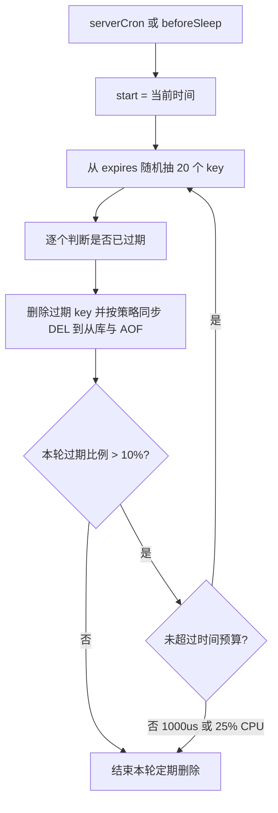

**扫描不到会怎样**：如果实例里存在大量 TTL 相同或相近的 key（例如整点批量写入 100 万 key、TTL 都是 1 小时），它们会在同一分钟集中过期，随机采样每轮都能抽到大量过期 key，CPU 被 `activeExpireCycle` 吃掉、延迟毛刺明显。**治理手段**：写入时给 TTL 加随机抖动（`TTL + rand(0, 300)`）。

**过期事件通知不保证及时**：`notify-keyspace-events Ex` 产生的 `__keyevent@0__:expired` 只在 key **被真正删除**的那一刻发出，而删除要么由访问触发（惰性删除）、要么由定期删除抽样命中触发。所以没被访问、也没被抽到的过期 key 不会立刻发通知，用它做"延时队列"会出现分钟级延迟甚至长时间收不到事件。它只适合做兜底通知（如缓存失效广播），不能当可靠调度用。

### 4.3 内存上限与 8 种淘汰策略

配置：

| 配置项 | 默认值 | 说明 |
| --- | --- | --- |
| `maxmemory` | `0`（64 位系统） | 0 表示不限制；32 位系统默认 3GB |
| `maxmemory-policy` | `noeviction` | 8 种策略见下表 |
| `maxmemory-samples` | `5` | 近似 LRU/LFU 每次采样数 |
| `maxmemory-eviction-tenacity` | `10` | 7.0 新增，淘汰的"韧性"，值越大越激进地做 sync 淘汰 |

8 种策略（`evict.c` 的 `performEvictions`）：

| 策略 | 淘汰范围 | 选择依据 | 适用场景 |
| --- | --- | --- | --- |
| `noeviction` | 不淘汰 | 写命令直接返回 `OOM command not allowed when used memory > 'maxmemory'` | 数据不允许丢，靠监控扩容 |
| `allkeys-lru` | 所有 key | 近似 LRU，idle 时间最长的先删 | 通用缓存（最常用） |
| `allkeys-lfu` | 所有 key | 近似 LFU，访问频率最低的先删（4.0+） | 有明显热点、长尾明显 |
| `allkeys-random` | 所有 key | 随机 | 访问分布均匀、无热点 |
| `volatile-lru` | 仅设置了 TTL 的 key | 近似 LRU | 同一实例混存"缓存 + 持久数据" |
| `volatile-lfu` | 仅设置了 TTL 的 key | 近似 LFU（4.0+） | 同上，且热点明显 |
| `volatile-random` | 仅设置了 TTL 的 key | 随机 | 同上 |
| `volatile-ttl` | 仅设置了 TTL 的 key | TTL 最小（最快过期）的先删 | 希望优先淘汰即将过期的 |

**注意**：`volatile-*` 系列在"没有可淘汰的带 TTL key"时会退化成 `noeviction` 报错，而不会去删没有 TTL 的 key。这是线上"明明有一堆数据却报 OOM"的常见原因。

### 4.4 近似 LRU：24 位时钟与采样池

Redis 不做精确 LRU（需要一个全局双向链表，每个 key 两个指针 + 每次访问都要移动节点，内存和 CPU 都不可接受）。做法是：

- `redisObject.lru` 是 24 位，`LRU_CLOCK_RESOLUTION = 1000` 毫秒，即**秒级精度**，最大表示 `2^24` 秒 ≈ 194 天，超过会回绕（回绕时用差值判断）。
- 每次访问 key（`lookupKey` 命中非只读命令）会更新 `robj.lru`（`LRU_CLOCK()` 返回 `server.lruclock`，`serverCron` 里每 `LRU_CLOCK_RESOLUTION` 更新一次，避免每次调用 `time()`）。
- 淘汰时：`performEvictions` 反复调用 `evictionPoolPopulate`，每次从目标 dict 采样 `maxmemory-samples` 个 key，计算 idle 时间（`estimateObjectIdleTime`），放入一个固定 16 槽的**淘汰池** `evictionPoolEntry eviction_pool[EVPOOL_SIZE]`（`EVPOOL_SIZE = 16`），池按 idle 从小到大有序插入，**取池里 idle 最大的那个删除**。
- 池跨轮保留，因此实际是"过去多轮采样里最久未访问的"，比纯随机准确得多。`maxmemory-samples` 从 5 调到 10，LRU 准确度接近理论 LRU，但 CPU 成本上升。

### 4.5 近似 LFU：16 位衰减时间 + 8 位计数器

4.0 引入，复用 `lru` 的 24 位：**高 16 位是上次衰减时间（分钟），低 8 位是访问频率计数器（0~255）**——`updateLFU` 写入的是 `(LFUGetTimeInMinutes()<<8) | counter`。

- **计数增长**：概率递增，`lfu-log-factor`（默认 `10`）越大增长越慢。源码 `LFULogIncr`：`r = rand()/RAND_MAX`，当 `r < 1/((counter - LFU_INIT_VAL) * lfu_log_factor + 1)` 时 counter++（`LFU_INIT_VAL = 5`，减去它是为了让新 key 的前几次访问能快速把计数抬起来）。counter 达到 255 后不再增长。
- **计数衰减**：`LFUDecrAndReturn` 先取 `ldt = lru >> 8`（高 16 位的上次衰减时间），按 `(now - ldt) / lfu-decay-time`（`lfu-decay-time` 默认 `1` 分钟）算出要减多少，再从低 8 位的 counter 里减掉。`lfu-decay-time` 设为 `0` 表示**从不按时间衰减**（源码 `num_periods = lfu_decay_time ? LFUTimeElapsed(ldt)/lfu_decay_time : 0`，此时 counter 只增不减）。
- `OBJECT FREQ key` 查看当前计数器，需要 `maxmemory-policy` 是 LFU 之一才有效。
- 与 LRU 的取舍：**LFU 抗"偶发批量扫盘"**（一次全表扫描不会让所有 key 变成热点），但**对新 key 不友好**（新 key 计数从 5 开始，`LFU_INIT_VAL = 5`，需要时间才能升上来，可能被误杀）。

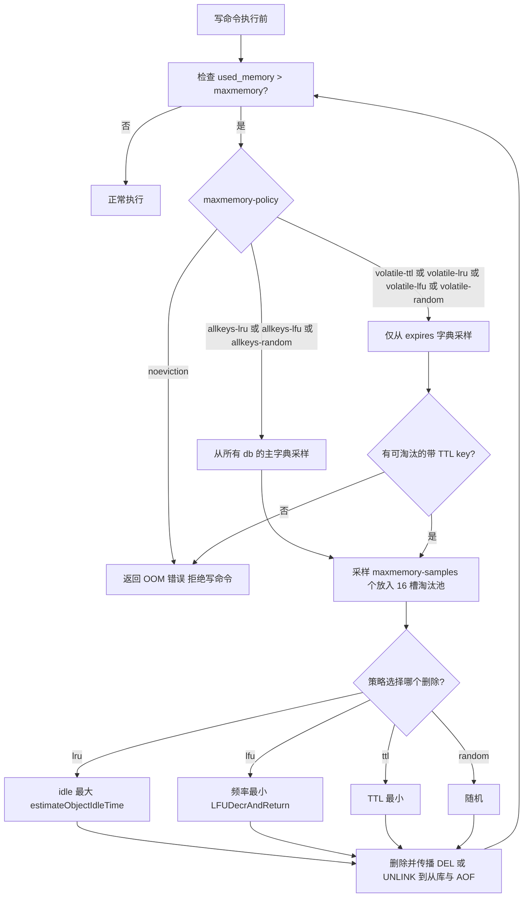

**`maxmemory` 到底限制了什么**：比较的是 `used_memory`，即 Redis 自己统计的内存分配量（jemalloc 分配出去的量）。客户端输出缓冲区、复制 backlog、AOF 缓冲区**都计入**：`INFO memory` 里 `used_memory` = `used_memory_dataset`（数据）+ `used_memory_overhead`（各种缓冲区、复制 backlog、客户端缓冲区等）。它**不包含** fork 期间 COW 额外复制出来的物理页、jemalloc 碎片和 THP 浪费，所以**给 Redis 的 `maxmemory` 应该比容器/机器的内存上限小 20%~30%**，给 fork 时的 COW 页表与 jemalloc 碎片留余量。经验值：容器 limit 4GB 时 `maxmemory` 设 3GB。7.0 起可额外用 `maxmemory-clients` 限制客户端缓冲区总量（默认 `0` 不限制）。

## 五、RDB 与 AOF 持久化

Redis 的持久化只有两条路，但组合出四种形态：**纯 RDB**、**纯 AOF**、**RDB + AOF 双开**、**混合持久化（AOF 里嵌 RDB 全量 + 增量 AOF）**。

| 维度 | RDB | AOF |
| --- | --- | --- |
| 原理 | 某时刻的全量二进制快照，fork 子进程写 | 追加写命令日志，重启时重放 |
| 文件体积 | 小（二进制 + LZF 压缩） | 大（7.0 混合持久化后小很多） |
| 恢复速度 | 快（直接加载内存镜像） | 慢（重放所有命令，7.0 前差距 3~10 倍） |
| 数据安全性 | 差，两次快照之间宕机全丢 | 好，取决于 `appendfsync` |
| 对主进程影响 | fork 时有短暂阻塞 + COW 内存开销 | 写盘在 `beforeSleep` 同步进行（`always` 时有 fsync 延迟） |
| 主要配置 | `save`、`rdbcompression`、`rdbchecksum` | `appendfsync`、`auto-aof-rewrite-*` |
| 主要风险 | fork 慢（大实例秒级）、COW 内存翻倍 | 重写期间的缓冲区膨胀、`everysec` 最多丢 1 秒 |

### 5.1 RDB 触发方式与配置

`redis.conf` 默认的保存点（`save` 是"或"关系，任一满足即触发 bgsave）：

```
save 3600 1      # 3600 秒内至少 1 次修改
save 300 100     # 300 秒内至少 100 次修改
save 60 10000    # 60 秒内至少 10000 次修改
```

| 配置 | 默认值 | 说明 |
| --- | --- | --- |
| `save` | `3600 1 300 100 60 10000` | 可在运行时用 `CONFIG SET save ""` 关闭 |
| `dbfilename` | `dump.rdb` | 文件名 |
| `dir` | `./` | 工作目录 |
| `rdbcompression` | `yes` | 对字符串值用 LZF 压缩（`rdbSaveRawString`） |
| `rdbchecksum` | `yes` | 文件末尾写 CRC64 校验和 |
| `stop-writes-on-bgsave-error` | `yes` | bgsave 失败（如磁盘满）时**拒绝写命令**，防止静默丢数据 |
| `rdb-save-incremental-fsync` | `yes` | 4.0 起，每写 32MB 数据 fsync 一次，平滑 IO |
| `rdb-del-sync-files` | `no` | 无持久化时删除主从同步用的 RDB |

四种触发入口：

1. **自动**：`serverCron` 里的 `checkSaveConditions` 判断 `dirty` 计数器（自上次保存以来的写次数）与时长。
2. **`BGSAVE`**：fork 子进程，主进程立即返回 `Background saving started`。
3. **`SAVE`**：主进程同步执行，**会阻塞所有客户端**，生产禁用。
4. **SHUTDOWN / 主从全量同步**：也会产生 RDB。

状态字段：`INFO persistence` 的 `rdb_bgsave_in_progress`、`rdb_last_bgsave_status`、`rdb_last_bgsave_time_sec`、`rdb_changes_since_last_save`、`rdb_last_cow_size`（上一次 fork 期间 COW 复制的字节数，**判断 fork 内存放大的核心指标**）、`latest_fork_usec`（`INFO stats`）。

### 5.2 fork 与 copy-on-write：RDB 的核心机制与最大风险

`fork()` 在 Linux 上是 **写时复制（COW）** 语义：

1. fork 时内核复制父进程的**页表**（不是物理内存），子进程与父进程指向同一批物理页，这些页被标记为只读。
2. 子进程开始遍历自己的内存快照并写文件。
3. 父进程在 fork 期间继续处理客户端请求，**一旦修改某个页，内核发生写保护异常，把那一页复制一份给父进程**，子进程仍看到旧页。
4. 因此 RDB 是"fork 那一刻的**一致性快照**"，这正是它不需要暂停服务的原因。

代价：

- **fork 本身要复制页表**，页表大小与内存成正比：每 GB 内存约 2MB 页表（4KB 页、每页 8 字节目表项 → `1GB/4KB*8 = 2MB`）。64GB 实例 fork 一次要复制 128MB 页表，耗时可打 `latest_fork_usec` 达到数百毫秒——**fork 期间主线程完全阻塞**。
- **COW 内存放大**：如果快照期间写入量很大，被修改的页会被复制，最坏情况内存翻倍。`rdb_last_cow_size` 就是实际量。大 value + 高频写是最坏的组合。
- **`vm.overcommit_memory`**：Linux 默认 `0`（启发式），fork 可能因为"看似内存不足"而失败。Redis 官方要求设 `vm.overcommit_memory=1`。
- **THP（Transparent Huge Pages）**：开启后 COW 的单位从 4KB 变成 2MB，写放大 512 倍。Redis 官方要求 `echo never > /sys/kernel/mm/transparent_hugepage/enabled`，并在启动日志里检查 `WARNING you have Transparent Huge Pages (THP) support enabled in your kernel`。

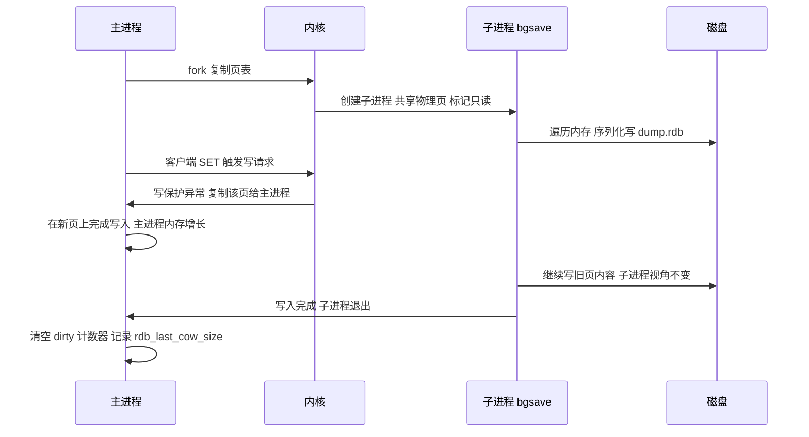

**排查 fork 慢**：

```
INFO stats | grep latest_fork_usec          # 单次 fork 耗时（微秒）
INFO persistence | grep rdb_last_cow_size   # 上次 COW 复制字节数
dmesg | grep -i "page allocation failure"   # 内核是否因内存不足失败
```

### 5.3 AOF 的三种 appendfsync 策略

AOF 的写入链路分三步，理解这三步才能答对"为什么 `everysec` 最多丢 1 秒"：

1. **写命令追加到 `server.aof_buf`**（进程内存，命令执行完就写，与磁盘无关）。
2. **`beforeSleep` 里调用 `flushAppendOnlyFile()` 把 `aof_buf` 写到内核 page cache（`write()`）**——此时数据已脱离 Redis 进程，但还在内核内存里。
3. **按策略调用 `fdatasync()`/`fsync()` 刷盘**。

| `appendfsync` | 行为 | 丢失窗口 | 吞吐 |
| --- | --- | --- | --- |
| `always` | 每个事件循环都在 `flushAppendOnlyFile` 里同步 fsync | 最多丢最后一条命令（进程崩溃不丢，机器断电可能丢） | 极低，QPS 掉到几百~几千 |
| `everysec` | **默认值**，由后台 `bio` 线程每秒 fsync 一次 | 最多丢 1 秒数据 | 高 |
| `no` | 不主动 fsync，交给内核（Linux 约 30 秒落盘） | 最多丢 30 秒 | 最高 |

**`everysec` 的隐藏毛刺**：如果上一次 fsync 还没完成（磁盘慢），主线程会**最多等待 2 秒**（`aof_fsync` 的延迟监控逻辑），期间 AOF 写入会进入"延迟写"状态，命令会**暂时累积在 `aof_buf`**，此时延迟飙升。相关配置：

| 配置 | 默认值 | 说明 |
| --- | --- | --- |
| `appendonly` | `no` | 7.2 默认关闭 |
| `appendfilename` | `appendonly.aof` | 7.0 起实际是 `appendonlydir/` 目录 |
| `no-appendfsync-on-rewrite` | `no` | 设为 `yes` 时，AOF 重写期间不 fsync（分担 IO 压力，但丢失窗口变大） |
| `aof-load-truncated` | `yes` | 加载时忽略尾部不完整命令（崩溃导致），只打印警告 |
| `aof-use-rdb-preamble` | `yes` | 4.0 引入混合持久化，5.0 起默认 `yes`（4.0 默认 `no`） |
| `aof-timestamp-enabled` | `no` | 7.0 起可在 AOF 里写注释形式的时间戳，便于按时间点恢复 |
| `aof-rewrite-incremental-fsync` | `yes` | 重写文件时每 32MB fsync 一次 |

对应的延迟监控事件名：`aof-fsync-always`、`aof-write`、`aof-fstat`、`aof-rename`。`INFO persistence` 有 `aof_last_write_status`、`aof_current_size`、`aof_base_size`、`aof_pending_rewrite`、`aof_buffer_length`、`aof_rewrite_buffer_length`、`aof_pending_bio_fsync`、`aof_delayed_fsync`（`aof_delayed_fsync` > 0 就说明发生了 fsync 延迟，是排查写入抖动的第一指标）。

### 5.4 AOF 重写：为什么不是"压缩旧文件"

AOF 是命令日志，会无限膨胀：对一个 key 执行 100 万次 `INCR`，AOF 里就有 100 万条命令，但恢复只需要最后的值。**AOF 重写不是读旧 AOF 做压缩，而是 fork 子进程直接遍历内存，用最少的写命令重建当前数据集**（`rewriteAppendOnlyFileBackground` → `rewriteAppendOnlyFileRio`）。

重写期间的一致性由**重写缓冲区**保证：

1. 子进程 fork 后开始写新的 AOF 临时文件（文件名前缀 `temp-rewriteaof-bg-`，后缀是子进程 pid）。
2. 主进程继续接收写命令，除了写入当前 `aof_buf`，还**同时追加一份到 `server.aof_rewrite_buf_blocks`**（由 `aof_child_pid != -1` 触发）。
3. 子进程写完内存快照，向父进程发信号；父进程在 `backgroundRewriteDoneHandler` 里把重写缓冲区的内容追加到新文件末尾。
4. `rename()` 原子替换旧 AOF，`fsync` 目录。

触发条件由两个配置共同决定（`serverCron` 里的 `checkAofRewriteConditions`）：

| 配置 | 默认值 | 触发条件 |
| --- | --- | --- |
| `auto-aof-rewrite-percentage` | `100` | 当前 AOF 体积比上次重写后的体积增长超过 100% |
| `auto-aof-rewrite-min-size` | `64mb` | 且 AOF 体积至少达到 64MB |

即"AOF 至少 64MB 且翻倍"才自动重写。也可以手动：`BGREWRITEAOF`。

**`BGREWRITEAOF` 不会与 `BGSAVE` 并发**：同一时刻 Redis 只允许一个"重活"子进程。如果 `bgsave` 正在执行，`BGREWRITEAOF` 会返回 `Background append only file rewriting scheduled`，把 `server.aof_rewrite_scheduled` 置 1，等 `BGSAVE` 结束后再真正开始——这是"手动触发了重写却看不到 `aof_rewrite_in_progress`"的常见原因。

**7.0 的多部分 AOF（Multi Part AOF）** 是最大的结构性变化：

- 之前是一个 `appendonly.aof` 文件（重写期间主进程写旧文件 + 缓冲区，重写完成后替换）。
- 7.0 起是 `appendonlydir/` 目录，包含一个 **base 文件**（`.rdb` 或 `.aof`，即重写产生的基础快照）+ 若干 **incr 文件**（`.incr.aof`，自上次重写以来的增量）+ 一个 **manifest 文件**（`.manifest`，记录文件列表与类型）。
- 好处：重写时主进程直接写新的 incr 文件，不再需要"重写缓冲区"这个内存黑洞，也避免了 `aof_rewrite_buf` 在重写期间无限增长导致内存暴涨（这是一个长期存在的线上问题）；超时/失败也更容易回滚。
- 文件命名：`appendonly.aof.1.base.rdb`、`appendonly.aof.1.incr.aof`、`appendonly.aof.manifest`。

**重写期间的经典故障**：`no-appendfsync-on-rewrite` 默认 `no`，所以重写时 fsync 与子进程写文件会争抢磁盘 IO，典型现象是 `INFO` 里 `aof_delayed_fsync` 持续上涨、`redis-cli --latency` 毛刺。磁盘 IO 能力不足时把它设为 `yes`，代价是重写窗口内的数据可能丢更多。

### 5.5 混合持久化与重启恢复优先级

**混合持久化**（4.0 引入，5.0 起 `aof-use-rdb-preamble yes` 为默认）：

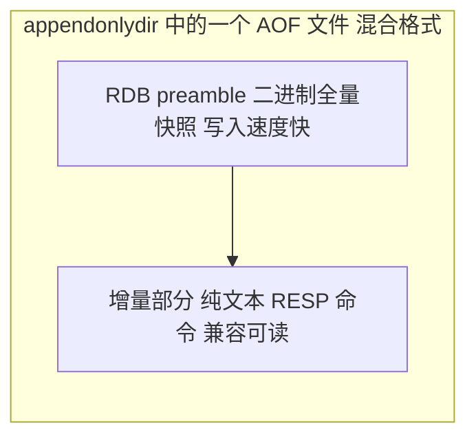

开头是 RDB 格式的全量数据，后面接着 AOF 格式的增量命令。加载时先按 RDB 载入（快），再重放后面的命令（少）。**这是 4.0 之后推荐的生产配置**：兼具 RDB 的加载速度与 AOF 的低丢失。

**重启时的恢复优先级**（源码 `main()` → `loadDataFromDisk()`）：

1. 如果 `appendonly yes`：**只加载 AOF，忽略 RDB**。这正是"开了 AOF 之后 RDB 被忽略"的原因——很多人的 AOF 是后来才开的，AOF 里数据不全，重启后反而"丢数据"。
2. 如果 `appendonly no`：加载 `dbfilename` 指定的 RDB。
3. AOF 被 `aof-load-truncated yes`（默认）判定为尾部截断时，会**截断**并继续启动；设为 `no` 则拒绝启动并报错，需要人工 `redis-check-aof --fix`。

7.0 起另外分了两步：先检查 `appendonlydir` 与 manifest，如果 manifest 与文件不匹配会拒绝启动。

**如何安全地开启 AOF（不丢数据）**：

```
CONFIG SET appendonly yes      # 触发一次 AOF 重写，基于当前内存生成全量
INFO persistence               # 观察 aof_rewrite_in_progress 变 0
CONFIG REWRITE                 # 写入 redis.conf 持久化配置
```

注意 `CONFIG SET appendonly yes` 会立刻触发一次后台重写，大实例上会 fork，注意内存余量。

**备份策略结论**：RDB 定时（如 `save 900 1`）+ AOF `everysec` + 定期把 RDB/AOF 目录备份到对象存储，主从 + 哨兵/集群保证可用性。RDB 不能替代备份，因为 `rm -rf` 手滑、`FLUSHALL` 会同步删掉所有节点的数据。

## 六、大 key、热 key、内存碎片与批量操作

### 6.1 大 key：定义、危害与发现

**什么是大 key**（没有官方阈值，生产经验共识）：

| 类型 | 危险阈值 | 绝对禁止 |
| --- | --- | --- |
| string | > 10KB | > 1MB |
| hash / set / zset | 元素数 > 5000 | > 10000 |
| list | 元素数 > 5000 | > 10000 |

**危害链条**（每个环节都是真实故障）：

1. `DEL` 一个大 key 是 O(N) 且**同步释放内存**，10 万元素的 hash 删除可阻塞数百毫秒 → 需要用 `UNLINK`（4.0+，把释放交给 `bio` 线程）。
2. **过期删除同理**：大 key 到期时 `expireIfNeeded` 走同一个删除路径 → 配 `lazyfree-lazy-expire yes`。
3. **RDB fork 时 COW 放大**：大 key 占多个页，快照期间任何写入都会复制整页。
4. **主从全量同步**：传输大 key 会撑爆 `repl-backlog` 或客户端输出缓冲区，触发 `client-output-buffer-limit` 断连 → 无限重同步。
5. **Cluster 槽倾斜**：一个大 key 只落一个分片，单分片内存/QPS 打满，其他分片空闲。
6. **慢查询**：`HGETALL`、`SMEMBERS`、`LRANGE 0 -1`、`ZRANGE 0 -1` 都是 O(N)。

**发现手段**（按可用性排序）：

| 工具 | 命令 | 说明 |
| --- | --- | --- |
| 内置扫描 | `redis-cli --bigkeys` | 基于 `SCAN` + `TYPE` + 各类型的 `*LEN`，**只给每种类型最大的 key，不是全部** |
| 内置扫描（按内存） | `redis-cli --memkeys --memkeys-samples 0` | 按 `MEMORY USAGE` 排序，更准确但更慢 |
| 单 key 精确 | `MEMORY USAGE key [SAMPLES n]` | 返回字节数，4.0+；`SAMPLES 0` 表示精确遍历（慢） |
| 单 key 元信息 | `DEBUG OBJECT key` | 返回 `serializedlength`、`ql_nodes` 等；生产默认被 `enable-debug-command` 限制 |
| 离线分析 | `rdb` 文件 + `redis-rdb-tools`（`rdb -c memory dump.rdb`） | 不碰线上实例，**唯一适合全量分析大 key 的方式** |
| 间接观测 | `INFO` 的 `keyspace`、`mem_fragmentation_ratio`、各实例内存分布 | 内存分布不均往往就是大 key |

`--bigkeys` 的核心缺陷：它用 `SCAN` 采样并只保留每种类型当前最大的一个 key（以及还有一个"元素个数 top"的实现差异），**一个 100 万元素的 list 后面还有 10 个同样大的 list，只会报告 1 个**。要全量必须离线分析 RDB。

**治理策略**：

- **拆分**：大 hash 按 `hash{userId % 100}` 分桶，大 zset 按时间/业务维度切分。
- **异步删除**：`UNLINK` 替代 `DEL`；开启 `lazyfree-lazy-user-del yes`（6.0+）、`lazyfree-lazy-expire yes`、`lazyfree-lazy-eviction yes`、`lazyfree-lazy-server-del yes`、`lazyfree-lazy-user-flush yes`（`FLUSHALL ASYNC`）。
- **禁止全量命令**：用 `HSCAN`/`SSCAN`/`ZSCAN` 分批，`LRANGE` 分页。
- **写入时防呆**：业务侧限制单个集合的元素上限（如 `ZADD` 前判断 `ZCARD`，或时间分片）。

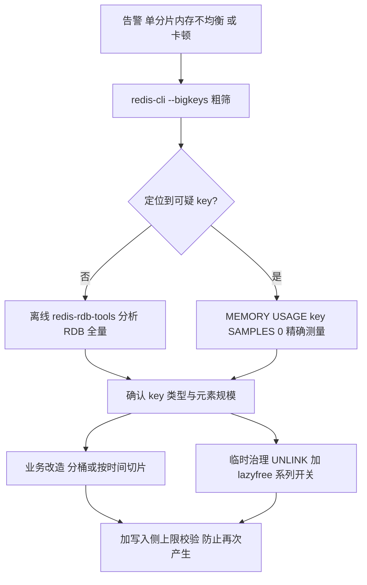

### 6.2 热 key：单分片 CPU 打满的元凶

**危害**：单 key 的 QPS 超过单分片处理能力（单核约 8 万~12 万 QPS），即使集群有 100 个分片，热点也只打在一个分片上。表现是"整体 QPS 不高但某个节点 CPU 100%"。

**发现手段**：

| 工具 | 说明 |
| --- | --- |
| `redis-cli --hotkeys` | **要求 `maxmemory-policy` 是 LFU 系列**，否则报错；基于采样，只能近似 |
| `MONITOR` | 全量命令回放，**生产禁用**（吞吐掉一半以上，且泄露所有 key） |
| `INFO commandstats` | 只能看到命令级别的调用次数与耗时，看不到 key |
| `latency monitor` | 只看事件耗时，不定位 key |
| 客户端埋点 | 在 Redis 客户端 SDK 里做 key 维度的本地计数（推荐），按分钟上报 |
| `redis-cli --hotkeys` 替代 | `--memkeys` 是内存维度，不是 QPS 维度 |
| 代理层统计 | 如果有 Redis 代理（如 Twemproxy、Codis、Redis Cluster Proxy），在代理层做 key 统计 |
| `OBJECT FREQ key` | 单个 key 的访问频率计数器（LFU） |

**治理**：

1. **本地缓存**：热点 key 在应用 JVM 内用 Caffeine 缓存 1~5 秒（允许短暂不一致），这是最有效的手段。
2. **读写分离**：热点读分散到多个从节点（Redis Cluster 的从节点默认不服务读，需要 `READONLY` 命令开启）。
3. **key 打散（加随机后缀）**：`hotkey` 变成 `hotkey:0`~`hotkey:9`，读的时候随机选一个，写时写 10 份或用 `MGET` 聚合——代价是写入放大 10 倍，且 `MGET` 在 Cluster 下要跨节点。
4. **拆分到独立实例**：把秒杀类热点数据单独部署一套 Redis。
5. **限流兜底**：网关层对热点 key 对应的接口限流，避免把 Redis 打挂。

### 6.3 内存碎片与 activedefrag

**碎片率的定义**：

```
mem_fragmentation_ratio = used_memory_rss / used_memory
```

- `1.0~1.5`：正常（jemalloc 的 size class 造成的内部碎片本身就有 1.1~1.2）。
- `> 1.5`：碎片偏高，考虑 `activedefrag` 或重启。
- `< 1`：**`used_memory_rss < used_memory`，说明发生了 swap**，性能会断崖式下跌（磁盘延迟 vs 内存延迟差 4 个数量级）。这是最危险的信号，用 `free -m` 检查 swap 使用量。

碎片来源：频繁的 `DEL`/`EXPIRE` 造成的外部碎片（内存有空隙但不连续）、大 value 与小 value 混合、listpack 扩容后缩容、`alloc` 与 `len` 不匹配（SDS 惰性释放）。

**activedefrag（4.0 起）**：

| 配置 | 默认值 | 说明 |
| --- | --- | --- |
| `activedefrag` | `no` | 总开关 |
| `active-defrag-ignore-bytes` | `100mb` | 碎片浪费小于 100MB 不启动 |
| `active-defrag-threshold-lower` | `10` | 碎片率（`frag_pct`）低于 10% 不启动 |
| `active-defrag-threshold-upper` | `100` | 碎片率高于 100% 时用最大 CPU |
| `active-defrag-cycle-min` | `1` | 最低占用 CPU 时间百分比 |
| `active-defrag-cycle-max` | `25` | 最高占用 CPU 时间百分比 |
| `active-defrag-max-scan-fields` | `1000` | 单次扫描的 field 上限，防止大 hash 卡住 |

碎片率的计算看 `INFO memory` 的 `allocator_frag_ratio`（jemalloc 内部碎片，理想 1.0~1.5）与 `mem_fragmentation_ratio`（含 OS 层面）。`MEMORY PURGE`（4.0+）可以主动让 jemalloc 归还内存给 OS（同步操作，慎用）。

**注意**：`activedefrag` 只处理 jemalloc 层面能回收的碎片，且会在 `serverCron` 里消耗 CPU。若碎片来自"大量已删除但 SDS 未释放"的场景（惰性释放），重启是唯一根治手段。

### 6.4 Pipeline：用 RTT 换吞吐

**原理**：Redis 是请求-响应协议，不 pipeline 时每条命令要等一个 RTT。pipeline 把 N 条命令一次性发出，服务端按顺序执行并把 N 个回复一起写回，把 N 个 RTT 压成 1 个。

| 维度 | 单条命令 | Pipeline（N=100） | MULTI/Lua |
| --- | --- | --- | --- |
| RTT 次数 | N | 1 | 1（Lua）/ 1（MULTI） |
| 原子性 | 单条原子 | **无**，中间会被其他客户端插入 | 有 |
| 客户端内存 | 低 | 需缓存 N 个回复 | 低 |
| 服务端输出缓冲区 | 低 | **N 个回复同时占用 `client-output-buffer-limit`** | 低 |
| 适用 | 低频、需要即时结果 | 批量写、批量读、无原子性要求 | 需要原子的多命令逻辑 |

**关键数字与陷阱**：

- 单条命令的网络往返在局域网约 0.1~0.3ms，pipeline 100 条后单命令分摊的 RTT 可降到微秒级，吞吐提升 5~10 倍。
- **批次不要太大**：一次 10 万条命令会让输出缓冲区撑爆（默认 `client-output-buffer-limit normal 0 0 0` 对普通客户端不限制，但内存会涨），推荐**每批 100~1000 条**。
- `redis-cli --pipe` 用于批量导入（`cat data.txt | redis-cli --pipe`），它用 `redis-cli` 自己实现的高效写入路径。
- **Pipeline 与 Cluster 的坑**：`JedisCluster`/`Lettuce` 的 pipeline 必须保证同一批 key 落在同一 slot，否则报 `CROSSSLOT Keys in request don't hash to the same slot`。解决：用 hash tag（`{user1000}:name`）把相关 key 固定到同一 slot，或分组后分别 pipeline。
- **Pipeline 不是原子**：中间可能穿插其他客户端的命令；需要原子用 `MULTI`/`EXEC` 或 Lua 脚本。`MULTI` 可以和 pipeline 混用（把 `MULTI`、若干命令、`EXEC` 一次性发出，省 RTT），但 `WATCH` 必须在 `MULTI` 之前单独发出，不能在 `MULTI` 内部使用。
- **Lua 脚本**：一次网络往返 + 原子执行，但脚本必须**快**（Redis 有 `lua-time-limit` 默认 `5000` 毫秒的保护，超时后只允许 `SCRIPT KILL` 或 `SHUTDOWN NOSAVE`）。

## 七、慢查询日志与 latency monitor

### 7.1 slowlog

配置：

| 配置 | 默认值 | 说明 |
| --- | --- | --- |
| `slowlog-log-slower-than` | `10000` | 单位**微秒**，即 10ms；`0` 记录所有命令；`-1` 关闭 |
| `slowlog-max-len` | `128` | 内存中的慢日志条数，超出后淘汰最旧的 |

命令：

```
SLOWLOG GET [count]     # 返回 id、时间戳、执行微秒、命令参数、客户端地址、客户端名
SLOWLOG LEN
SLOWLOG RESET
```

注意事项：

- 慢日志**只记录命令执行时间，不含网络传输与排队等待时间**。排队时间用 `latency monitor` 的 `command` 事件衡量。
- 慢日志里**不会记录 `EXEC` 内部的单条命令之外的排队耗时**，且 `EXEC` 整体算一条。
- `slowlog-max-len` 默认 128 很小，生产建议调大到 1000+ 并定期用采集器拉走（`SLOWLOG GET 1000`）。
- **典型慢命令**：`KEYS *`（O(N)，必须用 `SCAN`）、`FLUSHALL`（O(N)）、`HGETALL` 大 hash、`SMEMBERS` 大 set、`SORT`（O(N log N) 或 O(N*M)）、`ZUNIONSTORE` 大集合、`EVAL` 里的长循环、`DEL` 大 key。

### 7.2 latency monitor

`latency-monitor-threshold`（默认 `0`，即关闭）单位毫秒，设置后 Redis 会记录**超过该阈值的事件**。与 slowlog 的区别：latency monitor 记录的是**事件级耗时**，包括 `fork`、`expire-cycle`、`eviction-del` 这些不是命令的耗时。

| 命令 | 作用 |
| --- | --- |
| `LATENCY LATEST` | 列出所有事件的最新一次延迟与最大值 |
| `LATENCY HISTORY event` | 某事件的历史 160 条记录（时间戳 + 毫秒） |
| `LATENCY RESET [event...]` | 重置 |
| `LATENCY DOCTOR` | **人类可读的诊断建议**，排查卡顿第一步 |
| `CONFIG SET latency-monitor-threshold 100` | 运行时开启，只影响新事件 |

常见事件名：`command`、`expire-cycle`、`eviction-cycle`、`eviction-del`、`fork`、`aof-write`、`aof-fsync-always`、`aof-fstat`、`rdb-unlink-temp-file`。

**排查卡顿的标准流程**：

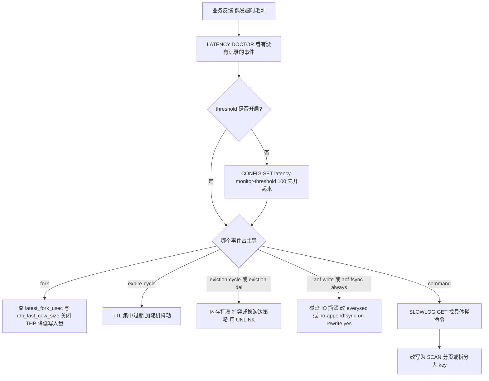

### 7.3 Java 客户端侧的配合

- **超时设置**：`JedisPoolConfig` 的 `setMaxWaitMillis` 不是命令超时，命令超时是 `Jedis` 构造时的 `timeout`（默认 2000ms，`Protocol.DEFAULT_TIMEOUT = 2000`）。超时设太小会误判（如 `BGSAVE` fork 慢导致抖动），设太大故障时线程池会被占满。
- **连接池**：`JedisPoolConfig` 的 `maxTotal`（默认 8）、`maxIdle`（默认 8）、`minIdle`（默认 0）、`maxWaitMillis`（默认 -1，即无限等待——**生产必须设**）。命令超时/连接断开会产生大量 `JedisConnectionException: Could not get a resource from the pool`。
- **Lettuce**：基于 Netty，默认共享单个连接（`RedisClient` 是线程安全的），命令超时 `RedisURI` 的 `timeout` / `RedisClientOptions` 的 `timeoutOptions`（默认 60 秒）。Lettuce 是异步非阻塞模型，**pipeline 与命令超时行为与 Jedis 完全不同**，排查时要看 `RedisCommandTimeoutException`。
- **`redis-py`/`jedis` 的 pipeline 与事务**：`jedis.pipelined()` 返回 `Pipeline`，`sync()` 收结果；`MultiKeyPipelineBase` 保证同 slot。

## 八、高级岗三问

### 8.1 为什么这么设计

| 设计决策 | 替代方案 | 选择的代价 |
| --- | --- | --- |
| 单线程执行命令 | 多线程 + 锁保护数据 | 单命令阻塞全实例；靠 IO 线程与 Cluster 扩展 |
| 渐进式 rehash | 一次性 rehash（阻塞但简单） | 实现变复杂；`SCAN` 语义变为"可能重复" |
| 跳表而非平衡树 | 红黑树 / B+ 树 | 指针更多、内存略高（每节点平均 1.33 个 forward 指针） |
| listpack 替代 ziplist | 保留 ziplist | 每 entry 多 1~5 字节 backlen，换来无连锁更新 |
| 近似 LRU | 精确 LRU（链表） | 淘汰不够精确，用 `maxmemory-samples` 调 |
| 近似 LFU | 精确 LFU | 新 key 从 `LFU_INIT_VAL = 5` 起步，有误杀 |
| fork + COW 做快照 | 加锁全量拷贝 | fork 阻塞、COW 内存放大 |
| AOF 混合持久化 | 纯 AOF / 纯 RDB | AOF 文件不再是"纯文本可读"（前段是二进制） |
| 7.0 多部分 AOF | 单文件 + 重写缓冲区 | 目录结构变复杂，运维脚本要改路径 |

### 8.2 线上出问题怎么定位

| 现象 | 第一步命令 | 关键指标 | 常见根因 |
| --- | --- | --- | --- |
| 整体卡顿、超时 | `LATENCY DOCTOR`、`SLOWLOG GET 10` | `latency_percentiles_usec` | 慢命令 / fork |
| CPU 100% | `INFO commandstats`、`--hotkeys` | `instantaneous_ops_per_sec` | 热 key、`KEYS *`、大 key 扫描 |
| 内存持续上涨 | `INFO memory`、`--bigkeys`、`--memkeys` | `used_memory`、`mem_fragmentation_ratio` | 无 TTL 的 key、大 key、客户端缓冲区 |
| 频繁 RDB | `INFO persistence` | `rdb_changes_since_last_save`、`rdb_last_cow_size` | 写入量大、`save` 配置过密 |
| 写入报 OOM | `INFO memory`、`CONFIG GET maxmemory*` | `maxmemory_policy` | `volatile-*` 无带 TTL key、`noeviction` |
| 主从反复全量同步 | `INFO replication` | `master_link_status`、`sync_full`、`repl_backlog_histlen` | 输出缓冲区打爆、backlog 太小 |
| AOF 写入延迟 | `INFO persistence` | `aof_delayed_fsync`、`aof_pending_bio_fsync` | 磁盘慢、重写期间竞争 |
| 重启后数据变少 | `INFO persistence` | 加载日志 | AOF 优先且 AOF 不完整 |
| 从节点读到旧数据 | `INFO replication`、`TTL` | `slave_read_only` | 从节点不主动删过期 key（3.2 前连读也不判断） |

### 8.3 规模变大后会怎样

- **QPS 上来**：单实例单核打满 → 先开 `io-threads 4` 观察，再上 Cluster 分片；热 key 单独打散或加本地缓存。
- **数据量上来**：fork 时间随内存线性增长（每 GB 约 2MB 页表），20GB 以上实例的 fork 可到百毫秒级 → 拆分成多个小实例；`rdb_last_cow_size` 监控写入放大。
- **节点变多**：Cluster 的 `CLUSTER SLOTS` 元数据、Gossip 通信、`MOVED`/`ASK` 重定向、跨 slot 的 `MGET`/Lua 都需要用 hash tag 规划；`cluster-node-timeout` 默认 `15000` 毫秒，建议按网络情况调小。
- **从节点变多**：复制风暴（一个主节点带太多从节点，全量同步时 fork 与带宽压力大）→ 用级联复制（从节点的从节点）或加中间层。
- **客户端变多**：连接数默认上限 `maxclients 10000`，超出后新连接收到 `ERR max number of clients reached`；7.0 用 `maxmemory-clients` 控制客户端缓冲区总量。

## 高频面试题

### Q1. Redis 为什么快？单线程到底指什么？（高频必问）

**答题框架（30 秒版）**：四个原因——纯内存操作、单线程命令执行（无锁无切换）、IO 多路复用 `epoll`、精调的数据结构编码；"单线程"指的是**命令的解析与执行串行**，不是整个进程只有一个线程（6.0 起有 IO 线程，一直有 `bio` 后台线程与 fork 子进程）。

**展开（2 分钟版）**：
1. 内存：命令路径上没有磁盘 IO，一次内存访问约 100ns。
2. 单线程：避免锁竞争与上下文切换，`dict`、`list` 都可以做非线程安全实现（`dict` 连迭代器失效都不需要考虑）。
3. `epoll`：`aeEventLoop` + `aeApiPoll`，O(就绪 fd)，1 万连接无压力。
4. 编码：SDS 取长度 O(1)、embstr 一条 cache line、小对象用 listpack 把内存放大压到几字节级。
5. 代价：任何 O(N) 命令阻塞全实例，所以必须禁 `KEYS *`、限制大 key、用 `SCAN`。

**追问**：6.0 的多线程 IO 边界？答：`io-threads` 只搬运 socket 读写与解析，命令执行仍在主线程，配置默认 1（不启用），官方建议 8 核设 4；如果瓶颈是命令本身，开 IO 线程无效。

### Q2. 讲讲 SDS、embstr 和 44 这个数字

**答题框架（30 秒版）**：SDS 是 Redis 自己实现的字符串，header 有 `len`/`alloc`/`flags`，解决 C 字符串取长度 O(N)、不二进制安全、易溢出三个问题；`embstr` 是"redisObject 与 SDS 在同一次 malloc 里"的小字符串编码，阈值 44 字节，由 64 字节 cache line 减去 robj 16 字节、sdshdr8 3 字节、结尾 `\0` 1 字节算出。

**展开（2 分钟版）**：
1. 5 种 header：`sdshdr5/8/16/32/64`，按 `len` 大小自动选，头占 1/3/5/9/17 字节。
2. 空间预分配 `sdsMakeRoomFor`：`newlen < 1MB` 时按 2 倍，否则多给 1MB（`SDS_MAX_PREALLOC`）。
3. embstr 只读，`APPEND`/`SETRANGE` 会转 `raw`（两次 malloc）。
4. 编码转换不可逆：`raw` 不会变回 `embstr`。

**追问**：为什么 `OBJECT ENCODING` 有时候是 `int`？答：`SET k 123` 时 `tryObjectEncoding` 判断可转 `long` 就直接把值存在 `ptr` 里，并共享 `0~9999` 的整数对象（`OBJ_SHARED_INTEGERS`）。

### Q3. ziplist 的连锁更新是什么？Redis 7.0 怎么解决的？

**答题框架（30 秒版）**：ziplist 每个 entry 存 `prevlen` 表示前一个 entry 的长度，前一个 entry 长度跨过 254 字节时 `prevlen` 要从 1 字节变成 5 字节，这会改变当前 entry 的长度，进而可能让下一个 entry 的 `prevlen` 也要扩，最坏每次插入 O(N²)。7.0 起 hash/zset/set/quicklist 节点改用 **listpack**，每个 entry 用尾部 `backlen` 记录自身长度，从后往前遍历不需要知道前一个 entry 长度，因此不存在连锁更新。

**展开（2 分钟版）**：
1. ziplist 结构：`zlbytes`(4) `zltail`(4) `zllen`(2) entries `zlend`(0xFF)；`zllen` 上限 65535。
2. 单个 entry：`prevlen` + `encoding` + `content`，`prevlen` 是 1 或 5 字节。
3. listpack 结构：`total-bytes`(4) `num-elements`(2) entries `0xFF`；entry 是 `encoding` + `content` + `backlen`，`backlen` 最多 5 字节倒序编码。
4. 代价：listpack 每个 entry 多 1~5 字节，且 `num-elements` 超过 65535 时固定返回 65535，需要遍历计数。

**追问**：7.0 改了哪些配置名？答：`hash-max-ziplist-entries` → `hash-max-listpack-entries`（128），`hash-max-ziplist-value` → `hash-max-listpack-value`（64），`zset-max-ziplist-*` → `zset-max-listpack-*`，`list-max-ziplist-size` → `list-max-listpack-size`（128），旧名在 7.0 作为废弃别名保留。

### Q4. 渐进式 rehash 的过程？rehash 期间怎么查找和写入？

**答题框架（30 秒版）**：`dict` 有 `ht[0]`/`ht[1]` 两张表和 `rehashidx` 游标。扩容时给 `ht[1]` 分配 2 倍空间，`rehashidx` 从 0 开始，之后每次增删改查都顺手搬一个桶（`_dictRehashStep`），`serverCron` 里再搬最多 1ms（`dictRehashMilliseconds(d, 1)`）。期间**查找查两张表、新增只写 `ht[1]`**，搬完后释放 `ht[0]` 并互换，`rehashidx` 回到 -1。

**展开（2 分钟版）**：
1. 触发：`used >= size` 且 `dict_can_resize`（有 fork 子进程时会临时关闭），或 `used/size > dict_force_resize_ratio = 5` 强制扩容；收缩条件是 `ht_used[0] / size < 10%`。
2. 初始容量 `DICT_HT_INITIAL_SIZE = 4`。
3. `SCAN` 的游标用 reverse binary iteration，保证扩容/收缩期间不漏元素（可能重复），业务要幂等。
4. `activerehashing yes` 默认开启，关闭后 rehash 只能靠请求路径推进，可能出现"长期处于 rehashing 状态"。

### Q5. Redis 的过期删除策略？为什么会有 key 明明过期了还占内存？

**答题框架（30 秒版）**：惰性删除（`expireIfNeeded`，访问时判断）+ 定期删除（`activeExpireCycle`，每秒 10 次，每次随机抽 20 个 key，过期比例超 10% 就继续，受 1000us/25% CPU 的预算约束）。所以**从不被访问的过期 key 会一直占内存**，直到定期删除随机抽到它。

**展开（2 分钟版）**：
1. 从节点不主动删除过期 key（`expireIfNeeded` 在主从场景直接返回），靠主节点同步 `DEL`/`UNLINK`；Redis 3.2 起从节点读取时会判断逻辑过期。
2. `lazyfree-lazy-expire yes` 让过期删除走 `UNLINK` 异步释放，避免大 key 过期卡顿。
3. **集中过期故障**：整点批量写入的 key 会在同一分钟集中过期，`activeExpireCycle` 采样命中率极高，CPU 被打满、延迟毛刺；治理是给 TTL 加随机抖动。
4. TTL 也存在 `expires` 字典里，key 有 TTL 会多一份 dictEntry 的内存开销。

### Q6. 内存淘汰的 8 种策略怎么选？LRU 和 LFU 的实现差别？

**答题框架（30 秒版）**：`maxmemory-policy` 默认 `noeviction`（写命令直接报 OOM）；8 种 = `noeviction` + `allkeys-{lru,lfu,random}` + `volatile-{lru,lfu,random,ttl}`。纯缓存用 `allkeys-lru`；有明显热点用 `allkeys-lfu`；缓存与持久数据混部用 `volatile-*`（**没有带 TTL 的 key 时会退化成 noeviction 报错**）。LRU/LFU 都是**近似**实现：`redisObject.lru` 24 位，采样 `maxmemory-samples`（默认 5）个放入 16 槽淘汰池取最优。

**展开（2 分钟版）**：
1. LRU：`LRU_CLOCK_RESOLUTION = 1000` 毫秒，24 位时钟最大约 194 天会回绕；命中非只读命令时更新 `robj.lru`。
2. LFU（4.0+）：24 位拆成高 16 位衰减时间 + 低 8 位计数器；概率递增 `1/((counter - LFU_INIT_VAL)*lfu-log-factor + 1)`，`lfu-log-factor` 默认 10；衰减按 `lfu-decay-time`（默认 1 分钟）；新 key 从 `LFU_INIT_VAL = 5` 起步。
3. 淘汰池 `EVPOOL_SIZE = 16`，跨轮保留，所以比单轮采样准。
4. `maxmemory` 只限制 `used_memory`，要留出 fork COW 与碎片余量，建议设为机器/容器内存的 70%~80%。

**追问**：为什么用近似不用精确？答：精确 LRU 需要全局双向链表，每 key 两个指针 + 每次访问搬节点，内存与 CPU 都不可接受；近似版把成本压到采样与 16 槽池。

### Q7. 场景题：线上 Redis 每隔一小时出现一次明显卡顿，怎么排查？

**答题框架（30 秒版）**：先按"周期性"这个特征锁定三类原因——**RDB/AOF 重写的 fork**、**集中过期**、**定时任务/备份脚本**。开 `latency-monitor-threshold 100`，用 `LATENCY DOCTOR` / `LATENCY LATEST` 看哪个事件占主导，再看 `INFO stats` 的 `latest_fork_usec` 与 `INFO persistence` 的 `rdb_last_cow_size`、`aof_delayed_fsync`。

**展开（2 分钟版）**：
1. 如果 `LATENCY LATEST` 显示 `fork`：确认 `save` 配置与 `auto-aof-rewrite-*`（默认 AOF 至少 `64mb` 且翻倍才触发）；检查 THP 是否开启（COW 单位从 4KB 变 2MB）、`vm.overcommit_memory` 是否为 1；`latest_fork_usec` 超过 1 秒说明页表太大，考虑拆分实例。
2. 如果显示 `expire-cycle`：说明大量 key 在同一时间过期，查业务是否整点批量写；方案是 TTL 加随机抖动。
3. 如果显示 `aof-write`/`aof-fsync-always`：磁盘 IO 瓶颈，`aof_delayed_fsync` > 0 是铁证；改 `appendfsync everysec`、`no-appendfsync-on-rewrite yes`。
4. 如果都不明显：看宿主机是否有 cron 备份（`BGSAVE` 或 `rdb` 拷贝）、是否有监控采集脚本跑 `KEYS`/`--bigkeys`。
5. 兜底：`--latency` 与 `--latency-history` 采样，确认毛刺的时间点与幅度。

### Q8. 场景题：实例内存满了但没报 OOM，反而越来越慢，怎么定位？

**答题框架（30 秒版）**：先分清是"真内存不够"还是"碎片/swap"。看 `INFO memory` 的 `used_memory`、`used_memory_rss`、`mem_fragmentation_ratio`、`allocator_frag_ratio`；`mem_fragmentation_ratio < 1` 说明发生了 **swap**，这是性能断崖的头号原因；`> 1.5` 是碎片，考虑 `activedefrag` 或重启。

**展开（2 分钟版）**：
1. `free -m` 看 swap 是否被占用；容器里看 cgroup 的 `memory.stat`。
2. 碎片来源：频繁删除（外部碎片）、大 value 与小 value 混存、SDS 惰性释放。
3. 开启 `activedefrag yes`（默认 no），`active-defrag-threshold-lower 10`、`active-defrag-cycle-max 25`；确认 jemalloc 有背景 purge 线程。
4. 如果内存是被客户端输出缓冲区吃掉的：`INFO clients` 的 `client_recent_max_output_buffer`、`client-output-buffer-limit`；7.0 起用 `maxmemory-clients` 限制。
5. 根治手段：重启（碎片彻底清理）、拆分实例、治理大 key 与无 TTL 的 key。

### Q9. 场景题：主从同步反复断开、频繁全量同步，怎么查？

**答题框架（30 秒版）**：看 `INFO replication` 的 `master_link_status`、`sync_full`、`sync_partial_ok`、`sync_partial_err`、`repl_backlog_histlen`、`repl_backlog_size`，以及 `INFO stats` 的 `sync_full` 是否持续增长。最常见三类原因：**输出缓冲区打爆**、**repl backlog 太小导致部分同步失败**、**网络/`repl-timeout`**。

**展开（2 分钟版）**：
1. 全量同步时主节点要为从节点缓冲写命令，大 key 或大事务会瞬间撑爆 `client-output-buffer-limit slave 256mb 64mb 60`（默认），触发主节点断开从节点 → 无限重同步。治理：治大 key、拆分、调大该限制（有内存风险）。
2. `repl-backlog-size` 默认 `1mb`，写量大时从节点短暂断连后 backlog 里的增量已被覆盖，只能全量同步；建议按"断开时长 × 写入速率"估算后调大（生产常用 64mb~256mb）。
3. `repl-timeout` 默认 `60` 秒；`repl-ping-slave-period` 默认 `10` 秒。
4. 从节点 `slave-read-only yes` 保护、`slave-serve-stale-data` 决定断连期间是否服务旧数据。
5. 检查 `repl-diskless-sync`（默认 `yes`，6.0 起）：无盘复制不落盘，但要求网络带宽充足，否则也可能超时。

### Q10. AOF 的 `appendfsync` 三种策略有什么区别？线上怎么选？

**答题框架（30 秒版）**：`always`（每条命令 fsync，最安全，QPS 掉到几百~几千）、`everysec`（默认，后台 `bio` 线程每秒 fsync，最多丢 1 秒）、`no`（交给内核，约 30 秒，最快）。生产选 `everysec`，配合 `no-appendfsync-on-rewrite` 处理重写期间的 IO 争抢。

**展开（2 分钟版）**：
1. 写路径三步：写 `server.aof_buf`（内存）→ `beforeSleep` 里 `write()` 到 page cache → 按策略 `fsync()`。所以 `write()` 成功不代表落盘。
2. `everysec` 的毛刺：上一次 fsync 未完成时主线程最多等 2 秒，`aof_delayed_fsync` 会累加。
3. `aof-load-truncated yes`（默认）在崩溃导致的尾部截断时自动截断并启动；`no` 则拒绝启动，需要 `redis-check-aof --fix`。
4. 混合持久化 `aof-use-rdb-preamble yes`（4.0 引入、5.0 起默认）让 AOF 前半段是 RDB 二进制、后半段是命令，重启加载快得多。

### Q11. 场景题：重启后数据比预期少了一大截，为什么？

**答题框架（30 秒版）**：Redis 的恢复优先级是"**只要 `appendonly yes` 就只加载 AOF，完全忽略 RDB**"（`loadDataFromDisk()`）。典型事故是：一直用 RDB，后来开了 AOF，但 AOF 是某个时间点才建的空/不全文件，于是重启后回到了 AOF 建立时的状态。

**展开（2 分钟版）**：
1. 确认 `CONFIG GET appendonly` 与启动日志里的 `DB loaded from append only file` / `DB loaded from disk`。
2. 7.0 起 AOF 是 `appendonlydir/` 目录 + manifest，检查 manifest 里的 base 文件与 incr 文件是否完整；文件缺失会拒绝启动。
3. 安全开启 AOF 的顺序：`CONFIG SET appendonly yes`（触发后台重写，基于当前内存生成全量）→ 等 `aof_rewrite_in_progress` 归 0 → `CONFIG REWRITE` 写回配置文件。
4. 从节点/新实例启动时如果 AOF 为空，也会以空数据启动，注意 `appendfsync` 与磁盘权限（`aof_last_write_status: err` 表示 AOF 写入失败但实例仍在跑，`stop-writes-on-bgsave-error` 只管 RDB）。
5. 兜底：保留 RDB 与 AOF 双份备份，且把 `dump.rdb` 与 `appendonlydir` 定期复制到对象存储。

### Q12. Pipeline、MULTI/EXEC、Lua 三者的取舍？

**答题框架（30 秒版）**：Pipeline 解决 RTT（吞吐），**不保证原子**；`MULTI`/`EXEC` 保证原子但不支持中间依赖结果（没有 `if` 分支）；Lua 保证原子且能在服务端做逻辑判断，但会阻塞主线程（`lua-time-limit` 默认 5000ms 的保护）。批量写且无原子要求 → Pipeline（每批 100~1000 条）；需要原子 + 条件逻辑 → Lua；单纯的原子多命令 → `MULTI`。

**展开（2 分钟版）**：
1. `MULTI`/`EXEC` 的原子性边界：`EXEC` 前命令只是入队，`WATCH` 的 key 被改则 `EXEC` 返回 nil；**`MULTI` 内的命令不会因为某条失败而回滚其他命令**（Redis 没有回滚）。
2. Lua 的坑：脚本里不要有随机性命令（Redis 7 会拒绝写入后再执行随机命令的脚本，报错提示脚本不能有写操作与非确定性命令混用），不要长时间循环，`SCRIPT KILL` 只能杀未执行写操作的脚本。
3. Cluster 下 Pipeline 与 Lua 都要求所有 key 在同一 slot（hash tag 解决）。
4. Pipeline 的批次大小建议 100~1000，太大会撑爆输出缓冲区；`redis-cli --pipe` 适合批量导入。

### Q13. 怎么理解 Redis 的"单线程模型"下的高并发？会有什么瓶颈？

**答题框架（30 秒版）**：并发靠"事件循环 + 非阻塞 IO"而不是线程，多个连接的命令按到达顺序串行执行。瓶颈有三个：**单命令复杂度**（O(N) 命令）、**单核 CPU**（解码/执行/编码）、**单实例内存**（fork 与复制）。解法分别是禁用慢命令与治理大 key、开 `io-threads` 或上 Cluster、拆分实例。

**展开（2 分钟版）**：
1. 串行执行意味着**没有"命令级别的并发"，但有"连接级别的并发"**，且每条命令是原子的（除了 `MULTI` 内的多条）。
2. 慢命令的影响面是**整个实例**，不是单个连接。
3. 6.0 的 IO 线程只分担网络；`io-threads-do-reads` 默认 `no`，读路径卸载需要显式打开。
4. 横向扩展用 Cluster，`CLUSTER SLOTS` 默认 16384 个 slot，跨 slot 的多 key 命令会报 `CROSSSLOT`。

### Q14. 大 key 和热 key 怎么发现、怎么治理？

**答题框架（30 秒版）**：大 key 用 `redis-cli --bigkeys` 粗筛 + `MEMORY USAGE key SAMPLES 0` 精测 + **离线 `redis-rdb-tools` 全量分析 RDB**（`--bigkeys` 每种类型只报最大的一个）；热 key 用 `--hotkeys`（要求 LFU 策略）、客户端埋点、代理层统计，`MONITOR` 生产禁用。治理：大 key 拆分 + `UNLINK` + lazyfree 系列；热 key 本地缓存 + 读写分离 + 加随机后缀打散。

**展开（2 分钟版）**：
1. 大 key 的六大连锁危害：删除阻塞、过期阻塞、COW 放大、全量同步断开、槽倾斜、慢查询。
2. `lazyfree-lazy-user-del yes`、`lazyfree-lazy-expire yes`、`lazyfree-lazy-eviction yes`、`lazyfree-lazy-server-del yes`、`lazyfree-lazy-user-flush yes` 五个开关的作用范围。
3. 热 key 打散的代价：读放大（要聚合）、写放大 N 倍、Cluster 下跨 slot。
4. 最有效的热 key 方案通常是**应用本地缓存 + 短 TTL**，而不是在 Redis 层做花活。

## 易错点与踩坑

| 易错点 | 正确理解 |
| --- | --- |
| "Redis 是单线程的" | 命令执行单线程；6.0 起有 IO 线程，还有 `bio` 后台线程与 fork 子进程 |
| "开了 IO 线程就能提升所有性能" | 只分担 socket 读写；`io-threads` 默认 1 即不启用；慢命令无效 |
| "`maxmemory-policy volatile-lru` 会淘汰所有 key" | 只淘汰带 TTL 的 key；没有可淘汰的 key 时退化成 `noeviction` 报错 |
| "`maxmemory` 可以设成机器内存大小" | 要为 fork COW、碎片、客户端缓冲区留 20%~30% 余量 |
| "过期 key 到期就立刻删掉" | 惰性 + 定期（每秒 10 次、每次抽 20 个）；不被访问的过期 key 会长期占内存 |
| "从节点也会主动删除过期 key" | 从节点不主动删，等主节点同步 `DEL`/`UNLINK`（3.2 起读取时判断逻辑过期） |
| "编码可以退化回去" | hashtable/skiplist/intset 都是单向的，删除元素不会退回 listpack/intset |
| "`list-max-listpack-size` 是 list 的元素总数上限" | 是**单个 quicklist 节点**的上限；list 本身可以是百万元素的 quicklist |
| "ziplist 还在用" | 7.0 起 hash/zset/set 用 listpack；7.2 起 quicklist 节点也是 listpack；ziplist 只在旧 RDB 载入时出现 |
| "`DEL` 大 key 没问题" | 同步释放，10 万元素可阻塞数百毫秒；用 `UNLINK` |
| "AOF 比 RDB 一定安全" | `everysec` 最多丢 1 秒；`always` 也有 fsync 延迟与崩溃窗口 |
| "开了 AOF 后数据就万无一失" | 只要 `appendonly yes` 就**只加载 AOF 忽略 RDB**，AOF 不全反而丢更多 |
| "Pipeline 是原子的" | 不是，中间会被其他客户端命令插入；原子用 `MULTI`/Lua |
| "`MEMORY USAGE` 是 O(1)" | 默认采样估算；`SAMPLES 0` 精确但 O(N) |
| "`--bigkeys` 列出了所有大 key" | 每种类型只保留最大的一个，全量必须离线分析 RDB |
| "`maxmemory-samples` 越大越好" | 准确度提升但 CPU 成本上升，默认 5，常用 5~10 |
| "`activedefrag` 默认开启" | 默认 `no`，需显式开启并配置阈值与 CPU 上限 |
| "`mem_fragmentation_ratio` 越小越好" | `< 1` 说明在用 swap，比碎片严重得多 |
| "`SLOWLOG` 记录了网络耗时" | 只记录命令执行时间；排队时间看 `LATENCY` 的 `command` 事件 |
| "`lua-time-limit` 超时会杀掉脚本" | 默认 5000ms，超时只是开始拒绝其他命令，需要手动 `SCRIPT KILL`/`SHUTDOWN NOSAVE` |
| "`SETNX` + `EXPIRE` 可以做分布式锁" | 两条命令之间有崩溃窗口会死锁，必须用 `SET key v NX PX ms` |
| "`INCR` 是幂等的" | 不是，重试会重复计数；幂等要靠业务侧去重 |
| "HyperLogLog 能删单个元素" | 不能，只能 `PFMERGE`；误差 0.81%，固定 12KB |
| "`EXPIRE` 负数只是不生效" | 负数会**立即删除**该 key |
| "THP 开着对 Redis 没影响" | COW 单位从 4KB 变 2MB，fork 期间内存放大 512 倍，官方要求关闭 |

## 一句话速记

- Redis 快 = 内存 + 单线程命令执行（无锁）+ epoll + 精调编码；单线程只指命令执行，6.0 起有 IO 线程。
- `io-threads` 默认 1，只搬运 socket 读写与解析，命令执行仍在主线程。
- SDS 五档 header（`sdshdr5/8/16/32/64`），扩容 `newlen < 1MB` 时翻倍（`SDS_MAX_PREALLOC`）。
- embstr 阈值 44 = 64（cache line）− 16（robj）− 3（sdshdr8）− 1（`\0`）；写操作会转 raw。
- ziplist 的 `prevlen` 引发连锁更新（最坏 O(N²)）；listpack 用尾部 `backlen` 消除它，代价是每 entry 多 1~5 字节。
- 小对象阈值：hash/zset/listpack 各 128 与 64，set intset 512，list 节点 128（`list-max-listpack-size`）。
- 编码转换单向不可逆，删除元素不会退回去。
- 渐进式 rehash：查两张表、新增只写 `ht[1]`、每步搬 1 桶、`serverCron` 每轮最多 1ms。
- 跳表 `ZSKIPLIST_MAXLEVEL = 32`、`ZSKIPLIST_P = 0.25`，`span` 支持 `ZRANK`。
- 过期 = 惰性（`expireIfNeeded`）+ 定期（每秒 10 次 × 20 个 key，过期比例 > 10% 继续，预算 1000us/25% CPU）。
- 淘汰 8 策略：`noeviction` + `allkeys-{lru,lfu,random}` + `volatile-{lru,lfu,random,ttl}`，默认 `noeviction`。
- 近似 LRU：24 位秒级时钟；近似 LFU：低 8 位计数 + 高 16 位衰减时间（`lfu-log-factor 10`、`lfu-decay-time 1`），新 key 从 `LFU_INIT_VAL = 5` 起。
- `maxmemory-samples` 默认 5，淘汰池 `EVPOOL_SIZE = 16`。
- RDB 靠 fork + COW，一致性快照但有 fork 阻塞与内存放大，`rdb_last_cow_size`/`latest_fork_usec` 是关键指标；必须关 THP、设 `vm.overcommit_memory=1`。
- AOF `appendfsync` 默认 `everysec`（最多丢 1 秒），重写是 fork 子进程遍历内存重建而非压缩旧文件，触发条件 `64mb` + 翻倍。
- 7.0 多部分 AOF：`appendonlydir/` + base + incr + manifest，取消了重写缓冲区。
- 恢复优先级：`appendonly yes` 就只加载 AOF，忽略 RDB。
- 大 key 用 `--bigkeys` 粗筛、`MEMORY USAGE` 精测、离线 `redis-rdb-tools` 全量；不能用 `DEL`，用 `UNLINK`。
- 热 key 用 `--hotkeys`（需 LFU）/客户端埋点；`MONITOR` 生产禁用。
- `mem_fragmentation_ratio < 1` 说明 swap（最危险），`> 1.5` 考虑 `activedefrag`（默认关闭）。
- Pipeline 省 RTT 但不原子，每批 100~1000；Cluster 下同 slot 才可 pipeline（hash tag）。
- `slowlog-log-slower-than` 默认 10000 微秒、`slowlog-max-len` 默认 128；`latency-monitor-threshold` 默认 0（关闭），排查用 `LATENCY DOCTOR`。


