# 05 Redis 高可用、集群与缓存架构

> 一句话定位：Redis 面试的真正分水岭不在"五种数据类型"，而在"复制、哨兵、集群三套高可用机制的失效模式"和"缓存与数据库之间永远对不齐的那段时间窗口" ｜ 面试权重 ★★★★★ ｜ 建议复习 60 分钟

## 本章大纲

- [一、版本基线与整体架构选型](#一版本基线与整体架构选型)
- [二、主从复制原理与故障处理](#二主从复制原理与故障处理)
- [三、Sentinel 哨兵机制](#三sentinel-哨兵机制)
- [四、Redis Cluster 集群](#四redis-cluster-集群)
- [五、缓存穿透、击穿与雪崩](#五缓存穿透击穿与雪崩)
- [六、缓存与数据库一致性](#六缓存与数据库一致性)
- [七、热点 key 与多级缓存](#七热点-key-与多级缓存)
- [八、Redis 分布式锁](#八redis-分布式锁)
- [九、Redis 事务与 Lua 脚本](#九redis-事务与-lua-脚本)
- [十、生产事故复盘](#十生产事故复盘)
- [十一、高级岗三问](#十一高级岗三问)
- [高频面试题](#高频面试题)
- [易错点与踩坑](#易错点与踩坑)
- [一句话速记](#一句话速记)

## 一、版本基线与整体架构选型

### 1.1 版本基线

本章以 **Redis 7.2.x** 为主基线，涉及演进的地方标注 6.2 / 6.0 / 5.0 / 4.0 / 3.0 的差异。客户端侧基线：

| 组件 | 版本 | 关键类 / 配置 | 说明 |
| --- | --- | --- | --- |
| 连接客户端 | Lettuce 6.x | `io.lettuce.core.RedisClient`、`RedisClusterClient` | Spring Boot 2.x 起默认，基于 Netty，连接可共享、线程安全 |
| 连接客户端 | Jedis 5.x | `redis.clients.jedis.JedisPool`、`JedisCluster`、`JedisSentinelPool` | 连接非线程安全，需池化；`JedisCluster` 内部维护槽位映射 |
| Spring 抽象 | Spring Data Redis 3.x | `RedisTemplate`、`StringRedisTemplate`、`LettuceConnectionFactory` | Spring Boot 3.0 起配置前缀由 `spring.redis.*` 改为 `spring.data.redis.*` |
| 分布式锁 | Redisson 3.2x | `RedissonClient#getLock`、`RLock#tryLock` | `lockWatchdogTimeout` 默认 30000 毫秒 |
| 本地缓存 | Caffeine 3.x | `Caffeine#newBuilder`、`Cache#get` | 淘汰算法 W-TinyLFU |
| 布隆过滤器 | Guava 32.x | `BloomFilter#create`、`BloomFilter#mightContain` | 默认 `fpp = 0.03` |
| 布隆过滤器 | RedisBloom 模块 | `BF.RESERVE`、`BF.ADD`、`BF.EXISTS`、`CF.ADD` | Redis 4.0 起以 Module 形式加载，Redis Stack 内置 |
| binlog 订阅 | Canal 1.1.7 | `CanalConnector#getWithoutAck` | 依赖 MySQL `binlog_format=ROW` |

### 1.2 三套高可用机制不是替代关系，是三个层级

很多人把"主从 / 哨兵 / 集群"当成递进关系背，这是错的。它们解决的是**三个不同的问题**：

| 机制 | 解决的问题 | 不解决的问题 | 引入版本 | 最小部署 |
| --- | --- | --- | --- | --- |
| 主从复制 replication | 数据冗余、读扩展 | 主库挂了不会自动切换，写入不可用 | 早期 | 1 主 1 从 |
| 哨兵 Sentinel | 主库故障自动发现与切换 | 单机容量上限、写扩展 | Redis 2.8 | 3 哨兵 + 1 主 2 从 |
| 集群 Cluster | 数据分片、水平扩容、写扩展 | 跨槽事务、复杂多 key 操作 | Redis 3.0 | 至少 3 主 3 从 |

一句话选型：

- 数据量 < 单机内存、QPS 靠读写分离能撑住 → **哨兵**。
- 数据量超过单机内存，或写 QPS 超过单机上限 → **Cluster**。
- 只做缓存、能容忍故障期间短暂不可用 → 可以只用**主从，靠客户端感知故障后人工切换**，但生产上仍建议上哨兵。

### 1.3 高可用全景图

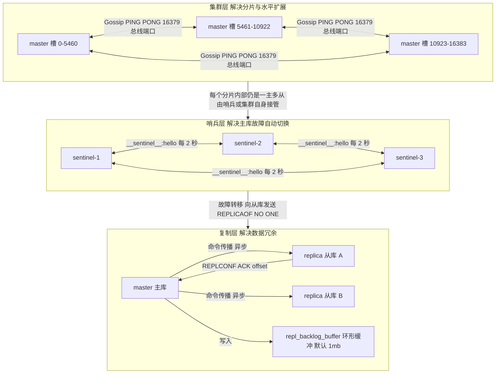

### 1.4 三个必须先记住的数字

- **16384**：Cluster 的哈希槽总数。为什么不是 65536？官方给的理由是心跳包要携带位图，16384 个槽的位图是 2048 字节，65536 个槽是 8192 字节，心跳太贵；同时集群规模通常不超过 1000 节点，16384 足够分配。
- **15000**：`cluster-node-timeout` 默认毫秒数，超过它没收到 PONG 就标记节点 `pfail`。
- **30000**：`repl-timeout` 是 60 秒，但哨兵的 `sentinel down-after-milliseconds` 和 Redisson 的 `lockWatchdogTimeout` 都是 30000 毫秒。这三个数字混淆是面试常见扣分点。

## 二、主从复制原理与故障处理

### 2.1 两条同步路径

Redis 2.8 之前只有 `SYNC`，从库重连就全量重传。2.8 引入 `PSYNC`，拆成全量复制（Full Resynchronization）与部分重同步（Partial Resynchronization）。**全量复制的成本是 O(数据集大小)，部分重同步的成本是 O(断连期间写入量)**，这个量级差是理解一切复制调优的起点。

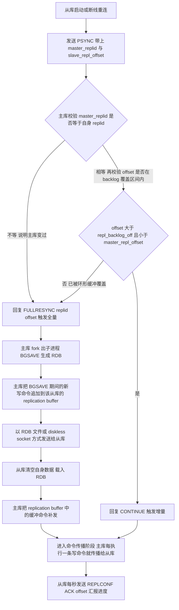

### 2.2 全量复制的四个关键对象

| 对象 | 作用域 | 默认值 | 溢出后果 |
| --- | --- | --- | --- |
| `repl_backlog_buffer` | **主库唯一**，所有从库共享 | `repl-backlog-size` 1mb | 从库 offset 被覆盖，只能全量重传 |
| replication buffer | **每个从库一个**，即客户端输出缓冲区 | `client-output-buffer-limit replica 256mb 64mb 60` | 超硬限制直接断开该从库连接 |
| `master_repl_offset` | 主库累积写入偏移量 | 无 | 单调递增 |
| `slave_repl_offset` | 从库已应用偏移量 | 无 | 与主库差值就是复制延迟字节数 |

两个缓冲区极易混淆，记住这条判据：**`repl_backlog_buffer` 溢出是"所有从库一起遭殃"，replication buffer 溢出是"那一个从库被踢掉"**。

`client-output-buffer-limit replica 256mb 64mb 60` 的三个参数含义是：硬限制 256MB 立即断开；软限制 64MB 且持续超过 60 秒才断开。生产上如果从库执行 `BGSAVE`/`BGREWRITEAOF` 较慢，这个缓冲会堆积，一次断连就等于一次全量复制，形成恶性循环。

### 2.3 部分重同步的判定条件

从库发 `PSYNC <master_replid> <offset>` 后，主库必须同时满足：

1. 携带的 `replid` 等于主库当前的 `server.replid`（PSYNC2 起还支持 `master_replid2`，用于主从角色切换后的再利用）；
2. 从库的 `offset` 落在主库 backlog 的有效区间 `[repl_backlog_off, master_repl_offset]` 内；
3. 从库 offset 对应的数据仍在缓冲区中未被环形覆盖。

任一不满足就走全量。所以 `repl-backlog-size` 的计算公式是：

```
repl-backlog-size >= 主库平均写入速率 (byte/s) * 预计最长断连时间 (s)
```

例如主库写入 2MB/s，从库因网络抖动或慢查询最长可能断连 60 秒，则至少要 120MB。默认 1MB 只够 0.5 秒，是生产上"无限全量同步风暴"的头号元凶。

### 2.4 从库的复制状态机

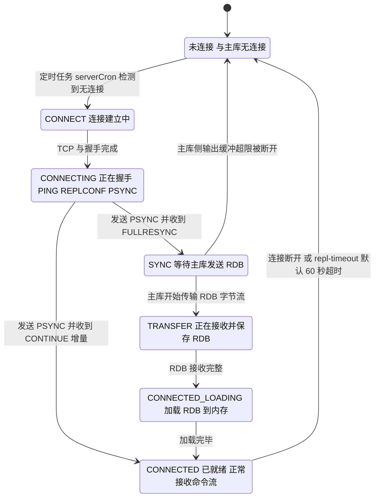

`INFO replication` 里的 `master_link_status` 只有 `up` / `down` 两个值，但底层状态机远不止两个状态。`master_link_status:down` 配合 `master_last_io_seconds_ago` 就能判断是网络断还是主库卡。

### 2.5 复制延迟与故障处理

**判断延迟的正确方法**：不要只看 `INFO replication` 里的 `slave_repl_offset` 与主库 `master_repl_offset` 做减法，因为字节差无法换算成"多少条命令"。真正要监控的是：

```bash
# 主库执行，观察从库 ack 的偏移量与延迟秒数
redis-cli -h master -p 6379 info replication | grep -E "slave[0-9]|master_repl_offset"
# 在从库执行，确认是否有正在等待的 ACK
redis-cli -h replica -p 6379 info replication | grep -E "master_link_status|master_last_io_seconds_ago|slave_read_only"
# 复制积压统计 这三个计数器是定位全量风暴的关键
redis-cli -h master -p 6379 info stats | grep -E "sync_full|sync_partial_ok|sync_partial_err"
```

**`sync_full` 持续增长就是全量风暴**。典型特征：`sync_full` 与 `sync_partial_err` 同比例增长、主库 CPU 被 `BGSAVE` 打满、磁盘 IO 高、`fork` 耗时（`INFO stats` 的 `latest_fork_usec`）上升。

排查与处置步骤：

1. 确认内存是否触发 swap：`redis-cli info memory | grep -E "used_memory_human|mem_fragmentation_ratio"`，`mem_fragmentation_ratio > 1.5` 说明有外部碎片或 swap。
2. 确认 fork 耗时：`latest_fork_usec` 超过 100 万微秒（1 秒）说明实例内存过大，需扩容。
3. 调大 `repl-backlog-size`（建议 64mb 起，按 2.3 的公式算）。
4. 缓解输出缓冲：调大 `client-output-buffer-limit replica`，或降低从库 `BGSAVE` 频率、关闭从库的 RDB 落盘（`save ""`）。
5. 开启无盘复制降低磁盘抖动：Redis 7.0 起 `repl-diskless-sync` 默认 `yes`，`repl-diskless-sync-delay` 默认 5 秒（这个 delay 是为了等更多从库一起来，共享一次 fork 和一份 RDB）。

**主库宕机但未配置哨兵**时的处理：

```bash
# 在从库上提升为主库
redis-cli -h replica-a -p 6379 replicaof no one
# 让另一台从库挂到新主库
redis-cli -h replica-b -p 6379 replicaof new-master-ip 6379
```

注意 `replicaof` 是 Redis 5.0 起的命令名，4.0 及以前是 `slaveof`；配置文件同理，`replicaof` 是 5.0 的名称。命令名 `SLAVEOF` 仍然保留可用。

### 2.6 复制相关的安全阀

| 配置 | 默认值 | 作用 |
| --- | --- | --- |
| `min-replicas-to-write` | 0（关闭） | 至少要有 N 个从库在线才允许写，防脑裂丢数据 |
| `min-replicas-max-lag` | 10（秒） | 从库延迟不超过该值才算"在线" |
| `replica-read-only` | yes | 从库默认只读，禁止写入 |
| `replica-serve-stale-data` | yes | 主从断开时从库仍响应旧数据；设为 no 则除 `INFO`/`REPLICAOF` 外一律返回错误 |
| `repl-timeout` | 60（秒） | 超过该时间无数据交互判定复制超时 |
| `repl-ping-replica-period` | 10（秒） | 主库向从库发送 PING 的周期 |
| `repl-backlog-ttl` | 3600（秒） | 最后一个从库断开后，backlog 保留多久释放 |

`min-replicas-to-write 1` + `min-replicas-max-lag 10` 是防脑裂写入丢失的**唯一有效手段**。原理：主库发现连不上足够多的从库时，直接拒绝写请求（返回错误），宁可牺牲可用性也不产生"只有旧主库有、新主库没有"的脏写。

## 三、Sentinel 哨兵机制

### 3.1 哨兵的三个职责与一条铁律

职责：**监控**（每秒 PING 主库、从库、其他哨兵）、**通知**（通过 Pub/Sub 通知客户端）、**自动故障转移**（选主、切换、通知客户端）。

铁律：**哨兵本身不存数据，它只维护一份"谁现在是主库"的共识**。客户端连接的是哨兵集群而不是主库地址，这样主库切换后客户端能自动获知。Java 侧对应 Jedis 的 `JedisSentinelPool`，以及 Lettuce 的 `RedisClient` 配合 `RedisURI.Builder.sentinel(host, port, masterId)` 构造哨兵 URI（内部走 `connectSentinel` 与 `StatefulRedisSentinelConnection` 监听 `+switch-master`）。

建议部署**奇数个哨兵，至少 3 个**，且分布在不同物理机/可用区。原因是选举 leader 需要 majority = `(哨兵总数 / 2) + 1`，2 个哨兵挂 1 个就无法选举。

### 3.2 主观下线与客观下线

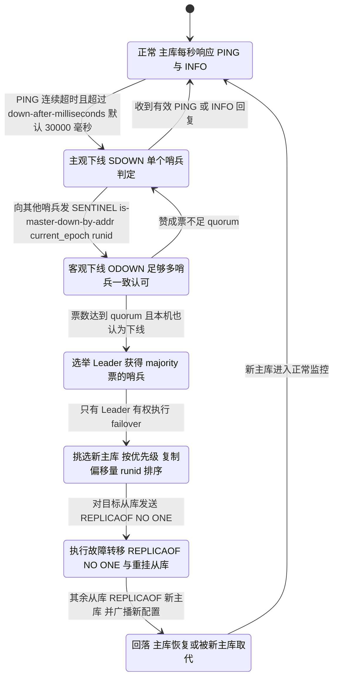

三个容易混淆的数字，必须分清：

| 参数 | 默认值 | 含义 | 谁用它 |
| --- | --- | --- | --- |
| `sentinel down-after-milliseconds` | 30000 ms | 多久没回应判主观下线 | 单个哨兵 |
| quorum | 配置文件 `sentinel monitor mymaster 127.0.0.1 6379 2` 的最后一个参数 | 多少票判客观下线 | 需要 quorum 票，**不要求过半** |
| majority | `(sentinel 总数 / 2) + 1` | 选举 Leader 需要多少票 | **必须过半** |

**quorum 与 majority 不是一回事**：quorum 决定"要不要开始故障转移"，majority 决定"谁来执行"。3 个哨兵、quorum=2 时，如果挂了 2 个哨兵，剩下的 1 个哨兵只能算自己这 1 票——其他哨兵的赞成票一旦停止刷新就不再计入，所以它连 quorum 都凑不齐，判不出 ODOWN；即便把 quorum 配成 1 判出了 ODOWN，它也拿不到 majority（需要 2 票）去选举 Leader。两道门槛任意一道过不去，故障转移都不会执行。这是生产上"主库挂了但没切换"的经典原因。

### 3.3 故障转移的完整时序

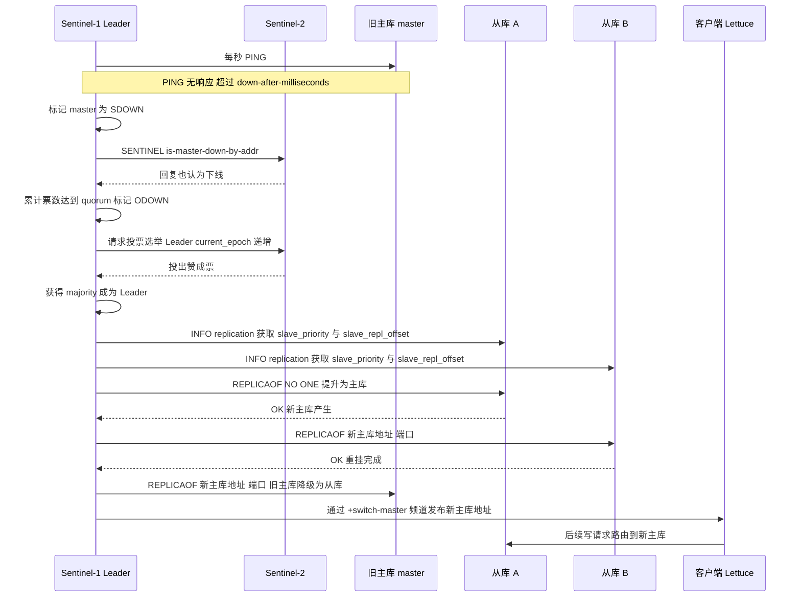

切换的快慢与代价由两个 per-master 配置决定，面试常被追问：

| 配置 | 默认值 | 作用 |
| --- | --- | --- |
| `sentinel failover-timeout` | 180000 ms | 故障转移各阶段的超时窗口：等待从库被提升、等待其余从库重挂新主库、等待旧主库降级为从库都用它；同一个 master 短时间内的重复 failover 也由它节流。调小切换更快，但在慢环境里容易失败重试；调大则一次切换的窗口更长 |
| `sentinel parallel-syncs` | 1 | 故障转移过程中，同时允许几个从库被重新指向新主库。默认 1 是逐个重挂：新主库同一时刻只承受一个从库的同步压力，也避免所有从库同时不可用；重挂走 PSYNC，多数情况能借旧 replid 做部分重同步（`master_replid2`），offset 超出 backlog 窗口才退化为全量。调大能更快把从库挂回，代价是新主库的磁盘与网络可能被同时打满 |

这两个值写在 `sentinel.conf` 里（形如 `sentinel parallel-syncs mymaster 1`），并且是**每个 master 一组**，不是全局值。

### 3.4 选新主库的排序规则

`sentinel.c` 中的 `sentinelSelectSlave` 按以下优先级打分排序：

1. 过滤掉 `master_link_status` 为 `down`、断线超过 `down-after-milliseconds * 10`、`priority = 0`（永不提升）的从库。
2. 比较 `slave_priority`，**越小优先级越高**，默认 100。
3. 优先级相同比较 `slave_repl_offset`，**越大越好**（数据更新）。
4. 偏移量相同比较 `runid`，**字典序越小越好**（oldest runid）。

`replica-priority 0` 是运维上的实用技巧：把某个从库设为 0，它就永远不会被提升，适合做"只读分析节点"。

### 3.5 脑裂与数据丢失

**脑裂场景**：主库与哨兵之间网络分区（或主库所在的机器假死），哨兵把从库提升为新主库，但旧主库仍在接受客户端写入。网络恢复后旧主库被 `REPLICAOF` 到新主库，它会**清空本地数据**做全量同步，那段时间的写入全部丢失。

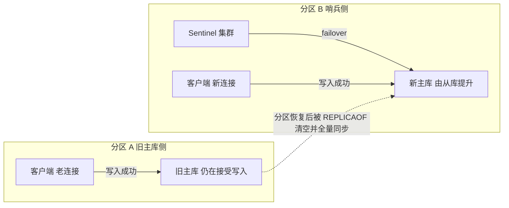

**唯一有效的防御**：

```
min-replicas-to-write 1
min-replicas-max-lag 10
```

旧主库一旦与所有从库断连，写请求直接失败，就不会产生"新主库没有的写入"。代价是牺牲了主库的写入可用性——这是一次明确的 CAP 选择：**在涉及资金/库存的场景选 CP，在纯缓存场景可以容忍丢几百毫秒数据**。

另一个次要措施是调整 `sentinel down-after-milliseconds`，但调大只是降低概率，不能根治。网络分区时间只要超过该阈值就会有风险。

### 3.6 哨兵的自我保护 TILT 模式

哨兵自身会因为系统时间被调整或线程长时间阻塞导致计时器异常，此时它会进入 **TILT 模式**：暂停所有故障判定，只做 INFO 采集。触发条件是连续 2 秒（`SENTINEL_TILT_PERIOD = 2000` 毫秒）未能正常执行定时任务。

现象：`INFO sentinel` 或日志里出现 `+tilt` / `-tilt` 事件。处置：检查宿主机是否 NTP 大幅校时、是否 CPU 被抢占、是否有 `fork` 阻塞。TILT 期间不切换是**正确的**，避免误判引发无谓的故障转移。

## 四、Redis Cluster 集群

### 4.1 分片模型

Redis Cluster 将整个键空间划分为 **16384 个哈希槽（hash slot）**，每个键归属的槽由下式确定：

```
slot = CRC16(key) mod 16384
```

CRC16 用的是 XMODEM 变体。`CLUSTER KEYSLOT <key>` 可以直接查询某个 key 落在哪个槽。

**Hash Tag 机制**：取 key 中**第一个 `{`** 与其**右侧第一个 `}`** 之间的内容做 CRC16；若没有 `{`、`{` 右侧没有 `}`，或两者紧邻（内容为空），则**整个 key 参与 CRC16**——不会跳过空花括号去匹配后面的 `{...}`。

| key | 实际参与哈希的部分 | 用途 |
| --- | --- | --- |
| `user:1001:name` | 整个字符串 | 普通键 |
| `{user:1001}:name` | `user:1001` | 与下面的键落到同一槽 |
| `{user:1001}:order` | `user:1001` | 可以与上一条做 `MGET` |
| `{}` | 整个字符串，回退 | 花括号内为空，等于没写 tag |
| `{}{a}` | 整个字符串，回退 | 第一个 `{` 紧邻 `}`，内容为空 → 整体回退，后面的 `{a}` 不会被采用 |
| `{a}{b}:x` | `a` | 取**第一个 `{` 到其后第一个 `}` 之间**的内容，后面的 `{b}` 被忽略 |

Hash tag 是**唯一能让多 key 操作在 Cluster 中工作**的手段，代价是数据倾斜：同一个 tag 的所有键都落在同一个节点，热点无法分散。

### 4.2 集群总线与 Gossip

Cluster 各节点之间通过一条独立的二进制协议通道通信，称为**集群总线**。端口是服务端口 + **10000**：6379 对应 16379，6380 对应 16380。配置项 `cluster-port` 在 7.0 起可以显式指定，否则默认 0 表示"服务端口 + 10000"。

Gossip 协议的具体行为：

- 每个节点每秒从已知节点列表中**随机选 5 个**节点，挑其中"最久没通信"的一个发 `PING`。
- 每个 `PING`/`PONG` 消息头 `clusterMsg` 里携带发送者视角下**随机若干节点的状态**（至少 3 个），以及发送者自己负责的槽位图。
- 收不到 `PONG` 超过 `cluster-node-timeout`（默认 15000 ms）→ 标记 `PFAIL`（主观下线）。
- 节点间交换 `PFAIL` 信息，当**超过半数持有槽的主节点**都报告某节点 `PFAIL` 时，升级为 `FAIL`（客观下线），广播给全集群。

`CLUSTER NODES` 输出里节点名后的标志位就是这套机制的体现：`myself,master,fail?`、`fail`、`pfail`。

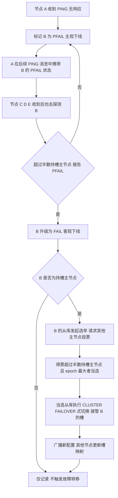

### 4.3 MOVED 与 ASK 重定向

这是 Cluster 面试出现频率最高的一题，必须讲清"槽迁移期间"这个前提。

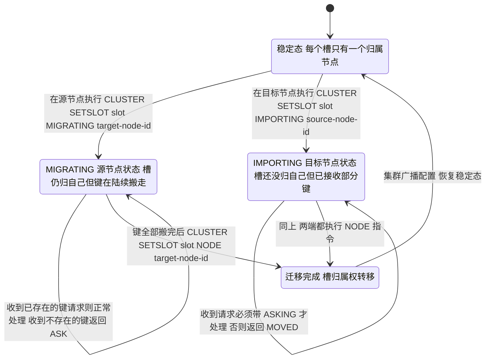

两者的差别：

| 维度 | MOVED | ASK |
| --- | --- | --- |
| 触发时机 | 槽已**永久**属于其他节点 | 槽正在迁移，该键暂时不在本节点 |
| 客户端动作 | **更新本地槽映射缓存**，重试目标节点 | **不更新**映射，本次请求先发 `ASKING` 再发命令 |
| 后续请求 | 永久转向新节点 | 下次仍然先问原节点（直到收到 MOVED） |
| 典型场景 | 稳定期的错误路由、主从切换后 | `redis-cli --cluster reshard` 迁移进行中 |

ASKING 的必要性：目标节点在 `IMPORTING` 状态下，对未迁移过来的槽的请求默认返回 MOVED（防止路由混乱）。客户端先发一条 `ASKING` 命令，目标节点会在该连接上打一个"本次允许"的标记，紧随其后的命令就会被执行。

代码层面，Lettuce 的 `RedisClusterClient` 与 Jedis 的 `JedisCluster` 都会自动处理这两种重定向，并维护一份 `Partitions` 槽映射。`JedisCluster` 默认 `maxAttempts = 5`，遇到重定向会重试。

### 4.4 槽迁移的完整操作

Redis 5.0 起，集群管理命令从 Ruby 脚本 `redis-trib.rb` 迁移到 `redis-cli --cluster` 子命令：

```bash
# 创建 3 主 3 从集群，--cluster-replicas 1 表示每个主库 1 个从库
redis-cli --cluster create \
  10.0.0.1:6379 10.0.0.2:6379 10.0.0.3:6379 \
  10.0.0.4:6379 10.0.0.5:6379 10.0.0.6:6379 \
  --cluster-replicas 1

# 健康检查 重点看是否有槽未覆盖
redis-cli --cluster check 10.0.0.1:6379

# 在线迁移槽 会交互式询问迁移多少个槽 从谁到谁
redis-cli --cluster reshard 10.0.0.1:6379

# 新节点加入后重新均衡
redis-cli --cluster rebalance 10.0.0.1:6379 --cluster-use-empty-masters
```

手工迁移某个槽时，单键搬迁用的是 `MIGRATE`：

```bash
# 注意 单键 MIGRATE 必须在源节点上针对目标节点的连接执行
MIGRATE 10.0.0.2 6379 "" 0 5000 KEYS "{user:1001}:name"
# 批量抽取本槽的键
CLUSTER GETKEYSINSLOT 5000 100
# 查看本槽还有多少键
CLUSTER COUNTKEYSINSLOT 5000
```

`MIGRATE` 的语法是 `MIGRATE host port key destination-db timeout [COPY] [REPLACE] [AUTH password] [KEYS key...]`，注意 `MIGRATE` 是**同步阻塞**的，迁移大 key 会卡住源节点，这是 slot 迁移最常见的事故源。

### 4.5 集群的限制清单

| 限制 | 具体表现 | 规避手段 |
| --- | --- | --- |
| 只有 db 0 | `SELECT 1` 报错 `ERR SELECT is not allowed in cluster mode` | 用 key 前缀区分环境，不要用多库 |
| 多 key 必须同槽 | `MGET k1 k2` 跨槽报 `CROSSSLOT Keys in request don't hash to the same slot` | 用 hash tag，或客户端拆分多次调用 |
| 多 key 命令不能跨节点 | `MSET`、`SUNION`、`ZINTERSTORE`、`BITOP`、`PFCOUNT`（多 key）均受限 | 同 tag 或降级为逐 key |
| Lua 脚本中所有 key 必须同槽 | Cluster 模式下强制校验，跨槽直接报错 | 脚本内使用 hash tag |
| 不支持跨槽事务 | `MULTI` 中若含跨槽 key，`EXEC` 报错 | 用 Lua 脚本 + hash tag |
| `KEYS`/`SCAN` 只扫本节点 | 结果不完整 | 用 `redis-cli --cluster call` 逐节点扫，或用 `SCAN` 遍历后聚合 |
| Pub/Sub 是全局广播 | 消息广播到所有节点，浪费带宽 | Redis 7.0 起用 `SSUBSCRIBE`/`SPUBLISH` 分片 Pub/Sub |
| 节点数多时 Gossip 开销上升 | 心跳包 = O(节点数) | 单集群控制在 1000 节点以内，超大集群做业务分片 |

`cluster-require-full-coverage` 默认 `yes`，意味着只要有任意一个槽不可用，整个集群就停止服务（返回 `CLUSTERDOWN The cluster is down`）。**高可用要求优先于一致性时可以设为 `no`**，让不可用部分降级，其余槽继续服务。这个默认值是生产事故的高频原因，必须知道。

`cluster-allow-reads-when-down`（Redis 5.0 引入，默认 `no`）设为 `yes` 后，集群判定为 `down` 时仍允许读请求。适合读多写少、能容忍数据陈旧的场景。

### 4.6 集群故障转移与手动切换

集群内的从库提升由集群自身完成（不需要哨兵），流程见 4.2 的 Gossip 图。

自动切换不是"所有从库一起抢"：主库被标记 `FAIL` 后，它的从库各自等一段随机延迟再发起选举，**偏移量排名越靠前（数据越新）的从库等待越短**，从而让最新的从库最可能先拿到多数票当选。这套排名机制只保证"尽量挑最新的"，并不改变复制本身是异步的——所以集群切换同样可能丢掉最后几条还没同步过去的写入。

手动操作：

```bash
# 在从库上执行 强制其主库切换为从库 该从库升级为主库
redis-cli -h replica -p 6379 CLUSTER FAILOVER
# FORCE 旧主库不可达时使用 不做偏移量协商
redis-cli -h replica -p 6379 CLUSTER FAILOVER FORCE
# TAKEOVER 不请求其他主节点投票 危险 仅在集群不可用时使用
redis-cli -h replica -p 6379 CLUSTER FAILOVER TAKEOVER
```

`CLUSTER FAILOVER TAKEOVER` 是救援手段：当多数主节点都不可达时，普通选举无法完成（拿不到过半票），只有靠它在单侧强行提升。副作用是可能造成**双主**（两侧各有一个接管了同批槽的主库），需要人工介入清理。

## 五、缓存穿透、击穿与雪崩

### 5.1 三者的准确定义与区别

这三个词是面试高频混淆点，判据只有一个：**问题的根源是"数据不存在"、"单个 key 失效"、还是"大批 key 同时失效"**。

| 维度 | 缓存穿透 | 缓存击穿 | 缓存雪崩 |
| --- | --- | --- | --- |
| 根源 | 查询的 key **在 DB 里也不存在** | 某个**热点 key 过期**瞬间 | **大批 key 同时过期**或 Redis 整体宕机 |
| 请求特征 | 大量不存在的 key，通常来自恶意攻击 | 同一 key 的并发量极高 | 所有请求同时压向 DB |
| 攻击面 | 单 key 不算，是海量随机 key | 单 key | 全局 |
| 结果 | DB 被无效查询打满 | 该 key 的请求全部落到 DB | DB 被瞬时并发打挂 |
| 核心解法 | 布隆过滤器 / 空值缓存 / 参数校验 | 互斥锁 / 逻辑过期 / 热点永不过期 | 随机 TTL / 多级缓存 / 熔断降级 / 高可用 |
| 兜底 | 限流 + WAF + 黑名单 | 热点 key 本地缓存 | 集群化 + 限流 + 降级返回默认值 |

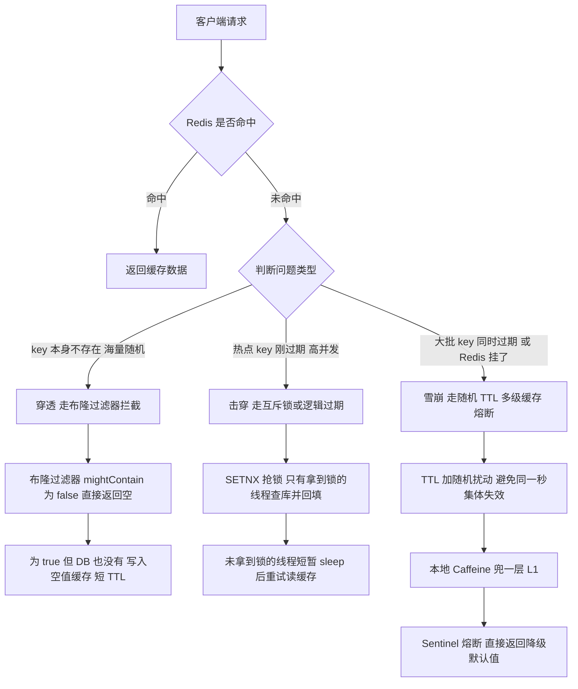

### 5.2 布隆过滤器：原理、参数与误判

布隆过滤器的本质是**一个位数组 + k 个独立哈希函数**。插入元素时把 k 个哈希位置置 1；查询时若**任一位为 0 则一定不存在**，若全为 1 则**可能存在**（可能被别的元素碰巧置位）。

关键性质两句话：**没有假阴性（false negative），只有假阳性（false positive）**。这正是它能做穿透拦截的原因——说"不存在"一定是对的，可以直接拒绝请求。

参数公式（n = 预期元素个数，p = 可接受的误判率）：

```
位数组长度 m = -n * ln(p) / (ln 2)^2
哈希函数个数 k = (m / n) * ln 2
```

代入常见值：n = 1000 万，p = 0.01，则 m ≈ 9585 万位 ≈ 11.4 MB，k ≈ 7。这个内存代价极小，是布隆过滤器被广泛使用的原因。

| 实现 | 类 / API | 默认误判率 | 能否删除 | 特点 |
| --- | --- | --- | --- | --- |
| Guava 本地 | `BloomFilter#create(Funnel, long expectedInsertions)` | `fpp = 0.03` | 不能 | JVM 内存，多实例不共享，重启丢失 |
| Guava 指定误判率 | `BloomFilter#create(Funnel, long, double fpp)` | 显式指定 | 不能 | 推荐显式指定 0.001 ~ 0.01 |
| RedisBloom | `BF.RESERVE key 0.01 1000000` | 首个参数即 error_rate | 不能 | Redis 4.0 起以 Module 加载，多实例共享 |
| RedisBloom 计数版 | `BF.ADD` / `BF.EXISTS` / `BF.MADD` / `BF.INSERT` | 同上 | 不能 | 支持容量自动扩展 `NONSCALING` 关闭时 |
| Cuckoo Filter | `CF.ADD` / `CF.DEL` / `CF.EXISTS` | `CF.RESERVE key 1000000` | **能** | 支持删除，空间效率通常优于布隆 |
| 计数布隆 | 位数组改为计数器数组 | 无默认 | 能（有上限） | 需要 4 倍以上空间，生产中少用 |

RedisBloom 是 Redis Stack / Redis 4.0+ 的模块，`BF.RESERVE` 完整语法：

```
BF.RESERVE key error_rate capacity [EXPANSION expansion] [NONSCALING]
```

`EXPANSION` 默认 2，表示容量满后新建子过滤器按 2 倍增长；`NONSCALING` 表示不扩容，满了直接报错。

**生产实践要点**：

1. **预加载**。过滤器必须在服务启动前把 DB 里所有合法 key 灌进去，否则合法请求会被误判拦截。灌 1000 万条用 `BF.MADD` 批量 1000 条一批，耗时通常在分钟级。
2. **增量更新**。新写入 DB 的 key 必须同步 `BF.ADD`，否则新数据永远查不到。放在 DB 写入成功之后，失败就补偿。
3. **误判的业务兜底**。过滤器说"可能存在"但 DB 查不到时，仍要写空值缓存，否则每次这类请求都穿透。
4. **不接受删除**。布隆过滤器不支持删除，业务上的"下架商品"只能靠空值缓存或 TTL 过期来消解。
5. **不要用 `KEYS` 重建**。重建过滤器需要全量扫 DB，务必做成异步任务 + 双 buffer 切换（新建一个 `BF.RESERVE newkey` 灌完再 rename）。

### 5.3 空值缓存

对 DB 也查不到的 key，缓存一个特殊空值：

```bash
# value 用约定好的空标记 不要用空字符串 避免与真实空值混淆
SET product:999999 "__NULL__" EX 60
```

要点：

- TTL 必须**短**，通常 60~300 秒。太长会导致"商品刚上架但缓存里还是空值"。
- 必须能区分"空值"和"缓存未命中"。用 `StringRedisTemplate#opsForValue().get` 返回 `null` 表示未命中，返回 `"__NULL__"` 表示命中了空值标记。
- 写数据成功时**主动删除**对应空值 key，缩短不一致窗口。
- 风险：如果攻击者用大量**随机**且各不相同的 key，空值缓存会把 Redis 内存打满。所以空值缓存必须配合限流和布隆过滤器一起用，**不能单独作为穿透的主防线**。

### 5.4 互斥锁重建

针对热点 key 失效瞬间的并发穿透，让**只有一个线程去查库重建**，其余线程等待。

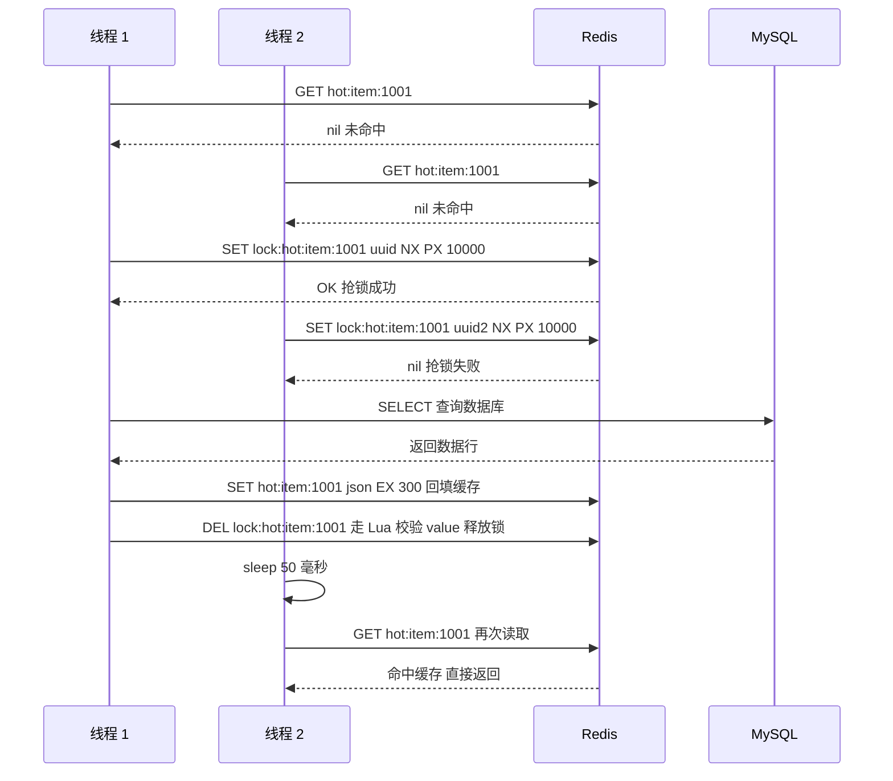

工程要点：

1. 锁的 `PX` 不要太长（建议 5~10 秒），避免持锁线程崩溃后长时间阻塞。
2. 抢锁失败的线程**不要自旋**，用 `sleep(50)` + 有限次重试（如 3 次），超时后降级为直接查库或返回兜底值。
3. 释放锁必须用 Lua 校验 value，否则会误删别人的锁（详见第八章）。
4. 这种方案会**牺牲可用性**（等待的线程被阻塞）。对延迟极敏感的场景用逻辑过期。

### 5.5 逻辑过期

核心思路：**缓存永远不设 TTL，而是在 value 里存一个逻辑过期时间字段**。读到逻辑过期的数据时，直接返回旧值，同时异步起一个线程去重建。

```json
{
  "data": { "itemId": 1001, "price": 1999 },
  "expireAt": 1735689600000
}
```

判据：读缓存 → 反序列化 → 若 `System.currentTimeMillis() > expireAt`，则尝试抢锁，抢到就提交异步任务重建，抢不到就什么都不做；**无论哪种情况都立刻返回当前 data**。

| 方案 | 一致性 | 可用性/延迟 | 实现复杂度 | 适用 |
| --- | --- | --- | --- | --- |
| 互斥锁重建 | 强（读到的一定是新数据） | 差（等待阻塞） | 中 | 商品详情、库存查询等能接受几十毫秒等待 |
| 逻辑过期 | 弱（会返回一段旧数据） | 好（不阻塞） | 高 | 首页楼层、榜单、公告等能容忍短暂陈旧 |
| 热点永不过期 | 弱（需主动更新） | 好 | 中 | 大促主会场，配合后台定时刷新 |
| 本地缓存兜底 | 弱 | 极好 | 中 | 配合以上任意方案做 L1 |

### 5.6 雪崩的完整防御

雪崩有两个诱因，防御手段不同：

**诱因一：大批 key 同时失效。** 典型是"凌晨 2 点批量预热 10 万个 key，全部设 1 小时 TTL"，那么 3 点整集体失效。

```java
// TTL 加随机扰动 推荐 ±10%
long baseSeconds = 3600L;
long ttl = baseSeconds + ThreadLocalRandom.current().nextLong(baseSeconds / 10);
redisTemplate.opsForValue().set(key, value, ttl, TimeUnit.SECONDS);
```

**诱因二：Redis 集群整体不可用**（宕机、网络分区、`CLUSTERDOWN`）。这时随机 TTL 完全无用，必须有架构层防御：

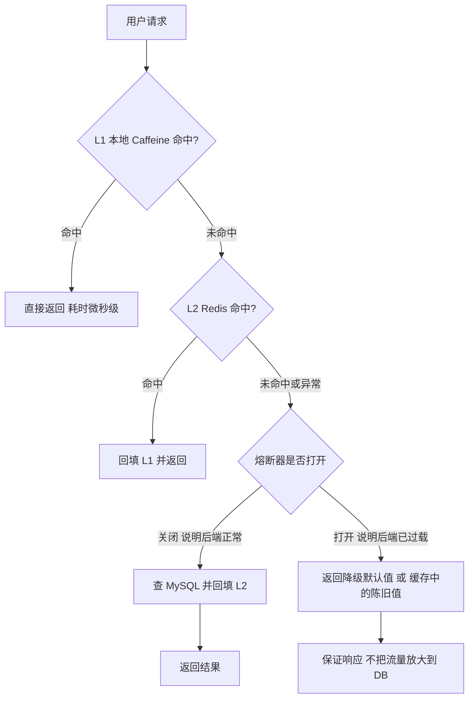

四层防御按优先级：

1. **多级缓存**：Caffeine 挡掉绝大部分重复读，Redis 挂了还有 L1 撑一段时间。
2. **熔断降级**：Sentinel / Resilience4j 的 `CircuitBreaker`，`failureRateThreshold` 默认 50%，`slidingWindowSize` 默认 100。熔断打开后直接返回默认值。
3. **限流**：对 DB 侧接口做令牌桶限流，宁可拒绝一部分请求也不让 DB 雪崩。Sentinel 的 `FlowRule` 用 QPS 模式，`controlBehavior` 选 `THROTTLE`（匀速排队）或 `REJECT`（快速失败）。
4. **高可用底座**：Redis 自身用哨兵/Cluster 保证不整体挂掉；DB 侧用读写分离 + 连接池上限（HikariCP `maximumPoolSize` 默认 10，生产通常 20~50）做最后一道闸。

### 5.7 三者的一句话速记

- **穿透**：查不存在的数据，防线在"入口拦截"（布隆过滤器 + 参数校验）。
- **击穿**：一个热点 key 失效，防线在"重建互斥"（锁 + 逻辑过期）。
- **雪崩**：大批 key 同时失效或缓存整体挂了，防线在"架构分层"（随机 TTL + 多级 + 熔断）。

## 六、缓存与数据库一致性

### 6.1 四个基础方案

| 方案 | 读逻辑 | 写逻辑 | 一致性 | 主要问题 |
| --- | --- | --- | --- | --- |
| Cache Aside（旁路缓存） | 先读缓存，未命中读 DB 并回写 | 先更新 DB，再**删除**缓存 | 最终一致 | 并发下仍有极小概率脏读 |
| Read/Write Through | 应用只与缓存交互，缓存层同步写 DB | 缓存层代理写库 | 强（若同步） | 需要缓存层支持，Redis 无原生实现 |
| Write Behind（Write Back） | 同上 | 先写缓存，异步批量刷 DB | 弱，可能丢数据 | Redis 宕机丢写，需 AOF everysec 配合 |
| 双写（先写库再写缓存） | 读缓存 | 更新 DB 后**更新**缓存 | 弱 | 并发写导致缓存与 DB 长期不一致 |

**为什么是"删除缓存"而不是"更新缓存"**：

1. 更新缓存在并发写时可能乱序，导致缓存永久保留旧值（见 6.2）。
2. 如果缓存值需要复杂计算（多表 join、聚合），"更新"在每次写时都要算一遍，而"删除"是惰性的，只在真正被读时才计算——这是 **lazy loading** 的思想。
3. 删除是幂等的，重复执行无副作用；更新不是。

代价是删除后下一次读必然 miss，有一瞬间的 DB 压力。对热点 key 这就是击穿，需要配合 5.4 的互斥锁。

### 6.2 时序分析：为什么两种顺序都不完美

**方案 A：先删除缓存，再更新数据库。**

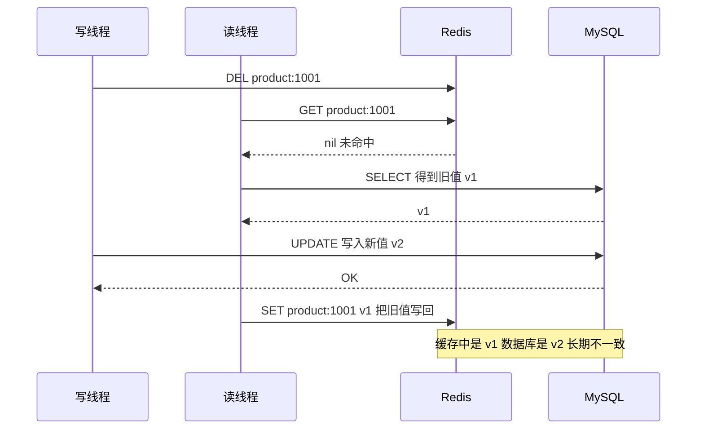

问题：读线程在"删缓存之后、写库之前"读了旧值，然后**姗姗来迟地把旧值写回缓存**，此后再也没有人来删它，缓存就永久脏了。窗口很小但后果严重。

**方案 B：先更新数据库，再删除缓存。**

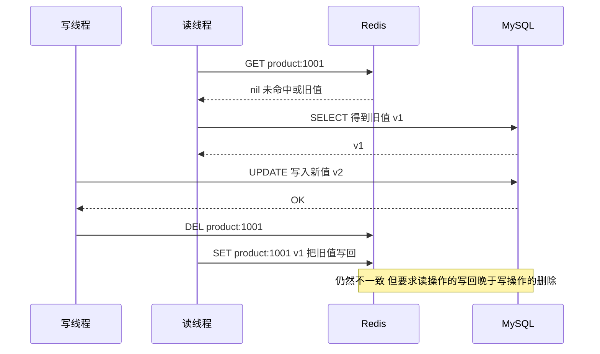

问题同样存在，但要满足"读线程先读 DB 得到 v1 → 写线程完成更新和删除 → 读线程才把 v1 写回"这个时序。关键差别：**方案 B 里读线程的 SELECT 必须早于写线程的 UPDATE 才会读到旧值，而写线程的 DEL 又必须晚于读线程的 SET**。这要求读线程在 DB 查询上比写线程慢、在缓存写入上比写线程快，概率远低于方案 A。

所以**工程上默认选方案 B：先更新数据库，再删除缓存**。Facebook 的 memcached 实践和《缓存更新的套路》都推荐这个顺序。

### 6.3 延迟双删

针对方案 A 里"旧值被写回"的窗口，做法是**删两次**：

```java
// 第一删 在更新数据库之前
redisTemplate.delete(key);
// 更新数据库
productMapper.update(product);
// 延迟再次删除 延迟时间要大于"一次读请求的耗时" 通常 500 毫秒到 1 秒
executor.schedule(() -> redisTemplate.delete(key), 800, TimeUnit.MILLISECONDS);
```

争议点必须讲清，否则面试会被追问：

1. **延迟双删解决的是方案 A 的问题**。如果已经采用方案 B，双删的收益就很有限，主要是防"读请求在 DEL 之后又把旧值写回"的极端情况。
2. **延迟时间无法精确确定**。它是"读请求从 SELECT 到 SET 缓存的最长耗时"，只能靠压测估算，设小了没用，设大了影响一致性窗口。
3. **第二次删除用的线程来自业务线程池**，必须做失败重试，否则调度失败就永久脏。
4. **它把一致性从"强"降到"最终"，且窗口不可控**。真正要强一致就不要用缓存，或者用 6.4 的 binlog 订阅。

### 6.4 基于 binlog 订阅的最终一致性

这是生产上最推荐的方案：**缓存删除动作不由业务代码触发，而由 binlog 变更事件触发**。


工程要点：

1. **必须有顺序保证**。同一个商品行的多次更新，如果消费者乱序处理会删掉又写回旧值。解决：Kafka 分区键用主键，保证同一行的事件进同一分区、被同一消费者顺序消费。
2. **删除而非更新**。消费者只做 `DEL`，不做 `SET`。让读请求回源重建，避免把 binlog 里的行数据拼成业务对象。
3. **幂等**。`DEL` 天然幂等，可以放心重复消费。
4. **积压监控**。Canal 的 `canal.instance.parser.parallelThreadSize` 与 Kafka lag 都要监控，lag 超过阈值说明缓冲删除不及时，一致性窗口在扩大。
5. **Canal 依赖 `binlog_format=ROW`**，MySQL 5.7.7 起默认就是 ROW。`STATEMENT` 格式下 Canal 无法拿到行前后的完整值。
6. **首启位点**。`canal.instance.master.journal.name` 与 `canal.instance.master.position` 决定从哪个位点开始，配置不当会漏掉历史变更。

### 6.5 一致性的终极权衡表

| 方案 | 一致性强度 | 一致窗口 | 对业务侵入 | 复杂度 | 推荐场景 |
| --- | --- | --- | --- | --- | --- |
| 先删缓存再更库 | 较弱 | 不可控（可能永久脏） | 低 | 低 | 不推荐单独使用 |
| 先更库再删缓存（Cache Aside） | 最终一致 | 毫秒级 | 低 | 低 | **默认方案，90% 场景** |
| 延迟双删 | 最终一致 | 秒级且不可控 | 低 | 中 | 历史系统改造的过渡方案 |
| binlog 订阅（Canal + MQ） | 最终一致 | 通常百毫秒~秒级 | 无（旁路） | 高 | 对一致性要求较高的核心数据 |
| 读写都走 DB，缓存只做只读副本 | 强一致 | 0（读主库） | 高 | 低 | 金额、库存扣减等强一致场景 |
| 分布式事务（Seata AT/TCC） | 强一致 | 0 | 极高 | 极高 | 跨服务跨库，不是缓存问题 |

**核心结论**：缓存与数据库之间**不可能做到强一致**，除非放弃缓存（每次读都走 DB）或用分布式锁串行化所有读写（性能归零）。面试时要把这句说清楚，然后给出"按业务容忍度选择方案"的判断框架，而不是背一个方案。

判定框架：

1. 数据能不能容忍 1 秒内的陈旧？能 → Cache Aside 足够。
2. 数据是所有用户共享还是仅本人可见？仅本人可见（用户改自己的昵称）→ 可以直接在写后删除自己那份缓存，不需要延迟双删。
3. 数据是否涉及金额、库存扣减？涉及 → 不走"缓存 + DB"的一致性方案，用 Redis 原子操作 + 异步对账，或直接读主库。
4. 是否已有 CDC 基础设施？有 → 直接上 Canal 方案，最干净。

**所有方案都缺不了 TTL 兜底**：删除动作可能因为网络抖动、MQ 消息丢失、消费者宕机而没执行，能"自愈"的只有过期时间。所以任何"永不过期"的缓存都必须配一个兜底 TTL（或定时全量对账刷新）；反过来，如果业务连"最坏情况下陈旧到 TTL 到期"这个窗口都不能接受，那这个场景就不该用缓存。

## 七、热点 key 与多级缓存

### 7.1 热点 key 的三种形态

| 形态 | 例子 | 危害 | 定位手段 |
| --- | --- | --- | --- |
| 读热点 | 明星微博、秒杀商品详情 | 单节点 CPU/网卡打满，Cluster 下倾斜 | `redis-cli --hotkeys`（需 `maxmemory-policy` 为 LFU 系）、`MONITOR` 采样、客户端埋点 |
| 写热点 | 大 V 发帖计数、库存扣减 | 单分片写 QPS 瓶颈 | `INFO commandstats` 看 `cmdstat_incr` 的 `usec_per_call` |
| 大 key | 10 万成员的 HASH、50 万元素的 ZSET | 单次操作阻塞、`DEL` 卡住、迁移失败 | `redis-cli --bigkeys`、`MEMORY USAGE key`、`DEBUG OBJECT key` 的 `serializedlength` |

大 key 是热点问题里最容易被忽视的一类。Redis 是单线程处理命令的（6.0 起 `io-threads` 可多线程处理网络 IO，但命令执行仍是单线程），一个 `HGETALL` 返回 10 万字段会阻塞整个实例数百毫秒。

**大 key 的阈值经验值**：String > 10KB、集合元素数 > 5000、集合总大小 > 1MB，就该考虑拆分。

排查命令：

```bash
# 抽样扫描大 key 注意本身有性能开销 建议在从库或低峰期执行
redis-cli -h host -p port --bigkeys
# 查看单个 key 的内存占用 单位字节
redis-cli -h host -p port MEMORY USAGE user:1001:profile
# 查看 key 的内部编码与长度 编码可从 quicklist hashtable skiplist 判断
redis-cli -h host -p port DEBUG OBJECT user:1001:profile
# 统计各命令耗时 定位是哪个命令慢
redis-cli -h host -p port INFO commandstats | grep -E "cmdstat_hgetall|cmdstat_keys|cmdstat_smembers"
# 慢查询日志 阈值由 slowlog-log-slower-than 控制 默认 10000 微秒
redis-cli -h host -p port SLOWLOG GET 10
```

`slowlog-log-slower-than` 默认 **10000 微秒（10 毫秒）**，`slowlog-max-len` 默认 **128** 条。超过 10 毫秒的命令会被记录，这是排查大 key 最直接的证据。

### 7.2 热点 key 的治理手段

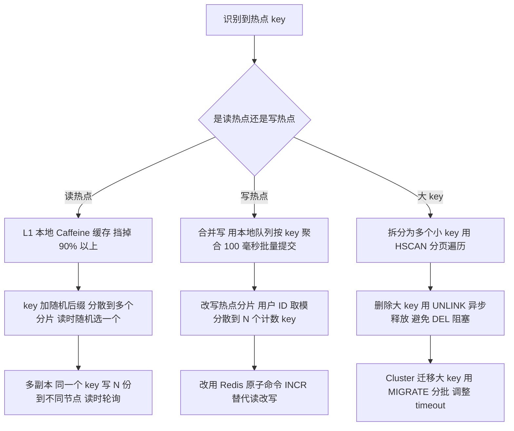

**Caffeine 本地缓存**是性价比最高的一招。因为热点 key 的请求在同一台 JVM 上是重复的，L1 命中率通常能到 95% 以上，Redis 侧压力直接降一个数量级。

```java
Cache<String, Product> localCache = Caffeine.newBuilder()
    .maximumSize(10_000)                       // 最多 1 万条
    .expireAfterWrite(Duration.ofSeconds(30))  // 写入 30 秒后过期
    .recordStats()                             // 开启命中率统计
    .build();

// get 的 mappingFunction 在 key 缺失时同步执行
Product product = localCache.get(key, k -> loadFromRedisOrDb(k));
// hitRate hitCount missCount 用于监控
CacheStats stats = localCache.stats();
```

Caffeine 的关键参数与默认行为：

| 参数 | 含义 | 默认 |
| --- | --- | --- |
| `maximumSize` | 基于 W-TinyLFU 的最大条目数 | 不限制（不设会 OOM） |
| `expireAfterWrite` | 写入后固定过期 | 无 |
| `expireAfterAccess` | 最后一次访问后过期 | 无 |
| `refreshAfterWrite` | 写入后到期触发**异步刷新**，返回旧值 | 无 |
| `recordStats` | 开启 `hitRate`/`loadTime` 统计 | 关闭 |
| `initialCapacity` | 初始容量 | 16 |
| 淘汰算法 | W-TinyLFU（Window + SLRU 主区 + 频率草图） | 固定，不可切换 |

**热点数据在 Caffeine 里推荐 `refreshAfterWrite` + `expireAfterWrite` 配合**：`refreshAfterWrite` 到期后的刷新是异步的，只有一个线程去加载，其余线程直接拿旧值不被阻塞（天然防击穿）；`expireAfterWrite` 设得长一些作为兜底，保证数据最终一定会被真正重新加载。

### 7.3 多级缓存的失效传播

L1（Caffeine）在 JVM 进程内，L2（Redis）是共享的。**更新数据时如果只删 L2，各个 JVM 的 L1 仍然保留旧值**，一致性窗口等于 L1 的 TTL。

三种解法：

| 方案 | 机制 | 一致性窗口 | 复杂度 |
| --- | --- | --- | --- |
| 短 TTL | L1 TTL 设 5~30 秒，靠自然过期 | 等于 TTL | 最低，**生产默认** |
| Redis Pub/Sub 广播失效 | 更新时 `PUBLISH cache:invalidate key`，各实例订阅后删本地 | 毫秒级 | 中，需处理消息丢失 |
| 版本号 | L1 里存版本号，读取时比对 Redis 中的全局版本 | 一次额外读 | 中，多一次 RTT |

推荐的组合是"短 TTL 为主 + Pub/Sub 为加速"。Pub/Sub 是**不可靠**的（Redis 宕机期间的消息永久丢失），所以不能只依赖它，TTL 是最终兜底。

Redis 7.0 起的 **Sharded Pub/Sub**（`SSUBSCRIBE`/`SPUBLISH`）只把消息发给持有该槽的节点及其订阅者，比传统的全局广播 Pub/Sub 在 Cluster 下更省带宽，适合做缓存失效通知。

## 八、Redis 分布式锁

### 8.1 从 setnx 到 SET NX PX

**错误写法**：

```
SETNX lock:order:1001 1
EXPIRE lock:order:1001 30
```

问题：`SETNX` 与 `EXPIRE` 是两条命令，如果在这两步之间进程崩溃或 Redis 重启，锁就**永不过期**，形成死锁。

**正确写法**（Redis 2.6.12 起 `SET` 支持 `NX`/`XX`/`EX`/`PX`）：

```
SET lock:order:1001 <uuid> NX PX 30000
```

四个要素缺一不可：

1. `NX`：只有 key 不存在才设置，保证互斥。
2. `PX 30000`：30 秒自动过期，防死锁。
3. `<uuid>`：**唯一标识持有者**，用于安全释放。生产上用 `UUID.randomUUID()` 或 Redisson 的 `UUID:threadId`。
4. `SET` 一条命令完成，天然原子。

### 8.2 误删问题与 Lua 释放

**误删场景**：线程 A 拿到锁，执行业务耗时超过 30 秒，锁自动过期；线程 B 拿到锁；此时 A 执行完毕，直接 `DEL lock:order:1001`，**删掉了 B 的锁**。

修法是把释放变成"校验 + 删除"，且必须原子：

```lua
-- KEYS[1] = 锁的 key
-- ARGV[1] = 当前线程持有的唯一 value
if redis.call('get', KEYS[1]) == ARGV[1] then
    return redis.call('del', KEYS[1])
else
    return 0
end
```

为什么必须用 Lua：`GET` 和 `DEL` 之间如果插入其他命令，仍可能删错。Redis 执行 Lua 脚本期间是单线程的，**脚本内的所有命令作为一个整体执行，不会被其他客户端命令打断**，这才是"原子性"的含义。

Java 侧：

```java
private static final String UNLOCK_SCRIPT =
    "if redis.call('get', KEYS[1]) == ARGV[1] then return redis.call('del', KEYS[1]) else return 0 end";

public boolean unlock(String key, String value) {
    Long result = redisTemplate.execute(
        new DefaultRedisScript<>(UNLOCK_SCRIPT, Long.class),
        Collections.singletonList(key), value);
    return Long.valueOf(1L).equals(result);
}
```

`DefaultRedisScript` 是 Spring Data Redis 的类，底层走 `EVALSHA`（先 `SCRIPT LOAD` 再按 SHA1 调用），脚本缓存失效时自动回退到 `EVAL`。

### 8.3 锁续期与看门狗

即使有了 Lua 校验，**锁过期而业务未完成**的问题依然存在：A 的锁过期，B 拿到锁，此时 A 和 B 同时在临界区，互斥性已破。

两种解法：

**解法一：预估时长，leaseTime 给足。** 简单但不可靠，业务耗时无法精确预估。

**解法二：看门狗自动续期（Redisson 的实现）。**

Redisson 的 `RLock#tryLock(long waitTime, long leaseTime, TimeUnit unit)`，当 `leaseTime` 传 **-1**（或不调用带 leaseTime 的重载）时，启用看门狗：

- `lockWatchdogTimeout` 默认 **30000 毫秒**。
- 加锁成功后启动一个 `Timeout` 任务，每 **`lockWatchdogTimeout / 3 = 10000` 毫秒**执行一次 `pexpire`，把锁的过期时间重置回 30 秒。
- 直到 `unlock()` 被调用才取消续期任务。

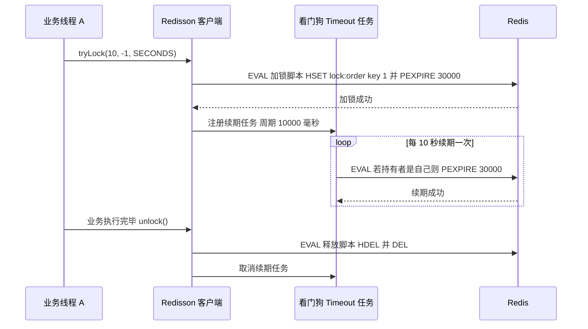

**看门狗的失效场景必须讲清楚**：

1. **JVM 长时间 STW**。Full GC 停顿超过 30 秒，看门狗线程也被暂停，Redis 侧锁自然过期，其他线程就能拿到锁。Full GC 停顿 30 秒本身已属严重故障，但确实发生过。
2. **客户端与 Redis 网络分区**。看门狗续期请求发不出去，锁过期。
3. **`leaseTime` 显式指定了值**。此时看门狗**不会启用**，锁到点就释放，无论业务是否完成。这是最常见的踩坑：`tryLock(0, 10, TimeUnit.SECONDS)` 里第二参数给了 10，就没有看门狗。
4. **Redisson 客户端进程被 kill -9**，续期任务消失，锁在 30 秒后自然释放——这是**期望行为**，避免了死锁。

### 8.4 可重入实现

Redisson 用的是 **Hash 结构**：key 是锁名，field 是 `UUID:threadId`，value 是重入次数。

```
HSET lock:order:1001  3f2a1b...:42  1
PEXPIRE lock:order:1001 30000
```

重入时 `HINCRBY lock:order:1001 3f2a1b...:42 1`，value 变 2；释放时 `HINCRBY ... -1`，减到 0 才 `DEL` 整个 key。Redisson 的实现方法是 `RedissonLock#tryLockInnerAsync`（加锁 Lua）与 `RedissonLock#unlockInnerAsync`（释放 Lua），继承自 `RedissonBaseLock`。

`UUID:threadId` 这个组合很关键：`UUID` 区分 JVM 实例（防止不同客户端互相误释放），`threadId` 区分线程（同一 JVM 内不同线程不能算重入）。

### 8.5 RedLock 与其争议

**RedLock 算法（antirez 提出）**：部署 N（通常 5）个**完全独立**的 Redis master（不是主从、不是 Cluster）。客户端：

1. 记录起始时间 `T1`。
2. 依次向 N 个节点用相同 key/value 加锁，每次设置**较短的超时**（远小于锁的有效期），避免在单个节点上耗尽时间。
3. 统计成功加锁的节点数，<strong>大于等于 `N/2 + 1`（majority）</strong>且总耗时小于锁有效期，才算加锁成功。
4. 计算锁的**实际有效时间 = 初始有效期 - 加锁总耗时**。
5. 失败则向所有节点发送释放请求（包括没加成功的节点）。

**争议（Martin Kleppmann《How to do distributed locking》，2016）**：

| 论据 | 说明 |
| --- | --- |
| 依赖时钟假设 | 算法正确性依赖各节点时钟不回退、速率相近；但 NTP 校时或 VM 暂停会让时钟跳变，锁可能在"有效期内"提前过期 |
| GC 停顿 | 客户端拿到锁后发生长 GC，锁到期，另一个客户端进入临界区，互斥被破坏 |
| 没有 fencing token | 真正的互斥应由**被保护资源**自己校验单调递增的 fencing token，而不是由锁保证 |
| 效率 vs 正确性 | 如果锁只是"避免重复劳动"（效率），单节点 Redis 就够；如果要保证正确性，就不该用有争议的分布式锁 |

**antirez 的回应《Is Redlock safe?》**：时钟跳变可以用"不依赖墙上时钟而依赖本地单调时间 + 扣除耗时"来缓解；fencing token 在 Redis 场景不适用，因为被保护资源（如 MySQL）难以强制校验。

**工程结论（面试要给的落点）**：

1. **RedLock 不解决"锁过期而业务未完成"这个根本问题**，看门狗也不解决 GC 停顿导致的续期失败。
2. 对**效率型**场景（防止定时任务重复执行、缓存重建），单节点 Redis 锁 + 看门狗足够。
3. 对**正确性型**场景（扣款、扣库存），不要指望分布式锁，应该在数据层做幂等：唯一索引、乐观锁版本号、`UPDATE ... WHERE num >= 1`、状态机。
4. Redisson 3.12.0 起 `RedissonRedLock` 已被标记 **`@Deprecated`**，官方推荐改用 `RedissonMultiLock`（它对所有节点都要求加锁成功，语义实际强于 RedLock 的多数派）。

### 8.6 分布式锁的状态机

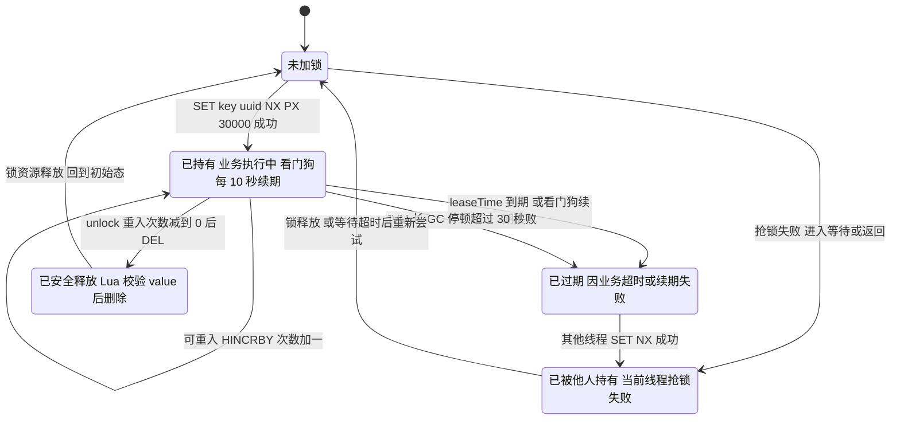

### 8.7 锁的选型对照

| 方案 | 互斥保证 | 可重入 | 自动续期 | 阻塞等待 | 适用 |
| --- | --- | --- | --- | --- | --- |
| `SET NX PX` + Lua 释放 | 单节点 | 否 | 否 | 需自旋 | 简单幂等控制 |
| Redisson `RLock`（单节点） | 单节点 | 是 | 是（看门狗） | `tryLock` 带 waitTime | **生产主流** |
| Redisson `RedissonMultiLock` | 多节点（全部加锁成功才算成功） | 是 | 是 | 是 | 跨机房跨集群 |
| 数据库唯一索引 | DB 强 | 否 | 靠事务 | 靠 `FOR UPDATE` | 正确性要求最高的场景 |
| ZooKeeper 临时顺序节点 | 强（ZAB） | 否 | 靠会话 | 是（Watch 通知） | 需要严格顺序与队列语义 |
| etcd Lease + Revision | 强（Raft） | 否 | 靠 KeepAlive | 是 | Go 生态，Java 侧少用 |

## 九、Redis 事务与 Lua 脚本

### 9.1 事务的四个命令与两个"不支持"

```
MULTI        -- 开启事务，后续命令进入队列，返回 +OK
...          -- 命令返回 +QUEUED，而不是执行结果
EXEC         -- 原子执行队列中的所有命令，返回结果数组
DISCARD      -- 放弃事务，清空队列
WATCH key    -- 乐观锁：监视 key，EXEC 前被改动则整个事务不执行
UNWATCH      -- 取消所有监视
```

**不支持一：不支持回滚。** 如果队列中的某条命令在**执行时**报错（例如对 String 类型的 key 执行 `LPUSH`），Redis 会继续执行其余命令，`EXEC` 返回的错误数组里对应的那一项是错误信息。Redis 官方明确说明这是设计选择：运行期错误通常是编程错误，不值得为它引入回滚的复杂度和性能开销。

**不支持二：WATCH 之上的 CAS 是"检测并失败"，不是"检测并重试"。** `EXEC` 返回 `nil`（Java 侧 `null`）就表示监视的 key 被改过，需要业务层重试。

对比 `MULTI` 与 Lua：

| 维度 | MULTI/EXEC | Lua 脚本 |
| --- | --- | --- |
| 原子性 | 命令间不会被插入 | 命令间不会被插入 |
| 条件分支 | **做不到**（无法根据中间结果决定后续命令） | 可以做 if/else |
| 网络开销 | 每条命令一个 RTT（可 pipeline 优化） | 一次 RTT 完成全部逻辑 |
| 错误处理 | 运行期错误不回滚，继续执行 | 脚本内可 `redis.pcall` 捕获 |
| 阻塞风险 | 命令都很短，风险低 | 脚本写死循环会阻塞整个实例 |
| 集群支持 | 所有 key 必须同槽 | 所有 key 必须同槽（Cluster 模式强制） |
| 调试 | 简单 | 需 `redis-cli --eval`、`SCRIPT DEBUG` |

**结论：需要条件的用 Lua，纯批量的用 pipeline 或 MULTI。**

### 9.2 Lua 脚本的关键规则

```lua
-- 推荐的规范写法
local key = KEYS[1]
local limit = tonumber(ARGV[1])
local current = tonumber(redis.call('get', key) or '0')
if current + 1 > limit then
    return 0
end
redis.call('incr', key)
redis.call('expire', key, 60)
return 1
```

必须遵守：

1. **只通过 `KEYS` 和 `ARGV` 传参，不要在脚本里拼接 key 字符串**。原因：Cluster 需要在执行前根据 `KEYS` 判断所有 key 是否同槽；动态拼接的 key 无法被静态分析，一旦落到别的槽就会被拒绝执行。
2. **`redis.call` vs `redis.pcall`**。前者出错会中断脚本并向上抛错，后者返回一个包含 `err` 字段的 table，脚本可继续。生产脚本应优先用 `pcall` 做容错。
3. **不要用 `KEYS`、`SMEMBERS` 等 O(N) 命令**。脚本阻塞实例期间，所有客户端都在等。
4. **确定性**。`redis.replicate_commands()` 在 Redis 3.2 引入、5.0 起成为默认（Effect Replication），此后脚本里的随机命令（`SPOP`、`TIME`、`RANDOMKEY`）会按实际操作效果复制，不再是问题。但**脚本里不要用 `os.time()`、`math.random` 做业务决策**，主从/主备会不一致。
5. **`lua-time-limit` 默认 5000 毫秒**。脚本执行超过 5 秒后，其他客户端发来的命令会收到 `BUSY Redis is busy running a script`。此时只能用 `SCRIPT KILL` 终止（**仅当脚本还没执行过写命令**），否则只能 `SHUTDOWN NOSAVE`。
6. **脚本要小**。功能单一的脚本更容易排查，也更容易做 `EVALSHA` 缓存。

`SCRIPT KILL` 不能杀掉已写脚本的原因：Redis 必须保证脚本的原子性，已执行部分写命令就中断会导致主从数据不一致（Effect Replication 下主库会传播已执行的写命令，从库是按命令重放而非按脚本重放，部分执行会错乱）。

### 9.3 Lua 在分布式锁与限流中的实战

**原子令牌桶限流**（单机维度）：

```lua
-- KEYS[1] = 限流 key
-- ARGV[1] = 桶容量 capacity
-- ARGV[2] = 令牌生成速率 rate 个/秒
-- ARGV[3] = 当前时间戳秒
-- ARGV[4] = 请求令牌数
local capacity = tonumber(ARGV[1])
local rate = tonumber(ARGV[2])
local now = tonumber(ARGV[3])
local requested = tonumber(ARGV[4])
local fill_time = capacity / rate
local ttl = math.floor(fill_time * 2)
local last = redis.call('hget', KEYS[1], 'last_tokens')
local tokens
if last then
    tokens = math.min(capacity, tonumber(redis.call('hget', KEYS[1], 'tokens')) + (now - last) * rate)
else
    tokens = capacity
end
if tokens < requested then
    redis.call('hset', KEYS[1], 'last_tokens', now)
    redis.call('hset', KEYS[1], 'tokens', tokens)
    redis.call('expire', KEYS[1], ttl)
    return 0
end
tokens = tokens - requested
redis.call('hset', KEYS[1], 'last_tokens', now)
redis.call('hset', KEYS[1], 'tokens', tokens)
redis.call('expire', KEYS[1], ttl)
return 1
```

注意 `ttl = fill_time * 2` 的作用：桶空闲超过"装满一次所需时间的两倍"后自动回收，避免无用的 key 长期占内存。

Java 封装用 `RedisTemplate#execute(RedisScript, List<K>, Object...)`：

```java
DefaultRedisScript<Long> script = new DefaultRedisScript<>(LUA_TEXT, Long.class);
Long allowed = redisTemplate.execute(script, Collections.singletonList(key),
        capacity, rate, System.currentTimeMillis() / 1000, requested);
```

**注意事项**：`RedisTemplate` 默认用 `JdkSerializationRedisSerializer`，会把 `Long` 序列化成带类型信息的字节，导致 Lua 里 `tonumber(ARGV[1])` 拿到乱码。**必须显式指定 `StringRedisSerializer`**，或用 `StringRedisTemplate`。这是生产上最常见的 Lua 脚本 bug。

### 9.4 Redis 7.0 的 Function

Redis 7.0 引入了 `FUNCTION` 系列命令，作为 `EVAL` 的补充：

```
FUNCTION LOAD "#!lua name=mylib
redis.register_function('myfunc', function(keys, args) return 1 end)"

FCALL myfunc 1 mykey
FCALL_RO myfunc 1 mykey
FUNCTION LIST
FUNCTION DUMP
FUNCTION STATS
FUNCTION DELETE mylib
FUNCTION FLUSH
```

与 `EVAL` 的差别：

| 维度 | EVAL / EVALSHA | FUNCTION / FCALL |
| --- | --- | --- |
| 脚本存储 | 客户端负责 `SCRIPT LOAD`，Redis 重启后缓存丢失 | 库名+函数名持久化，随 `FUNCTION DUMP` 复制与备份 |
| 版本管理 | 无，靠客户端维护 SHA1 | 库有名称，可重复 `FUNCTION LOAD REPLACE` |
| 只读变体 | `EVAL_RO`（7.0 起） | `FCALL_RO` |
| 传参 | `KEYS` / `ARGV` 数组 | 同样是 `keys` 和 `args` 两个 table |
| 适用 | 临时性的原子逻辑 | 需要长期维护、多服务共享的脚本库 |

生产上的选择：**逻辑稳定、多应用共享的用 `FUNCTION`；一次性的、随应用版本发布的用 `EVAL`**。

## 十、生产事故复盘

### 10.1 事故一：全量同步风暴打满主库 CPU

**现象**：主库 CPU 从 30% 升到 95%，`INFO stats` 里 `sync_full` 每分钟增长十几次，从库反复 `master_link_status:down` 又 `up`。

**根因链**：`repl-backlog-size` 用默认 1MB → 主库写入 5MB/s → 从库只要断连 0.2 秒以上，offset 就被环形缓冲覆盖 → 走全量复制 → 全量期间从库加载 RDB 无法响应 `REPLCONF ACK` → 主库 replication buffer 堆积超过 `256mb` 硬限制 → 主库主动断开从库 → 循环。

**定位**：

```bash
redis-cli info stats | grep -E "sync_full|sync_partial_ok|sync_partial_err|latest_fork_usec"
redis-cli info clients | grep -E "client_recent_max_output_buffer"
redis-cli config get repl-backlog-size
```

**修复**：`CONFIG SET repl-backlog-size 256mb`（并写入配置文件），调大 `client-output-buffer-limit replica 512mb 128mb 120`，从库关闭 RDB `save ""`，把 `repl-diskless-sync-delay` 从 5 秒调大到 10 秒让更多从库共享一次 fork。

**复盘教训**：`repl-backlog-size` 的默认值 1MB 只适合玩具环境。上线前必须按"峰值写入速率 × 最长可容忍断连时间"计算。

### 10.2 事故二：Cluster 迁移大 key 导致服务抖动

**现象**：运维在业务高峰期执行 `redis-cli --cluster rebalance`，迁移过程中多个业务报 `JedisConnectionException` 和 `CLUSTERDOWN`。

**根因**：槽迁移用 `MIGRATE`，它是**同步阻塞**命令。某个槽里有一个 50 万元素的 Hash（`serializedlength` 约 80MB），单次 `MIGRATE` 耗时超过 `cluster-node-timeout`（15000ms），其他节点判定源节点 `PFAIL`，进而升级为 `FAIL` 并触发故障转移，期间该分片短暂不可写。

**定位**：

```bash
# 找出集群中的大 key 逐个节点执行
redis-cli --cluster call 10.0.0.1:6379 --bigkeys
# 实时看迁移进度与状态
redis-cli --cluster check 10.0.0.1:6379
redis-cli -h 10.0.0.1 -p 6379 cluster nodes | grep -E "fail|handshake"
```

**修复与预防**：迁移前先治理大 key（拆分 Hash 为多个 key）；迁移放在低峰期；把 `cluster-node-timeout` 从 15000 适当调大（如 30000）以容忍抖动；大 key 用 `MIGRATE` 的 `KEYS` 批量模式分多次迁移，每次不超过 100 个 key，并显式指定较长的 `timeout` 参数。

### 10.3 事故三：缓存雪崩打挂数据库

**现象**：某次发布后，MySQL 连接数瞬间打满（`Threads_connected` 从 200 冲到 1000），`SHOW PROCESSLIST` 里全是同一条商品查询 SQL，Redis 侧 `keyspace_hits` 骤降。

**根因**：发布脚本调用了 `/admin/cache/warmup` 接口预热了 20 万个商品 key，全部设置 `EX 3600`。一小时后这 20 万个 key 在同一秒过期，所有读请求同时穿透到 DB。

**定位**：

```bash
redis-cli info stats | grep -E "keyspace_hits|keyspace_misses|expired_keys"
# 按前缀统计 key 的 TTL 分布 用 SCAN 抽样
redis-cli --scan --pattern "product:*" --count 1000 | head -20 | xargs -I{} redis-cli ttl {}
```

**修复**：预热脚本改成 `EX 3600 + random(0, 360)`；Redis 前置加 Caffeine 本地缓存；DB 层接口加 Sentinel 限流规则（QPS 模式，阈值按 DB 承载能力的 70% 设置）。

**复盘教训**：**任何批量写缓存的代码都必须带随机 TTL**。这是代码规范级别的要求，不是运维问题。

### 10.4 事故四：Redisson 看门狗失效导致并发写

**现象**：订单状态出现"已支付又被改回待支付"的异常，日志里两个线程都打印了"获取锁成功"。

**根因**：线程 A 的锁 `leaseTime` 被显式设为 10 秒（`tryLock(3, 10, TimeUnit.SECONDS)`），**看门狗未启用**；A 执行外部支付回调 http 请求耗时 15 秒；10 秒后锁自动过期，线程 B 拿到锁；A 完成后继续写入，覆盖了 B 的结果。

**定位要点**：检查所有 `tryLock` 调用的第二个参数是否传了正值。Redisson 源码中 `tryLock(waitTime, leaseTime, unit)` 在 `leaseTime != -1` 时走 `tryLockInnerAsync(leaseTime, ...)` 且不注册 `scheduleExpirationRenewal`。

**修复**：对需要看门狗保护的场景统一改用 `tryLock(waitTime, TimeUnit)` 重载（内部 `leaseTime = -1`）；同时对订单状态更新加乐观锁：`UPDATE orders SET status = ? WHERE id = ? AND status = ?`。

### 10.5 事故五：哨兵脑裂导致写入丢失

**现象**：机房网络抖动 40 秒，哨兵完成故障转移，把从库提升为新主库；网络恢复后旧主库上的 2000 条写入消失。

**根因**：旧主库在分区期间仍接受写入（`min-replicas-to-write` 默认 0，即关闭）；恢复后被 `REPLICAOF` 到新主库，触发全量复制，本地数据被清空。

**修复**：

```
min-replicas-to-write 1
min-replicas-max-lag 10
```

写入方收到 `NOREPLICAS Not enough good replicas to write` 错误后应快速失败并重试，而不是无限等待。

**复盘教训**：**Redis 主从复制是异步的，任何"主库写成功即认为持久"的假设都是错的**。需要更强保证时配合 `WAIT numreplicas timeout` 命令（Redis 3.0 起）阻塞等待指定数量的从库确认，但它是**尽力而为**，超时后会返回实际确认数，不能作为强一致保证。

### 10.6 事故六：慢查询积压导致集群雪崩

**现象**：`SLOWLOG GET 10` 显示有大量 `HGETALL` 耗时 200ms 以上的记录，随后集群出现 `CLUSTERDOWN`，多个业务超时。

**根因**：某个运营配置的 Hash 键被写成大 key（30 万字段），一个高频接口每次 `HGETALL` 全量拉取。Redis 单线程执行该命令期间，所有其他命令都要排队；`cluster-node-timeout` 期间节点无法及时响应 PONG，被判定下线。

**定位**：

```bash
redis-cli slowlog get 20
redis-cli info commandstats | sort -t= -k3 -rn | head -20
redis-cli --bigkeys
redis-cli memory usage 疑似大key名
```

**修复**：业务改用 `HGET key field` 精确读取，或 `HSCAN cursor COUNT 100` 分批；对存量数据拆分为 `config:{bizId}:{shardNo}` 多个 Hash；给该接口加本地缓存。

## 十一、高级岗三问

### 11.1 为什么这么设计？

| 设计点 | 为什么 | 替代方案与代价 |
| --- | --- | --- |
| 主从复制异步 | 同步复制每个写都要等所有从库，延迟不可接受 | 同步复制（延迟高）、半同步（Redis 无原生支持，需 `WAIT` 模拟） |
| 哨兵独立进程 | Redis 自身无法在自己挂掉时切换 | 客户端自研仲裁（引入客户端复杂度与网络依赖） |
| Cluster 用 16384 槽 | 心跳位图 2048 字节，节点数可到 1000 | 一致性哈希（无法方便地做人工槽位调度与迁移） |
| 缓存删除而非更新 | 删除幂等、惰性加载、避免并发写乱序 | 更新缓存（并发乱序导致永久脏数据） |
| Redis 事务不回滚 | 运行期错误是编程错误，回滚代价高 | 完整事务（性能与复杂度不可接受） |
| 单线程执行命令 | 无锁、无上下文切换、原子性天然成立 | 多线程命令执行（需大量锁，实测无收益，6.0 起只把网络 IO 多线程化了） |

### 11.2 线上出问题怎么定位？

按"先分层定位，再深入单点"的顺序：

1. **判断是 Redis 问题还是应用问题**：看应用侧 Redis 客户端耗时（Lettuce `CommandLatencyEvent`、Micrometer 的 `lettuce.command.completion` 指标）与 Redis 侧 `INFO commandstats` 的 `usec_per_call`。
2. **Redis 定位四板斧**：
   - `INFO all` 看 `used_memory_human`、`mem_fragmentation_ratio`、`instantaneous_ops_per_sec`、`rejected_connections`、`evicted_keys`。
   - `SLOWLOG GET 20` 看慢命令。
   - `CLIENT LIST` 看连接数、`omem`（输出缓冲）、`cmd`（正在执行的命令）。
   - `LATENCY DOCTOR` / `LATENCY HISTORY event` 看延迟事件来源（`fork`、`expire-cycle`、`command`）。
3. **高可用定位**：`INFO replication` 看复制状态；`INFO sentinel` / `SENTINEL master mymaster` 看哨兵判定；`CLUSTER INFO` 看 `cluster_state` 与 `cluster_slots_fail`。
4. **客户端侧定位**：连接是否共享（Spring Data Redis 3.x 用 `LettuceClientConfiguration`，`ClientOptions` 里可开 `AutoFlushCommands` 与超时）、连接池是否耗尽（用 commons-pool2 的 `GenericObjectPoolConfig` 时看 `numActive`）、是否序列化异常、是否 `RedisCommandTimeoutException`。

### 11.3 规模变大后会怎样？

| 规模变化 | 失效模式 | 应对 |
| --- | --- | --- |
| QPS 从 1 万到 50 万 | 单实例 CPU 打满，网络带宽成为瓶颈 | Cluster 分片；读多写少时加从库；本地缓存削峰 |
| 数据量从 10GB 到 1TB | 单实例 `fork` 耗时超过 1 秒，RDB 全量复制变慢 | 分片；控制单实例内存（建议不超过 16GB）；`repl-diskless-sync` |
| 节点从 3 到 100 | Gossip 心跳 O(N) 开销上升，故障检测变慢 | 单集群不超过 1000 节点；业务维度拆成多集群 |
| 从库从 1 到 10 | 主库 replication buffer 内存压力，`BGSAVE` 次数增多 | 级联复制（从库挂从库）；`repl-diskless-sync-delay` 攒批 |
| 热点集中 | 单分片倾斜，其他节点空闲 | hash tag 拆分热点、本地缓存、多副本读 |
| 客户端实例数增多 | 连接数爆炸（每个实例默认多条连接） | Lettuce 共享连接；`tcp-keepalive` 默认 300 秒；设置 `maxclients` 默认 10000 |

## 高频面试题

### Q1. Redis 主从复制的全量复制和增量复制分别是什么？`repl_backlog_size` 有什么用？

**答题框架（30 秒版）**：全量复制是主库 `BGSAVE` 生成 RDB 全量发给从库；增量复制是 Redis 2.8 引入 `PSYNC` 后，靠主库的 `repl_backlog_buffer` 环形缓冲补齐断连期间的命令。backlog 太小就永远是全量，这是生产事故高发点。

**展开（2 分钟版）**：
1. 从库发 `PSYNC <replid> <offset>`，主库校验 `replid` 和 offset 是否在 backlog 覆盖区间内。
2. 不满足 → `FULLRESYNC`：主库 `fork` 出子进程 `BGSAVE`，期间的新写命令进入该从库的 replication buffer；RDB 发完后补发 buffer。
3. 满足 → `CONTINUE`：从 `repl_backlog_buffer` 的对应位置取命令发送。
4. 两个缓冲区要分清：`repl_backlog_buffer` 主库全局共享一份（`repl-backlog-size` 默认 1mb，`repl-backlog-ttl` 默认 3600 秒）；replication buffer 每个从库一份（`client-output-buffer-limit replica 256mb 64mb 60`）。
5. 计算公式：`repl-backlog-size >= 写入速率 × 最长断连时间`。

**追问**：怎么看是否发生全量复制？答：`INFO stats` 的 `sync_full`、`sync_partial_ok`、`sync_partial_err` 三个计数器。`sync_full` 持续增长就是全量风暴。

### Q2. 哨兵的主观下线和客观下线有什么区别？quorum 和 majority 是一回事吗？

**答题框架（30 秒版）**：SDOWN 是单个哨兵自己判定（`down-after-milliseconds` 默认 30000ms），ODOWN 是要收到 quorum 张赞成票。quorum 决定"要不要切换"，majority = `(哨兵总数/2)+1` 决定"谁来切换"，**后者必须过半，前者不必**。

**展开（2 分钟版）**：
1. 哨兵每秒对所有实例发 `PING`，超过 `down-after-milliseconds` 无响应标记 SDOWN。
2. 向其他哨兵发 `SENTINEL is-master-down-by-addr <ip> <port> <current_epoch> <runid>` 拉票，票数达到 quorum 则标记 ODOWN。
3. 进入选举：向其他哨兵请求投票选举自己为 Leader，需要 majority 票。Leader 才有权执行故障转移。
4. 选新主库顺序：过滤 `priority = 0` 和长时间断开的，按 `slave_priority` 升序（默认 100）、`slave_repl_offset` 降序、`runid` 字典序升序。
5. 执行：新主库 `REPLICAOF NO ONE`，其余从库 `REPLICAOF` 新主库，旧主库降级，通过 `+switch-master` 频道通知客户端。

**追问**：3 个哨兵挂 2 个还能切换吗？答：不能。quorum=2 时剩下的 1 个哨兵只有自己 1 票，连 ODOWN 都判不出来；即便判出了 ODOWN，也拿不到 majority=2 的选举票，故障转移不执行。

### Q3. Redis Cluster 的 MOVED 和 ASK 重定向有什么区别？

**答题框架（30 秒版）**：MOVED 表示槽已经永久归属别的节点，客户端要**更新槽映射缓存**；ASK 表示槽正在迁移、这个 key 暂时不在本节点，客户端**不更新映射**，只是本次先发 `ASKING` 再发命令。

**展开（2 分钟版）**：
1. 迁移时源节点执行 `CLUSTER SETSLOT <slot> MIGRATING <target-id>`，目标节点执行 `CLUSTER SETSLOT <slot> IMPORTING <source-id>`。
2. 源节点对槽内**仍存在**的 key 正常处理；对**已迁走**的 key 返回 `ASK <slot> <target-ip>:<port>`。
3. 目标节点处于 IMPORTING 状态，对未迁移完的槽的请求默认返回 MOVED；只有客户端先发 `ASKING` 打了标记，紧随的命令才执行。
4. 全部 key 迁完后，两端都执行 `CLUSTER SETSLOT <slot> NODE <target-id>`，广播配置，恢复稳定态。
5. 客户端侧 Lettuce 的 `RedisClusterClient`、Jedis 的 `JedisCluster` 都自动处理，`JedisCluster` 默认 `maxAttempts = 5`。

**追问**：为什么目标节点需要 ASKING？答：防止路由混乱。IMPORTING 状态下的节点必须明确知道"这次请求是客户端被 ASK 引导来的"，否则它无法区分正常请求与迁移期请求。

### Q4. 【场景设计】商品详情接口有恶意脚本用海量不存在的 ID 刷，怎么防缓存穿透？

**答题框架（30 秒版）**：入口校验 ID 格式与范围 → 布隆过滤器拦截必然不存在的 ID → 空值缓存短 TTL 兜底 → 网关层限流与黑名单。四层配合，不靠单一手段。

**展开（2 分钟版）**：
1. **参数校验**：ID 必须是合法正整数且在业务 ID 段内，格式不对直接 400，不落 Redis。
2. **布隆过滤器**：启动时把 DB 里所有 `product_id` 用 `BF.MADD` 批量灌进 RedisBloom（`BF.RESERVE product:bloom 0.001 10000000`），查询时 `BF.EXISTS` 返回 0 直接返回空。误判率 0.001 时，合规请求被误拦的概率千分之一，需配合第 3 步兜底。
3. **空值缓存**：`SET product:{id} "__NULL__" EX 60`，TTL 要短，且商品创建成功后主动删除该 key。
4. **限流与风控**：网关层对单 IP / 单账号做 QPS 限流，`SCAN` 出高频异常 IP 进黑名单。
5. **监控**：埋点统计"布隆过滤器拦截次数"和"空值命中次数"，突增即告警。

**追问**：布隆过滤器不支持删除，商品下架怎么办？答：不依赖过滤器删除。下架商品在 DB 里标记为不可售，空值缓存会自然消解；过滤器定期用双 buffer 重建（新 key 灌完再 rename）。

### Q5. 【场景设计】大促主会场，10 万 QPS 打到一个爆款商品，怎么设计不把 Redis 打死？

**答题框架（30 秒版）**：本地 Caffeine 做 L1 挡 95% → Redis 做 L2 → 热点 key 加随机后缀分散分片 → 逻辑过期保证不阻塞 → 后台定时刷新兜底。

**展开（2 分钟版）**：
1. **L1 本地缓存**：Caffeine `maximumSize(5000)` + `expireAfterWrite(5s)`，命中率通常在 95% 以上。代价是每台机器一份，更新传播有延迟。
2. **L2 逻辑过期**：value 内嵌 `expireAt` 字段，不设 Redis TTL；读到逻辑过期时异步重建，读线程立刻返回旧值，不阻塞。
3. **热点拆分**：读场景把 key 变成 `hot:item:1001:{0..N-1}`，写入时 N 份都写，读取时随机选一份，把单节点压力降到 1/N。
4. **后台刷新**：定时任务每 5 秒主动刷新一次 L2，保证逻辑过期的时间窗口内数据基本新鲜。
5. **降级**：Sentinel 熔断规则挂在数据源上，`slowRatioThreshold` 或异常比例超阈值后直接返回静态兜底页。

**追问**：L1 的数据更新延迟怎么解决？答：主会用短 TTL（5 秒）作为最终兜底，同时用 Redis 7.0 的 Sharded Pub/Sub（`SPUBLISH cache:invalidate`）广播失效消息加速，各实例订阅后删除本地 key。

### Q6. 缓存与数据库一致性有哪几种方案？为什么推荐"先更新数据库再删除缓存"？

**答题框架（30 秒版）**：Cache Aside、延迟双删、binlog 订阅三条路线。推荐"先更库再删缓存"是因为它要求的最坏时序概率最低，而且删除操作幂等、惰性加载更省资源。

**展开（2 分钟版）**：
1. **先删缓存再更库**的风险：读线程在"删缓存后、更库前"读到旧值，之后把旧值写回缓存，此后无人删除，**永久脏**。
2. **先更库再删缓存**的风险：要满足"读线程 SELECT 早于写线程 UPDATE，且读线程 SET 晚于写线程 DEL"，这要求读线程在 DB 上更慢、在缓存上更快，概率极低。
3. **为什么用删除不用更新**：更新在并发写时会乱序导致缓存保留旧值；删除幂等；删除是惰性的，避免每次写都做复杂计算。
4. **延迟双删**是"删一次 → 更库 → 延迟 500~1000ms 再删一次"，只能缓解，延迟时间不可精确确定，且有调度失败风险。
5. **binlog 订阅**（Canal 1.1.7 + Kafka）是旁路方案，业务零侵入，一致性窗口在百毫秒到秒级，但要求 `binlog_format=ROW` 并按主键分区保证顺序。

**追问**：能保证强一致吗？答：不能。除非放弃缓存每次读 DB，或用分布式锁串行化所有读写（性能归零）。缓存与 DB 之间只能做最终一致，关键是把窗口控制在业务可接受范围内。

### Q7. Redis 分布式锁的加锁和释放怎么写才是对的？为什么要用 Lua？

**答题框架（30 秒版）**：加锁用 `SET key uuid NX PX 30000` 一条命令搞定；释放必须用 Lua 做"GET 校验 value 相等再 DEL"，否则会误删别人的锁。

**展开（2 分钟版）**：
1. `SETNX` + `EXPIRE` 两步不原子，中间崩溃就永不过期，必须用 `SET ... NX PX`（Redis 2.6.12 起支持）。
2. value 必须是唯一标识，生产上用 `UUID:threadId`，UUID 区分 JVM 实例，threadId 区分同实例不同线程。
3. 误删场景：A 的业务超过 30 秒，锁过期，B 拿到锁，A 执行完直接 `DEL` 删掉了 B 的锁。
4. 释放脚本：
```lua
if redis.call('get', KEYS[1]) == ARGV[1] then
    return redis.call('del', KEYS[1])
else
    return 0
end
```
5. 原子性的本质：Redis 单线程执行 Lua 期间不会插入其他客户端命令，`GET` 和 `DEL` 之间不可能被打断。

**追问**：用了 Lua 就万无一失了吗？答：不是。锁过期而业务未完成时，A 和 B 仍会同时在临界区，Lua 只防误删不防这个。根本解法是看门狗续期 + 数据层幂等（唯一索引、乐观锁）。

### Q8. Redisson 看门狗是怎么工作的？什么情况下会失效？

**答题框架（30 秒版）**：`lockWatchdogTimeout` 默认 30000ms，加锁成功后注册一个每 `1/3` 即 10000ms 执行一次的续期任务，`unlock` 时取消。失效场景：长 GC 停顿、网络分区、显式传了 leaseTime。

**展开（2 分钟版）**：
1. `tryLock(waitTime, leaseTime, unit)` 中 `leaseTime = -1` 才启用看门狗；调用 `tryLock(waitTime, unit)` 重载内部就是 -1。
2. 续期周期 = `lockWatchdogTimeout / 3`，即默认 10000ms，通过 `pexpire` 重置回 30 秒。
3. 可重入靠 Hash 结构：field 是 `UUID:threadId`，value 是重入次数，释放时减到 0 才 `DEL`。对应 `RedissonLock#tryLockInnerAsync` 与 `unlockInnerAsync`。
4. 失效场景：a) Full GC 停顿超过 30 秒，续期线程停摆；b) 客户端与 Redis 网络分区；c) **显式传了正的 leaseTime**，看门狗不启用；d) `kill -9` 客户端进程（这种情况锁会自然过期，是期望行为）。

**追问**：看门狗能解决 GC 停顿吗？答：不能。看门狗本身也跑在这个 JVM 里，STW 时它一起停。这是分布式锁的理论下限，RedLock 也解决不了。

### Q9. Redis 事务为什么不支持回滚？和 Lua 脚本怎么选？

**答题框架（30 秒版）**：Redis 只检测**入队时**的语法错误（`EXECABORT` 全部不执行），**执行时**的错误（类型错误）不回滚，其余命令继续跑。这是设计选择：运行期错误是编程错误，回滚的复杂度与性能代价不值得。需要条件判断就用 Lua。

**展开（2 分钟版）**：
1. 四个命令：`MULTI`、`EXEC`、`DISCARD`、`WATCH`；入队阶段返回 `+QUEUED`。
2. 两类错误：语法错误/命令不存在 → 入队失败，`EXEC` 返回 `EXECABORT`，整个事务不执行；运行期错误（如对 String 做 `LPUSH`）→ 该条报错，其余照常执行。
3. `WATCH` 是乐观锁，`EXEC` 返回 `nil` 表示监视的 key 被改，需要业务层重试。
4. 对比 Lua：能做 if/else 条件判断、一次 RTT 完成、可 `redis.pcall` 捕获错误；但脚本写死循环会阻塞整个实例（`lua-time-limit` 默认 5000ms，超过后其他客户端收 `BUSY`）。
5. 选型：纯批量用 pipeline 或 MULTI；需要条件分支、复合原子操作用 Lua；长期维护的共享脚本用 Redis 7.0 的 `FUNCTION`/`FCALL`。

**追问**：`SCRIPT KILL` 什么情况下失败？答：脚本已经执行过写命令时不能杀，因为中断会导致主从数据不一致。此时只能用 `SHUTDOWN NOSAVE`。

### Q10. 【排查】线上 Redis 响应变慢，CPU 到 100%，你怎么定位？

**答题框架（30 秒版）**：先用 `SLOWLOG` 和 `INFO commandstats` 找慢命令，再用 `--bigkeys` 找大 key，用 `LATENCY DOCTOR` 看延迟来源，同时排除 `fork` 和 swap。

**展开（2 分钟版）**：
1. `redis-cli --latency` 和 `redis-cli --latency-history` 先确认延迟是否真的高。
2. `SLOWLOG GET 20`：`slowlog-log-slower-than` 默认 10000 微秒，看是否有 `HGETALL`、`KEYS`、`SMEMBERS`、`ZRANGE` 全量拉取。
3. `INFO commandstats | sort -t= -k3 -rn | head`：`-k3` 排的是 `usec`（总耗时），想按单次平均耗时排就改成 `-k4`（`usec_per_call`）。
4. `redis-cli --bigkeys` + `MEMORY USAGE key`：找大 key，`UNLINK` 异步删除替代 `DEL`。
5. `INFO stats | grep latest_fork_usec`：`fork` 耗时超过 1 秒说明实例内存太大。
6. `INFO memory | grep mem_fragmentation_ratio`：大于 1.5 考虑内存碎片或 swap。
7. `LATENCY DOCTOR` / `LATENCY HISTORY fork`：确认延迟来自 `fork`、`expire-cycle` 还是 `command`。

**追问**：如果是 Cluster 环境单节点 CPU 高？答：大概率是热点倾斜。用 `redis-cli --hotkeys`（需 LFU 策略）或 `MONITOR` 短时采样定位热点 key 落在哪个节点，再做 key 拆分或本地缓存。

### Q11. 【排查】收到了 `NOREPLICAS Not enough good replicas to write` 错误，怎么处理？

**答题框架（30 秒版）**：这是 `min-replicas-to-write` 生效了，说明主库认为在线从库不足。先查 `INFO replication` 确认从库状态，再看网络与从库负载，不要盲目调大参数。

**展开（2 分钟版）**：
1. 确认配置：`CONFIG GET min-replicas-to-write min-replicas-max-lag`，默认是 `0` 和 `10`。
2. 主库执行 `INFO replication`，看每个从库的 `slave_repl_offset` 与 `master_link_status`，以及 `master_repl_offset` 的差值。
3. `min-replicas-max-lag` 的含义是从库**最后一次 ACK 距今秒数**，超过 10 秒就不计入"good replica"。
4. 常见原因：从库在做 `BGSAVE`/`BGREWRITEAOF` 阻塞；从库网络抖动；主库 replication buffer 溢出踢掉了从库；从库磁盘满导致 `AOF` 重写失败。
5. 处置顺序：先恢复从库（扩容、清理磁盘、调大 `repl-backlog-size`），**确认从库健康后**再决定是否临时放宽参数。直接设 `0` 等于放弃防脑裂，只适合纯缓存场景。

**追问**：这个参数和脑裂有什么关系？答：它是 Redis 里唯一能防止"旧主库在被隔离期间继续接受写入"的机制。没有它，故障转移 + 网络恢复后旧主库的数据会被清空，那段时间的写入永久丢失。

### Q12. 【场景设计】跨机房部署 Redis，主从同步延迟 200ms，业务读从库会读到旧数据，怎么设计？

**答题框架（30 秒版）**：先分清读写路径各自的一致性要求；写后立刻读的场景强制读主库；能容忍延迟的读走从库；跨机房场景考虑本地只读副本 + 会话粘性。

**展开（2 分钟版）**：
1. **写后读一致性**：用户提交后跳转到详情页，这类"写后立刻读"的请求打标走主库。Spring 侧可以用 `AbstractRoutingDataSource` 或自定义注解 + 线程上下文标记，把路由到主库的连接固定住。
2. **打标传输**：如果读发生在另一个服务，把标记放在请求头（如 `X-Read-Consistency: strong`）随链路透传。
3. **延迟窗口兜底**：写成功后把该 key 的版本号写入一个短 TTL 的"强制走主库"标记，读取时先检查标记。
4. **会话粘性**：同一用户的读请求固定路由到同一个从库，配合 `WAIT` 命令或 `INFO replication` 的 offset 检查，避免"第一次读从库 A 是新的，第二次读从库 B 是旧的"这种非单调读。
5. **跨机房架构**：采用"同城主从 + 异地只读副本 + 异地写回源"的形态；异地副本只服务能容忍延迟的查询。

**追问**：`WAIT` 命令能保证强一致吗？答：不能。`WAIT numreplicas timeout`（Redis 3.0 起）只是阻塞等待指定数量从库确认，超时后返回实际确认数，不保证一定达到。它是个尽力而为的同步化工具。

### Q13. Cluster 模式下有哪些命令不能用？业务怎么改？

**答题框架（30 秒版）**：跨槽的多 key 命令、`SELECT`、跨槽 Lua、跨槽事务、`KEYS` 全局扫描都不可用。核心解法是 hash tag 让相关 key 同槽，或改成逐 key 调用 + 客户端聚合。

**展开（2 分钟版）**：
1. `SELECT`：Cluster 只有 db 0，报 `ERR SELECT is not allowed in cluster mode`。
2. 多 key 命令：`MGET`、`MSET`、`SUNION`、`ZINTERSTORE`、`BITOP`、多 key `PFCOUNT` 等，跨槽报 `CROSSSLOT Keys in request don't hash to the same slot`。
3. **hash tag 解法**：`{user:1001}:name` 与 `{user:1001}:order` 都哈希 `user:1001`，必落同槽。代价是单用户数据在单节点，热用户会倾斜。
4. **客户端聚合解法**：`MGET` 改成按槽分组后并行发多个 `MGET`，在应用层合并结果。前提是每个分组内的 key 同槽。
5. **Lua 与事务**：Cluster 模式下强制校验脚本中所有 key 必须同槽（跨槽直接报错，且必须通过 `KEYS` 数组传参）；`MULTI` 中的跨槽命令 `EXEC` 直接报错。
6. **`KEYS` / `SCAN`**：只扫本节点。要全集群扫描用 `redis-cli --cluster call <node> KEYS <pattern>`，或按 key 前缀路由到已知节点。

**追问**：`cluster-require-full-coverage` 默认 yes 有什么影响？答：只要有任何一个槽不可用，整个集群返回 `CLUSTERDOWN` 停止服务。高可用优先的场景可以设为 `no`，让部分槽降级，其余继续服务。

### Q14. 【场景设计】设计一个"防重复提交"的分布式锁方案，要求内部服务调用超时后不能重复执行。

**答题框架（30 秒版）**：这题的坑在于"锁不能解决超时后的重复执行"，正确做法是**幂等键 + 状态机**，锁只作为性能优化的第一道防线。

**展开（2 分钟版）**：
1. **幂等键**：客户端提交时带 `requestId`（UUID），服务端用 `SET idem:{requestId} 1 NX PX 86400000` 做第一道拦截，重复请求直接返回。
2. **状态机**：DB 里有唯一索引 `uk_request_id`，且状态字段按 `待处理 → 处理中 → 已完成` 流转。`UPDATE ... SET status='处理中' WHERE request_id=? AND status='待处理'` 影响行数为 0 就说明别人已经处理。
3. **为什么锁不够**：调外部支付接口超时，无法判断对方是否已成功。此时锁已释放，重试会重复扣款。必须靠**查询接口对账**或**幂等键在对方系统生效**。
4. **锁的定位**：分布式锁（Redisson `RLock`）只用来防止同一秒内的并发重复提交，降低 DB 压力，是**效率优化**而不是正确性保证。
5. **补偿**：`待处理` 状态超过 N 分钟未推进的任务，由定时任务发起对账查询，确认结果后推进状态。

**追问**：RedLock 能解决这个场景吗？答：不能。RedLock 只保证"多数节点认为只有一个人持锁"，不解决"锁过期而业务未完成"。对正确性要求高的场景，必须在被保护的资源（DB 记录）上做幂等。

## 易错点与踩坑

| 易错点 | 正确理解 |
| --- | --- |
| "`repl_backlog_size` 默认 1MB 够用" | 1MB 只够主库 5MB/s 写入量 0.2 秒的份额，生产必须按 2.3 的公式（写入速率 × 最长断连时间）调到 64MB 以上 |
| "`repl_backlog_buffer` 每个从库一份" | 主库全局共享一份；每个从库独立的是 replication buffer（`client-output-buffer-limit replica`） |
| "哨兵 quorum 就是多数派" | quorum 只需达到配置值即可判 ODOWN；选举 Leader 才需要 majority = `(哨兵总数/2)+1` |
| "2 个哨兵也能高可用" | 挂 1 个就达不到 majority，无法选举，至少 3 个且奇数 |
| "哨兵切换后客户端会自动重连" | 客户端必须连哨兵而不是主库地址，且要监听 `+switch-master`；`JedisSentinelPool` / Lettuce 的 sentinel 模式才支持 |
| "Redis 主从是同步复制" | 默认**异步**；`WAIT` 只是尽力而为；`min-replicas-to-write` 默认 0（关闭） |
| "Cluster 有 65536 个槽" | 是 **16384**；位图 2048 字节，心跳开销可控 |
| "Cluster 总线端口是 6379 之外的随便一个" | 默认是**服务端口 + 10000**，防火墙必须放通 |
| "`cluster-require-full-coverage` 默认 no" | 默认 **yes**，任一槽不可用整个集群停止服务 |
| "MOVED 和 ASK 都要更新槽映射" | 只有 MOVED 更新；ASK 是临时的，客户端先发 `ASKING` 再发命令，不更新映射 |
| "hash tag 可以随便拆分热点" | 同一个 tag 的所有 key 必落同一节点，用它拆热点反而会加剧倾斜 |
| "布隆过滤器不会误判" | 只有假阳性没有假阴性，说"不存在"才可信；Guava 默认 `fpp = 0.03` |
| "布隆过滤器可以删除元素" | 标准布隆不能删；要删得用计数布隆或 Cuckoo Filter（`CF.DEL`） |
| "空值缓存可以单独防穿透" | 攻击者用海量随机 key 会把 Redis 内存打满，必须配合布隆过滤器与限流 |
| "缓存穿透和缓存击穿是一回事" | 穿透是"数据不存在"，击穿是"热点 key 失效"，雪崩是"大批 key 同时失效" |
| "先删缓存再更新数据库更好" | 有"读完旧值写回缓存"的窗口，概率高于"先更库再删缓存"，生产选后者 |
| "延迟双删能保证强一致" | 延迟时间无法精确确定，只是降低概率，本质仍是最终一致 |
| "Caffeine 默认用 LRU" | Caffeine 是 **W-TinyLFU**，无法切换；`refreshAfterWrite` 到期是异步刷新并返回旧值 |
| "只用 Redis Pub/Sub 就能同步本地缓存失效" | Pub/Sub 是不可靠的（Redis 宕机期间消息丢失），必须用短 TTL 兜底 |
| "`SETNX` + `EXPIRE` 就是分布式锁" | 两条命令不原子，中间崩溃就死锁；必须用 `SET key value NX PX 30000` |
| "释放锁直接 `DEL` 就行" | 会误删别人的锁，必须用 Lua 做 value 校验 |
| "Redisson 总是自动续期" | 只有 `leaseTime = -1`（或不传）才启用看门狗；显式传正值就不续期 |
| "RedLock 能保证强一致" | 依赖时钟、无法对抗长 GC 停顿；Kleppmann 的批评成立，正确性必须靠 fencing token 或数据层幂等 |
| "`RedissonRedLock` 是推荐用法" | Redisson 3.12.0 起已 `@Deprecated`，推荐 `RedissonMultiLock` |
| "Redis 事务出错会回滚" | 运行期错误**不回滚**，其余命令继续执行；只有入队期的语法错误才整组不执行 |
| "`WATCH` 后 `EXEC` 一定成功" | 被监视的 key 被改过则返回 `nil`，业务必须重试 |
| "Lua 脚本可以随便杀" | `SCRIPT KILL` 只能杀未执行过写命令的脚本；已写的只能 `SHUTDOWN NOSAVE` |
| "Lua 里可以用任意 key" | Cluster 下所有 key 必须同槽且强制校验，且必须通过 `KEYS` 数组传递 |
| "`RedisTemplate` 直接传 Long 给 Lua 就行" | 默认 `JdkSerializationRedisSerializer` 会序列化成带类型头的字节，Lua 里 `tonumber` 失败；必须用 `StringRedisTemplate` |
| "`MIGRATE` 是异步的" | **同步阻塞**，迁大 key 会卡住源节点，是 Cluster 事故高发点 |
| "删除大 key 用 `DEL` 就好" | `DEL` 是同步释放内存会阻塞，应该用 `UNLINK` 异步回收 |
| "`slowlog-log-slower-than` 默认 1 毫秒" | 默认 **10000 微秒（10 毫秒）**，`slowlog-max-len` 默认 128 |
| "Redis 的命令执行是多线程的" | 只有 6.0 起的 `io-threads` 把网络 IO 多线程化了，**命令执行仍是单线程** |

## 一句话速记

- 主从复制是**异步**的，全量靠 `BGSAVE` + replication buffer，增量靠 `repl_backlog_buffer`；`repl-backlog-size` 默认 1MB 是生产事故第一元凶。
- `repl_backlog_buffer` 主库共享一份；replication buffer 每个从库一份（`client-output-buffer-limit replica 256mb 64mb 60`）。
- 定位全量风暴只看三个计数器：`sync_full`、`sync_partial_ok`、`sync_partial_err`。
- 哨兵：`down-after-milliseconds` 默认 30000ms 判 SDOWN；quorum 判 ODOWN；majority = `(总数/2)+1` 选举 Leader；`failover-timeout` 默认 180000ms；`parallel-syncs` 默认 1。
- 防脑裂唯一手段：`min-replicas-to-write 1` + `min-replicas-max-lag 10`。
- Cluster：**16384** 槽，`CRC16(key) mod 16384`；总线端口 = 服务端口 + **10000**；`cluster-node-timeout` 默认 **15000ms**；`cluster-require-full-coverage` 默认 **yes**。
- MOVED 更新槽映射，ASK 不更新且要先发 `ASKING`。
- 穿透 = 数据不存在（布隆过滤器 + 空值缓存）；击穿 = 单个热点 key 失效（互斥锁 + 逻辑过期）；雪崩 = 大批 key 同时失效或 Redis 挂了（随机 TTL + 多级缓存 + 熔断）。
- 布隆过滤器只有假阳性没有假阴性；Guava 默认 `fpp = 0.03`；`m = -n*ln(p)/(ln2)^2`，`k = (m/n)*ln2`。
- 缓存一致性默认选 **Cache Aside：先更新数据库，再删除缓存**；要更干净就上 Canal + Kafka 订阅 binlog。
- 缓存与数据库**不可能强一致**，只能控制最终一致的窗口。
- 分布式锁四要素：`SET key uuid NX PX 30000` 加锁，Lua 校验 value 释放，看门狗续期（Redisson `lockWatchdogTimeout` 默认 30000ms，每 10000ms 续一次），缺一不可。
- 看门狗在长 GC、网络分区、显式传 leaseTime 时失效；正确性必须靠数据层幂等而不是锁。
- Redis 事务**不回滚**，需要条件分支就用 Lua；`lua-time-limit` 默认 5000ms。
- Caffeine 淘汰算法是 W-TinyLFU，`maximumSize` 不设会 OOM；热点场景 `refreshAfterWrite` 优于 `expireAfterWrite`。
- 排查三件套：`SLOWLOG GET`、`INFO commandstats`、`redis-cli --bigkeys`。
