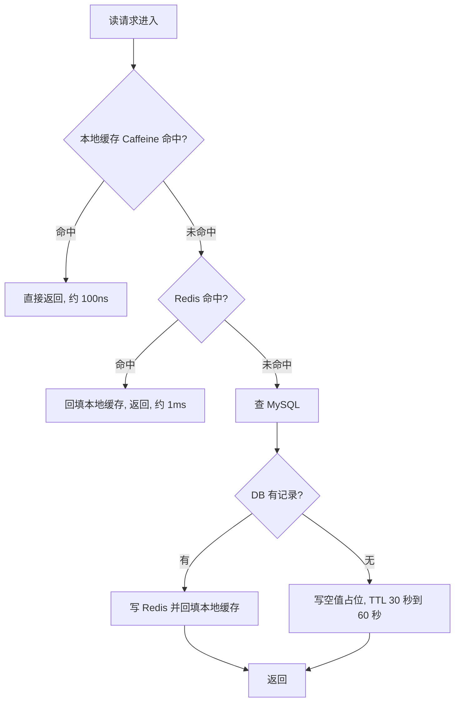
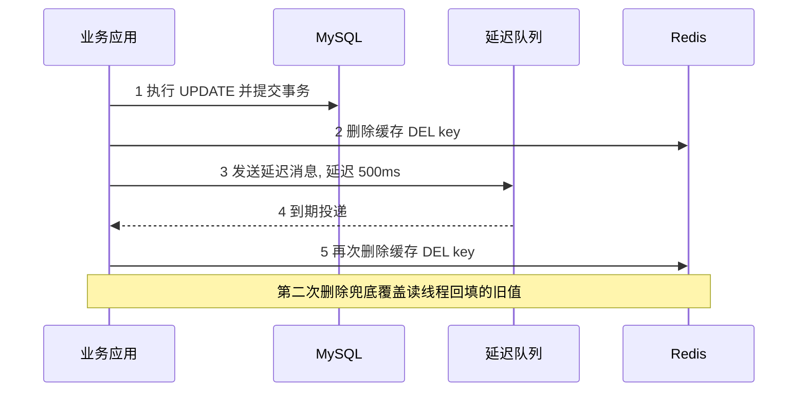
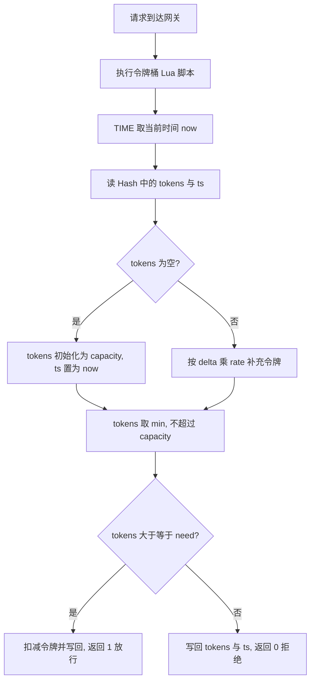
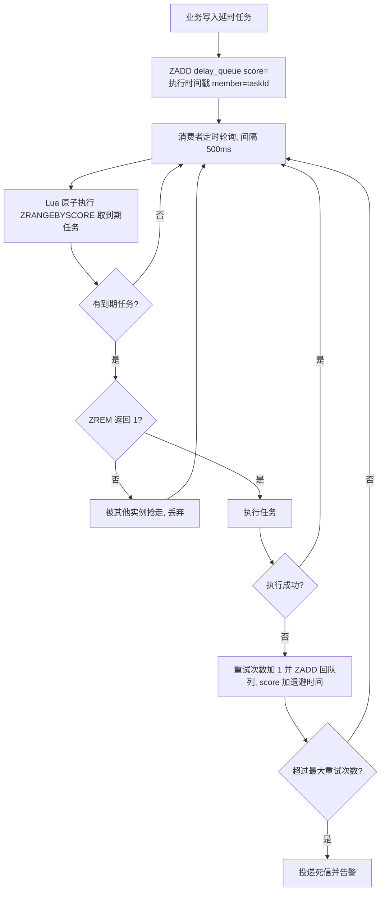
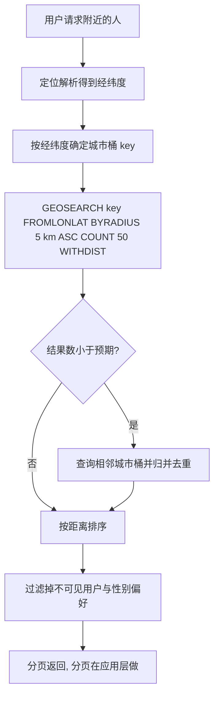
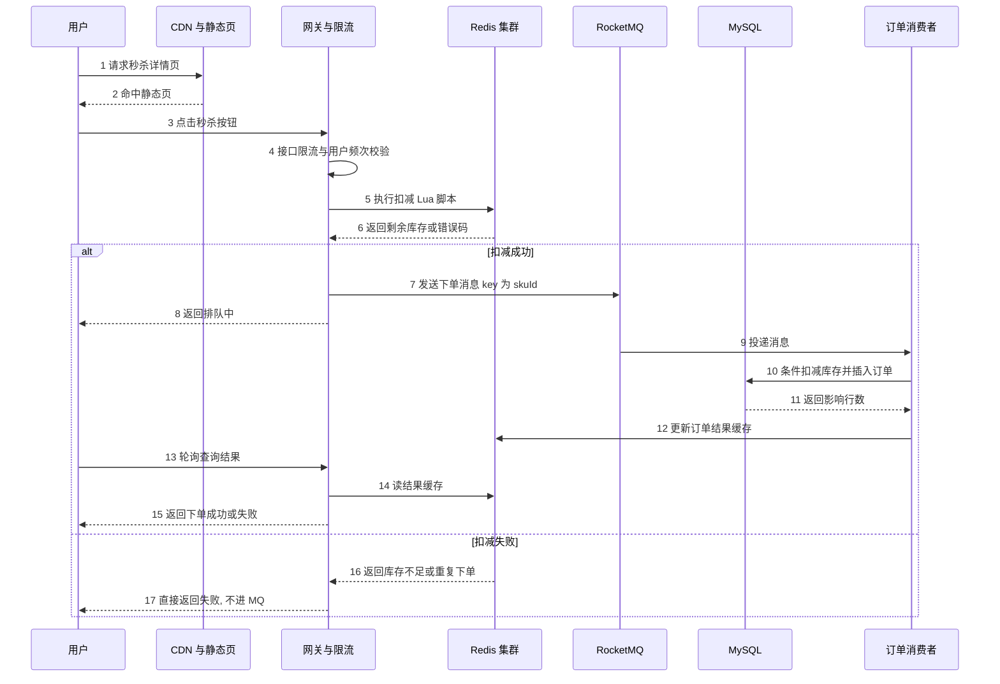
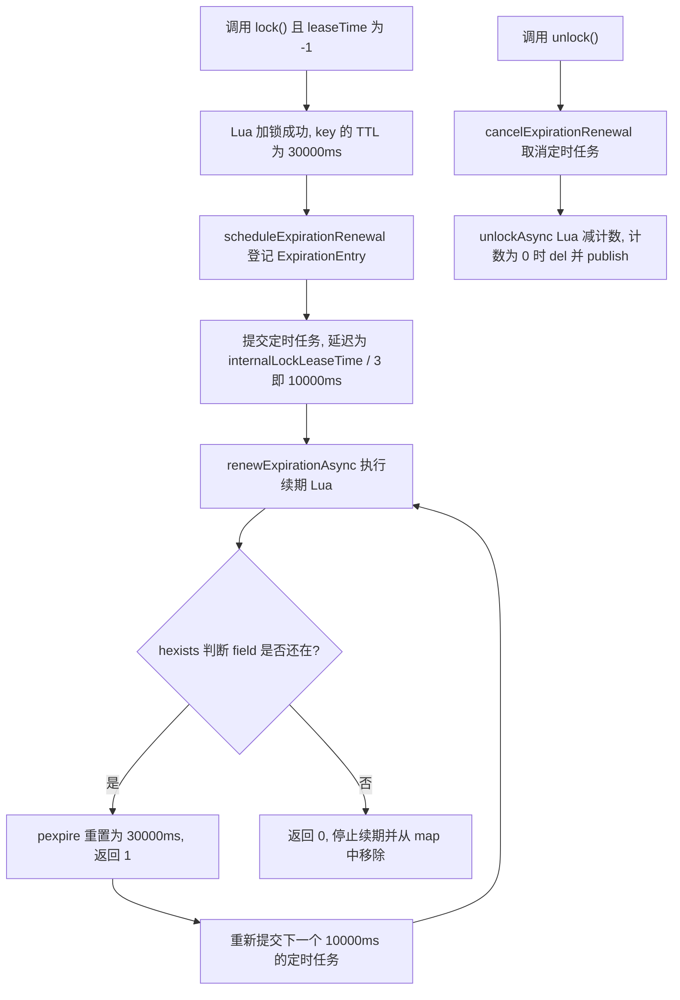
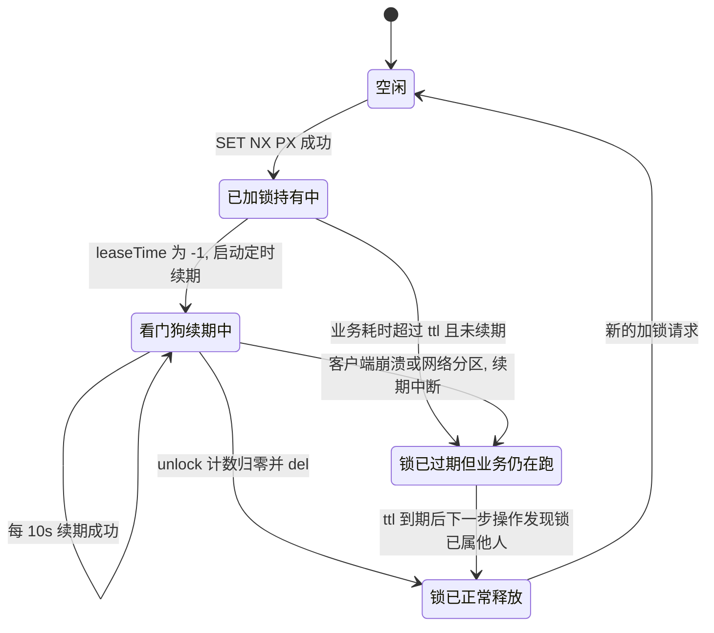
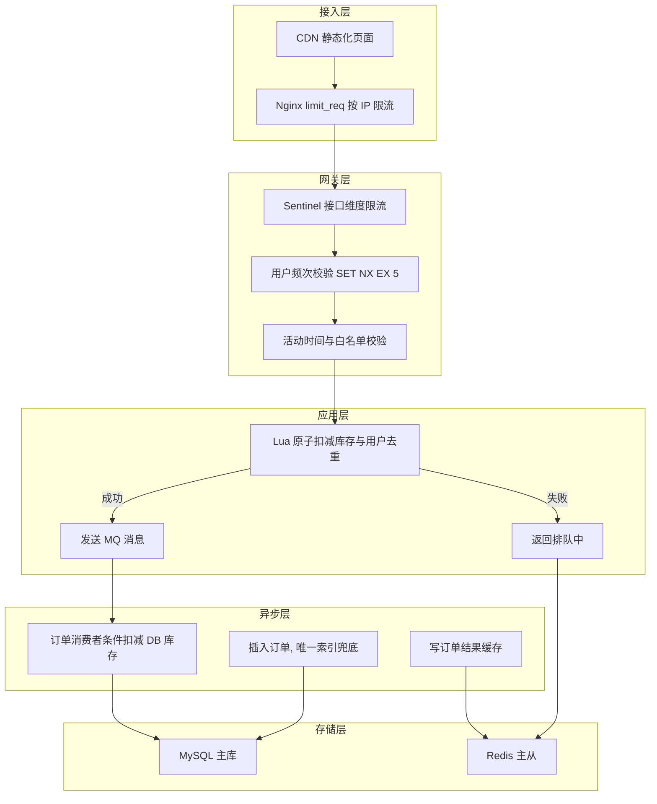

# 06 Redis 实战场景与分布式锁专题

> 一句话定位：Redis 在大厂面试里从来不是"会用 API"而是"场景选型 + 原子性边界 + 分布式锁的正确性证明"，本章从三级缓存讲到 RedLock 争议，覆盖"为什么这么设计、线上怎么排查、规模上来怎么崩"三问 ｜ 面试权重 ★★★★★ ｜ 建议复习 60 分钟

本文以 **Redis 7.2**（2023-08 GA）为基准，涉及 5.0 / 6.0 / 6.2 / 7.0 / 8.0 差异处显式标注。客户端默认以 **Redisson 3.27.x** 与 **Spring Data Redis 3.2.x**（Spring Boot 3.2）为例，ZooKeeper 侧以 **Apache Curator 5.5.0**、**ZooKeeper 3.8.x** 为例，JDK 基准 **JDK 17**。

关键版本分界线先摆出来，后面反复引用：

| 版本 | 关键变化 | 对本章的影响 |
| --- | --- | --- |
| Redis 2.8.9 | `SET key value NX EX` 完整可用 | 单条命令就能拿到锁，不再需要 `SETNX` + `EXPIRE` 两条 |
| Redis 3.2 | `GEOADD`/`GEORADIUS`、`OBJECT FREQ`、Lua 脚本支持 `redis.replicate_commands()` | GEO 可用；脚本内可调 `TIME` |
| Redis 4.0 | `UNLINK`、`FLUSHALL ASYNC`、模块（Modules）、LFU 淘汰 | 大 key 异步删除；RedisBloom 以模块形式存在 |
| Redis 5.0 | Stream（`XADD`/`XREAD`/`XACK`）、脚本默认 effects replication | 延时队列多一个选项；脚本内写 `TIME` 无需额外声明 |
| Redis 6.0 | ACL、多线程 IO（`io-threads` 默认 1，即关闭）、`repl-diskless-sync` 默认 `yes` | 吞吐瓶颈从网络 IO 转到命令执行 |
| Redis 6.2 | `XAUTOCLAIM`、`GEOSEARCH`、`ZRANGE BYSCORE`、`SET` 支持 `GET` | 延时队列与 GEO 的推荐写法变了 |
| Redis 7.0 | Redis Functions（`FUNCTION LOAD`）、Multi-Part AOF、Sharded Pub/Sub；ziplist 全面替换为 listpack；`redis.replicate_commands()` 变 no-op | 编码阈值参数改名：`hash-max-ziplist-entries` → `hash-max-listpack-entries` |
| Redis 7.2 | `WAITAOF`、set 支持 listpack 编码（`set-max-listpack-entries` 默认 128） | 小 set 内存进一步下降 |
| Redis 8.0 | Redis Stack 能力（JSON/Search/TimeSeries/Bloom）并入核心 | 布隆过滤器不再是外挂模块，但 API 名 `BF.*` 未变 |

## 本章大纲

- [一、缓存架构设计与三级结构](#一缓存架构设计与三级结构)
- [二、缓存穿透、击穿、雪崩](#二缓存穿透击穿雪崩)
- [三、缓存与 DB 的更新策略](#三缓存与-db-的更新策略)
- [四、计数器与限流](#四计数器与限流)
- [五、排行榜 zset](#五排行榜-zset)
- [六、延时队列](#六延时队列)
- [七、分布式 ID](#七分布式-id)
- [八、签到与 Bitmap](#八签到与-bitmap)
- [九、附近的人 GEO](#九附近的人-geo)
- [十、消息去重与布隆过滤器](#十消息去重与布隆过滤器)
- [十一、秒杀库存扣减](#十一秒杀库存扣减)
- [十二、分布式锁需要满足的条件](#十二分布式锁需要满足的条件)
- [十三、三种分布式锁实现的九维度对比](#十三三种分布式锁实现的九维度对比)
- [十四、Redisson 源码级原理](#十四redisson-源码级原理)
- [十五、RedLock 算法与 Martin Kleppmann 的质疑](#十五redlock-算法与-martin-kleppmann-的质疑)
- [十六、锁的常见事故与规避](#十六锁的常见事故与规避)
- [十七、分布式限流与分布式 ID 的选型对比](#十七分布式限流与分布式-id-的选型对比)
- [十八、完整秒杀系统设计与容量规划](#十八完整秒杀系统设计与容量规划)
- [十九、高级岗三问](#十九高级岗三问)
- [高频面试题](#高频面试题)
- [易错点与踩坑](#易错点与踩坑)
- [一句话速记](#一句话速记)

## 一、缓存架构设计与三级结构

### 1.1 为什么要三级，不是两级

单级 Redis 的问题不是"性能不够"，而是**成本曲线不划算**。Redis 单实例（非集群）在 Pipeline 场景下能到 100 万 QPS 量级，单条命令的 3 万~10 万 QPS 也够用，但：

1. 一次 Redis 调用约 **0.5~1 ms**（同机房 RTT + 命令执行），本地 Caffeine 命中约 **50~200 ns**，差 3~4 个数量级。
2. 热点数据（如首页配置、字典表、SKU 基础信息）符合幂律分布，**1% 的 key 承担 90% 的读**。把这 1% 放到本地堆内，Redis 的 QPS 压力可以降 10 倍以上。
3. 本地缓存不占网络带宽，不需要序列化往返。Redis 每次读写都要走 socket、协议解析、序列化，**value 越大差距越明显**（1KB 以上时序列化成本占主导）。

但本地缓存引入两个新问题：**一致性延迟**（多实例各自持有一份）和**堆内存压力**（GC 受影响）。所以三级缓存的前提是：本地缓存只放**允许秒级到分钟级延迟**的数据，绝对不能放库存、余额、订单状态这类强一致数据。



### 1.2 本地缓存选 Caffeine，不要自己写 ConcurrentHashMap

Caffeine 3.x（JDK 11 起，JDK 8 用 2.x）是本地缓存事实标准，底层淘汰算法是 **W-TinyLFU**：用 Count-Min Sketch 统计频率 + Window TinyLFU 窗口队列 + Segmented LRU 主队列。相比纯 LRU，它能抵抗"一次性批量扫描把热数据冲掉"的场景，命中率典型提升 5~15 个百分点。

必配参数与默认值：

| 方法 | 默认值 | 说明 |
| --- | --- | --- |
| `maximumSize(long)` | 无默认，必须显式设置 | 条数上限，超了按 W-TinyLFU 淘汰 |
| `maximumWeight(long)` / `weigher(Weigher)` | 无默认 | 按权重而非条数限制，适合 value 大小差异大的场景 |
| `expireAfterWrite(Duration)` | 无默认 | 写入后固定过期，一致性要求高时选它 |
| `expireAfterAccess(Duration)` | 无默认 | 访问后过期，允许热数据长期驻留 |
| `refreshAfterWrite(Duration)` | 无默认 | 到期后**先返回旧值，异步刷新**，避免请求阻塞在 reload 上 |
| `initialCapacity(int)` | 16 | 初始哈希表容量 |
| `recordStats()` | 关闭 | 打开后才能读到 `hitRate()`/`missRate()`/`evictionCount()` |

`refreshAfterWrite` 是分布式场景下最有价值的一个：它让"本地缓存过期"不再等于"请求打到 Redis"。注意 `refreshAfterWrite` 依赖 `CacheLoader` 或 `AsyncCacheLoader`，用 `cache.get(key, mappingFunction)` 这种形式不触发自动刷新。

生产上必看指标：`Cache#stats().hitRate()`。如果本地缓存 hitRate 低于 80%，说明要么 key 太散（长尾），要么 `maximumSize` 给小了导致频繁淘汰。用 `evictionCount()` 除以 `requestCount()` 判断是不是容量问题。

### 1.3 容量规划：把估算过程讲出来

Redis 容量规划分三步，面试时把这三步说出来就够了。

**第一步，估数据量。** 写一条脚本对线上抽样：`redis-cli --bigkeys` 看最大 key 的类型分布，`redis-cli --memkeys` 看内存分布（Redis 6.0+ 支持 `--memkeys`），单 key 用 `MEMORY USAGE key SAMPLES 5`。注意 `MEMORY USAGE` 默认采样 5 个元素做外推，元素少时准确，元素多时误差大。

**第二步，估单 key 开销。** Redis 每个 key 都有固定开销：一个 dictEntry 约 24 字节（64 位机器，3 个指针），Redis 7.0 起 dict 改用了不用溢出的实现，`sdshdr5/8/16/32/64` 头部 1~9 字节，jemalloc 按 8/16/32/64/128... 的 size class 分配，所以实际占用总是向上取整。经验值：

| 类型 | 单元素经验占用 | 备注 |
| --- | --- | --- |
| String | 值长度 + 约 50 字节 | 短 key 可直接用 `embstr`，≤44 字节合并分配 |
| Hash | 字段 + 值 + 约 60 字节 | 元素数 ≤ `hash-max-listpack-entries`（默认 128）且单值 ≤ `hash-max-listpack-value`（默认 64）时用 listpack，占用低一个量级 |
| ZSet | 成员 + 约 64 字节 | skiplist 每层指针平均 1.33 个，元素多时开销显著 |
| Set（整数） | 约 8~16 字节 | 全整数且 ≤ `set-max-intset-entries`（默认 512）用 intset |
| List | 元素 + 约 20 字节 | 7.2 前用 quicklist + listpack |

**第三步，留冗余。** `maxmemory` 设置建议为物理内存的 **70%~75%**，剩下 25% 留给：RDB fork 时的 **COW（Copy-On-Write）页复制**、AOF rewrite 的缓冲区、客户端输出缓冲区。fork 期间如果写入量大，COW 可能额外占用与"脏页比例"成正比的内存，极端情况超 50%。所以 `vm.overcommit_memory=1` 是 Redis 部署的硬要求，否则 fork 可能直接失败，日志里出现 `Can't save in background: fork: Cannot allocate memory`。

淘汰策略必须显式设置。默认是 `maxmemory-policy noeviction`——**内存满了直接对写命令返回 OOM 错误**，读命令仍可用。生产上纯缓存用 `allkeys-lru`；有冷热分层且不能丢数据的场景用 `volatile-lru`（只淘汰设了 TTL 的 key），但要注意如果所有 key 都没设 TTL，`volatile-*` 系列等价于 `noeviction`。

`maxmemory-samples` 默认 5，控制 LRU/LFU 采样的近似精度。调大到 10 命中率略升但 CPU 略涨，一般不动。LFU 场景下还需关注 `lfu-log-factor` 默认 10、`lfu-decay-time` 默认 1（分钟）。

慢查询排查三板斧：

- `SLOWLOG GET 10`：慢命令明细，阈值由 `slowlog-log-slower-than` 控制，默认 **10000 微秒（10ms）**；`slowlog-max-len` 默认 128 条。
- `LATENCY DOCTOR` / `LATENCY HISTORY event`：记录的是**事件级抖动**（fork、expire cycle、AOF fsync），阈值 `latency-monitor-threshold` 默认 0（关闭），生产建议设为 100。
- `INFO commandstats` + `INFO latencystats`（7.0 新增）：按命令维度看 `usec_per_call`，直接定位是哪个命令慢。

## 二、缓存穿透、击穿、雪崩

三个词经常被混用，先把定义钉死：

| 问题 | 触发条件 | 现象 | 主要解法 |
| --- | --- | --- | --- |
| 穿透 | 查**不存在**的数据 | 每次请求都落到 DB，DB QPS 被打满 | 空值占位、布隆过滤器、参数校验 |
| 击穿 | **单个热点 key 过期** | 同一时刻大量请求同时回源同一个 key | 互斥重建（分布式锁）、逻辑过期、`refreshAfterWrite` |
| 雪崩 | **大批 key 同时过期** 或 Redis 整体不可用 | DB 瞬时被压垮 | TTL 加随机抖动、多级缓存、熔断降级 |

### 2.1 穿透：空值占位与布隆过滤器的取舍

空值占位的写法是 `SET key "" EX 60`，两个坑必须说清楚：

1. **TTL 不能太长也不能太短**。太长会导致数据后来真的落库了还一直返回空；太短防不住攻击。经验值 **30~120 秒**，配合"数据写入时主动 `DEL` 该空值 key"一起用。
2. **不能防随机 key 攻击**。攻击者用 UUID 生成器每次换 key，空值占位会把 Redis 内存打满（虽然每个 key 很小，但 key 数量爆炸）。此时必须上布隆过滤器。

布隆过滤器用 RedisBloom 模块（Redis 8.0 起内置）的 `BF.RESERVE` / `BF.ADD` / `BF.EXISTS`：

```
BF.RESERVE sku:bloom 0.01 1000000
BF.ADD sku:bloom SKU1001
BF.EXISTS sku:bloom SKU1001
BF.INFO sku:bloom
```

参数语义：`BF.RESERVE key error_rate capacity`。官方默认值 `error_rate = 0.01`（1%），`capacity = 100`——**capacity 默认值极小，不显式指定会立刻扩容，扩容会新建子过滤器并叠加查询，性能与误判率都会劣化**。所以生产必须显式给容量，并加 20%~30% 余量。

误判率公式（考架构岗会问）：设位数组 m 位、元素 n 个、哈希函数 k 个，则

- 误判率 `p = (1 - e^(-kn/m))^k`
- 最优哈希个数 `k = (m/n) * ln2 ≈ 0.693 * (m/n)`
- 给定 p 和 n 时所需位数 `m = -n*ln(p) / (ln2)^2 ≈ 1.44 * n * log2(1/p)`

代入 `p = 0.01`：每个元素约 **9.6 bit**，`k ≈ 7`。所以 100 万容量、1% 误判约需 1.2 MB，代价极低。这也是面试时"布隆过滤器占多少内存"的标准答法。

布隆过滤器的致命限制：**不支持删除**。原因是一个位由多个元素共享，删除会误伤其他元素。需要删除时换 Counting Bloom（每位置计数，内存涨 3~4 倍）或 Cuckoo Filter（RedisBloom 的 `CF.RESERVE`/`CF.ADD`/`CF.DEL`，支持删除且空间效率更高，但不支持计数）。

### 2.2 击穿：逻辑过期优于互斥锁

互斥重建（`SET lock NX PX 3000`，拿不到锁就 sleep 50ms 重试或直接返回旧值）的缺点是**吞吐下降**：热点 key 每秒几万请求，只有一个线程能重建，其余全在自旋。更稳的方案是**逻辑过期**：

1. value 里带一个 `expireTime` 字段，Redis 的 TTL 设为**永不过期**（不设 TTL）。
2. 读到数据后判断 `expireTime` 是否已过。
3. 已过期则**返回旧值**，同时提交一个异步任务去重建（用 `ThreadPoolExecutor` 或 MQ，重建任务本身用分布式锁保证只有一个在跑）。
4. 重建完成后写回 Redis。

这样任何时刻请求都不会阻塞，代价是**短暂的数据不一致**（通常是毫秒到秒级）。这个权衡必须主动说出来，面试官就是在考这个。

### 2.3 雪崩：TTL 抖动是最低成本的解法

最土也最有效的一招：`SET key value EX (baseTtl + random(0, 300))`。让同一批预热的数据在 5 分钟内均匀散开，避免整点同时失效。生产上常见事故就是"凌晨 2 点发版把缓存全刷了一遍，TTL 都是 24 小时，第二天凌晨 2 点集体失效"。

真正的系统性防护是**多级 + 熔断**：

- 一级本地缓存即使 Redis 全挂也能扛住热点。
- Redis 集群模式 + 主从，避免单点。
- DB 前面加**信号量隔离 + 限流**（Sentinel 或 Hystrix/Sentinel 1.8.x 的 `SphU.entry`），DB 打满时对非核心接口直接降级返回兜底数据。

## 三、缓存与 DB 的更新策略

### 3.1 四种模式与默认选择

| 模式 | 谁来写缓存 | 一致性 | 适用 |
| --- | --- | --- | --- |
| Cache Aside（旁路） | 业务代码 | 最终一致 | **默认选择**，读多写少 |
| Read Through | 缓存组件 | 最终一致 | 缓存的"读穿"能力，Redis 无原生支持，需客户端封装 |
| Write Through | 缓存组件同步写 DB | 强一致（同步） | 写多读少时写放大严重 |
| Write Behind（写回） | 缓存异步刷 DB | 弱一致，有丢数据风险 | 计数器、点赞数等可容忍丢失的场景 |

**Cache Aside 的标准顺序是"先更新 DB，再删除缓存"**，不是更新缓存。原因有两条：

1. 更新缓存存在**并发写覆盖**：A 写 DB=1，B 写 DB=2，B 先更新缓存为 2，A 后更新缓存为 1，缓存里留下脏的 1，且永久脏。
2. 删除缓存比更新缓存好，因为**删除是幂等的**，且懒加载只在真正被读到时才回填缓存，避免"写了 100 次但没读一次"的无效写放大。

"先删缓存再更新 DB"为什么不行：请求 A 删缓存 → 请求 B 读缓存未命中 → B 读 DB 旧值 → B 写回缓存旧值 → A 更新 DB 为新值。缓存里永久是旧值。这个窗口是"一次读 DB + 一次写缓存"的时间，通常几毫秒，高并发下必现。

### 3.2 "先更新 DB 再删缓存"的失败窗口

反过来的顺序理论上也有窗口，但概率低得多：请求 A 读 DB 旧值 → A 因为 GC/网络卡住 → 请求 B 更新 DB 并删除缓存 → A 恢复并把旧值写回缓存。

这个窗口存在的条件是"A 的读 DB 到写缓存之间的耗时 > B 的整个更新耗时"，概率极低。业界有两条兜底：

1. **延迟双删**：更新 DB 后删一次缓存，再延迟 500ms~1s（要大于一次读 DB + 写缓存的耗时）删第二次。
2. **订阅 binlog**：用 Canal 4.x（或 Debezium）订阅 MySQL binlog 变更，由独立消费者删缓存。这是**最终一致性最强的方案**，因为它不依赖业务代码的正确性，所有写路径都被覆盖。



延迟双删的代价是**多一次 MQ 投递 + 至少两次 `DEL`**，并且延迟时间要靠压测定，不写死。如果延迟设成固定 500ms，而某次 GC 停顿 2 秒，兜底就失效了。

### 3.3 一致性要求的正确问法

面试题"如何保证缓存与 DB 强一致"的正确回应是：**先反问业务能接受多大的不一致窗口**，然后说结论——

- 强一致（不允许任何窗口）：**不要用缓存**，或者用 `Redis + 分布式锁 + 读写都串行化`，代价是 QPS 掉一个数量级。
- 秒级最终一致：Cache Aside + 延迟双删 / binlog 订阅。
- 分钟级最终一致：TTL 兜底，什么都不用做。

## 四、计数器与限流

### 4.1 计数器：`INCR` 家族

`INCR key` / `INCRBY key n` / `DECR` / `DECRBY` / `INCRBYFLOAT` 全部是原子操作（Redis 命令执行本身单线程）。要注意：

1. **`INCR` 的初值语义**：key 不存在时按 **0** 处理，`INCR` 之后为 1。这条保证"不存在即 0"的语义，不需要先 `SET 0` 再 `INCR`（那样反而有竞态）。
2. **`INCRBYFLOAT` 用 long double，存在精度问题**，金额统计不要用它，用整数分。
3. **计数 + 过期必须原子**。`INCR` 之后紧跟的 `EXPIRE` 不是原子的，如果 `INCR` 后进程崩了，key 就永不过期。Redis 7.0 起可用 `SET key 0 EX 60 NX` 预热，或者直接上 Lua。
4. `INCR` 到 `Long.MAX_VALUE`（9223372036854775807）会报 `ERR increment or decrement would overflow`。

### 4.2 限流算法：四选一的判断依据

| 算法 | 突发流量 | 精度 | 内存 | 实现成本 | 适用 |
| --- | --- | --- | --- | --- | --- |
| 固定窗口 | 允许 2 倍 | 差（临界问题） | O(1) | 最低 | 粗粒度保护 |
| 滑动窗口（zset） | 平滑 | 高 | **O(限流阈值)** | 中 | 阈值小（几百）的接口 |
| 令牌桶 | 允许一定突发 | 高 | O(1) | 中（需 Lua） | **推荐默认** |
| 漏桶 | 完全平滑，无突发 | 高 | O(1) | 中 | 下游极脆弱时 |

**固定窗口的临界问题**必须能举例：限流 100 QPS，窗口按整秒切分。0.99 秒来了 100 个请求（第 1 个窗口的最后），1.01 秒又来了 100 个请求（第 2 个窗口的开头），**200ms 内实际通过了 200 个请求**，是设定值的 2 倍。所有固定窗口的实现在窗口边界都会放大到 2 倍。

固定窗口 Lua（原子 `INCR` + 首次 `EXPIRE`）：

```lua
-- KEYS[1] 限流 key, ARGV[1] 阈值, ARGV[2] 窗口秒数
local current = redis.call('INCR', KEYS[1])
if current == 1 then
  redis.call('EXPIRE', KEYS[1], ARGV[2])
end
if current > tonumber(ARGV[1]) then
  return 0
end
return 1
```

滑动窗口用 zset，成员是请求的唯一标识（UUID），score 是毫秒时间戳：

```lua
-- KEYS[1] 限流 key, ARGV[1] 当前毫秒, ARGV[2] 窗口毫秒, ARGV[3] 阈值
redis.call('ZREMRANGEBYSCORE', KEYS[1], 0, tonumber(ARGV[1]) - tonumber(ARGV[2]))
local count = redis.call('ZCARD', KEYS[1])
if count >= tonumber(ARGV[3]) then
  return 0
end
redis.call('ZADD', KEYS[1], ARGV[1], ARGV[1] .. ':' .. math.random(100000))
redis.call('PEXPIRE', KEYS[1], ARGV[2])
return 1
```

滑动窗口的代价是**内存与阈值成正比**：限流 1 万 QPS 就是 zset 里常驻 1 万个成员，约 1 MB。所以只适合阈值几百以内。阈值大时改用"滑动窗口计数器"：把窗口切成 10 个 bucket，用 Hash 存 `bucketIndex -> count`，内存 O(10)。

令牌桶 Lua（推荐实现，可容忍突发）：

```lua
-- KEYS[1] 令牌桶 key
-- ARGV[1] 桶容量 capacity
-- ARGV[2] 令牌生成速率 rate (个/秒)
-- ARGV[3] 本次请求令牌数
-- 时间从 redis.call('TIME') 获取, Redis 5.0 起脚本按 effects 复制, 非确定性命令安全
local time = redis.call('TIME')
local now = tonumber(time[1]) + tonumber(time[2]) / 1000000
local capacity = tonumber(ARGV[1])
local rate = tonumber(ARGV[2])
local need = tonumber(ARGV[3])
local data = redis.call('HMGET', KEYS[1], 'tokens', 'ts')
local tokens = tonumber(data[1])
local ts = tonumber(data[2])
if tokens == nil then
  tokens = capacity
  ts = now
end
local delta = math.max(0, now - ts)
tokens = math.min(capacity, tokens + delta * rate)
local allowed = 0
if tokens >= need then
  tokens = tokens - need
  allowed = 1
end
redis.call('HSET', KEYS[1], 'tokens', tokens, 'ts', now)
redis.call('EXPIRE', KEYS[1], math.ceil(capacity / rate) + 1)
return allowed
```

三个易错点：

1. **`EXPIRE` 的时间要能覆盖桶重新装满的时间**，即 `capacity / rate`，否则 key 提前过期会让桶"瞬间满血"，限流失效。
2. **`redis.replicate_commands()` 在 Redis 7.0 起是 no-op**。Redis 5.0 起脚本默认按 effects（实际写命令）复制，脚本内调用 `TIME`、`SRANDMEMBER` 这类非确定性命令是安全的。3.2~4.x 才需要显式调用。
3. **Lua 脚本执行是原子的，但会阻塞整个实例**。脚本里的循环必须有上界，`slowlog-log-slower-than` 默认 10ms，脚本执行超过 `busy-reply-threshold`（默认 5000ms）会打印 `BUSY` 日志。Redis 7.0 起脚本超时不再阻塞，但会记录警告。



## 五、排行榜 zset

zset 底层是**listpack（7.0 前 ziplist）+ skiplist + dict** 的双结构：dict 提供 O(1) 的 `ZSCORE`，skiplist 提供 O(log N) 的排名与区间查询。元素超过 `zset-max-listpack-entries`（默认 **128**）或任一成员长度超过 `zset-max-listpack-value`（默认 **64**）就转 skiplist。

转型后**不可逆**（即使删元素回到 128 以下也不会转回 listpack），这点面试常问。

核心命令与复杂度：

| 命令 | 作用 | 复杂度 |
| --- | --- | --- |
| `ZADD key score member` | 写入，支持 `NX`/`XX`/`GT`/`LT`/`CH`/`INCR` | O(log N) |
| `ZINCRBY key delta member` | 分数自增（点赞数、热度分） | O(log N) |
| `ZREVRANGE key start stop WITHSCORES` | 榜单 Top N（7.0 起推荐 `ZRANGE key start stop REV WITHSCORES`） | O(log N + M) |
| `ZREVRANK key member` | 查排名（从 0 开始），`ZRANK` 是升序 | O(log N) |
| `ZSCORE key member` | 查分数，走 dict，不是 skiplist | **O(1)** |
| `ZRANGEBYSCORE key min max WITHSCORES` | 分数段查询 | O(log N + M) |
| `ZUNIONSTORE` / `ZINTERSTORE` | 多榜合并，可指定 `WEIGHTS` 与 `AGGREGATE SUM/MIN/MAX` | O(N*K + M log M) |

设计要点：

1. **分数必须能编码"并列时的次序"**。`ZADD` 分数相同时按 member 的**字典序**排。如果要求"同分先到先得"，就把时间戳编码进分数：`score = 热度 * 10^10 + (10^10 - timestampSec)`。注意 double 的**尾数只有 52 bit**，超过 2^53 的整数部分会丢精度，所以拼接位数要算清楚。更稳的做法是分数用 double，member 里带上时间戳并单独维护一个同分排序结构。
2. **分页深翻性能**。`ZREVRANGE key 100000 100010` 虽然复杂度是 O(log N + M)，但跳过前 10 万个元素仍需遍历，实际延迟会上去。需要深翻时改用游标：`ZREVRANGEBYSCORE key maxScore minScore LIMIT 0 10`，用上一次返回的最后一个分数作为下一次的 `maxScore`（注意用开区间 `(score` 排除重复）。
3. **榜单按天分 key**：`rank:daily:20250101`，避免一个 key 无限增长。日榜保留 7 天，周榜用 `ZUNIONSTORE rank:week:xxx 7 rank:daily:...` 合并，再 `EXPIRE` 设过期。
4. **大 zset 删除要用 `UNLINK`**（Redis 4.0+）或 `ZREMRANGEBYRANK key 0 -1` 分片删，直接 `DEL` 一个百万级 zset 会造成**几百毫秒的阻塞**，`INFO commandstats` 里能看到 `usec_per_call` 尖刺。

## 六、延时队列

### 6.1 三种实现对比

| 方案 | 精度 | 可靠性 | 复杂度 | 适用 |
| --- | --- | --- | --- | --- |
| zset + 轮询 | 秒级（取决于轮询间隔） | 中（需自行处理续租） | 低 | 一般延时的轻量场景 |
| Redis Stream + 消费者组 | 秒级 | 高（`XPENDING` + `XAUTOCLAIM` 可重新投递） | 中 | 需要 ack 与重投的可靠消费 |
| MQ 原生延时 | RabbitMQ 毫秒级 / RocketMQ 固定级别 | 高 | 低 | 大规模生产首选 |

### 6.2 zset 方案的完整写法

生产者在 `ZADD` 时把 score 设为**执行时间戳**（毫秒）。消费者轮询：

```
ZRANGEBYSCORE delay_queue 0 <now> LIMIT 0 1
ZREM delay_queue <member>
```

关键点：**`ZRANGEBYSCORE` 与 `ZREM` 必须用 Lua 合并，用 `ZREM` 的返回值判断是否抢到任务**。因为多实例同时轮询会拿到同一个 member，`ZREM` 返回 1 的那个实例才真正执行，返回 0 说明被别人抢走，直接忽略。这是最经典的"用返回值做 CAS"。

```lua
-- KEYS[1] 延时队列 zset, ARGV[1] 当前毫秒时间戳
local tasks = redis.call('ZRANGEBYSCORE', KEYS[1], 0, ARGV[1], 'LIMIT', 0, 1)
if #tasks == 0 then
  return nil
end
local member = tasks[1]
if redis.call('ZREM', KEYS[1], member) == 1 then
  return member
end
return nil
```

另一个必须说的问题：**任务执行失败怎么办**。zset 里已经没有这条记录了，最简单的兜底是"失败时重新 `ZADD`，但 score 设为 `now + 退避时间`，并限制最大重试次数（把重试次数编码进 member 或用单独的 Hash 记录）"。

Redisson 已经封装好了：`RDelayedQueue` + `RBlockingQueue`。

```java
RBlockingQueue<String> queue = redisson.getBlockingQueue("order:delay");
RDelayedQueue<String> delayed = redisson.getDelayedQueue(queue);
delayed.offer("orderId=1001", 30, TimeUnit.MINUTES);
String task = queue.take();
```

底层是 `redisson_delay_queue_timeout:{name}`（zset）+ `redisson_delay_queue:{name}`（list），由 Redisson 内部的定时任务把到期元素从 zset 搬到 list，`take()` 用 `BLPOP` 阻塞等待。它的问题是**延迟任务的搬运依赖单实例的定时器**，且 Redisson 客户端重启后由新实例接管，量级到十万级时 zset 扫描开销明显。

### 6.3 Stream 方案

Stream 是 Redis 5.0 引入的日志型结构，作为队列的正确姿势：

```
XGROUP CREATE order:stream order-group 0 MKSTREAM
XREADGROUP GROUP order-group consumer-1 COUNT 10 BLOCK 2000 STREAMS order:stream >
XACK order:stream order-group <id>
XPENDING order:stream order-group
XAUTOCLAIM order:stream order-group consumer-2 60000 0-0 COUNT 10
```

- `>` 表示只读新消息；指定具体 id 表示读该消费者的 Pending 列表（重试自己没 ack 的）。
- `XPENDING` 两参数形式返回 summary（总数、最小 id、最大 id、各消费者计数）；三参数形式 `XPENDING key group start end count [consumer]` 返回明细。
- `XAUTOCLAIM key group consumer min-idle-time start [COUNT n] [JUSTID]` 是 Redis **6.2** 引入的，用来替代 `XCLAIM` 的批量版：把空闲超过 `min-idle-time` 毫秒的消息改派给新消费者。这是实现"消费者宕机后消息重新投递"的核心机制。
- 裁剪用 `XADD key MAXLEN ~ 100000 * ...`，`~` 表示近似裁剪（按整个宏节点裁剪，效率远高于精确裁剪）。7.0 起 `XADD` 不支持 `NOMKSTREAM` 之外的组合变化，`XTRIM` 支持 `MINID`。

Stream 做延时的限制：**它没有"定时投递"能力**。要做延时必须自己用 zset 存到期时间，到期后再 `XADD` 进 Stream；或者用定时器延迟 ack。所以严格来说 Stream 是"可靠消费"，zset 才是"延时"，两者组合才是完整的延时队列。

RocketMQ 的延时是固定 18 级（`messageDelayLevel` 默认 `1s 5s 10s 30s 1m 2m 3m 4m 5m 6m 7m 8m 9m 10m 20m 30m 1h 2h`），RocketMQ 5.0 才支持任意时刻；RabbitMQ 用 `x-message-ttl` + `x-dead-letter-exchange`，用"每级一个队列"来规避队头阻塞。这些也应一并说出，体现选型视野。



## 七、分布式 ID

### 7.1 五类方案与选型

| 方案 | 有序性 | 性能（单机） | 依赖 | 主要缺陷 |
| --- | --- | --- | --- | --- |
| `UUID.randomUUID()` | 无序 | 百万级 | 无 | 36 字符占空间；无序导致 InnoDB 页分裂 |
| DB 自增 | 严格递增 | 受 DB 写入限制 | MySQL | 单点、暴露业务量、分库分表后需改造 |
| DB 号段（Leaf-segment） | 趋势递增 | 十万级 | MySQL | 号段用完时抖动；需双 buffer |
| Snowflake | 趋势递增 | **409.6 万/秒/机** | 机器号分配 | 时钟回拨 |
| Redis `INCR` | 严格递增 | 十万级 | Redis | 持久化配置不当会回退；需分片 |

### 7.2 Snowflake 的位分配必须背下来

经典 Snowflake（Twitter 版）64 bit：

| 段 | 位数 | 含义 |
| --- | --- | --- |
| 符号位 | 1 bit | 恒为 0，保证正数 |
| 时间戳 | 41 bit | `当前毫秒 - twepoch`，经典 `twepoch = 1288834974657L`（2010-11-04 01:42:54.657 UTC） |
| 数据中心 | 5 bit | 0~31 |
| 机器 | 5 bit | 0~31 |
| 序列号 | 12 bit | 0~4095 |

41 bit 时间戳的可用年数：`2^41 / (1000*3600*24*365) ≈ 69.7 年`。单机每秒上限 `4096 * 1000 = 409.6 万`。

**时钟回拨是必考**。回拨原因：NTP 校时、虚拟机迁移、闰秒、宿主机时间被手动改。三种处理：

1. **回拨小于阈值（如 5ms）**：自旋等待到 `lastTimestamp` 之后再生成。
2. **回拨较大**：拒绝服务并告警，或降级到其他 ID 生成器。
3. **美团 Leaf-snowflake**：启动时用 ZooKeeper 顺序节点分配 workerId，并**把上次的时间戳写入 ZK**，重启后如果发现当前时间小于 ZK 里的时间就告警并等待。这解决了"重启后 workerId 冲突 + 时间回拨"两个问题。

### 7.3 Redis 生成 ID 的两个坑

**坑一：`INCR` 的持久化策略决定了 ID 会不会回退。** 如果 `appendonly no` 且 RDB 的 `save` 间隔是 `3600 1`（默认配置之一），Redis 崩溃重启后可能丢掉最后几秒的 `INCR`，导致**ID 重复**。ID 生成器的 Redis **必须开 AOF 且 `appendfsync everysec` 或 `always`**，或者接受"ID 只在实例生命周期内唯一"。更彻底的方案是用 Redis Cluster 分片，每个分片独立自增，但这样 ID 就不全局递增了。

**坑二：`INCR` 是单 key 热点。** 十万 QPS 的 `INCR` 会把这个 key 所在分片的单核打满。解法是**号段模式 + 批量化**：`INCRBY key 1000` 一次拿 1000 个，本地内存分发，用完再取。这正是美团 Leaf-segment 的做法（表结构：`biz_tag`、`max_id`、`step`、`update_time`），配合**双 buffer**（一个号段用到 10% 时异步去预取下一段）来消除取号段时的抖动。

`INCRBY` 拿号段时必须用 Lua 或 `INCRBY` 的返回值本身（`INCRBY` 返回自增后的值，用它减去 step 就是起始值），不需要额外加锁：

```
INCRBY id:order 1000
-- 返回 1001, 则可用区间为 2..1001
```

## 八、签到与 Bitmap

Bitmap 不是独立数据类型，而是 **String 上的位操作**。最大 offset 是 **2^32 - 1 = 4294967295**，即一个 key 最多 512 MB。

| 命令 | 作用 |
| --- | --- |
| `SETBIT key offset value` | 置位，返回原值；offset 从 0 开始，value 只能是 0/1 |
| `GETBIT key offset` | 取位，超出长度返回 0 |
| `BITCOUNT key [start end [BYTE\|BIT]]` | 统计 1 的个数，`BIT` 单位是 Redis **7.0** 引入 |
| `BITPOS key bit [start [end [BYTE\|BIT]]]` | 找第一个 0 或 1 |
| `BITOP AND\|OR\|XOR\|NOT destkey key [key ...]` | 位运算，用于月活统计 |
| `BITFIELD key [GET type offset] [SET ...] [INCRBY ...] [OVERFLOW WRAP\|SAT\|FAIL]` | 位域批量读写，是 Bitmap 的"升级版" |

### 8.1 签到方案：按月一个 key

一个用户一个月最多 31 天，用一个 key 的 31 位足够：`sign:uid:1001:202501`，offset 用"日期 - 1"。

```
SETBIT sign:uid:1001:202501 0 1
BITCOUNT sign:uid:1001:202501
BITFIELD sign:uid:1001:202501 GET u31 0
```

每个月一个 key 的好处：key 数量 = 用户数 × 12 每年，可控；每个 key 只有 4 字节（31 位向上取整到 4 字节），内存开销约等于 0。**代价是跨月连续签到判断要读两个 key**，用 `BITFIELD` 把两个 key 的值取出来拼成一个 62 位整数再算连续 1 的个数。

### 8.2 统计类应用：日活/月活

经典做法是"按天一个 key，用户 id 作为 offset"：`SETBIT uv:20250101 <userId> 1`，然后 `BITCOUNT` 得日活，`BITOP OR uv:month uv:20250101 uv:20250102 ...` 得月活。

三个坑：

1. **userId 必须映射成紧凑的 offset**。如果 userId 是 19 位雪花 ID，`SETBIT` 的 offset 会到 10^18，远超 2^32-1，直接报错。必须用一层 `userId -> 自增序号` 的映射（放在 Redis Hash 或 DB 里）。
2. **稀疏 key 也占内存**。`SETBIT key 1000000 1` 会立刻分配 125 KB，因为 Redis 按最大 offset 分配。所以"活跃用户 ID 稀疏"的场景用 Bitmap 反而浪费，改用 HyperLogLog。
3. **HyperLogLog 的精度与内存**：`PFADD`/`PFCOUNT`/`PFMERGE`，标准误差 **0.81%**，每个 key 固定 **12 KB**（Redis 实现用 16384 个 6 bit 寄存器 = 12 KB）。它只支持基数估计，**不能判断单个元素是否存在**，也没有 `PFEXISTS`。日活百万级时 HLL 比 Bitmap 省内存（Bitmap 需要 userId 上界/8 字节），但 Bitmap 能回答"某用户某天是否活跃"，HLL 不能。

## 九、附近的人 GEO

GEO 不是独立类型，底层就是 **zset**：`GEOADD` 把经纬度编码成 **52 bit 的 geohash 整数**，作为 zset 的 score（double 的 52 bit 尾数刚好够用），member 是用户标识。

| 命令 | 说明 |
| --- | --- |
| `GEOADD key lon lat member [...]` | 经度 -180~180，纬度 -85.05112878~85.05112878，超出报错 |
| `GEOPOS key member` | 返回实际存储的经纬度（有精度损失） |
| `GEODIST key m1 m2 [unit]` | 单位 `m`（默认）/`km`/`mi`/`ft` |
| `GEOSEARCH key FROMLONLAT lon lat BYRADIUS r unit ASC COUNT n [WITHDIST] [WITHCOORD]` | **6.2 起推荐的查询命令** |
| `GEOSEARCH key FROMMEMBER m BYBOX w h unit ...` | 矩形范围查询 |
| `GEOSEARCHSTORE dest src ...` | 结果写入另一个 key |

`GEORADIUS` / `GEORADIUSBYMEMBER` 在 Redis 6.2 起被标记为废弃（deprecated），7.0 文档明确推荐 `GEOSEARCH`，因为 `GEORADIUS` 的参数顺序容易写错且不支持 `BYBOX` 的简洁形式。

### 9.1 精度损失与误差来源

Redis 的 GEO 有**两处误差**，必须都讲清楚：

1. **Geohash 编码误差**。52 bit 的 geohash 把经纬度量化到固定网格，纬度范围 180 度分 2^26 份，经度 360 度分 2^26 份，理论定位误差在**厘米级**（0.6 米以内），所以 `GEOPOS` 返回的坐标和写入的有微小差异，这是正常现象。
2. **检索的边界误差**。`GEOSEARCH` 的实现是：把查询范围的外接矩形转成 geohash 区间，取中心格 + 周围 **8 个邻居格**，把这 9 个格覆盖的 zset 区间全部取出，再逐条算真实距离过滤。所以：
   - 结果**不遗漏**（9 格覆盖了外接矩形）。
   - 但候选集比实际需要的大，**距离过滤后的 COUNT 限制在候选集上生效**。极端情况下如果 `COUNT` 设得很小、且格子内元素极多，Redis 内部分配的候选缓冲区有上限，可能返回少于 `COUNT` 的结果。

### 9.2 生产架构：Bucket 分桶

直接对全国用户做 `GEOSEARCH` 是**灾难**：一个 key 装几千万用户，单次查询的候选集太大，且这个 key 必然是热 key，所在分片 CPU 打满。

标准做法是**地理分桶**：按城市或 geohash 前缀分 key，例如 `geo:city:110100`（北京）。查询时先由用户定位解析出城市，再查对应 key。跨城查询（如"周边 100 公里"跨越城市边界）需要查询相邻的几个桶并归并结果，代价是要维护桶与邻近桶的映射表。

更彻底的方案是**用专门的空间索引**（PostGIS、Elasticsearch 的 `geo_point` / `geo_shape`、MongoDB 的 `2dsphere`）。Redis GEO 的定位是"百万级以下、精度要求不高、要低延迟"的场景。



注意最后一步：**GEO 不支持 offset 分页**。`GEOSEARCH` 只有 `COUNT`，没有 `LIMIT offset count`。要做分页只能：把 `COUNT` 放大（比如取前 500），在应用层分页；或者用 `GEOSEARCHSTORE` 落一个临时 key，再 `ZRANGE` 分页。

## 十、消息去重与布隆过滤器

### 10.1 幂等消费的三层做法

| 层次 | 做法 | 代价 |
| --- | --- | --- |
| 生产端去重 | 每条消息生成全局唯一 `msgId`（业务单号），发送前 `SET msgId NX EX 86400` | 发送前多一次 Redis 往返；发送失败需要回滚标记 |
| 消费端去重 | 消费前 `SET msgId NX EX 86400`，失败则直接 ack 不处理 | 必须在**同一个事务/原子操作**里标记，否则并发消费会穿透 |
| DB 兜底 | 唯一索引 / `INSERT ... ON DUPLICATE KEY UPDATE` | 最终防线，性能最低但绝对可靠 |

**"消费端用 `SETNX` 去重"最常见的错误是标记和处理不在一个原子边界内**：线程 A `SETNX` 成功，还没来得及写业务数据就崩了，消息重投时 `SETNX` 失败被当作重复丢弃，数据永久丢失。所以顺序必须是"**先处理业务，再标记已消费**"，或者用 `SETNX` 只做"正在处理"的互斥（带较短 TTL 的 processing 标记），处理完再写 completed 标记，并在重投时检查 processing 标记的 TTL。

### 10.2 布隆过滤器与 set 的选择

| 维度 | `SET` | 布隆过滤器 `BF.*` |
| --- | --- | --- |
| 判定 | 精确 | 有误判（可能把不存在判为存在），**不会漏判** |
| 删除 | 支持 `SREM` | 不支持 |
| 内存（100 万元素） | 约 60~70 MB | **约 1.2 MB**（p=0.01） |
| 扩容 | 自由 | 需 `BF.RESERVE` 预留，超容后新增子过滤器 |
| 适用 | 需要精确判定或删除 | 只问"可能存在吗"的过滤前置 |

**布隆过滤器只能挡"一定不存在"，不能当"一定存在"用**。所以业务上一旦 `BF.EXISTS` 返回 true，仍然要查 DB 确认真伪。它挡的是"大量不存在的 key 打 DB"，不是"保证 DB 不被查"。

在 Redis 里如何做到"防重 + 可删除"并存：常见组合是 **布隆做第一层快速拦截 + Redis Set 或 DB 唯一索引做第二层精确校验**。仅靠布隆无法满足"必须精确去重"的需求。

## 十一、秒杀库存扣减

### 11.1 核心矛盾

秒杀的本质是**在一个极小的库存上承受极端并发**，所有设计都围绕两条线：

1. **挡住无效流量**（不查库存、不落库）。
2. **保证库存不超卖、不早卖**（原子性 + 一致性）。

超卖的根因是把"判断"和"扣减"分成了两步非原子操作：

```
stock = GET stock:1001        -- 步骤 1
if stock > 0 then             -- 步骤 2
  DECR stock:1001             -- 步骤 3
end
```

并发下 N 个请求同时通过步骤 2，然后都执行步骤 3，库存变负数。**DB 层的经典超卖是 `UPDATE stock SET num = num - 1 WHERE id = ?` 缺少 `AND num > 0`**，必须写成：

```sql
UPDATE seckill_stock SET num = num - 1 WHERE id = ? AND num > 0;
```

再由 `affectedRows` 判断是否扣减成功（返回 0 说明库存不足）。这是最终防线。

### 11.2 Redis 层扣减：Lua 一次搞定

```lua
-- KEYS[1] 库存 key, 例如 seckill:stock:1001
-- KEYS[2] 用户去重 key, 例如 seckill:users:1001
-- ARGV[1] 用户 id
-- ARGV[2] 本次扣减数量, 秒杀场景通常为 1
-- 返回值: 剩余库存 >= 0 表示成功; -1 key 不存在; -2 库存不足; -3 重复下单
local stock = redis.call('GET', KEYS[1])
if stock == false then
  return -1
end
if redis.call('SISMEMBER', KEYS[2], ARGV[1]) == 1 then
  return -3
end
if tonumber(stock) < tonumber(ARGV[2]) then
  return -2
end
redis.call('DECRBY', KEYS[1], ARGV[2])
redis.call('SADD', KEYS[2], ARGV[1])
return tonumber(stock) - tonumber(ARGV[2])
```

设计要点逐条解释：

1. **去重必须在扣减之前判断**，否则同一用户重复扣减会造成"库存被自己吃光"。
2. **`SADD` 的去重集合会无限增长**。20 万人的秒杀就是 20 万个成员的 set，约 10 MB 以上。更好的做法是用 `SET seckill:user:1001:<uid> 1 EX 86400 NX`，或者用**布隆过滤器**（可容忍极低误判，但误判会导致用户被误拒，秒杀场景一般不接受）。也可以用 Hash + 分片降低单 key 压力。
3. **库存预热必须做**。秒杀开始前把 DB 库存 `SET seckill:stock:1001 100`，并把 `seckill:users:1001` 清空（`DEL`）。
4. **Lua 脚本不能超过一定长度**。脚本内容会被完整发送（或先 `SCRIPT LOAD` 拿 SHA1 再 `EVALSHA`）。Spring Data Redis 的 `DefaultRedisScript` 会自动处理 `NOSCRIPT` 错误并回退到 `EVAL`。
5. **返回值语义要统一**，客户端据此区分"没抢到"和"系统异常"，不要都用 -1。

### 11.3 完整链路：Redis 预扣 + MQ 异步下单

Redis 扣减成功**不等于**下单成功。Redis 只是"漏斗"，真正的订单必须落 DB。标准链路：

```
1. 网关限流（Sentinel 规则: 接口维度 5000 QPS）
2. 用户维度限流（SET seckill:freq:<uid> 1 EX 5 NX，5 秒内只能请求一次）
3. 秒杀开始时间校验（Redis 存 startTime，Lua 里比较，避免客户端改时间）
4. Lua 原子扣减库存 + 用户去重
5. 扣减成功 -> 发送 MQ 消息（RocketMQ 事务消息或 Kafka 分区顺序消息，key 用 skuId 保证同商品顺序）
6. 消费者落 DB：UPDATE ... WHERE id = ? AND num > 0，再 INSERT 订单（订单号唯一索引兜底）
7. 返回用户"排队中"，前端轮询/长轮询查订单结果
```



### 11.4 Redis 与 DB 库存一致性

两处库存必须有对账，否则会"Redis 扣了但 DB 没扣（少卖）"或"DB 扣了但 Redis 没扣（超卖）"。

| 失败点 | 后果 | 兜底 |
| --- | --- | --- |
| Redis 扣减成功，MQ 发送失败 | 少卖 | 发送失败时**回补 Redis 库存并移除用户去重标记**，或本地消息表 + 定时重发 |
| MQ 发送成功，消费失败 | 少卖 | MQ 重试 + 死信队列 + 人工/定时补偿任务扫 DB |
| DB 扣减成功，Redis 扣减失败 | 不会发生（Redis 在前） | 不需要处理 |
| Redis 主从切换丢数据 | 超卖 | `WAIT 1 100` 或 RedLock；或接受极小概率，靠 DB 的 `num > 0` 兜底 |

**最后一条是关键结论**：即使 Redis 层丢数据，DB 层的 `WHERE num > 0` 保证**永远不会超卖**，只会"Redis 说抢到了但 DB 扣减失败"。所以正确的产品设计是：Redis 返回"排队中"而不是"抢到了"，最终结果以 DB 为准。这样 Redis 只承担"削减流量"的职责，正确性由 DB 保证。这是架构师和普通工程师答这道题的分水岭。

### 11.5 库存回补与超时未支付

用户抢到但 15 分钟未支付，需要回补库存。做法：

1. **延时队列**（第六章的 zset 方案）在订单创建时投递一条 15 分钟后的延时消息。
2. 消息到期后查订单状态，仍是"未支付"则执行：DB `UPDATE stock SET num = num + 1 WHERE id = ?`，同时 `INCR` Redis 库存。
3. **必须幂等**：回补前检查订单状态是否为已关闭，用 `UPDATE order SET status = 'CLOSED' WHERE id = ? AND status = 'UNPAID'` 的 `affectedRows` 做 CAS。
4. **回补顺序有讲究**：先改 DB 再 `INCR` Redis。如果先 `INCR` 后 DB 失败，Redis 库存会虚高导致"Redis 放行但 DB 扣不动"，用户体验是"抢到了却下单失败"，虽然不超卖但会引发投诉。反过来先 DB 后 Redis 失败，Redis 库存偏低，结果是"少卖"，可通过定时对账修正（`Redis 库存 = DB 库存 - 未支付的 Redis 预占`）。

### 11.6 前置防护与降级

秒杀系统的 90% 工作在秒杀开始之前：

| 层级 | 措施 | 效果 |
| --- | --- | --- |
| 客户端 | 按钮置灰、倒计时与服务端时间同步、答题/验证码 | 砍掉脚本机器人 |
| CDN | 商品详情页静态化（HTML + JS + CSS），秒杀 URL 动态下发 | 挡住首屏流量 |
| Nginx | `limit_req_zone` 按 IP 限流，`limit_req zone=xxx burst=20 nodelay` | 挡住单 IP 刷 |
| 网关 | Sentinel 接口维度 + 用户维度限流，返回快速失败 | 保护后端 |
| Redis | Lua 原子扣减，热点 key 用 `{skuId}` hash tag 绑定到同一分片 | 防超卖、防跨槽 |
| MQ | 削峰填谷，消费速率可控 | 保护 DB |
| DB | 条件扣减 + 唯一索引 | 最终正确性 |
| 降级 | 秒杀入口开关（配置中心），DB 打满时直接关闭入口返回"活动火爆" | 保命 |

**关于 Redis Cluster 的 hash tag**：Lua 脚本要求所有 KEYS 在**同一个 slot**。`CRC16(key) mod 16384` 决定 slot，如果库存 key 和用户 key 的 hash tag 不同，脚本会直接报 `CROSSSLOT Keys in request don't hash to the same slot`。所以两个 key 都必须用同一个 tag：`seckill:{1001}:stock` 和 `seckill:{1001}:users`。这是线上真实事故，面试时主动提出来是加分项。

## 十二、分布式锁需要满足的条件

### 12.1 五个必要条件

面试时先给结论，再逐条展开，避免上来就写 `SETNX`。

| 条件 | 含义 | 不满足的后果 |
| --- | --- | --- |
| 互斥性 | 任意时刻只有一个客户端持有锁 | 并发写同一资源 |
| 不误删 | 只有加锁方自己能释放 | A 的锁超时后 B 拿到，A 恢复后把 B 的锁删了 |
| 防死锁 | 客户端崩溃后锁能自动释放 | 锁永久占用，业务全挂 |
| 可重入 | 同一线程可重复获取 | 递归调用 / 嵌套调用自己死锁 |
| 高可用 | 持锁方故障后锁能快速恢复可用 | 故障期间业务全阻塞 |

除此之外还有两条**工程要求**：**锁的续期能力**（业务执行时间不可预知）与**获取锁的阻塞等待能力**（`tryLock(waitTime, leaseTime, unit)` 而非立即失败）。

### 12.2 最小正确实现

```
SET lock:order:1001 <requestId> NX PX 30000
```

四个要素缺一不可：

1. **`SET` 单命令**，不能拆成 `SETNX` + `EXPIRE`。中间崩了就永久死锁。`SETNX` + `EXPIRE` 只在 Redis 2.6.12 之前是唯一选择，2.6.12 起 `SET` 支持 `EX`/`NX`，2.8.9 起支持 `PX`。
2. **`value` 必须是唯一标识**，通常是 `UUID.randomUUID() + ":" + Thread.currentThread().getId()`。用固定值（如 `"1"`）会导致误删。
3. **`NX` 保证互斥**。
4. **`PX` 保证自动释放**，单位毫秒。用 `EX` 秒级在某些场景粒度太粗。

释放必须用 Lua 保证"判断 + 删除"原子：

```lua
if redis.call('GET', KEYS[1]) == ARGV[1] then
  return redis.call('DEL', KEYS[1])
else
  return 0
end
```

写成 `if GET == id then DEL` 的两步非原子操作，会在"判断通过后、DEL 前"被其他线程抢入（锁刚好过期），删除别人的锁。

**这个最小实现仍然不是安全的**，因为业务执行时间不可预知：锁 30 秒过期、业务执行 35 秒时，第二个线程已经拿到锁，两个线程同时在临界区。以下三种做法，安全性递增：

1. 加长 `PX`（不可靠，总有更慢的时候）。
2. 自己起一个定时任务续期（比 Redisson 差，因为续期逻辑同样需要原子 Lua）。
3. **用 Redisson 的看门狗**（工程上唯一可接受的方案）。

## 十三、三种分布式锁实现的九维度对比

| 维度 | Redis（`SET NX PX` + Redisson） | ZooKeeper（Curator `InterProcessMutex`） | 数据库（`SELECT FOR UPDATE` / 唯一索引） |
| --- | --- | --- | --- |
| 实现复杂度 | 低（Redisson 封装完善） | 中（需理解临时顺序节点） | 低 |
| 性能（加解锁 TPS） | 高，单实例 5 万+ | 中，写请求需 ZAB 过半确认，约 1 万 | 低，受 DB 连接数与行锁限制，千级 |
| 一致性模型 | **AP**（主从异步复制，可能丢锁） | **CP**（ZAB 过半写入，不会丢） | CP（依赖 DB 事务隔离） |
| 锁自动释放 | 靠 TTL 过期（秒级语义） | 靠会话断开，sessionTimeout 后临时节点消失 | 靠事务结束/连接断开 |
| 可重入 | Redisson 用 Hash 计数实现 | Curator 客户端本地维护重入计数 | 不天然可重入 |
| 阻塞等待 | Redisson 用 Pub/Sub 通知，效率高 | Watch 前一个节点，**无惊群** | 靠 DB 行锁排队，`innodb_lock_wait_timeout` 默认 50s |
| 惊群效应 | `SETNX` 自旋版有；Pub/Sub 版无 | 无（只 watch 前驱节点） | 无 |
| 公平性 | 默认非公平；`RedissonFairLock` 可公平 | **天生公平**（顺序节点排队） | 由 DB 调度决定，通常近似公平 |
| 运维依赖 | Redis 集群（Sentinel/Cluster） | ZooKeeper 集群（3/5 节点） | 已有 MySQL，无需新组件 |
| 适用 | 高并发、对极端正确性要求可放宽 | 强一致要求、低频加锁、锁持有时间短 | 并发量低、不想引入新中间件 |

**选型的判断句**："如果锁的误判会直接造成资金损失，用 ZooKeeper 或数据库；如果是防止重复计算、防重复任务这类可容忍极小概率失败的场景，用 Redis。" 这句话是面试现场最有效的回答。

还有一个必须点出的 ZooKeeper 细节：Curator 的 `InterProcessMutex` 用**临时顺序节点**，`acquire()` 时创建 `/lock/xxx-0000000001` 这样的节点，然后**只 watch 序号比自己小的前一个节点**，而不是 watch 父节点。watch 父节点是初级写法，会导致"锁释放时所有等待者一起被唤醒"的惊群效应，ZK 集群瞬间被打爆。

## 十四、Redisson 源码级原理

以 Redisson 3.27.x 的 `RedissonLock` 为基准。核心字段：

| 字段/方法 | 值/作用 |
| --- | --- |
| `internalLockLeaseTime` | 默认取 `Config#lockWatchdogTimeout`，默认 **30000 ms** |
| `getLockName(threadId)` | 返回 `UUID + ":" + threadId`，UUID 是 `RedissonLock` 实例级字段 |
| `getName()` | 锁 key，默认前缀无，`RLock` 的 name 原样使用 |
| `getChannelName()` | `redisson_lock__channel:{<name>}`，7.x 后按 prefix 生成 |
| `EXPIRATION_RENEWAL_MAP` | 静态 `ConcurrentMap<String, ExpirationEntry>`，key 是**锁的 id**，用于管理续期任务 |
| `lock()` | 等价于 `lock(-1, null, false)`，`leaseTime = -1` 表示启用看门狗 |
| `tryLock()` | 默认 `waitTime = -1, leaseTime = -1`，同样启用看门狗 |
| `lock(long leaseTime, TimeUnit unit)` | 显式指定租期，**不启用看门狗**，到期自动释放 |

### 14.1 加锁 Lua：为什么用 Hash 而不是 String

`RedissonLock#tryLockInnerAsync` 的核心 Lua（参数：`KEYS[1] = getName()`，`ARGV[1] = leaseTime`，`ARGV[2] = getLockName(threadId)`）：

```lua
if (redis.call('exists', KEYS[1]) == 0) then
  redis.call('hincrby', KEYS[1], ARGV[2], 1);
  redis.call('pexpire', KEYS[1], ARGV[1]);
  return nil;
end;
if (redis.call('hexists', KEYS[1], ARGV[2]) == 1) then
  redis.call('hincrby', KEYS[1], ARGV[2], 1);
  redis.call('pexpire', KEYS[1], ARGV[1]);
  return nil;
end;
return redis.call('pttl', KEYS[1]);
```

三点必须讲清楚：

1. **锁结构是 Hash 而非 String**：`key = lockName`，`field = UUID:threadId`，`value = 重入次数`。这个设计同时解决了"可重入"和"多客户端互斥"两个问题——不同客户端的 `field` 不同，所以能共存于同一个 Hash 但语义上互斥（因为 `exists` 判断的是 key 是否存在）。
2. **返回值语义**：`nil` 表示加锁成功（Lua 的 `nil` 映射到 Redis 的 null bulk reply）；返回一个数字表示失败，数字是当前锁的**剩余 TTL 毫秒数**。Java 侧拿到这个 TTL 后，用它作为 `subscribe` 订阅锁释放频道时的超时参考，实现"等待前一个持有者释放"而不是盲目自旋。
3. **等待机制是 Pub/Sub 而非自旋**：加锁失败后 `RedissonLock#lock` 会通过 `LockPubSub` 订阅 `getChannelName()`，收到 `UNLOCK_MESSAGE`（常量 `0L`）后重新尝试。解锁时 `publish` 一条消息，所有等待者被唤醒。这比 `while(!tryLock()) sleep(50)` 的轮询好得多，既没有延迟也没有无效 QPS。

### 14.2 看门狗续期



续期 Lua（`RedissonLock#renewExpirationAsync`，`KEYS[1] = getName()`，`ARGV[1] = internalLockLeaseTime`，`ARGV[2] = getLockName(threadId)`）：

```lua
if (redis.call('hexists', KEYS[1], ARGV[2]) == 1) then
  redis.call('pexpire', KEYS[1], ARGV[1]);
  return 1;
end;
return 0;
```

关键知识点：

1. **续期周期 = `internalLockLeaseTime / 3`**，即 30000 / 3 = **10000 ms**。为什么是 1/3？因为即使**两次续期都因网络抖动失败**，还剩 1/3 的租期可用，给第三次机会。这个"1/3 冗余"是面试加分点。
2. **看门狗只在 `leaseTime = -1`（或不传 leaseTime）时生效**。一旦显式写 `lock(10, TimeUnit.SECONDS)`，Redisson 会直接把 10 秒传给 `pexpire`，**不启动续期**，10 秒后锁必然释放。这是线上最常见的坑：有人为了"避免锁不释放"而写 `lock(10, SECONDS)`，结果业务执行 15 秒，锁提前释放导致并发进入。
3. **看门狗是客户端行为，不是 Redis 行为**。进程被 `kill -9` 后定时任务消失，锁只会在 TTL 到期后释放（最长 30 秒）。所以"锁释放延迟上限 = `lockWatchdogTimeout`"是必须知道的数字。
4. `EXPIRATION_RENEWAL_MAP` 是 **static** 的，以锁的 id 为 key。如果客户端连接断开重连，`RedissonLock` 会通过 `ConnectionManager` 的重连监听重新续期。

### 14.3 解锁 Lua

`RedissonLock#unlockAsync`：

```lua
if (redis.call('hexists', KEYS[1], ARGV[3]) == 0) then
  return nil;
end;
local counter = redis.call('hincrby', KEYS[1], ARGV[3], -1);
if (counter > 0) then
  redis.call('pexpire', KEYS[1], ARGV[2]);
  return 0;
else
  redis.call('del', KEYS[1]);
  redis.call('publish', KEYS[2], ARGV[1]);
  return 1;
end;
return nil;
```

参数：`KEYS[1] = getName()`，`KEYS[2] = getChannelName()`，`ARGV[1] = LockPubSub.UNLOCK_MESSAGE`（`0L`），`ARGV[2] = internalLockLeaseTime`，`ARGV[3] = getLockName(threadId)`。

行为：
- `hexists == 0` 返回 `nil`，Java 侧抛 `IllegalMonitorStateException("attempt to unlock lock, not locked by current thread by node id: ...")`。**所以「解锁别人持有的锁」在 Redisson 里是直接抛异常的**，这比裸写 Lua 更进一步。
- 重入计数减到 0 才真正 `del` 并 `publish`，否则只刷新 TTL。

**致命细节：解锁一定要放在 `finally` 里，并且不能因为业务异常跳过了 `unlock`**。另一个真实事故是"锁被释放后业务还在跑"——因为 `unlock` 写在 `try` 块里，业务抛出异常前就解锁了。

### 14.4 公平锁

`RedissonFairLock` 继承 `RedissonLock`，额外使用两个结构：

| key | 类型 | 作用 |
| --- | --- | --- |
| `redisson_lock_queue:{<name>}` | List | 按请求到达顺序存 `UUID:threadId`，实现 FIFO 排队 |
| `redisson_lock_timeout:{<name>}` | ZSet | score = 排队超时时间戳，用于清理已放弃的等待者，防止队列被死线程占满 |

它的 Lua 会先做"清理队首超时等待者"（`zremrangebyscore` 检查队首元素的超时时间），再判断自己是否是队首。**公平锁的代价是每次加锁多两次数据结构操作**，QPS 下降约 20%~40%，并且如果队首线程长时间阻塞，后面的全部等待——**公平锁用吞吐换公平，非必要不用**。

### 14.5 读写锁

`RReadWriteLock` 由 `RedissonReadLock` 与 `RedissonWriteLock` 实现，共用同一个 Hash key `redisson_rwlock:{<name>}`：

| 字段 | 值 | 语义 |
| --- | --- | --- |
| `mode` | `read` 或 `write` | 当前锁模式 |
| `{UUID:threadId}:rlock` | 计数 | 该线程持有的读锁次数 |
| `{UUID:threadId}:wlock` | 计数 | 该线程持有的写锁次数 |

- 读锁：key 不存在或 `mode = read` 时，`hincrby` 读计数 +1，并创建 `{name}:<序号>` 的辅助 key（用于计数的独立 TTL 管理）。
- 写锁：key 不存在时 `hset mode write`；如果 `mode = read` 且**自己持有读锁**，允许获取写锁（锁降级），否则返回 `pttl` 失败。
- 写锁获取要求 `hlen == 1` 且 `mode = write`，即没有其他任何读者或写者。

读写锁的典型用途是"本地缓存与远程配置的刷新"：大量线程读、少量线程写。注意 **Redisson 的读写锁不支持锁升级**（先读锁再写锁会死锁），只支持**锁降级**（持有写锁时可以获取读锁）。

### 14.6 `tryLock` 与 `lock` 的差异

| 方法 | 行为 |
| --- | --- |
| `lock()` | 无限等待，`leaseTime = -1`（看门狗生效） |
| `lock(leaseTime, unit)` | 无限等待，指定租期，**看门狗失效** |
| `tryLock()` | 立即返回，`waitTime = -1`、`leaseTime = -1` |
| `tryLock(waitTime, unit)` | 最多等 `waitTime`，看门狗生效 |
| `tryLock(waitTime, leaseTime, unit)` | 最多等 `waitTime`，租期 `leaseTime`，**看门狗失效** |
| `tryLock(0, unit)` | 等价于 `waitTime = 0`，只尝试一次 |

**必须检查 `tryLock` 的返回值**。`if (!lock.tryLock(...)) { return; }` 漏写是高频 bug——拿不到锁却继续执行临界区，锁等于没加。

## 十五、RedLock 算法与 Martin Kleppmann 的质疑

### 15.1 RedLock 的完整步骤

antirez 在 2016 年提出 RedLock，目标是摆脱"单 Redis 主从异步复制丢锁"的问题。假设有 **N 个完全独立的 Redis master**（不是主从，不是 Cluster，官方建议 **N = 5**）：

1. 客户端记录开始时间 `T1`。
2. 依次向 N 个节点用**相同的 key 和 value** 执行 `SET key value NX PX ttl`，每个节点的请求超时时间要**远小于 ttl**（例如 ttl = 10s，单节点超时 5~50ms）。
3. 记录获得锁的结束时间 `T2`。**当且仅当**：
   - 在**超过半数**节点（`N/2 + 1`，N=5 时为 3 个）上成功获取；
   - 且总耗时 `T2 - T1 < ttl`；
   才算加锁成功。
4. 加锁成功后，锁的**实际有效时间 = ttl - (T2 - T1)**，因为网络和等待已经消耗了一部分。
5. 如果失败，**必须向所有 N 个节点发送释放请求**（包括那些"看起来没加成功"的节点，因为响应可能丢包）。

Redisson 的实现是 `RedissonMultiLock`（对多个独立的 `RLock` 做多数派判断），`RedissonRedLock` 在 **Redisson 3.19.0 起被标记 `@Deprecated`**，官方推荐直接用 `RedissonMultiLock`。

### 15.2 质疑与反驳的核心

Martin Kleppmann 在 2016 年的文章《How to do distributed locking》里提出两条质疑：

**质疑一：GC 停顿 / 网络延迟会让锁失效。** 客户端 A 在拿到锁后被 STW GC 停顿 30 秒（ttl 只有 10 秒），锁自动过期，客户端 B 拿到锁，A 恢复后以为还持有锁，两个客户端同时写共享资源。**RedLock 无法解决这个问题，因为节点数再多也不能阻止客户端自己的进程暂停。**

**质疑二：RedLock 依赖各节点的时钟。** 锁的有效性依赖"ttl 到期"这个时间判断，如果某个节点的时钟向前跳跃（NTP 校时、虚拟机迁移），锁可能提前失效；如果系统时钟回拨，`SET NX PX` 的行为相对安全（Redis 用单调时钟监控过期），但跨节点的"剩余有效期"计算仍依赖墙上时钟。Kleppmann 的原话是"RedLock 的安全性建立在多个节点时钟同步的假设上，而这个假设不成立"。

**Kleppmann 给出的正解是 fencing token（栅栏令牌）**：每次加锁返回一个**单调递增**的数字，写共享资源时带上这个 token，**存储层拒绝比已见过的最大 token 更小的写入**。这样即使两个客户端同时以为持有锁，只有 token 大的那个能写成功。他甚至建议直接用 ZooKeeper/etcd（因为它们提供单调递增的 `zxid`/`revision`）而不是 Redis。

**antirez 的反驳**：RedLock 的设计前提是"**锁的有效期远大于操作时间，并且客户端不会在持锁期间被长时间暂停**"，而不是要解决任意长度的暂停。如果业务真的需要严格的正确性，那确实需要 fencing token。antirez 也承认在"客户端可能长时间暂停"的场景下 RedLock 不足以保证安全。

**面试的落点结论**（这句话说出来就到位）：RedLock 解决的是"锁的存储本身高可用"问题，**没有解决"锁的持有者在暂停后仍然以为自己持有锁"的问题**。所以：

- 用 Redis 锁 → 必须接受"极小概率的并发"，把幂等性做在业务层或存储层（唯一索引、CAS、状态机）。
- 要严格正确 → 用 ZooKeeper 的临时顺序节点 + 单调递增版本号，或者存储层加 fencing token。
- **RedLock 的实际工程价值有限**：只有 5 个独立 Redis 集群的团队才用得上，而且它比单节点锁并没有在"正确性"上提升到质变。多数公司的选择是"单 Redis 锁 + 业务幂等"。

## 十六、锁的常见事故与规避

### 16.1 六类事故的因果链

| 事故 | 因果链 | 规避 |
| --- | --- | --- |
| 业务超时锁提前释放 | ttl 30s，业务跑 35s，B 拿到锁，A 恢复后继续写 | 看门狗续期；业务侧加"锁是否仍属于我"校验 |
| 主从切换丢锁 | 主节点写入锁后未同步到从节点即宕机，从升主后锁消失 | `WAIT 1 100` 同步等待至少 1 个从节点 ack；或 RedLock；或接受并靠业务幂等 |
| GC 停顿丢锁 | Full GC 停顿 8s，锁 ttl 5s | ttl 远大于最大 GC 停顿；换 G1/ZGC 降低停顿；业务幂等 |
| 时钟漂移 | NTP 向前跳跃导致 TTL 提前到期 | Redis 用单调时钟做过期判断（`mstime`），但仍应禁用大幅 NTP 跳变，用 `-x` 渐进校时 |
| 误删他人锁 | 没用唯一 value，或释放非原子 | 唯一 value + Lua 原子释放 |
| 锁忘记释放 | 异常路径跳过 `unlock` | `try/finally`；`tryLock` 判断返回值 |

### 16.2 主从切换丢锁的量化

Redis 主从复制是**异步**的，`repl-ping-replica-period` 默认 10 秒（心跳），但命令传播是实时的。问题在于**主节点执行完 `SET NX` 就返回给客户端，此时命令可能还在复制缓冲区里**。从节点收到并 apply 需要一次网络 RTT（同机房约 0.2ms，跨机房可能 5ms）。

在这不到 1ms 的窗口里如果主节点宕机，锁就丢了。概率很小但真实存在，Facebook 曾发论文讨论这类"异步复制 + 故障转移导致锁失效"的问题。

规避手段的代价：

| 手段 | 做法 | 代价 |
| --- | --- | --- |
| `WAIT` | 加锁后执行 `WAIT 1 100`，等至少 1 个从节点确认 | 每次加锁多一次 RTT，约 0.3~1ms；从节点故障时只能降级 |
| `min-replicas-to-write` | 配置 `min-replicas-to-write 1`、`min-replicas-max-lag 10` | 影响**所有写命令**，从节点不足时整个实例拒绝写，风险大 |
| RedLock | 5 个独立 master | 失去与单锁等价的简单性和性能 |
| 业务幂等 | DB 唯一索引 + 状态机 CAS | **推荐**，成本最低且能覆盖所有失效模式 |

**结论要落到"接受 Redis 锁不是 100% 安全，把幂等做在最后一道防线"**，而不是试图把 Redis 锁做到绝对安全。

### 16.3 锁的排查命令



现场排查条目：

- `redis-cli -h <host> -p <port> --scan --pattern 'lock:*'` 或 `KEYS lock:*`（**生产禁用 `KEYS`**，用 `SCAN` 游标）。
- `TTL lock:xxx` 看剩余租期；`PTTL` 更精确。
- `OBJECT IDLETIME lock:xxx`（lru 模式）或 `OBJECT FREQ`（lfu 模式）看访问情况。
- `MONITOR` **只用于短时定位**，它会显著降低实例吞吐并泄露敏感数据，生产环境慎用。
- `INFO clients` 看 `blocked_clients`；Redisson 的 Pub/Sub 等待不产生 blocked client。
- `CLIENT LIST` 看是否有大量连接堆积，判断是不是业务线程池被打满。
- `PUBSUB CHANNELS 'redisson_lock__channel:*'` 看有多少锁频道活跃，能判断锁泄漏量。
- `SLOWLOG GET 10` 看是否有锁 Lua 脚本超时（脚本本身很快，出现说明实例整体在排队）。

## 十七、分布式限流与分布式 ID 的选型对比

这两个能力常被放在同一题里问"为什么都用 Redis 却选型不同"，因为它们对 Redis 的要求相反：

| 维度 | 分布式限流 | 分布式 ID |
| --- | --- | --- |
| 数据特征 | 高频写、短生命周期、**允许丢失** | 高频写、需要**持久化不回退** |
| 能否接受不一致 | 能（集群总量略微超出阈值可接受） | 不能（重复 ID 是事故） |
| Redis 持久化要求 | 可关闭 AOF，纯内存 | **必须开 AOF**，`appendfsync everysec` 以上 |
| 分片策略 | 按**用户/接口**做 hash tag 分片，各分片独立计数 | 按**业务**分片，`INCRBY` 拿号段 |
| 精度权衡 | 本地预取配额（如每实例 100 QPS 配额）可提升 10 倍吞吐，代价是精确度 | 号段模式天然批量，精度无损 |
| 降级方案 | Redis 挂了直接放行（保护业务）或直接拒绝（保护下游），必须提前定 | Redis 挂了拒绝发号，或本地兜底 UUID |
| 替代方案 | Sentinel、Nginx `limit_req`、Guava `RateLimiter`（单机） | Snowflake、UUID、DB 号段 |

**限流的"本地预取"细节**：如果 100 个实例共享 Redis 限流 1000 QPS，每个请求都查 Redis，Redis 要承受 10 万 QPS 的读取。优化成"每个实例每 100ms 从 Redis 预取 10 个配额"，Redis 压力降到 1000 QPS。**代价是流量分布不均时会出现"某个实例名额没用完，其他实例已经被拒"**，集群真实的通过量会在 1000 上下波动，最大偏差约 `实例数 × 预取量`。这个权衡必须主动说。

**Guava `RateLimiter` 的默认值**：`RateLimiter.create(double permitsPerSecond)` 默认 `SmoothBursty`，`maxBurstSeconds = 1.0`，即最多存储 1 秒的令牌；`SmoothWarmingUp` 的 `coldFactor = 3.0`，预热期的速率是稳定期的 1/3。它是**单机限流**，集群总量 = 单机阈值 × 实例数，扩缩容时必须同步改配置，这是它最大的运维缺陷。

**Sentinel 的关键参数**（阿里 Sentinel 1.8.x）：`FlowRule` 的 `grade`（0 = 线程数，1 = QPS）、`count`（阈值）、`strategy`（0 直接、1 关联、2 链路）、`controlBehavior`（0 快速失败、1 Warm Up、2 排队等待）、`clusterMode`（集群限流开关）。集群限流模式需要部署独立的 token server，又引入了一个单点，实际落地率低——多数团队选择"集群维度限流用 Redis Lua，单机限流用 Sentinel"。

## 十八、完整秒杀系统设计与容量规划

### 18.1 容量估算的方法论

面试题"设计一个 10 万人抢 1000 件的秒杀系统"，正确答法是先算数：

1. **峰值 QPS**。假设 10 万人集中在 10 秒内点击（秒杀的真实特征），则 `100000 / 10 = 10000 QPS`。若活动页有 100 万人浏览、转化率 10%，则瞬时是 1 万 QPS 的下单请求、10 万 QPS 的页面请求。
2. **DB 能承受多少**。单机 MySQL 简单 `UPDATE` 约 2000~5000 TPS（`innodb_flush_log_at_trx_commit=1`，SATA SSD）。**1000 件商品只有 1000 次 DB 写**，只要不打到 DB 就没问题。所以目标是把 1 万 QPS 削到 DB 能承受的 1000 次写 + 查询。
3. **Redis 需要多少**。1 万 QPS 的 Lua 脚本调用，单实例足够（Lua 脚本约 2 万~5 万 QPS/核）。热点 key 用 hash tag 绑定同一分片，**该分片是瓶颈**，所以按"单分片承载 3 万 QPS"预留，秒杀场景不需要分片，反而要考虑用**副本读扩展**。
4. **MQ 需要多少**。RocketMQ 单机数万 TPS，1 万 QPS 一个 Broker 足够，但要开**同步刷盘 + 主从同步复制**保证不丢消息。
5. **连接数与线程池**。Tomcat `max-threads` 默认 200，网关层需要按 `QPS × 平均RT` 估：1 万 QPS × 20ms = 200 并发线程。秒杀接口应该**极短**（不做 DB 查询，只做 Redis Lua），RT 控制在 5ms 内。线程池 `RejectedExecutionHandler` 用 `AbortPolicy` 快速失败，不要用 `CallerRunsPolicy`（会拖垮调用线程）。



### 18.2 分层降级策略

降级要**分层且有优先级**，不能只有"关掉秒杀"这一招：

| 层级 | 触发条件 | 降级动作 |
| --- | --- | --- |
| 客户端 | 无 | 按钮置灰、结果页降级为"稍后查询" |
| CDN | 回源率超阈值 | 拉长静态资源 TTL，关闭动态渲染 |
| Nginx | 单 IP 超阈值 | `limit_req` 直接返回 503 |
| 网关 | 接口 QPS 超阈值 | Sentinel 快速失败，返回"活动火爆" |
| 应用 | Redis 超时率 > 1% | 熔断 Redis 调用，直接返回排队中并走 MQ 异步补偿（**危险操作，需谨慎**） |
| 应用 | MQ 发送失败率超阈值 | 本地消息表落库 + 定时重发 |
| 存储 | DB CPU > 80% | 关闭非核心接口（商品详情、评价），只保留下单 |
| 全局 | 严重故障 | 配置中心关闭秒杀开关 |

**"Redis 熔断后直接返回排队中"是危险的**：这样会让所有请求都进入 MQ，DB 被写爆。正确的降级是**直接拒绝**（保护下游）而不是放行。降级方向的判断标准是：**当前瓶颈在下游时，降级要"拒绝"；瓶颈在本层时，降级可以"放行"**。

### 18.3 对账与兜底

秒杀结束后必须有对账任务：

1. **库存对账**：`Redis 剩余库存 + Redis 已扣数量 == 初始库存`；`DB 剩余库存 + DB 已成交订单数 == 初始库存`；两者差额即需要人工介入的异常单。
2. **超卖检查**：`SELECT COUNT(*) FROM order WHERE sku_id = ? AND status IN ('PAID','UNPAID')` 与库存比较。
3. **一致性修复**：以 DB 为准，把 Redis 库存重置为 `DB 库存 - 未支付预占`。
4. **用户投诉处理**：Redis 说"排队中"但 DB 无订单的，属"少卖"，需要给用户补偿（优惠券/积分），这是产品设计层面必须预留的成本。

## 十九、高级岗三问

### 19.1 为什么这么设计（替代方案与代价）

| 设计选择 | 替代方案 | 代价对比 |
| --- | --- | --- |
| Redis 做缓存而非本地缓存 | 纯 Caffeine | 本地缓存一致性窗口不可控，多实例数据不一致 |
| Lua 脚本做原子扣减 | WATCH/MULTI 事务 | `WATCH` 冲突重试在 1 万 QPS 下重试风暴；Lua 一次 RTT |
| 令牌桶而非固定窗口 | 固定窗口 `INCR` | 固定窗口在边界放大 2 倍 |
| Redisson 看门狗而非固定 TTL | 无续期机制 | 固定 TTL 在业务变慢时必然失效 |
| Redis 锁而非 ZooKeeper | 强一致 CP 锁 | ZK 写需过半确认，TPS 低一个数量级且多一个组件 |
| zset 延时队列而非 MQ 延时 | RocketMQ 延时消息 | MQ 有天然重投与死信，但要运维 MQ 集群 |
| Snowflake 而非 UUID | UUID | UUID 无序导致 InnoDB 页分裂与索引膨胀 |

### 19.2 线上出问题怎么定位

| 现象 | 首查命令 | 判断依据 |
| --- | --- | --- |
| Redis CPU 100% | `INFO commandstats`、`SLOWLOG GET`、`redis-cli --hotkeys` | 找 `usec_per_call` 与调用次数双高的命令；`--hotkeys` 需 LFU 策略 |
| Redis 内存告警 | `INFO memory`、`--bigkeys`、`--memkeys`、`MEMORY USAGE key SAMPLES 5` | 看 `mem_fragmentation_ratio` 是否 > 1.5（碎片）或 < 1（已 swap，致命） |
| 响应变慢、抖动 | `LATENCY DOCTOR`、`LATENCY HISTORY fork` | fork 耗时与 RDB/AOF 重写相关；`INFO persistence` 看 `latest_fork_usec` |
| 锁似乎没生效 | `SCAN 0 MATCH lock:* COUNT 100`、`TTL lock:xxx`、`PUBSUB CHANNELS 'redisson_lock__channel:*'` | 锁 key 数量持续增长说明有锁泄漏 |
| 秒杀超卖 | `SELECT ... FROM order WHERE sku_id=?` 计数与库存比对；`INFO stats` 看 `keyspace_hits` | 先确认是 Redis 层还是 DB 层超卖 |
| 主从延迟 | `INFO replication` 的 `master_repl_offset` 与从节点 `slave_repl_offset` | 差值就是落后的字节数；`WAIT` 超时可量化延迟 |

三条最有价值的 Redis 健康指标，必须记住：

- `INFO stats` 的 `keyspace_hits / (keyspace_hits + keyspace_misses)` = **命中率**，低于 90% 说明缓存设计有问题。
- `INFO memory` 的 `mem_fragmentation_ratio` = `used_memory_rss / used_memory`，正常 1.0~1.5；超过 1.5 需 `activedefrag`（默认 `no`）；**低于 1 说明部分内存被换到磁盘（swap），延迟会飙到毫秒级以上，属于 P0 故障**。
- `INFO persistence` 的 `rdb_last_bgsave_status` / `aof_last_write_status` 必须是 `ok`；`aof_last_cow_size` 与 `rdb_last_cow_size` 反映 fork 期间的 COW 开销。

### 19.3 规模变大后会怎样

1. **QPS 上来**：单实例到 10 万 QPS 后，瓶颈从内存转向**网络 IO 与单核命令执行**。手段依次是：Pipeline 批量化 → 客户端读写分离（从节点读）→ Redis 6.0 多线程 IO（`io-threads 4`，仅 IO 多线程，命令执行仍单线程）→ Redis Cluster 分片。
2. **数据量上来**：单实例 `maxmemory` 建议不超过 32 GB，超过后 RDB fork 与全量同步的耗时与内存翻倍增长（`fork` 复制页表，48 GB 实例 fork 可耗时数百毫秒到秒级）。超过 32 GB 就分片。
3. **节点变多**：Cluster 模式引入 **16384 slot 的迁移与 `MOVED`/`ASK` 重定向**，客户端需要正确处理；多 key 操作必须同 slot（hash tag）；事务与 Lua 不能跨 slot；`KEYS`/`SCAN` 只能遍历当前节点。运维复杂度显著上升。
4. **热点 key**：单个 key 的 QPS 有物理上限（单核），必须拆分——比如库存 key 拆成 10 份 `seckill:{1001}:stock:{0..9}`，请求按 `hash(uid) % 10` 路由，余额存在一个汇总 key 里异步合并，或者每份独立分配库存。
5. **锁的规模**：锁数量从千级涨到百万级后，`EXPIRATION_RENEWAL_MAP` 的定时任务数量与 `PUBSUB` 频道数量都会成为客户端侧的负担（Redisson 每个锁一个定时任务 + 一个订阅）。这是"每个用户一个锁"设计的典型失效模式，正确做法是**按资源维度加锁（如订单维度）而不是按用户维度**，让锁的并发度与业务冲突度匹配。

## 高频面试题

### Q1. 缓存穿透、击穿、雪崩的区别与各自解法？

**答题框架（30 秒版）**：穿透查的是**不存在**的数据，每次落 DB，解法是空值占位 + 布隆过滤器；击穿是**单个热点 key 过期**导致并发回源，解法是互斥重建或逻辑过期；雪崩是**大批 key 同时失效或 Redis 整体挂掉**，解法是 TTL 随机抖动 + 多级缓存 + 熔断降级。

**展开（2 分钟版）**：
1. 穿透的三层防护：参数校验（拦截非法 id）→ 布隆过滤器（100 万元素 1% 误判只占 1.2 MB）→ 空值占位 TTL 30~120 秒。
2. 击穿优先用逻辑过期：value 内嵌 `expireTime`，Redis 不设 TTL，过期时**返回旧值 + 异步重建**，不阻塞任何请求。
3. 雪崩的工程手段：`EX = baseTtl + random(0, 300)`；缓存预热用发布系统而不是"首个请求触发"；DB 前加 Sentinel 限流与熔断。

**追问**：布隆过滤器为什么不能删除元素？答：一个位由多个元素共享，删除会误伤。要删除用 Counting Bloom 或 Cuckoo Filter（`CF.ADD`/`CF.DEL`）。

### Q2. 缓存和数据库怎么保证一致性？为什么是"先更新 DB 再删缓存"？

**答题框架（30 秒版）**：没有强一致的免费方案。Cache Aside 的顺序是"先更新 DB，再删除缓存"，因为"先删缓存再更 DB"在并发读下会把旧值写回缓存且长期不失效。真要更强一致就上 binlog 订阅（Canal）。

**展开（2 分钟版）**：
1. "更新缓存"而非"删除缓存"的致命问题是并发写覆盖，且缓存中会留下永久脏数据。
2. "先删缓存再更新 DB"的失败链：A 删缓存 → B 读未命中读 DB 旧值 → B 写回缓存 → A 更新 DB。窗口是"读 DB + 写缓存"的耗时，毫秒级，高并发必现。
3. "先更新 DB 再删缓存"的窗口要求"A 的读 DB 到写缓存耗时 > B 的整个更新耗时"，概率极低，用**延迟双删**（延迟 500ms~1s）或 **Canal 订阅 binlog** 兜底。
4. 一致性目标要先问业务：秒级最终一致用 Cache Aside + 延迟双删；分钟级用 TTL 兜底；强一致就别用缓存。

**追问**：延迟双删的延迟时间怎么定？答：不能拍脑袋，要压测出"读 DB + 写缓存"的 P99 耗时，取 2~3 倍，且要覆盖 GC 停顿。

### Q3. 用 Redis 实现一个分布式锁，需要考虑哪些问题？

**答题框架（30 秒版）**：互斥、不误删、防死锁、可重入、高可用，再加续期与阻塞等待。最小实现是 `SET key uuid NX PX 30000` + Lua 释放，工程上直接用 Redisson。

**展开（2 分钟版）**：
1. 为什么是 `SET NX PX` 而不是 `SETNX` + `EXPIRE`：后者非原子，中间崩溃会永久死锁。
2. value 为什么必须是 UUID：否则可能删掉别人的锁；`GET` + `DEL` 必须用 Lua 保证原子。
3. 为什么收不到续期就不安全：锁 30 秒过期、业务跑 35 秒，第二个线程已经进来。Redisson 用 `internalLockLeaseTime`（默认 30000ms）+ 每 1/3 租期（10000ms）续期一次解决。
4. 释放必须 `try/finally`，`tryLock` 必须检查返回值。

**追问**：Redisson 的锁为什么用 Hash？答：`field = UUID:threadId`、`value = 重入计数`，同时实现可重入和多客户端互斥。返回 `pttl` 让等待者知道要等多久。

### Q4. Redisson 看门狗机制的原理？为什么续期周期是 1/3？

**答题框架（30 秒版）**：`lock()` 不传 `leaseTime` 时，`RedissonLock` 的 `internalLockLeaseTime` 取 `lockWatchdogTimeout` 默认 30000ms；加锁成功后注册到 static 的 `EXPIRATION_RENEWAL_MAP`，起一个延迟 `internalLockLeaseTime / 3`（10000ms）的定时任务执行续期 Lua（`hexists` 判断 + `pexpire` 重置）。1/3 是为了**容忍两次连续续期失败**，还剩 1/3 租期。

**展开（2 分钟版）**：
1. 续期 Lua：`if redis.call('hexists', KEYS[1], ARGV[2]) == 1 then redis.call('pexpire', KEYS[1], ARGV[1]); return 1; end; return 0;`。
2. **显式传 `leaseTime` 会关闭看门狗**，这是线上最大的坑：`lock(10, SECONDS)` 的业务跑 15 秒必然并发。
3. 进程 `kill -9` 后定时任务消失，锁最长延迟 30 秒释放。
4. `EXPIRATION_RENEWAL_MAP` 是 static 的 `ConcurrentMap`，key 是锁 id，重连后会重新续期。

**追问**：如果续期时网络分区了会怎样？答：续期失败，锁到期后别的客户端可获取，此时原客户端仍以为持锁——这正是 Kleppmann 质疑的场景，必须靠业务幂等兜底。

### Q5. RedLock 算法是什么？Martin Kleppmann 为什么质疑它？

**答题框架（30 秒版）**：RedLock 向 N 个独立 master（官方建议 5 个）用相同 key/value 请求锁，超半数（3 个）成功且总耗时小于 ttl 才算成功，实际有效期是 `ttl - 耗时`。Kleppmann 质疑两点：GC 停顿会让客户端"以为还持锁"，以及算法依赖节点时钟。他主张用 fencing token 或 ZooKeeper/etcd。

**展开（2 分钟版）**：
1. 完整步骤要说出"时间戳 T1/T2"和"必须释放所有节点"两个细节。
2. 质疑一无法用增加节点解决，因为它发生在客户端进程内部。
3. 质疑二的本质是"分布式锁的安全性不能建立在墙上时钟同步的假设上"。
4. antirez 的反驳是"前提是锁有效期远大于操作时间"，但他也承认需要 fencing token 才能严格正确。
5. 工程结论：Redis 锁必须配业务幂等；严格正确用 ZK + 单调递增版本号；`RedissonRedLock` 自 3.19.0 起已废弃，改用 `RedissonMultiLock`。

**追问**：什么业务真的需要 fencing token？答：写存储且能用单调版本号做 CAS 的场景，如"分布式任务只能有一个 worker 提交结果"，存储层记录最大 token 并拒绝更小 token 的写入。

### Q6. Redis、ZooKeeper、数据库三种分布式锁怎么选？

**答题框架（30 秒版）**：看**误判的代价**。误判会造成资金损失的用 ZooKeeper（临时顺序节点 + ZAB 过半写，CP）或数据库（行锁/唯一索引）；只是防重复任务的用 Redis（AP，性能高一个数量级）。

**展开（2 分钟版）**：按九维度铺开——性能（Redis 5 万+ / ZK 1 万 / DB 千级）、一致性（AP / CP / CP）、自动释放（TTL / sessionTimeout / 事务结束）、可重入（Hash 计数 / 客户端计数 / 不天然支持）、阻塞等待（Pub/Sub / Watch 前驱节点 / 行锁排队）、公平性（FairLock / 天生公平 / DB 调度）、运维依赖（Redis 集群 / ZK 3 或 5 节点 / 已有 MySQL）、惊群（Pub/Sub 无 / 只 watch 前驱无 / 无）、适用并发量。

**追问**：Curator 为什么要 watch 前一个节点而不是父节点？答：watch 父节点会在锁释放时唤醒所有等待者，形成惊群，ZK 集群的 watch 通知风暴会把它打爆。

### Q7. 【场景设计】设计一个支撑 10 万人抢 1000 件的秒杀系统。

**答题框架（30 秒版）**：分层削流——CDN 静态化挡页面流量，Nginx + Sentinel 挡无效请求，Redis Lua 原子预扣 + 用户去重，MQ 异步下单，DB 条件扣减做最终正确性。**核心结论：Redis 返回"排队中"而不是"抢到了"，最终结果以 DB 为准。**

**展开（2 分钟版）**：
1. 先算数：10 万人 10 秒内点击 = 1 万 QPS；DB 要承受的只有 1000 次写，瓶颈不在 DB 在入口。
2. Lua 脚本要包含：库存存在性检查、用户去重（`SISMEMBER`）、库存充足性检查、`DECRBY` + `SADD`，四个操作原子。
3. Redis Cluster 下 KEYS 必须在同一 slot，用 hash tag `seckill:{1001}:stock` 与 `seckill:{1001}:users`，否则报 `CROSSSLOT`。
4. DB 兜底必须写 `UPDATE ... WHERE id = ? AND num > 0` 并用 `affectedRows` 判断。
5. 超时未支付用延时队列回补库存，回补要幂等（用订单状态 CAS），顺序是**先改 DB 再回补 Redis**。
6. 对账任务：`Redis 剩余 + 已扣 == 初始库存`，不一致的人工介入。

**追问**：Redis 主从切换导致丢锁/丢库存怎么办？答：`WAIT 1 100` 或接受并依赖 DB 的 `num > 0`，因为最终的"不超卖"由 DB 保证，Redis 只是漏斗。

### Q8. 【线上排查】线上出现订单重复创建，怀疑分布式锁失效，你怎么定位？

**答题框架（30 秒版）**：分五步——确认事故范围（哪些订单、什么时间、是否同用户）、检查锁实现（是否 `try/finally`、是否检查 `tryLock` 返回值、`leaseTime` 是否显式传了导致看门狗失效）、检查 Redis 状态（主从切换、慢查询、`SLOWLOG`）、检查应用（GC 日志的 Full GC 时长、线程堆栈、`MONITOR` 短时抓取）、最后确认业务幂等是否缺失。

**展开（2 分钟版）**：
1. 最先看代码里是不是 `lock(10, SECONDS)`——看门狗被关闭是这类事故的第一大原因。
2. `redis-cli INFO replication` 看 `master_repl_offset` 与 `slave_repl_offset` 差值，结合 `INFO server` 的 `uptime_in_seconds` 判断是否发生过主从切换（`INFO stats` 的 `sync_full` 计数增长）。
3. GC 日志找 `Full GC` 的 `[Times: user=.. sys=.., real=..]`，real 超过锁 TTL 就能解释并发进入。
4. `SLOWLOG GET 20` 看是否有超过锁 TTL 的慢命令导致锁写入延迟。
5. 根治手段：锁只做"性能优化"，正确性用 DB 唯一索引（`UNIQUE KEY uk_order(user_id, sku_id)`）兜底，并在消费者里做状态机 CAS。

**追问**：如果锁确实是正确的，还是重复了怎么查？答：查 MQ 是否重复投递（RocketMQ 在 Broker 重启、消费位点回退时会重投），以及幂等键是否用了 `msgId` 之外的随机值。

### Q9. 【线上排查】Redis 内存持续增长，`INFO memory` 显示 `mem_fragmentation_ratio` 超过 1.8，怎么处理？

**答题框架（30 秒版）**：先判断是**真实数据增长**还是**内存碎片**。真实增长看 `--bigkeys`/`--memkeys` 找大 key；碎片问题开 `activedefrag yes`（默认 `no`）并调 `active-defrag-ignore-bytes`（默认 100mb）与 `active-defrag-threshold-lower`（默认 10）。

**展开（2 分钟版）**：
1. `used_memory` 稳定但 `used_memory_rss` 增长 → 碎片。原因是频繁的 `SET`/`DEL`（尤其是变长 value）导致 jemalloc 无法完全回收，形成外碎片。
2. `redis-cli --bigkeys` 找元素最多的 key；`--memkeys` 找内存最大的 key。大 key 要拆分，删除用 `UNLINK` 而不是 `DEL`。
3. 频繁改动的 Hash/List 建议"分桶 + 定期重建"：把 `hash:big` 拆成 `hash:big:{0..99}`，值变化先写新 key 再原子替换。
4. 开启 `activedefrag yes` 会消耗 CPU，建议在从节点先跑。
5. 如果 `mem_fragmentation_ratio < 1`，说明发生了 swap，必须立刻扩容或排查 `vm.swappiness`。

**追问**：为什么 `DEL` 大 key 会造成卡顿？答：`DEL` 在单线程中同步释放内存，百万级元素的 zset/hash 释放可达数百毫秒，`SLOWLOG` 能看到尖刺。用 `UNLINK`（Redis 4.0+）把释放放到后台线程。

### Q10. 【场景设计】用 Redis 实现一个支持 1 亿用户、每天 100 万次签到、需要查询"连续签到 N 天"的功能，怎么设计？

**答题框架（30 秒版）**：不要给每个用户一个 Bitmap key（key 数量太大且元数据开销高）。用**按月一个 key + 用户 id 映射为 offset**，或者用 `Hash` / `String` 位域：`sign:<yyyyMM>` Hash 里 `field = uid`、`value = 该月签到位图`（31 bit 存进一个 int）。连续签到用位运算算尾部连续 1 的长度。

**展开（2 分钟版）**：
1. 方案 A：`SETBIT sign:uid:<id>:<yyyyMM> <day-1> 1`。key 数 = 用户数 × 12/年，100 万活跃用户约 1200 万 key，每个 key 约 4 字节数据 + 数十字节元数据，元数据开销远超数据本身。
2. 方案 B（推荐）：`sign:<yyyyMM>` 作为 Hash，`field = uid`，`value = 31 位整数`。用 `HINCRBY` 不合适，应该用 `HSET` 写入计算后的值，或者用 `BITFIELD` 直接操作。
3. 单用户读取用 `HGET sign:202501 1001` 拿到整数，在应用层用位运算算连续：`Integer.numberOfTrailingZeros(~value)` 得到末尾连续 1 的个数。
4. 跨月连续签到要同时读上个月的整数并拼接。
5. 日活统计另外用 HyperLogLog（`PFADD`/`PFCOUNT`，12 KB/天，误差 0.81%）或 Bitmap（`BITOP OR` 做月活）。

**追问**：为什么不用 HyperLogLog 存签到？答：HLL 只能估基数，不能判断单个用户是否签到，也没有 `PFEXISTS`。

### Q11. 【场景设计】Redis 集群下用 Lua 脚本报 `CROSSSLOT`，怎么解决？还有哪些 Lua 的坑？

**答题框架（30 秒版）**：`CROSSSLOT` 是因为 Lua 的所有 `KEYS` 必须落在同一个 slot。Redis Cluster 用 `CRC16(key) mod 16384` 分片，用 **hash tag `{}`** 把相关 key 强制到同一 slot：`seckill:{1001}:stock` 与 `seckill:{1001}:users` 都按 `1001` 计算 slot。

**展开（2 分钟版）**：
Lua 在 Redis 上的其他坑：
1. **脚本必须声明所有 key 在 `KEYS` 数组里**，不能把 key 拼进 `ARGV`。否则集群代理无法正确路由，且 Redis 7.0 起有 `lua-emit-write` 语义校验的风险。
2. **脚本不能有超过几百 KB 的内容**：脚本执行时间上限由 `busy-reply-threshold` 控制（默认 **5000 ms**，Redis 6.2 之前叫 `lua-time-limit`），超时后 Redis 对其他客户端返回 `BUSY` 错误，但仍会继续执行完脚本（不会中断），此时只能 `SCRIPT KILL`（仅限脚本尚未写入数据）或 `SHUTDOWN NOSAVE`。
3. **`EVALSHA` 的 `NOSCRIPT` 错误**：脚本缓存可能在 `SCRIPT FLUSH`、主从切换、实例重启后丢失。Spring Data Redis 的 `DefaultRedisScript` 会自动回退到 `EVAL`；自己封装的话必须处理。
4. **不能用 `RANDOMKEY`、`KEYS`**（非确定性且代价高）。
5. **脚本内的错误不会回滚已执行的写命令**——Lua 不是事务，`redis.call` 在中途报错时前面的写已经生效（7.0 起可以用 `redis.pcall` 捕获，或者用 `redis.setresp(3)` 配合 `redis.set_repl`）。这一点经常被误答成"Lua 有事务回滚"。

**追问**：那 `MULTI/EXEC` 能回滚吗？答：也不能。Redis 的事务只保证"命令顺序执行不被插入"，`EXEC` 中某条命令报错，其余命令照样执行，没有回滚能力。这与 MySQL 事务根本不同。

### Q12. 延时队列用 zset、Stream 还是 MQ？各自有什么坑？

**答题框架（30 秒版）**：zset 适合轻量、精度秒级、可容忍少量丢任务；Stream 解决的是**可靠消费**（`XPENDING` + `XAUTOCLAIM` 重新投递）而不是定时；大规模生产用 MQ（RocketMQ 延时消息、RabbitMQ 死信队列）。

**展开（2 分钟版）**：
1. zset 方案必须用 Lua 把 `ZRANGEBYSCORE` + `ZREM` 合并，靠 `ZREM` 的返回值做 CAS，否则多实例重复执行任务。
2. 消费端要处理"任务取出后执行失败"：重新 `ZADD` 并设 `score = now + 退避`，同时限制最大重试次数，超了投死信。
3. Stream 的关键命令：`XADD key MAXLEN ~ 100000 * ...` 近似裁剪、`XGROUP CREATE ... MKSTREAM`、`XREADGROUP ... BLOCK 2000 STREAMS key >`、`XACK`、`XPENDING` 三参数形式看明细、`XAUTOCLAIM key group consumer 60000 0-0 COUNT 10`（6.2+）接管空闲消息。
4. MQ 的坑：RocketMQ 4.x 只支持 18 个固定延时级别；RabbitMQ 用 DLX 时如果多个 TTL 共用一个队列会**队头阻塞**（队首消息未过期，后面的即使过期了也不会被投递），必须每级 TTL 一个队列。
5. Redisson 的 `RDelayedQueue` 底层是 zset + list，客户端定时搬运，量级到十万级后 zset 扫描开销明显。

**追问**：Stream 能保证"恰好一次"吗？答：不能，只能做到"至少一次"（at-least-once），业务必须幂等。Redis Stream 没有事务性 ack 与原业务写入的组合能力。

### Q13. 布隆过滤器、HyperLogLog、Bitmap、GEO 底层分别是什么数据结构？各自局限是什么？

**答题框架（30 秒版）**：布隆是**位数组 + 多个哈希函数**（Redis 里以 String 实现，对外是 `BF.*` 模块命令）；HyperLogLog 是**16384 个 6 bit 寄存器的概率基数估计**（固定 12 KB，误差 0.81%）；Bitmap 是 **String 的位操作**（最大 offset 2^32-1，即 512 MB）；GEO 是 **zset**（score 是 52 bit geohash 整数）。

**展开（2 分钟版）**：
1. 布隆：只能判"一定不存在"，不能判"一定存在"；不支持删除；`BF.RESERVE` 的 `capacity` 默认只有 100，必须显式指定。
2. HLL：不能判断单元素是否存在，没有 `PFEXISTS`；`PFMERGE` 可以合并多个 HLL 得到合并基数，适合做 UV 去重。
3. Bitmap：稀疏数据浪费严重（`SETBIT key 1000000 1` 立刻占 125 KB）；offset 必须是紧凑的整数，雪花 ID 不能直接当 offset。
4. GEO：底层 zset 意味着可以用 `ZRANGE` 遍历；但 `ZUNIONSTORE` 做多城市归并时 score 会被重算，geohash 语义丢失，不能用它做跨桶合并后的距离排序；查询只能 `COUNT` 不能 offset 分页。

**追问**：为什么 GEO 的 score 是 52 bit？答：IEEE 754 double 的尾数只有 52 bit，超出会丢精度，所以 geohash 被截断到 52 bit，纬度 26 bit + 经度 26 bit。

### Q14. Redisson 的读写锁和公平锁怎么实现的？什么时候用？

**答题框架（30 秒版）**：读写锁共用一个 Hash `redisson_rwlock:{name}`，用 `mode` 字段区分 `read`/`write`，读锁用 `{UUID:threadId}:rlock` 计数，写锁用 `{UUID:threadId}:wlock` 计数；写锁要求没有其他读者或写者。公平锁在 `RedissonLock` 基础上加了 `redisson_lock_queue:{name}` List 和 `redisson_lock_timeout:{name}` ZSet 实现 FIFO 与超时清理。

**展开（2 分钟版）**：
1. 读写锁只支持**锁降级**（持写锁时可再拿读锁），**不支持锁升级**（持读锁再拿写锁会死锁，因为自己持有的读锁阻塞了写锁的获取）。
2. 适用场景：本地缓存/配置的批量刷新（多读少写）。
3. 公平锁用吞吐换公平，每次加锁多两次结构操作，QPS 下降 20%~40%；只有"必须严格按请求顺序执行"（如顺序流水、按序清算）才用。
4. 公平锁的排队者如果超时未拿到锁，要靠 `redisson_lock_timeout` 里的 score 清理，否则队列会被死线程占满。

**追问**：`RLock` 和 `RReadWriteLock` 的 key 前缀是什么？答：`RLock` 无固定前缀，`RReadWriteLock` 是 `redisson_rwlock:{name}`，信号量是 `redisson_semaphore:{name}`，闭锁是 `redisson_countdownlatch:{name}`。

## 易错点与踩坑

| 易错点 | 正确理解 |
| --- | --- |
| `SETNX` + `EXPIRE` 做锁 | 非原子，中间崩溃永久死锁；必须用 `SET key value NX PX ms`（2.6.12+/2.8.9+） |
| 释放锁用 `GET` 后 `DEL` | 两步非原子，中间锁过期会删掉别人的锁；必须用 Lua |
| `tryLock` 不检查返回值 | 拿不到锁继续执行临界区，锁等于没加 |
| `lock(10, SECONDS)` 以为更安全 | 显式传 `leaseTime` 会**关闭看门狗**，业务超时后锁必然提前释放 |
| 看门狗是 Redis 服务端行为 | 是**客户端定时任务**，进程 `kill -9` 后只能等 TTL 到期 |
| RedLock 能解决 GC 停顿 | 不能。GC 停顿发生在客户端进程内，增加节点数无效，需要 fencing token 或业务幂等 |
| `RedissonRedLock` 是推荐用法 | 自 Redisson 3.19.0 起已 `@Deprecated`，改用 `RedissonMultiLock` |
| Redis 事务/Lua 能回滚 | 都不能。`EXEC` 中某条命令失败，其余命令照常执行；Lua 中途报错时已执行的写命令已生效 |
| 固定窗口限流等于阈值 | 窗口边界处实际可能通过 **2 倍**阈值 |
| 滑动窗口 zset 可以限流 10 万 QPS | zset 内存与阈值成正比，1 万阈值约 1 MB，大阈值要用分桶计数器 |
| 令牌桶的 key 不用当过期的 | 必须 `EXPIRE`，且时长要 ≥ `capacity / rate`，否则桶会"满血复活" |
| 布隆过滤器能当"一定存在"用 | 只能判"一定不存在"，返回 true 仍需查真实存储 |
| 布隆过滤器可以删除 | 不能。要删除用 Counting Bloom 或 Cuckoo Filter（`CF.DEL`） |
| `BF.RESERVE` 不传容量 | `capacity` 默认只有 **100**，不传会立刻扩容并新增子过滤器 |
| HyperLogLog 能判断用户是否签到 | 不能，只有 `PFADD`/`PFCOUNT`/`PFMERGE`，没有 `PFEXISTS` |
| Bitmap 的 offset 可以随便给 | 最大 `2^32 - 1`，且按最大 offset 分配内存，雪花 ID 直接当 offset 会报错 |
| GEO 的 score 可以复用做排名 | score 是 52 bit geohash，`ZUNIONSTORE` 会重算 loss 掉地理语义；GEO 也不支持 offset 分页 |
| Redis Cluster 下 Lua 可以跨 key | 所有 `KEYS` 必须同 slot，否则 `CROSSSLOT`；用 hash tag `{bizId}` 对齐 |
| 秒杀里 Redis 扣减成功就是下单成功 | Redis 只是漏斗，最终以 DB 的 `WHERE num > 0` 为准；返回给用户"排队中" |
| DB 扣库存不用 `num > 0` | 必须写 `UPDATE ... SET num = num - 1 WHERE id = ? AND num > 0` 并检查 `affectedRows` |
| 库存回补先 `INCR` Redis 再改 DB | 应先改 DB 再回补 Redis，否则 Redis 库存虚高会造成"抢到却下单失败" |
| `DEL` 大 key 无所谓 | 同步释放内存会阻塞单线程数百毫秒；用 `UNLINK`（4.0+） |
| 生产环境用 `KEYS` / `MONITOR` | 都禁用。`KEYS` 用 `SCAN` 游标替代，`MONITOR` 只在短时定位时用 |
| `maxmemory-policy` 默认会淘汰 | 默认是 `noeviction`，内存满后**写命令直接报 OOM** |
| `mem_fragmentation_ratio` 越大越好 | 正常 1.0~1.5；超过 1.5 是碎片；**小于 1 说明发生 swap，P0 故障** |
| `SLOWLOG` 默认阈值为 0 | 默认 `slowlog-log-slower-than = 10000` 微秒（10ms），`slowlog-max-len` 默认 128 |

## 一句话速记

- 三级缓存的边界：本地缓存只放允许秒级延迟的数据，库存与余额绝不放本地。
- `maxmemory` 留 25% 给 COW；`maxmemory-policy` 默认 `noeviction`，必须显式改。
- 穿透靠布隆（100 万元素 1% 误判约 1.2 MB），击穿靠逻辑过期（返回旧值 + 异步重建），雪崩靠 TTL 抖动。
- 缓存更新永远是"先更新 DB 再删缓存"，强一致就上 Canal 订阅 binlog。
- 固定窗口边界会放大 2 倍，生产默认用令牌桶 Lua。
- 令牌桶的 `EXPIRE` 必须 ≥ `capacity / rate`；Lua 有原子性但没有回滚。
- zset 延时队列靠 `ZRANGEBYSCORE` + `ZREM` 的返回值做 CAS。
- Snowflake 是 1 + 41 + 5 + 5 + 12，单机 409.6 万/秒；时钟回拨要等待或拒绝。
- 分布式 ID 用 Redis 必须开 AOF，否则 `INCR` 可能回退导致重复。
- 签到用"按月一个 key + 位图"，日活统计用 HyperLogLog 或 Bitmap 的 `BITOP OR`。
- GEO 底层就是 zset，score 是 52 bit geohash，必须按城市分桶，且不支持 offset 分页。
- 分布式锁五要素：互斥、不误删、防死锁、可重入、高可用，再加续期与阻塞等待。
- 加锁是 `SET key uuid NX PX 30000`，解锁必须 Lua 原子判断删除。
- Redisson 用 Hash 存 `UUID:threadId -> 重入次数`，等待用 Pub/Sub 而非自旋。
- 看门狗默认 30000ms，每 1/3 租期即 10000ms 续期一次，容忍两次连续失败。
- **显式传 `leaseTime` 会关闭看门狗**，这是线上锁失效的第一大原因。
- 三种实现性能差一个数量级：Redis 5 万+ / ZooKeeper 1 万 / DB 千级；一致性 AP / CP / CP。
- Curator 只 watch 前驱节点，watch 父节点会惊群。
- RedLock 建议 5 个独立 master、过半成功、实际有效期 `ttl - 耗时`；解决的是存储高可用，不是进程停顿。
- 秒杀的正确结论：Redis 返回"排队中"，DB 的 `WHERE num > 0` 保证永不超卖，对账任务兜底少卖。
