# 01 分布式理论与一致性协议

> 一句话定位：CAP/BASE 说不准、Paxos 与 Raft 讲不清、脑裂与时钟回拨答不上来，是高级岗最容易失分的三件事；本章把协议细节、默认参数、线上排查手法一次讲透 ｜ 面试权重 ★★★★★ ｜ 建议复习 60 分钟

## 本章大纲

- [一、分布式系统的目标与 CAP / BASE 的准确表述](#一分布式系统的目标与-cap--base-的准确表述)
- [二、一致性模型谱系](#二一致性模型谱系)
- [三、2PC 与 3PC：流程与阻塞](#三2pc-与-3pc流程与阻塞)
- [四、Paxos 的直觉解释](#四paxos-的直觉解释)
- [五、Raft 详解](#五raft-详解)
- [六、ZAB 与 Raft 的差异](#六zab-与-raft-的差异)
- [七、多数派、容错公式、脑裂与 fencing token](#七多数派容错公式脑裂与-fencing-token)
- [八、一致性哈希与虚拟节点](#八一致性哈希与虚拟节点)
- [九、Quorum 机制与 NRW](#九quorum-机制与-nrw)
- [十、故障模型与超时设计](#十故障模型与超时设计)
- [十一、时钟与顺序](#十一时钟与顺序)
- [十二、幂等、去重与序号生成](#十二幂等去重与序号生成)
- [十三、高级岗三问](#十三高级岗三问)
- [高频面试题](#高频面试题)
- [易错点与踩坑](#易错点与踩坑)
- [一句话速记](#一句话速记)

## 一、分布式系统的目标与 CAP / BASE 的准确表述

### 1.1 分布式要解决的四个目标

单机系统的问题只有一类：**整体失效（total failure）**。分布式系统引入了第二类问题：**部分失效（partial failure）**——某个节点挂了、某条链路丢了包、某个机架断网，而其他部分照常运行。所有分布式理论本质上都在回答"部分失效下如何还能给出确定的语义"。

| 目标 | 准确含义 | 常见手段 | 代价 |
| --- | --- | --- | --- |
| 可扩展性 Scalability | 吞吐随节点数近似线性增长（水平扩展 scale out） | 无状态服务 + 分片分库分表 | 跨分片事务、聚合查询、全局排序变难 |
| 高可用 Availability | 可用性 = MTBF / (MTBF + MTTR)，靠冗余与自动故障转移 | 多副本、多 AZ、选主 | 副本一致性成本、切换期间抖动 |
| 低延迟 Latency | 就近接入 + 并行调用，减少串行等待 | 多机房部署、CDN、并行 fan-out | 多机房一致性只能弱化 |
| 容错 Fault Tolerance | 允许 f 个节点故障仍对外提供正确服务 | 多数派复制、重试、幂等 | 至少 3 副本，成本上升 3 倍 |

关键认知：**分布式系统没有"既快又强一致又便宜"的方案，只有"在哪个维度上让步"**。面试时能把这一条说清楚，比背 CAP 三个字母强得多。

### 1.2 CAP 的准确表述与五个常见误解

CAP 源于 Eric Brewer 2000 年的 PODC 主题演讲，2002 年由 Seth Gilbert 与 Nancy Lynch 给出形式化证明（"Brewer's conjecture and the feasibility of consistent, available, partition-tolerant web services"）。三个字母的**准确定义**如下：

| 字母 | 准确定义 | 常见错误理解 |
| --- | --- | --- |
| C 一致性 | **线性一致（linearizability）**：每个操作看起来在调用与返回之间的某个瞬时点原子生效，且全体操作构成一个与实时顺序相容的全序 | "所有节点的数据一样"、"最终会一致" |
| A 可用性 | **每个非故障节点在有限时间内对每个请求返回非错误响应**（不要求是最新数据） | "系统一直能用"、"高可用 99.99%" |
| P 分区容忍 | **网络分区时系统仍继续运行**（分区指节点间消息可任意丢失，但节点本身还在运行） | 把 P 当成"可以放弃的一个选项" |

五个必须纠正的误解：

1. **"三选二"是错的**。网络分区在真实网络中不是"可不可以选"的问题，而是"什么时候发生"的问题。既然 P 不可放弃，真正的选择只有一条：**分区发生时，牺牲 C 还是牺牲 A**。所以不存在 CA 系统，只有"在无分区的单机/单副本场景下才成立的系统"。
2. **"分区期间的取舍"被说成了常态行为**。CAP 只约束分区期间。分区没发生时，系统完全可以同时低延迟、强一致、高可用；分区时的取舍才是 CAP 的内容。这就是 PACELC 要补足的部分。
3. **"CP 就等于强一致、AP 就等于最终一致"不严谨**。CAP 里的 C 特指线性一致，比"可串行化"更强；很多号称 CP 的系统（例如配置了 `w=majority, readConcern=majority` 的 MongoDB）在**分区少数派**上只是拒绝写，其读语义也不一定是线性一致。
4. **"同一个系统只有一个标签"是错的**。一致性级别通常是**每次请求可选**的：Cassandra 的 `ConsistencyLevel.ONE` 偏 A、`QUORUM` 偏 C；MongoDB 的 `writeConcern: {w:1}` 偏 A、`w:"majority"` 偏 C。面试官追问"Cassandra 是 AP 还是 CP"时，正确答法是"取决于读写一致性级别与 RF 配置"。
5. **CAP 不谈延迟**。分区态下即使选了 C，也不保证快；选了 A，也不保证慢。延迟是 PACELC 的第二个维度。

### 1.3 PACELC：把延迟补进来

Daniel Abadi 2012 年提出 PACELC：**if (P) then A or C, else (E) then L or C**——分区时在可用性与一致性之间选，**没有分区时在延迟（Latency）与一致性（Consistency）之间选**。

| 系统 | 分区态选择 | 常态选择 | 说明 |
| --- | --- | --- | --- |
| ZooKeeper | PC | EC | 写走 quorum 且写走 leader，读可由 follower 本地提供（可能陈旧） |
| etcd | PC | EC | 默认线性一致读走 ReadIndex，serializable 读要用 `etcdctl get --consistency=s` 显式开启 |
| Consul | PC | EC | 目录与 KV 走 `hashicorp/raft`，默认强一致；`?stale` 允许旧读 |
| Cassandra | PA | EL | 可调一致性，写本地最快；`QUORUM` 时偏 C，但仍有 LWW 丢写风险 |
| Dynamo / Riak | PA | EL | sloppy quorum + hinted handoff，向量时钟保留冲突 |
| Spanner | PC | EC | TrueTime + commit-wait，用 10ms 量级延迟换外部一致性 |

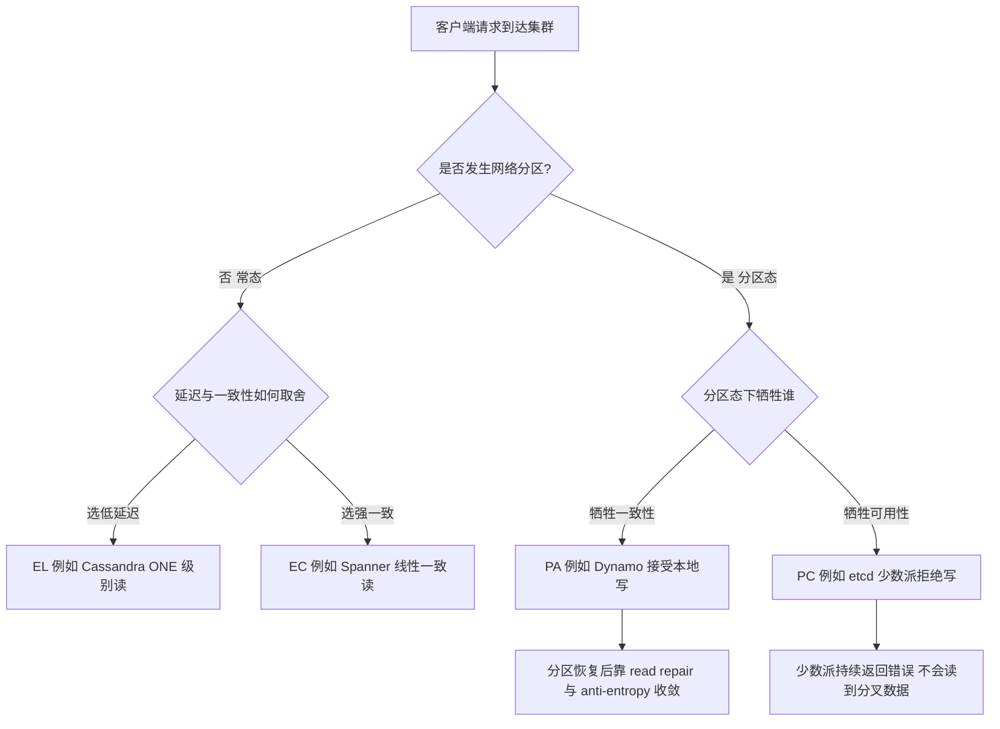

### 1.4 BASE 的准确表述

BASE 由 Dan Pritchett 在 2008 年提出（"BASE: An Acid Alternative"），用来描述 eBay 这类大规模系统的取舍：

| 词 | 准确含义 | 工程落地 |
| --- | --- | --- |
| Basically Available 基本可用 | 允许**损失部分可用性**：响应时间变长、功能降级、限流排队，但不整体宕机 | 降级开关、Sentinel 限流、排队削峰、非核心功能熔断 |
| Soft state 软状态 | 允许系统存在**中间状态**，该状态不要求随时可被外部观测为一致 | 订单的"支付中"、库存的"预占"、MQ 的中间态 |
| Eventually consistent 最终一致 | **停止写入后**，经过有限时间，所有副本读到相同值（"有限时间"没有上界，这是它最大的工程风险） | 异步复制、消息补偿、对账、定时 repair |

ACID 与 BASE 不是替代关系，而是**不同层的取舍**：

| 维度 | ACID | BASE |
| --- | --- | --- |
| 适用层 | 单库/单分片内的事务 | 跨服务、跨库的全局一致性 |
| 一致性强度 | 强一致（可串行化/快照隔离） | 最终一致 |
| 可用性优先级 | 低（宁可阻塞、回滚） | 高（宁可先返回、后补偿） |
| 典型实现 | InnoDB 事务、`@Transactional` | 本地消息表、事务消息、TCC、对账补偿 |
| 失败处理 | 回滚，业务无感知 | 补偿/重试/人工介入 |

面试落点：**BASE 不是"不保证一致"，而是把不一致窗口显式暴露给业务，并要求业务设计补偿动作**。所以凡是说"我们用了 BASE 所以不需要处理不一致"的答案，都是错的。

### 1.5 分布式系统的三条底层难点

1. **网络不可靠**：消息可能丢失、重复、乱序、延迟无上界。TCP 只保证"连得上时有序不重复"，不保证"对方一定收到"（连接断开时应用无法区分"对方处理了但应答丢了"）。
2. **时钟不可信**：`System.currentTimeMillis()` 会因 NTP 校正回拨，虚拟机暂停会让时间跳变，多机时钟无法严格比较。
3. **没有全局状态**：任何节点只能由本地信息 + 收到的消息推断全局状态，且推断可能过时。所有共识协议都是在"信息不完整"的前提下保持安全性（safety）。

## 二、一致性模型谱系

### 2.1 从强到弱的完整谱系

一致性模型描述的是"**多个客户端并发读写时，允许观察到什么样的结果**"。谱系从强到弱：

| 模型 | 定义 | 是否可组合 | 典型系统 |
| --- | --- | --- | --- |
| 严格可串行化 Strict Serializability | 线性一致 + 可串行化：事务看起来按某个全序串行执行，且该全序与实时顺序一致 | 是 | Spanner（外部一致性） |
| 线性一致 Linearizability | 单对象操作存在全序，且与实时顺序（happens-before）相容；读到的值必须是"最近一次已完成的写" | **是**（local property） | etcd 默认读、ZooKeeper 写、Raft ReadIndex 读 |
| 顺序一致 Sequential Consistency | 存在全序且保留**每个进程的程序顺序**，但不要求与实时时间一致 | 是 | 部分多核内存模型 |
| 因果一致 Causal Consistency | 只保证**有因果关系的操作**被所有节点按相同顺序看到；并发操作可有不同顺序 | 否 | MongoDB 的 `causal_consistency` 会话、部分 CRDT 系统 |
| 最终一致 Eventual Consistency | 停止写后有限时间内所有副本收敛到相同值 | 否 | Dynamo、Cassandra、DNS |

两个高频辨析：

- **线性一致 vs 可串行化**：前者是**单对象、可组合**的（子系统的线性一致拼起来仍然线性一致）；后者是**多对象事务、不可组合**的（两个子系统各自可串行化，合起来可能不可串行化）。
- **线性一致 vs 顺序一致**：线性一致要求"写完立刻能读到"，顺序一致只要求"所有人看到的顺序一样"，可以整体滞后。因此顺序一致允许读到旧值。

### 2.2 会话级保证：工程上最有用的一层

强一致代价高，最终一致体验差，中间的实用折中是**会话保证（session guarantees）**：

| 保证 | 含义 | 实现手段 |
| --- | --- | --- |
| 读己之写 Read Your Writes | 同一会话内，自己写过的数据一定能读到 | 粘性会话、写后携带版本号路由到已同步副本 |
| 单调读 Monotonic Reads | 同一会话内，读到的时间点不会倒退 | 会话记录已见版本号 `revision`，只路由到版本号不低于它的副本 |
| 单调写 Monotonic Writes | 同一会话内的写按发起顺序生效 | 会话内串行化 + 客户端序号 |
| 写后读 Writes Follow Reads | 先读后写，写依赖读到的版本 | 携带读到的版本号作为前置条件 |

实践：etcd 的 `WithSerializable()` 读、Cassandra 的 `LOCAL_QUORUM` + 客户端时间戳、Redis 主从的 `WAIT` 命令都是这一层的实现。Java 侧最容易落地的做法是**把版本号（etcd revision、MySQL GTID、业务 version）放进会话上下文，由路由层决定读哪个副本**。

### 2.3 线性一致的时序语义

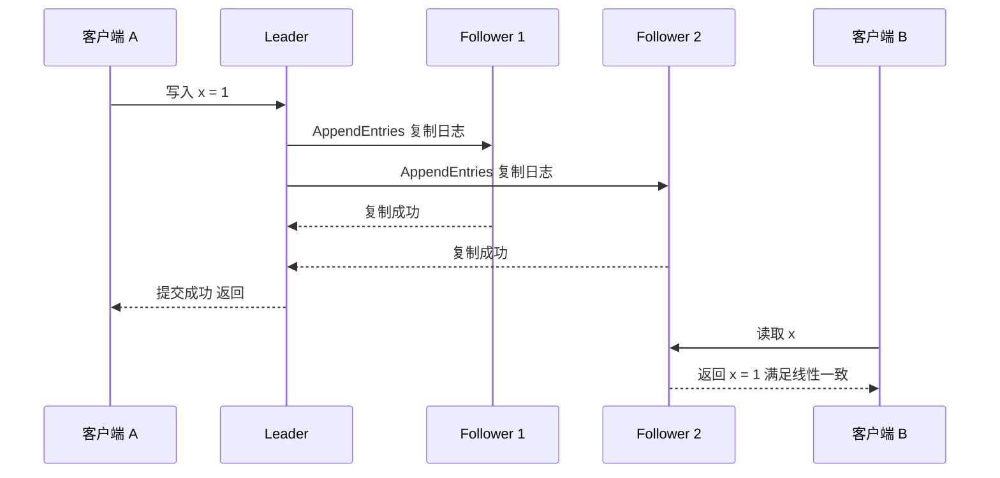

反例：如果 `F2` 因为网络延迟还没收到日志，`C2` 从 `F2` 读到 `x = 0`，这次读就**违反线性一致**——即使 `C1` 的写已经返回成功。这正是"从 Follower 读"必须配合 ReadIndex 或版本号的原因。


### 2.4 一致性模型与副本策略的对应关系

| 复制方式 | 写路径 | 一致性上限 | 数据丢失风险 |
| --- | --- | --- | --- |
| 同步复制（全副本确认） | 等所有副本 ack | 线性一致（配合读主） | 无（但一挂全挂） |
| 多数派复制 | 等多数派 ack | 线性一致（配合 leader 读） | 少数派挂不影响 |
| 半同步复制 | 等至少 1 个从库 ack | 读从库可能陈旧 | MySQL `rpl_semi_sync_master_wait_for_slave_count` 默认 1 |
| 异步复制 | 主库写完即返回 | 最终一致 | 主库挂可能丢未同步事务 |

MySQL 半同步复制（`rpl_semi_sync_source_enabled=ON`，MySQL 8.0.26 起把 `master/slave` 术语改为 `source/replica`）默认只等 1 个从库确认；`rpl_semi_sync_master_timeout` 默认 10000ms，超时后**自动降级为异步**——这就是"半同步不保证不丢数据"的根源。

## 三、2PC 与 3PC：流程与阻塞

### 3.1 2PC 的两阶段流程

2PC（Two-Phase Commit）是最早的原子提交协议，角色分两类：

- **协调者 Coordinator / 事务管理器 TM**：发起并决策提交或回滚。
- **参与者 Participant / 资源管理器 RM**：执行本地事务并投票。

阶段一（投票/prepare）：协调者向所有参与者发 prepare，参与者执行事务但**不提交**，写入 undo/redo 日志并**持有锁**，然后回复 yes/no。
阶段二（提交/回滚）：全部 yes 则发 commit，任一 no 或超时则发 abort。

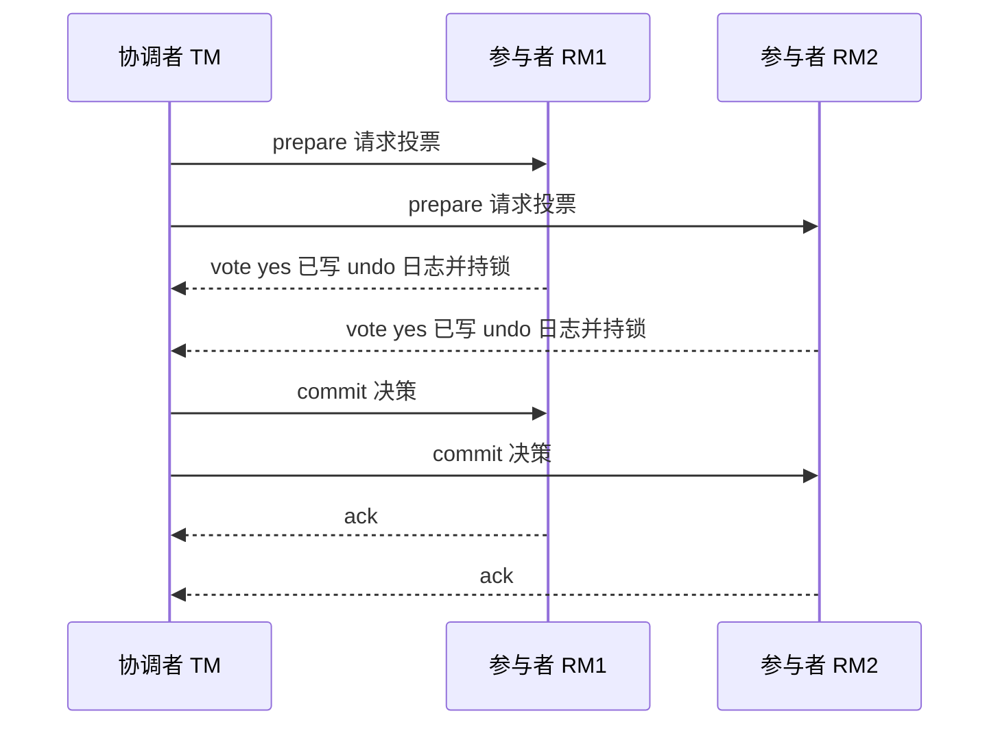

### 3.2 2PC 的三个致命缺陷

| 缺陷 | 具体表现 | 后果 |
| --- | --- | --- |
| 同步阻塞 | 参与者 prepare 后一直持锁，直到收到第二阶段指令 | 协调者挂掉时锁被长期持有，其他事务全部排队 |
| 协调者单点 | 协调者在发出决策前后崩溃，参与者无法判断该提交还是回滚 | 参与者处于"未知态"，只能等；这是 2PC 不可解的部分 |
| 数据不一致 | 部分参与者在 commit 前收到决策，部分没收到 | 出现"半数已提交、半数未提交"的中间态，需人工介入 |

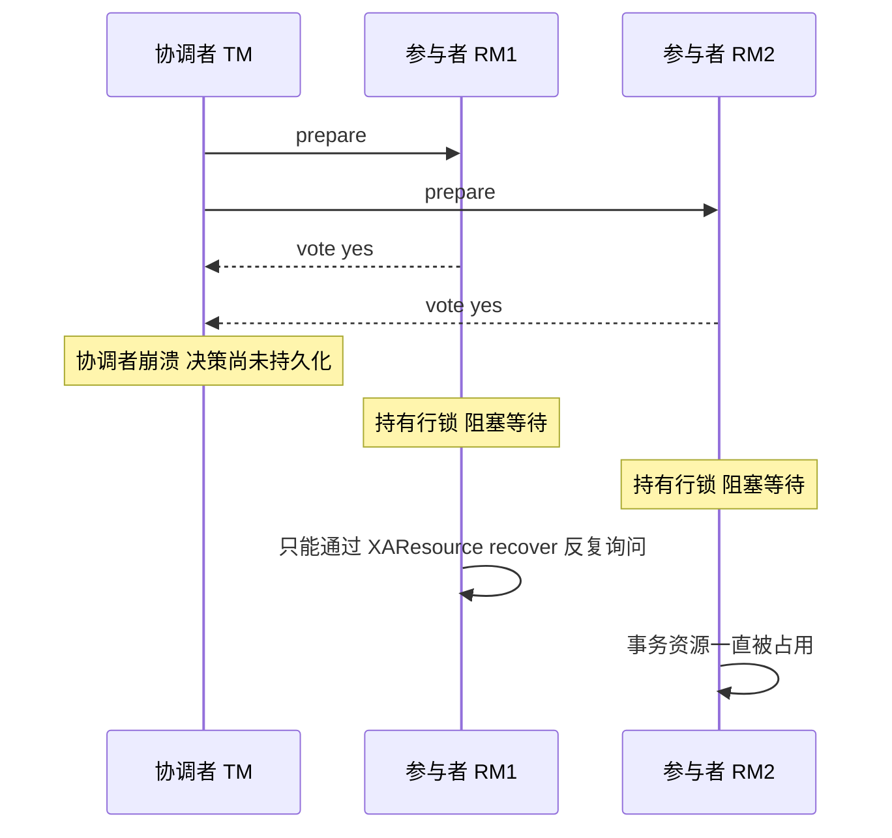

### 3.3 Java 里的 XA 与 2PC

Java 标准接口在 `javax.transaction.xa` 包（Jakarta EE 9 起改名 `jakarta.transaction.xa`，Spring 6 / Spring Boot 3 已全面切到 `jakarta` 命名空间）：

| 类/接口 | 关键方法 | 说明 |
| --- | --- | --- |
| `XAResource` | `start(Xid, int)`, `end(Xid, int)`, `prepare(Xid)`, `commit(Xid, boolean)`, `rollback(Xid)`, `recover(int)` | `commit` 第二参数 `onePhase=true` 表示单阶段提交 |
| `Xid` | `getFormatId()`, `getGlobalTransactionId()`, `getBranchQualifier()` | 全局事务 ID + 分支 ID |
| `TransactionManager` / `UserTransaction` | `begin()`, `commit()`, `rollback()`, `setTransactionTimeout(int)` | 编程式与声明式入口 |
| `XAException` | `XAER_RMFAIL`, `XAER_NOTA`, `XA_HEURCOM`, `XA_HEURRB`, `XA_RDONLY` | 启发式结果（heuristic）意味着需要人工对账 |

工程实现：Atomikos TransactionsEssentials、Narayana（原 JBoss TS）、Bitronix。Spring 里用 `org.springframework.transaction.jta.JtaTransactionManager` 包装。**注意 `XA_RDONLY`**：如果参与者在 prepare 阶段返回只读，协调者可以跳过它，这是唯一的正向优化。

XA 的现实约束：MySQL 的 XA 在两个事务同时 `XA PREPARE` 时会因 `innodb_lock_wait_timeout`（默认 50 秒）超时而失败；`XA RECOVER` 能看到处于 prepared 状态的事务；`XA START` 之后连接必须绑定同一连接（`XAResource` 与 `Connection` 一一对应），这在连接池（HikariCP `maximumPoolSize` 默认 10）下会导致连接长期被占用。

### 3.4 Seata AT 模式：把 2PC 改造成"一阶段本地提交"

Seata AT（Auto Transaction）是阿里开源的分布式事务框架，2.0 起 Maven groupId 由 `io.seata` 改为 `org.apache.seata`。它的核心是把 2PC 的第一阶段**本地提交**，用 `undo_log` 表记录前后镜像实现反向补偿：

| 角色 | 类 | 职责 |
| --- | --- | --- |
| TC | `io.seata.server.coordinator.DefaultCoordinator`（1.x） | 维护全局事务与全局锁状态，驱动提交/回滚 |
| TM | `io.seata.tm.api.GlobalTransaction` | `@GlobalTransactional` 注解所在线程，发起并决议全局事务 |
| RM | `io.seata.rm.datasource.ConnectionProxy` | 拦截 SQL 生成 before/after image 写入 `undo_log` |

关键点：

1. 一阶段业务 SQL 与 `undo_log` 在**同一个本地事务**中提交，因此不需要长时间持锁。
2. 一阶段提交前会向 TC 注册**全局锁**（默认表 `lock_table`，主键 `(xid, table_name, pk)`），防止其他全局事务修改同一行。
3. `@GlobalTransactional` 默认 `timeoutMills = 60000`（60 秒），超时后 TC 主动发起全局回滚；`rollbackFor` 默认 `Throwable`。
4. 二阶段提交是异步删除 `undo_log`；二阶段回滚是用 after image 与当前数据比对，若**数据已被别人改过（脏写）**则 `AbstractUndoExecutor#dataValidationAndGoOn` 返回 false 并抛出 `SQLException`（消息为 `Has dirty records when undo.`），全局事务需要人工处理。这也是 AT 的边界：只保证隔离级别为**读未提交**级别的全局事务，需要在业务关键点加 `@GlobalLock`。

### 3.5 3PC：用超时打破阻塞

3PC 由 Skeen 与 Stonebraker 在 1983 年提出，在 2PC 前插入一个 `CanCommit` 阶段，并把第二阶段改名为 `PreCommit`，第三阶段为 `DoCommit`：

| 阶段 | 动作 | 参与者状态 |
| --- | --- | --- |
| CanCommit | 协调者询问"能否提交"，参与者只做检查，不执行、不加锁 | 未确定 |
| PreCommit | 参与者执行事务并写日志、持锁，回复 ACK | 可提交（prepared） |
| DoCommit | 参与者正式提交并释放锁 | 已提交 |

3PC 的"改进"是：**参与者在 PreCommit 后等待 DoCommit 超时，则默认提交**；在 CanCommit 后超时则默认回滚。这确实避免了协调者崩溃导致的永久阻塞，但引入了新问题：网络分区时，一部分参与者超时提交、另一部分收到 abort 回滚，**结果不一致**。所以 3PC 只解决了崩溃故障下的阻塞，没有解决分区下的原子性，工程上几乎不用。

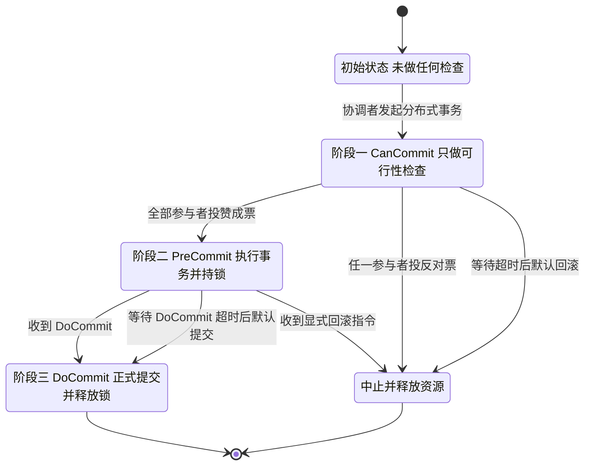

### 3.6 分布式事务方案横向对比

| 方案 | 一致性 | 隔离性 | 可用性 | 业务侵入 | 适用场景 |
| --- | --- | --- | --- | --- | --- |
| 2PC/XA | 强一致 | 强（持锁） | 低（同步阻塞、协调者单点） | 低 | 同构数据库、短事务、低并发 |
| 3PC | 强一致（无分区时） | 强 | 中 | 低 | 理论教学，工程少见 |
| TCC | 最终一致 | 由业务保证 | 高 | **高**（每个接口写 Try/Confirm/Cancel） | 资金、库存等强约束业务 |
| Seata AT | 最终一致（中间态可见） | 读未提交级 | 高 | 低（加注解即可） | 大多数业务系统 |
| 本地消息表 | 最终一致 | 无 | 高 | 中（同库写消息表 + 定时补偿） | 无 MQ 事务能力的场景 |
| 事务消息 | 最终一致 | 无 | 高 | 低 | RocketMQ 生态 |
| 最大努力通知 | 最终一致（不保证） | 无 | 最高 | 低 | 通知类、可人工兜底 |

RocketMQ 事务消息的实现要点：半消息先写入 `RMQ_SYS_TRANS_HALF_TOPIC`，本地事务执行后发送 `endTransaction` 的 commit 或 rollback；broker 对未确认的半消息做**事务回查**，`transactionCheckMax` 默认 15 次，`transactionCheckInterval` 默认 60000ms，`transactionTimeOut` 默认 6000ms。超过 15 次仍未知则丢弃并告警——**这就是"最终一致"的无界性风险**。

TCC 的三个经典坑必须能说出来：**空回滚**（Try 未执行就收到 Cancel，需要记录事务控制表判断）、**幂等**（Confirm/Cancel 可能重试，需唯一键去重）、**悬挂**（Cancel 比 Try 先到，之后 Try 再执行导致资源被锁死，需要在 Try 中检查事务控制表状态）。

## 四、Paxos 的直觉解释

### 4.1 角色与两个阶段

Basic Paxos 是 Leslie Lamport 1998 年提出（"The Part-Time Parliament"，1998 年 TOCS；通俗版 "Paxos Made Simple" 2001）的共识算法。三个角色：

| 角色 | 职责 | 工程对应 |
| --- | --- | --- |
| Proposer | 提出提案 `(n, v)`，n 是全局唯一且单调递增的提案编号（常用 `(round, serverId)` 构造） | 客户端请求 / leader |
| Acceptor | 对提案投票，承诺后必须遵守承诺；多数派投票通过则提案被选定 | 每个副本节点 |
| Learner | 学习已被选定的值 | 其余副本 / 观察者 |

两个阶段：

- **阶段一 Prepare / Promise**：Proposer 选编号 n，向多数派发 `Prepare(n)`；Acceptor 若 n 大于它已承诺的编号，则承诺不再接受编号小于 n 的提案，并返回**它已接受过的最大编号提案** `(n', v')`。
- **阶段二 Accept / Accepted**：Proposer 若收到多数派 Promise，则按规则选值——**若响应中有已接受值，必须选编号最大的那个值；否则可以自由选自己的值**。然后发 `Accept(n, v)`，Acceptor 接受并返回。

规则里最关键的一句：**Proposer 在阶段二不能随意选值，必须先看 Acceptor 返回的历史**。这条规则保证了"已被选定的值不会被后续提案覆盖"，是 Paxos 安全性的全部秘密。

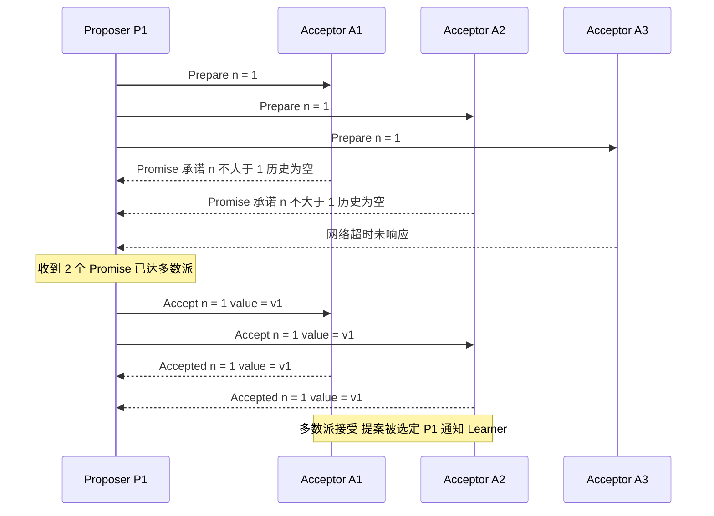

### 4.2 为什么多数派不会选出两个值

设两个多数派集合 Q1、Q2，各自大小都大于 N/2。由鸽巢原理，`|Q1| + |Q2| > N`，因此 **Q1 与 Q2 至少有一个公共 Acceptor**。这个公共节点已经承诺过较小提案并可能接受过值，当更大的提案到来时它会把历史值返回给新 Proposer，新 Proposer 必须沿用该值，于是不会出现两个不同的选定值。这就是"quorum 必须严格大于 N/2"的根本原因；而 N 取奇数只是为了让节点数刚好等于 `2f + 1`、不浪费机器（偶数节点的容错能力与 N-1 相同）。

### 4.3 活锁与工程解法

活锁（dueling proposers）：P1 用 n=1 完成阶段一，P2 用 n=2 完成阶段一，P1 的 Accept(1) 被拒绝，P1 改用 n=3，P2 的 Accept(2) 被拒绝……两个 Proposer 永远在提升编号，**永远无法达成决议**。

| 解法 | 做法 | 代价 |
| --- | --- | --- |
| 随机退避 | 冲突后随机 sleep 再重试 | 延迟抖动 |
| Leader 选举 | Multi-Paxos 先选一个稳定 Leader，只有 Leader 提提案 | 多一次选举开销 |
| 强制串行化 | 由一个固定节点（如 Chubby 的 master）代理所有提案 | 引入主节点可用性依赖 |

### 4.4 Multi-Paxos 与 Paxos 的工程代价

Multi-Paxos 把多个日志槽位（instance/slot）串起来：每个槽位跑一次 Paxos，但**稳定 Leader 存在时可以跳过阶段一**，只保留 Accept 阶段，于是 1 次 RTT 就能提交一个值（同一批多个值的 Accept 可以流水线合并）。

Google Chubby（Burrows, 2006, "The Chubby lock service for loosely-coupled distributed systems"）在论文 "Paxos Made Live"（2007）中记录了工程化的四个难点：

1. **只有值没有日志**：Basic Paxos 决议的是单值，实际系统需要连续日志，必须自己设计"日志连续性"。
2. **成员变更**：Paxos 本身不描述如何安全地增删 Acceptor，需要额外的 reconfiguration 协议。
3. **磁盘与快照**：Learner 补日志、快照传输、数据落盘顺序都要自己实现。
4. **活锁与性能**：需要 Leader 租约（lease）+ 批量 + 流水线才能上量。

这也是为什么工程界更愿意用 Raft：**Raft 把 Paxos 没定义的部分全部定义清楚了**。

### 4.5 Paxos 与 Raft 的对比

| 维度 | Paxos / Multi-Paxos | Raft |
| --- | --- | --- |
| 决议对象 | 单值（Basic）或"每槽位一个值"（Multi） | 连续的日志序列 |
| Leader | 不是算法必备（可优化引入） | 算法内建，强 Leader |
| 日志连续性 | 需要额外协议保证（空洞问题） | 通过 `prevLogIndex/prevLogTerm` 一致性检查天然连续 |
| 成员变更 | 未定义，需自行设计 | 单节点变更 + joint consensus |
| 可理解性 | 著名地难懂（Lamport 自嘲） | 以可理解性为设计目标 |
| 工程实现 | Chubby、libpaxos、部分自研 | etcd-io/raft、hashicorp/raft、sofa-jraft |
| 提交条件 | 多数派 Accept | 多数派复制 + 仅提交当前 term 日志 |

## 五、Raft 详解

### 5.1 三个角色与任期

Raft（Diego Ongaro 与 John Ousterhout，USENIX ATC 2014，"In Search of an Understandable Consensus Algorithm"）有三个角色：**Leader / Follower / Candidate**。所有节点启动时都是 Follower，靠**随机化选举超时**避免选票瓜分。

<strong>任期（term）</strong>是单调递增的逻辑时钟，每个 term 最多产生一个 Leader（Election Safety）。每条 RPC 都带 `term`：
- 收到更大 `term` → 立即降级为 Follower 并更新本地 term。
- 收到更小 `term` → 拒绝并返回自己的 term。

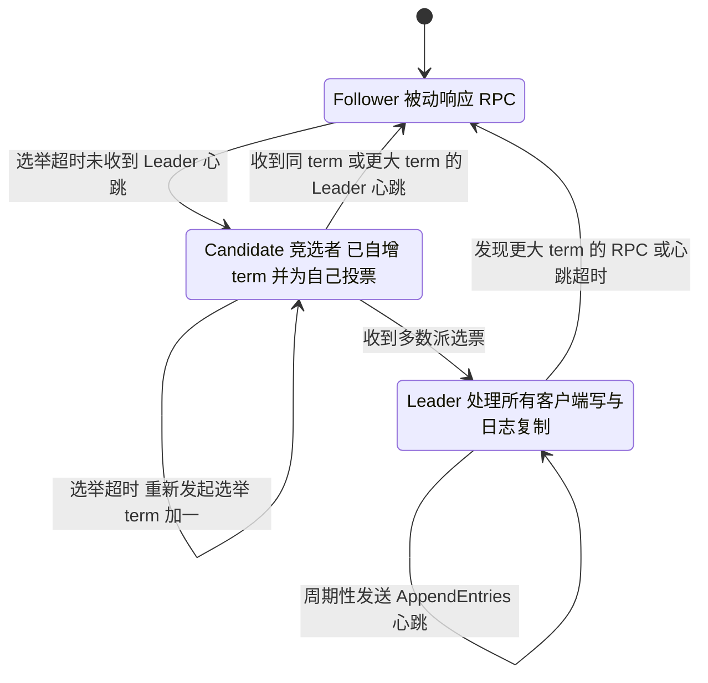

### 5.2 Leader 选举的完整报文与约束

选举超时后，Follower 转 Candidate 并执行：

1. `currentTerm = currentTerm + 1`，`votedFor = self`。
2. 并行发送 `RequestVote`，参数为 `term`、`candidateId`、`lastLogIndex`、`lastLogTerm`。
3. 收到多数派选票则成为 Leader，并立即发送**空 AppendEntries 心跳**宣告权威。

**选举限制（Election Restriction）**：投票者只给"日志至少和自己一样新"的候选人投票，判断规则是

```
候选人的 lastLogTerm 更大   则更新
lastLogTerm 相同 且 lastLogIndex 不小于自己   则不算旧
```

这条约束是 Raft 安全性的基石：它保证**新 Leader 一定包含所有已提交的日志**（Leader Completeness）。如果去掉它，少数派节点就可能当选并覆盖已提交数据。

**选举超时的时间参数**（必须按官方/实现默认值说）：

| 系统 | 心跳间隔 | 选举超时 | 说明 |
| --- | --- | --- | --- |
| Raft 论文推荐 | 100ms 量级 | 150~300ms 随机 | 比广播时间大一个数量级 |
| etcd（`etcd-io/raft`） | `--heartbeat-interval=100` ms | `--election-timeout=1000` ms | 选举超时随机化在 [T, 2T) 区间 |
| hashicorp/raft（Consul） | `HeartbeatTimeout=1000` ms | `ElectionTimeout=1000` ms | 另有 `LeaderLeaseTimeout=500` ms、`CommitTimeout=50` ms、`SnapshotThreshold=8192`、`SnapshotInterval=120s` |
| ZooKeeper（对比参考） | `tickTime=2000` ms | `initLimit=10`（20s）`syncLimit=5`（10s） | 心跳 = tickTime，超时按 tick 数计 |

选举超时必须满足：**election timeout 远大于一次心跳往返时间（含 GC 停顿）**，否则会频繁误判 Leader 失效，产生"选主风暴"。跨机房部署时，etcd 官方建议 `--election-timeout` 至少是节点间 RTT 的 10 倍；跨 region RTT 30ms 时保持默认 1000ms 是安全的，同机房 RTT 0.5ms 时可以下调以提高故障恢复速度。

### 5.3 日志复制

Leader 收到写请求后追加到本地日志，然后并发发送 `AppendEntries`：

| 参数 | 含义 |
| --- | --- |
| `term` | Leader 的任期 |
| `leaderId` | 用于 Follower 重定向客户端 |
| `prevLogIndex` / `prevLogTerm` | 前一条日志的位置与任期，用于**一致性检查** |
| `entries[]` | 本次要复制的日志条目（含 `index`、`term`、`command`） |
| `leaderCommit` | Leader 已知的已提交位置 |

Follower 的一致性检查：若本地 `prevLogIndex` 位置没有日志，或该位置日志的 term 不等于 `prevLogTerm`，则拒绝并返回失败。Leader 维护每个 Follower 的 `nextIndex`（下一个要发的日志下标，初始为 `lastLogIndex + 1`）与 `matchIndex`（已确认复制的最大下标，初始 0）：

- 复制成功：`matchIndex = prevLogIndex + len(entries)`，`nextIndex = matchIndex + 1`。
- 复制失败：`nextIndex = nextIndex - 1` 重试（论文原始做法，逐条回退，慢）。
- **工程优化**：Follower 在拒绝时返回冲突的 `conflictTerm` 与该项的 `conflictIndex`，Leader 一次跳过整个 term 的冲突日志（etcd、hashicorp/raft 都实现了这个优化，避免逐条回退的 O(日志长度) 次 RPC）。

**提交规则**：Leader 把日志复制到多数派后，令 `commitIndex = N`，其中 N 是**多数派 matchIndex 的中位数且 `log[N].term == currentTerm`**。这条"只能提交当前任期日志"的限制极其重要，它对应论文 Figure 8 的经典反例：

| 时刻 | 事件 | 若允许提交旧任期日志的错误后果 |
| --- | --- | --- |
| T1 | Leader S1 复制 index=2 到 S2 后崩溃，未提交 | 无 |
| T2 | S5 当选并使用 term=3 给自己写了 index=2 | 无 |
| T3 | S5 崩溃，S1 重新当选并把 index=2 复制到 S3（多数派） | 若此时提交 index=2，之后 S5 可能当选并覆盖它 → 已提交数据被覆盖 |

**只提交当前任期日志**时，只要 Leader 在当前任期提交了一条日志，这条日志之前的所有日志就被**间接提交**（因为 Log Matching 性质保证它们与 Leader 一致）。

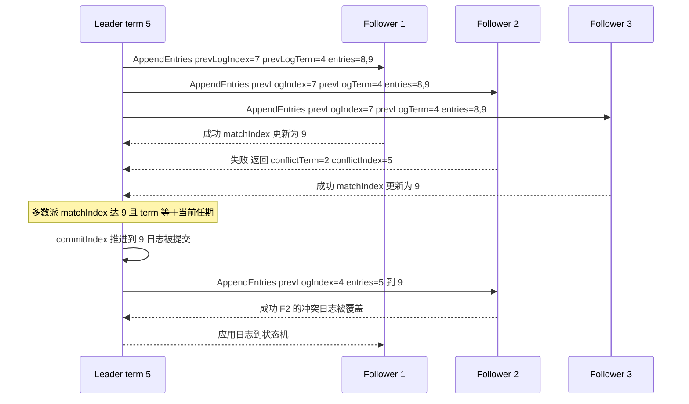

### 5.4 Raft 的五条安全性约束

| 约束 | 内容 | 作用 |
| --- | --- | --- |
| Election Safety | 每个 term 最多一个 Leader | 防止双主写入 |
| Leader Append-Only | Leader 只追加日志，不覆盖、不删除自己的日志 | 简化推理 |
| Log Matching | 若两条日志的 index 与 term 相同，则它们及之前的所有日志完全相同 | 支持一致性检查与快速回退 |
| Leader Completeness | 若一条日志在某个 term 被提交，则所有更高 term 的 Leader 都包含它 | 保证已提交数据不丢 |
| State Machine Safety | 若某节点把 index 位置的日志应用到状态机，则其他节点在同一 index 应用的日志相同 | 复制状态机的最终目标：所有副本按同一顺序应用同一日志（是 safety，不是"最终收敛"） |

### 5.5 只读请求的三种处理

这是 Raft 工程实现中最容易被追问的点，因为**简单地从 Leader 读会读到未提交或已失效的数据**：

| 方式 | 做法 | 一致性强弱 | 风险 |
| --- | --- | --- | --- |
| Leader + ReadIndex | Leader 记录当前 `commitIndex`，向多数派发一次心跳确认自己仍是 Leader，等待 `appliedIndex >= readIndex` 后返回 | 线性一致 | 多一次 RTT |
| Leader + Lease Read | 基于时钟租约，Leader 在租约期内直接读，不发心跳 | 线性一致（**依赖时钟**） | 时钟漂移或长 GC 可能读到旧值 |
| Follower Read | 向 Leader 询问 ReadIndex 后本地读 | 线性一致（TiKV 的 Follower Read 即此路径，需等本地 `appliedIndex` 追上 ReadIndex） | 需要额外的 ReadIndex 转发机制 |
| Serializable 读 | 直接读本地状态机 | 可能陈旧 | 性能最好 |

etcd 的 `--experimental-enable-lease-checkpoint` 与 `etcdctl get --consistency=s` 分别对应租约与序列化读。默认 `etcdctl get` 就是线性一致读（ReadIndex 路径）。

### 5.6 日志压缩与成员变更

**日志压缩**：日志不能无限增长，Raft 用快照（snapshot）。快照通过 `InstallSnapshot` RPC 传输（必须是**分块流式**，否则大快照会打爆网络）。etcd 还有 `--auto-compaction-retention` 做 MVCC 历史压缩。

**成员变更**（论文 §6）有两种：

| 方式 | 做法 | 优点 | 缺点 |
| --- | --- | --- | --- |
| 单节点变更 | 一次只增删一个节点，`C_old` 与 `C_new` 的多数派必然相交 | 简单，无需中间态 | 变更慢（N 个节点需 N 次） |
| Joint Consensus | 先切到 `C_old,new`，需要**两个多数派同时同意**，再切到 `C_new` | 可批量变更 | 复杂，任何一步都可能卡住 |

**etcd 的实现选择**：`MemberAdd` / `MemberRemove` 强制一次只能变更一个节点，正是采用了单节点变更；同时提供 `MemberAddAsLearner`（v3.4 起）——Learner 只接收日志、不参与投票，先把数据追平再提升为投票成员，避免新节点拖慢写入。这个细节是区分"读过 etcd 文档"和"只背过 Raft 论文"的分界线。

### 5.7 Raft 的工程实现与产品

| 项目 | Raft 库 | 存储的数据 | 说明 |
| --- | --- | --- | --- |
| etcd | `go.etcd.io/etcd/raft/v3`（原 coreos/etcd） | MVCC Key-Value、lease、watch | 客户端 2379、peer 2380；`--heartbeat-interval=100ms`、`--election-timeout=1000ms` |
| Consul | `hashicorp/raft` | catalog、KV、session、ACL | 端口 8300/8301/8302/8500/8600；raft 日志走 `raft.db` |
| TiKV | `tikv/raft-rs`（Multi-Raft） | Region 数据与元信息 | 每个 Region 一个 Raft Group，默认 `region-split-size=96MiB`、`region-max-size=144MiB`、`region-split-keys=960000` |
| Nacos | `sofa-jraft` | 持久实例的元数据 | 临时实例走自研 Distro 协议（AP），持久实例走 Raft（CP） |
| Kafka KRaft | 自研 Kafka Raft（KIP-500） | 元数据日志 `__cluster_metadata` | Kafka 3.3 起 KRaft 可用于生产（KIP-833），Kafka 4.0 起移除 ZooKeeper |
| Sofa-JRaft | `sofa-jraft` | 通用 | 蚂蚁开源，支持 Multi-Raft Group 与线性一致读 |

## 六、ZAB 与 Raft 的差异

### 6.1 ZAB 的三个阶段

ZAB（ZooKeeper Atomic Broadcast）是 ZooKeeper 的原子广播协议（Junqueira、Reed、Serafini，DSN 2011）。ZooKeeper 的每一次写都是一个**事务**，事务 ID 是 `zxid`：

```
zxid = (epoch 32 位) 高 32 位  |  (counter 32 位) 低 32 位
```

- `epoch` 相当于 Raft 的 term，每换一次 Leader 递增。
- `counter` 是该 epoch 内的自增序号，**保证事务 ID 严格单调递增**（ZooKeeper 不允许 zxid 回退，`stat` 命令里的 `mzxid`、`pzxid` 都来自它）。

ZAB 的流程分三块：

| 阶段 | 作用 | 细节 |
| --- | --- | --- |
| Leader Election | 选出新 Leader（ZooKeeper 3.4.0 起为 Fast Leader Election） | 投票比较 `(epoch, zxid, sid)`：先 epoch，再 zxid，最后 serverId |
| Discovery / Synchronization | 新 Leader 与 Follower 对齐数据 | 通过 `DIFF`（增量）、`TRUNC`（截断多余日志）、`SNAP`（全量快照）三种方式 |
| Broadcast | 原子广播 | Leader 把事务包装为 Proposal，Follower 落盘 ack，多数派后 Leader 发 COMMIT |

新 Leader 必须先提交一个 **NOOP 事务**来确认新 epoch 生效，再对外提供服务。这一点与 Raft 的"Leader 上任先发空心跳"不同：Raft 的空心跳只是宣告权威，而 ZAB 的 NOOP 是**真实提交一个事务**以推进 epoch。

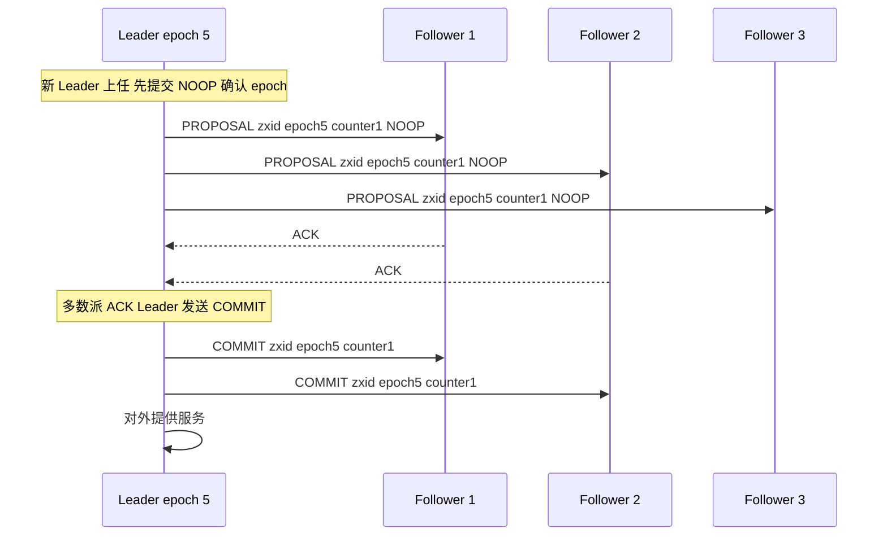

### 6.2 ZAB 与 Raft 的差异对照

| 维度 | ZAB（ZooKeeper） | Raft |
| --- | --- | --- |
| 理论定位 | 作者称为 primary-backup 系统的原子广播，侧重顺序而非状态机复制 | 明确的 state machine replication |
| 事务标识 | `zxid = (epoch, counter)`，32 + 32 位 | `(term, index)`，两者独立字段 |
| Leader 选举比较 | `(epoch, zxid, sid)`，zxid 参与比较 | `(lastLogTerm, lastLogIndex)`，再按节点 ID 打破平局 |
| 恢复语义 | 新 Leader 先跑恢复阶段（DIFF/TRUNC/SNAP）再广播 | 新 Leader 通过 AppendEntries 一致性检查回退 Follower |
| 提交旧 Leader 日志 | 新 Leader 必须包含全部已提交事务（与 Raft 等价） | 只能通过"提交当前 term 日志"间接提交旧 term 日志 |
| 日志连续性 | zxid 的 counter 单调，天然连续 | index 连续，空洞通过一致性检查修复 |
| 读语义 | Follower 本地读，**可能读到陈旧数据**，需要 `sync()` 保证 | 提供 ReadIndex/Lease Read 实现线性一致读 |
| 成员变更 | ZooKeeper 3.5.0 起支持动态 reconfig：`reconfigEnabled=true`、`zoo.cfg.dynamic`、`standaloneEnabled` | 单节点变更或 joint consensus（论文 §6） |
| 客户端会话 | 内建 session + 临时节点 + Watch，是 ZAB 之上的功能层 | Raft 只做共识，session 由上层实现（etcd 用 lease） |
| 默认超时 | `tickTime=2000`、`initLimit=10`、`syncLimit=5` | etcd `heartbeat=100ms`、`election=1000ms` |

**面试要点**：ZAB 与 Raft 在"安全性"上等价（都保证已提交日志不丢），差异主要在**工程形态**：ZAB 绑定了 ZooKeeper 的 session/Watch 模型，且默认读不保证线性一致；Raft 是纯粹可复用的共识库，读一致性可以按需加强。

### 6.3 ZooKeeper 的实战约束

| 约束 | 数值/行为 | 影响 |
| --- | --- | --- |
| 单节点数据大小 | `jute.maxbuffer` 默认 1MB（1048575 字节） | 大对象不要放 ZK，用 ZK 存指针 |
| Watch 一次性 | 触发后即失效，需重新注册 | Curator 的 `CuratorCache` 解决了重复注册问题 |
| 会话超时 | `minSessionTimeout` 默认 `2*tickTime`，`maxSessionTimeout` 默认 `20*tickTime` | 客户端申请的 session 超时会被夹逼到该区间 |
| 临时节点不能有子节点 | 设计限制 | 分布式锁只能用顺序临时节点实现 |
| 读可能陈旧 | follower 本地读 | 需要最新数据时调用 `ZooKeeper#sync` |
| 默认最大连接数 | `maxClientCnxns=60`（每 IP） | 客户端机器上连接数过多会被拒 |

Java 侧常用 `org.apache.curator` 的 `InterProcessMutex`（顺序临时节点 + Watcher）、`LeaderLatch`（选主）、`CuratorFrameworkFactory.newClient(connectString, sessionTimeoutMs, connectionTimeoutMs, retryPolicy)`，重试策略常用 `new ExponentialBackoffRetry(1000, 3)`（基准 1s、最多 3 次）。

## 七、多数派、容错公式、脑裂与 fencing token

### 7.1 容错公式

<strong>崩溃故障（crash fault）</strong>下，共识算法需要多数派：

```
写 quorum Q = floor(N / 2) + 1
可容忍故障数 f = N - Q = floor((N - 1) / 2)
N = 2f + 1
```

| 集群规模 N | 写 quorum | 容忍故障 f | 备注 |
| --- | --- | --- | --- |
| 1 | 1 | 0 | 无容错 |
| 2 | 2 | 0 | 比 1 节点更差（可用性更低） |
| 3 | 2 | 1 | 生产最小规模 |
| 4 | 3 | 1 | 与 3 节点容错相同，但成本更高 |
| 5 | 3 | 2 | 推荐规模 |
| 7 | 4 | 3 | 延迟开始明显上升 |

两条结论必须能脱口而出：

1. **偶数不增加容错**。N=4 与 N=3 都只能容忍 1 个故障，但 N=4 需要 3 个 ack，延迟更高、成本更高。所以 etcd/ZooKeeper 官方都推荐奇数。
2. **拜占庭故障（Byzantine fault）需要 N = 3f + 1**。Lamport、Shostak、Pease 1982 年证明：口头消息模型下需要 `N >= 3f + 1`，PBFT（Castro & Liskov, 1999）正是 3f+1 节点、quorum 2f+1，代价是消息复杂度 O(N²) 与 view change 的复杂性。

### 7.2 脑裂的准确描述

脑裂（split-brain）指**同一时刻出现两个都认为自己是 Leader 的节点各自处理写请求**。多数派机制能防止"双 commit"，但**不能防止旧 Leader 仍然对外提供读/接受请求**：

| 场景 | 后果 | 多数派是否防住了 |
| --- | --- | --- |
| 分区少数派里有旧 Leader | 旧 Leader 接受写但无法提交（提交需多数派） | 防住了，写会失败/挂起 |
| 旧 Leader 仍对外提供读 | 读到陈旧数据 | **没防住**，需要读路径上也校验 |
| Leader 因 long GC 停顿，被误判失效 | 新 Leader 已选出，旧 Leader 恢复后仍认为自己是主 | **没防住**，需要 term/epoch 校验或 fencing |
| 主从复制的数据库出现双主 | 两个主各自写入，冲突无法自动合并 | 数据库层没有多数派概念，最危险 |

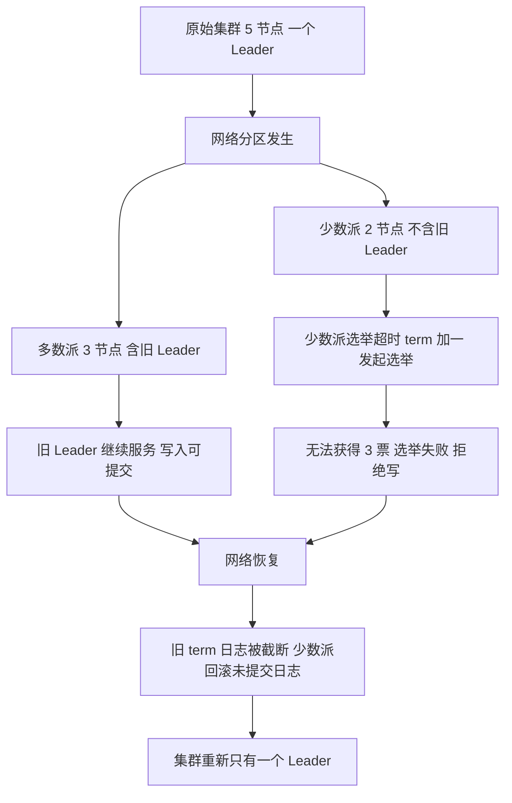

如果**旧 Leader 恰好在少数派**：多数派会选出新 Leader，旧 Leader 恢复通信后收到更大 term 的 RPC，自动降级并回滚未提交日志。**关键前提是"未提交日志可以安全丢弃"**——这就是为什么 Raft 与 ZAB 都要求客户端只在提交后收到成功响应。

### 7.3 Fencing token：防止"过期的主"继续搞破坏

只要系统里存在**依赖时钟的租约**（lease）或**无法区分自己是否已失效的旧主**，就必须有 fencing 机制。fencing token 由 Martin Kleppmann 在 2016 年的 "How to do distributed locking" 中系统化提出：

1. 锁服务在每次授予锁时返回一个**单调递增的 token**（例如 ZooKeeper 的 zxid、etcd 的 `revision`）。
2. 客户端每次写请求都携带 token。
3. 存储端**拒绝 token 小于等于已见最大 token 的请求**。

于是即使旧主的 GC 停顿结束、以为自己还拿着锁，它的写请求也会因为 token 过期而被存储层拒绝。

| 机制 | 实现 | 说明 |
| --- | --- | --- |
| ZooKeeper zxid | 锁节点名带顺序号，写入时校验 | 顺序临时节点天然提供单调号 |
| etcd lease + revision | `Grant` 返回 lease id，`Put` 返回 revision | revision 全局单调递增 |
| HDFS NameNode | 高可用用 epoch number（`dfs.ha.namenodes`） | 旧 NameNode 的 journal 写入被拒 |
| STONITH | Shoot The Other Node In The Head | Pacemaker 等集群管理器直接下电旧主 |
| Kubernetes Lease | `coordination.k8s.io/v1` 的 `Lease` 对象 + `resourceVersion` | kube-controller-manager 选主用它 |
| 数据库乐观锁 | `UPDATE ... WHERE version = ?` | 业务层最常用的 fencing |

**Redlock 的争议**（Redis 官方提出的多节点锁算法：向 5 个独立 Redis 实例申请锁，超半数成功且总耗时小于 TTL 则视为成功，有效性 `validity = ttl - elapsed - drift`，其中 `drift = ttl * 0.01 + 2ms`）被 Kleppmann 批评的两个点：**依赖多个节点的墙钟**（不能用回拨的 `System.currentTimeMillis()`，也不能假设各节点时钟同步）、**没有 fencing token**（持锁者长时间 GC 后仍可能写入）。工程结论：**单实例 Redis 锁 + Redisson watchdog 续约 + 业务层 version 校验**，比单纯依赖 Redlock 更可靠。

Redisson 的默认行为要记住：`lockWatchdogTimeout` 默认 **30000 ms（30 秒）**，看门狗每 `lockWatchdogTimeout / 3`（即 10 秒）续约一次；`tryLock(waitTime, leaseTime, unit)` 若显式传 `leaseTime`，看门狗**不会**续约，锁会在 leaseTime 到期后释放。Redis 单实例加锁正确写法是 `SET key randomValue NX PX 30000`，解锁必须用 Lua 脚本比对 `randomValue` 后删除（防误删他人的锁）。

## 八、一致性哈希与虚拟节点

### 8.1 取模哈希的问题

`node = hash(key) % N` 的成本：当 N 从 3 变成 4 时，几乎所有 key 的归属都会改变——需要迁移的 key 比例接近 `N / (N + 1)`（3 台扩到 4 台时约 75% 需要迁移）。缓存场景下这意味着**大面积缓存失效 → 缓存击穿 → 数据库被打爆**。

一致性哈希（David Karger 等，1997，用于 Akamai CDN）把节点和 key 都映射到一个 `[0, 2^32)` 的环上：key 顺时针找到的第一个节点就是归属节点。节点增加一个时，只有该节点逆时针到前一个节点之间的 key 需要迁移，**迁移量约为 K / N**（K 为 key 总数）。

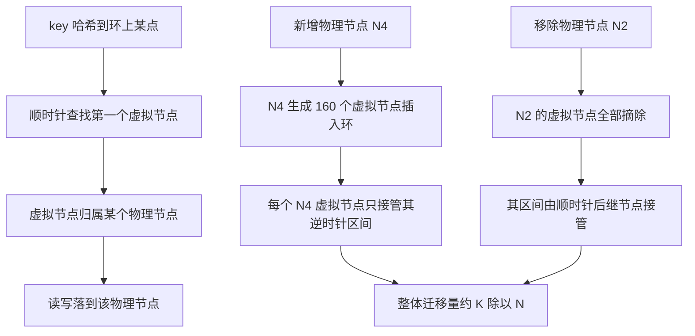

### 8.2 虚拟节点解决的两个问题

| 问题 | 原因 | 虚拟节点如何解决 |
| --- | --- | --- |
| 数据分布不均 | 少量物理节点在环上只占几个点，区间大小随机，可能出现"一个节点扛一半数据" | 每个物理节点生成 150~256 个虚拟节点，均匀撒在环上，区间总长趋于平均 |
| 节点规格不同 | 同规格假设不成立，强机器应该多分数据 | 给强节点分配更多虚拟节点，形成权重 |
| 故障时压力集中 | 一个节点挂掉，它的全部数据压给后继节点 | 虚拟节点分散，压力被多个节点共同承接（不会只压给 1 台） |

**必须记住的数字**：

| 系统 | 虚拟节点数量 | 备注 |
| --- | --- | --- |
| Ketama（libketama，2007） | 每节点 160 个 | memcached 客户端的事实标准 |
| Cassandra | `num_tokens` 默认 256（3.0 起） | 之前是 1 个 token + vnodes 实验特性 |
| Dubbo `ConsistentHashLoadBalance` | `hash.nodes` 默认 160，`hash.arguments` 默认 `0` | 参数可配：`hash.nodes=320` |
| Redis Cluster | 不采用环，固定 16384 个 slot | 见下一节 |

### 8.3 Java 实现要点

```java
// 一致性哈希环的骨架（JDK 8 起可用，NavigableMap 提供 ceilingEntry）
private final NavigableMap<Long, Node> ring = new ConcurrentSkipListMap<>();
private static final int VIRTUAL_NODES = 160;

public Node route(String key) {
    if (ring.isEmpty()) {
        throw new IllegalStateException("no node available");
    }
    long hash = hash(key);                        // 例如 murmur3_32 或 MD5 截断
    Map.Entry<Long, Node> entry = ring.ceilingEntry(hash);
    if (entry == null) {                          // hash 落在环的最后一段
        entry = ring.firstEntry();                // 回绕到最小 hash 的节点
    }
    return entry.getValue();
}
```

三个实现陷阱：

1. **环为空/只有一个节点暴露异常**。`ceilingEntry` 返回 null 时必须回绕到 `firstEntry()`，且 `firstEntry()` 也可能为 null（环为空）。
2. **哈希函数必须有良好雪崩性**。`String#hashCode()` 分布很差，会让虚拟节点扎堆；生产上用 MurmurHash3、MD5 或 xxHash。Cassandra 默认分区器是 `Murmur3Partitioner`（自 1.2 起取代 `RandomPartitioner`）。
3. **并发扩容与路由一致**：所有客户端必须看到**同一份环**，否则同一 key 会被路由到不同节点，读缓存必然 miss。做法是把环的版本号放进配置中心，客户端按版本热更新。

### 8.4 Redis Cluster 的固定分片方案

Redis Cluster 不走一致性哈希，而是固定 16384 个 slot：`slot = CRC16(key) mod 16384`，节点通过 `CLUSTER SLOTS` / `CLUSTER SHARDS` 获取槽位映射。

| 特性 | 说明 |
| --- | --- |
| 为什么是 16384 | 心跳包用 bitmap 携带槽位信息，16384 bit = 2KB；节点数控制在 1000 以内时压缩率最优。作者 antirez 说明：65536 slot 会让心跳包达到 8KB，浪费带宽 |
| 批量操作限制 | `MSET`/`MGET` 跨 slot 会报 `CROSSSLOT Keys in request don't hash to the same slot` |
| hash tag | `{user1000}.following` 与 `{user1000}.followers` 落在同一 slot（用 `{}` 包裹的部分参与哈希） |
| 重定向 | 槽迁移期间返回 `MOVED`（永久重定向）或 `ASK`（临时重定向），客户端需实现两者 |
| 完整覆盖 | `cluster-require-full-coverage` 默认 `yes`：只要有槽位不可用，**整个集群停止接受查询（读写全停）**，这是运维中最常见的"部分挂导致全挂"；想让存活槽位继续服务必须显式设为 `no` |
| 最小规模 | 3 主 3 从（6 节点）才能组成有意义的集群 |
| 数据倾斜 | 大 key、热点 key、槽位分配不均都会导致单节点内存/CPU 打满 |

Redis Cluster 的迁移量也明显大于一致性哈希：扩一个 master 需要搬迁约 `16384 / 新节点数` 个槽，但每个槽里的 key 数量取决于历史写入，可能极不均匀（`CLUSTER COUNTKEYSINSLOT` 可以看具体数量）。

### 8.5 数据倾斜的排查与治理

| 现象 | 定位手段 | 治理 |
| --- | --- | --- |
| 单节点内存远高于其他 | Redis `INFO memory`、`CLUSTER NODES` 看槽位分布；`redis-cli --bigkeys` 找大 key | 拆分大 key、`hash` 结构分桶 |
| 单 key QPS 打满一个节点 | `redis-cli --hotkeys`（要求 `maxmemory-policy` 为 LFU 策略，即 `allkeys-lfu` / `volatile-lfu`）、`MONITOR` 抽样 | 本地缓存、key 加随机后缀打散、读写分离 |
| Cassandra 单节点负载高 | `nodetool status`、`nodetool tablehistograms`、`nodetool tpstats` | 调整 `num_tokens`、用 `nodetool cleanup` 清残留、重新设计分区键 |
| Dubbo 一致性哈希流量不均 | 看每个 Provider 的 QPS 指标 | 提高 `hash.nodes`、给强机器更多虚拟节点 |
| 迁移期抖动 | 迁移中 `MOVED`/`ASK` 增多、P99 上升 | 限制迁移速度 `cluster-migration-barrier`、低峰迁移 |

## 九、Quorum 机制与 NRW

### 9.1 NRW 模型

Dynamo 论文（Amazon, 2007, "Dynamo: Amazon's Highly Available Key-value Store"）形式化了 NRW 模型：

- **N**：副本总数（replication factor）。
- **W**：写操作需要确认成功的副本数。
- **R**：读操作需要响应的副本数。

核心结论：**当 W + R 大于 N 时，读写集合必然有交集，读一定能看到最近一次写**（前提是单 DC、无失败、写已确认）。

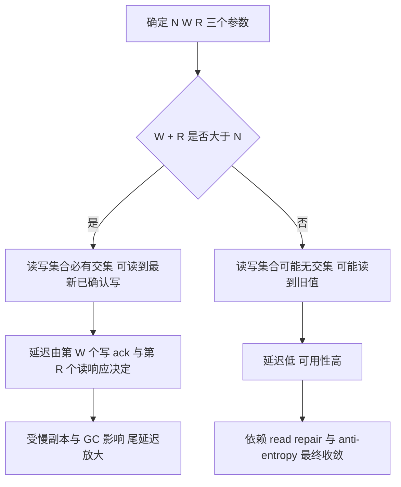

### 9.2 参数组合与代价

以 N = 3 为例：

| W | R | W + R | 语义 | 代价 |
| --- | --- | --- | --- | --- |
| 3 | 1 | 4 | 强一致，写极其脆弱 | 任一节点挂则写失败，可用性最差 |
| 2 | 2 | 4 | **常用组合，强一致** | 容忍 1 个节点故障，读延迟由第 2 快副本决定 |
| 1 | 3 | 4 | 读全部副本，写最快 | 读延迟高，且写可能落在非最新副本上 |
| 1 | 1 | 2 | 最终一致 | 可能长期读到旧值，依赖 repair |
| 2 | 1 | 3 | 偏写强、读弱 | 常见于"写多读少"场景 |

**用 W + R 大于 N 换强一致的代价是尾延迟（tail latency）**：读要等第 R 个副本响应，而分布式系统的响应时间由**最慢的那几个**决定（"The Tail at Scale"，Dean & Barroso, CACM 2013）。N=3/W=2/R=2 通常比 W=1/R=1 的 P99 高出一截，这是必须向面试官说清的取舍。

### 9.3 Cassandra 的落地参数

| 参数 | 默认值/取值 | 说明 |
| --- | --- | --- |
| `ConsistencyLevel` | ONE / TWO / THREE / QUORUM / LOCAL_QUORUM / EACH_QUORUM / ALL | `QUORUM = floor(RF / 2) + 1`，RF=3 时为 2 |
| `LOCAL_QUORUM` | 多 DC 场景推荐 | 只在本 DC 内凑多数派，避免跨 DC 延迟 |
| `hinted_handoff_enabled` | `true` | 目标节点不可达时，协调节点暂存 hint，最多保留 `max_hint_window_in_ms`（默认 10800000，即 3 小时） |
| `read_repair` | Cassandra 3.0 起 `read_repair_chance` 被废弃，改用 `dclocal_read_repair_chance` 与后台 repair | 读时修复不一致副本 |
| `write_request_timeout_in_ms` | 2000 | 写请求超时 |
| `read_request_timeout_in_ms` | 5000 | 读请求超时 |
| `gc_grace_seconds` | 864000（10 天） | 墓碑保留时间，必须大于 repair 周期，否则删除的数据会"复活" |
| 冲突解决 | Last-Write-Wins（基于单元格时间戳） | **时钟偏差会直接导致丢写**，跨节点写入必须带 `USING TIMESTAMP` 或用 LWT |

**LWW 的危害必须能讲清**：客户端 A 在时钟快 500ms 的机器上写了 `v1`，客户端 B 在时钟慢的机器上随后写了 `v2`，但 B 的时间戳更小，最终 `v1` 胜出，`v2` 丢失且**没有任何报错**。这是 Cassandra 与 Dynamo 的重要差异：Dynamo 用向量时钟保留冲突版本交给应用合并，Cassandra 用 LWW 静默丢弃。

### 9.4 Quorum 之外的三件配套机制

| 机制 | 作用 | 关键点 |
| --- | --- | --- |
| Read Repair | 读时发现副本不一致则修复 | 只有被读到的 key 才修复，冷数据永远不会被修 |
| Hinted Handoff | 写时目标不可达，暂存 hint 待恢复后重放 | 超过 `max_hint_window_in_ms` 的 hint 会被丢弃，需要全量 repair 兜底 |
| Anti-Entropy Repair | 后台用 Merkle Tree 比对副本差异 | `nodetool repair` 必须定期执行，且周期要小于 `gc_grace_seconds` |

Dynamo 的 **sloppy quorum** 是对严格 quorum 的补充：当偏好列表（preference list）前 N 个节点中有不可达的，写会落到环上后续的**其他节点**（哪怕它们本不该存这个 key），以换取写可用性。代价是"读到的 N 个副本可能不包含最新写"，因此必须配合 hinted handoff 与 read repair。

### 9.5 ZooKeeper / etcd 的读写 quorum 不对称

这是高频易错点：**ZooKeeper 与 etcd 的写需要多数派，但读不一定**。

| 系统 | 写 | 读 | 后果 |
| --- | --- | --- | --- |
| ZooKeeper | 必须 Leader + 多数派 Follower ACK | 任意 Follower 本地读 | 可能读到陈旧数据，需 `sync()` |
| etcd | 必须 Leader（Raft） | 默认 ReadIndex 线性一致；`WithSerializable` 走本地 | 默认不陈旧，但多一次心跳 RTT |
| Consul | 必须 Leader | 默认经 Leader；`?stale` 走本地 | `?stale` 降低延迟但可能陈旧 |

## 十、故障模型与超时设计

### 10.1 故障模型谱系

| 模型 | 节点可能的行为 | 代表算法 | 需要的节点数 |
| --- | --- | --- | --- |
| Fail-stop | 崩溃后永久停止，其他节点能检测到 | 简单主从 | 2 |
| Crash-recovery | 崩溃后可能重启，丢失内存状态 | Raft、Paxos、ZAB | 2f + 1 |
| Omission | 消息可丢失，节点不崩溃 | 可靠广播 | 2f + 1 |
| Timing / Partial Synchrony | 存在未知的全局稳定时间（GST）之后消息延迟有上界 | Raft、Paxos 的工程实现 | 2f + 1 |
| Byzantine | 任意行为，包括撒谎、伪造消息 | PBFT、Tendermint、HotStuff | 3f + 1 |

两个理论结论必须知道：

1. **FLP 不可能性**（Fischer、Lynch、Paterson, 1985）：在**完全异步**网络中，即使只有一个进程可能崩溃，也不存在**确定性**共识算法能保证终止。注意它限制的是"终止性（liveness）"，不是"安全性（safety）"。
2. **工程上的绕法**：用超时把异步网络"当作"部分同步网络（Partial Synchrony, Dwork、Lynch、Stockmeyer 1988），牺牲的是**在网络不稳定时可能牺牲活性**（选不出主、写入被拒），但**安全性永不破坏**。这就是为什么 Raft 宁可写失败也不写错。

**etcd 官方文档明确说明：etcd 不处理拜占庭故障**（"etcd does not handle Byzantine failures"）。所以在门槛最低的答案里就要说清：Raft 系算法假设节点不会撒谎，只防崩溃。

### 10.2 超时设计：三层数字

超时是分布式系统里最容易出事的地方，核心原则是**层层递减、内层小于外层，且重试必须有退避和抖动**。

| 层级 | 组件 | 默认值 | 说明 |
| --- | --- | --- | --- |
| TCP | Linux 初始 RTO | 1000 ms（RFC 6298；对应 Linux `TCP_TIMEOUT_INIT`） | 指数退避，上限是 Linux `TCP_RTO_MAX`=120s（RFC 6298 只要求上限不低于 60s） |
| TCP | `tcp_syn_retries` | 6 | 建连失败累计约 127 秒 |
| TCP | `tcp_retries2` | 15 | 已建连的数据重传约 13~30 分钟才报错 |
| Java | `Socket#setSoTimeout` / `connect(SocketAddress, int)` | 无默认（0 表示无限等待） | **必须显式设置** |
| Java | `CompletableFuture#orTimeout` | JDK 9 新增 | JDK 8 只能 `get(timeout, unit)` |
| 连接池 | HikariCP `connectionTimeout` | 30000 ms | `maximumPoolSize` 默认 10 |
| RPC | Dubbo `timeout` | 1000 ms | `retries` 默认 2（共 3 次调用，仅 failover 集群） |
| HTTP 客户端 | Feign `connectTimeout` / `readTimeout` | 10000 ms / 60000 ms | Ribbon 另有一套：`ConnectTimeout=2000`、`ReadTimeout=5000`、`MaxAutoRetries=0`、`MaxAutoRetriesNextServer=1` |
| Redis | Lettuce 默认命令超时 | 60 s | 生产务必下调到百毫秒级 |
| 熔断 | Hystrix `execution.isolation.thread.timeoutInMilliseconds` | 1000 ms | `requestVolumeThreshold=20`、`errorThresholdPercentage=50`、`sleepWindowInMilliseconds=5000` |
| 熔断 | Resilience4j | `slidingWindowSize=100`、`failureRateThreshold=50`、`waitDurationInOpenState=60s` | `permittedNumberOfCallsInHalfOpenState=10` |
| 事务 | Seata `@GlobalTransactional#timeoutMills` | 60000 ms | 超时触发全局回滚 |
| 事务 | Spring `@Transactional#timeout` | -1（使用数据库默认） | 走 `Statement#setQueryTimeout`，非 JDBC 驱动可能无效 |
| 半同步 | MySQL `rpl_semi_sync_master_timeout` | 10000 ms | 超时后降级为异步复制 |

### 10.3 重试放大与超时级联

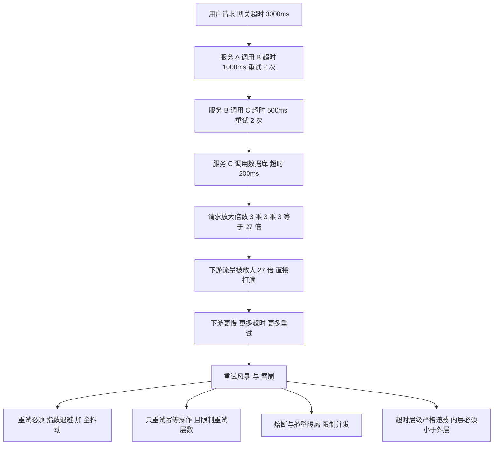

必须能说出的四条纪律：

1. **只重试幂等操作**。Dubbo 默认 `retries=2`，对非幂等写接口必须显式设 `retries=0`，否则一次下单可能变成 3 次下单。
2. **指数退避 + 抖动**。AWS 推荐的 full jitter：`sleep = random(0, min(cap, base * 2^attempt))`。固定间隔重试会让所有客户端同时打回来（thundering herd）。
3. **超时层级递减**。网关 3000ms 大于 服务 A 1000ms 大于 服务 B 500ms 大于 DB 200ms。若外层先超时，内层还在执行并可能已写入，导致"调用方认为失败、实际已成功"的重复提交。
4. **总超时预算（deadline）**。gRPC 的 deadline 会随请求向下传递并逐跳递减，是比"每层独立配置"更正确的做法。Java 侧可以在 `RequestContext` / `MDC` 里放 deadline 时间戳，每层调用前检查剩余时间。

### 10.4 心跳与故障检测器的调优

| 系统 | 参数 | 默认 | 调优建议 |
| --- | --- | --- | --- |
| etcd | `--heartbeat-interval` | 100 ms | 跨 region 可提到 200~300ms |
| etcd | `--election-timeout` | 1000 ms | 至少为节点间 RTT 的 10 倍 |
| ZooKeeper | `tickTime` | 2000 ms | 心跳基本单位 |
| ZooKeeper | `initLimit` / `syncLimit` | 10 / 5 | 即 20s / 10s |
| Consul | `HeartbeatTimeout` / `LeaderLeaseTimeout` | 1000 ms / 500 ms | 见 `hashicorp/raft` `Config` |
| Cassandra | `phi_convict_threshold` | 8 | 基于 φ accrual failure detector，越大越不敏感 |

**选主风暴的典型诱因**：JVM 长 GC（Stop-The-World 超过 election timeout）、虚拟机/容器 CPU 被限流（cgroup throttling）、网络抖包、NTP 校正导致时钟跳变引发租约异常。排查顺序是：先看节点 CPU throttling 与 GC 日志，再看网络 RTT，最后调大 election timeout。

还有一类诱因容易被忽略：**被分区节点的 term 已经涨得很高，恢复通信后会打断健康的 Leader**，触发本不该发生的选举。Raft 论文没有定义这个场景的解法，工程实现补了两个机制：**PreVote**（预投票阶段不递增自己的 term，能赢才发起真正的选举）与 **CheckQuorum**（Leader 在 election timeout 内没收到多数派响应就主动退位，避免已失效的 Leader 继续对外服务）。etcd 用 `--pre-vote` 开关提供前者。

## 十一、时钟与顺序

### 11.1 物理时钟为什么不够用

| 问题 | 表现 | Java 侧的对应 |
| --- | --- | --- |
| 时钟回拨 | NTP step 校正会瞬间把时钟往回拨，可能拨回数秒 | `System.currentTimeMillis()` 值变小 |
| 闰秒 | 2012、2015、2016 年闰秒导致大量服务异常 | 依赖 wall clock 的定时任务错乱 |
| 虚拟机暂停 | 快照恢复后 guest 时钟落后 | 心跳被误判超时 |
| 单调性缺失 | `System.currentTimeMillis()` 不保证单调 | 应用应改用 `System.nanoTime()` 测耗时 |
| 精度不足 | 毫秒精度，无法给高并发事件排序 | 同毫秒内多事件无法定序 |
| 多机不可比 | 各机偏差可达数十毫秒 | 跨机用时间戳比较先后是错的 |

Java 的正确用法：

| API | 语义 | 用途 |
| --- | --- | --- |
| `System.currentTimeMillis()` | wall clock，可回拨 | 打日志、存业务时间（需容忍回拨） |
| `System.nanoTime()` | 单调，与挂钟无关，只在同 JVM 内可比 | 测耗时、实现本地超时 |
| `Clock`（JDK 8 起） | `Clock.systemUTC()`、`Clock.fixed()`、`Clock.tick(Clock, Duration)`（JDK 8 里**没有** `tickMillis()`，只有 `tickSeconds()`、`tickMinutes()` 与通用 `tick()`） | 可注入的时间源，便于测试 |
| `Instant` / `Duration` | 明确的时刻/时长语义 | 替代裸 long 时间戳 |

Kafka 的 `message.timestamp.type` 默认 `CreateTime`（生产者客户端时间），所以 broker 侧的时间戳**不可靠**；需要 broker 时间时设为 `LogAppendTime`。

### 11.2 逻辑时钟与向量时钟

**Lamport 逻辑时钟**（Lamport, 1978, "Time, Clocks, and the Ordering of Events in a Distributed System"）：

```
进程本地事件：  LC = LC + 1
发送消息时：    附带当前 LC
接收消息时：    LC = max(本地 LC, 消息 LC) + 1
```

性质：`a 因果先于 b` 蕴含 `LC(a) 小于 LC(b)`，但**反过来不成立**（LC 小不代表因果先于）。所以它只能给出一个**一致的偏序**，用于构造全序时需要补一个平局打破字段：按 `(LC, nodeId)` 排序就是全序。

**向量时钟**（Fidge 1988 / Mattern 1988）：每个进程维护长度为 N 的向量 `VC[i]`，`VC[i]` 表示"本进程知道的第 i 个进程的事件数"。

```
V1 因果先于 V2  当且仅当  所有分量 V1[i] 不大于 V2[i] 且 存在分量严格小于
V1 与 V2 并发   当且仅当  两者互不包含
```

向量时钟的代价是 O(N) 的空间（几百节点时头部开销巨大），因此 Dynamo 用了**向量时钟的裁剪版本**（对每个 `(node, counter)` 对保留，超过阈值就丢弃最旧的），Cassandra 干脆退化成 LWW 的时间戳。

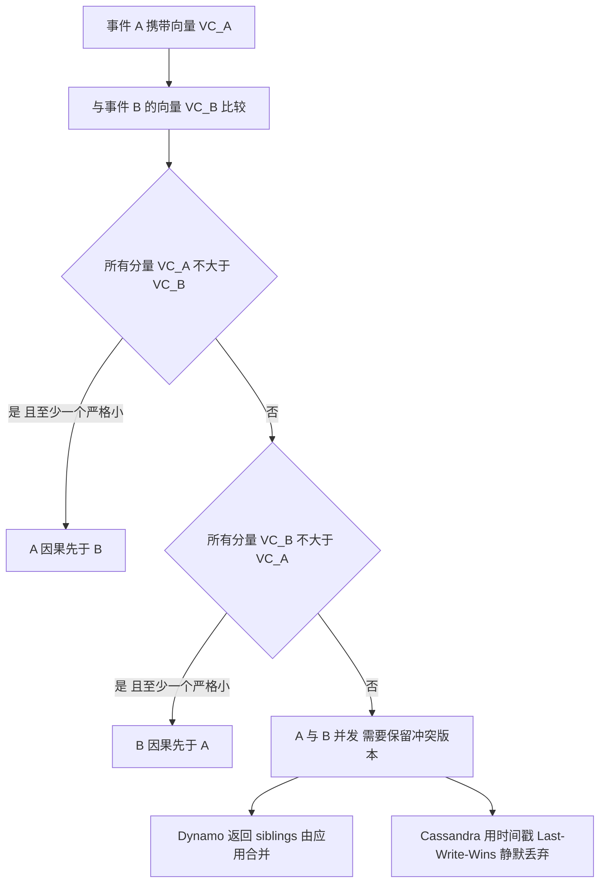

### 11.3 混合逻辑时钟 HLC

**HLC（Hybrid Logical Clock）**：把物理时钟与逻辑计数结合，时间戳为 `(wallTime, logical)`。

规则（`pt` 为本地物理时钟，`remote` 为收到的消息时间戳）：

```
本地事件/发送： wallTime' = max(local.wallTime, pt)
                logical'  = 若 wallTime' 等于 local.wallTime 则 local.logical + 1，否则 0

接收消息：      wallTime' = max(local.wallTime, remote.wallTime, pt)
                logical'  = 若 wallTime' 等于 local.wallTime 等于 remote.wallTime 则 max(local.logical, remote.logical) + 1
                            若 wallTime' 只等于 local.wallTime 则 local.logical + 1
                            若 wallTime' 只等于 remote.wallTime 则 remote.logical + 1
                            否则 0
```

注意：接收时如果只判第一个分支、其余情况一律把 `logical` 置 0，就会出现 `(5, 3)` 之后紧跟 `(5, 0)` 的时间戳，**破坏严格单调**；上面的三个分支必须写全。

性质：**时间戳与物理时钟的偏差有上界**（只要物理时钟不跑偏太多），同时**严格单调**。CockroachDB 用它做事务时间戳，`--max-offset` 默认 **500 ms**：如果节点间时钟偏差超过该值，事务会报 "clock synchronization error" 而不是悄悄给出错误结果。MongoDB 的 `$clusterTime`、`operationTime` 也是同一思想。

### 11.4 TrueTime 与 Spanner

Google Spanner 的 TrueTime API（OSDI 2012 论文 "Spanner: Google's Globally-Distributed Database"）：

| 方法 | 返回 |
| --- | --- |
| `TT.now()` | 区间 `[earliest, latest]`，真实时间一定在区间内 |
| `TT.after(t)` | 布尔值，t 是否肯定已过去 |
| `TT.before(t)` | 布尔值，t 是否肯定还没到 |

`ε` 是区间半宽，Spanner 部署里 ε 通常是**几毫秒量级**（论文实测典型小于 7ms，由 GPS 与原子钟共同保证）。实现外部一致性（external consistency = 严格可串行化）的关键动作是 **commit-wait**：事务提交前必须等到 `TT.after(s)` 为真，s 是该事务的时间戳，即等待时间约为 `2ε`（论文里量级在 10ms 上下）。

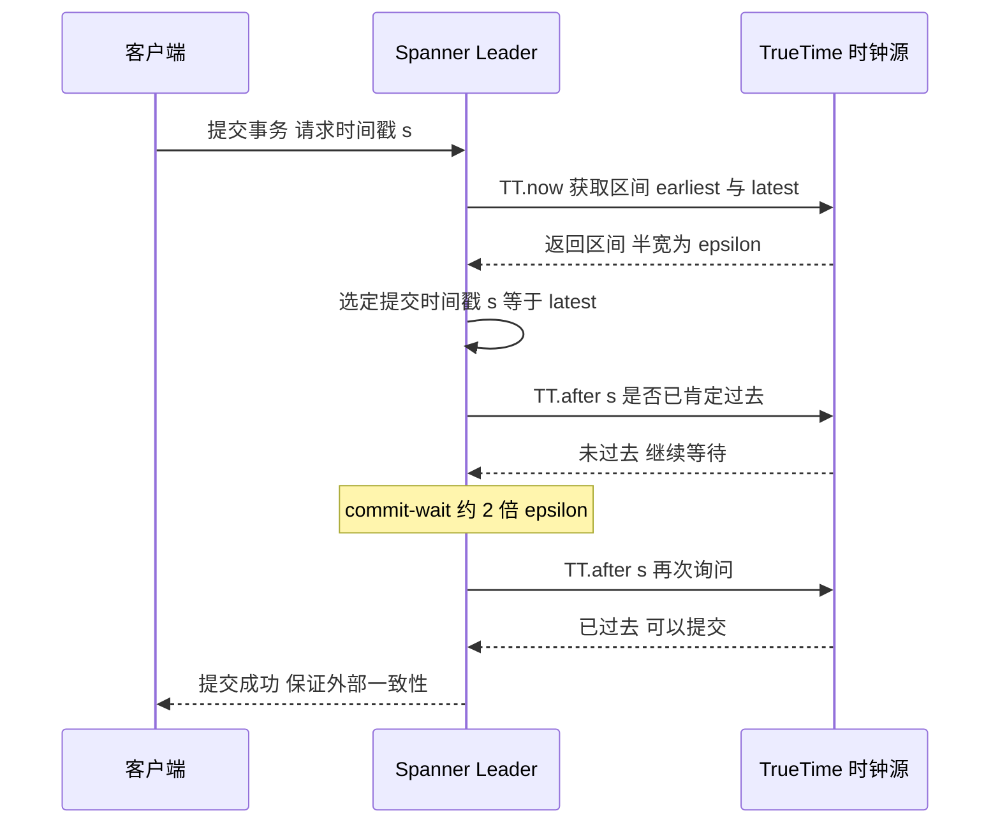

**面试落点**：Spanner 用"昂贵硬件（原子钟 + GPS）+ 等待"把不确定性压到可接受范围，本质是**用延迟换确定性**；而 CockroachDB 选择不做 commit-wait，代价是存在 `max-offset=500ms` 的不确定窗口，也正是它峰值性能不如 Spanner 的原因之一。

### 11.5 顺序的工程来源

| 顺序来源 | 单调性 | 范围 | 典型用途 | 风险 |
| --- | --- | --- | --- | --- |
| `System.currentTimeMillis()` | 否（可回拨） | 全局近似 | 日志、展示 | 不能用于定序 |
| `System.nanoTime()` | 是 | 单 JVM | 耗时统计 | 跨进程无意义 |
| 数据库自增 / `AUTO_INCREMENT` | 是 | 单库（或分片内） | 主键 | 分库后需 `auto_increment_offset` |
| MySQL GTID | 是 | 单实例 | 复制位点、幂等 | 主从切换需重新映射 |
| ZooKeeper zxid | 是 | 单集群 | 分布式锁、顺序节点 | 强依赖 ZK 可用性 |
| etcd `revision` | 是 | 单集群 | Watch 位点、fencing token | 需要 lease 配合 |
| Kafka offset | 是 | 单分区 | 消费位点、幂等 | 分区之间无全局序 |
| Snowflake ID | 趋势递增 | 全局 | 分布式主键 | 依赖时钟，需处理回拨 |

**重要区分**：ZooKeeper zxid、etcd revision 是**集中式发号**，全局单调且可靠；Snowflake 是**本地发号 + 时间戳前缀**，只保证"近似有序"——同一毫秒内不同机器产生的 ID 虽然能比大小，但比出来的是 `workerId` 的顺序，与业务的真实先后无关。

**etcd 的 watch 位点必须用 `revision` 续订**：断线重连时要指定"从上次处理到的 `revision + 1` 开始"重新订阅，否则断线期间的变更会静默丢失（etcd 不会补发）。另外 etcd 会按 `--auto-compaction-retention` 压缩历史，订阅过老的 revision 会直接报 `required revision has been compacted`，只能全量重新同步。这是"用单调序号做断点续传"的通用坑：位点要持久化，且服务端的保留窗口会过期。

## 十二、幂等、去重与序号生成

### 12.1 幂等的定义与责任边界

幂等：对同一操作执行一次或多次，对系统状态的影响相同。`f(f(x)) = f(x)`。

| HTTP 方法 | 幂等 | 安全 |
| --- | --- | --- |
| GET / HEAD | 是 | 是 |
| PUT | 是 | 否 |
| DELETE | 是 | 否 |
| POST | **否** | 否 |
| PATCH | 否（取决于语义） | 否 |

分布式系统里"至少一次（at-least-once）"是默认语义（网络超时无法区分"没收到"和"处理了但响应丢了"），所以**幂等是业务必须自己承担的责任**，不能指望中间件。

### 12.2 五种幂等实现

| 方案 | 实现要点 | 优点 | 缺点 |
| --- | --- | --- | --- |
| 唯一索引 | `INSERT ... ON DUPLICATE KEY UPDATE`、`INSERT IGNORE`，或捕获 `SQLIntegrityConstraintViolationException`（MySQL 错误码 1062） | 最可靠，数据库保证原子 | 约束设计不当会误伤正常业务 |
| 状态机 CAS | `UPDATE orders SET status='PAID' WHERE id=? AND status='UNPAID'` 判断 `affectedRows == 1` | 无额外表，语义清晰 | 仅适用于状态有限的业务 |
| 去重表 | `request_id` 唯一索引 + 异步清理（按时间分区或 TTL） | 通用，可记录结果用于重复返回 | 多一次写，需要治理表膨胀 |
| Redis `SET NX PX` | `SET idempotent:{key} 1 NX PX 86400000` | 快 | Redis 不可靠（主从异步复制、淘汰策略 `noeviction` 之外会逐出） |
| Token 机制 | 先申请 token 再消费（页面防重复提交） | 提前拦截，避免无效写入 | 需要额外一次交互 |

**唯一索引的边界要主动说出来**：唯一索引只在**同一个库/同一个分片内**保证唯一。分库分表后若幂等键不在分片键上，同一个 `request_id` 会被路由到两个库、谁都不冲突，幂等直接失效。两种解法：让幂等键与分片键绑定（同一业务实体必然落在同一分片），或把去重收敛到独立库 / Redis / 集中式去重服务。

**幂等键的设计**必须能唯一标识"一次业务意图"：

```
幂等键 = tenantId + bizType + bizId + operationType
示例   = 1001 + ORDER_PAY + SO20250101ABC + PAY
```

不要用 `userId + 时间戳` 这类会漂移的键，也不要用请求参数的 hash（参数顺序、默认值、浮点精度都会变）。

### 12.3 幂等的执行时序

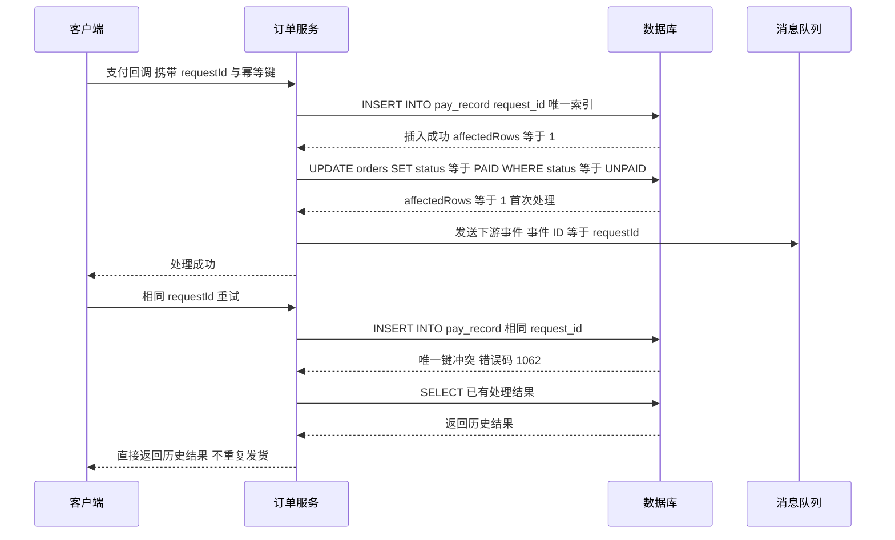

### 12.4 序号生成方案对比

| 方案 | 有序性 | 性能 | 依赖 | 失败模式 |
| --- | --- | --- | --- | --- |
| UUID v4 | 完全无序 | 本地生成，最高 | 无 | 作 MySQL 主键导致页分裂、随机 IO |
| UUID v7（RFC 9562, 2024） | 时间有序 | 本地生成 | 时钟 | 时钟回拨产生重复前缀 |
| 数据库自增 | 单库严格有序 | 受 DB 写能力限制 | 单库 | 单点、扩容难、主从延迟 |
| 数据库多主步长 | 分片内有序 | 中 | `auto_increment_increment` / `auto_increment_offset` | 需预先规划分片数 |
| 号段模式（Leaf-segment） | 趋势递增 | 高（内存分发） | DB | DB 不可用时耗尽号段 |
| Snowflake | 趋势递增 | 极高（本地） | 时钟 | 时钟回拨导致重复 ID |
| Redis INCR | 严格递增 | 高 | Redis | 持久化丢失导致 ID 回退 |
| 集中式服务（TinyId、UidGenerator） | 趋势递增 | 高 | 服务 + DB | 服务故障需多副本 |

### 12.5 Snowflake 的位布局与时钟回拨

标准 Snowflake 是 64 位 long：

```
0 | 41 位毫秒时间戳 | 5 位数据中心 ID | 5 位机器 ID | 12 位序列号
```

| 位段 | 位数 | 容量 | 说明 |
| --- | --- | --- | --- |
| 符号位 | 1 | 固定 0 | 保证 ID 为正数 |
| 时间戳 | 41 | 2^41 ms 约 69.7 年 | 相对自定义 epoch（Twitter 默认 epoch 为 1288834974657，即 2010-11-04） |
| 数据中心 | 5 | 32 | 需与机房/可用区绑定 |
| 机器 | 5 | 32 | 单机房最多 32 台 |
| 序列号 | 12 | 4096 | 每毫秒每节点最多 4096 个 ID，即单节点约 409.6 万 QPS 上限 |

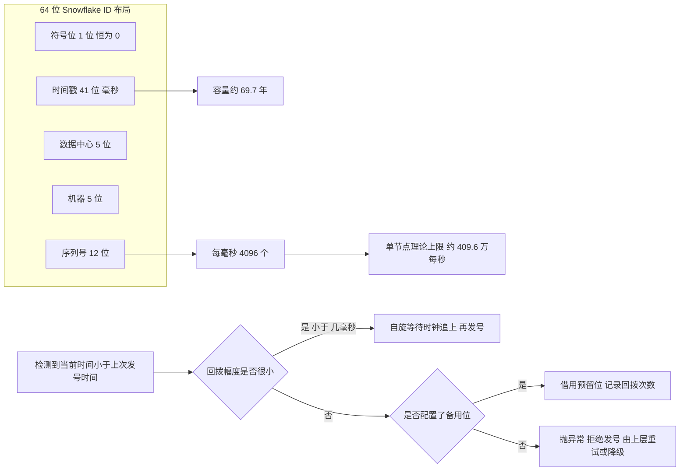

时钟回拨的四种处理（工程上必须能选择并解释）：

1. **等待**：回拨很小（几毫秒内）自旋等待，几乎无成本。
2. **抛异常并告警**：宁可短暂不可用，也不产生重复 ID。这是默认最安全的做法。
3. **借用扩展位**：预留 2~3 位记录"回拨轮次"（美团 Leaf-snowflake 的思路），可容忍分钟级回拨，代价是缩短 ID 可用年限。
4. **持久化上次时间戳 + 启动校验**：服务启动时从 ZooKeeper 读取该 workerId 的最近时间戳，若本机时钟落后则拒绝启动（Leaf-snowflake 用 `ZooKeeper` 的 `/leaf/worker/...` 路径记录）。

**注意**：时钟回拨只有在**同一 workerId** 上才会造成 ID 重复（不同 workerId 的数据中心位 + 机器位不同，生成的 ID 必然不同）；反过来说，只要两台实例**拿到了同一个 workerId**（租约失效、临时节点被抢注），即使时钟完全正常，同一毫秒内取到相同序列号也会生成完全一样的 ID——所以 workerId 的分配必须全局且互斥（用 ZooKeeper 顺序节点或 etcd lease 分配）。

### 12.6 号段模式（Leaf-segment）的关键设计

| 设计点 | 做法 | 原因 |
| --- | --- | --- |
| 取号 | `UPDATE leaf_alloc SET max_id = max_id + step WHERE biz_tag = ?` 后 `SELECT` | 一条 SQL 完成领取，行锁粒度小 |
| `step` | 与 QPS 匹配，常见千级到十万级 | 太小则 DB 压力大，太大则重启浪费号段 |
| 双 buffer | 当前号段消耗到 10% 时异步预取下一段 | 避免取号时同步等待 DB，`leaf` 用 `AtomicBoolean` 保证只有一个线程去预取 |
| 高可用 | DB 主从 + 号段本地缓存 | DB 挂掉后可继续发放当前号段（`leaf-segment` 的降级能力） |
| 动态调整 | 按 `biz_tag` 维度设置 step | 不同业务 QPS 差异大 |

## 十三、高级岗三问

### 13.1 为什么这么设计

| 设计 | 替代方案 | 为什么选它 | 代价 |
| --- | --- | --- | --- |
| Raft 用随机选举超时 | 固定超时 / 优先级选举 | 随机化让选票快速收敛到单一大数，避免永久瓜分 | 最坏情况下恢复时间波动 |
| Raft 只提交当前 term 日志 | 直接提交多数派最新日志 | 避免 Figure 8 的已提交日志被覆盖 | 旧 term 日志要等新日志一起提交，稍慢 |
| ZAB 的 zxid 高 32 位当 epoch | 单调整数（类似 Raft index） | 换主时能快速判断哪些事务属于旧 epoch，便于 TRUNC | 需要额外的 NOOP 事务宣告 epoch |
| Quorum 读写 | 主从同步复制 | 可用性与延迟更可控 | 尾延迟；LWW 冲突丢写 |
| Spanner commit-wait | 不做等待，用逻辑时钟 | 换取外部一致性 | 每次提交多加约 2ε 延迟 |
| Snowflake 用本地发号 | 集中式发号 | 零网络开销，QPS 极高 | 依赖时钟，需要回拨保护 |
| 唯一索引做幂等 | 先查后写 | 查与写不是原子操作，只有唯一索引能真正防并发重复 | 需要设计好约束与异常处理 |

### 13.2 线上出问题怎么定位

| 症状 | 第一步 | 关键命令/指标 | 判读 |
| --- | --- | --- | --- |
| etcd 集群写入慢 | 看是否有选主 | `etcdctl endpoint status --write-out=table` 看 `IS LEADER`、`RAFT TERM`、`RAFT INDEX`、`DB SIZE` | `RAFT TERM` 频繁增加 = 选主风暴；`DB SIZE` 过大 = 需要 compaction |
| etcd 报 `etcdserver: request timed out` | 看磁盘 fsync 延迟 | `etcdctl endpoint status`、`--debug` 日志、`iostat -x 1` | 磁盘 `await` 高会直接拖慢 Raft 日志落盘 |
| ZooKeeper 不可用 | 看节点角色与 zxid | `echo stat \| nc 10.0.0.11 2181`、`echo mntr \| nc 10.0.0.11 2181` | `Mode: looking` 表示在选举；`Zxid` 落后多表示同步慢 |
| ZooKeeper 大量连接被拒 | 看连接数限制 | `echo cons \| nc 10.0.0.11 2181` | `maxClientCnxns` 默认 60（每 IP），客户端机器需收敛连接 |
| 分区判定的直接证据 | 看实例间连通性 | `ping`、`traceroute`、`ss -s`、`netstat -s`、`tcpdump -i eth0 port 2379` | `netstat -s` 里 `segments retransmitted` 增长说明丢包严重 |
| 选主频繁 | 查 GC 与 CPU 限流 | `jstat -gcutil 12345 1000`、`cat /sys/fs/cgroup/cpu.stat`、`dmesg` | STW 超过 election timeout 会被误判为宕机 |
| 时钟异常 | 查时钟偏移 | `chronyc tracking`、`timedatectl`、`ntpq -p`、Java 里比较 `Instant.now()` 与 NTP | 偏差超过 `--max-offset=500ms`（CockroachDB）会直接报错 |
| 幂等失效重复下单 | 查唯一键是否生效 | `SHOW INDEX FROM payment_record`、慢日志里搜 `Duplicate entry` | 唯一索引缺失或幂等键设计成时间戳 |
| 分布式 ID 重复 | 查 workerId 冲突 | 找重复 ID，反解时间戳与 workerId | workerId 分配租约失效导致两台机器同 ID |
| 一致性哈希路由不一致 | 查各客户端环版本 | 客户端埋点打印环的版本与 key 的归属 | 扩容时未统一推送新环，同一 key 被路由到两处 |

### 13.3 规模变大后会怎样

| 规模变化 | 失效模式 | 应对 |
| --- | --- | --- |
| 节点从 3 到 7 | Raft 写延迟上升（要等第 4 个节点 ack） | 保持 3~5 个投票成员，其余用 Learner |
| 跨机房部署 | 跨 AZ RTT 变大，election timeout 需要放大 | 同城双活用 3 副本跨 AZ + `LOCAL_QUORUM`；异地容灾用异步 |
| 分片数从 4 到 64 | 跨分片查询、全局排序、"按时间倒序查最近 20 条"变难 | 冗余宽表、异步汇总、异构索引（ES） |
| key 从百万到百亿 | 一致性哈希的环计算与内存占用上升 | 分层路由（先按业务再按用户），虚拟节点数量按数据量调优 |
| 单 key QPS 从千到十万 | 热点 key 打满单节点 | 本地缓存 + 二级缓存、key 打散、读写分离、把热点数据放独立集群 |
| 时钟偏差从 1ms 到 100ms | LWW 丢写、HLC 报错、Snowflake 回拨 | 强制 NTP/chrony 监控告警、改用集中式发号 |
| 日志从 GB 到 TB | Raft 日志回放慢、snapshot 传输打爆网络 | 开启 compaction、分块 InstallSnapshot、增加节点时先加 Learner |

## 高频面试题

### Q1. 请准确解释 CAP，并说明"三选二"为什么是错的。

**答题框架（30 秒版）**：CAP 的 C 是线性一致、A 是每个非故障节点在有限时间内返回非错误响应、P 是分区时系统仍运行。网络分区不可避免，所以 P 不是可选维度，真正的取舍是"分区时牺牲 C 还是 A"；CA 系统只在无分区的单机场景成立。

**展开（2 分钟版）**：

1. C 不是"数据最终一样"，而是线性一致——操作在调用与返回之间的某个瞬时点原子生效，且全体操作有一个与实时顺序相容的全序。
2. A 不要求返回最新数据，只要求返回非错误响应。所以"返回旧值"仍算可用。
3. P 是网络分区（消息可任意丢失）时系统仍能继续运行，是网络环境的客观属性。
4. CAP 只约束分区期间；分区之外还有延迟与一致性的取舍，这就是 PACELC（Abadi, 2012）：`if (P) then A or C, else (E) then L or C`。Spanner 属于 PC/EC，Cassandra 属于 PA/EL。

**追问**：那 Cassandra 是 AP 还是 CP？答：取决于读写一致性级别。`ConsistencyLevel.ONE` 偏 A，`QUORUM`（RF=3 时为 2）配合 `W + R 大于 N` 偏 C；多 DC 时用 `LOCAL_QUORUM`。所以"给系统贴单一标签"是不准确的。

### Q2. BASE 与 ACID 的关系是什么？BASE 能保证不丢数据吗？

**答题框架（30 秒版）**：ACID 是单库事务的强保证，BASE 是跨服务场景的可用性优先取舍；BASE 的最终一致意味着不一致窗口无上界，必须靠补偿、对账、人工兜底，所以 BASE 本身不保证不丢数据。

**展开**：

1. Basically Available：允许降级、限流、排队，不整体宕机。
2. Soft state：允许存在"支付中""预占中"这类中间状态，且中间状态不保证外部可观测一致。
3. Eventually consistent：停止写后有限时间收敛。**"有限时间"没有上界**，这就是风险来源。
4. 所以工程上必须有：本地消息表/事务消息保证"至少一次"，消费端幂等去重保证"效果一次"，定时对账发现差异，人工工单兜底。

**追问**：RocketMQ 事务消息回查多少次？答：`transactionCheckMax` 默认 15 次，`transactionCheckInterval` 默认 60000ms，`transactionTimeOut` 默认 6000ms；超过 15 次仍未知则丢弃并告警。

### Q3. 2PC 的两个阶段分别做了什么？它的阻塞问题能否解决？

**答题框架（30 秒版）**：一阶段 prepare 投票（参与者执行但不提交、写 undo 日志、**持锁**），二阶段 commit/abort。阻塞的根因是"参与者 prepare 后进入未知态且持锁"，而协调者是单点；3PC 用超时缓解阻塞，但网络分区下会出现部分提交部分回滚，工程上基本不用。

**展开**：

1. 参与者要在 prepare 阶段把所有本地变更写入 undo/redo 并等待，所以锁的持有时间取决于最慢的参与者和协调者的可用性。
2. 协调者在"写完决策前"崩溃，参与者无法判断该提交还是回滚——这是 2PC 的不可解部分（JTA 里表现为 `XAException.XAER_RMFAIL`，要靠 `XAResource#recover` 反复询问）。
3. 3PC 增加 CanCommit 阶段并引入超时默认提交；但分区时部分参与者超时提交、部分收到 abort，仍不一致。
4. 工程改进方向是"不长时间持锁"：Seata AT 一阶段本地提交 + `undo_log` 反向补偿，代价是全局事务隔离级别只有读未提交。

**追问**：XA 在 MySQL 上有什么坑？答：`XA PREPARE` 期间的行锁受 `innodb_lock_wait_timeout`（默认 50 秒）约束；`XAResource` 与物理连接绑定，连接池（HikariCP 默认 `maximumPoolSize=10`）容易被占满；`XA RECOVER` 能看到遗留的 prepared 分支，必须人工或定时清理。

### Q4. 场景设计：订单系统要保证"下单扣库存 + 生成订单"的一致性，请给出方案并说明取舍。

**答题框架（30 秒版）**：先看是否同一库——同库用本地事务；跨库优先"本地消息表/事务消息 + 消费端幂等"；资金类强约束用 TCC；只有当参与方都支持 XA 且并发低时才考虑 2PC。任何方案都要配定时对账。

**展开（2 分钟版）**：

1. **同库**：`@Transactional` + InnoDB 事务，最简单，优先考虑数据是否能放一个库（垂直拆分时把强一致数据聚在一起）。
2. **跨库、可最终一致**：本地消息表（订单库与消息表同事务写入）或 RocketMQ 事务消息，库存服务消费后做 CAS 扣减，消费端用 `requestId` 唯一索引幂等。失败由定时补偿任务扫描"未确认消息"重发。
3. **跨库、隔离性要求高**：TCC。Try 里冻结库存（`UPDATE stock SET frozen = frozen + n WHERE available >= n`），Confirm 扣减冻结，Cancel 释放。三个接口都要幂等，业务表要有事务控制表防空回滚与悬挂。
4. **短事务、低并发、同构 DB**：Seata AT，一阶段本地提交 + 全局锁防脏写。

**追问**：如果消息发送成功但库存扣减失败怎么办？答：靠"消费端重试 + 死信队列 + 对账补偿"。同时要对账任务以订单状态和库存流水为双数据源，按 `T+1` 或分钟级核对差异；不要指望消息一定能被消费成功。

### Q5. Paxos 的两个阶段在做什么？为什么多数派能保证不选出两个值？

**答题框架（30 秒版）**：阶段一 Prepare/Promise 让 Acceptor 承诺不再接受更小号提案并返回历史已接受值；阶段二 Accept/Accepted 用"必须沿用返回的历史值"的规则保证已选定的值不被覆盖。多数派必有交集，公共节点会把自己接受过的值告诉新 Proposer。

**展开**：

1. 提案编号 n 全局唯一且单调，常用 `(round, serverId)`。
2. Proposer 在阶段二不能自由选值：响应中存在已接受值时，必须选**编号最大**的那个值；都没有才能用自己的值。这是 Paxos 安全性的全部秘密。
3. 交集论证：任一多数派大小大于 N/2，两个多数派之和大于 N，所以至少一个公共 Acceptor。
4. 活锁：两个 Proposer 不断抬高编号会互相否决。工程上用随机退避或引入稳定 Leader（Multi-Paxos 省略阶段一，1 个 RTT 提交）。

**追问**：为什么工程界更爱 Raft？答：Basic Paxos 只决议单值，实际系统需要连续日志，成员变更、快照、日志空洞都要自己补（见 "Paxos Made Live" 记录的 Chubby 实践）；Raft 把这些全部定义清楚，且以可理解性为设计目标。

### Q6. Raft 的选举超时与心跳参数怎么定？为什么必须随机化？

**答题框架（30 秒版）**：选举超时必须远大于一次心跳往返（含 GC 停顿），etcd 默认心跳 100ms、选举超时 1000ms；随机化是为了避免所有 Follower 同时超时、选票被瓜分导致反复选举。

**展开**：

1. etcd：`--heartbeat-interval=100` ms，`--election-timeout=1000` ms，选举超时在 `[T, 2T)` 内随机。
2. Consul 的 `hashicorp/raft`：`HeartbeatTimeout=1000ms`、`ElectionTimeout=1000ms`、`LeaderLeaseTimeout=500ms`、`CommitTimeout=50ms`。
3. 跨 region RTT 30ms 时，1000ms 已足够；同机房 RTT 0.5ms 可下调到 300~500ms 提升恢复速度。
4. 随机化的本质：让最先超时的节点抢先拿到多数票，其他节点还没超时就成了 Follower，避免平票僵局。
5. 选举超时是"故障检测准确度"与"故障恢复速度"的权衡：太小会因 GC/抖动误判，太大会延长不可用时间。

**追问**：随机化能解决平票吗？答：不能 100% 解决。若两个 Candidate 的 term 相同且各拿一半票，该 term 无 Leader，下一个超时周期重新随机，期望很快收敛；论文与工程实现都接受这一点。

### Q7. 线上排查：etcd 集群频繁选主，写入出现 `request timed out`，怎么定位？

**答题框架（30 秒版）**：先确认是不是选主（`RAFT TERM` 是否持续增长），再看"为什么会误判 Leader 失效"——依次排查 GC/STW、容器 CPU 限流、磁盘 fsync 延迟、网络丢包与时钟偏移，最后才是调大 `--election-timeout`。

**展开（2 分钟版）**：

1. 看集群状态：`etcdctl endpoint status --write-out=table` 关注 `IS LEADER`、`RAFT TERM`、`RAFT INDEX`、`DB SIZE`。`RAFT TERM` 每次查询都在涨 = 选主风暴。
2. 看日志：`journalctl -u etcd` 搜 `leader changed`、`failed to send out heartbeat`、`apply request took too long`；后者说明 apply 阶段慢，通常是磁盘或大事务。
3. 排除 JVM/容器因素（若客户端在同机）：`jstat -gcutil 12345 1000` 看 Full GC，`cat /sys/fs/cgroup/cpu.stat` 看 `nr_throttled`，容器 CPU 被限流是选主风暴的高频原因。
4. 磁盘：`iostat -x 1` 看 `await`；etcd 对 fsync 延迟极敏感，官方建议 SSD 且 `fdatasync` P99 在 10ms 内。`DB SIZE` 超过配额（默认 `--quota-backend-bytes=2147483648`，即 2GB）会进入 `NOSPACE` 只读状态，必须先 compaction 再 defrag。
5. 网络：`netstat -s` 看重传率，`ping` 看 RTT 抖动；跨 AZ 网络抖动会让心跳超时。
6. 时钟：`chronyc tracking` 看偏移；NTP step 会造成租约异常。
7. 最后调整参数：把 `--election-timeout` 提到 2000ms 以上只在磁盘/网络确实慢时使用，属于缓解而非根治。

### Q8. ZAB 与 Raft 有什么本质差异？

**答题框架（30 秒版）**：安全性等价（都保证已提交日志不丢），差异在形态：ZAB 是 primary-backup 的原子广播、事务 ID 是 `(epoch, counter)` 的 zxid、默认读不保证线性一致；Raft 是纯粹的状态机复制库、用 `(term, index)`、提供 ReadIndex 线性一致读，成员变更与快照都有标准方案。

**展开**：按六个维度对比——理论定位、事务标识、选举比较字段、恢复方式（DIFF/TRUNC/SNAP 对比一致性检查回退）、提交旧 Leader 日志的方式（NOOP 确认 epoch 对比只提交当前 term 日志）、成员变更（3.5.0 起动态 reconfig 对比 joint consensus/单节点变更）。补充 ZAB 新 Leader 必须先提交 NOOP，而 Raft 上位先发空心跳。

**追问**：ZooKeeper 为什么读会陈旧？答：读可以由任意 Follower 本地响应，不经过 Leader 也不走 quorum；需要最新数据要调用 `ZooKeeper#sync` 或直接用 etcd 的 ReadIndex 读。

### Q9. 场景设计：从 3 个缓存节点扩到 4 个，如何避免缓存大面积失效？

**答题框架（30 秒版）**：用一致性哈希替换取模哈希，每个物理节点配 150~200 个虚拟节点；扩容时只迁移约 `K / N` 的数据；同时给环加版本号统一下发，迁移期间对未命中做空值缓存 + 互斥重建，防止击穿。

**展开**：

1. `hash % N` 扩容时迁移比例接近 `N / (N + 1)`，3 扩 4 约 75%，等于缓存集体失效。
2. 一致性哈希只迁移新增节点逆时针区间，约为 `K / N`；虚拟节点数量参考：Ketama 每节点 160 个、Cassandra `num_tokens` 默认 256、Dubbo `hash.nodes` 默认 160 且 `hash.arguments` 默认 `0`。
3. Java 实现：`ConcurrentSkipListMap` + `ceilingEntry(hash)`，null 时回绕 `firstKey()`；哈希函数用 MurmurHash3 或 MD5，不要用 `String#hashCode()`。
4. 迁移期保护：环版本号统一下发避免路由分裂；热点 key 加本地缓存；未命中用互斥（Redisson 锁或 `SET NX`）只让一个线程回源；空值缓存 60 秒防穿透。
5. 如果已经用了 Redis Cluster 固定槽位：预先多分片（例如规划 16 个分片只启用 8 个），扩容时搬迁 slot 而不是重建集群；注意 `cluster-require-full-coverage` 默认 `yes`，任一槽不可用会导致整个集群停止接受查询（读写全停）。

**追问**：虚拟节点是不是越多越好？答：不是。虚拟节点多则分布更均匀，但环的内存与查找开销线性上升（`ceilingEntry` 是 O(log M)，M 为虚拟节点总数）；另外虚拟节点只解决"分布均匀"，不解决"单 key 热点"——热点要靠本地缓存与 key 打散。

### Q10. Quorum 的 W + R 大于 N 一定强一致吗？有什么前提和代价？

**答题框架（30 秒版）**：单 DC、无失败、写已确认、副本集合固定时，`W + R > N` 保证读写集合有交集，能读到最新已确认写；但多 DC、sloppy quorum、hinted handoff、LWW 冲突解决都会破坏这个保证，代价是尾延迟。

**展开**：

1. 交集证明：两个集合大小之和大于 N，必有公共副本。
2. 前提条件：同一 DC（`EACH_QUORUM` 例外）、副本集合固定（Dynamo 的 sloppy quorum 允许写到偏好列表之外的节点，破坏前提）、写已返回成功、没有并发的 LWW 覆盖。
3. 代价：延迟由第 W 个写 ack 和第 R 个读响应决定，受最慢副本影响（"The Tail at Scale"）；可用性降低（N=3/W=3 时任一节点挂即写失败）。
4. 冲突解决：Cassandra 用 LWW（时钟偏差会静默丢写），Dynamo 用向量时钟保留 siblings 交给应用合并。要强一致又不想丢写，应考虑支持 CAS/LWT 的存储或共识系统。
5. 配套机制：read repair、hinted handoff、`nodetool repair` 定期反熵；`gc_grace_seconds` 默认 864000（10 天）必须大于 repair 周期，否则删除的数据会复活。

**追问**：Cassandra 里 RF=3，读 `QUORUM` 写 `ONE` 会怎样？答：`W + R = 1 + 2 = 3`，不满足大于 N，可能读不到最新已确认写，只能算最终一致。

### Q11. 场景设计：如何设计一个能被安全使用的分布式锁？

**答题框架（30 秒版）**：加锁要"原子 + 带过期 + 带唯一标识"，解锁要"比对标识 + Lua 原子删除"，续约要"看门狗 + 有界次数"，业务写入要带 fencing token，最后一定要有本地兜底（数据库唯一约束/乐观锁），不要单独信任锁。

**展开**：

1. 加锁：`SET lockKey randomValue NX PX 30000`；`randomValue` 用 `UUID.randomUUID()`，用于标识持有者。
2. 解锁：Lua 脚本 `if redis.call('get', KEYS[1]) == ARGV[1] then return redis.call('del', KEYS[1]) else return 0 end`，保证"比对 + 删除"原子，防止误删他人的锁。
3. 续约：Redisson 的 `lockWatchdogTimeout` 默认 30000ms，看门狗每 10 秒续约；若调用 `tryLock(waitTime, leaseTime, unit)` 显式传了 `leaseTime`，看门狗不续约——这是最常见的"锁提前过期"事故原因。
4. 有效期必须大于业务最长执行时间，否则业务没跑完锁就没了。
5. fencing：把锁返回的单调号（etcd `revision`、ZK zxid）带给存储层，存储层拒绝更小的 token，防止长时间 GC 后旧持有者继续写。
6. 兜底：数据库唯一索引、`UPDATE ... WHERE version = ?` 乐观锁、状态机 CAS，这些是最终防线。
7. 不要把"分布式锁"当成"分布式事务"：加锁只解决互斥，解决不了原子性与隔离性。

**追问**：Redlock 能用吗？答：能用但有前提。它依赖 5 个独立 Redis 实例、依赖各节点墙钟且不能有回拨，且不带 fencing token；Kleppmann 的批评正是指这两点。多数业务用"单实例 Redis 锁 + 业务层 version 校验"就够了，不需要 Redlock。

### Q12. 逻辑时钟、向量时钟、TrueTime 分别解决什么问题？

**答题框架（30 秒版）**：逻辑时钟给因果一个偏序（`LC` 小不代表因果在先）；向量时钟能精确判断"因果先于 / 并发"两种关系（代价 O(N) 空间）；TrueTime 用硬件把物理时间的不确定性收窄到区间 `[earliest, latest]`，靠 commit-wait 换外部一致性。

**展开**：

1. Lamport 时钟：本地事件 +1，收消息取 `max(本地, 消息) + 1`；性质是因果蕴含大小关系，反向不成立。要做全序要补 `(LC, nodeId)`。
2. 向量时钟：`V1 因果先于 V2` 当且仅当所有分量不大于且至少一个严格小；互不包含即并发，Dynamo 保留 siblings 让应用合并。
3. HLC：`(wallTime, logical)`，与物理时间偏差有上界且严格单调；CockroachDB `--max-offset` 默认 500ms，超了直接报错。
4. TrueTime：`TT.now()` 返回区间，`TT.after/ before` 做区间判断，ε 通常小于 7ms，提交前 commit-wait 约 2ε（10ms 量级），实现外部一致性 = 严格可串行化。
5. Java 侧建议用 `Clock` 注入时间源，耗时统计用 `System.nanoTime()`，跨机定序不要用 `System.currentTimeMillis()`。

**追问**：为什么不用 NTP 把时钟调准就够了？答：NTP 只能缩小偏差，无法给出"误差上界"；而且 NTP 的 step 校正会造成回拨，依赖 wall clock 的租约与 LWW 会直接出错。

### Q13. 线上排查：分布式 ID 出现重复，如何定位与修复？

**答题框架（30 秒版）**：先反解重复 ID 的 Snowflake 位段拿到时间戳与 workerId，判断是"workerId 冲突"还是"时钟回拨"；修复分三步——补齐 workerId 分配租约、加回拨保护、对已产生的重复 ID 做业务侧合并或重新生成。

**展开（2 分钟版）**：

1. 反解 ID：`timestamp = (id >> 22) + epoch`，`datacenterId = (id >> 17) & 0x1F`，`workerId = (id >> 12) & 0x1F`，`sequence = id & 0xFFF`。若重复的两个 ID 反解结果完全相同的时间戳与 workerId，说明是同一实例在同一毫秒内重复用了同一序列号。
2. 判断根因：查该实例的启动日志与 NTP 日志。若是时钟回拨，`System.currentTimeMillis()` 落后于上次发号时间；若是 workerId 冲突，查 ZooKeeper/etcd 里的 workerId 注册记录，常见原因是临时节点会话过期后被另一台机器抢注，而旧机器还活着（网络抖动导致 session 过期）。
3. workerId 修复：用 etcd lease 或 ZooKeeper 临时顺序节点 + `InterProcessMutex` 保证互斥；租约续约失败时**主动放弃发号并退出或重启**，不要静默继续。
4. 回拨保护：回拨小于几毫秒自旋等待；否则抛异常并告警（宁可短暂不可用）；或用预留位记录回拨轮次（Leaf-snowflake 思路），代价是 ID 可用年限缩短。
5. 数据修复：重复 ID 若已入库，先定位影响范围（`SELECT id, COUNT(*) FROM t GROUP BY id HAVING COUNT(*) > 1`），业务上按自然键（订单号、业务流水号）判断归属，冲突行重新生成 ID 并修数据，不能直接删。
6. 长期方案：换成"号段模式"（Leaf-segment 双 buffer）或带 workerId 租约的集中式发号服务，从根上减少对本地时钟的依赖。

**追问**：为什么 UUID v4 不适合做 MySQL 主键？答：128 位无序，插入随机分布在 B+ 树各叶子节点，导致页分裂与随机 IO，索引体积与写入放大都显著上升；需要有序可用 UUID v7（RFC 9562）。

## 易错点与踩坑

| 易错点 | 正确理解 |
| --- | --- |
| CAP 是"三选二" | P 在真实网络中不可放弃，实际是"分区时牺牲 C 还是 A"；CA 只在无分区的单机场景成立 |
| 把 CAP 的 C 说成"最终一致" | CAP 的 C 特指线性一致（linearizability），比可串行化更强 |
| 把 A 说成"高可用 99.99%" | A 指每个非故障节点在有限时间内返回非错误响应，返回旧值也算可用 |
| 说 Cassandra 一定是 AP、MongoDB 一定是 CP | 一致性级别按请求可选；Cassandra `QUORUM` 偏 C，MongoDB `w:1` 偏 A |
| 认为 BASE 不需要处理不一致 | 最终一致的"有限时间"无上界，必须有补偿、对账、人工兜底 |
| 认为 2PC 能保证一致性就没问题 | 2PC 有同步阻塞、协调者单点、部分提交三个缺陷；XA 还会长时间占用连接池连接 |
| 认为 3PC 解决了 2PC 的问题 | 3PC 只缓解崩溃下的阻塞，分区时会部分提交部分回滚，工程基本不用 |
| 以为 Paxos 阶段二可以自由选值 | 必须沿用 Acceptor 返回的历史值中编号最大的那个，否则会覆盖已选定值 |
| 说 Raft 提交规则是"多数派复制就能提交" | 只能提交**当前 term** 的日志，旧 term 日志要靠当前 term 日志间接提交，否则触发 Figure 8 的数据覆盖 |
| 用固定选举超时 | 必须随机化，否则选票瓜分导致反复选举 |
| 认为 ZAB 与 Raft 完全一样 | 安全性等价，但事务标识、选举比较字段、恢复方式、读语义都不同；ZAB 默认读可能陈旧 |
| 认为 ZooKeeper 读是强一致的 | 读可由 Follower 本地响应；需要最新数据要 `ZooKeeper#sync` |
| 认为 N=4 比 N=3 容错更强 | 都只能容忍 1 个故障，N=4 需要 3 个 ack，延迟更高成本更高 |
| 认为拜占庭容错也只要多数派 | 拜占庭需要 `N = 3f + 1`，PBFT 的 quorum 是 2f+1 且消息复杂度 O(N²) |
| 用 `W + R > N` 就宣称强一致 | 还需单 DC、固定副本集、无 sloppy quorum；且代价是尾延迟 |
| 认为 Cassandra 用向量时钟解决冲突 | Cassandra 用 LWW 时间戳，时钟偏差会静默丢写；Dynamo 才用向量时钟保留 siblings |
| 分布式锁只加 `SETNX` 不设过期 | 必须带 `PX` 过期和唯一 `randomValue`，解锁用 Lua 比对后删除 |
| 用 Redisson `tryLock(wait, lease, unit)` 又以为会有看门狗 | 显式传 `leaseTime` 时看门狗不续约，锁会到期自动释放 |
| 忘记 `gc_grace_seconds` 约束 | 默认 864000（10 天），必须大于 repair 周期，否则删除的数据会复活 |
| 认为 `cluster-require-full-coverage` 无所谓 | Redis Cluster 该参数默认 `yes`，任一槽不可用会导致整个集群停止接受查询（读写全停） |
| 用 `hash % N` 做缓存分片 | 扩容时迁移比例接近 `N/(N+1)`，缓存会大面积失效；应使用一致性哈希 + 虚拟节点 |
| 一致性哈希虚拟节点用 `String#hashCode()` | 分布极差，虚拟节点会扎堆；应用 MurmurHash3/MD5 |
| 认为逻辑时钟能判断因果 | Lamport 时钟只保证因果蕴含大小关系，反向不成立；判断并发要用向量时钟 |
| 用 `System.currentTimeMillis()` 计算耗时或跨机定序 | 会回拨且不单调；耗时用 `System.nanoTime()`，跨机定序用逻辑时钟或集中式发号 |
| 重试不设退避与上限 | 3 层各重试 2 次 = 27 倍放大，会引发重试风暴；必须指数退避 + 抖动，且只重试幂等操作 |
| 外层超时小于内层 | 外层先超时会导致"调用方认为失败、实际已成功"的重复提交；超时必须严格递减 |
| Snowflake 不处理时钟回拨 | 回拨会造成 ID 重复；必须自旋等待、抛异常或用预留位，且 workerId 要租约互斥分配 |
| 幂等键用时间戳或参数 hash | 会漂移；应使用 `tenantId + bizType + bizId + opType` 这类稳定业务键 |

## 一句话速记

- CAP 的 C 是线性一致、A 是非错误响应、P 是分区下仍运行；P 不可放弃，真正的取舍是分区时牺牲 C 还是 A。
- PACELC：分区时选 A 或 C，常态下选延迟 L 或一致性 C。
- BASE 是把不一致窗口显式暴露给业务，必须配补偿与对账，最终一致的"有限时间"无上界。
- 2PC 一阶段持锁投票、二阶段提交；阻塞源于协调者单点与参与者未知态，3PC 只缓解不根治。
- Seata AT 一阶段本地提交 + `undo_log` 反向补偿，`@GlobalTransactional` 默认 `timeoutMills=60000`。
- Paxos：Prepare 承诺 + Accept 遵守历史值；多数派必有交集；活锁靠随机退避或稳定 Leader。
- Raft：随机选举超时、`prevLogIndex/prevLogTerm` 一致性检查、`nextIndex/matchIndex` 回退、只能提交当前 term 日志。
- etcd 默认 `heartbeat=100ms`、`election=1000ms`；Consul 的 `hashicorp/raft` 默认 `HeartbeatTimeout=1000ms`、`LeaderLeaseTimeout=500ms`。
- ZAB 的 `zxid = (epoch, counter)`，选举比较 `(epoch, zxid, sid)`，新 Leader 先提交 NOOP 宣告 epoch。
- 容错公式：崩溃故障 `N = 2f + 1`、quorum `floor(N/2)+1`；拜占庭 `N = 3f + 1`；偶数节点不增加容错。
- 脑裂防不住"旧主继续读"，必须用单调递增的 fencing token 让存储层拒绝过期写。
- `W + R > N` 保证读写交集，代价是尾延迟；Cassandra 的 LWW 在时钟偏差下会静默丢写。
- 一致性哈希只迁移约 `K/N`；虚拟节点 Ketama 每节点 160 个、Cassandra `num_tokens=256`、Dubbo `hash.nodes=160`。
- Redis Cluster 用 16384 个槽 + CRC16，`cluster-require-full-coverage` 默认 `yes`。
- FLP 说异步网络下没有确定性共识，工程用超时把网络当部分同步，牺牲活性保安全性；etcd 不抗拜占庭。
- 超时必须层层递减，重试要指数退避 + 抖动；Dubbo 默认 `timeout=1000ms`、`retries=2`，对非幂等写必须设 `retries=0`。
- 顺序只能来自集中式发号或逻辑时钟；Snowflake 1 + 41 + 10 + 12 位，单节点每毫秒 4096 个 ID。
- 幂等靠唯一索引、状态机 CAS、去重表、`SET NX PX`、Token；不要用"先查后写"防并发重复。
- 分布式系统里唯一可信的是"多数派 + 单调编号 + 业务幂等"，时钟、网络、锁都只是概率上的可靠。
