# 02 注册中心、RPC 与微服务治理

> 一句话定位：注册中心的 CAP 取舍答不清、RPC 一次调用的链路断层、Dubbo 的 SPI 与容错策略记不住默认值，是"分布式服务化"这一块最常见的三处失分；本章把注册中心数据模型、RPC 全链路时序、Dubbo 3.x 扩展机制与治理参数一次讲透 ｜ 面试权重 ★★★★★ ｜ 建议复习 60 分钟

## 本章大纲

- [一、微服务演进与拆分原则](#一微服务演进与拆分原则)
- [二、注册中心的职责与 CAP 取舍](#二注册中心的职责与-cap-取舍)
- [三、四种注册中心的实现对比](#三四种注册中心的实现对比)
- [四、服务发现：客户端发现与服务端发现](#四服务发现客户端发现与服务端发现)
- [五、Nacos 的实例模型与心跳机制](#五nacos-的实例模型与心跳机制)
- [六、RPC 的核心组成](#六rpc-的核心组成)
- [七、一次 RPC 调用的完整时序](#七一次-rpc-调用的完整时序)
- [八、序列化协议对比与选型](#八序列化协议对比与选型)
- [九、HTTP 与 RPC、gRPC 与 Dubbo 的对比](#九http-与-rpcgrpc-与-dubbo-的对比)
- [十、Dubbo 架构分层与 SPI 自适应扩展](#十dubbo-架构分层与-spi-自适应扩展)
- [十一、Dubbo 负载均衡策略](#十一dubbo-负载均衡策略)
- [十二、Dubbo 集群容错策略](#十二dubbo-集群容错策略)
- [十三、泛化调用与隐式参数](#十三泛化调用与隐式参数)
- [十四、服务治理：超时、重试与幂等](#十四服务治理超时重试与幂等)
- [十五、线程池隔离、优雅上下线、灰度与路由](#十五线程池隔离优雅上下线灰度与路由)
- [十六、链路追踪与 OpenTelemetry](#十六链路追踪与-opentelemetry)
- [十七、微服务典型故障与雪崩](#十七微服务典型故障与雪崩)
- [十八、高级岗三问](#十八高级岗三问)
- [高频面试题](#高频面试题)
- [易错点与踩坑](#易错点与踩坑)
- [一句话速记](#一句话速记)

## 一、微服务演进与拆分原则

### 1.1 从单体到微服务的四个阶段

| 阶段 | 形态 | 通信方式 | 扩展方式 | 典型痛点 |
| --- | --- | --- | --- | --- |
| 单体 Monolith | 一个 war/jar，一个数据库 | 进程内方法调用 | 垂直加机器 | 构建慢、发布互相阻塞、故障放大 |
| 分层单体 | 按 controller/service/dao 分包 | 进程内方法调用 | 加机器 | 模块边界靠人守，禁不起工程腐化 |
| SOA | ESB 总线 + 多个服务 | SOAP/WebService、ESB 路由与协议转换 | 服务级扩展 | ESB 成为单点与瓶颈，契约重 |
| 微服务 | 按业务能力自治的小服务 | REST/RPC（Dubbo、gRPC） | 服务级 + 数据级扩展 | 分布式复杂度、数据一致性、治理成本 |

关键判断：**微服务不是"把类拆到不同 JVM"，而是把组织边界、数据所有权、发布节奏一起切分**。只拆进程不拆数据库，会得到"分布式单体"——调用链变长、事务变难，却拿不到任何自治收益。

### 1.2 DDD 限界上下文：拆分的理论依据

限界上下文（Bounded Context）是 DDD 战略设计的核心概念：**同一个词在不同上下文里含义不同，模型只在上下文边界内保证一致**。

举一个面试常被追问的例子。在电商系统里"商品"这个词：

| 上下文 | "商品"的含义 | 关键属性 |
| --- | --- | --- |
| 交易上下文 | 可下单的 SKU 快照 | 下单时刻的价格、库存扣减结果 |
| 库存上下文 | 可分配的库存单位 | 可用量、锁定、批次 |
| 商品上下文 | 主数据 | 标题、类目、品牌、上架状态 |
| 营销上下文 | 参与活动的资格载体 | 活动价、限购规则、优惠券适用范围 |

如果强行合并成一个 `Product` 类，就会出现"营销要改了 `price` 字段、交易不敢动"的互相牵制。拆成四个上下文后，交易上下文只依赖"下单快照"，通过领域事件（`OrderPlaced`）异步同步，耦合被降到消息契约级别。

实践中常用的三种拆分粒度：

1. **按业务能力拆**：订单、支付、库存、履约。粒度最大，最稳，适合起步。
2. **按领域事件拆**：把同一条写入链路里"不同步阻塞"的部分拆开，例如"下单成功 → 异步加积分/发通知"。
3. **按读写与流量特征拆**：把 QPS 极高、SLA 要求完全不同的部分（如库存扣减）单独拆成服务，避免被其他模块的重查询拖死。

反面模式要能说出来：**共享数据库反模式**、**分布式单体（所有服务必须一起发布）**、**纳米服务（一个服务只有一两个接口，调用链长到无法运维）**、**按技术分层拆（service 层一个服务、dao 层一个服务）**。

### 1.3 康威定律与组织架构

康威定律（Melvin Conway，1968）：**系统架构会与设计它的组织的沟通结构同构**。反向应用叫"逆康威定律"：想得到什么样的架构，就先调整组织结构。

工程上的推论：

- 一个服务最好由**一个团队**（Two-Pizza Team，5~9 人）端到端负责：开发、测试、发布、值班。否则会出现"接口变更要跨团队排期三个月"。
- 服务边界若与团队边界错位，会出现大量跨服务同步 CUD，等于把进程内调用换成了 RPC，只增开销。
- 团队规模上不去时，先把**代码边界**（模块、包、接口）划清，用 ArchUnit 之类的测试守住依赖方向，等组织跟上再物理拆分。这是成本最低的过渡路径。

### 1.4 拆分后必然引入的复杂度

| 复杂度 | 单体中的形态 | 微服务中的形态 | 应对手段 |
| --- | --- | --- | --- |
| 服务寻址 | 方法调用 | 要找到实例的 IP:Port | 注册中心 + 服务发现 |
| 通信可靠性 | 不会失败 | 超时、丢包、乱序、半开连接 | 超时/重试/熔断/幂等 |
| 数据一致性 | 本地事务 | 跨服务无事务 | Saga、TCC、本地消息表、Outbox |
| 可观测性 | 单进程日志 | 日志散落 N 台机器 | TraceID 贯穿、指标、链路追踪 |
| 配置管理 | 配置文件随包 | 多环境多实例 | 配置中心 + 动态刷新 |
| 版本兼容 | 同时发布 | 新旧版本共存 | 契约向后兼容、接口版本、灰度 |

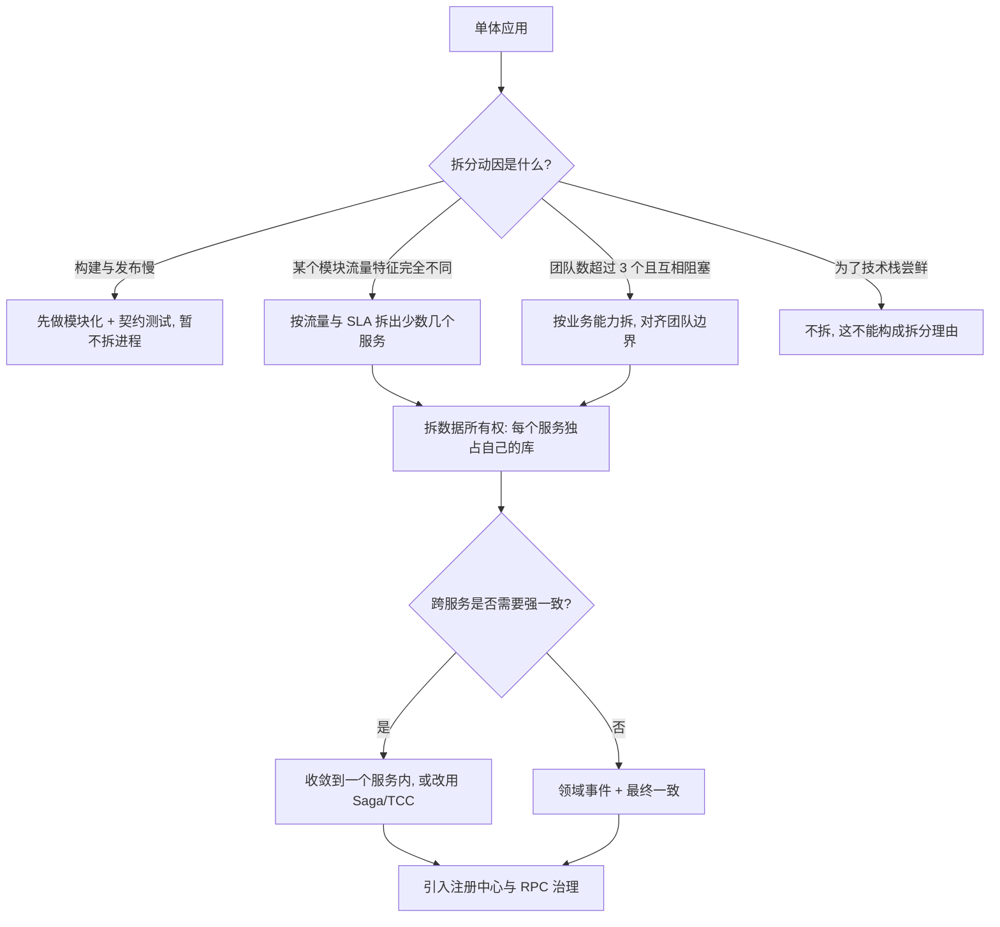

## 二、注册中心的职责与 CAP 取舍

### 2.1 注册中心到底提供什么

注册中心（Registry / Naming Service）承担四件事，四件事的 SLA 要求完全不同：

| 职责 | 说明 | 对一致性的要求 | 对可用性的要求 |
| --- | --- | --- | --- |
| 服务注册 | 实例启动后写入 `service → [instance...]` | 弱（可最终一致） | 高 |
| 服务注销 | 实例下线/宕机后移除 | 弱 | 高 |
| 健康检查 | 判断实例是否可服务 | 中 | 高 |
| 服务发现/推送 | 消费者拉取或接收变更通知 | 弱（宁可短暂看到旧列表） | **极高** |

这张表是面试的关键：**注册中心的核心矛盾不是"数据强一致"，而是"在数据不完整时也不能让调用方拿不到地址"**。所以生产上选 AP 系统居多——宁可多推几个已经挂掉的实例（调用方用重试和熔断兜住），也不能因为注册中心选主卡住导致整个集群拿不到地址。

### 2.2 CAP 取舍的准确说法

结合第一章对 CAP 的定义（C 指线性一致，P 指网络分区容忍），四类注册中心的定位：

| 系统 | 一致性协议 | CAP 定位 | 分区少数派的行为 | 数据模型 |
| --- | --- | --- | --- | --- |
| Eureka 1.x | 无共识协议，节点间异步复制（replicateToPeers） | AP | 继续接受注册与查询，返回可能陈旧的数据 | 内存 `ConcurrentHashMap` |
| ZooKeeper 3.4~3.8 | ZAB（类 Paxos） | CP | 少数派进不了 quorum：默认读写都不可用（显式开启只读模式后可读到旧值） | ZNode 树 |
| Nacos 1.x | 临时实例 Distro（AP）；持久实例 Raft（CP） | AP + CP 可切换 | Distro 分区各自服务；Raft 少数派不可写 | 内存 + Derby/MySQL |
| Nacos 2.x | 同上，客户端改 gRPC 长连接，服务端换 JRaft | AP + CP 可切换 | 同上 | 内存 + Derby/MySQL |
| Consul 1.x | hashicorp/raft | CP | 少数派不可写；`?stale` 允许旧读 | KV + 服务目录 |
| etcd 3.5 | Raft | CP | 少数派不可写，lease 续期失败 | MVCC KV |

要能讲清"ZooKeeper 做注册中心在什么情况下会全站不可用"：

1. ZK 集群 3 节点挂 2 个 → 剩下 1 个进不了 quorum，**读写全挂**：follower 与 leader 失联后会进入 LOOKING，ZK 3.8 的 `Learner.shutdown()` 会把该 peer 的 `ZooKeeperServer` 置空并 `closeAllConnections()`，所以 `getChildren` 同样报 `ConnectionLoss`。"少数派还能读"只在**显式开启只读模式**时成立（服务端 `readonlymode.enabled=true` 且客户端 `canBeReadOnly=true`），且读到的是可能陈旧的数据。所以 ZK 失去多数派时，**新提供者注册不进来、新消费者也订阅不到列表**；存量消费者靠 `RegistryDirectory` 的内存列表与本地文件缓存继续调用。很多公司用 ZK 做注册中心仍能跑，不是因为 ZK 高可用，而是因为消费者有本地缓存。
2. ZK 的 watch 是**一次性**的，触发后必须重新注册。Dubbo 的 `ZookeeperRegistry` 在收到 `None`/`NodeChildrenChanged` 事件后会重新 `getChildren` 并**重新 addWatch**，否则会永久失去推送。
3. ZK session 超时会导致临时节点被删除，进而触发该实例的全部订阅者刷新，形成**惊群**。超时值由客户端建议、服务端夹紧：`minSessionTimeout` 默认 `2 * tickTime`，`maxSessionTimeout` 默认 `20 * tickTime`（`tickTime` 在 `zoo_sample.cfg` 里常配 2000ms，而 ZK 3.8 `QuorumPeerConfig` 的字段默认值是 3000ms；按 2000ms 算即 4s ~ 40s）。

### 2.3 Eureka 的自我保护：最容易被追问的机制

Eureka Server 的 `AbstractInstanceRegistry` 维护每分钟的续约计数。当**最近一分钟实际收到的续约数 < 期望续约数 * renewalPercentThreshold**（配置项 `eureka.server.renewal-percent-threshold`，默认 `0.85`）时，触发自我保护：

- 不再剔除任何过期实例（`evict` 逻辑被跳过），即使 `lease-expiration-duration-in-seconds` 已到。
- 日志出现 `EMERGENCY! EUREKA MAY BE INCORRECTLY CLAIMING INSTANCES ARE UP WHEN THEY'RE NOT. RENEWALS ARE LESSER THAN THRESHOLD AND HENCE THE INSTANCES ARE NOT BEING EXPIRED JUST TO BE SAFE.`
- 目的：防止**注册中心自身网络抖动**导致大批实例被误判下线，把整个集群的可用列表清空。

代价：真实宕机的实例会被继续保留在列表中，调用方拿到死地址。补救手段是客户端侧的重试与熔断，而不是指望注册中心立刻清理。

时间参数（Spring Cloud Netflix 默认值）：

| 参数 | 默认值 | 作用 |
| --- | --- | --- |
| `eureka.instance.lease-renewal-interval-in-seconds` | 30s | 客户端发送心跳间隔 |
| `eureka.instance.lease-expiration-duration-in-seconds` | 90s | 服务端判定过期时间（3 次心跳） |
| `eureka.client.registry-fetch-interval-seconds` | 30s | 客户端拉取注册表间隔 |
| `eureka.server.response-cache-update-interval-ms` | 30000ms | readOnlyCacheMap 刷新周期 |
| `eureka.server.eviction-interval-timer-in-ms` | 60000ms | 服务端清理任务周期 |
| `ResponseCacheImpl` readWriteCacheMap 过期 | 180s | 缓存过期时间，默认 `DEFAULT_CACHE_EXPIRY=180` 秒 |

还有一个必答点：**Eureka 的多级缓存会放大感知延迟**。`AbstractInstanceRegistry` 的注册表 → `ResponseCacheImpl` 的 `readWriteCacheMap`（有 180s 过期）→ `readOnlyCacheMap`（默认 30s 定时刷新）。所以一个实例下线到所有消费者感知，最坏是 90s（过期判定）+ 30s（只读缓存刷新）+ 30s（客户端拉取），量级可达 2 分钟以上。Eureka 官方因此明确建议：**服务端关掉只读缓存**（`eureka.server.use-read-only-response-cache=false`）。

### 2.4 健康检查机制对比

| 机制 | 谁发起 | 判定依据 | 感知延迟 | 典型实现 |
| --- | --- | --- | --- | --- |
| 客户端心跳续约 | 提供者 → 注册中心 | 是否在 TTL 内收到心跳 | TTL（如 90s） | Eureka `lease-renewal` |
| 客户端心跳 + 主动探测 | 双向 | 心跳 + 服务端连接存活 | 心跳周期（如 15s） | Nacos 2.x gRPC 连接状态 |
| 服务端主动探测 | 注册中心 → 提供者 | TCP/HTTP/TTL/脚本结果 | 探测间隔（如 10s） | Consul `check` |
| 会话绑定 | 注册中心 ← 长连接 | session 是否存活 | session 超时 | ZooKeeper 临时节点、Consul TTL |

**关键权衡**：客户端心跳实现简单、对提供者无侵入，但**心跳只证明"进程还在"，不证明"能处理业务"**（线程池打满、依赖全挂时心跳照样正常）。生产上应把"业务就绪"暴露为独立的健康端点（Spring Boot Actuator 的 `/actuator/health`，配合 `ReadinessState`），并在 **readiness 探针失败时主动下线**，而不是依赖注册中心的心跳超时。

## 三、四种注册中心的实现对比

| 维度 | Eureka 1.x | ZooKeeper 3.8 | Nacos 2.2.x | Consul 1.16 |
| --- | --- | --- | --- | --- |
| 一致性模型 | AP（异步复制） | CP（ZAB） | AP/CP 按实例类型切换 | CP（Raft） |
| 服务发现方式 | 客户端拉 + 服务端推送（HTTP 轮询为主） | watch 推送（一次性） | 2.x gRPC 长连接推送 + UDP（1.x） | DNS / HTTP，blocking query |
| 健康检查 | 客户端心跳 | 会话（临时节点） | 心跳 + gRPC 连接 | 主动探测 / TTL / 脚本 |
| 配置中心 | 无（需另配 Spring Cloud Config） | 有（ZK 当 KV，能力弱） | 有（独立 Config 模块 + 长轮询） | 有（KV） |
| 元数据/分组/命名空间 | 较弱（仅 metadata map） | 路径即层级 | 命名空间 + 分组 + 集群 + 权重 | 标签 + KV |
| 多数据中心 | 需多套集群 | 需多套 | 内置 namespace + 集群 | 内置 WAN gossip |
| 权限与鉴权 | 弱（Basic Auth 可选） | ACL（digest/sasl） | RBAC + 命名空间隔离 | ACL Token |
| 运维复杂度 | 低 | 中高（session/GC/磁盘） | 中（依赖 MySQL 用于持久化） | 中高 |
| 典型使用方 | Spring Cloud Netflix（已停更，Eureka 2.x 开源版停止开发） | Dubbo 2.x 大量使用 | Spring Cloud Alibaba、Dubbo 3.x | K8s 生态、Service Mesh、多机房 |
| 继续演进 | 维护模式 | 维护模式（3.9 无重大更新） | 活跃 | 活跃 |

选型结论：

- **已有 ZK 且只用 Dubbo、运维能力够** → 继续用 ZK，但要接受"写不可用"和惊群风险。
- **Spring Cloud Alibaba 体系** → Nacos，一个组件同时解决注册与配置，减少组件数。
- **需要多机房、多语言、Service Mesh** → Consul 或 K8s 原生 Service + CoreDNS。
- **Eureka**：只建议维护存量系统。Eureka 2.x 开源开发已经停止，不适合新项目。

## 四、服务发现：客户端发现与服务端发现

### 4.1 两种模式的本质差异

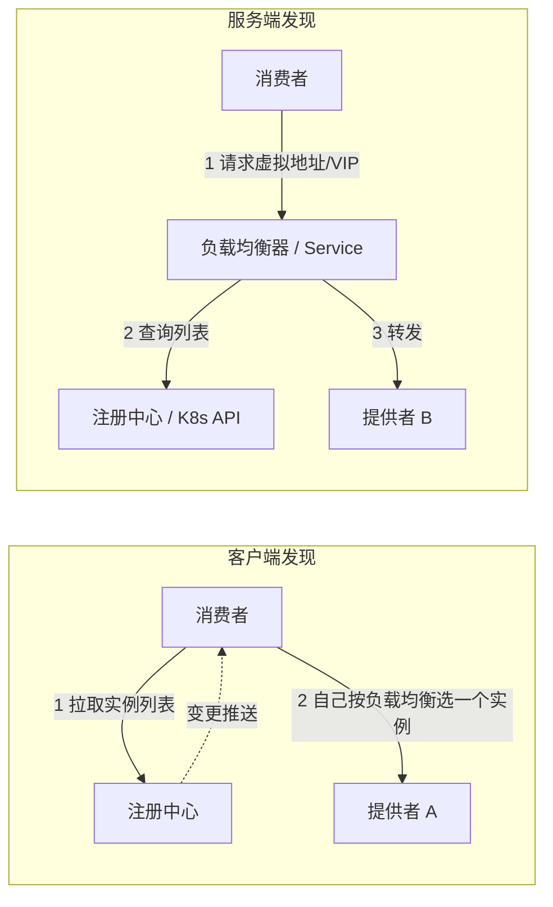

| 维度 | 客户端发现 | 服务端发现 |
| --- | --- | --- |
| 代表实现 | Dubbo、Spring Cloud LoadBalancer、gRPC `NameResolver` + `LoadBalancer` | K8s Service + kube-proxy、Nginx/HAProxy、Consul + Envoy、AWS ALB |
| 负载均衡决策点 | 进程内 | 独立组件 |
| 延迟 | 少一跳 | 多一跳，但可预测 |
| 客户端依赖 | 必须引入 SDK，语言绑定强 | 无侵入，多语言友好 |
| 服务端能力 | 简单 | 加密、鉴权、限流、灰度集中做 |
| 弹性 | 客户端可做自适应、混沌注入 | 依赖 LB 配置 |
| 扩缩容感知 | 依赖注册中心推送时效 | 依赖 Endpoint 更新时效 |

### 4.2 客户端发现的三个实现细节

**1）本地缓存是必需品，不是优化。** 注册中心完全不可用时，消费者必须能靠本地快照继续调用。Dubbo 的 `RegistryDirectory` 在收到 `notify(urls)` 后，把实例列表转换并缓存在内存中；`RegistryProtocol` 在注册中心连不上时还会读取**本地文件缓存**（默认在 `~/.dubbo/dubbo-registry-{application}-{port}.cache`，由 `AbstractRegistry.saveProperties` 落盘，写文件通过 `atomicWrite` 保证原子性）。

**2）空列表保护（空保护）是保命开关。** 如果注册中心故障返回空列表，消费者若直接把路由表置空，会导致全部调用失败。Dubbo 的 `RegistryDirectory#refreshInvoker` 区分两种情况：推来的是**普通空列表**时走空保护——用上次缓存的 `cachedInvokerUrls` 重建列表，不把路由表清空；推来的是注册中心合成的 `empty://` URL（表示该服务确实没有提供者）时才 `forbidden = true` 并 `destroyAllInvokers()` 清空列表。经典坑：注册中心被误删/网络抖动导致一次"真空推"，消费者全量报 `No provider available`。治理手段是配置注册中心的多地址与权限控制，并在推送侧做校验。

**3）列表变更要"增量合并"而不是"全量替换"。** 全量替换会让正在处理的请求的路由表瞬间失效。Dubbo 的 `RegistryDirectory` 内部用 `UrlInvokerMap`（`volatile` 字段 + `synchronized` 写）维护 `methodInvokerMap`，并在 `destroy` 旧 Invoker 前先替换引用等旧请求跑完。

### 4.3 服务端发现：K8s 时代的现实

K8s 中注册中心的角色被 `Service` + `EndpointSlice` + `CoreDNS` 取代：

- 服务名解析成 `ClusterIP`（默认 `Service` 类型），`kube-proxy` 用 iptables 或 IPVS 模式转发到 Pod。
- 就绪性由 `readinessProbe` 控制，未就绪的 Pod 不会进 EndpointSlice——这比"心跳"准确，因为探针可以打业务端点。
- 缺点：`ClusterIP` 做的是 L4 转发，**没有方法级路由、权重灰度、参数级路由**等 Dubbo 框架内的治理能力，需要 Service Mesh（Istio + Envoy）或应用层框架补齐。

面试结论：**注册中心不会消失，但形态会变**。无论哪种形态，"实例列表的最终一致性 + 客户端本地缓存 + 就绪性判定"这三件事都要有人做。

## 五、Nacos 的实例模型与心跳机制

### 5.1 数据模型

Nacos 的定位是"服务 + 配置"双中心，其命名空间模型是面试高频点：

```
namespace（租户/环境隔离，如 prod / gray）
  └── group（分组，默认 DEFAULT_GROUP）
        └── service（服务名，如 com.example.OrderService）
              └── cluster（集群，如 SHANGHAI / HANGZHOU）
                    └── instance（实例：ip:port + weight + ephemeral + metadata）
```

- 命名空间用 `namespaceId` 区分，例如 `spring.cloud.nacos.discovery.namespace=prod-ns-id`。**不同命名空间的服务互不可见**，是实现环境隔离的首选。
- 分组默认 `DEFAULT_GROUP`（常量 `com.alibaba.nacos.api.common.Constants.DEFAULT_GROUP`）。分组常用于"同环境多套"场景（如 `DEFAULT_GROUP` 与 `GRAY_GROUP`）。
- 集群用于同城多机房就近访问，配合 Dubbo 的 `cluster` 路由或 Nacos 的权重做流量分配。

### 5.2 临时实例与持久实例

这是 Nacos 最有辨识度的设计，也是"AP/CP 可切换"的落点：

| 维度 | 临时实例（ephemeral=true，默认） | 持久实例（ephemeral=false） |
| --- | --- | --- |
| 一致性协议 | Distro（AP，服务端分片 + 异步复制） | JRaft / Raft（CP，多数派日志复制） |
| 心跳方式 | Nacos 1.x：HTTP `PUT /nacos/v1/ns/instance/beat`；2.x：gRPC 连接保活 + 轻量心跳 | 服务端主动健康检查（`heartbeat`/`tcp`/`http`），不是客户端心跳 |
| 实例下线 | 心跳超时（默认 15s）后自动剔除 | 不会自动剔除，但健康状态变为不健康 |
| 注册中心宕机后 | 数据可能不一致（异步复制） | 数据强一致 |
| 是否落盘 | 内存为主（1.x 有本地磁盘 `naming/data` 缓存用于重启恢复） | 持久化到 Derby（内嵌）或 MySQL |
| 适用场景 | 无状态微服务实例（绝大多数情况） | 数据库、DNS、需要强一致的元数据 |

把这条讲清楚的价值：面试官问"你们注册中心为什么不选 CP"，正确答案是"**服务实例列表天生是 AP 语义**——实例随时上下线，短暂的不一致由调用方的重试与熔断兜住；但配置和元数据需要 CP"。

Nacos 还有一层与 Eureka 自我保护对应的机制：**服务级保护阈值** `protectThreshold`（0~1 的小数，默认 0 表示关闭）。该服务的健康实例占比低于阈值时，Nacos 会把<strong>全部实例（含不健康）</strong>推给消费者，避免剩下的极少数健康实例被流量瞬间打满；代价和 Eureka 自我保护一样——消费者会拿到一部分不可用地址，要靠客户端重试与熔断兜住。

### 5.3 心跳与健康检查参数

Nacos 1.x 客户端心跳（`com.alibaba.nacos.client.naming.beat.BeatReactor`）：

| 参数 | 默认值 | 说明 |
| --- | --- | --- |
| `beatInterval` | 5000ms | 心跳间隔，客户端定时发送 `BeatInfo` |
| 服务端心跳超时 | 15000ms（`heartbeatTimeout`） | 超过即判定不健康 |
| 不健康实例剔除/标记 | 超时后标记不健康；`nacos.naming.clean.expired-instance.interval` 清扫任务周期 5s（1.x 里 `ClientBeatCheckTask` 周期为 5s 量级） | 由 `ClientBeatCheckTask` 负责 |
| `nacos.naming.clean.initial-delay` | 10000ms | 清理任务首次延迟 |

Nacos 2.x 的架构变化（重要，容易被追问版本差异）：

- 客户端与服务端改为**单条 gRPC 长连接**（`NamingGrpcClientProxy`），端口按主端口偏移：**客户端 gRPC 端口 = 主端口 + 1000**（8848 → 9848），**服务端间 gRPC 端口 = 主端口 + 1001**（8848 → 9849）。**部署时防火墙必须放通 9848/9849**，这是 2.x 上线最常见的故障（客户端一直重连，报 `Client not connected`）。
- 临时实例的"心跳"退化为连接保活 + 客户端轻量上报（`HealthCheckRequest`），实例下线会更快感知（连接断开即触发）。
- 服务端一致性组件从自研的 `RaftCore` 换成 **JRaft（sofa-jraft）**，Nacos 2.x 的持久实例与配置走 JRaft。
- 订阅推送从 1.x 的 UDP 推送（易丢包、需 `PushReceiver` 兜底）改为 gRPC 双向流推送。

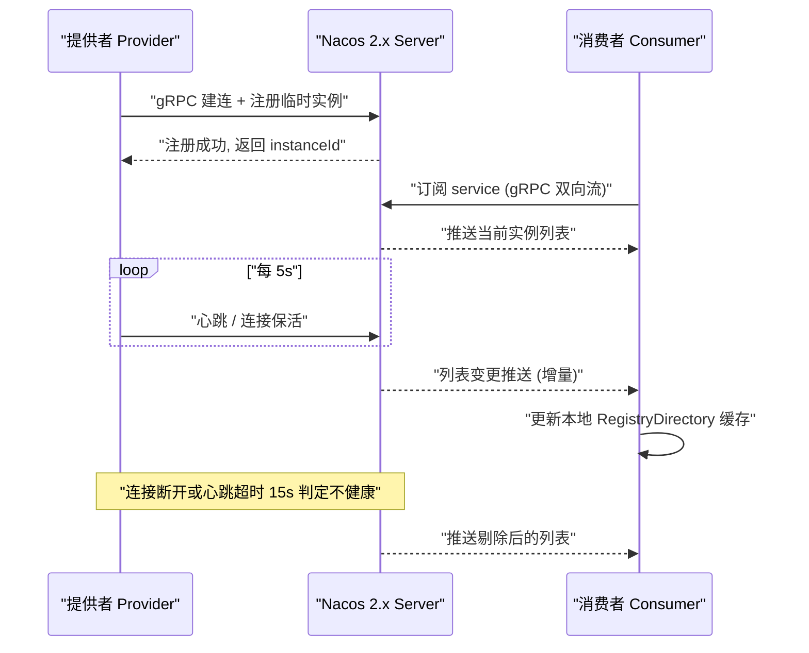

### 5.4 Nacos 的状态机视角

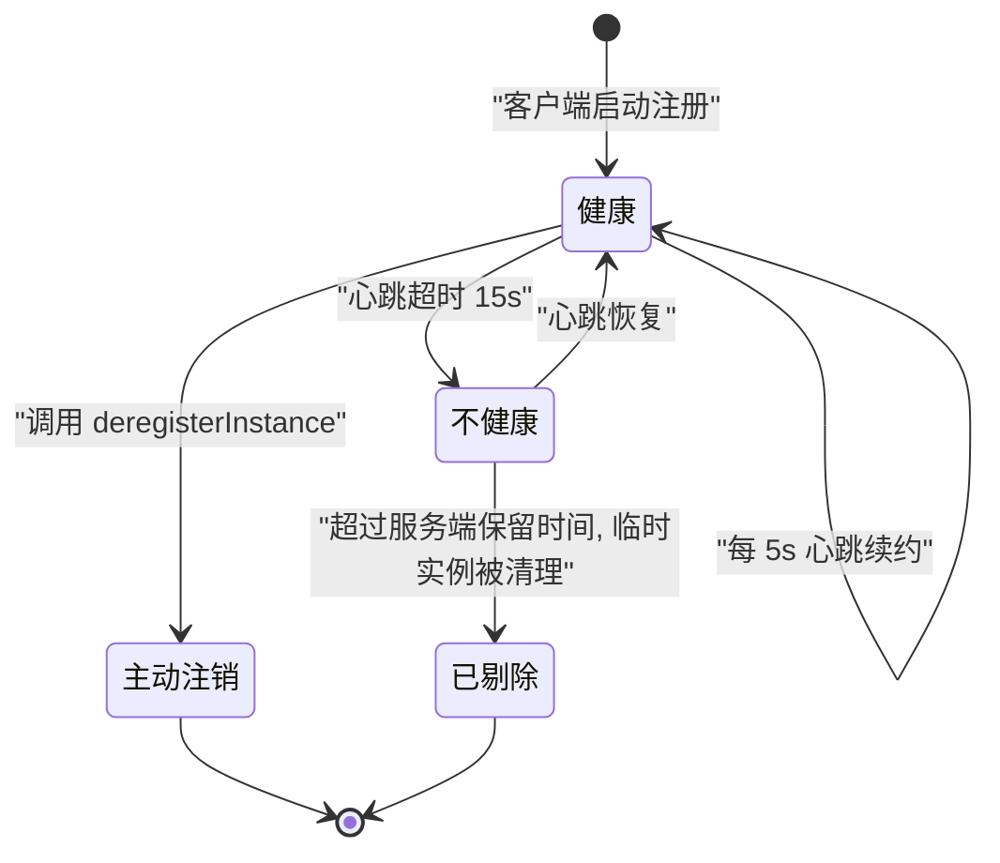

注意：**持久实例（ephemeral=false）不会进入 s3**，它只会停留在 s2（不健康）并被保留，因为持久实例由服务端主动探测且不依赖客户端心跳。

## 六、RPC 的核心组成

### 6.1 RPC 要解决的五个问题

RPC（Remote Procedure Call）的目标是**让远程调用看起来像本地调用**。拆开看，任何一个 RPC 框架都必须解决五件事：

| 问题 | 技术手段 | Dubbo 3.x 实现 | gRPC 实现 |
| --- | --- | --- | --- |
| 如何像调用本地方法 | 动态代理 | `JavassistProxyFactory`（默认）/ `JdkProxyFactory` | 生成的 Stub 类 |
| 方法名与参数怎么表达 | 接口 + 方法名 + 参数类型 + 参数值 | `RpcInvocation` 携带 `methodName`/`parameterTypes`/`arguments` | Protobuf 生成的方法签名 |
| 数据怎么变成字节 | 序列化 | Hessian2（默认）、Fastjson2、Kryo、Protobuf | Protobuf |
| 字节怎么传过去 | 网络传输 + 编解码 | 传输 Netty 4；Dubbo 协议（默认）、Triple 协议 | HTTP/2 + Protobuf frame |
| 怎么把结果还给调用方 | 请求-响应关联 | `DefaultFuture` + `requestId` ↔ `ResponseFuture` 映射 | Stream ID |

### 6.2 关键概念落点

- **动态代理**：`JavassistProxyFactory#getInvoker` 用 `Wrapper`（字节码生成的包装类）避免反射；`JdkProxyFactory` 用 `InvocationHandler` + 反射。Dubbo 默认用 `javassist`（`ProxyFactory` 的 `@SPI("javassist")`）。JDK 17+ 下若开启了强封装，Javassist 生成类可能告警，需关注 Dubbo 版本与 `--add-opens` 参数。
- **Invoker 模型**：Dubbo 的一切都是 `Invoker`。`Invoker#invoke(Invocation)` 是统一抽象；`AbstractProxyInvoker` 是服务端实现类侧，`InvokerInvocationHandler` 是客户端代理侧，`ClusterInvoker` 是集群侧（`FailoverClusterInvoker` 等），`ProtocolFilterWrapper` 在 Invoker 链上挂 Filter。
- **调用链**：`Consumer → ClusterInvoker → Directory(实例列表) → Router(路由) → LoadBalance → ProtocolFilterWrapper(Filter 链) → Client(Netty) → Server → Filter → Invoker → 业务实现`。
- **超时与 Future**：Dubbo 的 `DefaultFuture` 在发出请求时创建，key 是 `requestId`；客户端超时由 `DefaultFuture` 的 `TimeoutCheckTask`（时间轮 `HashedWheelTimer`）触发，超时后从 `FUTURES` map 移除并返回 `TimeoutException`。**服务端仍会继续执行**——这是"超时不等于取消"的根本原因，也是必须做幂等的原因。
- **`RpcContext`**：ThreadLocal 载体，客户端侧的隐式参数在 `RpcContext.getClientAttachment()` 放置，服务端侧从 `RpcContext.getServerAttachment()` 读取。

## 七、一次 RPC 调用的完整时序

以 Dubbo 3.2 + 默认 Dubbo 协议（hessian2 序列化）+ Netty 传输为例。

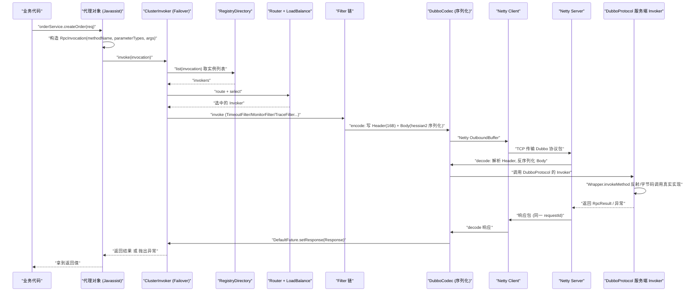

### 7.1 拆成六个阶段看细节

**阶段一：代理与 Invocation 构造。** 业务代码调用的其实是 `InvokerInvocationHandler` 生成的代理对象。它把 `方法名 + 参数类型数组 + 参数值数组` 塞进 `RpcInvocation`，同时把 `RpcContext` 的 attachments 复制进去（隐式参数就是在这里传递的）。

**阶段二：集群层。** `FailoverClusterInvoker#doInvoke` 先 `list(invocation)` 拿到全部 `Invoker`，再经 `RouterChain` 过滤（`TagRouter`、`ConditionRouter`、`ScriptRouter`、`MeshRuleRouter`），最后 `select(loadbalance, invocation, invokers, selected)` 选出一个。失败后按 `retries` 重试并排除已失败的（`invoked` 集合 + `available` 计算）。

**阶段三：Filter 链。** 客户端 Filter（`@Activate(group = CONSUMER)`，order 值决定先后）大致为：`ConsumerContextFilter → FutureFilter → ...`；注意 `TimeoutFilter`、`ExceptionFilter` 只挂在**服务端**（`@Activate(group = PROVIDER)`），前者记录服务端处理超时的日志，后者把服务端异常转成 `RpcResult`（客户端超时由 `DefaultFuture` 处理）。

**阶段四：编码。** Dubbo 协议头 16 字节：`magic(2B, 0xdabb) + flag(1B) + status(1B) + requestId(8B) + dataLength(4B)`。flag 的低 5 位是序列化 ID（hessian2 = 2，fastjson2 = 23，jdk = 3，kryo = 8，protostuff = 10 等）。**序列化 ID 不一致会导致服务端反序列化失败或报 `Unknown serialization`**，是跨版本升级的常见事故。

**阶段五：Netty 收发。** 客户端每个 `<host:port>` 默认共享一个连接（`share connections` 由 `connections` 参数控制，默认 0 表示共享连接）。服务端用 `Dispatcher`（默认 `all`）把请求派发到线程池（默认 `fixed`，`threads=200`）。

**阶段六：服务端反射调用。** `DubboProtocol` 持有的 `Invoker` 由 `Wrapper` 完成调用。`JavassistProxyFactory` 生成 `Wrapper` 子类，把方法调用变成索引查表 + 直接调用，避免 `Method.invoke` 的开销；`JdkProxyFactory` 则直接用反射。

### 7.2 一次调用的耗时构成（排查超时必用）

| 环节 | 典型耗时 | 变大时的表现 | 排查手段 |
| --- | --- | --- | --- |
| 代理 + Invocation 构造 | < 0.05ms | 几乎不会成为瓶颈 | JFR / async-profiler |
| 路由 + 负载均衡 | < 0.1ms | 脚本路由（`ScriptRouter`）复杂时可达 ms | 检查 Router 数量与规则复杂度 |
| 序列化 | 0.05~2ms（视对象大小） | 大对象、深嵌套、JDK 序列化 | 序列化耗时埋点、换 Protobuf |
| 排队等待（客户端连接） | 0~100ms | 连接数不足或 write buffer 满 | Netty `ChannelOutboundBuffer` 水位 |
| 网络传输 | 0.1~数 ms | 跨机房、丢包重传 | `ping`、`mtr`、TCP 重传率 |
| 服务端排队 | 0~超时 | 线程池队列堆积 | `dubbo` 线程池 active/queue 指标 |
| 业务执行 | 变化最大 | 慢 SQL、外部依赖 | Arthas `trace`、慢日志 |

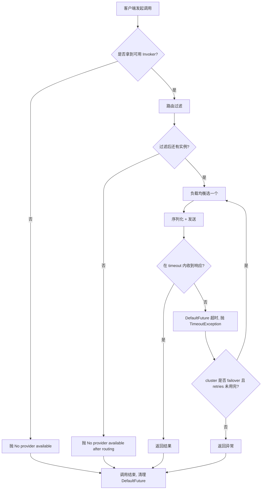

## 八、序列化协议对比与选型

### 8.1 五种常用序列化方案

| 维度 | JDK Serializable | Hessian2 | Protobuf 3 | JSON（Jackson） | Kryo |
| --- | --- | --- | --- | --- | --- |
| 是否需要 IDL / 代码生成 | 否 | 否 | 需要 `.proto` + protoc | 否 | 否 |
| 是否自描述 | 是 | 是 | 否 | 是 | 否 |
| 体积（同结构对象） | 最大，通常 2~5 倍于 Protobuf | 中，约为 JDK 的 1/3~1/2 | 最小 | 大（字段名重复） | 小，接近 Protobuf |
| 序列化速度 | 慢（反射 + 类元数据） | 快 | 极快 | 中 | 极快 |
| 跨语言 | 仅 Java | 多语言（Hessian 协议） | 多语言（主流语言全覆盖） | 所有语言 | 主要 Java |
| 可读性 | 无 | 无 | 无（需 .proto 反解） | 高，可直接看日志 | 无 |
| 前后兼容 | 靠 `serialVersionUID`，脆弱 | 一般 | 好（字段号 + optional/repeated） | 好 | 弱（类结构变化易失败） |
| 安全风险 | 极高（反序列化漏洞，需 `ObjectInputFilter`） | 中（类白名单可缓解） | 低（无任意类实例化） | 中（多态类型配置不当可被利用） | 高（默认可实例化任意类） |
| Dubbo 配置值 | `jdk`(3) | `hessian2`(2，Dubbo 默认) | `protobuf`(?) | `fastjson2`(23) 等 | `kryo`(8) |

版本与注意事项：

- `serialVersionUID` 未显式声明时由**序列化运行时**计算（`java.io.ObjectStreamClass#computeDefaultSUID`，JDK 8 与 JDK 17 行为一致，不是某个版本才有的变化），计算依据包含类名、修饰符、接口、字段与方法签名，所以字段或方法一增删就会变更，跨版本报 `InvalidClassException: local class incompatible`。对 JDK 反序列化攻击的缓解要靠 `jdk.serialFilter` 全局配置。
- **JDK 序列化在生产 RPC 中不应该使用**：体积大、性能差、有反序列化 RCE 历史。若必须用，设置 `-Djdk.serialFilter=com.example.**;!*` 做白名单：`java.io.ObjectInputFilter`、`ObjectInputFilter.Config.setSerialFilter` 与 `jdk.serialFilter` 系统属性都是 **JDK 9 引入**的（JEP 290），JDK 8 没有这套接口，只能自己重写 `ObjectInputStream#resolveClass` 做类过滤。
- Hessian2 是 Dubbo 2.x/3.x 默认。注意 Hessian 的历史漏洞（CVE-2020-... 系列的 Hessian 反序列化）与 Dubbo 的 `SerializeSecurityManager`（Dubbo 2.7.5+ 引入，配合 `dubbo.application.serialize-check-status` 与 `dubbo.application.check-serializable`）。Dubbo 3.x 里类名黑白名单通过 `SerializeSecurityManager` + `-Ddubbo.application.serialize-check-status=STRICT` 控制。
- Protobuf 没有"序列化 ID"概念，靠**字段号**保证兼容：字段号不能改、不能复用；`reserved` 关键字用于废弃字段号。这正是它能做到前后兼容的原因，也是它要求先定 IDL 的原因。
- Kryo 需要注册类（`kryo.register(...)`），未注册会写入类名（体积变大），且**默认允许实例化任意类**，安全问题需要 `kryo.setRegistrationRequired(true)`。

### 8.2 选型决策树

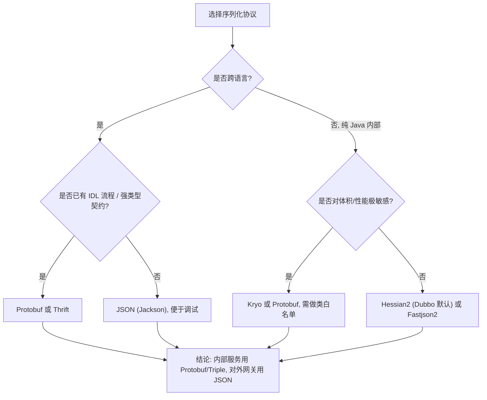

**面试结论模板**：内部高频 RPC 用 Protobuf（体积小、跨语言、兼容性好）或 Hessian2（改动成本低、Dubbo 原生支持）；对外网关/前后端接口用 JSON；JDK 序列化只用于本地缓存或 JMV 内传递等受控场景；Kryo 只在能保证类结构稳定的封闭体系里用。

## 九、HTTP 与 RPC、gRPC 与 Dubbo 的对比

### 9.1 HTTP（REST）与 RPC 框架

| 维度 | REST over HTTP/1.1 | RPC（Dubbo 协议 / Triple / gRPC） |
| --- | --- | --- |
| 编程模型 | 资源 + 动宾分离，靠 URL 与 HTTP 方法表达 | 接口 + 方法，靠近本地调用 |
| 契约 | OpenAPI/Swagger，运行时弱校验 | 接口 Jar / `.proto`，编译期强校验 |
| 传输协议 | HTTP/1.1（默认不支持多路复用） | Dubbo 私有二进制协议 / HTTP/2 |
| 序列化 | JSON 为主 | Protobuf / Hessian2 |
| 连接模型 | 短连接或 keep-alive 长连接 + 连接池 | 长连接多路复用，单连接多请求 |
| 头部开销 | 大（文本 header，几百字节起） | 小（16 字节 Dubbo 头 + 少量 attachment） |
| 服务治理 | 靠网关、Sidecar、SDK 各自实现 | 框架内建：负载均衡、容错、路由、熔断 |
| 浏览器/多语言友好 | 极好 | Dubbo 协议需 SDK；Triple/gRPC 需 HTTP/2 支持 |
| 调试成本 | 低（curl 即可） | 中（需要泛化调用、telnet、triple 反射） |
| 性能（同机压测，小对象） | 通常 1x 基准 | Dubbo/Protobuf 常见 2~5 倍吞吐优势 |

结论：**内部服务间高频调用用 RPC，对外/前端用 HTTP**。不要把"HTTP 一定慢"当作教条——HTTP/2 + gRPC 的性能与 Dubbo 同量级；差距主要来自 HTTP/1.1 的文本协议与队头阻塞。

### 9.2 gRPC 与 Dubbo

| 维度 | gRPC (1.5x) | Dubbo 3.2 |
| --- | --- | --- |
| 传输协议 | HTTP/2（强制） | Dubbo 私有协议（默认）/ Triple（HTTP/2，兼容 gRPC） |
| 序列化 | Protobuf（默认，可扩展 codec） | Hessian2 默认，可选 Protobuf/Kryo/Fastjson2 |
| IDL | 必须 `.proto` | 可选（Java 接口即可） |
| 服务发现 | 需外部实现（`NameResolver`+ 自定义，或 xDS） | 内建注册中心（Nacos/ZK/Consul） |
| 负载均衡 | 客户端（`round_robin`/`pick_first` 等）或代理 | 客户端，5+ 种策略 |
| 流式调用 | 完整：Unary、Server Streaming、Client Streaming、Bidi | Triple 支持；Dubbo 协议仅请求-响应 |
| 服务治理（熔断/限流/灰度/鉴权） | 需要生态组件（xDS、Envoy、拦截器） | 内建 Filter / Router / Sentinel 适配 |
| 多语言 | 官方支持十余种语言 | Java 为主，Triple 后可跨语言 |
| 默认最大消息体 | 4MB（`MaxRecvMsgSize` / `MaxSendMsgSize` 默认 `4 * 1024 * 1024` 字节） | 由 payload 与 `dubbo.protocol.payload`（默认 8MB，Dubbo 2.7+ 增加 payload 校验）控制 |
| 生态定位 | Cloud Native / Service Mesh / K8s 原生 | 国内微服务事实标准，治理能力完整 |

**默认最大消息体是你必须记住的数字**：gRPC 默认 4MB，超过报 `RESOURCE_EXHAUSTED: grpc: received message larger than max`，需要调 `maxInboundMessageSize`。Dubbo 的 `payload` 默认 8388608 字节（8MB），Dubbo 3.x 会在编解码时校验，超限报错。踩坑场景是"把大对象（如批量导出结果、大列表）塞进 RPC 返回"，正确做法是改成分页或走对象存储。

## 十、Dubbo 架构分层与 SPI 自适应扩展

### 10.1 Dubbo 3.x 分层

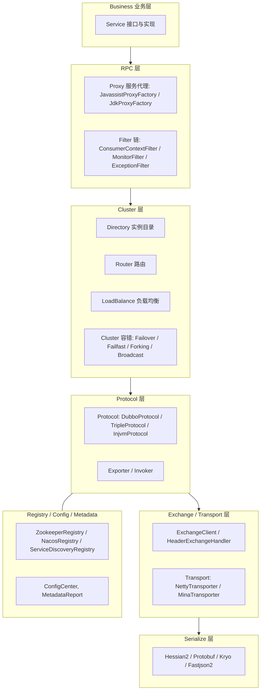

各层的职责边界要能一句话说清：

| 层 | 职责 | 不能做的事 |
| --- | --- | --- |
| Business | 业务逻辑 | 不应感知 RPC 细节 |
| RPC（Proxy/Filter） | 代理、拦截、上下文传递 | 不做路由决策 |
| Cluster | 把一组 Invoker 当成一个用：路由、负载均衡、容错 | 不做协议编解码 |
| Protocol | 服务的暴露（export）与引用（refer），Invoker 的创建 | 不关心网络细节 |
| Exchange | 请求-响应语义、Future 管理、心跳 | 不关心序列化格式 |
| Transport | 纯字节收发（Netty） | 不理解业务语义 |
| Serialize | 对象 ↔ 字节 | 不做 IO |

**为什么这样分层**：Dubbo 用 `URL` 作为贯穿全层的配置载体（`dubbo://192.168.1.1:20880/com.example.Foo?timeout=1000&serialization=hessian2`）。每一层从 URL 里读自己的参数，新增参数不需要改接口签名，这让扩展点可以用字符串配置驱动——代价是 URL 会变得很长，且参数传递缺乏编译期校验（Dubbo 3.x 引入 `ScopeModel`/`Configurator` 与 `ApplicationModel` 来缓解全局 URL 的耦合）。

### 10.2 SPI 与自适应扩展

JDK 的 SPI（`ServiceLoader`）有三个致命问题：**一次性加载全部实现**（无法按需）、**没有自动注入/包装**、**扩展名是类全限定名**（无法用短名字配置）。Dubbo 自己实现了一套：

| 机制 | 注解 / 位置 | 作用 |
| --- | --- | --- |
| 扩展点声明 | `@SPI("dubbo")` 标在接口上 | 声明此接口是扩展点，括号内是默认实现名 |
| 实现声明 | `@Adaptive({"protocol"})` 标在方法上 | 生成自适应类，按 URL 参数动态选择实现 |
| 实现注册 | 文件 `META-INF/dubbo/internal/{接口全限定名}`、`META-INF/dubbo/`、`META-INF/services/` | 内容为 `名字=实现类全限定名` |
| 自动激活 | `@Activate(group = {CONSUMER, PROVIDER}, order = -10000)` | 用于 Filter、Configurator 等批量链式扩展 |

`@Adaptive` 的三种用法：

1. **方法级 `@Adaptive`**：`ExtensionLoader` 用 Javassist 动态生成 `Protocol$Adaptive` 类，运行时从 `URL#getProtocol()` 取名字（若注解指定了 `value = {"protocol"}` 则取该 key 对应的值），再 `getExtension(name)` 拿到实现。这就是 `Protocol` 接口上 `export`/`refer` 标注 `@Adaptive` 后，`dubbo://` 走 `DubboProtocol`、`tri://` 走 `TripleProtocol` 的原因。
2. **类级 `@Adaptive`**：直接指定某个类为该接口的自适应类，不再动态生成。例如 `AdaptiveExtensionFactory`、`AdaptiveCompiler`。
3. **未找到实现时的降级**：生成的代码在取不到扩展名时使用 `@SPI` 的默认值，仍取不到则抛 `IllegalStateException`。

经典的面试题："Dubbo 的 SPI 比 JDK SPI 强在哪"——答三点：**按需加载（`ExtensionLoader#getExtension` 才实例化）**、**IOC（`injectExtension` 自动注入 setter 依赖）**、**AOP（`Wrapper` 包装类自动叠加，如 ProtocolFilterWrapper、ProtocolListenerWrapper 都是 Protocol 的 Wrapper）**，再加一条**自适应扩展由配置驱动**。

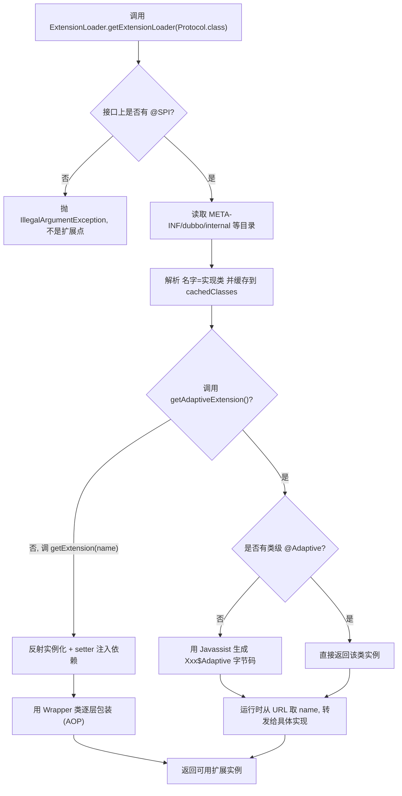

### 10.3 常用扩展点清单

| 扩展点 | 关键实现 | 默认 |
| --- | --- | --- |
| `Protocol` | `dubbo`(DubboProtocol)、`tri`(TripleProtocol)、`injvm`、`rest`、`grpc` | `dubbo` |
| `ProxyFactory` | `javassist`、`jdk` | `javassist` |
| `Cluster` | `failover`、`failfast`、`failsafe`、`failback`、`forking`、`broadcast`、`available`、`mergeable` | `failover` |
| `LoadBalance` | `random`、`roundrobin`、`leastactive`、`consistenthash`、`shortestresponse` | `random` |
| `Serialization` | `hessian2`、`fastjson2`、`kryo`、`protostuff`、`jdk`、`protobuf` | `hessian2` |
| `Transporter` | `netty`（Netty 4）、`netty3`、`mina` | `netty` |
| `Dispatcher` | `all`、`direct`、`message`、`execution`、`connection` | `all` |
| `ThreadPool` | `fixed`、`cached`、`limited`、`eager` | `fixed`（`threads=200`） |
| `Router` | `tag`、`condition`、`script`、`mesh`、`file` | 无（按需激活） |
| `Filter` | `ConsumerContextFilter`、`MonitorFilter`、`TraceFilter`、`Sentinel` 适配 | `@Activate` 自动生效 |

## 十一、Dubbo 负载均衡策略

### 11.1 五种策略的实现与适用场景

| 策略 | 配置值 | 核心算法 | 优点 | 缺点 | 适用场景 |
| --- | --- | --- | --- | --- | --- |
| 随机 | `random`（默认） | 按权重区间概率选择（`ThreadLocalRandom` + `getWeight`） | 简单、无状态、实例多时分布均匀 | 实例少时可能短时偏斜 | 通用默认，实例数 >= 5 |
| 轮询 | `roundrobin` | 加权轮询（Dubbo 2.6.5+ 改为平滑加权轮询，用 `ConcurrentMap<Method, ...>` 记录各实例的 `weight` 与 `current`） | 严格均匀 | 慢实例会被持续打到 | 实例性能一致的场景 |
| 最小活跃数 | `leastactive` | 统计各实例的 `active`（`RpcStatus` 记录，调用前后 +-1），活跃数相同则按权重随机 | 自动避开慢实例 | 需要维护计数，抖动时可能雪崩式转移 | 调用耗时差异大的场景 |
| 一致性哈希 | `consistenthash` | 对参数做 `hash`（默认对第一个参数），映射到 160 个虚拟节点环（`replicaNumber` 默认 160） | 相同参数总落到同一实例，利于本地缓存 | 实例变更时仍会少量迁移；热点参数会压单机 | 有本地缓存/有状态计算 |
| 最短响应 | `shortestresponse` | 按滑动窗口统计的成功请求平均 RT 选择最短者（`ShortestResponseLoadBalance`） | 对慢实例反应最快 | 强抖动下容易集中到单一实例 | 实例性能差异明显且需快速规避 |

配置方式（Dubbo 3.x，注解优先）：

```java
// 服务级别指定负载均衡（Dubbo 2.7.7+ 注解风格）
@DubboReference(
        interfaceClass = OrderService.class,
        loadbalance = "leastactive",
        cluster = "failover",
        retries = 2,
        timeout = 1000
)
private OrderService orderService;

// 方法级覆盖（XML 中 <dubbo:method name="query" loadbalance="consistenthash"/>）
// 注解方式通过 parameters 配置：
@DubboReference(
        interfaceClass = OrderService.class,
        parameters = {"query.loadbalance", "consistenthash"}
)
private OrderService orderService;
```

优先级：**方法级 > 接口级 > 全局默认**。Dubbo 的 `URL` 参数 key 是 `loadbalance`。

### 11.2 一致性哈希的实现细节（高频追问）

`ConsistentHashLoadBalance` 的逻辑：

1. 用 `serviceKey + methodName` 作为 `ConcurrentMap<String, ConsistentHashSelector>` 的 key，缓存选择器。
2. `ConsistentHashSelector` 构造时把每个 Invoker 的 `address`（如 `192.168.1.1:20880`）做 `md5` 哈希，**每个实例放 160 个虚拟节点**（`replicaNumber` 默认 `160`），形成 `TreeMap<Long, Invoker>` 环。
3. 调用时对参数做哈希：`selectors = arguments`，默认只对第一个参数哈希（`hash(arguments, ...)`），可用 `hash.arguments` 指定参数下标、`hash.nodes` 指定虚拟节点数。
4. `TreeMap.tailMap(hash)` 取顺时针第一个节点，为空则取 `firstKey`。

生产坑：**参数只有一个时哈希效果最好**。如果第一个参数是枚举、随机数或 userId，热度会集中；如果第一个参数是 null，`toKey` 拼进哈希 key 的是字符串 `"null"`，所有首参为 null 的请求都会落到同一个实例（不会自动改用后面的参数）。更好的做法是显式配置 `hash.arguments=0` 并保证参数分布均匀。

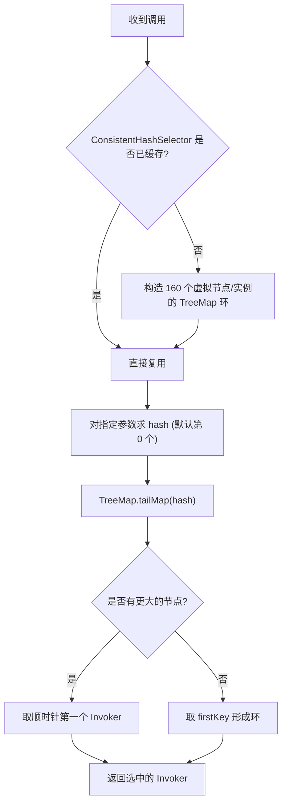

## 十二、Dubbo 集群容错策略

| 策略 | 配置值 | 行为 | 幂等要求 | 风险 |
| --- | --- | --- | --- | --- |
| 失败重试 | `failover`（默认） | 失败后换一个实例重试，`retries` 默认 2（即最多 3 次调用） | **必须幂等** | 重试放大流量，可能引发雪崩 |
| 快速失败 | `failfast` | 只调用一次，失败立即抛异常 | 不要求 | 对瞬时抖动没有容忍 |
| 安全失败 | `failsafe` | 失败返回空结果，不抛异常（只记日志） | 不适用 | 静默失败，问题被掩盖，仅用于写审计日志等非关键链路 |
| 失败自动恢复 | `failback` | 失败后记录到失败列表，由定时线程（默认 5s 一次）重试 | 必须幂等 | 后台重试不可控，可能长期堆积 |
| 并行调用 | `forking` | 并行调用 `forks` 个实例（默认 `forks=2`），一个成功即返回 | 必须幂等 | 资源消耗成倍，需配合 `forks` 与超时 |
| 广播调用 | `broadcast` | 逐个调用所有实例，任一失败即整体失败 | 必须幂等 | 慢实例拖累整体，用于"通知所有节点刷新缓存" |
| 可用即调用 | `available` | 遍历列表，找到第一个可用的就调用 | 不适用 | 实际很少用 |
| 合并结果 | `mergeable` | 分组调用后合并结果（配合 `group` 使用） | 视业务 | 合并逻辑需自定义 `Merger` |

### 12.1 FailoverClusterInvoker 的执行流程

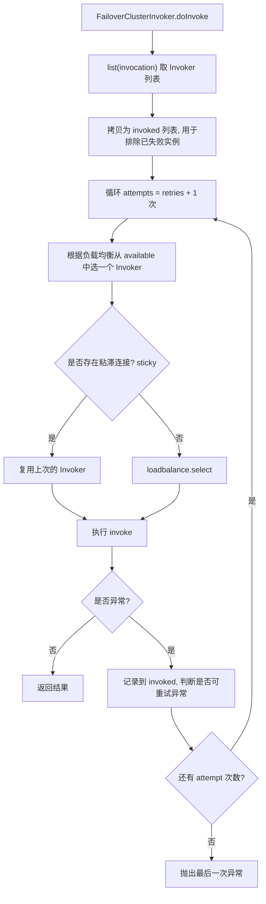

两个必须说清的细节：

1. **只有特定异常才重试**。Dubbo 的 `FailoverClusterInvoker` 会区分 `RpcException` 的 `isBiz()`：**业务异常不重试**（`isBiz() == true` 直接抛出），只有网络/超时类异常才进入重试。这是为了避免"业务失败被重复执行"。
2. **`retries` 的语义是"重试次数"不是"总次数"**。默认 `retries=2` 意味着**最多 3 次调用**。写接口的超时时间要算上这个倍数：单次 1000ms 的接口，最坏情况客户端要等 3s 以上（每次调用各自超时）。这是"客户端超时配置 > 服务端超时配置"这一原则的来源。

### 12.2 重试风暴与参数建议

| 参数 | 默认 | 建议 | 理由 |
| --- | --- | --- | --- |
| `retries` | 2 | 读接口 2，写接口 **0**（failfast） | 写接口重试必须配合幂等键 |
| `timeout` | 1000ms（`DEFAULT_TIMEOUT`） | 按 P99 设置，客户端 timeout > 服务端 timeout | 否则客户端先超时，服务端还在跑 |
| `cluster` | failover | 查询用 failover，写用 failfast | 语义匹配 |
| `actives` | 0（不限制） | 关键接口设置如 100 | 限制每个服务的并发调用数，防自伤 |

## 十三、泛化调用与隐式参数

### 13.1 泛化调用

泛化调用用于**调用方没有服务提供方的接口 Jar** 的场景（网关、测试平台、多语言网关、服务治理平台）。有两种泛化模式：

| 模式 | 配置 | 特点 |
| --- | --- | --- |
| 泛化引用 GenericReference | `generic="true"` | 客户端用 Map/Pojo 传参，服务端正常反序列化到具体类 |
| 泛化实现 GenericService | 服务端实现 `GenericService` | 服务端用 `$invoke` 收参数，自己处理，接口方法名带 `$invoke` |

客户端用法（Dubbo 3.x）：

```java
// 通过 API 方式引用泛化服务
ReferenceConfig<GenericService> reference = new ReferenceConfig<>();
reference.setApplication(new ApplicationConfig("generic-consumer"));
reference.setRegistry(new RegistryConfig("nacos://127.0.0.1:8848"));
reference.setInterface("com.example.OrderService");
reference.setGeneric("true");
GenericService genericService = reference.get();

// 三个参数分别是: 方法名, 参数类型数组(全限定名), 参数值数组
Object result = genericService.$invoke(
        "createOrder",
        new String[]{"java.lang.String", "com.example.dto.OrderDTO"},
        new Object[]{"order-001", orderDtoMap}
);
```

要点：

- 泛化调用**失去编译期校验**，参数类型与方法名要严格匹配，否则报 `NoSuchMethodException` 或参数类型转换异常。
- `GenericService` 接口定义在 `org.apache.dubbo.rpc.service.GenericService`，方法签名为 `Object $invoke(String method, String[] parameterTypes, Object[] args) throws GenericException`。
- 泛化的另一面是**反序列化安全风险**：Dubbo 会按传入的类名反序列化，必须开 `serialize-check-status=STRICT` 并配置类白名单，否则等于把反序列化入口暴露给调用方。
- 服务端若同时要支持泛化实现，可以实现 `GenericService` 或让实现类 implements `GenericService`，Dubbo 会走 `GenericImplFilter` 处理。

### 13.2 隐式参数与 attachment

`RpcContext` 是 Dubbo 的 ThreadLocal 上下文，附着在每次调用的 attachment（键值对）上，随请求传到服务端。**Dubbo 3.x 把它拆成了 client / server 两个端**（`RpcContext.getClientAttachment()` / `RpcContext.getServerAttachment()`，2.7.8 引入 `getClientContext`、`getServerContext` 区分）。

```java
// 客户端设置（会随请求传到服务端）
RpcContext.getClientAttachment().setAttachment("tenantId", "t-001");
RpcContext.getClientAttachment().setAttachment("gray", "v2");
orderService.createOrder(req);

// 服务端读取
String tenantId = RpcContext.getServerAttachment().getAttachment("tenantId");
```

关键坑：

1. **attachment 是 ThreadLocal**，异步（CompletableFuture、线程池）会丢。要手工透传或使用 `RpcContext.getContext().setAttachments(...)` 在新线程里重建。
2. **`setAttachment` 是"每次调用有效"**——一次调用后 Dubbo 会调用 `RpcContext.removeContext()` 清理（`ContextFilter` 在调用结束后清理）。如果误用成"全局配置"，会出现"第一次生效、后面丢失"。
3. **attachment 会被序列化传输**，不要塞大对象。
4. 内建保留 key（如 `path`、`interface`、`version`、`group`、`timeout`、`token`）不要覆盖，否则会破坏框架行为。

## 十四、服务治理：超时、重试与幂等

### 14.1 超时的分层设计

超时必须**分层设置且逐层收敛**，否则出现"客户端已经超时，服务端还在算"的资源浪费：

| 层 | 设置位置 | 建议值 | 说明 |
| --- | --- | --- | --- |
| 网关 | Nginx/Spring Cloud Gateway 全局超时 | 3~10s | 最外层，保证用户不会无限等 |
| RPC 客户端 | `dubbo.consumer.timeout` | 接口 P99 的 1.5 倍 | 必须大于服务端处理时间 |
| RPC 服务端 | `dubbo.provider.timeout` | 接口 P99 | Dubbo 服务端超时后仍会执行完（不强制中断） |
| DB | SocketTimeout、`mybatis` `defaultStatementTimeout` | 1~3s | 防止慢 SQL 拖垮线程池 |
| 外部 HTTP | HttpClient `connectTimeout`/`socketTimeout` | 连接 200ms、读 1s | 连接超时与读取超时都要设 |
| 线程池任务 | `Future.get(timeout)` | 短于 RPC 超时 | 让内部先失败，暴露真实原因 |

**服务端超时不会中断业务线程**，这是 Dubbo 的明确行为（`TimeoutFilter` 只打日志）。所以"客户端超时 + 服务端继续执行"的窗口是客观存在的，它直接推出两个结论：**写操作必须幂等**、**慢接口必须做异步化和结果缓存**。

### 14.2 幂等的实现手段

| 手段 | 原理 | 适用 | 缺点 |
| --- | --- | --- | --- |
| 唯一索引 | DB 层 `UNIQUE KEY` 兜底 | 插入类操作 | 需要业务上有唯一业务键 |
| 幂等表 / 去重表 | 用 `requestId` 做唯一键，插入成功才执行 | 通用 | 多一次写入，需清理历史数据 |
| 状态机 | 只允许 `待支付 → 已支付` 的合法迁移 | 状态流转类 | 需要严格状态定义 |
| 乐观锁版本号 | `UPDATE ... SET v = v + 1 WHERE id = ? AND v = ?` | 更新类 | 冲突时需重试 |
| Redis SETNX | `SET key value NX EX 60` | 高频短周期去重 | 需考虑 Redis 可用性，不能作为唯一依据 |
| Token 机制 | 先申请 token，提交时校验并删除 | 前端重复提交 | 需要额外的发 token 接口 |

推荐的组合：**业务唯一键（DB 唯一索引）+ 幂等表（Redis 或 DB）**，Redis 做前置快速拦截，DB 做最终一致性兜底。**只用 Redis 做幂等是不安全的**，因为 Redis 的 key 可能过期或被清空。

### 14.3 熔断与限流

对比三种主流组件：

| 维度 | Hystrix 1.5.18 | Sentinel 1.8.x | Resilience4j 2.x |
| --- | --- | --- | --- |
| 状态 | Netflix 已停止开发，维护模式 | 活跃（阿里） | 活跃 |
| 隔离方式 | 线程池隔离（默认）+ 信号量隔离 | 信号量（并发线程数）为主 | 信号量为主 |
| 熔断统计 | 滑动窗口（默认 10s，`metrics.rollingStats.timeInMilliseconds=10000`，桶数 10） | `DegradeRule`：RT 或异常比例/异常数 | 滑动窗口（`slidingWindowType`） |
| 限流 | 不支持（需配合其他组件） | `FlowRule`：QPS/线程数、直接/关联/链路、快速失败/Warm Up/排队等待 | `RateLimiter`（Token Bucket） |
| 控制台 | Hystrix Dashboard | Sentinel Dashboard | 无 |
| 编程模型 | `@HystrixCommand` | `@SentinelResource` | `@CircuitBreaker`、`@RateLimiter` |

Sentinel 关键默认与公式：

- `DegradeRule` 熔断：`count` 为阈值，`timeWindow` 为熔断时长（秒，必填），`grade` 支持 `RT`(`DEGRADE_GRADE_RT`)、`EXCEPTION_RATIO`、`EXCEPTION_COUNT`。异常比例阈值取值 `[0.0, 1.0]`。
- `FlowRule` 限流：`grade` 支持 `FLOW_GRADE_QPS=1` 与 `FLOW_GRADE_THREAD=0`（注意 0 是线程数），`controlBehavior` 支持 `CONTROL_BEHAVIOR_DEFAULT`(快速失败)、`WARM_UP`、`RATE_LIMITER`(匀速排队)、`WARM_UP_RATE_LIMITER`。
- Sentinel 的 `Resource` 名默认取 Dubbo 接口全限定名或 `interface:method`（Dubbo 适配的 `SentinelDubboConsumerFilter`、`SentinelDubboProviderFilter`）。

## 十五、线程池隔离、优雅上下线、灰度与路由

### 15.1 线程池隔离

| 隔离方式 | 原理 | 开销 | 隔离强度 | 适用 |
| --- | --- | --- | --- | --- |
| 线程池隔离 | 每个依赖一个独立线程池 | 大（线程数×栈内存，默认 1MB/线程，还有上下文切换） | 强（一个依赖打满不影响其他） | 强依赖外部服务、需要严格隔离 |
| 信号量隔离 | 只限制并发数，用调用方线程执行 | 小 | 中 | 内部 RPC 调用、低延迟要求 |
| 无隔离 | 共享容器线程池 | 无 | 无 | 不推荐用于外部依赖 |

**Dubbo 服务端的线程池本身就是共享的**（默认 `fixed`，`threads=200`，队列 `SynchronousQueue`，即 `ThreadPoolExecutor(200, 200, 0, TimeUnit.MILLISECONDS, new SynchronousQueue<>())`）。这意味着：

- 200 个线程被慢接口占满后，**其他所有接口也一起不可用**——这是 Dubbo 服务雪崩的经典路径。
- 应对：把慢接口拆到独立线程池（`dubbo.protocol.threadpool=cached` 或多 Protocol 多端口），或用 Sentinel 的线程数限流在入口拦截。
- 排查命令：`jstack <pid> | grep -A 30 "DubboServerHandler"` 看线程栈；Dubbo 在 `dubbo` 线程名中带端口，如 `DubboServerHandler-192.168.1.1:20880-thread-1`。

**Dubbo 线程池打满的典型日志**：

```
WARN ... [DubboServerHandler-...-thread-199] ... 
java.util.concurrent.RejectedExecutionException: 
  Task ... rejected from java.util.concurrent.ThreadPoolExecutor
  [Running, pool size = 200, active threads = 200, queued tasks = 0, completed tasks = ...]
```

因为默认队列是 `SynchronousQueue`（不排队，直接交给空闲线程或拒绝），所以打满的表现是 `RejectedExecutionException`，而不是"请求排队变慢"。这与 Spring MVC 的 `ThreadPoolTaskExecutor`（有队列）表现不同，面试时能区分这一点是加分项。

### 15.2 优雅上下线

**上线（滚动发布）问题**：新实例刚启动，Dubbo 的 Netty 端口已监听并注册到注册中心，但 **Spring 容器可能还没初始化完**（或 JVM 还在 JIT 预热），消费者立刻打流量会导致大量失败。

对策：

1. **延迟注册**：Dubbo 提供 `dubbo.provider.delay`（XML 中 `<dubbo:provider delay="-1"/>`，默认无延迟；`delay=-1` 表示等 Spring 初始化完再暴露）。Spring Boot 场景下用 `ApplicationContext` 的 `ContextRefreshedEvent` 之后暴露更稳。
2. **预热（warmup）**：Dubbo 的 `warmup` 参数（默认 `600000` ms = 10 分钟），配合 `Weight` 计算，新实例的权重在预热期内从 1 线性升到配置权重。公式在 `AbstractLoadBalance#getWeight`：`weight * (uptime / warmup)`，`uptime < warmup` 时生效。
3. **JIT 预热与健康检查就绪**：readiness 探针要打**业务端点**，确认依赖（DB、Redis、下游 RPC）都通再放流量。
4. **消费者侧的启动检查**：`check` 默认 `true`，消费者启动时会检查注册中心里有没有可用提供者，没有就抛 `IllegalStateException`（`Failed to check the status of the service ... No provider available ...`）导致应用起不来。发布顺序不可控（消费者先于提供者启动、或提供者同批发布）时应把它设为 `false`（`dubbo.consumer.check=false` 或 `@DubboReference(check = false)`），靠启动后的重试与健康检查恢复。

**下线问题**：直接 `kill -9` 或先停进程都会导致"注册中心还没通知、消费者还在打"的窗口期。

对策（按顺序）：

1. 先从注册中心**注销**（`deregisterInstance` / Dubbo 的 `unexport`），停止接收新流量。
2. 等待一个"消费者感知周期"（Eureka 场景建议 >= 90s；Nacos 2.x gRPC 推送通常秒级，但也要留几秒）。
3. 再**拒绝新请求**（`ShutdownHook` 中先关闭端口或设置开关），继续处理在途请求。
4. 等待在途请求完成（`awaitTermination`，配合 Dubbo 的 `shutdown.timeout`/`DEFAULT_SHUTDOWN_TIMEOUT`，Dubbo 2.7+ 默认等待 10s，超时强制关闭），最后销毁线程池与连接。

上面这几步不用自己写：Dubbo 的 QOS（默认端口 22222，前提是 `qos-enable` 没被关掉）提供了现成命令——`offline` 只做"从注册中心摘除"（`BaseOffline#doUnexport` 只调 `registry.unregister`，不拒绝新请求、也不返回 `RpcException`），处置完用 `online` 恢复，`ls` 查看该实例已注册的服务与 URL。常见做法是发布脚本里先 `offline`、等一个感知周期再发 SIGTERM。

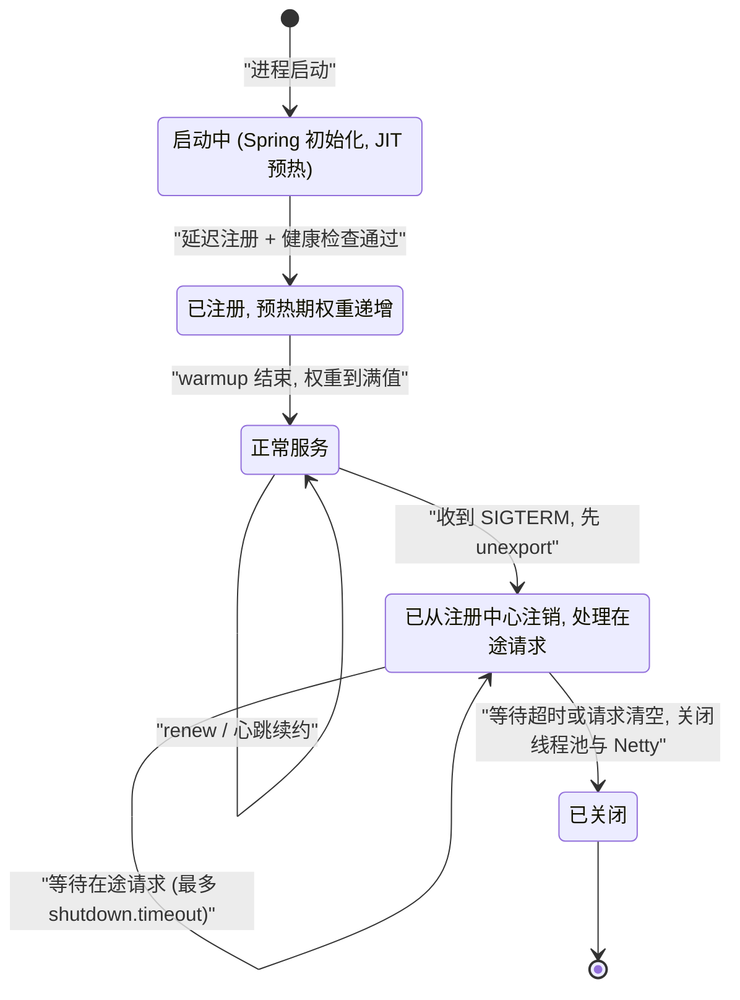

K8s 下的对应配置：`preStop` 里 `sleep 15` 让 Endpoint 先摘除，配合 `terminationGracePeriodSeconds`（默认 30s）大于应用内等待时间。

### 15.3 灰度与路由

Dubbo 的 `Router` 扩展点（`org.apache.dubbo.rpc.cluster.Router`）：

| Router | 实现类 | 匹配依据 | 典型用法 |
| --- | --- | --- | --- |
| 标签路由 | `TagRouter` | 请求 attachment 里的 `dubbo.tag` | 全链路灰度：入口打标 → 逐跳透传 tag → 只路由到带该 tag 的实例 |
| 条件路由 | `ConditionRouter` | 规则表达式 `host = 10.0.0.1 => host = 10.0.0.2` 形式 | 机房就近、黑名单、特定机器下线 |
| 脚本路由 | `ScriptRouter` | 脚本语言（js/groovy）返回实例列表 | 复杂自定义逻辑，**性能差，慎用** |
| 文件路由 | `FileRouterFactory` | 从文件加载条件路由规则 | 运维临时生效 |

**全链路灰度的落地要点**（这是高频场景题）：

1. **打标**：入口（网关）按规则（用户 ID 尾号、header、AB 实验）在 `RpcContext.getClientAttachment()` 里写 `dubbo.tag=gray`。
2. **透传**：每个中间服务必须把 tag 继续往下传，否则链路断裂。Dubbo 的 `ConsumerContextFilter` 会把 `RpcContext` 的 attachment 带到下游；跨 Dubbo 版本或跨框架（HTTP → Dubbo）需要手工透传。
3. **路由**：每个服务都注册 `TagRouter` 规则，`gray` tag 的请求只匹配 `dubbo.tag=gray` 的实例；若无匹配实例，Dubbo 的行为由 `TagRouter` 的 `force` 决定——**`force=true` 直接报错，`force=false` 降级到普通实例**。生产上核心服务用 `force=true` 防止灰度流量漏到正式实例。
4. **数据面隔离**：只做路由不做数据隔离会产生脏数据。灰度实例必须连灰度库/灰度表，或用 `tenantId` 做逻辑隔离。
5. **验证与回滚**：灰度期间监控关键指标（错误率、RT、业务指标），异常时一键删除 tag 路由规则回滚。

## 十六、链路追踪与 OpenTelemetry

### 16.1 核心概念

| 概念 | 含义 | 落地字段 |
| --- | --- | --- |
| Trace | 一次完整请求的链路，由 TraceId 标识 | `trace_id`（16 字节，32 位十六进制） |
| Span | 链路中的一个工作单元，有开始/结束时间、属性、事件、状态 | `span_id`（8 字节，16 位十六进制）、`parent_span_id` |
| SpanContext | 跨进程传播所需的最小信息 | `trace_id` + `span_id` + `trace_flags` + `trace_state` |
| Propagation | 把 SpanContext 塞进 RPC/HTTP 头部 | W3C Trace Context：`traceparent: 00-{trace-id}-{parent-id}-{flags}`；`tracestate` |
| Baggage | 跨服务传递的业务键值（不属于 trace 本身） | `baggage: key=value,...` |
| Resource | 进程级属性：`service.name`、`service.version`、`host.name` | OTel SDK 的 `Resource` |
| Sampling | 决定是否记录该 trace | head-based（SDK 侧，常见 `parentbased_traceidratio`）与 tail-based（Collector 侧） |

W3C Trace Context 的 `traceparent` 格式（4 段，十六进制）：

```
traceparent: 00-4bf92f3577b34da6a3ce929d0e0e4736-00f067aa0ba902b7-01
             ^  ^                                ^                ^
          version  trace-id(16B=32hex)      span-id(8B=16hex)   flags
```

### 16.2 采样策略的取舍

| 策略 | 决策点 | 优点 | 缺点 |
| --- | --- | --- | --- |
| 概率采样 `traceidratio` | SDK（头部） | 实现简单、开销低 | 采不到异常请求（异常是小概率） |
| 父级决策 `parentbased_*` | SDK（头部） | 保证同一 trace 全采或全不采 | 同上 |
| 尾部采样 | Collector | 可按错误/慢请求采样 | 需要全量数据缓冲，Collector 资源消耗大 |
| 自适应采样 | Collector/SDK | 按 QPS 动态调整 | 实现复杂 |

生产建议：**头部用低比例概率采样（如 1%，`OTEL_TRACES_SAMPLER_ARG=0.01`）+ 关键接口强制采样（错误必采）**，两者结合。全量采样的成本与流量线性相关，在微服务里是 10 倍级别的放大（一个请求产生几十个 span）。

### 16.3 Dubbo 的 Trace 集成

Dubbo 3.x 的 `TraceFilter`（`org.apache.dubbo.rpc.protocol.dubbo.filter.TraceFilter`，`@Activate(group = {PROVIDER, CONSUMER}, order = -9000)`）通过 `TracingContext` 把 Dubbo 的 attachment（键为 `traceparent`/`tracestate`/`dubbo.trace.*`）与 OTel 的 `Context` 打通。要点：

- **consumer → provider 的透传依赖 attachment**，如果自定义 Filter 在 `TraceFilter` 之后清理了 attachment，链路会断。
- 异步场景（`CompletableFuture`、CompletableFuture 回调）必须显式 `Context.current().with(span)`，否则 span 挂错父节点，Trace 变成多个孤儿。
- 服务端线程池切换到业务线程时，OTel 的 `ContextStorage`（默认 `ThreadLocal`）不会自动传递，需要 `Context.current()` 捕获后再 `makeCurrent()`。

排查链路问题的三步：**看 TraceId 是否全链路一致**（不一致说明透传断了）→ **看 span 树是否有多棵根**（说明上下文丢失）→ **看时间轴是否有空隙**（空隙处是排队或未被埋点的代码）。

## 十七、微服务典型故障与雪崩

### 17.1 雪崩的形成条件

雪崩（Cascading Failure）不是"某个服务挂了"，而是**局部故障通过资源耦合被放大成全站故障**。形成需要三个条件同时成立：

1. **资源被共享**（同一线程池、同一连接池、同一 DB）。
2. **调用有同步等待**（调用方线程被占住，不会自愈）。
3. **上游不断重试或流量不减**（故障被持续注入）。

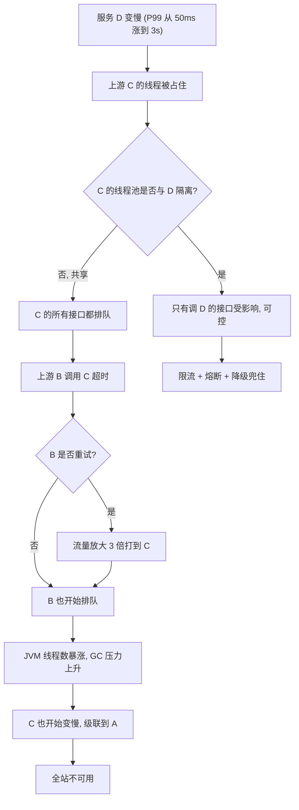

### 17.2 雪崩的七种典型触发场景

| 场景 | 现象 | 根因 | 治理 |
| --- | --- | --- | --- |
| 慢 SQL 拖垮线程池 | Dubbo 线程池 200 打满，`RejectedExecutionException` | 一个慢查询占满共享线程池 | 独立线程池 + SQL 超时 + 慢查询治理 |
| 重试风暴 | 下游 QPS 为正常的 3 倍 | `retries=2` + 无退避 | 写接口 `retries=0`，读接口配合熔断与退避 |
| 连接池打满 | `Connection is not available, request timed out after 30000ms` | HikariCP `maximumPoolSize` 太小或长事务 | 合理设置池大小（≈ CPU 核数×2~4 或按 IO 等待比推导），缩短事务 |
| 缓存击穿 | 某热点 key 过期瞬间 DB QPS 暴涨 | 大量请求同时回源 | 互斥重建（`SETNX` 锁）+ 逻辑过期 + 热点 key 不过期 |
| 缓存雪崩 | 大批 key 同时过期或 Redis 整体故障 | 过期时间集中 / 无降级 | 过期时间加随机抖动 + 多级缓存 + 熔断降级 |
| 注册中心推送问题 | 全量 `No provider available` | 空推送、网络分区、配置错误 | 本地缓存 + 空列表保护 + 注册中心多副本 |
| 大对象传输 | `payload` 超限、GC 飙升 | 返回全量列表 | 分页、压缩、走对象存储 |

### 17.3 排查命令与定位路径

```bash
# 1. 看 Dubbo 线程池状态（Dubbo 3.x 暴露的指标，或直接用 jstack）
jstack <pid> | grep -c "DubboServerHandler"
jstack <pid> | grep -A 20 "DubboServerHandler" | head -100

# 2. 看 Netty 客户端连接数与写缓冲
#    走 Dubbo Metrics 的 Prometheus 端点（dubbo.metrics.protocol=prometheus，端口由 dubbo.metrics.port 指定，默认 20888）
#    注意 20880 是 Dubbo 协议端口（二进制协议），不能用 curl 取指标
curl -s http://127.0.0.1:20888/metrics | grep -i "dubbo_provider_requests"

# 3. 看 JVM 与 GC
jstat -gcutil <pid> 1000 20
jcmd <pid> GC.heap_info

# 4. 线上定位单接口耗时（Arthas）
trace com.example.OrderServiceImpl createOrder -n 5
#    看具体方法耗时分布，找慢在哪一段

# 5. 看网络与 TCP 重传
ss -s
netstat -s | grep -i retrans
mtr -r -c 100 <provider-ip>

# 6. 看是否有大量 TIMEWAIT / CLOSE_WAIT
ss -ant | awk '{print $1}' | sort | uniq -c | sort -rn
```

定位顺序（重要）：**先确定影响面（几个服务）→ 再看资源瓶颈（线程/连接/CPU/GC）→ 再看依赖链路（谁最慢）→ 最后看流量（是否有放大）**。

### 17.4 稳定性防护的层次


## 十八、高级岗三问

### 18.1 为什么这么设计？

- **为什么注册中心多为 AP**：实例列表的可用性权重远高于一致性。列表短暂陈旧（多几个死实例）由客户端重试/熔断兜住；列表不可用（拿不到地址）则是全局故障。代价是需要客户端有本地缓存与空列表保护。
- **为什么 Nacos 要区分临时与持久实例**：不同数据的 SLA 不同。实例列表要快、要能自动清理（AP）；元数据和配置要准、不能因注册中心抖动丢数据（CP）。用一个组件覆盖两种语义，代价是两套一致性协议都要维护。
- **为什么 Dubbo 用 URL 贯穿全层**：扩展点用字符串驱动，新增治理参数无需改接口，实现了配置的动态化。代价是运行时才有校验、URL 冗长、调试需要理解 key 的语义。
- **为什么 Dubbo 默认 Failover + 默认不重试业务异常**：网络抖动占故障的大多数，重试收益高；业务异常重试没有意义且会重复副作用。代价是写接口必须自己配 `retries=0`。
- **为什么线程池默认 200 + SynchronousQueue**：SynchronousQueue 不做排队，打满即拒绝，把"排队延迟"换成"快速失败"，让上游尽早感知压力。代价是瞬时突发会直接失败，需要上游配合重试或削峰。

### 18.2 线上出问题怎么定位？

| 现象 | 第一步 | 第二步 | 第三步 |
| --- | --- | --- | --- |
| `No provider available` | 查注册中心该服务实例数（Nacos 控制台 / `ls /dubbo/{interface}/providers`） | 查消费者本地缓存文件是否为空 | 查是否发生过空推送、网络分区、AK/SK 鉴权失败 |
| 大量 `TimeoutException` | 看服务端 RT 与线程池 active 数 | 用 Arthas `trace` 找慢点 | 看是否上游流量突增或依赖变慢 |
| `RejectedExecutionException` | 确认 Dubbo 线程池 200 是否打满 | 找占住线程的接口（jstack 聚合栈） | 拆分线程池 + 限流 |
| 调用成功率抖动 | 看注册列表是否在抖动（实例频繁上下线） | 看服务端健康检查与 GC 停顿 | 修健康检查阈值、排查 Full GC |
| 链路遗漏 | 查 TraceId 是否透传 | 查异步线程上下文 | 补 `Context.makeCurrent()` |
| 灰度流量泄漏 | 查 `TagRouter` 的 `force` 与 tag 透传 | 查中间件是否清理 attachment | 设 `force=true` |

### 18.3 规模变大后会怎样？

- **实例数上到几百**：全量推送成本高（一次变更推给所有订阅者），注册中心成为放大器。Nacos 2.x 已改为增量推送与长连接；Dubbo 3.x 引入**应用级服务发现**（Application-level，一个应用一份实例列表，而非每个接口一份），把 `N × M` 的接口级订阅压成应用级订阅。
- **跨机房**：同机房优先的 `TagRouter`/集群路由成为必备；跨机房调用延迟从 0.5ms 涨到 10ms 量级，超时与重试参数要按机房重算。
- **QPS 上到十万后**：序列化与网络成为主要开销，必须换 Protobuf/Triple；单连接成为瓶颈，需要 `connections` 调大或多连接复用策略。
- **接口数上到几千**：接口级注册数据量爆炸（ZK 的 ZNode 数、Nacos 的订阅关系数），必须走应用级服务发现与元数据中心分离。
- **应用级服务发现的落地**：Provider 侧用 `dubbo.application.register-mode` 控制注册粒度——`interface`（只注册接口级）、`instance`（只注册应用级）、`all`（双注册，迁移期用）。应用级注册只把"应用名 + 主机 + 端口 + 元数据"写进注册中心；接口 → 应用的映射（ServiceNameMapping）与接口元数据放在元数据中心（`MetadataReport`），消费者先取应用级实例列表，再换取该应用暴露的接口。代价是多一次元数据查询、强依赖元数据中心可用，且 Provider 与 Consumer 需要同时升到 Dubbo 3.x。
- **团队上百人**：治理规则（路由、限流阈值）需要平台化，靠配置文件已经无法维护，必须接入统一的治理控制面（Dubbo Admin / Sentinel Dashboard / 自研平台）。

## 高频面试题

### Q1. 你们为什么选 Nacos 而不是 ZooKeeper 做注册中心？

**答题框架（30 秒版）**：核心是语义匹配——服务实例列表是 AP 语义，ZK 是 CP。ZK 在多数派不可用时写全挂（新实例注册不进来），且 watch 是一次性的、session 超时会造成惊群。Nacos 默认临时实例走 Distro（AP），同时用持久实例/JRaft 覆盖配置与元数据的 CP 需求，还能顺带做配置中心。

**展开（2 分钟版）**：
1. CAP 定位差异：ZK 走 ZAB，分区少数派拒绝写；Eureka/Nacos 临时实例走 AP，分区时各自服务。
2. 元数据模型差异：ZK 只有路径，做环境隔离要靠在路径里拼字符串；Nacos 原生有 namespace/group/cluster/weight/metadata。
3. 运维差异：ZK 对 session 与 GC 敏感，磁盘与网络抖动会导致临时节点被删；Nacos 2.x 用 gRPC 长连接感知更快。
4. 能力覆盖差异：Nacos 一个组件覆盖注册 + 配置；ZK 做配置能力弱（无版本、无灰度、无监听语义）。
5. 代价：Nacos 持久实例需要 MySQL（生产环境），引入额外组件；2.x 必须放通 9848/9849 端口。

**追问**：那 ZK 做注册中心就一定要换掉吗？答：不必。如果只做 Dubbo 服务发现、消费者侧有本地缓存，ZK 挂掉多数派（此时 ZK 的读写都不可用）时存量调用不受影响；真正的问题是"新实例无法注册""新消费者拿不到地址"和"惊群"，可以用双注册中心（迁移期）或本地缓存 + 静态兜底地址缓解。换与不换取决于是否有必须解决的痛点，而不是组件是否"先进"。

### Q2. Nacos 的临时实例和持久实例有什么区别？底层协议一样吗？

**答题框架（30 秒版）**：临时实例 `ephemeral=true`（默认），走 Distro 协议（AP），靠客户端心跳（1.x 默认 5s 一次、15s 判不健康），宕机后自动剔除；持久实例 `ephemeral=false`，走 JRaft/Raft（CP），由服务端主动健康检查，不健康也不自动删除。

**展开（2 分钟版）**：
1. 数据模型：RocksDB/Derby 或 MySQL 存储持久实例，临时实例主要驻留内存 + 本地磁盘快照。
2. 一致性：Distro 是"分片 + 异步复制 + 每个节点负责一部分服务的写"，没有 quorum，分区时各自可写，冲突靠时间戳覆盖；Raft 有 leader，写需要多数派。
3. 心跳：临时实例的心跳只证明"连接/进程还活着"，不代表业务健康；持久实例服务端可以配 `tcp`/`http`/`mysql` 等检查器主动探测。
4. 取舍：临时实例感知快、注册中心故障时可能不一致但可用；持久实例宁可保留不健康实例，保证不丢数据。

**追问**：Nacos 2.x 为什么客户端不再发心跳了？答：2.x 改为 gRPC 长连接，注册动作本身会建立双向流，服务端通过连接存活 + 客户端轻量上报（`HealthCheckRequest`）判定，连接断开时能更快触发实例下线，比 1.x 的 5s 心跳 + 15s 超时更灵敏。同时推送从 UDP 改为 gRPC 流，避免了 1.x UDP 丢包的问题。

### Q3. 讲一下一次 Dubbo 调用从代理到返回的完整过程。

**答题框架（30 秒版）**：代理生成 `RpcInvocation` → `ClusterInvoker`（默认 Failover）通过 `Directory` 拿实例列表 → `Router` 过滤 → `LoadBalance` 选一个 → `Filter` 链处理 → 编码（16 字节头 + hessian2 body）→ Netty 发送 → 服务端解码 → 服务端 Filter → `Wrapper` 调用真实实现 → 响应按 requestId 匹配到 `DefaultFuture` → 返回。

**展开（2 分钟版）**：

1. `InvokerInvocationHandler` 拦截方法调用，构造 `RpcInvocation(methodName, parameterTypes, arguments)`，把 `RpcContext` 的 attachment 带上。
2. `FailoverClusterInvoker#doInvoke` 调 `list(invocation)` 拿 `Invoker` 列表（来自 `RegistryDirectory` 的本地缓存），`RouterChain.route` 过滤，`loadbalance.select` 选一个（默认 `RandomLoadBalance`）。
3. `ProtocolFilterWrapper` 上的 Filter 依次执行，`ConsumerContextFilter` 负责 attachment 传递，`MonitorFilter` 负责埋点。
4. `DubboCodec.encode`：16 字节头（magic `0xdabb`、flag 含序列化 ID、status、requestId、dataLength）+ body（hessian2）。
5. Netty Client 写出，`DefaultFuture.newFuture(channel, request, timeout)` 注册到 `FUTURES` map，key 是 requestId。
6. 服务端 `DubboProtocol` 的 `HeaderExchangeHandler` 解析后，由 `Dispatcher`（默认 `all`）派发到 `fixed` 线程池（200 线程），执行 Filter 链和 `Wrapper.invokeMethod`。
7. 响应写回，客户端 `NettyClientHandler` 收到后按 requestId 找到 `DefaultFuture` 并 `setResponse`；若超时，`HashedWheelTimer` 触发 `TimeoutCheckTask` 抛 `TimeoutException`。

**追问**：超时后服务端会中断执行吗？答：不会。Dubbo 的 `TimeoutFilter` 只记录日志，没有中断机制。所以写接口必须幂等，慢接口要考虑异步化或结果缓存。

### Q4. Dubbo 的 SPI 和 JDK 的 SPI 有什么区别？@Adaptive 是怎么工作的？

**答题框架（30 秒版）**：JDK SPI 一次性加载全部实现、无 IoC/AoP、用全限定名做 key；Dubbo SPI 按需加载、支持 `@SPI` 默认值、`@Adaptive` 运行时按 URL 参数选择实现、`@Activate` 自动激活、Wrapper 类自动叠加实现 AOP。

**展开（2 分钟版）**：

1. 加载路径：`META-INF/dubbo/internal/`（框架内置）、`META-INF/dubbo/`（用户扩展）、`META-INF/services/`（兼容 JDK SPI）。
2. 文件格式：`名字=实现类全限定名`，比 JDK 的"一行一个类名"多了命名能力。
3. `@Adaptive({"protocol"})`：`ExtensionLoader` 用 Javassist 生成 `Protocol$Adaptive`，`export` 里从 `URL#getParameter("protocol")` 取名字，再 `getExtension(name)`；取不到就用 `@SPI` 的默认值。
4. 类级 `@Adaptive`：如 `AdaptiveExtensionFactory`，直接指定不做字节码生成。
5. Wrapper：若某实现类构造器参数是接口本身，则被识别为 Wrapper，自动包装（`ProtocolFilterWrapper`、`ProtocolListenerWrapper`）。
6. `@Activate`：按 `group` 与 `@SPI` 的 key 决定是否启用，`order` 决定顺序。

**追问**：为什么要"自适应"而不是直接配置实现类？答：因为 Dubbo 的配置是运行时的、分层的（方法 > 接口 > 全局），而且同一进程内不同接口可能用不同协议（`dubbo://` 与 `tri://` 并存）。自适应扩展把"选择实现"延迟到运行时，用 `URL` 表达决策，避免启动期绑定。

### Q5. Dubbo 的负载均衡策略怎么选？一致性哈希有什么坑？

**答题框架（30 秒版）**：默认 `random`（按权重随机），实例性能一致用 `roundrobin`，调用耗时差异大用 `leastactive` 或 `shortestresponse`，有本地缓存/需要同参数落到同机器用 `consistenthash`（默认 160 个虚拟节点）。一致性哈希的坑是热点参数压单机、参数哈希分布不均、实例变更仍会迁移部分流量。

**展开（2 分钟版）**：

| 场景 | 推荐 | 理由 |
| --- | --- | --- |
| 通用、实例多 | `random` | 无状态、均匀 |
| 实例规格一致 | `roundrobin` | 严格均匀，易验证 |
| 有慢实例、RT 差异大 | `leastactive` | 自动避开堆积的实例 |
| 需要快速规避慢实例 | `shortestresponse` | 按窗口内平均 RT 选最短 |
| 本地缓存、有状态分片 | `consistenthash` | 同参数固定实例，缓存命中率高 |

一致性哈希的实现细节：`ConsistentHashLoadBalance` 用 `serviceKey + methodName` 缓存 `ConsistentHashSelector`，构造时对每个 `invoker.getUrl().getAddress()` 做 md5，放 160 个虚拟节点到 `TreeMap`；调用时对 `hash.arguments` 指定的参数（默认第 0 个）哈希，`tailMap` 取顺时针节点。坑：第一个参数是 null 或低基数（如只有 3 种枚举）会导致严重偏斜，此时应改 `hash.arguments`。

**追问**：一致性哈希和 Dubbo 3.x 的"应用级服务发现"有什么关系？答：两者都指向同一个问题——把 `接口 × 实例` 的笛卡尔积压小。一致性哈希解决"选谁"，应用级服务发现解决"推什么"（一个应用推一份实例列表，而不是每个接口推一份），后者在接口数上千时能把注册中心的数据量降一个量级。

### Q6. Failover 的重试和幂等怎么配合？retries 默认值是多少？

**答题框架（30 秒版）**：Dubbo 默认 `cluster=failover`、`retries=2`，即最多 3 次调用。业务异常（`RpcException.isBiz()` 为 true）不重试；写接口建议 `retries=0` 配 `failfast`；必须重试的写接口要有业务幂等键（唯一索引 + 幂等表）。

**展开（2 分钟版）**：
1. `FailoverClusterInvoker#doInvoke` 按 `retries + 1` 循环，每次从 `available`（排除 `invoked` 中的实例）里选一个，避免重复打到同一实例。
2. 只有非业务异常才重试：网络异常、超时、`RpcException` 中 `isBiz()` 为 false 的。
3. 超时时间要乘上重试次数：单次 1000ms、retries=2，最坏客户端等待可达 3s 以上。
4. 幂等实现：DB 唯一索引兜底 + 幂等表（`requestId` 唯一键）；Redis `SET NX EX` 只做前置拦截，不能作为唯一依据。
5. 更稳的做法是"先查后写 + 状态机"：幂等表插入成功才执行业务，业务与幂等表同事务。

**追问**：为什么不能所有接口都开重试？答：两个原因。一是重试放大流量，下游已经过载时重试会加速雪崩；二是重试对非幂等写会重复副作用。正确做法是"读接口重试、写接口不重试或强幂等后重试"，并按依赖的稳定性动态调整。

### Q7. 服务上线后立刻流量打满、大量超时，怎么排查和解决？

**答题框架（30 秒版）**：先分清新实例还是全量。新实例常见原因是"未预热 + 注册过早"：Dubbo 端口已监听但 Spring 未初始化完/JIT 未预热，权重却已满值。解决是延迟注册（`delay=-1`）、`warmup`（默认 600000ms）、readiness 探针打业务端点；全量问题则看线程池、DB、下游依赖。

**展开（2 分钟版）**：
1. 看现象分布：是"某个新实例报错多"还是"所有实例都慢"。前者是上线问题，后者是容量或依赖问题。
2. 新实例的检查项：`jstack` 看线程是否在 Spring 初始化、类加载或 JDBC 首次连接；`jstat -gcutil` 看是否在频繁 Young GC；看 Dubbo 暴露时间与 Spring `ContextRefreshedEvent` 的先后。
3. 修正配置：`dubbo.provider.delay=-1`（等 Spring 初始化完再暴露）或 `delay=5000`；`warmup` 调到 5~10 分钟；readiness 探针打 `/actuator/health/readiness` 并要求依赖全通。
4. JIT 预热：分层编译（`-XX:+TieredCompilation`，JDK 8 起默认开启，`TieredStopAtLevel` 默认 4）已经是先 C1 后 C2，想再缩短编译预热时间只能把它**调低**到 `-XX:TieredStopAtLevel=1`（只用 C1，峰值性能下降，生产不建议）；更可靠的做法是配置预热流量（回放真实请求）。
5. 发布策略：金丝雀先放 1% 流量，观察 RT/错误率 5 分钟再全量；K8s 加 `preStop` 与 `terminationGracePeriodSeconds` 处理下线。

**追问**：为什么新实例反而更容易超时？答：JIT 未编译（解释执行慢几倍到几十倍）、类没加载完（首次反射/序列化开销大）、连接池（DB/Redis/下游）还是空的（首次建连几百 ms）、CPU 缓存与分支预测未热。这些叠加起来，新实例首分钟 RT 可能是稳态的 3~10 倍。

### Q8. 线上出现大量 No provider available，你的排查步骤是什么？

**答题框架（30 秒版）**：分三层查——注册中心有没有数据、消费者本地有没有缓存、客户端有没有可用连接。常见根因：实例未注册成功（端口/网络/鉴权）、空推送把本地列表清了、路由规则把实例全过滤了、消费者配置的 group/version 与提供者不一致。

**展开（2 分钟版）**：

1. **查注册中心**：Nacos 控制台看该服务的实例数；ZK 用 `ls /dubbo/{接口全限定名}/providers`。无实例说明注册侧有问题。
2. **查提供者日志**：是否有 `Failed to register dubbo://...`、`Client not connected`（Nacos 2.x 9848 端口不通）、鉴权失败（`unauthorized`）。
3. **查消费者本地缓存**：Dubbo 的 `~/.dubbo/dubbo-registry-{app}-{port}.cache` 是否为空/过期。文件为空且注册中心不可用 → 只能等注册中心恢复。
4. **查路由**：是否有 `ConditionRouter`/`TagRouter` 规则把所有实例过滤掉（`force=true` 的 tag 路由在无匹配实例时会直接报错）。Dubbo 报错信息里会带 `No provider available from registry ... for service ... on consumer ... use dubbo version ...`，能直接看出是哪个应用、哪个接口。
5. **查 group/version/interface**：这三个 key 必须完全一致。`group` 不一致是最常见的"能注册但发现不了"。
6. **查空推送**：如果有一次 `notify(urls)` 传了空列表，`RegistryDirectory` 会触发 `destroyAllInvokers`，之后若注册中心一直不可用就一直空。

**追问**：怎么从架构上避免？答：注册中心多副本（ZK 3/5 节点、Nacos 集群）、消费者本地缓存 + 静态兜底地址（`dubbo.registry.address` 配多个或使用直连）、推送侧做空列表校验、注册中心故障时禁止自动下线（类似 Eureka 自我保护），以及全链路压测覆盖"注册中心不可用"这个故障场景。

### Q9. 场景设计：设计一个支持全链路灰度的微服务方案。

**答题框架（30 秒版）**：四件事——打标、透传、路由、数据隔离，加一个回滚开关。Dubbo 用 `RpcContext` attachment 传 `dubbo.tag`，`TagRouter` 做路由（核心服务 `force=true`），网关负责入口打标，DB/缓存按 tag 隔离，监控异常时删除规则回滚。

**展开（2 分钟版）**：

1. **打标**：网关按灰度规则（用户 ID 尾号、设备、header、AB 实验）写入 `RpcContext.getClientAttachment().setAttachment("dubbo.tag", "gray")`。
2. **透传**：`ConsumerContextFilter` 会把 attachment 带到下游；跨协议（HTTP→Dubbo）或跨框架（Dubbo→gRPC）时手工透传。异步调用要在新线程重建上下文。
3. **路由**：每个服务配置 `TagRouter` 规则 `dubbo.tag=gray => 只匹配 tag=gray 的实例`。`force=true` 表示无匹配实例时直接报错（防止灰度流量打到正式实例）；非核心服务可 `force=false` 降级。
4. **数据隔离**：灰度实例连灰度库/独立 schema，或用 `tenantId` 逻辑隔离。只做路由不做数据隔离会写脏数据，且无法回滚。
5. **容量与依赖**：灰度池要保证所有依赖（DB、Redis、MQ、第三方）都有灰度对应，否则灰度不可控。
6. **观测与回滚**：灰度期重点看错误率、RT、业务指标；规则用配置中心下发（Nacos），支持一键删除回滚。回滚要保证"已写的数据可识别"（加 `gray` 字段或独立库表）。

**追问**：Dubbo 3.x 对灰度有什么额外支持？答：Dubbo 3.x 强化了 `TagRouter` 与 `MeshRuleRouter`（xDS 规则），并支持应用级服务发现，使灰度路由规则可以按"应用 + 标签"而不是"接口 + 实例"表达，规则规模显著减小。

### Q10. 场景设计：如何把现有 HTTP 微服务改造成高性能 RPC 体系？迁移步骤是什么？

**答题框架（30 秒版）**：不要一次性替换。先补治理能力（超时/熔断/追踪），再按调用频次选高价值链路做"双协议并行"，用网关做协议转换，稳定后逐步下线 HTTP。关键是契约兼容与灰度可回滚。

**展开（2 分钟版）**：

1. **盘点**：统计调用量 Top 接口、请求/响应对象大小、P99 延迟，找出"高频 + 小对象"这类最值得换成 RPC 的链路。低频、对外接口保持 HTTP。
2. **统一契约**：把 DTO 抽成独立的 api jar（或 `.proto`），禁止直接传 PO/Entity；约定 `serialVersionUID` 或 Protobuf 字段号策略。
3. **双协议并行**：Dubbo 3.x 同一服务可以同时暴露 `dubbo://`（内部）与 `rest://`（对外），或同时注册 HTTP 与 Triple。消费者按灰度开关切换走哪条。
4. **网关转换**：前端仍走 HTTP，网关（Spring Cloud Gateway + 泛化调用）把 HTTP 请求转换成 Dubbo 泛化调用，避免前端改造成本。
5. **治理先落地**：在切换前把超时分层、重试策略、幂等、熔断、追踪都配好，否则只是把问题从 HTTP 搬到 RPC。
6. **观测与回滚**：对比双协议的 RT、错误率与资源占用，确认收益后再删 HTTP 入口；保留至少一个版本周期的回滚能力。

**追问**：迁移中最容易踩的坑是什么？答：三个。一是序列化兼容（Hessian2 对字段增删相对宽容，但对类型变更敏感，`java.util.Date`/`LocalDateTime` 与跨版本类结构最容易出问题）；二是超时与重试语义变化（HTTP 有连接池与排队，RPC 有不同默认值，`retries=2` 会让 QPS 放大）；三是链路追踪断链（attachment 透传与异步上下文）。

### Q11. 场景排查：Dubbo 线程池打满，接口大面积报 RejectedExecutionException，怎么处理？

**答题框架（30 秒版）**：线程池是共享的（默认 `fixed`，200 线程，`SynchronousQueue`），一个慢接口会拖垮全部。先止血（临时扩线程/限流/禁用慢接口），再定位占线程的接口，最后做隔离与治理。

**展开（2 分钟版）**：

1. **止血**：`jstack` 找出占住线程最多的方法；临时把 `dubbo.protocol.threads` 调大（治标）、或把慢接口通过配置中心"一键降级"（返回兜底或抛业务异常）、或调低入口限流阈值。
2. **定位**：`jstack <pid> | grep -A 20 "DubboServerHandler" | grep "at com.yourcompany"` 聚合，找出高频的栈；用 Arthas `trace` 看具体方法耗时；看是否有慢 SQL、外部 HTTP 未设超时、锁等待。
3. **根因**：常见是外部依赖未设超时（HttpClient 默认无读超时）、慢 SQL、大对象序列化、下游 RT 抖动。
4. **治理**：把慢接口拆到独立线程池（独立 Protocol + 端口，或 `dubbo.protocol.threadpool=cached` 并单独限流）；给外部调用设超时；用 Sentinel `FlowRule` 的线程数模式在入口限制并发。
5. **验证**：压测对比治理前后 `active` 峰值与 `RejectedExecutionException` 数量。

**追问**：为什么 Dubbo 默认用 `SynchronousQueue` 而不是 `LinkedBlockingQueue`？答：用 `SynchronousQueue` 不排队，线程满就立即拒绝，把"不可控的排队延迟"换成"快速失败"，让上游尽早感知并触发熔断/降级。有队列反而会造成请求在队列里等待超出客户端超时，浪费服务端资源。代价是瞬时突发会直接失败，需要上游有重试或削峰能力。

### Q12. 场景排查：链路追踪里同一个请求出现了三棵独立的 Trace 树，问题在哪？

**答题框架（30 秒版）**：上下文传播断了。三类原因——attachment 被自定义 Filter 提前清理、异步线程切换没传递 `Context`、跨协议（HTTP→Dubbo、Dubbo→MQ）没有透传 `traceparent`。

**展开（2 分钟版）**：

1. **确认传播载体**：Dubbo 场景下 traceparent 放在 attachment 里；HTTP 场景放在 header；MQ 场景放在消息属性。缺一环就断。
2. **检查 Filter 顺序**：`TraceFilter` 的 `order` 是 `-9000`，自定义 Filter 如果 order 更小（更靠前）且在 `invoke` 返回后做了 `RpcContext.removeContext()`，或直接操作 attachment 覆盖了 traceparent，就会断链。
3. **检查异步**：`CompletableFuture.supplyAsync`、线程池、`@Async` 都不会自动传播 OTel 的 `Context`（默认存储是 `ThreadLocal`）。必须 `Context ctx = Context.current(); executor.execute(ctx.wrap(runnable))` 或在回调里 `try (Scope s = ctx.makeCurrent())`。
4. **检查 MQ**：生产者在消息 header 写 traceparent，消费者读取并 `makeCurrent()`。很多自研 MQ 封装没做这一步。
5. **验证**：比对三棵树的开始时间与 TraceId，看缺口出现在哪个服务边界。

**追问**：为什么不用全量采样来避免丢链路？答：采样比例与链路完整性是两件事。丢链路是**上下文传播**问题，全量采样只会让"断掉的树"更多，解决不了根因；而且全量采样的成本随 QPS 线性增长，在微服务里一个请求产生几十个 span，开销不可接受。正确做法是低比例采样 + 错误/慢请求强制采样。

## 易错点与踩坑

| 易错点 | 正确理解 |
| --- | --- |
| "Nacos 是 AP，ZooKeeper 是 CP" 一句话定性 | Nacos 的临时实例走 Distro（AP），持久实例走 JRaft（CP），是"可切换"而非单一标签 |
| "注册中心要强一致才可靠" | 实例列表要的是可用性与最终一致；强一致（CP）在分区时会拒绝写，反而让新实例注册不进来 |
| "心跳正常说明服务健康" | 心跳只证明进程/连接存活；线程池打满、依赖全挂时心跳照样正常，必须用业务就绪探针 |
| "Dubbo 默认 retries=3" | 默认 `retries=2`，表示**重试 2 次**，总调用最多 3 次 |
| "超时后服务端会停止执行" | Dubbo 的 `TimeoutFilter` 只记录日志，不中断业务；写接口必须幂等 |
| "所有接口都能重试" | 业务异常不重试，写接口默认不应重试；重试会放大流量 |
| "Dubbo 线程池因为有队列所以是排队变慢" | 默认 `fixed` + `SynchronousQueue`，不排队，直接抛 `RejectedExecutionException` |
| "Dubbo SPI 就是 ServiceLoader" | Dubbo 自己实现，支持按名字加载、`@Adaptive`、`@Activate`、Wrapper AOP |
| "Hessian2 是零风险的高效选择" | 有反序列化安全历史，需配合 `SerializeSecurityManager` 与类白名单 |
| "换 Protobuf 只需换个序列化配置" | Protobuf 需要 IDL 与代码生成，字段号策略、`reserved`、兼容规则都要设计 |
| "gRPC 和 Dubbo 都是 RPC，参数可以随便传" | gRPC 默认消息上限 4MB；Dubbo `payload` 默认 8MB，超限报错，需分页或走对象存储 |
| "`RpcContext.setAttachment` 是全局配置" | 是单次调用有效，调用结束会被清理；异步线程会丢，必须手工透传 |
| "服务下线直接 kill 就行" | 应先注销 → 等在途请求完成（Dubbo 2.7+ 默认等待 10s 量级）→ 再关线程池与端口 |
| "灰度只做路由就够了" | 不隔离数据会产生脏数据且无法回滚，必须做数据面隔离 |
| "链路追踪用全量采样最保险" | 断链是传播问题不是采样问题；全量采样成本随 QPS 线性增长 |
| "注册中心挂了整个系统就挂了" | 消费者有本地缓存与空列表保护，注册中心短时不可用通常不影响存量调用 |
| "实例越多负载越均衡" | 实例越多，注册中心推送成本与网络抖动风险越大；Dubbo 3.x 用应用级服务发现降低数据量 |
| "线程池越大吞吐越高" | 线程数超过瓶颈资源（CPU、连接池、下游容量）后吞吐下降、延迟上升，需按瓶颈推导而非拍脑袋 |
| "Nacos 2.x 只开放 8848 就够" | 2.x 还需要 9848（主端口 + 1000，客户端 gRPC）与 9849（主端口 + 1001，服务端间 gRPC），这是上线最常见的连通性问题 |
| "Eureka 自我保护是 bug" | 是刻意设计，防止注册中心自身抖动导致大批实例被误剔除；代价是死实例留存更久 |

## 一句话速记

- **微服务拆分**：按业务能力/限界上下文拆，数据所有权必须一起拆；只拆进程不拆库 = 分布式单体。
- **康威定律**：架构与组织同构，要对齐团队边界，规模不够先用代码边界守住依赖方向。
- **注册中心职责**：注册、注销、健康检查、服务发现；四者 SLA 不同，发现路径要求极高可用。
- **CAP 取舍**：实例列表是 AP 语义，配置与元数据是 CP 语义；Nacos 用临时/持久实例同时覆盖两者。
- **Eureka**：心跳 30s、过期 90s、客户端拉取 30s、只读缓存刷新 30s、自我保护阈值 0.85，关掉只读缓存。
- **ZooKeeper**：临时节点 + 一次性 watch，session 超时区间 = 2~20 倍 `tickTime`（`zoo_sample.cfg` 常用 2000ms，代码默认 3000ms），临时节点被删会引发惊群。
- **Nacos**：默认临时实例（Distro/AP）、持久实例（JRaft/CP）；1.x 心跳 5s/15s；2.x gRPC 端口 = 主端口 + 1000（客户端）/ 主端口 + 1001（服务端间）。
- **服务发现**：客户端发现（Dubbo/LoadBalancer）延迟低但要 SDK；服务端发现（K8s Service/Sidecar）多语言友好但少一层治理能力；两者都必须有本地缓存。
- **RPC 五件事**：动态代理、方法契约、序列化、网络传输、请求响应关联。
- **Dubbo 调用链**：Proxy → ClusterInvoker(Failover) → Directory → Router → LoadBalance → Filter → Codec → Netty → 服务端 Filter → Wrapper。
- **Dubbo 协议头**：16 字节，magic `0xdabb`，flag 低 5 位是序列化 ID（hessian2 = 2）。
- **序列化选型**：内部高频 Protobuf/Hessian2，对外 JSON，JDK 序列化禁用，Kryo 需注册类型与白名单。
- **Dubbo 默认值**：`cluster=failover`、`retries=2`、`loadbalance=random`、`serialization=hessian2`、`proxy=javassist`、`threadpool=fixed(200)`、`timeout=1000ms`、`port=20880`、`payload=8MB`、`warmup=600000ms`。
- **Dubbo SPI**：`@SPI` 声明扩展点、`@Adaptive` 运行时按 URL 选择、`@Activate` 自动激活、Wrapper 实现 AOP、文件在 `META-INF/dubbo/internal/`。
- **负载均衡**：random 默认、roundrobin 均匀、leastactive 避慢、consistenthash 160 虚拟节点保缓存、shortestresponse 按 RT。
- **容错**：failover 默认（写接口改 failfast）、forking 默认 `forks=2`、failback 5s 后台重试、broadcast 用于通知类操作。
- **超时**：逐层收敛且客户端 > 服务端；服务端超时不中断执行，所以写接口必须幂等。
- **优雅上下线**：延迟注册 + warmup 权重递增；下线先注销、再等在途请求、后关线程池。
- **灰度**：打标 → 透传 → 路由（`TagRouter`，核心服务 `force=true`）→ 数据隔离 → 可回滚。
- **链路追踪**：W3C `traceparent` 四段格式，SpanContext 跨进程传播；断链是传播问题，低比例采样 + 错误强采。
- **雪崩三要素**：资源共享、同步等待、上游重试/流量不减；防护靠限流、超时、熔断、隔离、降级。
- **排查顺序**：影响面 → 资源瓶颈（线程/连接/CPU/GC）→ 依赖链路（谁最慢）→ 流量是否被放大。
