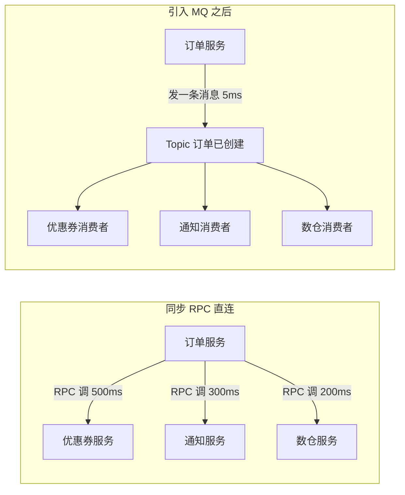
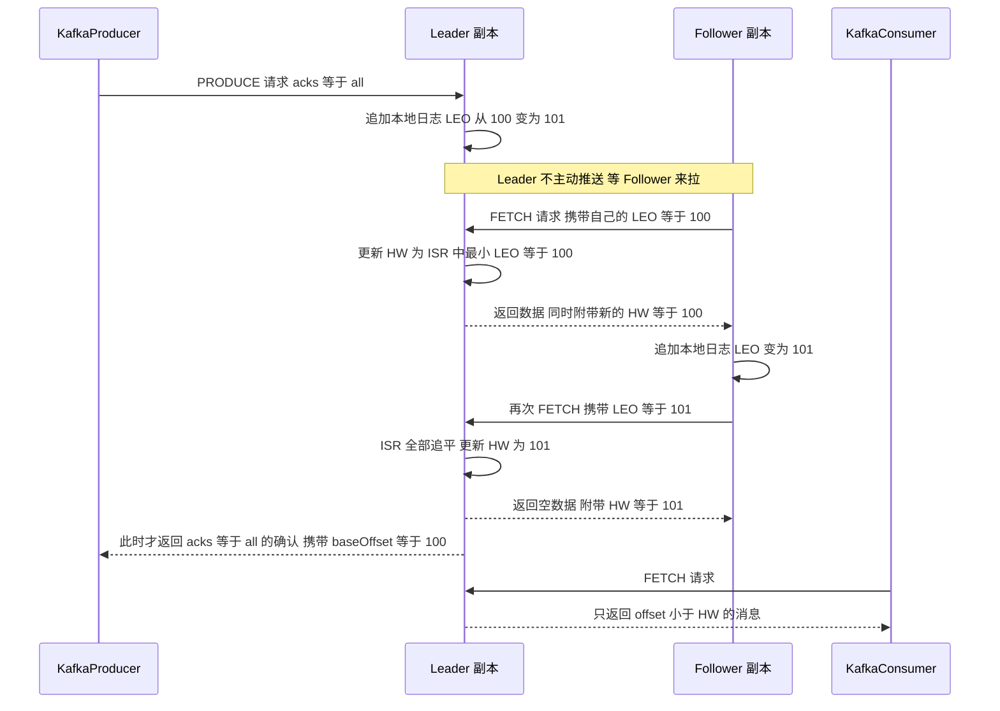
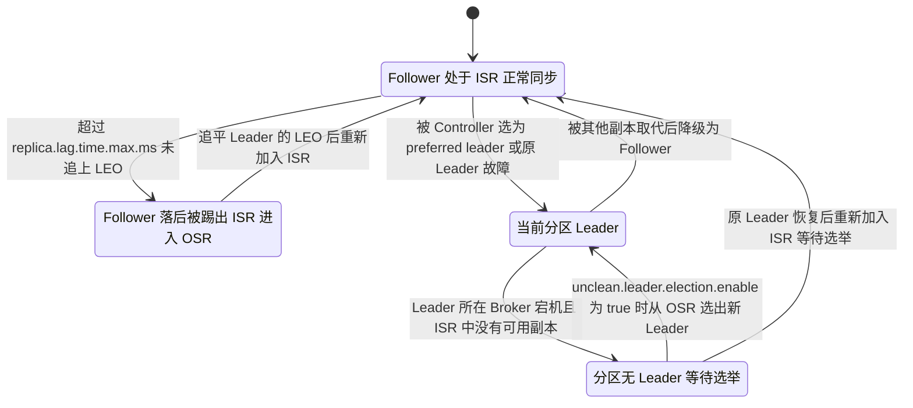
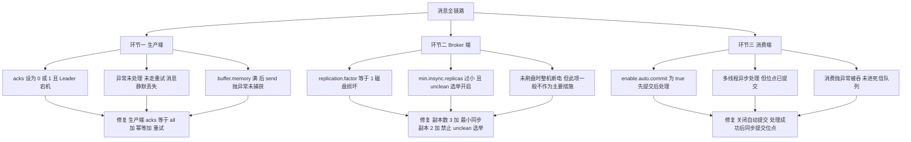
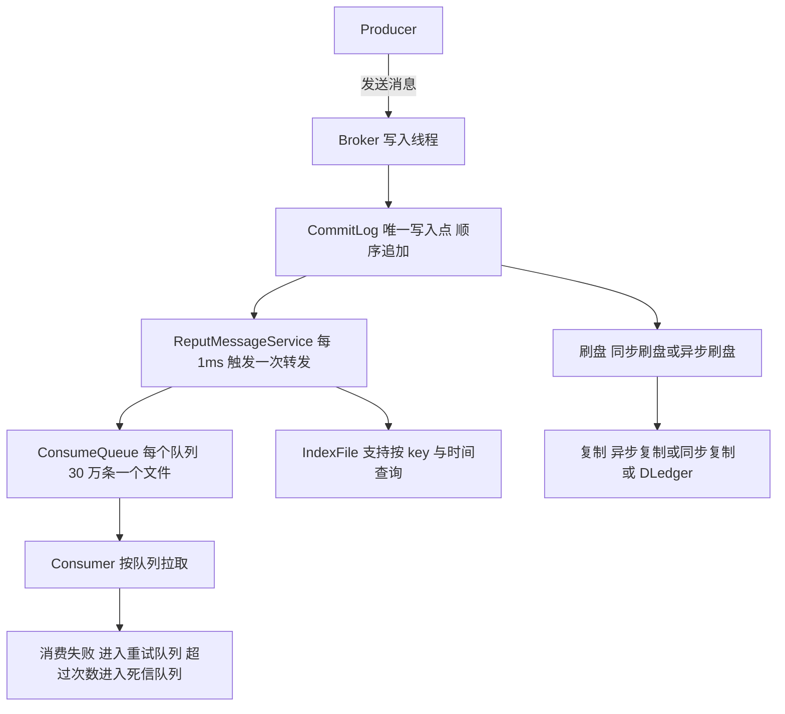
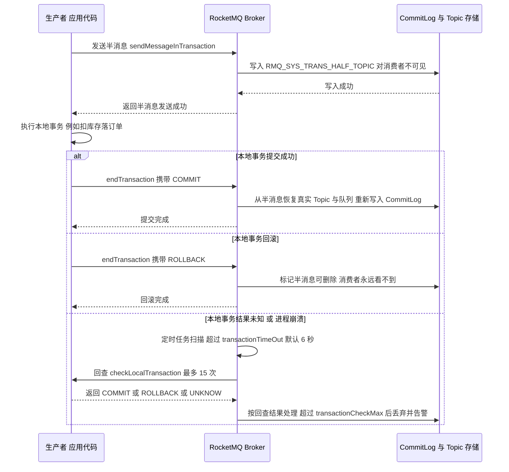
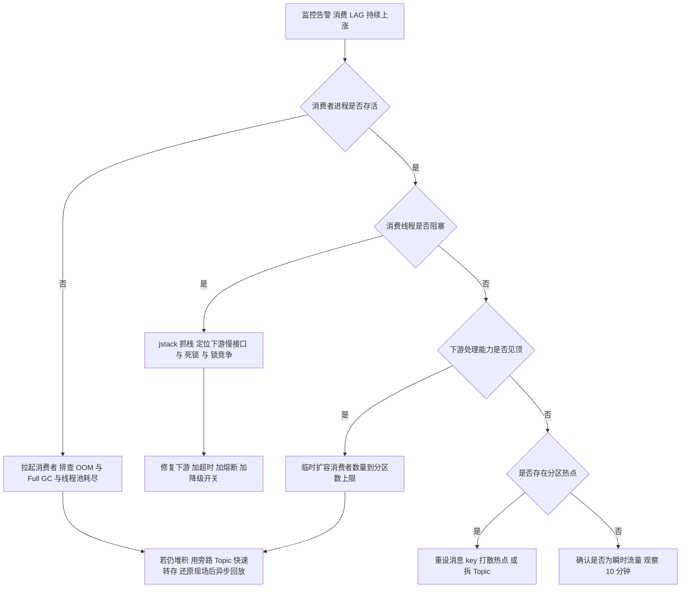
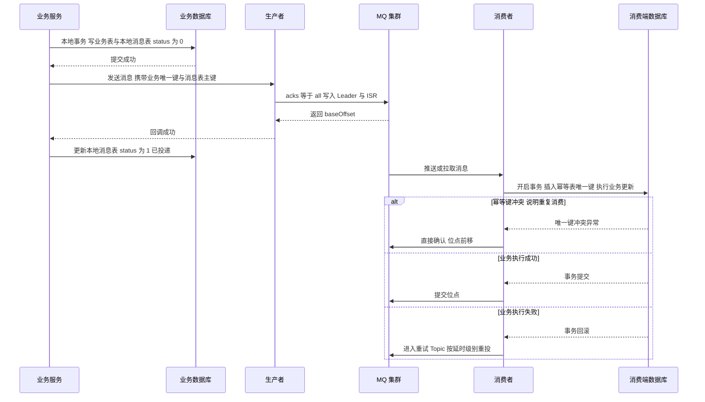
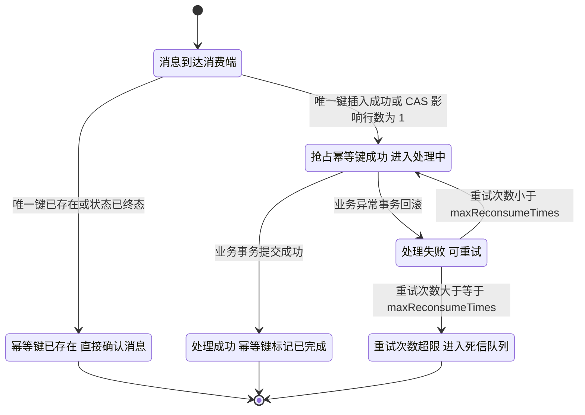
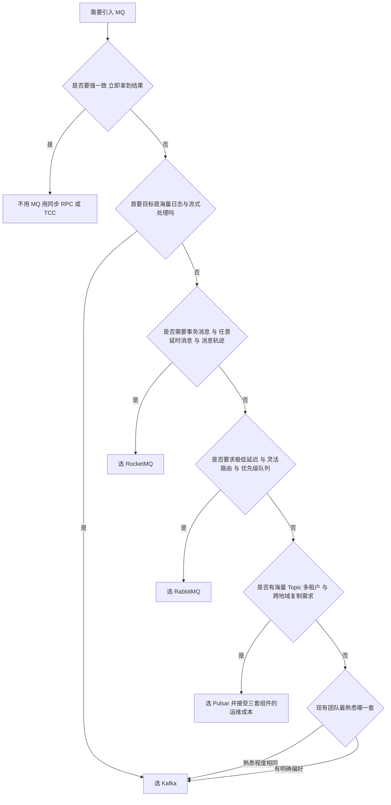

# 03 消息队列与异步架构

> 一句话定位：MQ 是分布式系统里最好用也最容易埋雷的组件——会用它不难，能说清"消息为什么不丢、为什么重复、什么时候乱序、积压了怎么救"才是高级岗的分水岭 ｜ 面试权重 ★★★★★ ｜ 建议复习 60 分钟

## 本章大纲

- [一、MQ 的四大作用与引入代价](#一mq-的四大作用与引入代价)
- [二、主流 MQ 多维度对比](#二主流-mq-多维度对比)
- [三、Kafka 核心机制](#三kafka-核心机制)
- [四、Kafka 为什么快](#四kafka-为什么快)
- [五、Kafka 的可靠性：不丢、不重、有序](#五kafka-的可靠性不丢不重有序)
- [六、RocketMQ 核心机制](#六rocketmq-核心机制)
- [七、RocketMQ 事务消息与延时消息](#七rocketmq-事务消息与延时消息)
- [八、消息积压、重复、乱序、丢失的完整解决方案](#八消息积压重复乱序丢失的完整解决方案)
- [九、事务消息与本地消息表的对比](#九事务消息与本地消息表的对比)
- [十、消费端幂等的三种落地方案](#十消费端幂等的三种落地方案)
- [十一、削峰填谷的容量估算](#十一削峰填谷的容量估算)
- [十二、MQ 选型决策树](#十二mq-选型决策树)
- [十三、高级岗三问](#十三高级岗三问)
- [高频面试题](#高频面试题)
- [易错点与踩坑](#易错点与踩坑)
- [一句话速记](#一句话速记)

## 零、版本与约定

本章所有结论都绑定到具体版本，面试时说出"这个默认值在哪个版本改的"是加分项。

| 组件 | 本章覆盖版本 | 关键版本分界点 |
| --- | --- | --- |
| Apache Kafka | 3.x 与 4.0.x | 2.4 粘性分区（KIP-480）与增量协作再均衡（KIP-429）；2.8 KRaft 尝鲜（KIP-500）；3.0 生产者 `acks` 默认改为 `all`、幂等默认开启（KIP-679）；3.3 KRaft 生产可用；3.7 新消费者组协议预览（KIP-848）；4.0 彻底移除 ZooKeeper |
| Apache RocketMQ | 4.9.x 与 5.x | 4.5.0 引入 DLedger 主从自动切换；5.0 引入 Proxy、gRPC 协议、任意时刻定时消息、POP 消费、Controller 模式选主 |
| RabbitMQ | 3.13 与 4.0 | 3.8 引入 Quorum Queue；3.9 引入 Stream Queue 并弃用经典镜像队列；4.0 移除经典镜像队列与部分弃用特性，默认 AMQP 0-9-1 与 AMQP 1.0 并行 |
| Apache Pulsar | 2.11 与 3.x | 2.8 引入事务；2.10 引入 `ScalableTopic` 相关能力的前置；3.0 引入可扩展 Topic 与新的负载均衡策略 |

客户端与框架侧：

| 依赖 | 版本 | 说明 |
| --- | --- | --- |
| `kafka-clients` | 3.6 ~ 3.9 | 生产者、消费者、AdminClient 都在这一个包里 |
| `spring-kafka` | 3.x | 需要 JDK 17 与 Spring Framework 6；`spring-kafka` 2.9.x 是最后支持 JDK 8 的分支 |
| `rocketmq-client-java` | 5.x | 新版 gRPC 客户端，`Producer` / `PushConsumer` 接口 |
| `rocketmq-spring-boot-starter` | 2.3.x | 注解 `@RocketMQMessageListener` 与 `RocketMQTemplate` |
| `spring-rabbit` | 3.x | 注解 `@RabbitListener`、`RabbitTemplate`、`SimpleMessageListenerContainer` |

> 阅读源码时注意坐标：Kafka 的核心类在 `org.apache.kafka.clients.producer.KafkaProducer`、`org.apache.kafka.clients.consumer.KafkaConsumer`、`org.apache.kafka.common.record.FileRecords`；RocketMQ 的核心类在 `org.apache.rocketmq.store.CommitLog`、`org.apache.rocketmq.store.DefaultMessageStore`、`org.apache.rocketmq.broker.processor.SendMessageProcessor`。

## 一、MQ 的四大作用与引入代价

### 1.1 四大作用：解耦、异步、削峰、最终一致

四个作用不是并列关系，而是"为了解决不同问题而引入同一种中间件"。面试时先分类，再举自己项目里的例子。

| 作用 | 解决的问题 | 典型形态 | 量化收益 |
| --- | --- | --- | --- |
| 解耦 | 上游要通知 N 个下游，每加一个下游就要改上游代码并回归 | 上游只发一个 Topic，下游各自订阅 | 上游变更次数从 O(N) 降到 O(1) |
| 异步 | 主流程被非核心动作拖长，RT 里 80% 时间花在"可以晚点做"的事上 | 下单成功后异步发券、发短信、写数仓 | 主链路 RT 从 500ms 降到 80ms |
| 削峰 | 峰值 QPS 是日常的 10 ~ 100 倍，下游按峰值扩容不划算 | 秒杀请求先落 MQ，下游按稳定速率消费 | 下游只需日常容量，峰值被摊平到几分钟 |
| 最终一致 | 跨服务、跨库的数据要一致，但不想上分布式事务 | 本地事务加消息投递，消费端幂等重试 | 一致性从强一致降级为最终一致，换来可用性 |

### 1.2 引入 MQ 的六项代价

只讲收益不讲代价，是中级工程师最常见的失分点。

1. **系统可用性被拉低**：引入了新的单点风险，MQ 挂了整条链路挂。所以 MQ 必须集群化，且要有降级开关（见 8.6）。
2. **一致性从强变弱**：本地事务提交成功但消息发送失败，或者消息发出但本地事务回滚，都会造成不一致。必须靠事务消息或本地消息表补救。
3. **复杂度上升**：重复消费、乱序、消息堆积、消息丢失、顺序性、消息回溯，每一项都要专门的代码与监控。
4. **排障链路变长**：一个请求横跨生产者、Broker、消费者三段，出了问题要看三处日志，traceId 必须透传到消息头。
5. **延迟变高**：同步调用是毫秒级，走 MQ 至少多一次网络往返加一次磁盘写，生产端 `linger.ms` 还会主动攒批。
6. **成本上升**：三副本加多天保留，磁盘成本是原始数据量的 3 倍以上。Kafka 保留 7 天、每副本 1TB 的集群很常见。



注意上图第二段的收益不是"变快"，而是"主链路的 RT 与下游数量解耦"：下游从 3 个变成 30 个，订单服务的 RT 不变。

### 1.3 什么时候不该用 MQ

| 场景 | 不该用 MQ 的原因 | 替代方案 |
| --- | --- | --- |
| 强一致要求、必须立刻知道结果 | MQ 天然异步，拿不到同步结果 | 同步 RPC 加分布式事务，或 TCC |
| 调用链很短且下游只有一个 | 引入 MQ 只增加运维成本 | 直接 RPC |
| 需要请求响应语义 | 事务消息只有单向确认 | 同步调用 |
| 数据量极小、QPS 个位数 | 运维成本远大于收益 | 数据库加定时任务 |
| 需要严格全局有序且数据量大 | MQ 只能保证分区内有序 | 单分区，或按业务键分片后各自有序 |

## 二、主流 MQ 多维度对比

### 2.1 十二个维度横向对比

| 维度 | Kafka 3.x / 4.0 | RocketMQ 4.9 / 5.x | RabbitMQ 3.13 / 4.0 | Pulsar 2.11 / 3.x |
| --- | --- | --- | --- | --- |
| 开发语言 | Scala 与 Java | Java | Erlang | Java 加 BookKeeper |
| 协议 | 自有二进制协议 | 自有协议，5.0 增加 gRPC | AMQP 0-9-1，3.13 起支持 AMQP 1.0、MQTT、STOMP | 自有二进制协议加 gRPC |
| 单机吞吐 | 十万到百万级 | 十万级 | 万级 | 十万级 |
| 单条延迟 | 毫秒级，攒批后 5 ~ 20ms | 毫秒级 | 微秒到毫秒级，最低 | 毫秒级 |
| 消息可靠性 | 副本加 ISR，可配 `acks=all` | 同步刷盘加同步复制 | confirm 加 Quorum Queue | BookKeeper 多副本加 ack quorum |
| 顺序消息 | 分区内有序 | 队列内有序，支持严格顺序 | 单消费者单队列有序 | Key_Shared 订阅内同 key 有序 |
| 延时消息 | 不原生支持，需要外部实现 | 4.x 固定 18 级，5.0 任意时刻 | 靠 TTL 加死信交换机，或插件 | 原生支持，`deliverAt` 任意时刻 |
| 事务消息 | 只支持流处理的 EOS，不解决本地事务 | 原生半消息加回查 | 有 AMQP 事务与 confirm，但无回查 | 2.8 起支持事务 |
| 消息回溯 | 按 offset 或时间戳任意回放 | 按 offset 与时间戳回溯 | 消费即删，不支持回溯 | 按 messageId 与时间戳回溯 |
| 海量 Topic | 单集群可支撑十万级分区，性能随分区数下降明显 | 单机万级 Topic | 万级队列，但依赖 Erlang 调度 | 单集群百万级 Topic，存算分离 |
| 运维复杂度 | 中，KRaft 后无需 ZooKeeper | 中，需要 NameServer 与 Broker | 低，单机即可跑 | 高，Broker 加 BookKeeper 加 ZooKeeper 三套组件 |
| 典型场景 | 日志采集、流计算、CDC、事件溯源 | 电商交易、订单履约、金融场景 | 业务解耦、任务分发、低延迟 RPC 替代 | 多租户平台、跨地域复制、海量 Topic |

### 2.2 三张必须记住的差异点

1. **Kafka 没有延时消息与事务回查**。想要延时只能在业务层做时间轮，或者用 Kafka 加定时任务扫描；想要本地事务一致只能靠本地消息表。RocketMQ 原生半消息加回查是它在中国电商场景里占优的核心原因。
2. **RabbitMQ 强在路由与延迟，弱在堆积**。消息在队列里堆积时性能下降明显，百万级积压就会触发流控甚至内存告警（`vm_memory_high_watermark` 默认 0.4，即内存使用到 40% 就阻塞生产者）。所以 RabbitMQ 适合"低延迟、队列浅"的场景。
3. **Pulsar 强在存算分离与多租户，代价是组件多**。计算层 Broker 无状态可快速扩缩，存储层 BookKeeper 负责多副本；BookKeeper 的 `ensembleSize`、`writeQuorum`、`ackQuorum` 三个参数决定了可靠性与写放大。

## 三、Kafka 核心机制

### 3.1 存储模型：Topic、Partition、Offset

- **Topic** 是逻辑分类，**Partition** 是物理分片，也是并行度的上限。一个分区同一时刻只能被同一消费者组内的一个消费者消费。
- 分区在磁盘上对应一个目录，命名规则是 `<topic>-<partition>`，目录里滚动生成 `LogSegment`：`00000000000000000000.log` 是数据文件、`.index` 是偏移索引、`.timeindex` 是时间戳索引。
- `.index` 每条 8 字节：4 字节相对 offset 加 4 字节物理位置；`.timeindex` 每条 12 字节：8 字节时间戳加 4 字节相对 offset。索引不是每条消息都写，由 `log.index.interval.bytes` 控制密度，默认 4096 字节。
- `log.segment.bytes` 默认 1073741824，即 1GB 滚动一个新段。
- `log.retention.hours` 默认 168，即 7 天；`log.retention.bytes` 默认 -1 表示不限。两者是"或"的关系，任一满足就删除。

### 3.2 副本、ISR、HW、LEO

这是 Kafka 最核心的四个概念，必须能画图讲清。

| 概念 | 定义 | 关键点 |
| --- | --- | --- |
| AR | Assigned Replicas，分区的全部副本集合 | 由 `replication.factor` 决定，创建后一般不改 |
| ISR | In-Sync Replicas，与 Leader 保持同步的副本集合 | 包含 Leader 本身；落后超过 `replica.lag.time.max.ms`（默认 30000ms）会被踢出 |
| OSR | Out-of-Sync Replicas，AR 减去 ISR | 落后副本，数据可能是脏的 |
| LEO | Log End Offset，每个副本自己下一条待写入消息的 offset | 每个副本各自维护，Leader 与 Follower 可以不同 |
| HW | High Watermark，消费者可见的最大 offset | 取 ISR 中所有副本 LEO 的最小值，由 Leader 计算并随 Fetch 响应下发给 Follower |
| LSO | Last Stable Offset，开启事务时的可见上限 | 只对 `isolation.level=read_committed` 的消费者生效 |

三条必须记住的结论：

1. **消费者只能读到 HW 之前的消息**。HW 之后的即使已经写在 Leader 磁盘上也不可见，这就避免了"Leader 挂了之后消息消失"的脏读。
2. **HW 的最小值语义决定它在副本数变化时可能回退**。这是 Kafka 著名的 HW 收缩问题，也是它默认依赖副本数大于等于 3 的原因之一。
3. **`replica.lag.time.max.ms` 是时间维度不是条数维度**。0.9 之前用 `replica.lag.max.messages`（默认 4000 条）判断，会出现"流量突增导致副本短暂落后就被踢出 ISR"的误判，所以 0.9 之后改成时间维度。



注意 Sequence 图里的顺序：`acks=all` 的确认发生在**数据写入 Leader 且所有 ISR 副本都拉取到之后**，而不是在每个 Follower 落盘后由 Leader 主动推送确认。Kafka 的副本同步是 Follower 主动拉（pull）模型，这带来一个重要推论：**Follower 挂掉不会阻塞 Leader 写入**，只会让它被踢出 ISR。

### 3.3 acks 与 min.insync.replicas 的组合语义

这两个参数必须成对理解。`acks` 是生产者侧，`min.insync.replicas` 是 Broker 与 Topic 侧。

| `acks` 取值 | 语义 | 丢消息风险 | 吞吐 |
| --- | --- | --- | --- |
| `0` | 发出即认为成功，不等任何确认 | 极高，网络抖动就丢 | 最高 |
| `1` | Leader 写入本地日志即返回 | Leader 落盘前宕机就丢 | 高 |
| `all` 或 `-1` | 写入 Leader 且所有 ISR 副本确认后返回 | 与 `min.insync.replicas` 配合可控 | 最低 |

`min.insync.replicas` 默认值是 1（Broker 级与 Topic 级都可配）。它的作用是：**当 ISR 中的副本数小于该值时，生产者带着 `acks=all` 的写入会被拒绝，抛出 `NotEnoughReplicasException` 或 `NotEnoughReplicasAfterAppendException`**。

生产配置的唯一正确组合：

| 参数 | 生产建议值 | 理由 |
| --- | --- | --- |
| `replication.factor` | 3 | 允许 1 个副本故障，且能容忍一次滚动重启 |
| `min.insync.replicas` | 2 | 只允许 1 个副本落后，ISR 掉到 1 就拒写，避免"只剩 Leader 还继续收"导致丢数据 |
| `acks` | `all` | 与上面两项配合形成"至少两份确认" |
| `unclean.leader.election.enable` | false | 默认值，禁止非 ISR 副本当 Leader，牺牲可用性换不丢数据 |
| `enable.idempotence` | true | 3.0 起默认，保证单分区不重复不丢序 |

一个必须能背下来的失效链条：`replication.factor=3`、`min.insync.replicas=1`、`acks=1`，此时两个 Follower 全挂，Leader 继续接收写入，然后 Leader 挂掉，被踢出的 Follower 之一被选为新 Leader——**最近这批消息永久丢失**。改成 `min.insync.replicas=2` 后，同样场景下生产者直接收到异常，业务可以走降级与重试，数据不会静默消失。

### 3.4 Leader 选举与控制器

| 机制 | ZooKeeper 模式（3.x 之前默认） | KRaft 模式（3.3 起生产可用，4.0 起唯一） |
| --- | --- | --- |
| 元数据存储 | ZooKeeper 的 znode | 内部的 `__cluster_metadata` 元数据日志 |
| Controller | 由 ZK 选举一个 Broker 当 Controller | Controller 是 Raft Quorum，由 `controller.quorum.voters` 配置 |
| 元数据传播 | Controller 写 ZK，其他 Broker 监听 | Controller 把元数据事件 append 到日志，Broker 拉取 |
| 故障恢复 | 需要 ZK 选举，分区数多时恢复慢 | 快，且可支撑更多分区 |
| 运维组件 | Kafka 加 ZooKeeper | 只有 Kafka |

分区 Leader 选举的四条规则，按优先级：

1. **优先从 ISR 中选**。Controller 按 AR 顺序找第一个在 ISR 中的副本，尽量让副本分布均匀。
2. **ISR 为空时才考虑非 ISR**，前提是 `unclean.leader.election.enable=true`。此时会丢数据但保住可用性。
3. **`auto.leader.rebalance.enable` 默认 true**，由 Controller 按 `leader.imbalance.check.interval.seconds`（默认 300 秒）检查并触发 preferred leader 选举，把 Leader 拉回 AR 的第一个副本，避免长期倾斜。
4. **Broker 优雅下线（受控关闭）会主动触发分区迁移**；进程被 kill -9 只能等 Controller 感知会话超时。



### 3.5 分区策略与再均衡

**生产者分区策略**（`partitioner.class`）：

- Kafka 2.4 之前：`DefaultPartitioner`，key 为 null 时轮询所有分区。
- Kafka 2.4 起：`DefaultPartitioner` 对 null key 采用**粘性分区**（KIP-480）。选定一个分区后持续写入，直到该分区的批次被 `batch.size`（默认 16384 字节）填满或 `linger.ms` 到期，再换下一个分区。目的是减少小批次，提升吞吐。
- Kafka 3.3 起：`BuiltInPartitioner` 取代 `DefaultPartitioner`（KIP-794）。新增 `partitioner.adaptive.partitioning.enable`（默认 true），会感知各分区所在 Broker 的请求队列长度，队列长度超过最闲分区两倍时切换分区；`partitioner.availability.timeout.ms` 默认 0 表示不启用"分区不可用就换分区"。
- key 不为 null 时：`Utils.toPositive(Utils.murmur2(keyBytes)) % numPartitions`。**注意是 murmur2 不是 hashCode**，Java 自己算 `hashCode` 再取模得到的分区与 Kafka 不一致，这是跨语言复现分区逻辑时最常见的坑。

**消费者再均衡（Rebalance）**：

| 阶段 | 动作 | 关键参数 |
| --- | --- | --- |
| 找 Coordinator | 对 `__consumer_offsets` 的分区数取模定位 | `offsets.topic.num.partitions` 默认 50 |
| JoinGroup | 所有成员上报订阅关系，Coordinator 选一个 Leader 消费者 | `session.timeout.ms` 默认 45000 |
| SyncGroup | Leader 消费者按分配策略算出方案下发 | `partition.assignment.strategy` |
| 心跳维持 | 心跳线程独立于消费线程 | `heartbeat.interval.ms` 默认 3000 |

再均衡触发的条件：成员加入、成员离开、订阅的 Topic 分区数变化、订阅关系变化。**消费者未在 `max.poll.interval.ms`（默认 300000ms，即 5 分钟）内调用 `poll()` 会被踢出组**，这是"消费变慢导致反复 Rebalance 风暴"的根因。

三种优化手段：

1. **`CooperativeStickyAssignor`**（KIP-429，2.4 引入，3.0 起默认策略列表为 `[RangeAssignor, CooperativeStickyAssignor]`）。协作式再均衡分两轮：第一轮只撤销需要转移的分区，第二轮再分配，避免全局 stop-the-world。
2. **静态成员 `group.instance.id`**（KIP-345，2.3 引入）。进程重启在 `session.timeout.ms` 内不触发再均衡，适合 Kubernetes 滚动发布。
3. **KIP-848 新协议**（3.7 预览，4.0 GA）。把分配计算从客户端 Leader 移到 Coordinator，心跳与分配解耦，再均衡时间大幅缩短。

### 3.6 消费位点与消息回溯

- 位点提交方式：`enable.auto.commit=true` 时由 `auto.commit.interval.ms`（默认 5000ms）周期提交，位点是"上次 poll 到的最大 offset"，**会丢消息**（消息还没处理完位点已提交）。生产必须 `enable.auto.commit=false`，处理后手动 `commitSync()` 或 `commitAsync()`。
- `auto.offset.reset` 默认 `latest`，只在"无位点或位点越界"时生效。新上线消费者想从头消费必须显式设 `earliest`。
- 位点存储在 `__consumer_offsets` 这个 compact Topic 里，`offsets.retention.minutes` 默认 10080，即 7 天。消费者组 7 天不活跃，位点被清理。
- 回溯消费：`KafkaConsumer#seek(TopicPartition, long)`、`seekToBeginning`、`seekToEnd`，或 `offsetsForTimes` 按时间戳定位。基于时间戳回溯依赖 `.timeindex` 索引，精度受索引密度影响。

### 3.7 日志压缩与墓碑消息

`cleanup.policy=compact` 时，Kafka 只保留每个 key 的最新 value，用于 CDC 与状态恢复场景。

| 参数 | 默认值 | 含义 |
| --- | --- | --- |
| `cleanup.policy` | `delete` | 可选 `compact`、`delete,compact` |
| `min.cleanable.dirty.ratio` | 0.5 | 脏数据占比超过 50% 才触发压缩 |
| `delete.retention.ms` | 86400000 | 墓碑消息（value 为 null）保留 24 小时 |
| `min.compaction.lag.ms` | 0 | 消息至少多久之后才可被压缩 |

墓碑消息不是"删除 key"，而是写入一个 value 为 null 的记录，等待下游也删除后再由压缩清理。

## 四、Kafka 为什么快

面试官问"Kafka 为什么快"，标准答案是五条，每条都要能展开到类名或系统调用。

### 4.1 顺序写盘

每个分区内的消息只在文件末尾追加。机械磁盘顺序写可达 600MB/s，随机写只有 100KB/s 量级，差距三个数量级。SSD 上差距缩小但仍然存在。这就是"Topic 数不能无限增长"的底层原因：**Topic 分区越多，写入越分散，顺序写退化为随机写**。

### 4.2 页缓存与零拷贝

- Kafka **不用 JVM 堆做消息缓存**。所有消息读写都落到 OS page cache，避免 GC 压力。写入时页缓存标记为脏页，由内核按 `vm.dirty_ratio` 等参数刷盘，`log.flush.interval.messages` 与 `log.flush.interval.ms` 默认极大（相当于从不主动 fsync），可靠性依赖副本而不是 fsync。
- 消费端零拷贝：`FileRecords#writeTo` 调用 `FileChannel#transferTo`，在 Linux 上落到 `sendfile(2)` 系统调用，数据从页缓存直接送到网卡，**不经过用户态**。传统的"先 read 到用户态再 write 回内核"是 4 次上下文切换加 4 次拷贝；`sendfile` 降为 2 次上下文切换加 3 次拷贝，在支持 SG-DMA 的网卡上进一步降为 2 次拷贝。**DMA 拷贝无法消除**，这是"零拷贝"这个名字最容易被追问的点。
- 生产端**没有**零拷贝。因为要攒批、压缩、转成 `MemoryRecords`，必须经过用户态。所以"Kafka 零拷贝"只适用于消费者读路径，面试时说错方向会掉分。

### 4.3 批量与压缩

| 参数 | 默认值 | 作用 |
| --- | --- | --- |
| `batch.size` | 16384 字节 | 每分区批次上限，满了就发 |
| `linger.ms` | 0 | 等待攒批的时间，3.0 之前默认 0，实际建议 5 ~ 100 |
| `compression.type` | `none` | 可选 `gzip`、`snappy`、`lz4`、`zstd`，`zstd` 压缩比最好 |
| `buffer.memory` | 33554432 字节 | 生产者总缓冲，默认 32MB，满了 `send()` 阻塞 |
| `max.block.ms` | 60000 | `send()` 与 `partitionsFor()` 的最长阻塞时间 |

批量不是简单合并，Kafka 用 `RecordAccumulator` 把 `ProducerRecord` 按分区放进 `Deque<ProducerBatch>`，`Sender` 线程按 Broker 维度聚合，一次请求带多个分区多个批次。压缩也是按批次做的，**批次越大压缩比越高**，这是 `linger.ms` 值得设非 0 的根本原因。

### 4.4 分区并行

生产者可并行写多个分区，消费者组内分区可并行消费。吞吐上限由分区数决定，`num.partitions` 默认是 1，所以新建 Topic 必须显式指定。

### 4.5 稀疏索引与二分查找

`.index` 每 4096 字节数据才写一条索引，用少量内存换快速定位。查 offset 时先在索引做二分找到"不大于目标 offset 的最大索引项"，再在数据文件里顺序扫描。因此**消息大小越不均匀，定位越慢**。

## 五、Kafka 的可靠性：不丢、不重、有序

### 5.1 消息可能丢失的三个环节



### 5.2 生产端可靠发送的完整配置

```java
Properties props = new Properties();
props.put(ProducerConfig.BOOTSTRAP_SERVERS_CONFIG, "kafka-1:9092,kafka-2:9092,kafka-3:9092");
props.put(ProducerConfig.ACKS_CONFIG, "all");
props.put(ProducerConfig.RETRIES_CONFIG, Integer.MAX_VALUE);
props.put(ProducerConfig.ENABLE_IDEMPOTENCE_CONFIG, true);
props.put(ProducerConfig.MAX_IN_FLIGHT_REQUESTS_PER_CONNECTION, 5);
props.put(ProducerConfig.DELIVERY_TIMEOUT_MS_CONFIG, 120000);
props.put(ProducerConfig.REQUEST_TIMEOUT_MS_CONFIG, 30000);
props.put(ProducerConfig.LINGER_MS_CONFIG, 20);
props.put(ProducerConfig.COMPRESSION_TYPE_CONFIG, "lz4");
```

关键点：

- `enable.idempotence=true` 会强制 `acks=all`、`retries>0`、`max.in.flight.requests.per.connection<=5`，否则客户端启动时直接抛 `ConfigException`。
- `delivery.timeout.ms` 默认 120000，它约束"发送到最终成功或失败"的总时间，必须大于等于 `request.timeout.ms` 加 `linger.ms`。
- `retries` 在 2.4 起默认就是 `Integer.MAX_VALUE`，真正的失败判定交给 `delivery.timeout.ms`。
- 发送结果必须异步回调处理，**不要在回调里做重试**（`delivery.timeout.ms` 内客户端已自动重试），而应该记录失败日志并落库补偿。

### 5.3 幂等生产者与事务

**幂等生产者**（`enable.idempotence=true`）的原理：

- 每个生产者会话分配一个 `producerId`（PID），每条消息带一个单调递增的 `sequence number`（从 0 开始，按 `<PID, TopicPartition>` 维度）。
- Broker 端为每个 `<PID, TopicPartition>` 缓存最近 5 个批次的序列号（`ProducerStateManager`，`max.in.flight.requests.per.connection` 默认 5 与之对应）。
- 收到 `sequence <= lastSequence` 的重复批次直接丢弃并返回成功；收到 `sequence > lastSequence + 1` 的乱序批次返回 `OutOfOrderSequenceException`。

由此得到两条硬结论：

1. **幂等只保证单分区、单会话内不重复**。生产者重启 PID 变化，跨分区去重不生效。
2. **幂等加 `max.in.flight.requests.per.connection<=5` 已经保证单分区有序**。因为乱序的批次会被 Broker 拒绝并要求重发，配合幂等去重，重发不会造成重复。

**事务生产者**用于跨分区原子写与"读-处理-写"模式：

| 配置 | 值 | 说明 |
| --- | --- | --- |
| `transactional.id` | 业务唯一值 | 配置后 `enable.idempotence` 强制为 true，且生产者升级为事务生产者 |
| `transaction.timeout.ms` | 60000 | 事务超时，超过后 Coordinator 主动 abort |
| `transaction.max.timeout.ms` | 900000 | Broker 侧上限，15 分钟 |
| 消费者 `isolation.level` | `read_committed` | 只读已提交事务的消息，且不越过 LSO |

事务只解决"多条消息原子写入 Kafka"，**不解决"本地数据库事务与 Kafka 写入的原子性"**，后者仍然要靠本地消息表或 RocketMQ 事务消息。这是面试高频追问点。

### 5.4 有序性的三个层次

| 层次 | 保证范围 | 实现手段 | 代价 |
| --- | --- | --- | --- |
| 分区内有序 | 同一 key 的消息严格有序 | 生产端按 key 分区、幂等开启、消费端单线程按分区处理 | 分区内串行，吞吐受限 |
| 局部分区有序 | 同一业务键有序，不同键并行 | 用业务主键作为 key | 热点 key 会导致分区倾斜 |
| 全局有序 | 所有消息严格有序 | 单分区 Topic，或消费端全量排序 | 完全失去并行能力，不适合高吞吐 |

Kafka 的顺序保证是**加粗的"分区内有序"**。常见的三种破坏顺序的行为必须避免：

1. 生产者重试造成乱序（`max.in.flight>1` 且幂等关闭）。
2. 消费端使用线程池并行处理同分区消息，处理完成后位点提交顺序与处理顺序不一致。
3. 消费端多线程拉取后把消息投到 `LinkedBlockingQueue`，多个工作线程消费导致乱序。

## 六、RocketMQ 核心机制

### 6.1 架构：NameServer 与 Broker

- **NameServer 是无状态的路由中心**，多个节点互不通信，Broker 向所有 NameServer 注册。这比 Kafka 依赖 ZooKeeper 做选举要简单，代价是 NameServer 之间没有一致性保证，客户端可能读到略旧的路由（最终一致，秒级）。
- **Broker 分为 Master 与 Slave**。4.x 有 `ASYNC_MASTER`、`SYNC_MASTER`、`SLAVE` 三种角色；4.5.0 起推荐 DLedger 模式（基于 Raft 的日志复制，支持自动选主）；5.0 起推荐 Controller 模式，把选主逻辑抽到独立的 Controller 组件，且不需要额外复制 CommitLog。
- 心跳与路由时效：Broker 每 30 秒向所有 NameServer 发心跳；NameServer 每 10 秒扫描一次，**120 秒**没有心跳的 Broker 被剔除路由。

### 6.2 存储设计：CommitLog、ConsumeQueue、IndexFile

这是 RocketMQ 最值得讲的差异化设计。

| 文件 | 内容 | 单文件大小 | 写入方式 |
| --- | --- | --- | --- |
| CommitLog | 所有 Topic 的消息体，顺序追加 | `mappedFileSizeCommitLog` 默认 1073741824，即 1GB | mmap 加顺序写 |
| ConsumeQueue | 每个 Topic 队列一个目录，条目定长 20 字节 | `mappedFileSizeConsumeQueue` 默认 300000 乘 20 等于 6000000，即 6MB 存 30 万条 | mmap 加顺序写，由 Reput 服务异步构建 |
| IndexFile | 按消息 key 或时间区间检索 | 40 字节头加 500 万槽位乘 4 字节加 500 万条目乘 20 字节，约 120MB | mmap |

ConsumeQueue 的 20 字节 = 8 字节 CommitLog 物理偏移 + 4 字节消息长度 + 8 字节 tag 的 hashcode。**Tag 过滤在 ConsumeQueue 层就能完成**，不需要读 CommitLog；SQL92 属性过滤必须先读 CommitLog 再判断，代价高得多。



这张图解释了 RocketMQ 的核心取舍：**写入只有 CommitLog 一个点，所以写入是全局顺序的；ConsumeQueue 是异步构建的索引，读放大被降到最低**。代价是 ConsumeQueue 构建存在延迟（默认 1ms 级别），且 CommitLog 与 ConsumeQueue 的行数必须对齐，否则会出现"消息不可见"。

### 6.3 刷盘策略

| 策略 | 配置 | 机制 | 可靠性 | 吞吐 |
| --- | --- | --- | --- | --- |
| 异步刷盘 | `FlushDiskType.ASYNC_FLUSH`，默认 | 写入页缓存即返回，后台线程按 `flushIntervalCommitLog` 默认 500ms 或 `flushCommitLogLeastPages` 默认 4 页触发刷盘 | 断电丢最多 500ms 数据 | 高 |
| 同步刷盘 | `FlushDiskType.SYNC_FLUSH` | `GroupCommitService` 每 10ms 唤醒，批量 fsync 后唤醒等待的写入线程 | 单机不丢 | 下降约一个数量级 |

关键数字：异步刷盘默认 500ms 周期，同步刷盘固定 10ms 轮询。`flushCommitLogLeastPages=4` 表示脏页不足 4 页（每页 4KB，即 16KB）时不刷盘，避免频繁小 IO。

### 6.4 主从复制与故障切换

| 复制方式 | 语义 | 数据风险 | 切换 |
| --- | --- | --- | --- |
| 异步复制 | Master 写成功即返回，异步同步给 Slave | Master 宕机丢少量数据 | Slave 只读，需人工或运维脚本切换 |
| 同步复制 | Master 等 Slave 写入成功再返回 | 单机不丢 | Master 挂后 Slave 只读，需要切换 |
| DLedger | 基于 Raft 的多副本，多数派确认 | 不丢，可自动选主 | 自动切换，需要至少 3 副本 |
| Controller 模式 | 5.0 引入，Controller 负责选主与副本管理 | 不丢，自动切换 | 自动，且不强制要求 DLedger 的日志格式 |

必须理解的一点：**4.x 的 Master 与 Slave 是主备而非分布式共识**。没有 DLedger 时，主从切换不会自动完成，且异步复制下主挂会丢数据。这是很多团队在 RocketMQ 上踩的最大坑。

### 6.5 消息重试与死信队列

- **消费重试 Topic**：`%RETRY%<consumerGroup>`，重试消息的延时级别为 `3 + reconsumeTimes`。级别 3 对应延时等级表里的 10 秒，所以第一次重试是 10 秒后，随次数递增最长到 2 小时。
- **最大重试次数**：`maxReconsumeTimes` 默认 -1。并发消费（`MessageListenerConcurrently`）时 -1 表示 16 次；顺序消费（`MessageListenerOrderly`）时 -1 表示 `Integer.MAX_VALUE`，即一直重试直到成功。生产上并发消费建议显式设成 16 或 3 ~ 5，避免重试风暴。
- **死信队列**：Topic 名为 `%DLQ%<consumerGroup>`，消息重试超过上限后写入。死信队列默认权限是只读，需要运维手动或写专门工具消费。

### 6.6 顺序消息

RocketMQ 的顺序保证是**队列级**的，实现方式与 Kafka 有本质差异：

1. 生产者用 `MessageQueueSelector` 把同一业务键路由到同一队列。
2. 消费者使用 `MessageListenerOrderly`。**Broker 端对每个 `MessageQueue` 加分布式锁**（`ConsumerManager` 里的 `MessageQueueLock`，基于 `ConcurrentHashMap` 加 `ReentrantLock`），保证同一时刻只有一个消费者实例能消费该队列。
3. 消费端 `ConsumeMessageOrderlyService` 内部使用 `MessageQueue` 维度的本地锁，把并发消费降级为串行消费。
4. 消费失败时返回 `SUSPEND_CURRENT_QUEUE_A_MOMENT`，**当前队列挂起而不是跳过**，保证不出现"后面消息成功、前面消息在重试"的乱序。

代价很明确：顺序消费无法并行，且一个队列卡住会阻塞整个队列。所以只有真正需要顺序的业务（如订单状态流转、账户流水）才用顺序消息。

## 七、RocketMQ 事务消息与延时消息

### 7.1 事务消息的半消息机制



关键细节与默认值：

| 配置 | 默认值 | 作用 |
| --- | --- | --- |
| `transactionTimeOut` | 6000ms | 半消息多久没收到二次确认就触发回查 |
| `transactionCheckMax` | 15 | 最多回查 15 次 |
| `transactionCheckInterval` | 60000ms | 回查任务执行周期 |
| `TransactionCheckListener` | 无默认实现 | 服务端回查监听，客户端需实现 `checkLocalTransaction` |
| `TransactionMQProducer#setExecutorService` | 无 | 回查线程池，必须设置，否则回查串行执行 |

三条必须说清的边界：

1. **回查次数用尽后消息被丢弃**（4.x 行为，会打日志），不会永远重试。业务必须监控回查日志。
2. **回查接口必须幂等且能根据事务 ID 查到本地事务状态**。常见错误是只查缓存，缓存过期后返回 UNKNOW 导致消息丢失。
3. **事务消息只保证"本地事务成功则消息必定可投递"**，消费端仍然可能重复收到消息，幂等仍要做。

### 7.2 延时消息的两代实现

| 版本 | 能力 | 实现机制 | 精度 |
| --- | --- | --- | --- |
| 4.x 与 5.x 兼容模式 | 固定 18 个等级 | 写入 `SCHEDULE_TOPIC_XXXX` 的 18 个队列，`ScheduleMessageService` 每秒扫描每个等级的队列，把到期消息重新写回真实 Topic | 秒级，到期时间有 1 秒以内的抖动 |
| 5.0 定时消息 | 任意时刻 `setDeliverTimeMs` | 基于时间轮的 `TimerWheel`，按 `deliverTimeMs` 分桶，延迟消息先落 `rmq_sys_wheel_timer` | 秒级精度，支持更长延时 |

18 个等级由 `messageDelayLevel` 配置，默认值是：

`1s 5s 10s 30s 1m 2m 3m 4m 5m 6m 7m 8m 9m 10m 20m 30m 1h 2h`

对应等级 1 到 18。使用 `message.setDelayTimeLevel(3)` 表示延时 10 秒。常见误区：

- 等级从 1 开始，`setDelayTimeLevel(0)` 会抛异常或被视为不延时。
- 4.x 无法表达"3 天 5 小时"这种任意延时，只能近似到 2 小时等级加业务侧二次判断。
- 延时消息**不支持自定义 Topic 的 ConsumeQueue 直接命中**，重写回真实 Topic 时 offset 会变，所以依靠 offset 做幂等是不可靠的。

### 7.3 消息过滤

| 方式 | 位置 | 配置 | 代价 |
| --- | --- | --- | --- |
| Tag 过滤 | ConsumeQueue 层，用 tag hashcode 比对 | `consumer.subscribe("topic", "tagA || tagB")` | 极低，但 hashcode 冲突会多投少量消息，消费端仍需校验 |
| SQL92 属性过滤 | Consume 时读取 CommitLog 后判断 | Broker 配置 `enablePropertyFilter=true` | 高，需要读全量消息体，官方不推荐大范围使用 |
| 服务端过滤加客户端二次过滤 | 两者结合 | Tag 粗筛加业务判断 | 推荐做法 |

## 八、消息积压、重复、乱序、丢失的完整解决方案

### 8.1 消息积压的四种成因与对应处置



必须在告警时就准备好的三张牌：

1. **扩容上限是分区数**。Kafka 消费者数超过分区数后多出来的实例只占 CPU，不消费。所以关键 Topic 的分区数要按未来一年的峰值预留，但也不能过多（分区多会放大 Rebalance 时间与文件句柄数）。
2. **紧急转存方案**。写一个"只搬不算"的消费者，把消息原样转到临时 Topic，先让原 Topic 的 LAG 归零，再慢慢消费临时 Topic。这是双十一的标准应急手段。
3. **降级开关**。非核心消息（如行为埋点）直接丢弃或降采样，优先保证交易链路。

### 8.2 积压排查命令清单

| 组件 | 命令 | 作用 |
| --- | --- | --- |
| Kafka | `kafka-consumer-groups.sh --bootstrap-server kafka:9092 --describe --group order-group` | 看每个分区的 `CURRENT-OFFSET`、`LOG-END-OFFSET`、`LAG` |
| Kafka | `kafka-consumer-groups.sh --bootstrap-server kafka:9092 --group order-group --reset-offsets --to-earliest --topic order --execute` | 重置位点，注意必须先停消费组 |
| Kafka | `kafka-run-class.sh kafka.tools.GetOffsetShell --broker-list kafka:9092 --topic order --time -1` | 看每个分区的最大 offset，判断写入速率 |
| Kafka | `kafka-topics.sh --describe --topic order` | 看分区、副本、ISR 与 Leader 分布 |
| Kafka | `kafka-log-dirs.sh --describe --bootstrap-server kafka:9092` | 看各 Broker 磁盘占用，定位磁盘倾斜 |
| RocketMQ | `mqadmin consumerProgress -g order-group -n nameserver:9876` | 看消费进度、堆积量与最后消费时间 |
| RocketMQ | `mqadmin brokerStatus -b broker:10911 -n nameserver:9876` | 看 Broker 的 TPS、CommitLog 写入位置、页缓存命中 |
| RocketMQ | `mqadmin topicStatus -t order -n nameserver:9876` | 看每个队列的最小最大 offset，定位热点队列 |
| RocketMQ | `mqadmin consumerConnection -g order-group -n nameserver:9876` | 看消费者实例数量与订阅关系，确认是否掉线 |

### 8.3 重复消费的根因与幂等兜底

重复消费是**必然发生**的，不是异常。三个根因：

1. 消费成功但位点提交失败（网络抖动、进程被 kill、`commitSync` 抛 `CommitFailedException`）。
2. Rebalance 期间分区被重新分配，新消费者从上一次提交的位点开始，重复一部分消息。
3. 生产者重试且幂等未开启。

结论：**MQ 只能做到 at-least-once，exactly-once 必须在业务侧用幂等实现**。Kafka 的 EOS（`processing.guarantee=exactly_once_v2`）只在 Kafka Streams 或"消费 Kafka 写 Kafka"且所有外部副作用都在事务内时成立，一旦写入 MySQL 就不成立。

### 8.4 消息丢失的完整防线

| 环节 | 防线 | 配置 | 兜底 |
| --- | --- | --- | --- |
| 生产端 | 确认机制 | `acks=all` 加 `enable.idempotence=true` 加 `min.insync.replicas=2` | 发送失败落库，定时任务补偿重发 |
| 生产端 | 异步回调处理 | `send(record, callback)`，回调里记录失败 | 失败消息写入 `t_mq_send_fail` 表 |
| Broker 端 | 多副本 | `replication.factor=3` 加 `unclean.leader.election.enable=false` | 跨机架或跨 AZ 部署 |
| Broker 端 | 刷盘 | 按需 `log.flush.interval.messages` | 一般不靠 fsync，靠副本 |
| 消费端 | 关闭自动提交 | `enable.auto.commit=false` | 处理成功后 `commitSync` |
| 消费端 | 手动提交时机 | 业务事务提交后再提交位点 | 宁可重复不可丢 |
| 消费端 | 异常处理 | 捕获异常走重试 Topic，超限进死信队列 | 死信队列必须有消费与告警 |
| 全链路 | 对账 | 定时比对生产条数与消费条数 | T 加 1 对账补偿 |

### 8.5 端到端时序：一次可靠投递的完整过程



### 8.6 降级设计：MQ 不可用时怎么办

三个层次的降级，面试时能主动说出来会显著加分：

1. **同步降级为异步落库**：MQ 不可用时把消息写入本地文件或本地表，后台线程持续重试投递。适用于生产端。
2. **降级开关**：通过配置中心动态关闭非核心消息的发送（`@ConditionalOnProperty` 或 Apollo 开关）。适用于埋点、推荐等场景。
3. **本地缓存兜底**：核心链路的关键数据写本地缓存加周期对账，即使消息全丢也能在 T 加 1 恢复。

## 九、事务消息与本地消息表的对比

这是场景设计题的高频考点：面试官给一个"订单创建成功后要通知库存、积分、通知三个服务且不能不一致"的场景，看你怎么选。

| 维度 | RocketMQ 事务消息 | 本地消息表 |
| --- | --- | --- |
| 一致性保证 | 本地事务成功后消息必定可投递 | 本地事务与消息记录同库同事务，原子性由数据库保证 |
| 实现复杂度 | 低，实现 `TransactionListener` 两个方法即可 | 中，要建表、写扫描任务、做状态机 |
| 对数据库的压力 | 无额外压力 | 每次业务写多一次 insert，且扫描任务持续查询 |
| 回查机制 | Broker 主动回查，最多 15 次 | 定时任务扫表重投，间隔自己定 |
| 消息重复 | 可能重复，需幂等 | 可能重复，需幂等 |
| 跨数据库 | 依赖 MQ 的 Broker 可用性 | 与业务库同库同事务，最稳，但只适合同库 |
| 消息丢失风险 | 回查次数耗尽后丢弃，需要监控 | 表数据不丢，可以无限补偿 |
| 性能 | 一次多一次半消息写与一次二次确认 | 一次多一次 insert，且高频扫表 |
| MQ 选型限制 | 只有 RocketMQ 原生支持；Kafka 不支持 | 与 MQ 无关，Kafka、RabbitMQ 都能用 |
| 适用场景 | 已有 RocketMQ、希望少写代码 | 使用 Kafka、对一致性要求极高、或需要无限补偿 |

选型结论：

- 团队已经用 RocketMQ，选事务消息，代码少、可维护性好。
- 团队用 Kafka 或 RabbitMQ，只能用本地消息表。
- 对一致性要求达到"绝对不能丢"（如资金），本地消息表加对账加人工兜底更稳妥。
- 两种方案都必须配**消费端幂等**，这一点没有区别。

## 十、消费端幂等的三种落地方案

### 10.1 方案一：唯一索引加去重表

在消费端数据库建一张 `t_message_dedup` 表，`biz_key` 建唯一索引，与业务操作放在同一个本地事务里：

```sql
CREATE TABLE t_message_dedup (
  id BIGINT NOT NULL AUTO_INCREMENT,
  biz_key VARCHAR(128) NOT NULL COMMENT '业务唯一键 通常为 业务类型 加 业务主键 加 版本号',
  status TINYINT NOT NULL DEFAULT 0 COMMENT '0 处理中 1 成功 2 失败',
  created_at DATETIME NOT NULL DEFAULT CURRENT_TIMESTAMP,
  PRIMARY KEY (id),
  UNIQUE KEY uk_biz_key (biz_key)
) ENGINE=InnoDB DEFAULT CHARSET=utf8mb4;
```

流程：先 `INSERT` 去重表，捕获 `DuplicateKeyException` 表示重复消息，直接确认。优点是最严格、与业务同事务；缺点是每次消费多一次写入，且表会持续增长，需要按时间分区或定期归档。

### 10.2 方案二：状态机加 CAS 更新

不建额外表，利用业务表自带的状态字段做条件更新：

```sql
UPDATE orders
   SET status = 2, pay_time = NOW()
 WHERE order_no = ? AND status = 1;
```

`affectedRows` 为 0 表示"已经被处理过或状态不对"，直接确认消息。要求业务表的状态流转是单向的（`1 待支付 -> 2 已支付 -> 3 已发货`），且不允许回退。优点是无额外存储；缺点是只适用于状态机明确的场景，且必须保证状态单向。

### 10.3 方案三：Redis 加唯一键

`SET bizKey 1 NX EX 86400`，返回 false 表示重复。适用于非关键路径的去重（短信、推送）。

局限必须说清：

- Redis 不是持久化保证，主从切换可能丢失 `SETNX` 结果。
- key 过期后同样的消息再来会重复处理。
- 所以 **Redis 方案不能用于资金类场景**，只能作为前置快速过滤，最终仍要有数据库层的唯一约束兜底。
- 正确用法是两级：Redis 先挡 99% 的重复（减少数据库压力），数据库唯一索引做最终保证。

### 10.4 三种方案对比

| 维度 | 唯一索引去重表 | 状态机 CAS | Redis 去重 |
| --- | --- | --- | --- |
| 严格性 | 最高 | 高，依赖状态单向 | 中，可能失效 |
| 额外存储 | 需要，且会增长 | 无 | Redis 内存 |
| 对数据库压力 | 每条消息多一次 insert | 无额外写 | 无 |
| 适用场景 | 资金、订单、任何关键写 | 状态流转类业务 | 通知、推送类 |
| 数据库宕机 | 随业务事务一起失败并重试 | 同左 | Redis 挂则全部放过 |
| 实现复杂度 | 低 | 最低 | 低 |



## 十一、削峰填谷的容量估算

### 11.1 三个必须回答的问题

1. **峰值有多大、持续多久？** 得到总消息量 `N = 峰值 QPS 乘 峰值持续秒数`。
2. **下游能消费多快？** 得到消费能力 `C`（条每秒），通常受下游数据库写能力限制，而不是受 MQ 限制。
3. **能接受多久消费完？** 得到允许的消化时间 `T`，进而得到需要的并行度 `P = N / (C 乘 T)`。

### 11.2 一个完整的算例

场景：秒杀下单，峰值 50000 QPS，持续 60 秒，单条消息 1KB。

| 步骤 | 计算 | 结果 |
| --- | --- | --- |
| 总消息量 | 50000 乘 60 | 300 万条 |
| 消息体积 | 300 万乘 1KB | 约 3GB |
| 三副本存储 | 3GB 乘 3 | 约 9GB |
| 不含副本按 7 天保留的峰值写入量 | 3GB 乘 7 | 约 21GB，实际按日常量算 |
| 下游单消费者吞吐 | 含一次数据库写，实测约 1000 条每秒 | 1000 |
| 期望 5 分钟消化完 | 300 万 / (1000 乘 300) | 需要 10 个消费者并发 |
| 分区数 | 至少等于消费者数，留 50% 余量 | 建议 16 个分区 |
| 每分区峰值写入 | 50000 / 16 | 约 3125 条每秒，远低于单分区能力 |

分区数的三条经验：

- **分区数等于消费者数上限**。想扩到 32 个消费者就必须有 32 个分区。
- **单分区写入超过 10MB/s 就要考虑加分区**。Kafka 单分区顺序写经验值在 10 ~ 50MB/s 之间，取决于磁盘。
- **分区不是越多越好**。每个分区在 Broker 上占文件句柄与内存（索引加日志段），超过 1 万个分区后 Controller 故障恢复时间显著变长，Rebalance 也更慢。

### 11.3 磁盘与保留期估算

| 输入 | 值 |
| --- | --- |
| 日均消息量 | 1 亿条 |
| 平均消息大小 | 1KB |
| 单日原始数据 | 约 100GB |
| 副本数 | 3 |
| 保留天数 | 7 |
| 总磁盘需求 | 100GB 乘 3 乘 7 等于 2.1TB |
| 加 30% 余量与压缩收益 | 建议规划 2.5TB 到 3TB |
| 单 Broker 磁盘 4TB | 至少 3 台 Broker，推荐 5 台 |

压缩会显著降低实际占用（`lz4` 对文本日志常见 3 ~ 5 倍压缩比），但**不要按压缩后的数字做容量规划**，因为压缩比随内容变化。

### 11.4 反压与流控

| 组件 | 流控机制 | 默认值 |
| --- | --- | --- |
| Kafka 生产者 | `buffer.memory` 满后 `send()` 阻塞 | 33554432 字节 |
| Kafka 生产者 | `max.block.ms` 阻塞上限 | 60000ms |
| Kafka 消费者 | 一次 `poll` 最多返回 | `max.poll.records` 默认 500 |
| Kafka 消费者 | 单次拉取字节上限 | `fetch.max.bytes` 默认 52428800 字节 |
| RocketMQ 消费者 | 单队列未确认消息数上限 | `pullThresholdForQueue` 默认 1000 |
| RocketMQ 消费者 | 单队列未确认消息体积上限 | `pullThresholdSizeForQueue` 默认 100MB |
| RocketMQ 消费者 | 并发消费最大位点跨度 | `consumeConcurrentlyMaxSpan` 默认 2000 |
| RabbitMQ | 内存水位 | `vm_memory_high_watermark` 默认 0.4 |
| RabbitMQ | 单消费者未确认上限 | `basic.qos` 的 prefetch，需显式设置，默认无限 |

## 十二、MQ 选型决策树



决策树背后的三条判据：

1. **一致性需求决定要不要 MQ**，而不是决定选哪套 MQ。
2. **业务语义决定选型**：需要事务消息与延时消息，国内电商几乎必然选 RocketMQ。
3. **团队能力决定落地成败**。选一个没人会运维的 Pulsar，故障恢复时间会远超收益。

## 十三、高级岗三问

### 13.1 为什么这么设计

| 设计 | 替代方案 | 为什么这样选 | 代价 |
| --- | --- | --- | --- |
| Kafka 用页缓存而非 JVM 堆缓存 | 堆内缓存加刷盘 | 避免 GC 停顿，读写共用缓存 | 依赖 OS，JVM 无法精确控制刷盘 |
| Kafka 消费者只能读到 HW | 直接读 Leader 的 LEO | 避免 Leader 切换后消息回退导致脏读 | 存在少量延迟，HW 更新有滞后 |
| RocketMQ 单一 CommitLog | 每个队列一个文件 | 全量顺序写，避免随机写 | ConsumeQueue 异步构建有延迟 |
| RocketMQ 异步刷盘为默认 | 同步刷盘 | 吞吐差一个数量级 | 断电丢 500ms 数据 |
| RabbitMQ 消费即删 | Kafka 式保留 | 队列浅时内存占用低、延迟低 | 不支持回溯，堆积能力弱 |
| Pulsar 存算分离 | Broker 自带存储 | Broker 可秒级扩缩，Topic 数可到百万级 | 三套组件，运维复杂 |

### 13.2 线上出问题怎么定位

| 现象 | 第一步 | 第二步 | 第三步 |
| --- | --- | --- | --- |
| 消费 LAG 持续上涨 | `kafka-consumer-groups.sh --describe` 看是否所有分区都涨 | 若只涨部分分区，查 key 设计导致的热点 | `jstack` 看消费线程是否阻塞在下游调用 |
| 消息重复消费大量出现 | 查 `CommitFailedException` 日志，判断是否 Rebalance 风暴 | 检查 `max.poll.interval.ms` 是否小于单批处理耗时 | 检查消费线程池是否把同分区消息并行处理 |
| 生产端 `NotEnoughReplicas` | `kafka-topics.sh --describe` 看 ISR 是否只剩 1 | 查 Broker 是否宕机、磁盘是否打满、网络是否分区 | 若 ISR 正常恢复，考虑加副本或降 `min.insync.replicas`（有丢数据风险） |
| 消息顺序错乱 | 确认生产端 key 是否稳定 | 确认消费端是否多线程处理同分区 | 确认是否发生过 `max.in.flight` 超限重试 |
| RocketMQ 消息写入变慢 | `mqadmin brokerStatus` 看 CommitLog 写入位置 | 查是否发生同步刷盘或同步复制导致的等待 | 查页缓存是否被打满（`free -g` 看 buff/cache） |
| Broker 磁盘突增 | `kafka-log-dirs.sh --describe` 定位倾斜 | 查是否有 Topic 保留期过长或消息体突增 | 检查是否有消费者卡住导致 `log.retention` 无法删除（Kafka 的保留删除与消费无关，但要排查是否被 `log.retention.bytes` 卡住） |

### 13.3 规模变大后会怎样

| 规模变量 | 失效模式 | 应对 |
| --- | --- | --- |
| 分区数超过 1 万 | Controller 故障恢复从秒级变分钟级，Rebalance 时间线性增长 | 拆集群、按业务域隔离、迁移到 KRaft |
| 消费者实例数超过分区数 | 多余实例空转 | 提前按峰值规划分区数 |
| 单分区流量超过 50MB/s | 该分区所在 Broker 磁盘 IO 打满 | 增加分区，或调整 key 打散 |
| 消息体超过 1MB | 生产者抛 `RecordTooLargeException` | 大消息走对象存储，MQ 只传引用 |
| 消费端数据库成为瓶颈 | 加消费者无效，LAG 不降 | 批量写、异步写、分库分表 |
| Topic 数达到数万 | Kafka 元数据膨胀，RocketMQ 与 Pulsar 更适合 | 合并 Topic 或用 Pulsar |

## 高频面试题

### Q1. 消息队列的四大作用是什么？引入 MQ 有什么代价？

**答题框架（30 秒版）**：解耦、异步、削峰、最终一致。代价是可用性下降、一致性变弱、复杂度上升、排障链路变长、延迟变高、成本上升。

**展开（2 分钟版）**：

1. 逐条给项目例子：解耦用"订单创建通知 5 个下游"，异步用"发券短信移出主链路"，削峰用"秒杀落 MQ 后匀速消费"，最终一致用"本地消息表加幂等"。
2. 代价里最关键的是**可用性**：MQ 是一个新的单点，必须集群化并准备降级开关。其次是**一致性**：本地事务与消息发送不是原子的。
3. 补充"不该用 MQ"的场景：强一致要求、单一下游、需要同步响应、数据量极小。

**追问**：MQ 挂了业务怎么办？答：三层降级——同步降级为本地落库重投、配置中心动态关闭非核心消息、关键数据本地缓存加 T 加 1 对账。

### Q2. Kafka、RocketMQ、RabbitMQ、Pulsar 怎么选？

**答题框架（30 秒版）**：看业务语义与团队能力。海量日志与流处理选 Kafka；要事务消息与延时消息选 RocketMQ；要低延迟与灵活路由选 RabbitMQ；要海量 Topic 与多租户选 Pulsar。

**展开（2 分钟版）**：

1. 先用表格给出九个维度的差异（吞吐、延迟、顺序、延时消息、事务消息、回溯、Topic 规模、运维复杂度、生态）。
2. 给出三条硬边界：Kafka 无原生延时消息与事务回查；RabbitMQ 堆积能力弱，`vm_memory_high_watermark` 默认 0.4 就会阻塞生产者；Pulsar 组件最多。
3. 强调"团队熟悉度"权重很高，选无人会运维的组件是灾难。

**追问**：为什么国内电商偏好 RocketMQ？答：原生事务消息、18 级延时消息、消息轨迹、消息堆积能力强（CommitLog 单文件顺序写，堆积几十亿条仍可服务）。

### Q3. Kafka 的 ISR、HW、LEO 分别是什么？为什么消费者只能读到 HW？

**答题框架（30 秒版）**：ISR 是与 Leader 保持同步的副本集合；LEO 是副本下一条待写 offset；HW 是 ISR 中最小 LEO，决定消费者可见范围。

**展开（2 分钟版）**：

1. 画时序图讲清 `acks=all` 的确认链路：Follower 主动 FETCH，Leader 收到后更新 HW。
2. 解释"只读 HW"的必要性：如果消费者读到 Leader 的 LEO，Leader 挂掉后新 Leader 的 LEO 可能更小，消息就"消失了"。HW 保证读到的消息在所有 ISR 上都存在。
3. 补充 `replica.lag.time.max.ms` 默认 30000ms 这个时间维度判定，以及 0.9 之前用 `replica.lag.max.messages=4000` 导致的误判问题。

**追问**：HW 会回退吗？答：某些副本收缩场景下会，这也是 Kafka 建议三副本的原因之一。

### Q4. Kafka 怎么保证消息不丢？

**答题框架（30 秒版）**：分三个环节。生产端 `acks=all` 加 `enable.idempotence=true` 加失败落库补偿；Broker 端 `replication.factor=3` 加 `min.insync.replicas=2` 加 `unclean.leader.election.enable=false`；消费端 `enable.auto.commit=false` 加处理成功后手动提交位点。

**展开（2 分钟版）**：

1. 生产端逐参数解释：`acks=all` 需要与 `min.insync.replicas` 配合，否则只剩 Leader 也能写。
2. 讲清失效链条：三副本加 `min.insync.replicas=1` 加 `acks=1` 会静默丢数据。
3. 消费端强调"先处理后提交"这个顺序，并说明 `commitSync` 与 `commitAsync` 的取舍：前者阻塞但可靠，后者要在 `close()` 前 `commitSync` 兜底。
4. 最后一层是对账：定时比对生产条数与消费条数。

**追问**：`acks=all` 会不会很慢？答：会，但可以用 `linger.ms` 攒批、压缩、多分区并行来补偿，实测吞吐下降通常在 20% 以内，而可靠性提升是数量级的。

### Q5. Kafka 为什么快？（源码与系统调用层面）

**答题框架（30 秒版）**：顺序写盘、页缓存加零拷贝、批量加压缩、分区并行、稀疏索引。

**展开（2 分钟版）**：

1. 顺序写：每个分区文件末尾追加，机械盘顺序写 600MB/s 对随机写 100KB/s 量级。
2. 零拷贝：消费端 `FileRecords#writeTo` 走 `FileChannel#transferTo` 落到 `sendfile(2)`，数据不经用户态。**生产端没有零拷贝**，因为要攒批压缩。
3. 批量：`RecordAccumulator` 按分区攒 `ProducerBatch`，`batch.size` 默认 16384 字节，`linger.ms` 默认 0 但建议设 5 到 100。
4. 页缓存：不用 JVM 堆，规避 GC。
5. 稀疏索引：`.index` 每条 8 字节，由 `log.index.interval.bytes` 默认 4096 控制密度。

**追问**：为什么 Kafka 不把消息放 JVM 堆？答：堆内缓存会造成大量对象与 GC 压力，且无法与 OS 页缓存复用；另外 JVM 堆内数据在崩溃后会丢，而页缓存由 OS 管理可以复用给所有读写路径。

### Q6. RocketMQ 的 CommitLog 与 ConsumeQueue 为什么要这样设计？

**答题框架（30 秒版）**：CommitLog 是唯一写入点，保证全量顺序写；ConsumeQueue 是定长 20 字节的轻量索引，异步构建，保证顺序读；两者配合实现"写一次读多次"的低读放大。

**展开（2 分钟版）**：

1. CommitLog 单文件 1GB（`mappedFileSizeCommitLog` 默认 1073741824），mmap 写入。
2. ConsumeQueue 每条 20 字节等于 8 字节物理偏移加 4 字节长度加 8 字节 tag hashcode，每文件 30 万条共 6MB。
3. Reput 服务每 1ms 转发一次，ConsumeQueue 与 IndexFile 都由它构建。
4. 优势对比 Kafka：Kafka 每个分区一个文件，Topic 多时顺序写退化为随机写；RocketMQ 只有 CommitLog 一个写入点，所以支撑海量 Topic 更从容。
5. 代价：ConsumeQueue 构建有延迟；CommitLog 与 ConsumeQueue 需要行数对齐；重建 ConsumeQueue 需要全量扫描 CommitLog（RocketMQ 提供 `RebuildConsumeQueue` 工具）。

**追问**：为什么 Tag 能高效过滤？答：Tag 的 hashcode 直接写在 ConsumeQueue 条目里，订阅时按 hashcode 比对，无需读 CommitLog。hashcode 冲突只是多投少量消息，消费端再精确校验。

### Q7. RocketMQ 事务消息的原理是什么？回查次数用尽会怎样？

**答题框架（30 秒版）**：半消息写 `RMQ_SYS_TRANS_HALF_TOPIC` 对消费者不可见，本地事务执行后发送 COMMIT 或 ROLLBACK，Broker 通过定时回查补齐未知状态。

**展开（2 分钟版）**：

1. 三段式：发半消息、执行本地事务、二次确认。半消息成功才执行本地事务，保证不会"本地成功但消息没发出"。
2. 回查参数：`transactionTimeOut` 默认 6000ms，`transactionCheckMax` 默认 15，`transactionCheckInterval` 默认 60000ms。
3. 回查次数用尽后消息会被丢弃并打日志，必须监控。
4. `checkLocalTransaction` 必须幂等且能真实查到本地事务结果，不能只查缓存。
5. 消费端仍可能重复，幂等不可省。

**追问**：Kafka 有事务，能不能替代？答：不能。Kafka 事务只保证多条消息原子写入 Kafka，不解决本地数据库事务与消息发送的原子性，那部分仍要靠本地消息表。

### Q8. 消息大量积压（LAG 上千万），怎么处理？

**答题框架（30 秒版）**：先定位原因（消费者挂了、消费阻塞、下游瓶颈、分区热点），再决定是扩容、优化还是转存。扩容上限是分区数。

**展开（2 分钟版）**：

1. 排查顺序：`kafka-consumer-groups.sh --describe` 看是否所有分区都涨；若是，进程或下游问题；若只有部分分区，是热点。
2. `jstack` 抓栈看是否阻塞在数据库或 RPC 调用；检查是否因 `max.poll.interval.ms` 超时导致 Rebalance 风暴。
3. 处置优先级：先恢复消费（扩容到分区数）→ 仍不够则用旁路 Topic 快速转存让原 Topic 归零 → 再慢慢消费旁路 Topic。
4. 事后动作：调整分区数、优化批量写、给下游加超时熔断、加监控告警阈值。

**追问**：能不能直接删消息或重置位点？答：重置位点等于丢消息，只在确认业务可接受时使用；Kafka 的 `--reset-offsets --to-earliest` 必须在消费组停止状态下执行。

### Q9. 线上出现大量重复消费，怎么排查和根治？

**答题框架（30 秒版）**：重复是 at-least-once 的必然结果。先定位根因（位点提交失败、Rebalance、生产者重试），再用幂等根治。

**展开（2 分钟版）**：

1. 看日志有没有 `CommitFailedException`，它通常由 Rebalance 或 `max.poll.interval.ms` 超时引起。
2. 检查单批处理耗时是否超过 `max.poll.interval.ms`（默认 300000ms），必要时调小 `max.poll.records`（默认 500）或加大该参数。
3. 检查消费端是否用线程池并行处理同分区消息——这是最隐蔽的重复源。
4. 根治手段三级：Redis 快速过滤、状态机 CAS、数据库唯一索引最终兜底。

**追问**：能不能让 Kafka 端到端 exactly-once？答：只在 Kafka 到 Kafka 且事务覆盖全部副作用时成立（`processing.guarantee=exactly_once_v2`）。写 MySQL 就不成立。

### Q10. 如何保证消息顺序？

**答题框架（30 秒版）**：先明确需要哪一级有序。分区内有序靠 key 加幂等生产者加单线程消费；全局有序只能单分区。

**展开（2 分钟版）**：

1. Kafka 侧三件事：生产端按 key 分区、`enable.idempotence=true`、`max.in.flight.requests.per.connection<=5`（幂等开启时乱序批次被 Broker 拒绝）。消费端同分区必须单线程处理。
2. RocketMQ 侧：`MessageQueueSelector` 路由加 `MessageListenerOrderly`，Broker 端按队列加锁，失败时挂起队列而不是跳过。
3. 常见错误：消费端为了吞吐把消息丢给线程池；用业务主键之外的无序字段做 key；Topic 分区数扩了但 key 逻辑没跟着改。

**追问**：顺序消息怎么扩容？答：换 key 维度（比如从用户维度换成订单维度），或者接受局部有序、把强顺序范围缩小到单聚合根。

### Q11. 【场景设计】设计一个订单创建后通知库存、积分、通知三个服务的异步方案，要求不丢不重。

**答题框架（30 秒版）**：生产者用本地消息表或事务消息保证"业务成功则消息必达"；Broker 三副本加 `min.insync.replicas=2`；消费端用唯一索引幂等加手动提交位点；配 T 加 1 对账。

**展开（2 分钟版）**：

1. 先给出一致性目标：最终一致，允许秒级到分钟级延迟，不允许丢。
2. 生产端：本地事务写订单表加消息表（或用 RocketMQ 事务消息），消息表扫描任务指数退避重投。
3. Broker：`replication.factor=3`、`min.insync.replicas=2`、`unclean.leader.election.enable=false`。
4. 消费端：每个服务各自的 `groupId`，唯一索引去重表加业务更新同事务，成功后 `commitSync`。
5. 兜底：死信队列加告警、T 加 1 对账、手工补偿接口。
6. 给出消息 key：`orderNo`，保证同一订单的消息有序。

**追问**：积分服务挂了 2 小时怎么办？答：消息堆在它自己的消费组里，其他服务不受影响；这就是"每个下游独立消费组"的价值。若超过保留期（`log.retention.hours` 默认 168 小时），需要靠对账补偿。

### Q12. 【场景设计】秒杀场景下峰值 10 万 QPS，下游只能承受 2000 TPS，怎么设计？

**答题框架（30 秒版）**：前端限流加答题削掉大部分流量，MQ 承接峰值，下游按 2000 TPS 匀速消费，用分区数控制并行度，并做超时未处理补偿。

**展开（2 分钟版）**：

1. 容量：10 万 QPS 乘 30 秒等于 300 万条，需要 300 万除以 2000 等于 1500 秒才能消费完，因此必须在业务上接受"下单结果异步通知"，或加大下游能力。
2. 分区数按"期望消费者数乘 1.5"规划；消费者数不超过分区数。
3. 削峰的三个前提必须与业务对齐：结果异步、有超时兜底、用户能接受排队。
4. 监控：生产速率、消费速率、LAG 曲线、单条处理耗时 P99。
5. 兜底：等待超过 N 分钟的请求直接返回"排队失败"，同时释放库存。

**追问**：消息积压导致用户 30 分钟没收到结果怎么办？答：业务侧必须有超时状态机，订单在 30 秒内未确认则关闭并释放库存；不能把 MQ 当作可靠的结果通知渠道。

### Q13. 【线上排查】消费端 LAG 不降但消费者 CPU 很低，可能是什么原因？

**答题框架（30 秒版）**：CPU 低说明不是在忙，而是在等——等下游 IO、等锁、等线程池、或被流控。依次排查阻塞点。

**展开（2 分钟版）**：

1. `jstack` 连续抓三次（间隔 5 秒），看消费线程栈是否停在同一个 JDBC 或 RPC 调用上。
2. 检查是否触发流控：RocketMQ 的 `pullThresholdForQueue` 默认 1000、`pullThresholdSizeForQueue` 默认 100MB；Kafka 侧看 `max.poll.records` 与 `fetch.max.bytes`。
3. 检查消费线程池是否被占满（RocketMQ `consumeThreadMin` 默认 20、`consumeThreadMax` 默认 64），是否有任务在等待一个已经死锁的锁。
4. 检查是否被下游限流（数据库连接池 `HikariCP` 的 `maximumPoolSize` 打满、`connectionTimeout` 报错）。
5. 查看 GC 日志，排除 Full GC 导致的长时间停顿。

**追问**：怎么快速验证是下游慢？答：临时把消费逻辑改成"只打印不处理"，若 LAG 立刻下降就确认是下游瓶颈。

### Q14. 【线上排查】Broker 磁盘使用率突然飙升，怎么定位？

**答题框架（30 秒版）**：先定位是哪个 Topic、哪个分区、哪台 Broker，再判断是写入量突增、保留期配置变化，还是删除策略失效。

**展开（2 分钟版）**：

1. `kafka-log-dirs.sh --describe` 看各 Broker 各分区的 `size`，找倾斜。
2. `kafka-topics.sh --describe` 看该 Topic 的 `retention.ms`、`retention.bytes`、`cleanup.policy`，确认是否被误改。
3. 检查消息体是否突增（上游加了字段、序列化方式从 JSON 改成了更冗余的格式）。
4. 检查是否有大量 tombstone 或 compact 未生效（`min.cleanable.dirty.ratio` 默认 0.5）。
5. 注意一个经典误区：**Kafka 按时间删除的前提是文件段达到 `log.segment.bytes`（默认 1GB）后滚动**；若写入很慢，段迟迟不滚动，数据会超过保留期仍不删除。
6. 应急：降低 `retention.ms` 或对特定 Topic 执行 `kafka-delete-records.sh`（只能从最早 offset 删到指定 offset）。

**追问**：RocketMQ 磁盘满了怎么办？答：`DefaultMessageStore` 有磁盘保护——使用率超过 `rocketmq.broker.diskSpaceWarningLevelRatio`（默认 0.90）时把 Broker 标记为磁盘满并拒绝写入，回落到 `rocketmq.broker.diskSpaceCleanForciblyRatio`（默认 0.85）以下才恢复；同时当使用率超过 `diskMaxUsedSpaceRatio`（默认 75）时会加速清理过期文件。此时只能等消费推进、扩容磁盘或降低保留时长；手工删除 CommitLog 必须同步处理 ConsumeQueue，否则会出现消息不可见或文件对不齐。

## 易错点与踩坑

| 易错点 | 正确理解 |
| --- | --- |
| "Kafka 生产端也用 sendfile 零拷贝" | 只有消费端读路径走 `FileChannel#transferTo` 即 `sendfile(2)`；生产端要经过 `RecordAccumulator` 攒批压缩，没有零拷贝 |
| "acks=all 就一定不丢" | 必须与 `min.insync.replicas>=2` 配合。`min.insync.replicas` 默认 1，此时 ISR 只剩 Leader 仍会写入 |
| "`enable.idempotence=true` 可以全局去重" | 幂等只对单个生产者会话（PID）内的单分区生效，生产者重启 PID 变化，跨分区无效 |
| "Kafka 事务能解决本地事务与发消息的原子性" | 不能。Kafka 事务只保证多条消息原子写入 Kafka，跨数据库仍需本地消息表 |
| "`auto.offset.reset=earliest` 就能重头消费" | 只在无位点或位点越界时生效。已有位点时必须用 `seekToBeginning` 或重置位点 |
| "消费者数越多消费越快" | 消费者数超过分区数后多余实例空闲。扩容上限就是分区数 |
| "`replica.lag.max.messages` 是当前参数" | 0.9 之后改为时间维度的 `replica.lag.time.max.ms`，默认 30000ms |
| "Kafka 会自动 fsync 保证单机不丢" | `log.flush.interval.messages` 与 `log.flush.interval.ms` 默认为极大值，可靠性依赖副本而非 fsync |
| "RocketMQ 主从会自动切换" | 4.x 非 DLedger 模式不会自动切换，需要人工或运维工具；5.0 的 Controller 模式才原生自动 |
| "RocketMQ 延时消息支持任意时间" | 4.x 只支持 18 个固定等级；5.0 才支持 `setDeliverTimeMs` 任意时刻 |
| "顺序消费可以用并发监听器" | 顺序消费必须用 `MessageListenerOrderly`，且 Broker 端按队列加锁，并发会破坏顺序 |
| "死信队列会自动被消费" | 死信队列权限默认只读，需要专门消费与告警，否则消息静默积累 |
| "重复消费是 MQ 的 bug" | at-least-once 语义下重复是必然，幂等是业务的责任 |
| "回调里做重试是正确做法" | 客户端在 `delivery.timeout.ms` 内已自动重试，回调里再重试会造成放大；应记录并走独立的补偿通道 |
| "RabbitMQ 可以像 Kafka 一样长期堆积" | 堆积会触发 `vm_memory_high_watermark`（默认 0.4）流控，生产者被阻塞，设计上应保持队列浅 |
| "分区数可以随意增加" | 分区增加会破坏基于 key 的分区稳定性（同一 key 可能落到新分区），且分区过多会拖慢 Controller 恢复与 Rebalance |
| "消费端用线程池能提升吞吐且不影响顺序" | 若同一分区的消息并行处理会乱序；正确做法是按分区维度的顺序执行器，每个分区内部串行 |

## 一句话速记

- MQ 四大作用：解耦、异步、削峰、最终一致；四大代价：可用性下降、一致性变弱、复杂度上升、排障变长。
- Kafka 生产端可靠三件套：`acks=all`、`enable.idempotence=true`、`min.insync.replicas=2`。
- Kafka 消费者只能读到 HW，HW 等于 ISR 中最小 LEO；`replica.lag.time.max.ms` 默认 30000ms。
- Kafka `acks` 默认从 3.0 起是 `all`，`enable.idempotence` 默认从 3.0 起是 true；Kafka 4.0 起只有 KRaft。
- Kafka 零拷贝只在消费端：`FileRecords#writeTo` 到 `FileChannel#transferTo` 到 `sendfile(2)`。
- RocketMQ 写入只有 CommitLog 一个点，单文件 1GB，ConsumeQueue 每条 20 字节，每文件 30 万条。
- RocketMQ 异步刷盘默认 500ms 周期，同步刷盘 10ms 轮询；ConsumeQueue 由 Reput 服务每 1ms 转发构建。
- RocketMQ 延时消息 4.x 是 18 个固定等级（1s 到 2h），5.0 起支持任意时刻。
- RocketMQ 事务消息回查：`transactionTimeOut` 默认 6 秒、`transactionCheckMax` 默认 15 次、`transactionCheckInterval` 默认 60 秒。
- 幂等三方案：唯一索引去重表最严格、状态机 CAS 最轻、Redis SETNX 最快但不可靠，生产用 Redis 挡量加数据库兜底。
- 扩容上限等于分区数；积压应急用旁路 Topic 转存；死信队列必须有人消费并告警。
- 选型一句话：日志流式用 Kafka，事务与延时用 RocketMQ，低延迟路由用 RabbitMQ，多租户海量 Topic 用 Pulsar。
