# 04 高可用保障：限流、熔断、降级与网关

> 一句话定位：高可用不是"多加机器"，而是"在依赖已经坏掉的前提下，系统还能按设计好的方式退化"；本章把五种限流算法的源码级差异、熔断状态机参数、隔离代价、Sentinel Slot 链、Gateway 过滤器顺序、雪崩复盘一次讲透 ｜ 面试权重 ★★★★★ ｜ 建议复习 55 分钟

## 本章大纲

- [一、高可用方法论与故障分级](#一高可用方法论与故障分级)
- [二、限流算法详解：五种算法的数学本质与失效边界](#二限流算法详解五种算法的数学本质与失效边界)
- [三、单机限流落地：Guava RateLimiter 与 Sentinel FlowRule](#三单机限流落地guava-ratelimiter-与-sentinel-flowrule)
- [四、分布式限流：Redis + Lua、集群流控与热 key](#四分布式限流redis-lua集群流控与热-key)
- [五、熔断器状态机与框架参数对比](#五熔断器状态机与框架参数对比)
- [六、隔离策略：线程池隔离 vs 信号量隔离](#六隔离策略线程池隔离-vs-信号量隔离)
- [七、降级：触发条件与兜底策略设计](#七降级触发条件与兜底策略设计)
- [八、Sentinel 内核：资源、规则、Slot 链与滑动窗口](#八sentinel-内核资源规则slot-链与滑动窗口)
- [九、网关的职责与选型](#九网关的职责与选型)
- [十、Spring Cloud Gateway 内核与过滤器执行顺序](#十spring-cloud-gateway-内核与过滤器执行顺序)
- [十一、网关限流与鉴权的工程落地](#十一网关限流与鉴权的工程落地)
- [十二、容量规划、全链路压测与弹性伸缩](#十二容量规划全链路压测与弹性伸缩)
- [十三、混沌工程与故障演练](#十三混沌工程与故障演练)
- [十四、一次线上雪崩的完整复盘](#十四一次线上雪崩的完整复盘)
- [十五、高级岗三问](#十五高级岗三问)
- [高频面试题](#高频面试题)
- [易错点与踩坑](#易错点与踩坑)
- [一句话速记](#一句话速记)

## 一、高可用方法论与故障分级

### 1.1 高可用的四个层次

高可用不是单点技术，而是一组按"故障发生前 / 发生中 / 发生后"排列的手段。面试时先给层次，再往下钻细节，比直接背"限流熔断降级"三段论更能体现架构视角。

| 层次 | 目标 | 手段 | 典型组件 | 代价 |
| --- | --- | --- | --- | --- |
| 冗余与容错 | 单点故障不影响整体 | 多副本、多可用区、无状态化、主从切换 | K8s Deployment、Raft 集群、LVS/Keepalived | 成本 x2~x3，一致性与切换抖动 |
| 流量治理 | 过载时保住核心链路 | 限流、熔断、隔离、降级、排队 | Sentinel、Resilience4j、Hystrix、Gateway | 误杀正常流量、降级体验下降 |
| 可观测与应急 | 故障 5 分钟内可定位 | 指标、日志、链路追踪、告警、预案 | Prometheus、SkyWalking、Arthas | 埋点成本、采样与存储成本 |
| 变更与演练 | 让故障可预期、可复现 | 灰度发布、混沌工程、故障演练、预案演练 | ChaosBlade、Chaos Mesh、Argo Rollouts | 演练本身可能引发事故 |

一个核心结论：**冗余解决"机器坏了"，流量治理解决"机器还在但撑不住"，可观测解决"不知道哪里坏了"，演练解决"知道但没练过"**。四者缺一不可，很多团队只做了冗余，遇到依赖变慢依然雪崩。

### 1.2 故障分级与响应策略

故障必须先分级，否则"什么都最高优先级"等于没有优先级。

| 等级 | 定义 | 判定口径示例 | 响应策略 | 恢复目标 |
| --- | --- | --- | --- | --- |
| P0 | 核心交易链路整体不可用 | 支付成功率 < 90% 或下单接口错误率 > 20% | 立即拉起应急群，回滚 + 降级 + 限流三选一先执行 | 15 分钟内恢复 |
| P1 | 核心功能部分受损或非核心整体不可用 | 详情页 P99 > 3s，搜索超时率 > 10% | 值班工程师主导，先降级非核心保核心 | 30 分钟内恢复 |
| P2 | 单机房/单分片异常，全局有损但可用 | 单可用区实例全部摘除，容量下降 30% | 扩容 + 摘流量，无需回滚 | 2 小时内恢复 |
| P3 | 轻微指标异常，无用户可感知影响 | 慢查询数量上升、GC 时间上升 | 记录并纳入例行优化 | 排期修复 |

关键判定维度只有三个：**影响面（多少用户）**、**严重度（核心链路还是边缘功能）**、**是否在扩大（趋势）**。其中"是否在扩大"最能决定要不要现在就动手，而不是先定位根因——**止血优先级高于定位根因**，这是 SRE 与研发最容易吵架的点。

### 1.3 高可用设计的六条硬约束

1. **超时必须逐层收敛**：上游超时 > 下游超时之和 + 裕量。常见事故是网关 30s、服务 30s、依赖 30s，等于三倍等待却没有任何一层先失败。
2. **重试必须限制次数并加退避**：默认不重试，最多 1~2 次，只重试幂等操作，使用指数退避 + 抖动（jitter）。3 次重试会把下游流量放大 4 倍，是雪崩的头号放大器。
3. **每个外部依赖必须有独立资源池或并发信号量**：共享线程池/共享连接池意味着最慢的依赖决定所有人的命运。
4. **降级必须有兜底值且兜底路径不能再调用外部依赖**：兜底逻辑调用同一个故障依赖等于没降级。
5. **限流阈值必须小于系统真实容量**：按压测拐点的 50%~70% 设置，留出流量毛刺与依赖变慢的余量。
6. **所有治理开关必须可动态下发且秒级生效**：改代码 + 发版才能降级等于没有降级能力。

### 1.4 为什么这么设计：限流、熔断、降级的边界

| 机制 | 解决什么 | 触发依据 | 作用对象 | 失效模式 |
| --- | --- | --- | --- | --- |
| 限流 Rate Limiting | 保护自己不被流量打死 | 到达速率超过阈值（QPS/并发/连接数） | 入向流量 | 阈值拍错：过低误杀，过高无效 |
| 熔断 Circuit Breaking | 保护自己不被依赖拖死 | 依赖的错误率/慢调用率超阈值 | 出向依赖调用 | 半开探测被冲垮、规则抖动 |
| 隔离 Bulkhead | 限制单个依赖的故障影响范围 | 资源池/信号量上限 | 出向调用资源 | 池大小分错，反而放大排队 |
| 降级 Fallback | 在功能与可用性之间选可用性 | 限流拒绝、熔断开、超时、异常、人工 | 业务功能 | 兜底数据过期、兜底逻辑本身有依赖 |

四者是**串联**关系而非替代关系：真实链路是 `限流 → 隔离 → 熔断 → 超时 → 重试 → 降级`，任何一环缺失都会把压力传递给下一环。

## 二、限流算法详解：五种算法的数学本质与失效边界

### 2.1 五种算法横向对照

限流算法的差别只有两点：**统计的粒度（时间维度）**和**是否允许突发（burst）**。

| 算法 | 数据结构 | 允许突发 | 临界问题 | 内存 | 精度 | 典型实现 |
| --- | --- | --- | --- | --- | --- | --- |
| 固定窗口计数器 | 一个整数 + 过期时间 | 是（跨窗口可翻倍） | 有，最严重 | O(1) | 低 | Redis `INCR` + `EXPIRE` |
| 滑动窗口 | 环形数组 + 时间桶 | 有限 | 无（近似消除） | O(桶数) | 中高 | Sentinel `LeapArray` |
| 漏桶 | 队列/计数器 + 上次漏出时间 | 否（可排队） | 无 | O(1) | 高 | Nginx `limit_req` |
| 令牌桶 | 令牌计数 + 上次填充时间 | 是（桶容量上限） | 无 | O(1) | 高 | Guava `RateLimiter` |
| 滑动日志 | 有序集合存每个时间戳 | 是 | 无（完全精确） | O(请求数) | 最高 | Redis ZSET |

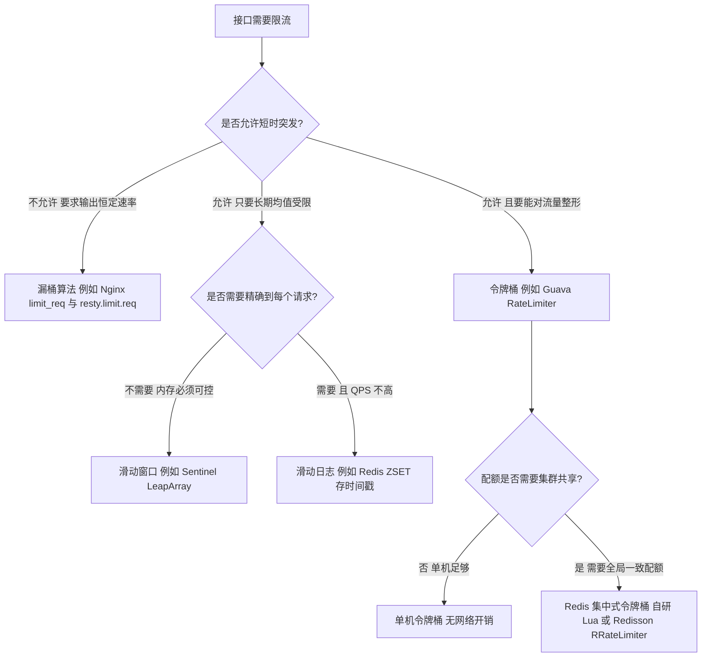

### 2.2 固定窗口：最简单也最容易被打穿

固定窗口把时间切成等长区间（例如 1 秒），每区间一个计数器，到点清零。

Redis 实现的经典写法（放在 Lua 脚本里保证原子性）：

```lua
-- KEYS[1] = 限流 key，ARGV[1] = 阈值，ARGV[2] = 窗口毫秒数
local current = redis.call('INCR', KEYS[1])
if current == 1 then
  redis.call('PEXPIRE', KEYS[1], ARGV[2])
end
if current > tonumber(ARGV[1]) then
  return 0
end
return 1
```

**临界问题（必须能算给面试官听）**：设阈值 100 QPS、窗口 1 秒，窗口边界为 1000ms。
- 第 900ms~1000ms 的 100ms 内通过 100 个请求（属于窗口 [0,1000)）；
- 第 1000ms~1100ms 的 100ms 内又通过 100 个请求（属于窗口 [1000,2000)）；
- 于是 **200ms 内实际通过了 200 个请求，瞬时速率达到 1000 QPS**，是阈值的 10 倍。

窗口边界被"打穿"的根因：计数器在边界处**硬重置**，没有任何跨窗口的平滑。固定窗口只适合"对精度不敏感、只要长期均值受限"的场景，例如统计类接口、后台任务触发口。

### 2.3 滑动窗口：用环形数组逼近滑动日志

滑动窗口把大窗口切成 `N` 个小桶，统计时把"当前时间往前推一个窗口"覆盖到的所有小桶求和，然后让窗口随时间滑动。桶越小越接近精确，代价是内存和遍历成本。

Sentinel 的实现（`com.alibaba.csp.sentinel.slots.statistic.base.LeapArray`，Sentinel 1.8.x）：
- `windowLengthInMs`：单桶时长，`intervalInMs / sampleCount`；
- `arrayLength`：桶数量，等于 `sampleCount`；
- `SampleCountProperty.SAMPLE_COUNT` 默认为 **2**，`IntervalProperty.INTERVAL` 默认为 **1000ms**，所以秒级统计是 **2 个 500ms 的桶**；
- 分钟级统计（`DefaultNode` 中的 `rollingCounterInMinute`）按 `ArrayMetric(60, 60 * 1000)` 构建，即 **60 个 1 秒桶**；
- 每个桶是 `WindowWrap<MetricBucket>`，记录 `windowStart`；`MetricBucket` 内部用 `LongAdder[]` 按 `MetricEvent` 下标存放 `PASS/BLOCK/EXCEPTION/SUCCESS/RT/OCCUPIED_PASS` 六类计数。

**Sentinel 秒级统计只有 2 个桶，意味着 1 秒的滑动窗口实际是"当前桶 + 前一个桶"，精度约 500ms 级，不是真正的逐请求滑动**。这是面试里区分"背概念"和"看过源码"的分水岭。

`LeapArray` 的写入逻辑（`currentWindow` 系列方法）核心是三段判定：
1. 计算 `windowStart = timeMillis - timeMillis % windowLengthInMs`；
2. 用 `(int)((windowStart / windowLengthInMs) % arrayLength)` 定位桶下标 `idx`（源码是 `timeId = timeMillis / windowLengthInMs`，再取 `timeId % array.length()`）；
3. 比较 `windowStart` 与该桶的 `windowStart`：相等直接返回；`windowStart` 更大（时间正常推进）则加锁复用该桶并重置统计（`resetWindowTo`）；`windowStart` 更小（时钟回拨、传入时间戳落后）则直接新建 `WindowWrap`，不复用。**桶是否过期不在这里判断**，而在读取路径的 `isWindowDeprecated(timeMillis, windowWrap)`：`timeMillis - windowStart > intervalInMs` 的桶不再计入统计。

代价与权衡：
- 桶越多精度越高，但每次 `passQps` 统计要遍历所有桶，QPS 越高 CPU 越贵；
- 桶复用的判定会让"恰好落在边界"的请求被算进新桶，因此仍有极小概率的临界误差；
- 所以 Sentinel 的默认 2 桶是**精度与开销的折中**，可以通过 `-Dcsp.sentinel.statistic.max.rt` 等参数调整统计行为；改变 `SAMPLE_COUNT` 则只能走 `SampleCountProperty.updateSampleCount(int)`（它会顺带重置 `ClusterNode` 缓存），而且**已经建好的 `DefaultNode` 仍用旧桶数**。

### 2.4 漏桶：恒定输出速率，天然抗突发

漏桶把请求先放进桶，再以**固定速率**漏出。桶满则拒绝（或排队）。它不关心请求到达速率，只保证流出速率恒定，因此**没有任何突发**。

Nginx 的两个指令（`ngx_http_limit_req_module`）：
- `limit_req_zone $binary_remote_addr zone=perip:10m rate=100r/s;` —— 声明共享内存区，`rate` 是漏出速率；
- `limit_req zone=perip burst=200 nodelay;` —— `burst` 是桶中允许排队的请求数（额外容量）；
- 不带 `nodelay` 时，`burst` 内的请求按 `rate` 匀速放行，客户端感受为变慢；
- 带 `nodelay` 时，`burst` 内的请求立即放行，但**桶中的槽位仍按 `rate` 恢复**，所以突发之后会有一段"不能再来突发"的惩罚期；
- 超出 `burst` 的请求默认返回 503，用 `limit_req_status 429;` 改成 429 更符合语义；
- `10m` 共享内存大约能保存 **16 万个** `$binary_remote_addr` 键（官方文档口径 1MB 约 16000 个状态），内存耗尽后按 LRU 淘汰，被淘汰的 key 相当于计数清零，会出现"限流突然失效"。

关键认知：**`burst` 不等于"允许 QPS 提升到 rate+burst"**，它只影响突发窗口能吸收多少请求，长期平均仍然被 `rate` 卡死。

### 2.5 令牌桶：允许突发，Guava 的平滑突发与平滑预热

令牌桶以固定速率往桶里放令牌，桶有容量上限，请求取到令牌才能通过。

Guava（`com.google.common.util.concurrent.RateLimiter`，Guava 32.x）的核心结构与默认值：
- `RateLimiter.create(double permitsPerSecond)` 返回 `SmoothBursty`，桶容量 `maxPermits = maxBurstSeconds * permitsPerSecond`，其中 `maxBurstSeconds` 默认 **1.0**，即"最多攒 1 秒的令牌"；
- `RateLimiter.create(double permitsPerSecond, long warmupPeriod, TimeUnit unit)` 一律返回 `SmoothWarmingUp`（冷启动预热）：源码里只校验 `warmupPeriod >= 0`，传 0 也不会退化成 `SmoothBursty`，只是 `maxPermits` 退化为 0、再也攒不出突发额度；
- `SmoothRateLimiter` 的关键字段：`stableIntervalMicros = 1_000_000 / permitsPerSecond`（微秒）、`storedPermits`、`maxPermits`、`nextFreeTicketMicros`；
- `SmoothWarmingUp` 的 `coldFactor` 硬编码为 **3.0**，即冷启动时的最大速率只有稳定速率的 1/3，在 `warmupPeriod` 内线性放开；
- `resync(long nowMicros)` 负责按流逝时间补充令牌，且只在 `nowMicros > nextFreeTicketMicros`（有令牌可补）时执行：`storedPermits = min(maxPermits, storedPermits + (nowMicros - nextFreeTicketMicros) / coolDownIntervalMicros())`，并把 `nextFreeTicketMicros` 推进到 `nowMicros`（`coolDownIntervalMicros()` 在 `SmoothBursty` 下等于 `stableIntervalMicros`，在 `SmoothWarmingUp` 下等于 `warmupPeriodMicros / maxPermits`）；
- `reserveEarliestAvailable(requiredPermits, nowMicros)` 是取令牌的核心：先 `resync`，再返回 `returnValue = nextFreeTicketMicros`，然后 `nextFreeTicketMicros = returnValue + storedPermitsToWaitTime(storedPermits, storedPermitsToSpend) + (新鲜令牌不足的部分) * stableIntervalMicros`（`SmoothBursty` 的 `storedPermitsToWaitTime` 恒为 0；`SmoothWarmingUp` 取用存量令牌要按预热曲线额外等待）。

**最容易被追问的一点：Guava `RateLimiter` 没有"拒绝"语义，只有"延迟"语义。**
- `acquire()` 会阻塞直到拿到令牌，返回本次等待的秒数；
- `tryAcquire()` 等价于 `tryAcquire(1, 0, TimeUnit.MICROSECONDS)`，超时 0，但它**在桶里有存量令牌时依然会返回 true**；
- 如果桶里没有令牌，`tryAcquire` 会"预支"未来的令牌并让 `nextFreeTicketMicros` 前移，也就是说**这一次拒绝了，但下一次会更晚才能通过**；
- 因此直接用它做"超限就拒绝"是错的，正确做法是配合 `tryAcquire(0)` 的返回值 + 自己的一次性限流保护，或直接用 Sentinel 的 `CONTROL_BEHAVIOR_DEFAULT` 快速失败。

**`SmoothWarmingUp` 的生产价值**：新发布实例的 JIT 未编译、连接池未预热、本地缓存为空，此时按标称 QPS 放开必然慢。用预热令牌桶让实例在 30~60 秒内逐步放量，比"先拒绝一部分流量"更平滑。

### 2.6 滑动日志：精度最高、代价最大

滑动日志记录**每个通过请求的时间戳**，判断"当前时间往前推一个窗口内"的时间戳个数是否超过阈值。

Redis ZSET 实现：
- `ZREMRANGEBYSCORE key 0 (now - window)` 清理过期成员；
- `ZCARD key` 得到窗口内请求数；
- 未超限则 `ZADD key now now`，并 `PEXPIRE key window`；
- 三条命令必须放在一个 Lua 脚本里原子执行，否则并发下会超发。

坑点：
- 内存与 QPS 成正比（`O(窗口内请求数)`），10000 QPS × 1 秒窗口 = 10000 个 ZSET 成员，单 key 内存约数百 KB；
- `now` 用 ZSET 的 score，若两个请求在同一毫秒，`ZADD` 会因成员相同而覆盖，**必须用 `now + 随机后缀` 或 `INCR` 生成的唯一成员名**；
- 一般只用于低 QPS 但要求精确的场景，例如"每个用户每分钟只能领 3 次券"。

### 2.7 时间精度与时钟的坑

- Sentinel 提供 `TimeUtil.currentTimeMillis()`，它**不直接调系统调用**：一个名为 `sentinel-time-tick-thread` 的守护线程每 1 毫秒把 `System.currentTimeMillis()` 写进一个 volatile 字段，读取方只做一次 volatile 读，用于降低高频计数的系统调用开销（代价是时间戳有 1ms 级的滞后）；
- 多机做集中式限流时，**不要用业务机器的时间做窗口判定**，用 Redis 服务端的 `TIME`（返回 `{秒, 微秒}`）或直接用 `INCR` + `PEXPIRE` 让 Redis 自己管过期；
- Redis 3.2 起提供 `redis.replicate_commands()`，调用后脚本按**效果复制**（复制脚本产生的写入而不是脚本原文），此时脚本里调用非确定性命令（`TIME`、`RANDOMKEY`、`SRANDMEMBER`）才不会造成主从不一致；Redis 5.0 起效果复制是默认行为，所以脚本里用 `TIME` 是安全的；
- 容器/vm 的时钟回拨会让滑动窗口出现"负跨度"：`LeapArray` 计算出的 `windowStart` 落后于桶上记录的时间戳时，会返回一个全新的空桶（不会把旧桶的统计算进来，也不会覆盖数组里的旧桶），因此不会死锁或统计错乱。

## 三、单机限流落地：Guava RateLimiter 与 Sentinel FlowRule

### 3.1 单机限流够不够用

| 场景 | 单机限流是否足够 | 说明 |
| --- | --- | --- |
| 保护本机资源（线程池、连接池、CPU） | 足够 | 目的是自保，本机视角最准确 |
| 保护下游依赖的总配额 | 不够 | N 台机器各自按单机阈值放行，总流量是 N 倍 |
| 第三方接口的配额（如支付、短信） | 不够 | 供应商按全局额度计费，超了直接报错甚至封号 |
| 灰度/热点隔离（同城双活不同机房） | 部分够 | 单机房内单机限流 + 机房级阈值组合 |

正确姿势：**单机限流作为兜底（保护自己），集群限流作为总闸（保护依赖）**，两者同时配置，单机阈值 = 集群阈值 / 实例数 × 1.2（留 20% 不均摊余量）。

### 3.2 Sentinel `FlowRule` 的字段与常量

`com.alibaba.csp.sentinel.slots.block.flow.FlowRule` 的关键字段（Sentinel 1.8.x）：

| 字段 | 含义 | 默认值 / 常量 |
| --- | --- | --- |
| `resource` | 资源名，`SphU.entry("xxx")` 或 `@SentinelResource("xxx")` 中的值 | 必填 |
| `limitApp` | 针对来源，`default` 表示不区分来源 | `RuleConstant.LIMIT_APP_DEFAULT` |
| `grade` | 阈值类型 | `FLOW_GRADE_THREAD = 0`（并发线程数）、`FLOW_GRADE_QPS = 1`（默认） |
| `count` | 阈值，QPS 模式下是每秒请求数，线程模式下是并发线程数 | 必填 |
| `strategy` | 流控模式 | `STRATEGY_DIRECT = 0`（直接）、`STRATEGY_RELATE = 1`（关联）、`STRATEGY_CHAIN = 2`（链路） |
| `refResource` | 关联/链路模式下的参照资源名 | 关联与链路模式必填 |
| `controlBehavior` | 流控效果 | `CONTROL_BEHAVIOR_DEFAULT = 0` 快速失败、`CONTROL_BEHAVIOR_WARM_UP = 1` 预热、`CONTROL_BEHAVIOR_RATE_LIMITER = 2` 匀速排队、`CONTROL_BEHAVIOR_WARM_UP_RATE_LIMITER = 3` 预热 + 排队 |
| `warmUpPeriodSec` | 预热时长 | **10** 秒 |
| `maxQueueingTimeMs` | 匀速排队的最大排队时长 | **500** 毫秒 |
| `clusterMode` / `clusterConfig` | 是否集群流控及其配置 | `false` |

三种流控模式的语义差别（这是高频追问点）：
- **直接模式**：对资源自身限流。
- **关联模式**：`refResource` 超过阈值时，限流当前资源。典型用法：读接口 `queryOrder` 关联写接口 `updateOrder`——写压力大时优先保写，牺牲读。
- **链路模式**：只对**特定调用入口**限流。例如 `serviceA` 与 `serviceB` 都调用资源 `dbQuery`，链路模式指定入口 `serviceA`，则从 `serviceA` 进入 `dbQuery` 的调用被限流，`serviceB` 的不受影响。链路模式依赖 `ContextUtil.enter(name, origin)` 传入的 context name，**必须区分入口 context，否则统计会混在一起**。

链路模式的实现细节：`NodeSelectorSlot` 按 `Context` 的名字分别构建 `DefaultNode`（不同 context name 是两棵树），`FlowRuleChecker#selectReferenceNode` 对 `STRATEGY_CHAIN` 只做一次判断——`refResource.equals(context.getName())` 成立才用当前 `DefaultNode` 统计，不成立这条规则对本次调用直接不生效，因此**只有通过 `ContextUtil.enter(contextName)` 显式区分入口，链路规则才有意义**。

预热流控（`WarmUpController`）的核心公式（Sentinel 1.8.x 源码）：

```text
coldFactor = 3.0
warningToken = (warmUpPeriodInSec * count) / (coldFactor - 1)
maxToken      = warningToken + 2 * warmUpPeriodInSec * count / (1 + coldFactor)
slope         = (coldFactor - 1) / count / (maxToken - warningToken)
```

当当前令牌数 `restToken` 落在 `[warningToken, maxToken]` 区间时，阈值不再是 `count`，而是 `Math.nextUp(1.0 / (aboveToken * slope + 1.0 / count))`（其中 `aboveToken = restToken - warningToken`）：**`restToken` 越大（越"冷"）阈值越低，最低到 `count / coldFactor`**；`restToken` 回落到 `warningToken` 以下说明预热完成，阈值恢复为 `count`。注意 `coldFactor` 是 Sentinel 内部常量 **3.0**，与 Guava `SmoothWarmingUp` 的 `coldFactor = 3.0` 一致，这不是巧合，Sentinel 的预热实现参考了 Guava 令牌桶。

匀速排队（`RateLimiterController`）的机制：
- 记录 `latestPassedTime`，计算 `expectedTime = latestPassedTime + costTime`，`costTime = 1000 / count`（毫秒）；
- 若 `expectedTime - currentTime > maxQueueingTimeMs` 则拒绝（`FlowException`）；
- 否则 `Thread.sleep(expectedTime - currentTime)` 后放行，并更新 `latestPassedTime`；
- 因此排队是**真的睡线程**，QPS 高、排队时间长时会把 Tomcat/Netty 线程睡满，**`maxQueueingTimeMs` 不要超过业务超时预算的 1/3**。

## 四、分布式限流：Redis + Lua、集群流控与热 key

### 4.1 为什么必须用 Lua

分布式限流的本质是"把计数器从本地内存搬到共享存储"。共享存储带来三个问题：**原子性、网络往返、单点**。

- **原子性**：`GET` 判断 + `INCR` 写入是两步，并发下必然超发。Redis 单线程执行 Lua 脚本期间不会插入其他命令，一个脚本等于一个原子操作。
- **网络往返**：一次限流判定至少 1 次 RTT，同机房约 0.2~1ms。若一次请求要判 3 个维度（用户、IP、全局），串行就是 3 次 RTT，必须用 pipeline 或把多个维度合并进一个脚本。
- **单点与容量**：Redis 单节点 10 万 QPS 量级，限流本身会成为瓶颈，需要按业务维度分片（例如按接口分 key、按用户 hash 分片），但分片会破坏全局阈值精度。

### 4.2 Redis + Lua 令牌桶实现

下面的脚本用 Redis 服务端时间做填充，两个 key 分别存令牌数与上次填充时间，`HMGET` 一次取回避免两次 RTT：

```lua
-- KEYS[1] = 令牌数的 hash key
-- ARGV[1] = 速率 每秒补充的令牌数
-- ARGV[2] = burstCapacity 桶容量
-- ARGV[3] = 本次请求需要的令牌数
local time = redis.call('TIME')
local now = tonumber(time[1]) * 1000 + math.floor(tonumber(time[2]) / 1000)
local values = redis.call('HMGET', KEYS[1], 'tokens', 'timestamp')
local tokens = tonumber(values[1])
local lastRefill = tonumber(values[2])
if tokens == nil then
  tokens = tonumber(ARGV[2])
  lastRefill = now
end
local delta = math.max(0, now - lastRefill)
local filled = delta * tonumber(ARGV[1]) / 1000
tokens = math.min(tonumber(ARGV[2]), tokens + filled)
local allowed = 0
local remaining = math.floor(tokens)
if tokens >= tonumber(ARGV[3]) then
  tokens = tokens - tonumber(ARGV[3])
  allowed = 1
  remaining = math.floor(tokens)
end
redis.call('HMSET', KEYS[1], 'tokens', tokens, 'timestamp', now)
redis.call('PEXPIRE', KEYS[1], math.ceil(tonumber(ARGV[2]) / tonumber(ARGV[1]) * 1000) + 1000)
return { allowed, remaining }
```

三个必须写进答案的工程点：
1. **`TIME` 用服务端时间**，避免客户端时钟不一致导致令牌数抖动；
2. **`PEXPIRE` 不能省**，否则闲置 key 永久驻留，Redis 内存被限流键吃满（每个 key 至少几十字节，百万用户就是几十 MB 起）；
3. **Lua 内不能有不确定分支**（例如 `RANDOMKEY`）：Redis 5.0 之前脚本按原文复制，主从执行结果会不同、数据不一致；5.0 起默认效果复制，这类命令才安全（版本前提见 2.7）。

### 4.3 Redis 滑动窗口限流的时序

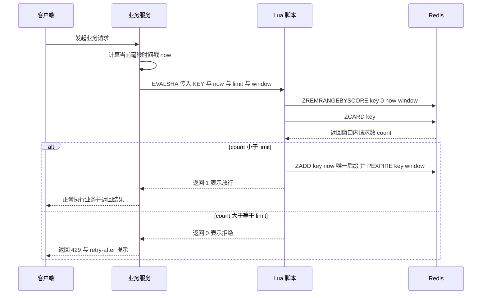

### 4.4 Redis 限流的七个生产坑

| 坑 | 现象 | 正确做法 |
| --- | --- | --- |
| 未用 Lua 脚本 | 并发下超发 10%~30% | 判定与写入合并为一个脚本，用 `EVALSHA` 复用脚本缓存 |
| 客户端时间 | 多机时钟差 100ms 窗口统计错乱 | 脚本内用 `TIME` 或只用 `INCR` + `PEXPIRE` |
| key 无过期 | 内存持续上涨，`INFO memory` 里 `used_memory` 只增不减 | 每个 key 都设 `PEXPIRE`，并加监控 |
| Redis Cluster 多 key | 报 `CROSSSLOT Keys in request don't hash to the same slot` | 多 key 用 hash tag，例如 `rate:{userId}:tokens` 与 `rate:{userId}:ts` |
| 热 key | 单个限流 key 打到 5 万 QPS，Redis 单分片 CPU 打满 | 本地预取令牌（每实例一次预取 100 个，本地扣减）、key 打散、读写分离 |
| 限流判定阻塞业务 | Redis 抖动导致业务 RT 上升 | 限流调用设 50~200ms 超时，超时按"放行 + 告警"或"拒绝"由业务安全方向决定 |
| Redis 故障 | 全站被拒或全站不限流 | 预置降级策略：默认**放行**保可用性，配合单机限流兜底；资金类默认**拒绝**保安全 |

**热 key 的解法值得展开**：限流键天然是热 key（全局 QPS 键每秒被访问几万次）。工程上常用"批量预取 + 本地令牌"：
- 每实例维护一个本地令牌桶，桶里令牌来自 Redis 的批量发放（一次 `DECRBY 100`）；
- 本地扣减不走网络，Redis 只承担 `总QPS / 100` 的访问量；
- 代价是**集群维度上会有最多 `实例数 × 批量大小` 的令牌误差**，需要把批量大小控制在总配额的 1%~5%。

### 4.5 集群流控：Sentinel Token Server 的取舍

Sentinel 的集群流控引入两种角色：
- **Token Server**：按 `flowId` 维护全局配额，两种部署模式——嵌入式（从业务实例中选一个当 server，省一次网络跳转但会占用业务资源）与独立模式（单独部署 server 集群，客户端通过 token server 地址列表连接，需要额外配置客户端侧的 server 地址）；
- **Token Client**：业务实例，向 Token Server 请求令牌。

关键配置项（`ClusterFlowConfig`）：
- `flowId`：集群规则编号，服务端与客户端必须一致；
- `thresholdType`：`0` 表示**单机均摊**（全局阈值 = 单机阈值 × 连接数），`1` 表示**全局阈值**；
- `fallbackToLocalWhenFail`：默认为 **true**，Token Server 不可用时退化为单机限流，这是它能在生产用的关键；
- `sampleCount`、`windowIntervalMs`：客户端请求令牌的采样行为。

集群流控的固有难点：
1. **Token Server 是单点**：它挂了以后靠 `fallbackToLocalWhenFail` 兜底，但兜底期间全局阈值形同虚设；
2. **网络开销**：每次判定多一次 RPC，QPS 上万时 server 的 CPU 会成为瓶颈，需要按 `flowId` 分片到多个 server；
3. **配额不均摊**：实例数变化（扩容/缩容）瞬间，单机均摊阈值会失真，所以更推荐全局阈值 + 单机兜底；
4. **与规则一致性耦合**：规则推送必须保证 server 与 client 同时生效，否则出现"server 认为阈值 1000、client 认为 500"的窗口期。

结论：**能不用集群流控就不用**；优先用"网关层全局限流 + 服务层单机限流"的组合，把全局配额收敛到网关这一层（网关实例数少、流量单一入口、没有 RPC 开销）。

## 五、熔断器状态机与框架参数对比

### 5.1 三态状态机

熔断器的本质是一个**带记忆的开关**：错误积累到阈值就断开，断开一段时间后试探，试探成功就恢复。

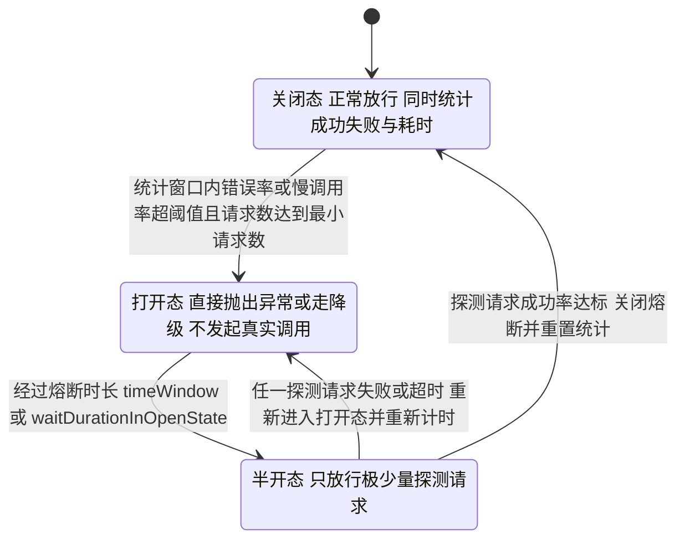

三个状态的实现要点：
- **Closed → Open** 的判定依赖"统计窗口 + 最小请求数"，避免低流量下 1 次失败就 100% 错误率误触发；
- **Open → HalfOpen** 有两种触发方式：**定时自动转换**（后台线程，Hystrix 是 `metrics.healthSnapshot.intervalInMilliseconds=500` 采样后由 `sleepWindow` 控制）与**调用时惰性转换**（Resilience4j 默认 `automaticTransitionFromOpenToHalfOpenEnabled=false`，即只有新请求到来才尝试转半开）；
- **HalfOpen → Closed** 必须**重置统计窗口**，否则旧的失败计数会立刻把状态打回 Open，形成"永远恢复不了"的死循环。Sentinel 的 `AbstractCircuitBreaker#fromHalfOpenToClose` 会 `resetStat`；Resilience4j 的 `CircuitBreakerStateMachine` 在转 Closed 时会重置 metrics；
- **半开态放行数量要极小**：Sentinel 1.8 的 `AbstractCircuitBreaker#tryPass`（`ResponseTimeCircuitBreaker` 等直接继承）用 `AtomicReference<State>` 的 CAS 从 `OPEN` 抢到 `HALF_OPEN`，**只放行抢到 CAS 的那一个请求**；Resilience4j 用 `permittedNumberOfCallsInHalfOpenState`（默认 **10**）。放行太多等于没熔断，刚恢复的下游会被立刻再次打挂。

### 5.2 三大框架对照（含默认值）

| 维度 | Hystrix 1.5.18 | Sentinel 1.8.x | Resilience4j 1.7.x / 2.x |
| --- | --- | --- | --- |
| 维护状态 | **2018 年 11 月进入维护模式**，不再新增功能 | 活跃，阿里生产验证 | 活跃，官方推荐替代 Hystrix |
| 熔断参数模型 | 滚动窗口错误率 | 异常比例 / 异常数 / 慢调用比例 | 失败率 / 慢调用率 |
| 统计窗口 | `metrics.rollingStats.timeInMilliseconds=10000`，`numBuckets=10`（1 秒 1 桶） | `statIntervalMs` 默认 **1000ms**（可配更大） | `slidingWindowType=COUNT_BASED` 默认，`slidingWindowSize=100` |
| 最小请求数 | `circuitBreaker.requestVolumeThreshold=20` | `minRequestAmount` 默认 **5** | `minimumNumberOfCalls` 默认 **100**（等于窗口大小） |
| 错误率阈值 | `circuitBreaker.errorThresholdPercentage=50` | `count` 按 grade 解释，异常比例时是 0~1 的小数 | `failureRateThreshold=50`（百分比） |
| 打开时长 | `circuitBreaker.sleepWindowInMilliseconds=5000` | `timeWindow` 单位**秒**，需显式设置 | `waitDurationInOpenState=60s` |
| 慢调用支持 | 无独立慢调用维度，靠超时 | `slowRatioThreshold` 默认 **1.0**（等于不生效），慢调用 RT 阈值由 `count` 承担 | `slowCallDurationThreshold=60s`、`slowCallRateThreshold=100`（默认不生效） |
| 半开放行 | 第一次请求试探 | 1 个请求 | `permittedNumberOfCallsInHalfOpenState=10` |
| 隔离方式 | 线程池（默认）与信号量 | 信号量式（基于并发线程数统计） | Bulkhead 信号量与线程池两种 |
| 超时实现 | `execution.isolation.thread.timeoutInMilliseconds=1000` | 无内置超时，需自行配合 | `TimeLimiter` 默认 1s |
| 规则动态性 | 需要 Archaius 或自行接入 | 原生支持 Nacos/Apollo/ZooKeeper 动态规则 | 需要自行接入配置源 |

### 5.3 用 Sentinel 配一条"慢调用熔断"

```java
DegradeRule rule = new DegradeRule("queryUser")
    .setGrade(RuleConstant.DEGRADE_GRADE_RT)   // 慢调用比例模式，1.8 起该 grade 支持比例判定
    .setCount(200)                             // 慢调用判定阈值：RT 超过 200ms 记为慢调用
    .setSlowRatioThreshold(0.5)                // 慢调用比例阈值 0.5，默认 1.0 等于不生效
    .setTimeWindow(10)                         // 熔断时长 10 秒，单位是秒
    .setMinRequestAmount(20)                   // 窗口内至少 20 个请求才判定
    .setStatIntervalMs(1000);                  // 统计窗口 1 秒
DegradeRuleManager.loadRules(Collections.singletonList(rule));
```

**必须能解释 `count` 与 `slowRatioThreshold` 的区别**：在 `DEGRADE_GRADE_RT`（慢调用比例）模式下，`count` 是**慢调用的 RT 阈值（毫秒）**，`slowRatioThreshold` 是**慢调用占比阈值（0.0~1.0 的小数）**。`slowRatioThreshold` 默认值是 **1.0**，含义是"慢调用数等于总请求数才算触发"，所以**不显式设置它等于这个维度不生效**——这是"熔断规则配了却没断开"最常见的原因。另外 `timeWindow` 的单位是**秒**而不是毫秒，和 Hystrix 的 `sleepWindowInMilliseconds` 容易混。

参数配套经验值：

| 场景 | `minRequestAmount` | `statIntervalMs` | `timeWindow` | 说明 |
| --- | --- | --- | --- | --- |
| 高 QPS 核心接口（>1000 QPS） | 20~50 | 1000 | 5~10s | 快速止损，避免长窗口掩盖抖动 |
| 中低 QPS 接口（10~100 QPS） | 10~20 | 10000 | 30~60s | 窗口太短会因样本不足反复抖动 |
| 第三方接口 | 5~10 | 1000 | 30~60s | 优先保自身，宁可多熔断一会儿 |
| 批量任务依赖 | 按批次数 | 60000 | 60~300s | 与调度周期对齐 |

### 5.4 熔断的三个常见反模式

1. **只配熔断不配超时**：熔断判定依赖"慢调用"，但如果没有超时，慢调用会一直占着线程，等到比例算出来时线程池已经满了。**超时是第一道防线，熔断是第二道。**
2. **熔断后直接抛异常给用户**：熔断必须配降级兜底，否则只是把"慢失败"换成"快失败"，用户体验没有改善。
3. **熔断粒度过粗**：按整个下游服务名熔断，会导致一个接口慢就把该服务的所有接口全熔断。正确做法是按"依赖 + 接口"维度设置资源粒度，例如 `userService.queryUserById` 而不是 `userService`。

## 六、隔离策略：线程池隔离 vs 信号量隔离

### 6.1 两种隔离的本质差异

| 维度 | 线程池隔离 | 信号量隔离 |
| --- | --- | --- |
| 资源模型 | 每个依赖一个独立 `ThreadPoolExecutor` | 一个 `Semaphore` 计数 |
| 是否切换线程 | 是（业务线程 → 执行线程） | 否（在原线程执行） |
| 超时能否中断 | 逻辑上可以（Future 超时后丢弃结果），但阻塞式 socket read 不响应 interrupt | 不能，超时控制由底层 HTTP 客户端负责 |
| 支持异步 | 是（返回 `Future` / `CompletableFuture`） | 仅同步 |
| ThreadLocal 传递 | 默认丢失，需要手动传递（Hystrix 用 `HystrixRequestContext`，Spring 用 `RequestContextHolder` 的 `RequestAttributes`） | 完整保留 |
| 单次调用开销 | 有队列 + 上下文切换，微秒到百微秒级 | 只有 CAS 与计数 |
| 资源上限 | 明确（corePoolSize + queue） | 明确（并发数上限） |
| 池大小配置失误的后果 | 队列积压，RT 雪崩式上升 | 信号量耗尽后立刻拒绝，反而更安全 |

Hystrix 具体默认值（`HystrixCommandProperties` / `HystrixThreadPoolProperties`）：
- `execution.isolation.strategy` 默认 **THREAD**；
- `execution.isolation.thread.timeoutInMilliseconds` 默认 **1000**，`execution.timeout.enabled` 默认 true；
- `execution.isolation.semaphore.maxConcurrentRequests` 默认 **10**（信号量模式下生效）；
- `coreSize` 默认 **10**，`maxQueueSize` 默认 **-1**（使用 `SynchronousQueue`，不排队）；`queueSizeRejectionThreshold` 虽然默认 **5**，但 `HystrixThreadPoolDefault#isQueueSpaceAvailable` 在 `queueSize <= 0`（即 `maxQueueSize <= 0`）时直接返回 true，所以**默认配置下它并不生效**，拒绝完全由线程池自身（核心线程占满即拒绝）决定；
- `allowMaximumSizeToDivergeFromCoreSize` 默认 false（`maximumSize` 不生效）；
- `keepAliveTimeMinutes` 默认 **1**。

Resilience4j 的具体默认值：
- `BulkheadConfig`：`maxConcurrentCalls=25`、`maxWaitDuration=0`（等待 0 即立刻拒绝）；
- `ThreadPoolBulkheadConfig`：`coreThreadPoolSize = CPU 核数 - 1`、`maxThreadPoolSize = CPU 核数`、`queueCapacity=100`、`keepAliveDuration=20ms`；
- `TimeLimiterConfig`：`timeoutDuration=1s`、`cancelRunningFuture=true`。**关键限制：`TimeLimiter` 只对返回 `CompletionStage` 的异步方法生效，同步方法加 `@TimeLimiter` 不生效**，这是生产里最常见的"配了超时却不生效"。

Sentinel 的隔离是**信号量式**：`FlowRule` 的 `grade = FLOW_GRADE_THREAD` 时按并发线程数统计。`StatisticSlot#entry` 调用 `node.increaseThreadNum()`，`StatisticSlot#exit` 调用 `node.decreaseThreadNum()`，统计的是"穿过该资源且尚未返回的线程数"，因此**它统计的是业务线程，不需要额外线程池**。

### 6.2 怎么选：决策规则

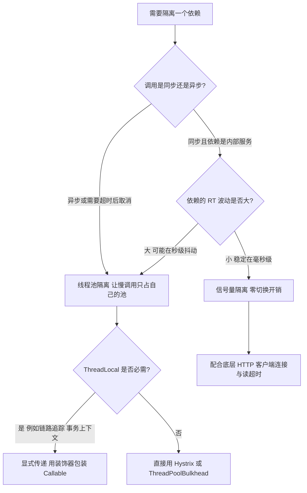

实践结论：
- **大多数场景用"信号量 + 超时 + 熔断"三件套**即可，线程池隔离只在"依赖 RT 抖动极大且必须严格隔离"时使用；
- 线程池隔离的池大小必须按 `QPS × P99 RT` 估算（利特尔法则），配小了排队、配大了失去隔离意义；
- 无论哪种隔离，**都必须配超时**。隔离只限制并发数，不限制单次调用时长；100 个并发 × 30 秒超时，一样能拖垮整个系统。

## 七、降级：触发条件与兜底策略设计

### 7.1 降级的触发条件矩阵

| 触发源 | 判定方式 | 典型动作 | 恢复方式 |
| --- | --- | --- | --- |
| 限流拒绝 | `BlockException` 子类 `FlowException` | 返回排队提示或缓存数据 | 流量回落后自动 |
| 熔断打开 | `DegradeException` | 走 `fallback` 兜底 | `timeWindow` 后半开探测 |
| 调用超时 | HTTP/RPC 客户端超时 | 返回兜底 + 上报 | 依赖恢复后自动 |
| 异常率超阈值 | 业务异常计数（Sentinel 异常比例） | 降级整个功能 | 异常率回落 |
| 依赖健康检查失败 | 主动探测（如 Nacos 下线、Hystrix 健康快照） | 摘除依赖 | 健康检查恢复 |
| 人工开关 | 配置中心下发的降级开关键 | 按预案关闭非核心功能 | 人工恢复 |
| 容量预警 | CPU/内存/线程池水位 > 阈值 | 关闭非核心入口（推荐、评论） | 水位回落 |
| 大促预案 | 定时或事件触发 | 提前降级，把资源留给主链路 | 大促结束 |

### 7.2 兜底策略的六种模式

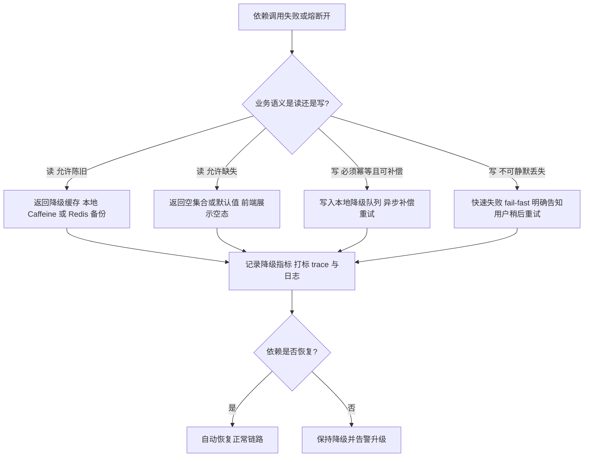

六种兜底模式与适用性：

| 模式 | 说明 | 适用 | 风险 |
| --- | --- | --- | --- |
| 默认值兜底 | 返回常量或空对象 | 推荐位、排行榜、非核心字段 | 用户感知到内容缺失 |
| 缓存兜底 | 返回上一次成功的快照 | 商品详情、配置、字典 | 数据陈旧，可能展示已下架商品 |
| 静态兜底 | 返回预置的静态页面/文案 | 营销页、公告 | 内容不个性化 |
| 排队/削峰 | 进入 MQ 异步处理并返回"处理中" | 异步任务、通知、对账 | 需要幂等与结果查询能力 |
| 功能裁剪 | 关闭非核心功能，保核心链路 | 大促、故障期 | 需要产品提前确认可裁剪清单 |
| 快速失败 | 直接返回错误码与提示 | 资金、库存、幂等键生成 | 用户体验下降但语义安全 |

### 7.3 降级的设计红线

1. **资金、库存、幂等类操作禁止"假成功"**：降级方向必须选 fail-fast。返回"下单成功"但实际没扣库存，是数据事故不是可用性问题。
2. **兜底逻辑不能依赖任何外部资源**：缓存兜底要用**本地**缓存（Caffeine），如果用 Redis 兜底，Redis 挂了兜底也挂。
3. **降级必须有开关且开关要能秒级生效**：从配置中心推送到本地内存缓存，刷新周期不超过 5 秒。
4. **降级必须可观测**：给降级路径打独立指标（`fallback_total{resource="queryUser",reason="circuit_open"}`）与 trace 标签，否则降级长期挂着没人发现。
5. **降级要能自动恢复**：靠 `timeWindow` 后的半开探测或定时校验，不要依赖人工解除。

### 7.4 Sentinel 中 `blockHandler` 与 `fallback` 的区别

```java
@SentinelResource(
    value = "queryUser",
    blockHandler = "handleBlock",
    fallback = "handleFallback",
    exceptionsToIgnore = {IllegalArgumentException.class})
public User queryUser(Long id) { ... }

// blockHandler：只处理 BlockException，参数为原参数 + 末尾 BlockException
public User handleBlock(Long id, BlockException ex) { ... }

// fallback：处理业务异常，参数为原参数 + 可选的 Throwable
public User handleFallback(Long id, Throwable t) { ... }
```

| 维度 | `blockHandler` | `fallback` |
| --- | --- | --- |
| 处理对象 | 仅 `BlockException` 及其子类 | 业务异常（除 `exceptionsToIgnore`） |
| 签名要求 | 与原方法参数一致，末尾多一个 `BlockException` | 与原方法参数一致，末尾可多一个 `Throwable` |
| 是否要求同类 | 默认必须同类的 `public` 方法，或配 `blockHandlerClass` | 同上，或配 `fallbackClass` |
| 返回类型 | 必须与原方法一致 | 必须与原方法一致 |
| 优先级 | 更高，命中后不再走 `fallback` | 低于 `blockHandler` |

必须记住的坑：**`@SentinelResource` 若不配 `blockHandler`，`BlockException` 会走 `fallback`（若配置了）**；若两者都没配，异常会直接向上抛，且**只有通过 Sentinel 代理（Spring AOP 或 `SphU.entry` 包裹）的调用才有资源统计，同类内部方法自调用不经过代理，注解失效**——这与 `@Transactional` 自调用失效是同一类问题。

## 八、Sentinel 内核：资源、规则、Slot 链与滑动窗口

### 8.1 核心概念映射

| 概念 | 类 / 常量 | 说明 |
| --- | --- | --- |
| 资源 | `ResourceWrapper`（`StringResourceWrapper`） | 被保护的逻辑单元，名字唯一 |
| 入口 | `EntryType.IN` / `EntryType.OUT` | IN 表示入口流量，OUT 表示出口依赖调用 |
| 上下文 | `Context`、`ContextUtil.enter(name, origin)` | 一次调用链的上下文，`name` 决定链路统计归属 |
| 入口节点 | `EntranceNode`（`Constants.ROOT`）、`Constants.ENTRY_NODE` | `ROOT` 是资源名 `machine-root` 的根入口节点；`ENTRY_NODE` 是资源名 `__total_inbound_traffic__` 的 `ClusterNode`，汇总所有 `EntryType.IN` 流量，系统自适应保护依赖它统计全局 QPS 与 RT |
| 默认节点 | `DefaultNode` | 一棵按 context 组织的调用树，保存 `rollingCounterInSecond` 与 `rollingCounterInMinute` |
| 集群节点 | `ClusterNode` | 按资源名全局唯一，保存该资源所有上下文的汇总统计 |
| 规则管理器 | `FlowRuleManager`、`DegradeRuleManager`、`SystemRuleManager`、`ParamFlowRuleManager`、`AuthorityRuleManager` | 各自维护内存规则表并提供 `loadRules` |
| 统计事件 | `MetricEvent` | `PASS`、`BLOCK`、`EXCEPTION`、`SUCCESS`、`RT`、`OCCUPIED_PASS` |
| 阻塞异常 | `BlockException` | 子类 `FlowException`、`DegradeException`、`SystemBlockException`、`AuthorityException`、`ParamFlowException` |

规则管理器还有一个生产上必须知道的前提：**`loadRules` 只写当前进程的内存表，应用重启规则就没了**，Dashboard 推送的规则走的也是这条路（原始模式）。要持久化只有两条路：

- **Pull 模式**：客户端定时拉取（如 `FileRefreshableDataSource`），实现简单，但有拉取间隔、规则生效不实时；
- **Push 模式**：接配置中心（Nacos 的 `NacosDataSource`、Apollo、ZooKeeper），客户端实现 `ReadableDataSource` 并注册监听器，配置一变就推送到所有实例，生产推荐；再实现 `WritableDataSource` 才能把 Dashboard 上的改动写回配置中心。

另一个高频坑：`FlowRuleManager#loadRules`、`DegradeRuleManager#loadRules` 都是**整表覆盖**，多来源推送（Dashboard + 配置中心）时后到的会清掉先到的规则，必须先合并再下发——这也是"规则配了却像没生效"的常见根因之一（见高频面试题 Q8）。

### 8.2 Slot 链的执行顺序

Sentinel 的所有功能都挂在一条 `ProcessorSlotChain` 上，由 `SlotChainBuilder` 的 SPI 实现 `DefaultSlotChainBuilder` 构建，每个 Slot 用 `@Spi(order = ...)` 声明顺序，`order` **越小越先执行**。

下面标注的 `order` 数值取自 Sentinel 1.8.x 各 Slot 类上的 `@Spi(order = ...)` 注解。**不同小版本的具体数值可能微调，但相对顺序（统计类在前、规则校验类按权限 → 系统 → 热点 → 流控 → 熔断的顺序）在所有 1.6+ 版本中是一致的**；面试时说出相对顺序和"order 越小越先执行"这条规则，比背数字更重要。

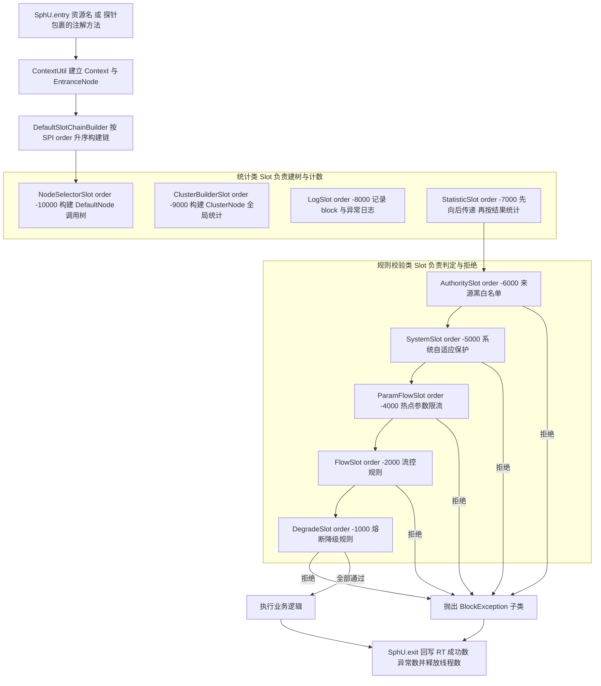

这张图里最值得讲的是 **`StatisticSlot` 的位置与"先放行后统计"语义**：

```java
// StatisticSlot#entry 的核心逻辑（Sentinel 1.8.x）
try {
    // 1) 先向后传递，让后面的规则 Slot 有机会抛 BlockException
    fireEntry(context, resourceWrapper, node, count, prioritized, args);
    // 2) 没有任何 Slot 拒绝，才统计 PASS 与线程数
    node.increaseThreadNum();
    node.addPassRequest(count);
    ...
} catch (PriorityWaitException ex) {
    node.increaseThreadNum();
    ...
} catch (BlockException e) {
    // 3) 被拒绝时统计 BLOCK 并向上抛
    context.getCurEntry().setBlockError(e);
    node.increaseBlockQps(count);
    ...
    throw e;
} catch (Throwable e) {
    node.increaseExceptionQps(count);
    throw e;
}
```

由此可以推导出三个结论：
- **`FlowSlot` 判定用的是"通过"计数**，被前面 Slot 拒绝的请求不会计入 `PASS`，因此不会误伤阈值；
- **`increaseThreadNum` 发生在规则校验之后**，线程数限流统计的是"已经开始执行"的线程，不包含被拒绝的；
- **RT 在 `exit` 时才记录**，所以慢调用熔断的判定有约一个统计窗口的滞后。

### 8.3 滑动窗口统计的数据结构

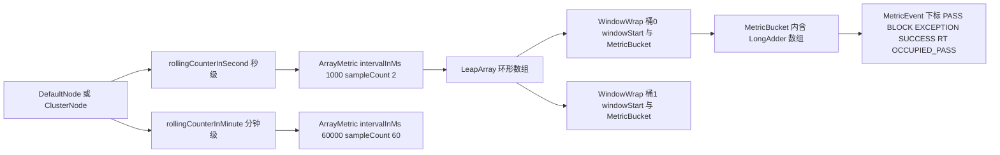

读取统计时（`ArrayMetric#passQps`）会遍历所有桶并累加对应 `MetricEvent` 的计数；写入时定位到当前时间对应桶再 `add`。因为 `MetricBucket` 内部是 `java.util.concurrent.atomic.LongAdder[]`（JDK 8 的 `Striped64` 机制），**高并发计数不会出现单一热点 CAS**。注意 1.8 起 Sentinel 直接用 JDK 自带的 `LongAdder`，1.7.x 及更早版本才为兼容低版本 JDK 自带了一份 `com.alibaba.csp.sentinel.slots.statistic.base.LongAdder`。

`LeapArray` 的三个方法决定了它的正确性：
- `currentWindow(timeMillis, initValue)`：写入路径，负责按如上三段判定复用、重置或新建桶；
- `values()` / `list()`：读取路径，遍历整个数组，因此 `sampleCount` 越大读越慢；
- `isWindowDeprecated(timeMillis, windowWrap)`：判定桶是否过期，`timeMillis - windowWrap.windowStart() > intervalInMs` 时过期。

### 8.4 热点参数限流

`ParamFlowRule`（Sentinel 1.8.x）字段：

| 字段 | 含义 | 默认值 |
| --- | --- | --- |
| `resource` | 资源名 | 必填 |
| `paramIdx` | 参数下标（从 0 开始，对应方法签名里的位置） | 必填 |
| `count` | 阈值 | 必填 |
| `grade` | 阈值类型 | `PARAM_FLOW_GRADE_QPS = 1` |
| `durationInSec` | 统计窗口时长 | **1** 秒 |
| `controlBehavior` | 流控效果 | 快速失败，支持匀速排队 |
| `paramFlowItemList` | 参数例外项 | 空 |
| `clusterMode` | 是否集群 | false |

例外项 `ParamFlowItem` 需要声明参数类型（整型、长整型、字符串），可以给某个具体参数值单独设阈值。例如"秒杀商品 `itemId=123` 的阈值是 100 QPS，其余商品统一 10 QPS"。

实现要点：`ParamFlowSlot#entry` 会把方法参数数组交给 `ParamFlowChecker.passCheck(rule, count, args)`，参数值的热点统计存在 `ParameterMetric` 里，内部用 `CacheMap` 做 **LRU 淘汰**，容量有限。由此得到两个工程结论：
1. **热点参数只适合参数取值可枚举的场景**（商品 ID、用户等级、租户 ID），参数基数巨大（如 UUID、时间戳）时统计表会被反复驱逐，等于没统计；
2. 统计表被驱逐后计数会"从头开始"，表现为**限流间歇性失效**，这是排查"规则配了但偶尔漏过"的重要线索。

`ParamFlowRule` 必须在 `SphU.entry(resource, EntryType, count, args)` 里传 args 才生效，只写 `@SentinelResource` 注解而不用 `SphU.entry` 传参，热点参数统计拿不到参数值。**`@SentinelResource` 的注解方式需要配合 `SentinelResourceAspect`，它内部会把方法参数传给 `SphU.entry`。**

### 8.5 系统自适应保护 `SystemRule`

`SystemRule` 五个字段，默认值全部是 **-1**（表示不生效）：

| 字段 | 含义 | 单位 | 默认 |
| --- | --- | --- | --- |
| `highestSystemLoad` | 系统 load1 阈值 | 1 分钟平均负载 | -1 |
| `avgRt` | 所有入口资源平均 RT 阈值 | 毫秒 | -1 |
| `maxThread` | 所有入口资源并发线程数阈值 | 个 | -1 |
| `qps` | 所有入口资源总 QPS 阈值 | 次/秒 | -1 |
| `highestCpuUsage` | CPU 使用率阈值 | 0.0~1.0 的小数 | -1 |

判定逻辑（`SystemRuleManager#checkSystem` + `SystemSlot`）：
- 系统指标由 `SystemStatusListener` 周期性采样（**秒级**，不是每次请求实时读取），通过 `OperatingSystemMXBean#getSystemLoadAverage` 与 `com.sun.management.OperatingSystemMXBean#getSystemCpuLoad`（JDK 8）或 `getCpuLoad`（JDK 14+）获取，因此判定有一秒级的采样滞后；
- `qps`、`avgRt`、`maxThread` 都基于全局入口节点 `Constants.ENTRY_NODE` 的统计，即**只统计 `EntryType.IN` 的入口流量**；
- 任一规则命中即抛 `SystemBlockException`（`BlockException` 子类），**系统规则的目的是"保命"，不是精确控制，所以阈值要设得比单机容量高 20%~30%**，否则会与业务限流互相干扰。

`highestSystemLoad` 的取值要参考 CPU 核数：Linux 上 load 反映的是可运行 + 不可中断进程数，**load 等于核数即已跑满**。因此 4 核机器建议 `highestSystemLoad` 设为 `核数 * 0.7` 左右（例如 2.8），而不是照抄某个固定数字。

## 九、网关的职责与选型

### 9.1 网关的八项职责

1. **路由转发**：按 path/header/method 把请求转发到后端服务；
2. **认证鉴权**：统一做 JWT/OAuth2 校验，避免每个服务重复实现；
3. **限流与熔断**：全局配额的总闸，唯一入口流量视角最准；
4. **协议转换与适配**：HTTP ↔ gRPC、请求/响应体改写、字段裁剪；
5. **灰度与路由策略**：按用户标签、设备、地域分流，蓝绿与金丝雀发布；
6. **可观测性**：统一 trace id 注入、访问日志、指标埋点；
7. **安全防护**：IP 黑白名单、防重放、请求体大小限制、CORS、WAF 联动；
8. **连接管理**：长连接/WebSocket 保活、超时与重试统一配置。

### 9.2 选型对照

| 维度 | Spring Cloud Gateway 3.1.x / 4.x | Zuul 1.x（`spring-cloud-netflix-zuul`） | Nginx + OpenResty |
| --- | --- | --- | --- |
| 编程模型 | 响应式，WebFlux + Reactor Netty | 阻塞式，Servlet，每请求一线程 | 事件驱动 C + Lua 协程 |
| 单机吞吐（同规格压测口径） | 高，无每请求线程开销 | 低，线程上下文切换明显 | 最高 |
| 是否支持动态路由 | 支持，`RefreshRoutesEvent` 触发 `CachingRouteLocator` 刷新 | 支持，`RefreshRouteService` | 需 `nginx -s reload` 或动态 upstream（OpenResty + 共享内存） |
| 过滤器能力 | pre/post 环绕，可读写请求与响应体 | 四种 filter 类型，`RequestContext` 基于 ThreadLocal | 核心模块 + Lua，能力最强但开发效率最低 |
| 阻塞代码的风险 | 阻塞 EventLoop，必须切 `Schedulers.boundedElastic()` | 天然阻塞，风险由线程池承担 | 阻塞会卡住 worker，风险极大 |
| 生态契合 | 与 Spring Cloud 服务发现、配置中心、链路追踪无缝 | 已被 Spring Cloud 2020.0.0 起移除 | 与 Java 生态解耦 |
| 监控与调试 | 与 Actuator/Micrometer 集成好 | 一般 | 依赖自建，日志分散 |
| 适用位置 | 业务网关（鉴权、灰度、协议转换） | 历史系统维护 | 接入层网关（TLS 卸载、WAF、静态资源、连接数保护） |

**架构结论：Nginx 在最外层做 L4/L7 接入（TLS、静态、粗粒度限流、连接数保护），Spring Cloud Gateway 在第二层做业务网关（鉴权、路由、灰度、细粒度限流），两者不是二选一而是分工。**

Zuul 的两个关键事实（面试常问）：
- Zuul 1.x 基于 `ZuulServlet` + `ZuulFilter` + `RequestContext`，`RequestContext` 是 `ConcurrentHashMap` 且通过 `ThreadLocal` 绑定当前线程，因此**异步/线程池场景下上下文会丢失**；
- 四种 filter 类型固定为 `pre`、`route`、`post`、`error`，执行顺序先按 `filterType` 分组（pre → route → post），组内按 `filterOrder()` 升序。`error` 类型的 filter 在任意阶段抛异常时执行；
- Spring Cloud 2020.0.0（Ilford 版本序列）正式移除了对 Zuul 1 的支持，新项目不应再选它。

## 十、Spring Cloud Gateway 内核与过滤器执行顺序

### 10.1 三大组件

| 组件 | 接口 / 类 | 作用 |
| --- | --- | --- |
| 路由 | `Route`、`RouteDefinition`、`RouteLocator`、`CachingRouteLocator` | `Route` 由 `id`、`uri`、`order`、`predicate`、`filter` 组成；`RouteDefinition` 是配置态，由 `RouteDefinitionRouteLocator` 转成运行态 `Route` |
| 断言 | `PredicateDefinition`、`RoutePredicateFactory` | 匹配请求，常用 `Path`、`Method`、`Host`、`Header`、`Query`、`Cookie`、`RemoteAddr`、`Weight`、`After`/`Before`/`Between` |
| 过滤器 | `GatewayFilter`、`GlobalFilter`、`GatewayFilterFactory` | `GatewayFilter` 只作用于配置它的路由；`GlobalFilter` 作用于所有路由 |

请求处理链：`DispatcherHandler` → `RoutePredicateHandlerMapping`（内部调用 `RouteLocator` 找到第一个匹配的 `Route`，并按 `order` 排序）→ `FilteringWebHandler`（把该路由的 `GatewayFilter` 与所有 `GlobalFilter` 合并排序）→ 过滤器链 → `NettyRoutingFilter` 发起真实请求。

关键实现细节：
- `RoutePredicateHandlerMapping` 继承 `AbstractHandlerMapping`，路由匹配结果放入 `ServerWebExchange` 的属性 `ServerWebExchangeUtils.GATEWAY_ROUTE_ATTR`；
- `FilteringWebHandler#handle` 里把路由的 `GatewayFilter` 用 `GatewayFilterAdapter` 包装成 `GlobalFilter`，然后 `AnnotationAwareOrderComparator.sort(combined)`；
- **路由级 filter 的顺序由配置声明顺序决定**：`OrderedGatewayFilter` 的 order 从 **1** 开始按顺序递增（本身已经实现 `Ordered` 的 filter 保留自己的 order，不再被包一层）；
- `GlobalFilter` 的顺序来自 `Ordered#getOrder()` 或类上的 `@Order`。

### 10.2 内置 GlobalFilter 的顺序与执行模型

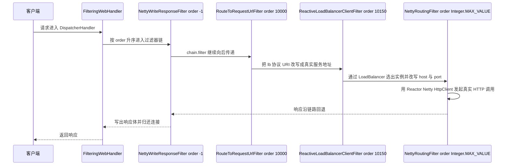

内置过滤器的 order 参考（Spring Cloud Gateway 3.x / 4.x）：

| 过滤器 | order | 作用 |
| --- | --- | --- |
| `RemoveCachedBodyFilter` | `Ordered.HIGHEST_PRECEDENCE`（-2147483648） | 请求结束后清理缓存的请求体，防止内存泄漏 |
| `AdaptCachedBodyGlobalFilter` | `HIGHEST_PRECEDENCE + 1000` | 缓存请求体，供后续过滤器重复读取 |
| `NettyWriteResponseFilter` | **-1** | 整条链的最外层包装，链路回退时写出响应体 |
| `RouteToRequestUrlFilter` | **10000** | `lb://service` → 真实 URI |
| `ReactiveLoadBalancerClientFilter` | **10150** | 通过 `ReactorLoadBalancer` 选实例并改写 host/port |
| `ForwardRoutingFilter` / `NettyRoutingFilter` | `Ordered.LOWEST_PRECEDENCE`（Integer.MAX_VALUE） | 真正发起转发，二者按 URI scheme 二选一 |

两条必答结论：
1. **过滤器是"环绕式"执行**：order 小的先进入 pre 逻辑，order 大的先返回 post 逻辑。`NettyWriteResponseFilter` order 为 -1，只排在 `HIGHEST_PRECEDENCE` 系的清理/缓存过滤器（`RemoveCachedBodyFilter`、`AdaptCachedBodyGlobalFilter`）之后，意味着它**很早进入、最晚返回**，因此它能在最后写出响应体；
2. **`RouteToRequestUrlFilter`（10000）必须在 `ReactiveLoadBalancerClientFilter`（10150）之前**，否则负载均衡拿不到服务名；而真实的 `NettyRoutingFilter` 必须是最大的 order，保证所有改写都已完成。

### 10.3 自定义 GlobalFilter 的正确写法

```java
@Component
public class AuthGlobalFilter implements GlobalFilter, Ordered {

    @Override
    public Mono<Void> filter(ServerWebExchange exchange, GatewayFilterChain chain) {
        String token = exchange.getRequest().getHeaders().getFirst("Authorization");
        if (token == null || !tokenValidator.isValid(token)) {
            exchange.getResponse().setStatusCode(HttpStatus.UNAUTHORIZED);
            exchange.getResponse().getHeaders().setContentType(MediaType.APPLICATION_JSON);
            DataBuffer buffer = exchange.getResponse().bufferFactory()
                    .wrap("{\"code\":401,\"msg\":\"unauthorized\"}".getBytes(StandardCharsets.UTF_8));
            return exchange.getResponse().writeWith(Mono.just(buffer));
        }
        ServerHttpRequest mutated = exchange.getRequest().mutate()
                .header("X-User-Id", tokenValidator.getUserId(token))
                .build();
        return chain.filter(exchange.mutate().request(mutated).build());
    }

    @Override
    public int getOrder() {
        // 必须小于 RouteToRequestUrlFilter 的 10000，鉴权失败才能提前返回
        return -100;
    }
}
```

四个易错点：
1. **鉴权 filter 的 order 必须小于 10000**，且返回错误响应后**不要再调用 `chain.filter`**，否则请求仍会被转发；
2. **不要用阻塞式代码**：`Thread.sleep`、JDBC、`RestTemplate` 在 EventLoop 上执行会阻塞整条 Reactor Netty 的 I/O 线程，必须 `Mono.fromCallable(...).subscribeOn(Schedulers.boundedElastic())`；
3. **修改请求体要用 `ServerHttpRequestDecorator`**，直接 `mutate().body()` 需要自行处理 `DataBuffer` 的引用计数（`DataBufferUtils.retain/release`），否则出现内存泄漏或 `DataBuffer` 已被释放的报错；
4. **`spring.codec.max-in-memory-size` 默认 256KB**，超过会导致大请求体读取失败，需要在网关调大或走流式处理。

### 10.4 动态路由刷新

- 路由来源可以是 `application.yml`（`spring.cloud.gateway.routes`）或配置中心；`RouteDefinitionWriter#save` 写入后需要发布 `RefreshRoutesEvent`，`CachingRouteLocator` 监听该事件并重建缓存；
- Nacos/Apollo 监听配置变化后调用 `RouteDefinitionWriter` 并 `publishEvent(new RefreshRoutesEvent(this))` 是标准做法；
- 注意 `CachingRouteLocator` 的缓存与 `RoutePredicateHandlerMapping` 的匹配是**先匹配先得**：路由多时按 `order` 显式排序，避免通配路由把精确路由抢走。

## 十一、网关限流与鉴权的工程落地

### 11.1 Gateway 的 `RequestRateLimiter` 与 Redis

配置示例（Spring Cloud Gateway 3.1.x / 4.x）：

```yaml
spring:
  cloud:
    gateway:
      routes:
        - id: order-service
          uri: lb://order-service
          predicates:
            - Path=/api/order/**
          filters:
            - name: RequestRateLimiter
              args:
                redis-rate-limiter.replenishRate: 100
                redis-rate-limiter.burstCapacity: 200
                redis-rate-limiter.requestedTokens: 1
                key-resolver: "#{@userKeyResolver}"
      redis-rate-limiter:
        deny-empty-key: true
        empty-key-status-code: 403
```

参数语义与默认值：
- `replenishRate`：令牌桶每秒填充速率，等价于 QPS 上限；
- `burstCapacity`：桶容量，即允许的最大瞬时突发；**`burstCapacity` 必须大于等于 `replenishRate`**，官方建议 `burstCapacity = 2 × replenishRate`；
- `requestedTokens`：单次请求消耗的令牌数，默认 **1**，可用于"一个请求按权重扣多个令牌"的加权限流；
- `deny-empty-key`：KeyResolver 返回空 key 时是否拒绝，默认 **true**；
- `empty-key-status-code`：空 key 时的响应码，默认 **403**；
- 底层是 `RedisRateLimiter` + `request_rate_limiter.lua`，key 形如 `request_rate_limiter.{key}.tokens` 与 `request_rate_limiter.{key}.timestamp`，返回允许标记与剩余令牌数。

```java
@Configuration
public class RateLimiterConfig {
    @Bean
    public KeyResolver userKeyResolver() {
        return exchange -> Mono.justOrEmpty(
                exchange.getRequest().getQueryParams().getFirst("userId"))
                .defaultIfEmpty(exchange.getRequest().getRemoteAddress().getAddress().getHostAddress());
    }
}
```

`KeyResolver` 的选择决定限流维度：`PrincipalNameKeyResolver` 按认证主体（需要 `Principal` 存在，否则空 key 被拒），生产上更常用"用户 ID 优先、IP 兜底"的组合。

必须提醒的三个坑：
1. **`RequestRateLimiter` 不允许在 URL 中明文传用户标识后直接限流**：用户标识必须来自可信来源（网关校验过的 token 或 IP），否则客户端可以随意伪造 key 来绕过限流；
2. **Redis 成为限流单点后，网关的每条路由判定都要访问 Redis**，QPS 高时 Redis 网络往返是主要延迟来源，建议同机房部署、开启连接池、必要时用 `lua` 脚本单次调用；
3. **`deny-empty-key=true` + 无 `Principal`** 会让所有请求 403，这是新项目最常见的"网关全站 403"原因之一。

网关侧的**熔断**用 `CircuitBreaker` filter（`SpringCloudCircuitBreakerFilterFactory`，底层是 Spring Cloud CircuitBreaker 抽象，可接 Resilience4j），三个参数：`name`（熔断器名，统计与状态机参数在 CircuitBreaker 的配置里统一设置）、`fallbackUri`（熔断打开后 forward 或 redirect 到的降级地址，网关里必须真的存在这个兜底路由）、`statusCodes`（哪些响应码算失败）。模型还是 §5 的三态状态机，区别只是跑在网关的 Reactor 链路上：**降级地址本身不能依赖出故障的下游，否则等于没降级**。

### 11.2 网关鉴权的三种方案对照

| 方案 | 校验位置 | 优点 | 缺点 |
| --- | --- | --- | --- |
| 网关集中校验 JWT 签名 | 网关 | 无状态、无网络调用、性能好 | 无法即时吊销；密钥轮换需双密钥过渡；网关需拿到公钥 |
| 网关校验 + Redis 黑名单 | 网关 + Redis | 支持登出与强制下线 | 每个请求一次 Redis 查询，网络开销 |
| 网关转发到认证中心 introspect | 网关 + 认证服务 | 语义最标准（OAuth2 Token Introspection） | 每次请求一次 RPC，认证服务成为瓶颈与单点 |

工程建议：
- **JWT 校验放在网关，业务服务不再重复校验**，但业务服务仍要校验 `X-User-Id` 是由内网可信网关注入的（用内网白名单 + 网关头信息剥离，防止外部伪造 header）；
- **JWT 的过期时间设为 15~30 分钟，配 refresh token**，把吊销问题转化为"refresh token 存 Redis 可吊销"；
- **密钥轮换用 kid 双密钥过渡**：JWKS 同时暴露新旧密钥，旧 token 自然过期后再下掉旧密钥；
- **网关要剥离客户端传入的同名内部 header**（例如 `X-User-Id`），否则存在越权漏洞。这是网关鉴权最严重的安全坑。

### 11.3 Nginx + OpenResty 侧的限流

```nginx
limit_req_zone $binary_remote_addr zone=perip:10m rate=100r/s;
limit_conn_zone $binary_remote_addr zone=addr:10m;
limit_req_status 429;

server {
    location /api/ {
        limit_req zone=perip burst=200 nodelay;
        limit_conn addr 50;
        proxy_pass http://gateway_upstream;
    }
}
```

- `limit_conn`（`ngx_http_limit_conn_module`）限制**并发连接数**，`limit_req` 限制**请求速率**，两者互补；
- 注意 `limit_conn` 统计的是连接数而非请求数，HTTP/1.1 长连接下同一个连接会发多个请求，`limit_conn` 会低估压力；
- OpenResty 侧用 `resty.limit.req`（漏桶）、`resty.limit.count`（固定窗口）、`resty.limit.conn`（并发）、`resty.limit.traffic`（带宽），底层用 `ngx.shared.DICT` 共享内存，`DICT` 写满会报 `no memory`，需要监控 `ngx.shared` 的 `free_page`。

## 十二、容量规划、全链路压测与弹性伸缩

### 12.1 利特尔法则与线程池估算

利特尔法则：`L = λ × W`，其中 `L` 是系统内并发数，`λ` 是到达速率（QPS），`W` 是平均停留时间（秒）。

估算示例：
- 目标 2000 QPS，接口 P99 = 200ms，平均 RT ≈ 80ms → 平均并发 `L = 2000 × 0.08 = 160`；
- 但线程池必须按 **P99** 而不是均值估算，否则 1% 的慢请求会排队：按 P99 计算 `L99 = 2000 × 0.2 = 400`；
- 再考虑依赖抖动放大（依赖 RT 从 80ms 涨到 300ms）：`L = 2000 × 0.3 = 600`；
- 所以线程池应设为 **600~800**，同时**必须配超时与熔断**，否则线程数只是把崩溃时间推后。

容量估算公式（三件套）：

```text
单机安全 QPS = 压测拐点 QPS × 0.7            // 留 30% 余量
所需实例数   = 峰值 QPS / 单机安全 QPS
最终实例数   = ceil(所需实例数) + N          // N 为冗余，核心链路 N >= 2
```

### 12.2 全链路压测的六个隔离点

| 隔离维度 | 做法 | 为什么必须做 |
| --- | --- | --- |
| 数据库表 | 影子表（`order` → `order_shadow`），由压测标识路由 | 避免污染生产数据 |
| 数据库实例 | 影子库 + 影子数据源 | 压测写入量会打满生产库 |
| 消息队列 | 影子 Topic / 影子 Tag | 避免压测消息被真实消费者处理 |
| 缓存 | 影子 key 前缀 | 避免压测覆盖真实缓存 |
| 第三方依赖 | Mock 或挡板 | 不能真的给用户发短信、扣款 |
| 日志与监控 | 压测标识打在 trace 与日志上 | 否则压测流量污染监控指标与告警 |

压测标识的标准做法：在请求头注入 `X-Shadow: true`（或业务自定义 `x-pressure-test`），全链路透传，在数据访问层（中间件/MyBatis 拦截器/分库分表组件）根据标识改写目标表名与数据源。

压测必须回答的四个问题：
1. **单机拐点在哪**：QPS 提升到多少时 P99 开始非线性上升（这个点通常对应线程池排队、GC 加剧、锁竞争）；
2. **哪个依赖最先成为瓶颈**：观察各依赖的 RT 与错误率曲线拐点；
3. **容量是否线性**：实例数翻倍 QPS 是否翻倍，不线性说明有共享瓶颈（DB、Redis、MQ、共享连接池）；
4. **限流与熔断是否按预期生效**：把 QPS 压到阈值以上，验证是否返回 429/降级而不是雪崩。

### 12.3 弹性伸缩的两个硬限制

K8s HPA 的关键默认值：
- `--horizontal-pod-autoscaler-sync-period` 默认 **15 秒**（控制器检查指标的周期）；
- `--horizontal-pod-autoscaler-downscale-stabilization` 默认 **5 分钟**（缩容冷却，1.18 起）；
- 扩容的实际生效时间 = 指标采集延迟（15s）+ 控制器决策 + 调度 + 镜像拉取 + 应用启动 + 就绪探针 = **30 秒到几分钟**。

结论：
- **秒级/十秒级流量尖峰不能依赖 HPA**，必须靠限流 + 排队 + 容量冗余扛过去；HPA 只适合应对外卖午高峰、早晚高峰这类分钟级以上的趋势；
- **缩容比扩容更危险**：缩容时正在处理的请求会被中断，必须配 `preStop` 优雅停机（Spring Boot 2.3+ 的 `server.shutdown=graceful` 与 `spring.lifecycle.timeout-per-shutdown-phase=30s`）+ `terminationGracePeriodSeconds`；
- **新实例是"冷"的**：JIT 未编译、连接池未建立、本地缓存为空，容量约为稳态实例的 50%~70%。必须用预热（Guava `SmoothWarmingUp`、Sentinel 预热流控）和就绪探针里的自检接口挡住流量。

## 十三、混沌工程与故障演练

### 13.1 混沌工程五原则

1. **建立稳态假设**：先用指标定义"正常"（例如下单接口 P99 < 500ms、错误率 < 0.1%、成功率 > 99.5%）；
2. **用真实事件与真实流量**：优先在生产或生产影子环境演练，测试环境流量分布不真实；
3. **在生产环境运行**：测试环境缺少真实的数据规模、并发分布与依赖行为；
4. **持续自动运行**：一次性演练只能发现一次问题，稳定后可以做成常态化（每天低峰执行）；
5. **最小爆炸半径**：先单实例、单可用区，逐步扩大。

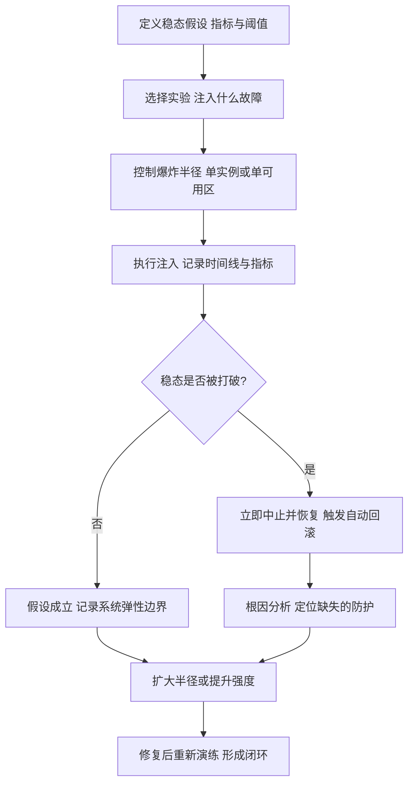

### 13.2 常用故障注入工具与命令

ChaosBlade（阿里开源，`blade` 命令）：

| 故障类型 | 命令示例 | 验证目标 |
| --- | --- | --- |
| CPU 满载 | `blade create cpu load --cpu-percent 90` | 系统自适应保护的 `highestSystemLoad` 是否触发 |
| 网络延迟 | `blade create network delay --time 3000 --offset 500 --interface eth0` | 超时与熔断是否按预期触发 |
| 网络丢包 | `blade create network loss --percent 30 --interface eth0` | 重试与幂等是否安全 |
| 网络分区 | `blade create network partition --interface eth0 --destination-ip 10.0.0.5` | 降级与本地缓存是否生效 |
| JVM 方法延迟 | `blade create jvm delay --time 3000 --classname com.x.UserService --methodname query` | 慢调用熔断是否触发 |
| JVM 抛异常 | `blade create jvm throwCustomException --exception java.lang.RuntimeException --classname com.x.UserService` | 异常比例熔断与兜底是否生效 |
| 数据库访问 | `blade create jvm delay --time 2000 --classname com.x.mapper.OrderMapper --methodname selectById` | 连接池超时与线程池隔离是否生效 |

Chaos Mesh（K8s 原生）：`PodChaos`（`pod-failure`、`pod-kill`、`container-kill`）、`NetworkChaos`（`delay`、`loss`、`duplicate`、`partition`、`bandwidth`）、`StressChaos`（`cpu`、`memory`）、`IOChaos`（`latency`、`fault`、`attrOverride`）、`DNSChaos`、`HTTPChaos`、`TimeChaos`（时钟偏移，验证时钟回拨的容错）。

### 13.3 演练的安全设计

- **必须设置自动中止条件**：错误率 > 5% 或核心接口 P99 > 2s 持续 30 秒，自动恢复注入；
- **必须避开大促与发布窗口**：发布期间注入故障会破坏"变更与故障的因果关系判断"；
- **必须有回滚脚本**：`blade destroy <experiment-id>` 或删除 Chaos 对象；
- **必须通知值班**：演练不通知值班等于制造事故，会浪费真实应急资源；
- **演练后必须验证防护是否真生效**：只记录"演练完成"没有意义，要记录"熔断是否在 1 秒内打开、降级率峰值多少、用户影响面多大"。

## 十四、一次线上雪崩的完整复盘

### 14.1 故障现象与时间线

场景：电商订单服务（`order-service`，Tomcat 200 线程，JDK 8u292，Spring Boot 2.3.12）调用用户服务与优惠券服务；午高峰流量是平时的 4 倍；优惠券服务依赖的 MySQL 出现慢查询（缺索引的 `order by create_time` 全表扫描）。

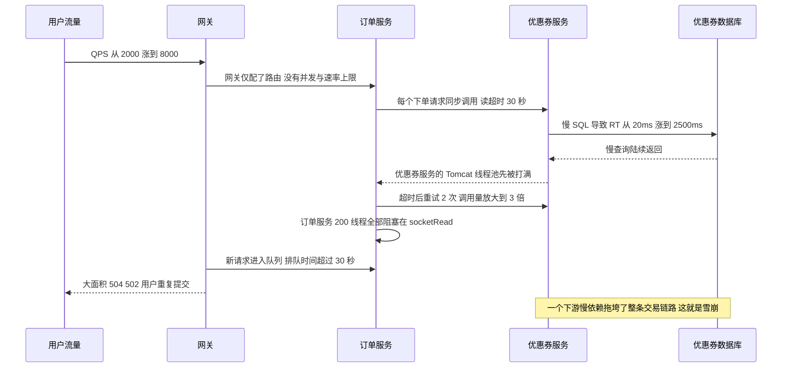

时间线（真实故障的典型节奏）：

| 时间 | 事件 | 关键指标 |
| --- | --- | --- |
| T+0s | 流量从 2000 QPS 涨到 8000 QPS | 网关 QPS 陡增，无拒绝 |
| T+20s | 优惠券 DB 慢查询出现，RT 从 20ms 涨到 800ms | `mysql slow_query` 数量上升 |
| T+60s | 优惠券服务 RT 到 2500ms，线程池 200 打满 | 优惠券服务 `tomcat_threads_busy` = 200 |
| T+90s | 订单服务线程开始堆积，重试放大 3 倍流量 | 订单服务 `tomcat_threads_busy` 从 40 涨到 180 |
| T+150s | 订单服务 200 线程全部阻塞，新请求排队 | RT 从 200ms 涨到 30s，`http_server_requests` 5xx 上升 |
| T+180s | 网关开始 504，用户重复提交，流量进一步上涨 | 网关 5xx 比例 40% |
| T+240s | DBA 杀掉慢查询，DB 恢复；但订单服务仍积压 | 队列需要 3 分钟才能消化，出现"恢复了但还在报错" |

### 14.2 排查过程与命令

**第一步：确认是"自己慢"还是"依赖慢"**。CPU 不高但 RT 高，基本可以判定是等待型问题。

```bash
# 1. 看整体负载，CPU 不高而 load 高说明大量线程在等 I/O
top -Hp <pid>

# 2. 抓线程栈，找出阻塞点
jstack <pid> > /tmp/stack1.txt
jstack <pid> > /tmp/stack2.txt   # 隔 5 秒再抓一次，对比
grep -c "java.lang.Thread.State: WAITING" /tmp/stack1.txt
grep -A 15 "http-nio-8080-exec" /tmp/stack1.txt | grep -E "at (java|com)" | sort | uniq -c | sort -rn | head -20

# 3. 用 Arthas 更快：看最忙的线程与调用链耗时
thread -n 10
thread -b          # 找阻塞其他线程的锁持有者
trace com.x.order.service.OrderService createOrder -n 5 --skipJDKMethod false

# 4. 看连接与端口状态，判断是连接耗尽还是等待响应
ss -s
ss -tanp | awk '{print $1}' | sort | uniq -c | sort -rn
netstat -anp | grep -c ESTABLISHED

# 5. GC 是否参与（本例中不是主因，但要排除）
jstat -gcutil <pid> 1000 10
```

第二步：**从日志和指标里找"最慢依赖"**。本例中的决定性证据来自两处：

```text
# 订单服务日志：典型的 socket 读超时
2024-06-01 12:31:02.114 ERROR [order-service] c.x.c.CouponClient - read timeout
  after 30000ms, url=http://coupon-service/api/coupon/query

# HikariCP 连接池打满的日志特征
HikariPool-1 - Connection is not available, request timed out after 30000ms
  (total=50, active=50, idle=0, waiting=213)
```

指标侧的关键查询（Prometheus）：

```promql
# 各接口 P99 曲线，看是谁先抬头
histogram_quantile(0.99,
  sum(rate(http_server_requests_seconds_bucket{application="coupon-service"}[1m])) by (le, uri))

# Tomcat 线程池忙碌数，这是"线程池是否打满"的最直接证据
tomcat_threads_busy_threads{application="order-service"}

# 依赖调用的超时率
sum(rate(http_client_requests_seconds_count{status="timeout"}[1m])) by (client_name)
```

**第三步：止血**。定位到是优惠券依赖导致后，动作顺序是：

1. 手动把优惠券查询降级（配置中心开关），下单流程改为"不查券、以用户手动选择为准"的兜底逻辑 —— **先止血**；
2. 网关对下单接口开启限流，把 QPS 压回系统承受范围；
3. 通知 DBA 处理慢查询，加索引；
4. 观察积压消化，确认 RT 回落到正常。

### 14.3 根因分析

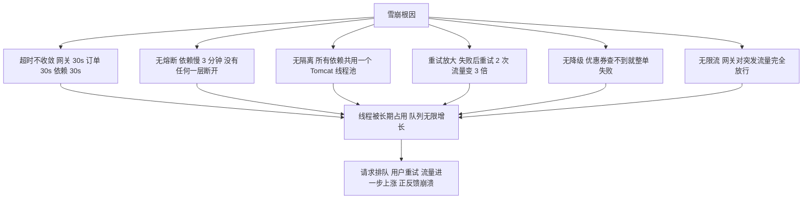

三条最本质的结论：
1. **雪崩是一个正反馈系统**：用户重试 + 自动重试 + 线程排队共同放大流量，一旦进入正反馈，靠"等依赖恢复"是等不回来的，必须主动切断（限流 + 熔断 + 降级）；
2. **共享线程池是故障传播的高速通道**：一个依赖慢 → 线程被占 → 其他接口也没线程 → 全站不可用。隔离的价值就是把"单依赖故障"限制在局部；
3. **超时是最高优先级的手段**：熔断需要统计窗口（秒级滞后），降级需要触发条件，而超时是唯一"立即生效、不需要任何统计"的防线。

### 14.4 改造方案与验证

| 改造项 | 具体配置 | 预期效果 |
| --- | --- | --- |
| 超时收敛 | 网关 3s、订单服务调用依赖 800ms、HTTP 连接 300ms、读 800ms | 线程占用时间从 30s 降到 0.8s，容量提升约 37 倍 |
| 熔断 | Sentinel `DegradeRule`：`grade=DEGRADE_GRADE_RT`、`count=200`（慢调用 RT 阈值）、`slowRatioThreshold=0.5`、`minRequestAmount=20`、`statIntervalMs=1000`、`timeWindow=10` | 依赖慢 1 秒内断开，10 秒后探测恢复 |
| 隔离 | 优惠券、用户、库存各自线程池（`coreSize` 按 `QPS × P99` 估算，队列用 `ArrayBlockingQueue(100)` + `CallerRunsPolicy` 或直接拒绝） | 优惠券故障不再占用订单主线程池 |
| 降级 | 优惠券查询失败返回"不使用优惠券"，并记录降级指标 | 下单成功率达到 99% 以上 |
| 重试收敛 | 最多 1 次，仅幂等查询，退避 100ms + 抖动 | 放大倍数从 3 倍降到 1.1 倍 |
| 网关限流 | 下单接口 4000 QPS（单机安全容量的 70%），超限返回 429 + 排队提示 | 突发流量不再打穿后端 |
| 连接池对齐 | HikariCP `maximumPoolSize` = 依赖线程池大小 × 1.2，`connectionTimeout=1000ms` | 避免连接池排队掩盖问题 |
| 监控告警 | 线程池忙碌度 > 80%、熔断打开、降级率 > 1%、依赖 P99 > 500ms 全部告警 | 提前 3 分钟发现 |

验证方式：用 ChaosBlade 注入 `blade create jvm delay --time 3000 --classname com.x.coupon.CouponService --methodname query`，验证四个断言：熔断在 1 秒内打开、订单接口 P99 < 1s、降级率符合预期、订单服务线程池忙碌度不再持续上升。**改造后必须用故障注入复验，否则无法证明防护有效。**

## 十五、高级岗三问

### 15.1 为什么这么设计：限流阈值到底该由谁决定

- **由容量决定，不由业务决定**：阈值来自压测拐点 × 0.7，业务方说"我们需要 1 万 QPS"时要回答"系统只能安全承接 6000"；
- **分层设置，逐层收紧**：接入层（Nginx 连接数）> 网关（业务速率）> 服务（并发数）> 依赖（连接池），任何一层单独设置都可能被另一层绕过；
- **代价是"误杀 + 体验下降"**：限流一定会在某些时刻拒绝正常用户，选择限流就是选择"部分用户失败好过全部用户失败"。所以必须配 429 + `Retry-After` + 排队提示，把"系统拒绝"变成"用户可理解的行为"。

### 15.2 线上出问题怎么定位

固定四步法，任何"变慢/报错"类故障都适用：

1. **看吞吐与错误率**：确认是流量问题（QPS 涨了）还是质量问题（QPS 没涨但错误率涨了）；
2. **看 RT 分布**：P99 抬升但 P50 正常 → 少数慢请求影响排队；P50 也抬升 → 整体资源不足或依赖普遍变慢；
3. **看资源与等待**：CPU、GC、线程数、连接池、队列长度，`jstack` 看线程停在什么地方（`socketRead`、`park`、`wait`、`LockSupport.park`）；
4. **看依赖**：按依赖维度对比 RT 与错误率，找到最先抬头的那个依赖。

必须准备的三样东西：一个能一键看链路的 trace 系统、一个能一键抓线程栈的脚本（`jstack` + `ss` + `jstat` 打包）、一份把"当前 QPS / 当前阈值 / 当前降级开关状态"打在一个面板上的值班大屏。

### 15.3 规模变大后会怎样

| 规模变化 | 失效模式 | 应对 |
| --- | --- | --- |
| QPS 提升 10 倍 | 单机限流总配额失控；Redis 限流键成为热 key | 改集群限流放网关；本地预取 + 批量令牌 |
| 实例数从 10 到 200 | 单机均摊阈值失真；配置推送不一致产生窗口期 | 全局阈值 + 单机兜底；规则推送加版本号与灰度 |
| 依赖数从 5 到 50 | 每依赖一个线程池导致线程总数爆炸 | 改信号量隔离为主，线程池只给波动大的依赖 |
| 网关路由从 20 到 2000 | 路由匹配 O(n) 变慢，配置变更引发全量刷新抖动 | 路由按前缀分层、限制通配路由数量、分片网关 |
| 机房从 1 到 3 | 跨机房限流配额如何拆分；单机房故障时配额如何接管 | 按机房独立配额 + 全局配额双保险，故障时切换配额 |
| 压测与真实流量混合 | 影子数据污染、容量评估失真 | 全链路压测标识 + 影子表/影子库 |

## 高频面试题

### Q1. 固定窗口、滑动窗口、漏桶、令牌桶、滑动日志，怎么选？

**答题框架（30 秒版）**：看两个维度——是否允许突发、是否需要精确。允许突发且要整形用令牌桶（Guava `SmoothBursty`，桶容量 `maxBurstSeconds=1.0 × rate`）；要求恒定速率用漏桶（Nginx `limit_req`）；内存敏感又要平滑用滑动窗口（Sentinel `LeapArray`，默认 2 个 500ms 桶）；要求逐请求精确且 QPS 不高用滑动日志（Redis ZSET）；只有完全不在意精度才用固定窗口，因为它有 2 倍临界问题。

**展开（2 分钟版）**：
1. 固定窗口的临界问题：阈值 100 QPS 时，窗口边界前后各 100ms 可通过 200 个请求，瞬时 1000 QPS；
2. 滑动窗口用环形数组把所有桶的计数求和，Sentinel 秒级窗口只有 2 个桶，是精度与 CPU 开销的折中；
3. 漏桶恒定漏出，`burst` 是排队容量不是速率提升，`nodelay` 只影响是否立即放行；
4. 令牌桶允许突发，Guava 的 `RateLimiter` **只有延迟语义没有拒绝语义**，`tryAcquire` 会预支未来令牌；
5. 选择依据最终落到"保护谁"：保护自己用令牌桶/滑动窗口，保护下游总配额用集群限流。

**追问**：为什么 Nginx 用漏桶而 Nginx 的 `burst` 还能"允许突发"？
答：`burst` 提供的是**排队缓冲**，不是速率提升。不带 `nodelay` 时请求被匀速放行（表现为变慢），带 `nodelay` 时请求立即放行但**槽位按 rate 恢复**，突发后有一段惩罚期，长期均值仍受 `rate` 约束。

### Q2. Guava `RateLimiter` 的预热模式怎么实现的？为什么直接用 `tryAcquire()` 做限流会出错？

**答题框架（30 秒版）**：`SmoothWarmingUp` 用 `coldFactor=3.0` 让冷启动速率只有稳定速率的 1/3，在 `warmupPeriod` 内线性放开；`RateLimiter` 只提供"延迟"语义，`tryAcquire()` 在桶里有存量令牌时返回 true，没有时会预支未来令牌并把 `nextFreeTicketMicros` 前移，所以它**不会拒绝，只会把惩罚延后**。

**展开（2 分钟版）**：
1. 核心字段：`stableIntervalMicros = 1e6 / permitsPerSecond`、`storedPermits`、`maxPermits`、`nextFreeTicketMicros`；
2. `resync(nowMicros)` 按流逝时间补令牌；`reserveEarliestAvailable(requiredPermits, nowMicros)` 先 resync，再返回旧的 `nextFreeTicketMicros` 作为等待时间，然后把 `nextFreeTicketMicros` 前移到"补齐不足部分"的时刻；
3. `SmoothBursty` 的 `maxPermits = maxBurstSeconds × rate`，`maxBurstSeconds` 默认 1.0；
4. `SmoothWarmingUp` 在 `doSetRate` 里用 `coldFactor=3.0` 算 `slope`，`storedPermits` 高时消耗慢（对应低速期），随着预热结束逐渐恢复正常速率；
5. 正确用法：`tryAcquire(0, TimeUnit.MILLISECONDS)` 判断本次是否"零等待"，或者改用 Sentinel 的快速失败模式。

**追问**：单机 10 个实例都想用 `RateLimiter` 做全局限流会怎样？
答：总流量变成 10 倍阈值。必须用集中式（Redis + Lua）或"网关全局限流 + 单机兜底"。

### Q3. 单机限流 1000 QPS、10 台机器，怎么实现全局限流？Redis + Lua 有哪些坑？

**答题框架（30 秒版）**：优先把全局配额收敛到网关（实例少、入口唯一），用 `RequestRateLimiter` + Redis；服务侧保留单机限流兜底。如果必须在服务层做，用 Redis + Lua 保证原子性、服务端 `TIME` 保证时钟一致、`PEXPIRE` 保证内存回收、hash tag 保证 Cluster 下单 key 同槽。

**展开（2 分钟版）**：
1. Lua 脚本内完成"清理过期 + 计数 + 判定 + 写入 + 续期"，三条命令不可拆；
2. 七个坑：不加 Lua 超发、用客户端时钟抖动、key 无过期内存泄漏、Cluster 多 key `CROSSSLOT`、热 key 打满 Redis 单分片、Redis 抖动阻塞业务、Redis 故障时放行还是拒绝要按业务安全方向预设；
3. 热 key 解法：本地令牌桶 + 批量预取（`DECRBY 100`），误差上限为 `实例数 × 批量`；
4. 精确到"全局 1000 QPS、10 台机器"：可以按 `1000/10 = 100` 单机限流，但实例数变化时会失配，所以更推荐全局阈值。

**追问**：Redis 挂了，限流应该放行还是拒绝？
答：看业务安全方向。普通查询接口**放行**（保可用性），靠单机限流与依赖熔断兜底；资金、库存等安全敏感接口**拒绝**（保安全）。这个选择必须写进预案，不能临场决定。

### Q4. 熔断器三个状态怎么转换？Hystrix 和 Resilience4j 的默认参数差异有多大？

**答题框架（30 秒版）**：Closed 统计、Open 快速失败、Half-Open 少量探测。差异最大的三个默认值是：Hystrix 最小请求数 20 / 错误率 50% / 打开 5 秒（窗口 10 秒分 10 桶）；Resilience4j 最小请求数 100 / 错误率 50% / 打开 60 秒（计数窗口 100）；Sentinel 最小请求数 5 / 统计窗口 1 秒 / `timeWindow` 单位是秒。半开态 Hystrix 与 Sentinel 放行 1 个请求，Resilience4j 默认放行 10 个。

**展开（2 分钟版）**：
1. 转换条件是"最小请求数 + 比例阈值"双条件，防止低流量误触发；
2. Half-Open → Closed 必须重置统计窗口，否则旧失败计数立刻打回 Open；
3. Open → Half-Open 有两种触发方式：定时自动（Hystrix 后台健康快照）与调用时惰性（Resilience4j 默认 `automaticTransitionFromOpenToHalfOpenEnabled=false`）；
4. 参数选型表：高 QPS 用 1 秒窗口、5~10 秒打开；低 QPS 用 10 秒窗口、30~60 秒打开，否则样本不足导致状态抖动；
5. Hystrix 2018 年 11 月进入维护模式，新项目不要再选。

**追问**：Sentinel 1.8 里慢调用熔断要配哪两个参数？
答：`count` 配**慢调用的 RT 阈值（毫秒）**，`slowRatioThreshold` 配**慢调用占比阈值（0~1 的小数）**。`slowRatioThreshold` 默认值是 1.0，含义是"慢调用数等于总请求数才触发"，等于该维度不生效，所以**必须显式设置**。另外 `timeWindow` 的单位是秒（不是毫秒），`minRequestAmount` 默认 5 在低 QPS 接口上容易误熔断，`statIntervalMs` 默认 1000ms。

### Q5. 线程池隔离和信号量隔离怎么选？线程池隔离的隐藏代价是什么？

**答题框架（30 秒版）**：依赖 RT 稳定用信号量（零切换开销、ThreadLocal 完整），依赖可能秒级抖动用线程池（慢调用只占自己的池）。线程池隔离的代价是：线程数膨胀（每依赖 10 个线程起）、上下文切换、ThreadLocal 丢失需要手动传递、超时后 `Future.cancel` 也无法中断阻塞的 socket read。

**展开（2 分钟版）**：
1. Hystrix 默认 `execution.isolation.strategy=THREAD`，`coreSize=10`，`maxQueueSize=-1`（`SynchronousQueue`），`queueSizeRejectionThreshold=5` 只有在 `maxQueueSize > 0` 时才参与拒绝判定，默认配置下不生效；
2. 信号量模式 `execution.isolation.semaphore.maxConcurrentRequests=10`，同步执行无超时能力；
3. Sentinel 是信号量式：`FlowRule.grade = FLOW_GRADE_THREAD`，`StatisticSlot` 用 `increaseThreadNum/decreaseThreadNum` 统计并发线程；
4. Resilience4j 两种 Bulkhead：`BulkheadConfig`（`maxConcurrentCalls=25`、`maxWaitDuration=0`）与 `ThreadPoolBulkheadConfig`（`coreThreadPoolSize=CPU-1`、`maxThreadPoolSize=CPU`、`queueCapacity=100`）；
5. 无论哪种隔离都必须配超时，隔离只限并发不限时长。

**追问**：为什么 `Future.cancel(true)` 超时后线程还占着？
答：`Thread.interrupt()` 无法中断阻塞在 `SocketInputStream#read` 的线程（JDK 的阻塞式 socket I/O 不响应中断）。线程池隔离只能做到"逻辑超时、丢弃结果"，线程本身仍要等到底层读超时。所以**底层客户端必须配读超时**，隔离不能替代超时。

### Q6. 【场景设计】大促场景下，设计一套覆盖网关、应用、数据库的限流方案。

**答题框架（30 秒版）**：四层设防——接入层（Nginx 连接数 + 速率，保护入口）、网关层（业务维度全局限流，唯一配额总闸）、应用层（单机兜底 + 并发隔离 + 熔断）、数据层（连接池上限 + 慢查询拦截 + 读写分离）。阈值全部来自压测拐点 × 0.7，且逐层递减。

**展开（2 分钟版）**：
1. **接入层**：`limit_conn addr 50;` + `limit_req zone=perip burst=200 nodelay;`，目的是挡住恶意刷单与爬虫，阈值按 IP 维度；
2. **网关层**：`RequestRateLimiter` 按接口 + 用户维度做全局限流，`replenishRate=4000`（压测拐点 6000 × 0.7），`burstCapacity=8000`（2 倍），超限返回 429 + `Retry-After`；
3. **应用层**：核心接口配 Sentinel `FlowRule`（单机 QPS = 4000/实例数 × 1.2）、依赖配 `DegradeRule`（`count=200` 即慢调用 RT 阈值 200ms、`slowRatioThreshold=0.5`、`minRequestAmount=20`、`timeWindow=10` 秒）、非核心接口（推荐、评价）配 `SystemRule` 在水位高时自动关闭；
4. **数据层**：HikariCP `maximumPoolSize` 与线程池对齐（不是越大越好，连接数超过 DB 核数的 2~4 倍反而恶化）、`connectionTimeout=1000ms` 快速失败、慢 SQL 拦截（超过 500ms 打日志并告警）、核心表读写分离、库存扣减走 Redis 预扣 + 异步落库；
5. **兜底**：大促预案里明确"可降级清单"（推荐、评价、积分、优惠券查询）与"不可降级清单"（下单、支付、库存扣减）；
6. **演练**：压测验证每层限流都能生效、验证超限时返回码正确、验证降级开关 5 秒内生效。

**追问**：`maximumPoolSize` 为什么不是越大越好？
答：DB 的并发处理能力受核数与磁盘限制，连接数超过 `核数 × 2~4` 后，连接竞争与上下文切换会让整体吞吐下降。正确做法是按 DB 容量反推连接池，而不是按应用线程数放大。

### Q7. 【场景排查】线上接口大面积超时，CPU 不高，日志只有 timeout，怎么定位？

**答题框架（30 秒版）**：CPU 不高 + RT 高 = 等待型故障。先 `jstack` 看线程停在哪（`socketRead` 说明等下游、`park` 说明等锁或线程池、`wait` 说明等条件），再按依赖维度对比 RT 找"最先抬头"的那个依赖，同时看线程池忙碌度、连接池 `waiting` 数、队列长度这三个指标。

**展开（2 分钟版）**：
1. `top -Hp <pid>` 找 CPU 高线程；本例 CPU 不高，排除计算型问题；
2. 间隔 5 秒抓两次 `jstack`，`grep` 统计 `http-nio-*` 线程的栈顶业务帧，出现大量同一依赖的 `socketRead0` 即锁定嫌疑；
3. `ss -tanp | awk '{print $1}' | sort | uniq -c` 看连接状态分布；
4. 看 HikariCP 日志特征 `HikariPool-1 - Connection is not available, request timed out after 30000ms (total=50, active=50, idle=0, waiting=213)`——`waiting=213` 说明是连接池排队而不是 DB 慢；
5. Prometheus 查 `tomcat_threads_busy_threads`、`histogram_quantile(0.99, ...)`、依赖客户端超时计数，确认是谁先坏；
6. Arthas `thread -n 10` 与 `trace` 直接看最耗时的方法链路；
7. 止血优先：先降级/限流，再定位根因。

**追问**：怎么区分"我慢"和"下游慢"？
答：看三个信号。一是线程栈——线程阻塞在 `socketRead` 是等下游，阻塞在 CPU 计算或锁上是自己慢；二是依赖的客户端指标（`http_client_requests_seconds`）与自身 RT 是否同步抬升；三是把依赖的 RT 从自身 RT 中减去，若差值稳定，说明增量全部来自下游。

### Q8. 【场景排查】Sentinel 规则配了却"没生效"，怎么排查？

**答题框架（30 秒版）**：按"资源是否被统计 → 规则是否加载 → 规则是否匹配 → 阈值与效果是否配错"四步查。最常见的六个原因：自调用不走代理、资源名不一致、`limitApp` 配了非默认值、规则被后续 `loadRules` 覆盖、`controlBehavior` 选成匀速排队看起来"没限住"、集群流控的 `flowId`/`thresholdType` 配错。

**展开（2 分钟版）**：
1. **资源未统计**：`@SentinelResource` 依赖 Spring AOP 代理，同类内部方法自调用不生效（与 `@Transactional` 自调用失效同源）；注解没加 `SentinelResourceAspect` 也没用；资源名与规则名不一致（区分大小写、注意常量拼接）；
2. **规则未加载**：`FlowRuleManager.loadRules` 被后一次调用整体覆盖；动态数据源（Nacos/Apollo）的 `dataId`、`groupId` 配错；规则 JSON 字段名与 `FlowRule` 属性不匹配导致反序列化后 `count=0`；
3. **规则不匹配**：`limitApp` 不是 `default` 时只对指定来源生效；链路模式必须用 `ContextUtil.enter(contextName)` 区分入口；关联模式要看的是 `refResource` 而不是当前资源；
4. **配错效果**：`controlBehavior=CONTROL_BEHAVIOR_RATE_LIMITER`（匀速排队）会把请求 sleep 后放行，表现为"限了但没拒"；`maxQueueingTimeMs` 默认 500ms，排队超过 500ms 才拒绝；
5. **热点参数**：`ParamFlowRule` 的 `paramIdx` 从 0 开始，且必须有参数传入 `SphU.entry(..., args)`；
6. **自查手段**：打开 Sentinel 的日志（`-Dcsp.sentinel.log.use.pid=true`）、看 `sentinel-record.log` 的规则加载记录、用 Dashboard 的"簇点链路"确认资源是否出现、用 `curl` 压测确认返回的是 `FlowException` 还是业务异常。

**追问**：`BlockException` 变成了 500 而不是降级响应，为什么？
答：没配 `blockHandler` 也没配 `fallback`，`BlockException` 直接冒泡到全局异常处理器。正确做法是配 `blockHandler`（处理 `BlockException`）+ `fallback`（处理业务异常），并在全局异常处理器兜底处理 `BlockException`。

### Q9. 降级怎么设计才不会被追责？哪些场景绝对不能降级？

**答题框架（30 秒版）**：降级方向按"读可陈旧、写要 fail-fast"划分。绝对不能降级的是资金、库存扣减、幂等键生成、审计合规日志——这些宁可失败也不能假成功。可降级的是推荐、评价、榜单、非核心字段、营销展示。兜底逻辑必须用**本地**缓存且不依赖任何外部资源。

**展开（2 分钟版）**：
1. 触发条件矩阵：限流拒绝、熔断开、超时、异常率、依赖健康检查、人工开关、容量水位、大促预案；
2. 六种兜底模式：默认值、缓存快照、静态兜底、排队异步、功能裁剪、快速失败；
3. 三条红线：写操作不能静默丢失、兜底不再依赖外部、开关必须秒级生效且可自动恢复；
4. 可观测：降级路径必须有独立指标与 trace 标签，否则降级长期挂着无人发现；
5. 演练：降级开关要在演练中验证过，不能大促当天第一次点。

**追问**：缓存兜底为什么要用本地缓存？
答：如果用 Redis 兜底，当"Redis 与依赖同时抖动"或者"限流键把 Redis 打满"时，兜底路径本身也失败。本地 Caffeine 缓存在进程内，只要进程活着就一定能返回，是最后一道确定性防线。代价是数据陈旧窗口与多实例不一致，需要在业务上可接受。

### Q10. Spring Cloud Gateway 与 Zuul 的本质差异是什么？过滤器顺序怎么控制？

**答题框架（30 秒版）**：本质差异是编程模型：Gateway 基于 WebFlux + Reactor Netty，非阻塞、无线程切换；Zuul 1.x 基于 Servlet 阻塞模型、每请求一线程，且 Spring Cloud 2020.0.0 起已移除。Gateway 的顺序控制是 `AnnotationAwareOrderComparator.sort`，`GlobalFilter` 用 `Ordered`/`@Order`（`NettyWriteResponseFilter` = -1、`RouteToRequestUrlFilter` = 10000、`ReactiveLoadBalancerClientFilter` = 10150、`NettyRoutingFilter` = Integer.MAX_VALUE），路由级 `GatewayFilter` 由配置声明顺序决定、order 从 1 递增。

**展开（2 分钟版）**：
1. 三大组件：`Route`/`RouteDefinition`/`RouteLocator`、`RoutePredicateFactory`、`GatewayFilter` 与 `GlobalFilter`；
2. 处理链：`DispatcherHandler` → `RoutePredicateHandlerMapping` → `FilteringWebHandler` → 过滤器链 → `NettyRoutingFilter`；
3. 过滤器是环绕执行，order 小的先进入、后返回，因此写响应的 `NettyWriteResponseFilter` order 是 -1；
4. 自义 filter 的 order 要小于 10000 才能"提前拒绝"，否则请求已经被转发；
5. Zuul 的 `RequestContext` 是 ThreadLocal 绑定的 `ConcurrentHashMap`，异步场景会丢上下文，这也是它被淘汰的原因之一。

**追问**：在 Gateway 里写了一段 JDBC 查询会怎样？
答：会阻塞 Reactor Netty 的 EventLoop 线程（`reactor.netty.ioWorkerCount` 默认 `max(CPU 核数, 4)`，不是按业务量弹性伸缩的线程池），阻塞几个线程就能让整个网关吞吐骤降甚至假死。必须 `Mono.fromCallable(...).subscribeOn(Schedulers.boundedElastic())` 切到弹性线程池。

### Q11. 网关鉴权怎么做？JWT 放网关校验有什么问题？

**答题框架（30 秒版）**：网关集中校验 JWT 签名 + 过期时间，把用户身份以内部 header（如 `X-User-Id`）注入下游，下游只信内网来源。核心问题是**无法即时吊销**，解法是短过期（15~30 分钟）+ refresh token 存 Redis（可吊销）+ kid 双密钥轮换。

**展开（2 分钟版）**：
1. 三种方案对比：网关本地验签（快、无状态、不可吊销）、验签 + Redis 黑名单（可吊销、每请求一次 Redis）、转发认证中心 introspect（最标准、认证中心成瓶颈）；
2. **安全红线**：网关必须剥离客户端伪造的同名内部 header（`X-User-Id`、`X-User-Role`），否则存在越权漏洞；
3. 密钥轮换：JWKS 同时暴露新旧 `kid`，等旧 token 自然过期后再下掉；
4. 网关鉴权 filter 的 order 必须小于 10000，且拒绝时不能继续 `chain.filter`；
5. 下游服务仍要做权限校验（接口级 RBAC），网关只做认证不做细粒度授权。

**追问**：网关鉴权失败返回 401，但被 Gateway 的 `ErrorWebExceptionHandler` 改写成了 500，怎么排查？
答：检查是否在 filter 里抛了异常而不是直接 `writeWith` 响应；网关默认的 `DefaultErrorWebExceptionHandler` 会把未处理异常转成 500。正确写法是设置 `HttpStatus.UNAUTHORIZED` 并直接 `exchange.getResponse().writeWith(...)`，或自定义 `ErrorWebExceptionHandler` 保留原始状态码。

### Q12. 集群流控为什么难？Sentinel 的 Token Server 挂了会怎样？

**答题框架（30 秒版）**：难在三点——Token Server 是单点、每次判定多一次 RPC、实例数变化导致配额失真。`ClusterFlowConfig` 的 `fallbackToLocalWhenFail` 默认为 true，所以 Token Server 不可用时退化为单机限流，全局阈值短时失效但不至于全站被拒。

**展开（2 分钟版）**：
1. 角色与配置：Token Server / Token Client，`flowId` 两端一致，`thresholdType`（0 单机均摊、1 全局阈值），`fallbackToLocalWhenFail` 默认 true；
2. 部署模式：嵌入式（选一个实例）与独立模式；
3. 失败模式：server 挂 → 退化为单机限流（各实例按单机阈值放行，总配额放大）；网络分区 → 部分 client 退化，配额不一致；规则推送不一致 → 阈值窗口期；
4. 更推荐的架构：把全局配额放在网关层（实例少、入口唯一、无额外 RPC），服务层只做单机兜底。

**追问**：为什么全局阈值比单机均摊更好？
答：单机均摊在实例数变化（扩缩容、实例被摘除、灰度发布）时配额会失真——10 个实例均摊 1000 QPS，缩到 5 个实例后总配额只剩 500，系统白白浪费一半容量。全局阈值由 server 统一扣减，与实例数解耦。

### Q13. 【场景设计】全链路压测怎么做数据隔离？压测标识怎么透传？

**答题框架（30 秒版）**：核心是"压测标识 + 影子资源"。标识放在请求头（如 `X-Shadow: true`），通过网关 → 服务 → MQ → 缓存 → DB 全链路透传；末端按标识路由到影子表（`order_shadow`）/影子库/影子 Topic，第三方依赖走挡板 Mock，监控与日志给压测流量打标。

**展开（2 分钟版）**：
1. 六个隔离点：影子表、影子库、影子 MQ Topic/Tag、影子缓存 key 前缀、第三方 Mock、日志监控打标；
2. 透传实现：网关 filter 读 header 写进 `ServerWebExchange` 属性 → 服务用统一的 `ShadowContext`（ThreadLocal）→ 线程池/异步任务要显式传递（可参考 `TransmittableThreadLocal`）→ MQ 消息头携带 → DB 中间件/MyBatis 拦截器改写表名或数据源；
3. 重点风险：ThreadLocal 在异步与线程池中丢失导致压测数据落进正式表，这是压测最常见的数据污染事故；
4. 数据清理：压测数据要能被识别并批量清理，影子表用完即删；
5. 压测目标：找单机拐点、找首个瓶颈依赖、验证容量线性度、验证限流熔断降级是否按预期生效。

**追问**：为什么不在测试环境压测？
答：数据规模、依赖拓扑、JVM 预热状态、网络拓扑都不同，测出来的拐点没有参考价值。生产压测的价值在于"用真实流量分布与真实数据规模得到可用的容量结论"。

### Q14. 线上雪崩如何止血？事后怎么改造？

**答题框架（30 秒版）**：止血三件套按顺序执行——限流（把入口流量压回容量）、熔断/降级（切断慢依赖）、扩容（只在确认是容量不足而非依赖故障时才做，否则是火上浇油）。事后按"超时收敛、熔断、隔离、降级、重试收敛、限流、监控告警"七项改造，并用故障注入复验。

**展开（2 分钟版）**：
1. 判断顺序：先确认是流量问题还是依赖问题，`jstack` + 依赖维度 RT 对比是核心手段；
2. 雪崩是正反馈系统：用户重试 + 自动重试 + 队列排队三方放大，必须主动切断；
3. 改造的核心数字：超时从 30s 收敛到 800ms 可以让同样线程数支撑约 37 倍请求；熔断参数 `grade=DEGRADE_GRADE_RT`、`count=200`（慢调用 RT 阈值）、`slowRatioThreshold=0.5`、`minRequestAmount=20`、`statIntervalMs=1000`、`timeWindow=10`（单位秒）；
4. 隔离：按依赖拆线程池，`coreSize` 按 `QPS × P99` 估算，队列有界，满了快速失败；
5. 监控：线程池忙碌度、连接池 `waiting`、熔断状态、降级率、依赖 P99 五类指标必须有告警；
6. 复验：`blade create jvm delay --time 3000` 注入慢调用，验证熔断 1 秒内打开、P99 < 1s、降级率可解释。

**追问**：为什么"扩容"有时候反而让情况更糟？
答：如果根因是下游依赖故障（DB 慢、第三方限流），扩容会让更多实例同时打向已经过载的依赖，流量放大、依赖更慢，形成"越扩容越慢"。只有当依赖健康、瓶颈确实在自己（CPU/内存/连接池不足）时扩容才有效。**先判断瓶颈位置，再决定扩容还是限流。**

## 易错点与踩坑

| 易错点 | 正确理解 |
| --- | --- |
| 用固定窗口做核心接口限流 | 有 2 倍临界问题：窗口边界前后各 100ms 可通过 200 个请求，瞬时速率达阈值 100 QPS 的 10 倍 |
| 认为 `RateLimiter.tryAcquire()` 会"拒绝" | Guava 只有延迟语义，`tryAcquire` 无令牌时会预支未来令牌，惩罚延后 |
| 单机限流当全局限流用 | N 个实例总配额是 N 倍，必须用网关或 Redis 做全局配额 |
| 限流 key 不设过期 | Redis 内存只增不减，百万用户可占用几十 MB 以上 |
| Redis Cluster 下 Lua 用多 key 不加 hash tag | 报 `CROSSSLOT Keys in request don't hash to the same slot` |
| 认为 Sentinel 秒级滑动窗口是逐请求精确 | 默认 `SAMPLE_COUNT=2`，只有 2 个 500ms 桶，精度约 500ms |
| Sentinel `minRequestAmount` 用默认 5 | 低 QPS 接口容易因 3 次失败就 100% 错误率误熔断，应按流量调整 |
| Resilience4j 给同步方法加 `@TimeLimiter` | `TimeLimiter` 只对返回 `CompletionStage` 的异步方法生效 |
| 熔断不配降级 | 只是把"慢失败"变成"快失败"，用户体验没改善 |
| 熔断粒度按整个服务 | 一个接口慢会熔断该服务所有接口，应按"依赖 + 接口"粒度 |
| Half-Open 放行大量请求 | 刚恢复的下游会被立刻打挂，Sentinel 放行 1 个，Resilience4j 默认 10 个 |
| 线程池隔离后忘了传 ThreadLocal | 链路 traceId、事务上下文、用户身份全部丢失，必须显式装饰传递 |
| 认为 `Future.cancel(true)` 能中断阻塞 socket 读 | JDK 阻塞式 socket I/O 不响应 interrupt，必须依赖底层读超时 |
| 降级兜底又调用了故障依赖 | 等于没降级，兜底只能用本地缓存/静态值 |
| 资金/库存做"降级成功" | 假成功是数据事故，写操作降级方向必须是 fail-fast |
| 全链路超时都配 30 秒 | 超时必须逐层收敛且上游 > 下游之和，否则层层等待零收益 |
| 无脑重试 3 次 | 3 次重试把下游流量放大到 4 倍，是雪崩头号放大器 |
| Gateway 里写阻塞代码 | 阻塞 EventLoop（`ioWorkerCount` 默认 `max(CPU 核数, 4)`）会导致网关整体假死 |
| 网关不剥离客户端传入的内部 header | `X-User-Id` 可被伪造，直接越权，属高危漏洞 |
| `deny-empty-key` 默认 true 又没配 `KeyResolver` | 所有请求空 key 被拒，表现为"网关全站 403" |
| 两级网关（Nginx + Gateway）重复限流不协调 | 阈值互相打架，需明确分层：Nginx 按 IP/连接，Gateway 按业务维度 |
| 认为 HPA 能扛秒级尖峰 | HPA 同步周期默认 15 秒、缩容稳定窗口默认 5 分钟，扩容还要调度与启动，必须靠限流冗余兜住 |
| 压测标识只用 ThreadLocal 传 | 线程池与异步任务中会丢失，压测数据落进正式表，必须显式传递 |
| Redis 挂掉时限流"临场决定"放行还是拒绝 | 必须提前写进预案：查询类放行、资金类拒绝 |

## 一句话速记

- **固定窗口有临界问题，滑动窗口用环形数组逼近精确，漏桶不允许突发，令牌桶允许突发，滑动日志最精确最费内存**。
- **Guava `RateLimiter` 只有延迟语义没有拒绝语义**，`SmoothBursty` 桶容量 = `maxBurstSeconds(1.0) × rate`，`SmoothWarmingUp` 的 `coldFactor = 3.0`。
- **单机限流保护自己，集群限流保护依赖**；Redis 限流的四件套是 Lua 原子 + 服务端 `TIME` + `PEXPIRE` + hash tag。
- **熔断三态的关键不是状态转换，而是"最小请求数"防止误熔断和"半开后重置统计"防止恢复死循环**。
- **Sentinel 的 order 越小越先执行**：NodeSelector(-10000) → ClusterBuilder(-9000) → Log(-8000) → Statistic(-7000) → Authority(-6000) → System(-5000) → ParamFlow(-4000) → Flow(-2000) → Degrade(-1000)；`StatisticSlot` 是"先放行后统计"。
- **线程池隔离换安全，信号量隔离换性能**；所有隔离都必须配超时，隔离限并发不限时长。
- **降级方向：读可陈旧，写必须 fail-fast**；兜底只能用本地缓存，且必须可观测、可自动恢复。
- **Gateway 过滤器环绕执行**，`NettyWriteResponseFilter = -1`、`RouteToRequestUrlFilter = 10000`、`ReactiveLoadBalancerClientFilter = 10150`、`NettyRoutingFilter = Integer.MAX_VALUE`。
- **容量 = 压测拐点 × 0.7**；并发 = QPS × RT（利特尔法则）；秒级尖峰靠限流冗余，不靠 HPA。
- **雪崩止血顺序：限流 → 熔断降级 → 确认瓶颈后再扩容**；事后七项改造，最后必须用混沌工程复验。
