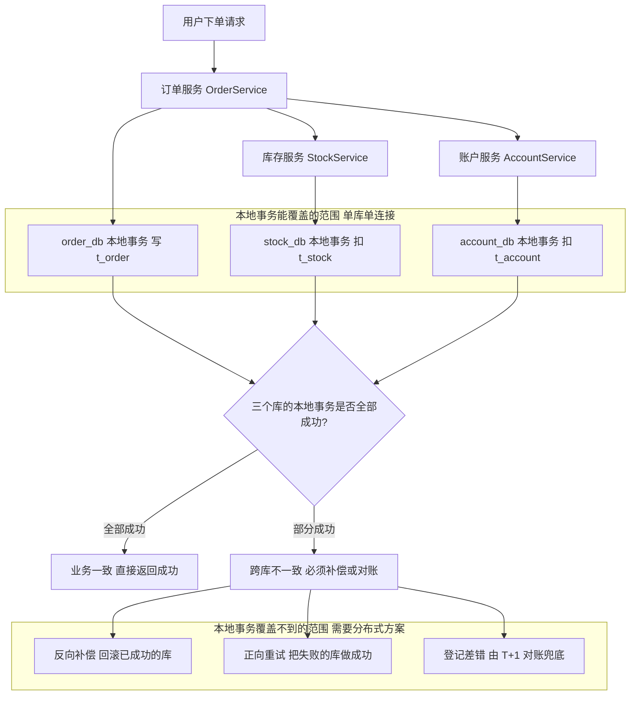
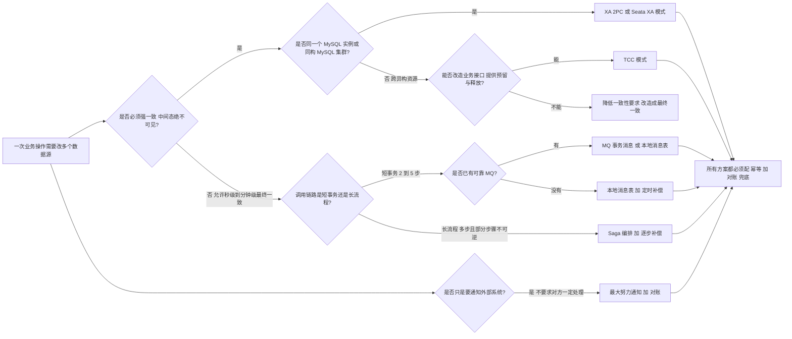
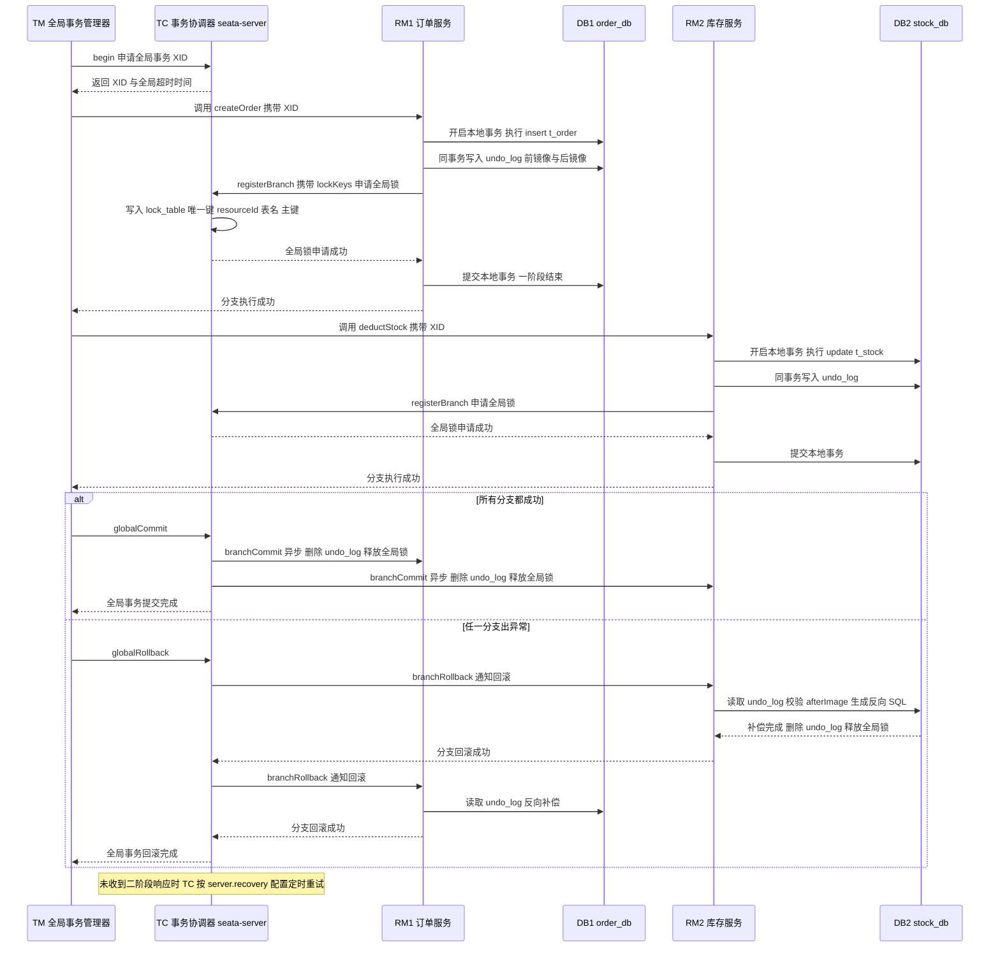
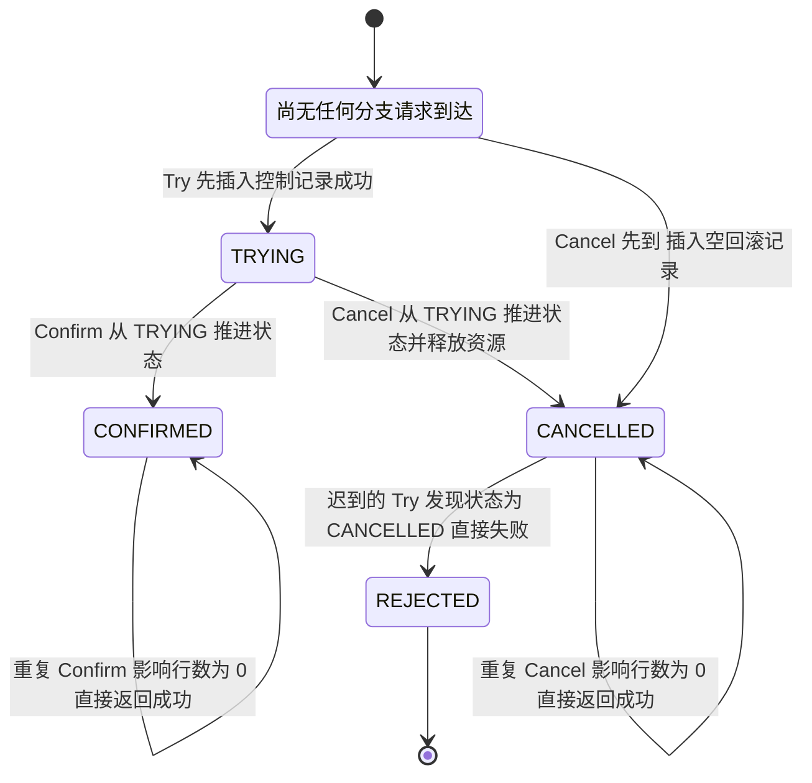
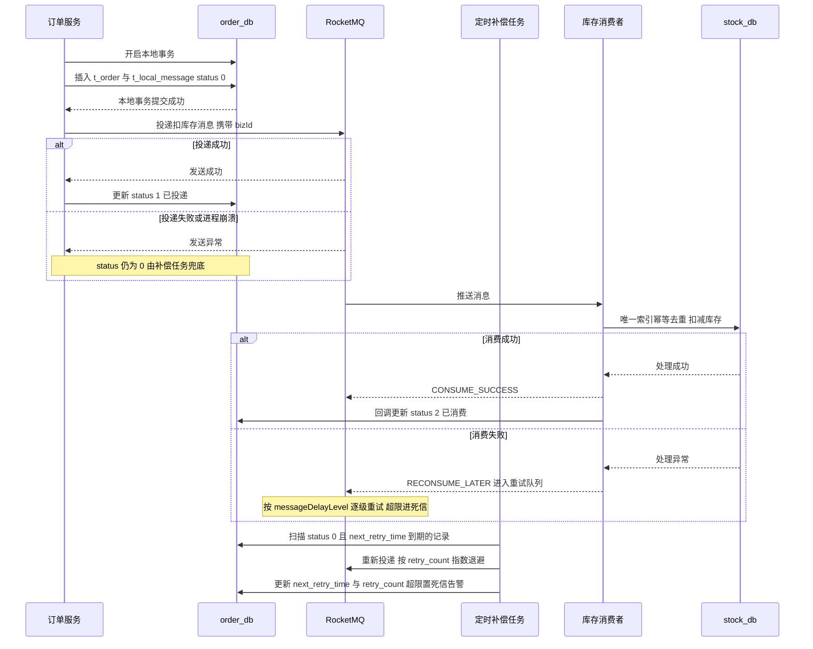
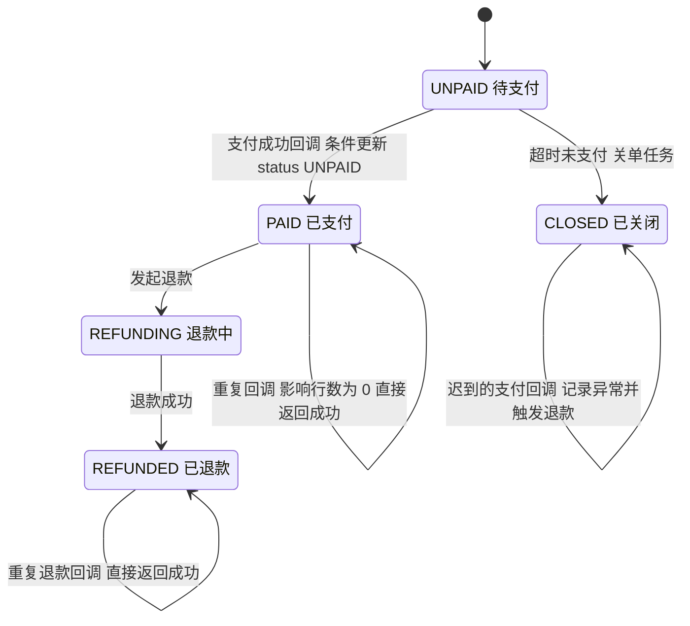
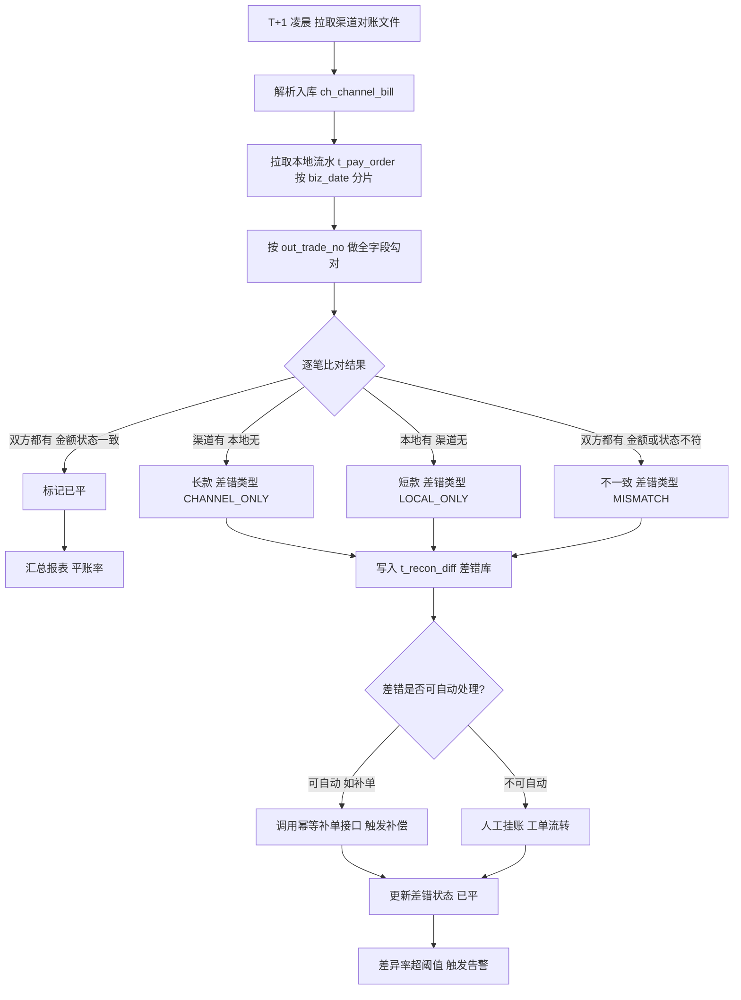
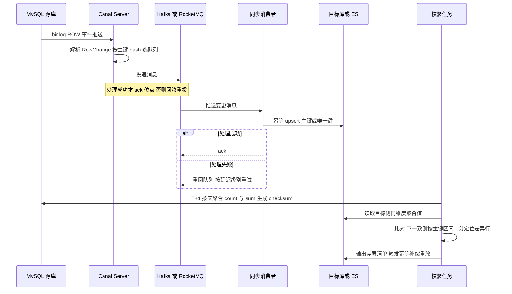

# 05 分布式事务、幂等与一致性实践

> 一句话定位：分布式事务考的不是"知道几种方案"，而是"能否在具体业务约束下选出代价最小的那一种，并把空回滚、悬挂、重复消费这些坑提前堵死" ｜ 面试权重 ★★★★★ ｜ 建议复习 60 分钟

## 本章大纲

- [一、本地事务的边界与分布式事务场景](#一本地事务的边界与分布式事务场景)
- [二、方案全景与横向对比](#二方案全景与横向对比)
- [三、Seata 四种模式原理详解](#三seata-四种模式原理详解)
- [四、TCC 设计与空回滚幂等悬挂](#四tcc-设计与空回滚幂等悬挂)
- [五、Saga 与补偿设计](#五saga-与补偿设计)
- [六、可靠消息最终一致](#六可靠消息最终一致)
- [七、幂等的本质与实现手段](#七幂等的本质与实现手段)
- [八、一致性取舍决策树与对账兜底](#八一致性取舍决策树与对账兜底)
- [九、数据同步与一致性校验](#九数据同步与一致性校验)
- [十、高级岗三问](#十高级岗三问)
- [高频面试题](#高频面试题)
- [易错点与踩坑](#易错点与踩坑)
- [一句话速记](#一句话速记)

## 一、本地事务的边界与分布式事务场景

### 1.1 事务边界为什么必然被打破

单体时代，一次下单在同一个 `DataSource` 上开一个连接，`Connection#setAutoCommit(false)` 到 `Connection#commit()` 之间就是一个 ACID 单元。MySQL 8.0 InnoDB 默认 `transaction_isolation=REPEATABLE-READ`，靠 MVCC 提供快照读、靠 next-key lock 提供当前读，这个边界是**数据库自己保证**的。

服务化之后边界被两件事同时打破：

| 破坏因素 | 具体表现 | 数据库能不能兜住 |
| --- | --- | --- |
| 垂直拆分 | 订单、库存、账户各自一个库，一个连接只能管一个库（MySQL 中一个连接同一时刻只能有一个活跃事务，`XA` 除外） | 不能 |
| 水平分库 | `order_db_0 / order_db_1`，一次按用户维度的操作可能落两个分片 | 不能 |
| 异构存储 | 扣款在 MySQL、扣积分在 Redis、扣券在 MongoDB | 不能 |
| 外部第三方 | 支付渠道回调、银行代扣，本地事务根本不覆盖对方 | 不能 |
| 异步化 | 为了削峰把同步调用换成 MQ，调用方已经返回成功 | 不能 |

结论一句话：**只要事务边界跨出了单个数据库连接，ACID 就不再是免费的，必须由业务层用"补偿 + 幂等 + 对账"重新拼出来**。

### 1.2 分布式事务的四种失效形态

面试里被问"分布式事务要解决什么问题"，不要只答"数据不一致"，要能拆成四类：

| 失效形态 | 英文 | 场景 | 典型后果 |
| --- | --- | --- | --- |
| 部分成功 | partial failure | A 库扣款成功、B 库加库存超时 | 钱扣了货没加 |
| 结果未知 | unknown outcome | 调下游超时，不知道对方提交没提交 | 重试可能重复，不重试可能丢失 |
| 重复提交 | duplicate | 用户连点、RPC 框架重试、MQ 重投 | 扣两次库存 |
| 悬空操作 | dangling | 先到的 Cancel 在迟到的 Try 之后 | 资源被预留但全局事务已回滚 |

真正的工程难点是后三类。**部分成功靠补偿，结果未知靠幂等 + 对账，重复提交靠幂等，悬空靠事务控制表**。这四句话就是本章的总纲。

### 1.3 一次下单链路的事务边界解剖



这张图的重点是：**每个服务内部仍然是干净的 ACID，问题只出现在服务之间的接缝上**。所以分布式事务方案的设计目标不是"让三个库原子提交"，而是"让接缝上的不一致有界、可收敛"。

### 1.4 本地事务失效的八个高频场景

在谈分布式方案之前，先确认本地事务有没有真的生效。Spring `@Transactional`（Spring Framework 5.3.x 起注解处理在 `TransactionInterceptor` + `AnnotationTransactionAttributeSource`）失效的场景，面试几乎必问：

| 场景 | 原因 | 源码位置 |
| --- | --- | --- |
| 同类内部方法调用（`this.method()`） | 不走代理对象，`TransactionInterceptor` 根本没进 | 代理机制决定 |
| 方法非 `public` | `AbstractFallbackTransactionAttributeSource#computeTransactionAttribute` 对非 public 方法返回 null（`MethodVisibility.PUBLIC`） | Spring 5.3.x |
| 类未被 Spring 管理（`new` 出来的对象） | 没有代理 | 代理机制决定 |
| `rollbackFor` 未配置且抛受检异常 | 默认只回滚 `RuntimeException` 与 `Error`，`Exception` 不回滚 | `RuleBasedTransactionAttribute#rollbackOn` |
| `try-catch` 吞掉异常 | 拦截器感知不到异常 | `TransactionAspectSupport#invokeWithinTransaction` |
| 多线程 / `@Async` 内部 | 连接与 `TransactionSynchronizationManager` 的 ThreadLocal 不共享 | `TransactionSynchronizationManager` |
| `propagation=REQUIRES_NEW` 但外层未提交 | 内层是独立物理事务，外层回滚不回滚内层 | `AbstractPlatformTransactionManager` |
| `readOnly=true` 下执行 DML | MySQL 会报错或依赖驱动行为，`readOnly` 只是 hint | `DataSourceTransactionManager` |

补充两个版本敏感的坑：

- `TransactionSynchronizationAdapter` 在 Spring 4.2 起被 `TransactionSynchronization` 接口的默认方法取代，Spring 5 已移除该类；写 `afterCommit` 逻辑请直接实现 `TransactionSynchronization#afterCommit`。
- `@Transactional` 的 `timeout` 在 MySQL 8.0 上不一定会真正打断 SQL，它只是给 `Statement#setQueryTimeout` 一个值，且 JDBC 驱动实现差异较大；真正的超时保护应该放在连接池（HikariCP `connectionTimeout` 默认 30000ms）与服务调用超时上。

### 1.5 本地事务与远程调用的顺序陷阱

一个高频错误写法：

```java
// 错误示范：本地事务边界内做远程调用
@Transactional(rollbackFor = Exception.class)
public void createOrder(OrderCmd cmd) {
    orderMapper.insert(cmd.toOrder());      // 本地写
    stockClient.deduct(cmd.getSkuId(), 1);  // 远程调用，可能超时
}
```

问题有三个：

1. 远程调用期间本地事务一直持有行锁与连接，`stock_db` 的慢会放大 `order_db` 的锁等待，MySQL 8.0 默认 `innodb_lock_wait_timeout=50` 秒，一旦触发就是 `Lock wait timeout exceeded`。
2. 远程调用超时抛出异常，本地回滚，但**下游可能已经成功**——这就是典型的"结果未知"。
3. 连接池被慢调用占满，HikariCP 默认 `maximumPoolSize=10`，十个慢请求就能让整个服务不可用。

正确姿势在后面第六节：**本地事务只写自己的库 + 写一条消息记录，远程调用交给异步投递与补偿**。

## 二、方案全景与横向对比

### 2.1 六类方案的一句话本质

| 方案 | 一句话本质 | 一致性 | 业务侵入 |
| --- | --- | --- | --- |
| 2PC / XA | 数据库层面 prepare 后统一 commit | 强一致 | 无（改数据源） |
| TCC | 业务层面手写 Try 预留、Confirm 确认、Cancel 释放 | 最终一致（准实时） | 极高 |
| 可靠消息最终一致 | 本地事务 + 消息投递，下游消费 | 最终一致 | 中 |
| 本地消息表 | 把"要发的消息"和业务数据写进同一个本地事务 | 最终一致 | 中 |
| 最大努力通知 | 不断重试通知对方，不保证对方一定处理 | 弱 | 低 |
| Saga | 长流程逐步执行，失败逐步反向补偿 | 最终一致 | 中（每步要有补偿） |

### 2.2 八个维度的横向对比

| 维度 | 2PC/XA | TCC | 可靠消息 | 本地消息表 | 最大努力通知 | Saga |
| --- | --- | --- | --- | --- | --- | --- |
| 一致性强度 | 强一致（提交点原子） | 最终一致，秒级 | 最终一致，秒级到分钟级 | 最终一致，秒级到分钟级 | 弱一致，不保证 | 最终一致，秒级到分钟级 |
| 是否锁资源 | 一阶段到二阶段全程锁行 | Try 阶段锁业务资源 | 不锁，靠状态 | 不锁，靠状态 | 不锁 | 不锁 |
| 吞吐 | 低（锁持有时间长） | 中 | 高 | 高 | 高 | 中 |
| 业务侵入 | 无 | 高（每步三接口） | 中 | 中 | 低 | 中（每步补偿） |
| 隔离性 | 依赖数据库 | 靠业务预留字段 | 无隔离，中间态可见 | 无隔离 | 无 | 无隔离 |
| 中间态可见 | 否（未提交） | 可见（冻结金额） | 可见 | 可见 | 可见 | 可见 |
| 回滚语义 | 数据库回滚 | Cancel 业务补偿 | 补偿事务 / 反向消息 | 补偿事务 | 无回滚 | 反向补偿 |
| 适用时长 | 毫秒级（越短越好） | 秒级 | 秒级到分钟级 | 秒级到分钟级 | 分钟级以上 | 秒级到天级 |
| 崩溃恢复 | 依赖数据库 XA 恢复 | 依赖事务控制表 | 依赖 MQ 与补偿任务 | 依赖定时扫表 | 依赖重试任务 | 依赖状态机持久化 |
| 典型实现 | Atomikos、Narayana、Seata XA、MySQL XA | Seata TCC、Hmily | RocketMQ 事务消息、Kafka 事务 | 自研 + 定时任务 | 自研重试 | Seata Saga、Temporal |

### 2.3 2PC 与 XA 的协议细节

XA 是 X/Open DTP 模型的一部分，角色分三个：

- **AP（Application Program）**：业务应用，调用 TM。
- **TM（Transaction Manager）**：全局事务协调者，Java 里对应 JTA 的 `jakarta.transaction.TransactionManager`（Jakarta EE 9 之前是 `javax.transaction.TransactionManager`，JDK 11 起随 Jakarta 迁移）。
- **RM（Resource Manager）**：数据库，对应 `XAResource` 接口。

XA 的两阶段与 `XAResource` 方法的对应关系：

| 阶段 | 应用侧动作 | `XAResource` 方法 | MySQL 命令 |
| --- | --- | --- | --- |
| 一阶段开始 | 事务分支关联全局事务 | `start(xid, XAResource.TMNOFLAGS)` | `XA START 'gtrid'` |
| 一阶段执行 | 执行 DML | 无（走普通 `Statement`） | `UPDATE ...` |
| 一阶段结束 | 分支结束，进入 prepare 前状态 | `end(xid, XAResource.TMSUCCESS)` | `XA END 'gtrid'` |
| 一阶段投票 | 询问 RM 能否提交 | `prepare(xid)` 返回 `XA_OK` / `XA_RDONLY` | `XA PREPARE 'gtrid'` |
| 二阶段提交 | TM 决定提交 | `commit(xid, false)` | `XA COMMIT 'gtrid'` |
| 二阶段回滚 | TM 决定回滚 | `rollback(xid)` | `XA ROLLBACK 'gtrid'` |
| 崩溃恢复 | 扫描未决分支 | `recover(XAResource.TMSTARTRSCAN)` | `XA RECOVER` |
| 放弃分支 | 忘记一个启发式完成的分支 | `forget(xid)` | 无直接对应 |

标准返回码要能说出来：`XAResource.XA_OK`、`XA_RDONLY`（只读分支可跳过二阶段）、`XAER_RMFAIL`（RM 不可用）、`XAER_NOTA`（XID 不存在）、`XAER_RETRY`（可重试）、`XA_HEURCOM`/`XA_HEURRB`/`XA_HEURMIX`（启发式完成，最危险的情况，需要人工介入）。

XA 的致命问题：

1. **同步阻塞**：`XA PREPARE` 之后行锁一直持有到二阶段，MySQL 里表现为 `XA RECOVER` 能查到、`SHOW ENGINE INNODB STATUS` 能看到持锁事务，应用不提交就锁到天荒地老。
2. **协调者单点**：TM 崩了之后所有 prepare 状态的分支全部悬空，只能靠 DBA 用 `XA RECOVER` 查出 XID 手工 `XA COMMIT` 或 `XA ROLLBACK`。
3. **启发式完成**：二阶段部分提交、部分回滚，XA 规范里没有自动修复手段，只能人肉处理。
4. **一个连接同时只能有一个活跃 XA 事务**，跨库并行度受限。
5. **MySQL 侧的历史包袱**：`innodb_support_xa` 参数在 MySQL 5.7.10 起被标记废弃、8.0 移除；在 5.7 之前，prepare 后崩溃可能存在 binlog 与存储引擎不一致的历史问题。生产上要慎重评估，这也是 Seata 主推 AT 而不主推 XA 的原因之一。

### 2.4 方案选型决策树



决策树要能背下来的三条：

1. **强一致只在"同一 MySQL 集群且事务极短"时才考虑 XA**，其他情况一律降级到最终一致。
2. **TCC 的准入条件是"业务能提供预留与释放动作"**（库存冻结、金额冻结、券锁定），给不出预留动作就不该用 TCC。
3. **任何方案都不是终点，终点是"幂等 + 对账"**。没有对账的最终一致方案，等于把不一致永久留在库里。

## 三、Seata 四种模式原理详解

### 3.1 三个角色与全局事务 ID

Seata 1.x（当前主流 1.5.x / 1.6.x，2.x 在 1.x 基础上调整了配置与 `seata-server` 的部署方式）的架构只有三个角色：

| 角色 | 全称 | 落地实现 | 职责 |
| --- | --- | --- | --- |
| TC | Transaction Coordinator | `seata-server`，Netty RPC 默认端口 8091 | 维护全局事务与分支事务状态、管理全局锁、驱动二阶段提交或回滚 |
| TM | Transaction Manager | 应用内的 `GlobalTransactionScanner`、`DefaultGlobalTransaction` | 定义全局事务边界，`begin` / `commit` / `rollback` |
| RM | Resource Manager | `DataSourceProxy`、`ConnectionProxy`、`StatementProxy`、`ExecuteTemplate` | 管理分支事务、上报分支状态、生成与回滚 undo_log |

全局事务 ID 叫 **XID**，格式是 `ip:port:transactionId`（例如 `192.168.1.10:8091:73654215804178432`），分支 ID 是 `branchId`。XID 通过 RPC 上下文透传，Seata 自己实现了 `TransactionPropagationInterceptor`（Dubbo）与 `TransactionPropagationInterceptor`（Spring Cloud / Feign 通过 `SeataFeignClient` 包装）来把 XID 放进请求头，默认头名是 `TX_XID`。

TC 端的核心表（以 `script/server/db/mysql.sql` 为准，不同小版本字段略有差异）：

| 表 | 用途 | 关键字段 |
| --- | --- | --- |
| `global_table` | 全局事务 | `xid`（主键）、`transaction_id`、`status`、`application_id`、`transaction_service_group`、`timeout`、`begin_time` |
| `branch_table` | 分支事务 | `branch_id`（主键）、`xid`、`resource_id`、`resource_group_id`、`lock_key`、`status` |
| `lock_table` | 全局锁 | `row_key`（主键）、`xid`、`transaction_id`、`branch_id`、`resource_id`、`table_name`、`pk` |
| `distributed_lock` | TC 集群选主与元数据锁 | `lock_key`、`lock_value`、`expire` |

`store.mode` 默认是 `file`（单机文件存储，适合开发验证），生产集群必须切成 `db` 或 `redis`，否则 TC 多节点之间看不到彼此的全局事务。Seata 1.5.0 起 `seata-server` 内置了 Web 控制台，默认端口 7091。

### 3.2 AT 模式：undo_log、前后镜像、全局锁

AT（Auto Transaction）是 Seata 用得最多的模式，其核心承诺是：**业务代码不用改，只在方法上打 `@GlobalTransactional`**。它靠三样东西实现这个承诺：

**第一样：数据源代理。** 业务注入的 `DataSource` 被替换成 `DataSourceProxy`，`getConnection()` 返回 `ConnectionProxy`，`prepareStatement()` 返回 `StatementProxy`，SQL 执行走 `ExecuteTemplate#execute`。Seata 通过 `seata.sqlParserType` 选择 SQL 解析器（默认 `druid`）解析出表名、主键、前镜像与后镜像。

**第二样：`undo_log`。** 每个业务库都要建这张表（官方脚本，1.4.x 及以后）：

```sql
CREATE TABLE `undo_log` (
  `branch_id`     BIGINT       NOT NULL COMMENT 'branch transaction id',
  `xid`           VARCHAR(128) NOT NULL COMMENT 'global transaction id',
  `context`       VARCHAR(128) NOT NULL COMMENT 'undo_log context, such as serialization',
  `rollback_info` LONGBLOB     NOT NULL COMMENT 'rollback info',
  `log_status`    INT          NOT NULL COMMENT '0 normal, 1 defense status',
  `log_created`   DATETIME(6)  NOT NULL COMMENT 'create datetime',
  `log_modified`  DATETIME(6)  NOT NULL COMMENT 'modify datetime',
  UNIQUE KEY `ux_undo_log` (`xid`, `branch_id`)
) ENGINE = InnoDB DEFAULT CHARSET = utf8mb4 COMMENT = 'AT transaction mode undo table';
```

关键点：

- `rollback_info` 存的是序列化后的 **beforeImage + afterImage**，序列化方式由 `client.undo.logSerialization` 控制，**默认 `jackson`**（早期版本默认 fastjson，0.9.0 起切换）。
- 一条 DML 对应一条 `SQLUndoLog`，里面是 `TableRecords`（`TableMeta` + `List<Row>`），每个 `Row` 是 `Map<String, Field>`，`Field` 记录列名、类型、是否主键与值。
- **业务表和 `undo_log` 在同一个本地事务里提交**，这是 AT 正确性的基石。
- `client.undo.dataValidation` 默认 `true`：二阶段回滚前，先把 afterImage 与数据库当前值比对，不一致就抛 `SQLUndoDirtyException`，避免把别人的修改一起回滚掉。生产环境不要关这个开关。
- `client.undo.onlyCareUpdateColumns` 默认 `true`：前镜像只记录被更新的列，减小 `rollback_info` 体积，但要求表的非更新列没有依赖前镜像的逻辑。

**第三样：全局锁。** 一阶段提交本地事务之前，RM 会带着 `lockKeys` 向 TC 申请全局锁，锁的粒度是 **`resourceId + table_name + pk`**（例如 `jdbc:mysql://127.0.0.1:3306/stock_db:t_stock:1001`）。TC 把锁写进 `lock_table`，唯一约束保证同一主键同一时刻只有一个全局事务持有。申请失败会按 `@GlobalTransactional` 的 `lockRetryInterval`（默认 10ms）重试 `lockRetryTimes`（默认 30 次），总共约 300ms 的窗口；最终仍失败则抛 `LockConflictException`，业务侧应该重试整个全局事务。

**AT 的两阶段与经典 2PC 完全不同**：

| 阶段 | AT 做什么 | 与经典 2PC 的差异 |
| --- | --- | --- |
| 一阶段 | 业务 SQL + 写 undo_log + 申请全局锁 + **直接提交本地事务** | 2PC 是 prepare 不提交，锁一直持有 |
| 二阶段提交 | 异步删除 undo_log、释放全局锁 | 2PC 是真提交 |
| 二阶段回滚 | 用 undo_log 生成反向 SQL 补偿，校验 afterImage，删 undo_log、释放锁 | 2PC 是数据库回滚 |

一句话总结：**AT 用"一阶段就提交 + 二阶段反向补偿"换来了短锁，代价是必须牺牲隔离性，靠全局锁挡住写写冲突、靠 `SELECT ... FOR UPDATE` 挡住读写冲突。**

### 3.3 AT 两阶段完整时序



### 3.4 AT 的读写隔离、脏写与并发

AT 的隔离性是面试最容易露馅的地方，记住三句话：

1. **AT 的全局隔离级别默认是读未提交（Read Uncommitted）**。因为一阶段就提交了本地事务，别的全局事务在快照读里能看到未提交的中间态。
2. **写写冲突靠全局锁挡住**。事务 A 改了 `t_stock` 主键 1001 并提交本地事务，但在 TC 仍持全局锁；事务 B 也改 1001 时会申请锁失败，重试 30 次后抛 `LockConflictException`。这就避免了"B 的本地提交覆盖 A 的前镜像"导致的脏写。
3. **读写冲突必须用 `SELECT ... FOR UPDATE`**。普通快照读 Seata 不管；写成 `SELECT ... FOR UPDATE` 后，Seata 会将其识别为需要加锁的语句，走 `lockQuery` 向 TC 校验全局锁，等价于拿到"读已提交 + 排他"的语义。Seata 1.3.0 起还提供了 `@GlobalLock`，用于"我本身不是全局事务，但我要读被全局锁保护的数据"的场景。

再看关键默认参数（`registry.conf` / `file.conf` 或 Spring Boot 的 `seata.*` 配置）：

| 配置项 | 默认值 | 含义 |
| --- | --- | --- |
| `client.tm.defaultGlobalTransactionTimeout` | `60000`（毫秒） | 全局事务默认超时 |
| `@GlobalTransactional.timeoutMills` | `60000` | 单次注解声明的全局事务超时 |
| `@GlobalTransactional.lockRetryInterval` | `10`（毫秒） | 全局锁重试间隔 |
| `@GlobalTransactional.lockRetryTimes` | `30` | 全局锁重试次数，乘起来约 300ms |
| `client.undo.logTable` | `undo_log` | undo_log 表名 |
| `client.undo.logSerialization` | `jackson` | undo_log 序列化方式 |
| `client.undo.dataValidation` | `true` | 二阶段回滚前校验后镜像 |
| `client.undo.onlyCareUpdateColumns` | `true` | 前镜像只记被更新列 |
| `client.rm.reportSuccessEnable` | `false` | 是否上报成功的分支（开启会增加 TC 压力） |
| `client.rm.tableMetaCheckEnable` | `false` | 是否开启表元数据校验 |
| `transport.heartbeat` | `true` | 与 TC 的心跳 |
| `store.mode` | `file` | TC 存储模式，生产用 `db` 或 `redis` |
| `server.recovery.*` 系列 | 多为 `1000`（毫秒） | TC 重试提交 / 回滚 / 超时检查 / undo_log 清理的周期 |
| `server.recovery.rollbacking-retry-timeout` | `1000 * 30 * 60` | 回滚重试最长持续时间（30 分钟） |
| `server.recovery.undo-log-delete-period` | `1000 * 60 * 60 * 24` | 已完成的 undo_log 清理周期（24 小时） |

`@GlobalTransactional` 与 Spring `@Transactional` 的一个重要差异：**Seata 在 `GlobalTransactionalInterceptor` 中捕获 `Throwable` 后触发全局回滚**，比 Spring 默认只回滚 `RuntimeException` / `Error` 更激进；`rollbackFor` / `noRollbackFor` 默认是空数组。生产上建议显式写 `rollbackFor = Throwable.class` 或显式声明 `noRollbackFor`，避免把"业务上不想回滚"的异常也回滚了。

### 3.5 AT 模式做不到的事

一定要能说出 AT 的边界，否则面试官会认为你只背了宣传语：

| 限制 | 原因 | 规避方式 |
| --- | --- | --- |
| 业务表必须有主键 | 前镜像需要主键定位行，无主键无法生成反向 SQL | 加自增 / 雪花主键或联合主键 |
| 不支持 DDL | 解析器只处理 DML | DDL 走单独流程，不与全局事务混用 |
| 跨库 JOIN、跨库子查询 | 每个 RM 只解析自己的连接 | 拆成多次单库操作 |
| 全局事务内不支持 `SELECT ... FOR UPDATE` 之外的强读隔离 | 见 3.4 | 用 `@GlobalLock` 或加锁读 |
| 大批量更新（一次改几十万行） | undo_log 体积爆炸，回滚极慢 | 拆批，或不用 AT，改用异步补偿 |
| `rollback_info` 大小受 `LONGBLOB` 与 `max_allowed_packet` 限制 | 前后镜像按行存 | 大字段（TEXT/BLOB）不要参与 AT 更新，或拆分表 |
| 不能替代业务幂等 | 二阶段重试是 at-least-once | 关键写入加唯一索引 |

有个真实的生产现象值得记住：**`undo_log` 表膨胀导致磁盘打满**。原因是 TC 的 `handleUndoLogDelete` 定时任务默认 24 小时清理一次已完成的 undo_log，如果中途 TC 宕机或清理失败，undo_log 会堆积。排查手法是 `SELECT count(*) FROM undo_log WHERE log_created < now() - INTERVAL 1 DAY;`，治理手段是周期性清理 + 监控表大小。

### 3.6 TCC 模式

Seata TCC 模式要求业务自己实现三个方法，通过 `@TwoPhaseBusinessAction` 声明：

```java
@LocalTCC
public interface StockTccAction {
    @TwoPhaseBusinessAction(name = "stockTccAction",
                            commitMethod = "confirm",
                            rollbackMethod = "cancel")
    boolean tryDeduct(BusinessActionContext ctx, @BusinessActionContextParameter(paramName = "skuId") Long skuId,
                      @BusinessActionContextParameter(paramName = "count") Integer count);

    boolean confirm(BusinessActionContext ctx);   // 二阶段提交
    boolean cancel(BusinessActionContext ctx);      // 二阶段回滚
}
```

`BusinessActionContext` 里可以拿到 `getXid()`、`getBranchId()`、`getActionName()`，以及 `getActionContext()` 中由 `@BusinessActionContextParameter` 序列化进去的业务参数。二阶段方法**必须幂等**，因为它们会被 TC 反复重试。

Seata TCC 与 AT 的关系：TCC 模式下不需要 `undo_log`，但仍需要 TC 协调与分支注册，所以依然依赖 `seata-server`。

### 3.7 Saga 模式

Seata Saga 是"长流程 + 反向补偿"，用状态机描述流程，引擎是 `io.seata.saga.engine.StateMachineEngine`，核心方法是 `start(String stateMachineName, String tenantId, Map<String, Object> startParams)` 与 `forward(String stateMachineInstId, Map<String, Object> replaceParameters)`。状态机定义是一段 JSON（挂到 `stateMachineEngine` 的 `resources` 目录下，通过 `StateMachineConfig#setResources` 加载），关键元素：

| 元素 | 含义 | 关键属性 |
| --- | --- | --- |
| `Name` | 状态机名 | 与 Java 调用时的 `stateMachineName` 对应 |
| `StartState` | 起始状态 | 指向 `States` 里的某个 `Name` |
| `States[].Type` | 状态类型 | `ServiceTask`、`CompensationTrigger`、`SubStateMachine`、`Choice`、`Succeed`、`Fail` |
| `ServiceTask.ServiceName / ServiceMethod` | 调用的 Spring Bean 与方法 | 必须返回 `boolean` 或抛异常 |
| `CompensateState` | 该状态对应的补偿状态 | 由 `CompensationTrigger` 统一触发 |
| `Next` | 下一个状态 | 串成主流程 |
| `Retry` | 重试策略 | `IntervalSeconds`、`MaxAttempts`、`BackoffRate` |
| 状态实例状态 | 运行期 | `SU`（成功）、`FA`（失败）、`UN`（未定义），持久化在 `seata_state_machine_inst` / `seata_state_inst` 表 |

Saga 的可靠性来自**状态机实例的持久化**：每一步执行结果落到 `seata_state_inst`，进程重启后 `StateMachineEngine` 可以从断点继续 `forward`。这是它比手写补偿链路强的地方。

### 3.8 四种模式对比

| 维度 | AT | TCC | Saga | XA |
| --- | --- | --- | --- | --- |
| 业务改造 | 加注解即可 | 每步写 Try / Confirm / Cancel | 每步写正向与补偿，且要写状态机 JSON | 换数据源为 `DataSourceProxyXA` |
| 隔离性 | 默认读未提交，靠全局锁防脏写 | 靠业务预留字段实现隔离 | 无隔离，中间态完全可见 | 数据库级隔离，接近本地事务 |
| 锁粒度 | 全局锁（表 + 主键），一阶段后释放 | 业务资源锁（冻结记录） | 无锁 | 数据库行锁，持有到二阶段 |
| 一阶段是否提交 | 提交 | 提交（Try 写冻结记录） | 提交（每步立即提交） | prepare 不提交 |
| 回滚方式 | undo_log 反向 SQL | Cancel 业务释放 | 反向执行补偿状态 | 数据库 `XA ROLLBACK` |
| 性能 | 高 | 高（无全局锁，但业务复杂） | 中 | 低 |
| 一致性强度 | 最终一致 | 最终一致（准实时） | 最终一致（长窗口） | 强一致 |
| 支持的数据源 | JDBC（MySQL / Oracle / PG 等） | 任意（含 Redis、HTTP 接口） | 任意 | 支持 XA 的 JDBC 数据源 |
| 典型坑 | undo_log 膨胀、无主键不能回滚 | 空回滚、悬挂、幂等 | 补偿不可逆、流程无法回滚 | 长事务锁表、协调者单点 |
| 引入版本 | Seata 0.x 起 | Seata 0.x 起 | Seata 0.9 起 | Seata 1.2.0 起 |

## 四、TCC 设计与空回滚幂等悬挂

### 4.1 Try / Confirm / Cancel 的语义边界

TCC 的三个动作必须这样切分，不能含糊：

| 动作 | 语义 | 必须满足 | 常见错误 |
| --- | --- | --- | --- |
| Try | 检查并预留业务资源 | 只做资源冻结，不做真正的业务扣减；可回滚 | 直接在 Try 里扣减，Cancel 无法归还 |
| Confirm | 确认使用预留资源 | 幂等；失败要能一直重试；不能失败后要求业务回滚 | Confirm 里做校验并可能抛业务异常 |
| Cancel | 释放预留资源 | 幂等；必须能处理"从未 Try 过"的情况 | Cancel 里假设预留记录一定存在，直接 NPE |

以"账户扣款 100 元"为例，三种写法的高下立判：

- 错误：Try 里 `UPDATE account SET balance = balance - 100 WHERE user_id = ?`，Cancel 里 `+100`。问题：并发下 Cancel 可能把别人扣的钱加回去，且无法区分"我扣的"和"别人扣的"。
- 正确：Try 里 `UPDATE account SET frozen = frozen + 100 WHERE user_id = ? AND balance - frozen >= 100`，Confirm 里 `UPDATE account SET balance = balance - 100, frozen = frozen - 100 WHERE user_id = ? AND frozen >= 100`，Cancel 里 `UPDATE account SET frozen = frozen - 100 WHERE user_id = ? AND frozen >= 100`。
- 判据：**Try 只动 frozen，Confirm 同时动 balance 与 frozen，Cancel 只动 frozen**，全程用 `balance - frozen >= amount` 做可用余额校验。

### 4.2 空回滚

**现象**：Cancel 比 Try 先到。原因是 Try 请求的 RPC 超时或网络分区，TC 认定分支失败并下发 Cancel，而 Try 的请求还在网络里飘或干脆没执行成功。

**后果**：Cancel 里查不到预留记录，如果代码写成"查不到就抛异常"，TC 会一直重试 Cancel，全局事务卡死；如果写成"查不到就返回成功"，等于什么都没做，看似正确——但如果随后迟到的 Try 到了，就会留下一个永远不会被释放的冻结资源，这就是悬挂。

**解法**：Cancel 执行前先往事务控制表插一条 `status=CANCELLED` 的记录（或在已有记录上把状态从 `INIT` 改成 `CANCELLED`），然后才去释放资源。查不到资源就正常返回成功。这条 `CANCELLED` 记录同时是悬挂防护的锚点。

### 4.3 悬挂

**现象**：Try 在 Cancel 之后到达。原因是 Try 的请求在网络中滞留（例如长 GC、TCP 重传、上游线程池排队），TC 已经完成全局回滚，之后 Try 才落库，留下了永远不会被 Confirm 也不会被 Cancel 的冻结资源。

**后果**：资源泄漏。库存被永久冻结，钱被永久冻结，只能靠人工或对账发现。

**解法**：Try 的第一条 SQL 必须是插入事务控制记录，靠唯一索引 `uk_xid_branch(xid, branch_id)` 保证只会成功一次。插入时：

1. 插入成功 → 状态 `TRYING`，继续执行业务预留。
2. 唯一键冲突 → 查询已有记录：
   - 状态是 `CANCELLED` → **说明 Cancel 已经来过，直接返回失败**（让全局事务感知到 Try 失败，不要继续预留资源）。
   - 状态是 `TRYING` 或 `CONFIRMED` → 说明是重复调用，直接返回成功（幂等）。

关键顺序：**先写控制记录，再动业务资源**。反过来就会出现"资源已经冻结、控制记录显示 CANCELLED"的窗口。

### 4.4 幂等

Confirm 与 Cancel 都会被 TC 重试，所以两者都必须幂等。实现方式是**用影响行数做判断，而不是先查后改**：

```sql
-- 幂等推进状态，返回受影响行数，1 表示本次生效，0 表示已经处理过
UPDATE t_tcc_transaction
   SET status = 2,                     -- 2 表示 CANCELLED
       gmt_modified = NOW(3)
 WHERE xid = ? AND branch_id = ? AND status = 0;   -- 仅从 TRYING 推进
```

`UPDATE ... WHERE status = 旧值` 在 InnoDB 里是原子的（当前读加行锁），`affectedRows()` 为 0 时直接返回成功即可。这就是"状态机 + 乐观锁"式的幂等，比 `SELECT` 再 `UPDATE` 安全得多。

### 4.5 事务控制表与状态机



控制表 DDL（生产可直接用）：

```sql
CREATE TABLE `t_tcc_transaction` (
  `id`           BIGINT UNSIGNED NOT NULL AUTO_INCREMENT,
  `xid`          VARCHAR(128)    NOT NULL COMMENT '全局事务 ID',
  `branch_id`    BIGINT          NOT NULL COMMENT '分支事务 ID',
  `biz_type`     VARCHAR(32)     NOT NULL COMMENT '业务类型 如 STOCK DEDUCT',
  `biz_id`       VARCHAR(64)     NOT NULL COMMENT '业务主键',
  `status`       TINYINT         NOT NULL DEFAULT 0 COMMENT '0 TRYING 1 CONFIRMED 2 CANCELLED',
  `gmt_create`   DATETIME(3)     NOT NULL DEFAULT CURRENT_TIMESTAMP(3),
  `gmt_modified` DATETIME(3)     NOT NULL DEFAULT CURRENT_TIMESTAMP(3) ON UPDATE CURRENT_TIMESTAMP(3),
  PRIMARY KEY (`id`),
  UNIQUE KEY `uk_xid_branch` (`xid`, `branch_id`),
  KEY `idx_biz` (`biz_type`, `biz_id`)
) ENGINE = InnoDB DEFAULT CHARSET = utf8mb4;
```

### 4.6 三大问题的统一解法对照

| 问题 | 触发条件 | 根因 | 解法 | 检验方式 |
| --- | --- | --- | --- | --- |
| 空回滚 | Cancel 先于 Try | Try 超时未执行 | Cancel 查不到记录时插入 `CANCELLED` 记录并返回成功 | 人为让 Try 超时，观察 Cancel 是否报错 |
| 悬挂 | Try 后于 Cancel | Try 请求滞留 | Try 先写控制记录，发现 `CANCELLED` 直接失败 | 人为延迟 Try，观察是否留下冻结资源 |
| 幂等 | Confirm / Cancel 重试 | 二阶段 at-least-once | `UPDATE ... WHERE status = 旧值` + 影响行数判断 | 重复调用 Confirm，验证只生效一次 |

三个问题的解法最终都落到同一张表上，这也是为什么 TCC 一定要配**事务控制表**；靠内存标记或 Redis 记录会因进程重启、主从切换而失效。

## 五、Saga 与补偿设计

### 5.1 编排与协同

| 模式 | 结构 | 优点 | 缺点 | 典型实现 |
| --- | --- | --- | --- | --- |
| 编排 Orchestration | 中心协调器按流程依次调用 | 流程集中可观测、易改 | 协调器可能成为瓶颈与单点 | Seata Saga、Temporal、Camunda |
| 协同 Choreography | 每个服务发事件，下一个服务订阅 | 无中心、松耦合 | 流程分散、难以追踪与调试 | 事件驱动 + MQ |

订单主链路（下单 - 扣库存 - 扣优惠券 - 创建支付单 - 通知物流）这类步骤明确、有 SLA 要求的流程，应该用编排。

### 5.2 补偿设计的四条铁律

1. **补偿必须幂等**：协调器会重试，网络会重复投递。
2. **补偿必须可重入且能空补偿**：对应 TCC 的空回滚。
3. **不可逆动作不要放进 Saga 主流程**：发短信、寄快递、调用外部支付这些动作无法"反做"，应该放到 `Confirm` 之后的最终阶段，或改成"正向恢复"。
4. **补偿要记录轨迹**：`t_saga_log(action, status, retry_count, error_msg)`，线上排查全靠它。

### 5.3 正向恢复与反向恢复的取舍

| 策略 | 做法 | 适用 | 代价 |
| --- | --- | --- | --- |
| 反向恢复 | 回滚已完成的步骤 | 后续步骤失败、业务要求"要么全做要么全不做" | 需要每步补偿，且补偿本身可能失败 |
| 正向恢复 | 不断重试失败步骤直到成功 | 后续步骤失败但业务上必须完成（如支付成功后必须发货） | 需要重试上限与人工介入通道 |

选择依据是**业务语义**而不是技术偏好。支付成功之后"通知积分服务失败"，应该正向恢复（重试发积分消息），而不是把支付回滚掉。

## 六、可靠消息最终一致

### 6.1 方案一：本地消息表

核心思想：**把"要投递的消息"和"业务数据"放在同一个本地事务里写**，这样"业务成功"与"消息一定会被投递"绑在一起。

```sql
CREATE TABLE `t_local_message` (
  `id`              BIGINT UNSIGNED NOT NULL AUTO_INCREMENT,
  `biz_type`        VARCHAR(32)     NOT NULL COMMENT '业务类型',
  `biz_id`          VARCHAR(64)     NOT NULL COMMENT '业务唯一键 幂等用',
  `msg_body`        JSON            NOT NULL COMMENT '消息体',
  `status`          TINYINT         NOT NULL DEFAULT 0 COMMENT '0 待投递 1 已投递 2 已消费 3 死信',
  `retry_count`     INT             NOT NULL DEFAULT 0 COMMENT '重试次数',
  `next_retry_time` DATETIME(3)     NOT NULL DEFAULT CURRENT_TIMESTAMP(3) COMMENT '下次投递时间',
  `gmt_create`      DATETIME(3)     NOT NULL DEFAULT CURRENT_TIMESTAMP(3),
  `gmt_modified`    DATETIME(3)     NOT NULL DEFAULT CURRENT_TIMESTAMP(3) ON UPDATE CURRENT_TIMESTAMP(3),
  PRIMARY KEY (`id`),
  UNIQUE KEY `uk_biz` (`biz_type`, `biz_id`),
  KEY `idx_scan` (`status`, `next_retry_time`)
) ENGINE = InnoDB DEFAULT CHARSET = utf8mb4;
```

写入顺序（顺序不能颠倒）：

1. 业务表与 `t_local_message` 在**同一个本地事务**里写入，`status=0`。
2. 事务提交成功后立即尝试投递 MQ；成功则 `UPDATE ... SET status=1 WHERE id=? AND status=0`。
3. 定时任务扫描 `status=0 AND next_retry_time <= NOW()` 的记录重新投递。
4. 消费者处理成功后回调（或由消费端自己更新 `status=2`）。

关键点：**投递失败不影响本地事务**。这正是本地消息表比"先写库再发 MQ"强的地方——后者在"写库成功、发 MQ 前进程崩溃"时链路就断了。

### 6.2 定时补偿的三条纪律

1. **扫描必须走索引**：`idx_scan(status, next_retry_time)`，避免全表扫描。数据量大时按 `id` 分片扫描，或用 `shardingTotalCount` 分片广播任务。
2. **重试要退避与封顶**：`next_retry_time = NOW() + INTERVAL (2^retry_count) SECOND`，并对 `retry_count` 做上限（例如 10 次），超过进 `status=3` 死信并告警。退避公式要加抖动，避免同一批记录同时重试造成尖峰。
3. **补偿任务必须幂等**：多个实例可能同时扫到同一条记录（没有加锁时），所以投递侧用 `UPDATE ... WHERE status=0` 抢占，消费侧用业务唯一键兜底。

### 6.3 方案二：MQ 事务消息

以 RocketMQ 4.x / 5.x 为例，事务消息的完整流程：

| 步骤 | 动作 | 关键点 |
| --- | --- | --- |
| 1 | `TransactionMQProducer#sendMessageInTransaction` 发送半消息 | 半消息存在 `RMQ_SYS_TRANS_HALF_TOPIC`，消费者不可见 |
| 2 | Broker 返回半消息写入成功 | 此时消息对消费者不可见 |
| 3 | Producer 执行本地事务 | `TransactionListener#executeLocalTransaction` |
| 4 | 返回本地事务状态 | `COMMIT_MESSAGE` / `ROLLBACK_MESSAGE` / `UNKNOW` |
| 5 | Broker 收到 `COMMIT_MESSAGE` 则把消息移到真实 Topic | 消费者此时才能看到 |
| 6 | 收到 `ROLLBACK_MESSAGE` 则丢弃半消息 | 无消费 |
| 7 | 返回 `UNKNOW` 或超时未返回，Broker 定时回查 | `TransactionListener#checkLocalTransaction` |
| 8 | 回查上限 | `transactionCheckMax` 默认 15 次，超过则丢弃并打日志 |
| 9 | 回查间隔 | `transactionCheckInterval` 默认 60000ms（逐次延长） |
| 10 | 事务超时 | `transactionTimeOut` 默认 6000ms |

回查是这套方案的关键：**Broker 通过回查反向确认本地事务到底成没成**，把"两阶段"里协调者的职责交给了 Broker。要求实现 `checkLocalTransaction` 时必须能根据消息里的业务键查到本地事务状态，并且查询要快（回查是 Broker 线程池里的同步调用，慢查询会拖垮回查线程）。

消费侧的重试与死信：`ConsumeConcurrentlyStatus.RECONSUME_LATER` 会让消息进入 `%RETRY%{consumerGroup}`，重试延迟级别由 Broker 的 `messageDelayLevel` 控制，默认是 `1s 5s 10s 30s 1m 2m 3m 4m 5m 6m 7m 8m 9m 10m 20m 30m 1h 2h`（18 级）。并发消费默认最多重试 16 次后进入死信 Topic `%DLQ%{consumerGroup}`；顺序消费为了保序默认会一直重试（`maxReconsumeTimes` 默认 `-1`，由 Broker 决定），必须配合 `setMaxReconsumeTimes` 与人工介入预案，否则一个坏消息会阻塞整个队列。

### 6.4 方案三：Kafka 事务

Kafka 的事务消息（Kafka 0.11 引入）与 RocketMQ 的思路不同，它是**生产者幂等 + 事务标记 + 消费者隔离级别**的组合：

| 配置 | 默认值 | 作用 |
| --- | --- | --- |
| `enable.idempotence` | Kafka 3.0 起默认 `true` | 生产者幂等，靠 PID + sequence number 去重 |
| `acks` | `all`（幂等开启时强制） | 保证副本确认 |
| `max.in.flight.requests.per.connection` | `5` | 开启幂等时上限 5，保证顺序 |
| `transactional.id` | 无 | 开启事务必需，用于跨会话恢复事务 |
| `transaction.timeout.ms` | `60000` | 事务超时，超过 Broker 会中止事务 |
| `isolation.level`（消费端） | `read_uncommitted` | 要读事务消息必须改成 `read_committed` |

代码形态是 `producer.initTransactions()` → `beginTransaction()` → 业务处理 → `sendOffsetsToTransaction(offsets, groupMetadata)` → `commitTransaction()`。Spring Kafka 封装为 `KafkaTransactionManager` 与 `@Transactional`。

与 RocketMQ 相比：Kafka 事务只覆盖"消费 - 处理 - 生产"的流式场景（Exactly-Once Semantics），**没有 RocketMQ 那种"本地数据库事务 + 半消息 + 回查"的能力**。要在 Kafka 上做数据库与消息的一致，仍然要回到本地消息表。

### 6.5 可靠消息完整时序



### 6.6 可靠消息必答的四个坑

| 坑 | 现象 | 原因 | 解法 |
| --- | --- | --- | --- |
| 重复消费 | 库存扣两次 | MQ at-least-once，重试与重平衡都会重投 | 消费端幂等：唯一索引、去重表、状态机 |
| 消息丢失 | 消息没被消费 | 投递失败、Broker 刷盘策略、消费端 ack 后崩溃 | 本地消息表 + 定时补偿 + 消费端幂等 |
| 顺序错乱 | 先收到"取消"再收到"下单" | 多队列并发、重试队列与原队列分离 | 同一业务键路由到同一队列（`MessageQueueSelector` 按业务主键 hash），或消费端做状态机版本号判断 |
| 消息积压 | 消费延迟飙升 | 消费者处理慢或下游故障 | 扩消费者实例（不能超过队列数）、临时降级、旁路丢弃非关键消息 |

顺序性这里要多说一句：**RocketMQ 的顺序消息只在同一队列内保证**，`MessageQueueSelector` 的 `arg` 传业务主键（如 `orderId`）即可。但重试消息会进入 `%RETRY%` 队列，重试队列与原队列不是同一个，所以"重试后顺序仍然正确"必须靠消费端幂等与状态判断来兜底，不能只依赖 MQ。

### 6.7 最大努力通知

适用于"通知到就行"的场景：商户通知、物流状态推送、外部渠道回调。特征是：

- 通知失败后按固定节奏重试（支付宝异步通知的节奏是 4m / 10m / 10m / 1h / 2h / 6h / 15h，覆盖约 25 小时；微信支付 V3 的回调重试节奏是 15s / 15s / 30s / 3m / 10m / 20m / 30m / 30m / 30m / 60m / 3h / 3h / 3h / 6h / 6h / 6h，覆盖约 24 小时，具体以各渠道当期文档为准）。
- 重试耗尽后不再保证成功，转为**主动查询 + 对账**兜底。
- 被通知方必须提供"主动查询接口"，否则重试耗尽就是永久不一致。

## 七、幂等的本质与实现手段

### 7.1 幂等的定义与三种类型

幂等的严格定义是：**对同一个请求执行一次与执行 N 次，对系统状态的影响相同**。注意是对"状态"相同，不是对"返回值"相同。三种类型：

| 类型 | 例子 | 幂等难度 |
| --- | --- | --- |
| 天然幂等 | `UPDATE t SET status = 1 WHERE id = 1`、`DELETE WHERE id = 1` | 无（赋值型写） |
| 需要幂等 | `UPDATE t SET balance = balance - 100 WHERE id = 1` | 中（累加型写） |
| 无法幂等 | `INSERT INTO t_log(...)` 每次都要留痕、发短信 | 高（需要外部业务键） |

判断的一个实用口诀：**赋值型天然幂等，累加型必须防重，追加型要看业务是否需要留痕**。

### 7.2 六种实现手段与适用边界

| 手段 | 实现 | 适用 | 不适用 | 关键坑 |
| --- | --- | --- | --- | --- |
| 数据库唯一索引 | `UNIQUE KEY` + 捕获 `DuplicateKeyException` | 插入类操作 | 更新类操作 | 并发下会短暂持锁，异常要吞掉不能乱抛 |
| 去重表 | 独立表记录 `biz_type + biz_id` | 插入与更新都能用 | 超高 QPS 写场景 | 去重表与业务表必须在同一个本地事务 |
| 状态机 | `UPDATE ... WHERE status = 旧值` | 有明确状态流转的业务 | 无状态的操作 | 必须先定义全部合法迁移 |
| Token | 先申请后校验，用完即删 | 表单防重复提交 | 服务端到服务端调用 | Token 存储挂了就失效 |
| Redis SETNX | `SET key value NX PX 30000` | 高并发快速去重 | 强一致要求 | 主从切换会丢 key，必须有 DB 兜底 |
| 乐观锁版本号 | `UPDATE ... SET version = version + 1 WHERE version = ?` | 并发更新同一行 | 无版本列的历史表 | 影响行数为 0 要定义重试还是失败 |

### 7.3 唯一索引方案（最可靠）

```java
public void handlePayCallback(PayCallbackDTO dto) {
    try {
        // 唯一索引 uk_out_trade_no 保证同一渠道流水号只处理一次
        payCallbackMapper.insert(dto.toRecord());
    } catch (DuplicateKeyException e) {
        log.warn("重复回调，已忽略, outTradeNo={}", dto.getOutTradeNo());
        return;
    }
    doBusiness(dto);
}
```

要点：

- 必须捕获 Spring 的 `org.springframework.dao.DuplicateKeyException`（`SQLExceptionTranslator` 已经把 `SQLIntegrityConstraintViolationException` 翻译过来了），不要直接 catch `SQLException`。
- 唯一索引的列选择是**幂等键**，不是主键。渠道回调天然带 `out_trade_no`，直接用它做唯一键最稳。
- 注意唯一索引长度限制：MySQL 8.0 InnoDB 默认 `innodb_large_prefix` 行为下索引前缀最长 3072 字节（`utf8mb4` 下约 768 个字符），超长幂等键要改存 `CHAR(64)` 的 SHA-256 值。

### 7.4 去重表方案

唯一索引方案只解决"插入"，如果业务是更新，需要一张独立去重表：

```sql
CREATE TABLE `t_idempotent_record` (
  `id`              BIGINT UNSIGNED NOT NULL AUTO_INCREMENT,
  `idem_key`        VARCHAR(128)    NOT NULL COMMENT '幂等键',
  `status`          TINYINT         NOT NULL DEFAULT 0 COMMENT '0 处理中 1 处理成功 2 处理失败',
  `result_snapshot` VARCHAR(512)    DEFAULT NULL COMMENT '结果快照 便于重复请求直接返回',
  `gmt_create`      DATETIME(3)     NOT NULL DEFAULT CURRENT_TIMESTAMP(3),
  `gmt_modified`    DATETIME(3)     NOT NULL DEFAULT CURRENT_TIMESTAMP(3) ON UPDATE CURRENT_TIMESTAMP(3),
  PRIMARY KEY (`id`),
  UNIQUE KEY `uk_idem_key` (`idem_key`)
) ENGINE = InnoDB DEFAULT CHARSET = utf8mb4;
```

执行顺序必须是：**先插去重表（同一事务），再执行业务**。如果先执行业务再插去重表，两次并发请求会同时通过。

`status` 字段还能解决"处理中"的并发问题：第二个请求插不进去时，读到 `status=0` 应返回"处理中，请稍后"，而不是直接返回成功。

### 7.5 状态机 + 乐观锁（订单支付场景的标准答案）

```sql
-- 只有从 UNPAID 迁移到 PAID 才生效，重复回调与并发回调都会被挡住
UPDATE t_order
   SET status = 'PAID',
       pay_time = NOW(3),
       version = version + 1
 WHERE order_id = ?
   AND status = 'UNPAID'
   AND version = ?;
```

`affectedRows()` 为 0 时有三种可能，必须区分处理：订单不存在、订单已经是 `PAID`（幂等，返回成功）、订单是 `CLOSED`（业务拒绝，返回失败）。很多线上事故就是因为把"状态不对"和"已经处理过"混为一谈。

### 7.6 Token 与 Redis SETNX

Token 方案（防表单重复提交的标准流程）：

1. 用户打开页面，服务端生成 `UUID`，`SET token:{uuid} 1 EX 1800 NX`，返回给前端。
2. 提交时前端带上 token，服务端 `DEL token:{uuid}`，返回 1 才继续，返回 0 说明已用过。
3. `DEL` 是原子操作，天然并发安全。

Redis 方案（服务端到服务端）：

```bash
# Redis 2.6.12 起 SET 支持 NX / EX / PX，单条命令原子
SET idem:pay:OUT202501011200001 1 NX PX 86400000
```

返回 `OK` 说明首次处理，返回 `nil` 说明重复。**必须设过期时间**，否则 key 无限增长。

Redis 方案的失效模式（面试高频追问）：

| 失效模式 | 原因 | 兜底 |
| --- | --- | --- |
| 主从切换丢 key | Redis 复制异步，master 写成功后宕机未同步 | DB 唯一索引兜底；或用 `WAIT 1 100` 强同步一个副本 |
| 过期时间太短 | 业务还没处理完 key 就过期 | TTL 必须大于业务最长处理时间，例如支付回调设 24 小时 |
| 抢锁成功但业务失败 | 业务异常回滚后 key 还在 | 失败时主动 `DEL`，或让幂等键与业务状态绑定 |
| 大 key 与内存增长 | 幂等键无限累积 | 按天分 key 前缀 + TTL，或改用 DB 去重表 + 定期归档 |

### 7.7 幂等键的设计

幂等键是整个幂等方案的灵魂，设计要点：

- **组成**：`业务主体 + 业务类型 + 业务唯一 ID + 操作类型`，例如 `TENANT_001:PAY_CALLBACK:OUT202501011200001:NOTIFY`。
- **必须由调用方提供或从请求中稳定推导**，不能用时间戳、不能用随机数、不能用整个请求参数的 hash（字段顺序变化会导致 hash 变化）。
- **粒度要选对**：支付回调按 `out_trade_no`，退款按 `out_refund_no`，下单按 `requestId`（前端生成的 UUID）。

### 7.8 支付订单的幂等状态流转



这张图里的 `s2 --> s2` 是真实场景：订单已经超时关闭，渠道的支付成功回调才到。**这种情况绝不能把订单改回 `PAID`，而应该记录下来并触发原路退款**，否则就会出现"已关闭订单被支付"的资损事故。

## 八、一致性取舍决策树与对账兜底

### 8.1 强一致为什么应该少用

| 代价 | 具体表现 | 数字感受 |
| --- | --- | --- |
| 吞吐下降 | XA 一阶段持锁到二阶段 | 跨库转账 TPS 从数千降到数百 |
| 可用性下降 | 任一 RM 不可用则全局事务无法结束 | 3 个库各 99.9%，联合可用性理论上限约 99.7% |
| 故障恢复复杂 | prepare 态分支需要人工 `XA RECOVER` 处理 | 一次事故处理可能数小时 |
| 无法跨异构 | Redis、MongoDB、HTTP 接口不参与 XA | 必须业务补偿 |
| 架构耦合 | 所有参与方在同一故障域内 | 无法独立扩缩容 |

**结论：强一致只用在"钱在同一个 MySQL 集群里搬，且事务在毫秒级完成"的场景。** 其他一律降级为最终一致 + 对账。

### 8.2 分场景的一致性档位

| 业务场景 | 推荐档位 | 方案 | 兜底 |
| --- | --- | --- | --- |
| 同一库内转账 | 强一致 | 本地事务 + 行锁 | 无需 |
| 同一 MySQL 实例跨库转账 | 强一致（可选） | XA / Seata XA | 交易日终对账 |
| 跨行转账 | 最终一致 | 支付网关 + 状态机 + 渠道查询 | 人行清算对账 |
| 下单扣库存 | 最终一致 | 本地消息表 + MQ 事务消息 | 库存流水对账 |
| 余额扣减 + 积分发放 | 最终一致 | TCC 或可靠消息 | 积分对账 |
| 优惠券核销 | 最终一致 | 状态机 CAS | 券核销对账 |
| 外部渠道通知 | 弱一致 | 最大努力通知 + 重试 | 主动查询 + 对账 |

### 8.3 对账系统设计

对账是最终一致方案的**最后一道防线**，也是面试里区分"用过"和"想过"的分水岭。



对账系统的四个工程要点：

1. **数据量**：日订单千万级时，对账表必须按 `biz_date` 分表，任务按用户维度或 ID 区间分片并行（xxl-job 的 `XxlJobHelper.getShardIndex()/getShardTotal()`，或 ElasticJob 的 `shardingTotalCount`）。
2. **幂等**：对账任务必须可重跑，同一 `biz_date` 重跑结果一致，靠 `UNIQUE KEY (biz_date, out_trade_no)` 实现。
3. **只读不写业务表**：对账过程只写差错库，所有修正动作都通过业务接口（幂等）发起，不允许直接 `UPDATE` 业务数据。
4. **可追溯**：每一笔差异都要记录渠道原文、比对时间、处理人、处理结果。

### 8.4 差异分类与处理策略

| 差异类型 | 名称 | 典型原因 | 处理策略 | 风险 |
| --- | --- | --- | --- | --- |
| 渠道有、本地无 | 长款 | 回调丢失且主动查询没做、本地事务回滚 | 主动查询渠道状态，确认成功后幂等补单 | 重复发货，必须幂等 |
| 本地有、渠道无 | 短款 | 本地记账成功但渠道实际失败 | 回滚本地业务，必要时先退款 | 用户投诉 |
| 金额不符 | 金额差异 | 手续费计算不一致、币种精度 | 人工核对，修正配置 | 资损 |
| 状态不符 | 状态差异 | 状态机推进失败 | 以渠道为准，走状态修正流程 | 状态错乱 |
| 时间跨日 | 跨日差 | 23:59 与 00:01 的边界 | 对账窗口留 5 到 10 分钟缓冲 | 假差异，浪费人力 |
| 重复记账 | 重复 | 幂等失效 | 冲正 + 修复幂等 | 资损 |

注意"跨日差异"这类**假差异**：如果对账窗口按自然日严格切分，23:59:59 发起、00:00:01 完成的交易会两边都查不到。工程上通常把窗口定义为 `[T 00:00:00 - 10min, T+1 00:00:00 + 10min)`。

### 8.5 补偿任务与告警

补偿任务（`t_compensate_task`）设计要点：

| 字段 | 作用 |
| --- | --- |
| `biz_type` / `biz_id` | 唯一键，保证同一业务只补偿一次 |
| `compensate_type` | 补偿动作类型（重投消息、补单、冲正） |
| `status` | 0 待处理 1 处理中 2 成功 3 失败 4 死信 |
| `retry_count` / `max_retry` | 重试计数与上限（建议 10 次） |
| `next_exec_time` | 下次执行时间，指数退避 |
| `last_error` | 最后一次错误堆栈摘要 |

告警阈值建议：

- 平账率低于 99.99% 立即告警。
- 单日差错笔数超过前一周期均值 3 倍告警。
- 死信数量大于 0 告警（死信必须有人看，否则会静默堆积）。
- 补偿任务积压（`status=0` 且 `next_exec_time < now() - 30min`）超过阈值告警。

## 九、数据同步与一致性校验

### 9.1 Canal 原理

Canal 的工作方式是**伪装成 MySQL slave**：

1. 向 MySQL 发送 `COM_BINLOG_DUMP` 命令，携带 `server_id`、`binlog filename`、`position`（或 GTID）。
2. MySQL Master 把 binlog 事件推给 Canal，相当于一次主从复制。
3. Canal 解析 binlog（`ROW` 格式），转成结构化的 `EntryProtocol`（`RowChange` / `Column`），投递给客户端或写入 MQ。

必须提前确认的 MySQL 侧配置：

| 参数 | 要求 | 检查命令 |
| --- | --- | --- |
| `log_bin` | `ON` | `SHOW VARIABLES LIKE 'log_bin';` |
| `binlog_format` | `ROW` | `SHOW VARIABLES LIKE 'binlog_format';` |
| `binlog_row_image` | `FULL` | `SHOW VARIABLES LIKE 'binlog_row_image';` |
| `server_id` | 全局唯一 | `SHOW VARIABLES LIKE 'server_id';` |

`binlog_row_image=MINIMAL` 时只记录被修改的列和主键，下游拿不到完整前镜像，做宽表同步会缺列——这是一个非常隐蔽的线上问题。

### 9.2 Canal 关键配置与默认值

| 配置项 | 默认值 | 说明 |
| --- | --- | --- |
| `canal.instance.mysql.slaveId` | 需手工指定，必须唯一 | 与真实 slave 冲突会导致互相踢下线 |
| `canal.instance.master.address` | 无 | `host:port` |
| `canal.instance.filter.regex` | `.*\\..*` | 白名单，生产必须收窄 |
| `canal.instance.memory.buffer.size` | `16384` | 环形缓冲槽位数，必须是 2 的幂 |
| `canal.instance.memory.batch.mode` | `MEMSIZE` | 另一种是 `ITEMSIZE`（按条数） |
| `canal.instance.transaction.size` | `1024` | 单事务最大事件数，超过会拆事务 |
| `canal.meta.mode` | `memory` | 可选 `zookeeper` / `period` / `mixed`；HA 与位点持久化场景建议 `zookeeper` 或 `mixed` |

客户端 API（`com.alibaba.otter.canal.client.CanalConnector`）：

```java
CanalConnector connector = CanalConnectors.newClusterConnector(
        "zk1:2181,zk2:2181", "example", "", "");
connector.connect();
connector.subscribe("order_db\\.t_order");
connector.rollback();  // 从头开始，丢弃未 ack 的位点
while (running) {
    Message message = connector.getWithoutAck(1000, 5L, TimeUnit.SECONDS);
    long batchId = message.getId();
    try {
        if (batchId == -1 || message.getEntries().isEmpty()) {
            continue;
        }
        handle(message.getEntries());
        connector.ack(batchId);            // 处理成功才 ack 位点
    } catch (Exception e) {
        connector.rollback(batchId);       // 处理失败回滚，下次重投
    }
}
```

`ack(batchId)` 的语义是"位点已推进"，`rollback(batchId)` 的语义是"重新投递"。因此 **Canal 的投递语义是 at-least-once，消费端必须幂等**。

### 9.3 顺序性的保证边界

| 层级 | 顺序保证 | 破坏因素 |
| --- | --- | --- |
| MySQL binlog | 同一事务内严格有序 | 无 |
| Canal 解析 | 单实例单线程保证顺序；开并行解析（`canal.instance.parser.parallel`）后按主键 hash 分派 | 并行度配置不当 |
| MQ | **只保证同一队列内有序** | 多队列并发、重试队列与原队列分离 |
| 消费端 | 需要自己保证 | 线程池并发消费 |

工程做法：**Canal 解析后按主键 hash 选队列（RocketMQ `MessageQueueSelector` 传业务主键，Kafka 用 key 做分区）**，消费端按队列串行或按 key 路由到固定线程。这样同一行的变更天然有序。

### 9.4 一致性校验

数据同步之后一定要有校验机制，否则不一致会静默累积。



三种校验手段：

| 手段 | 粒度 | 成本 | 适用 |
| --- | --- | --- | --- |
| 全量逐行比对 | 行级 | 高 | 核心小表、对账文件 |
| 聚合校验（count + sum） | 维度级 | 低 | 大表日常监控，先发现"有没有差异" |
| 分片二分定位 | 行级 | 中 | 聚合校验发现差异后，二分缩小范围定位具体行 |
| `pt-table-checksum` | 块级 | 中 | MySQL 主从一致性校验（Percona Toolkit，按 chunk 计算校验和） |
| `CHECKSUM TABLE` | 表级 | 低到中 | 加 `QUICK` 用存储引擎校验和，不加则逐行计算；InnoDB 上开销需评估 |

校验的**幂等重放**是关键：发现差异后不要直接 `UPDATE` 目标库，而是从源库按主键查出最新值，重新走一次幂等 upsert，这样即使重复执行也不会产生错误。

## 十、高级岗三问

### 10.1 为什么这么设计

- **为什么 Seata AT 一阶段就提交，而不是像 2PC 一样等二阶段？** 因为 2PC 的锁持有时间等于"全局事务时长"，跨服务调用会把毫秒级事务拉长到秒级，锁竞争直接打满数据库。AT 用"本地提交 + undo_log 反向补偿"把锁缩短到单个本地事务，代价是隔离性降级为读未提交，必须用全局锁防脏写、用 `SELECT ... FOR UPDATE` 防脏读。
- **为什么 TCC 一定要三张接口而不是两张？** 因为 Try 必须能"只预留不扣减"，如果只有 Confirm / Cancel，就无法区分"资源已被预留"和"资源已被消费"，Cancel 会变成无法实现的语义。
- **为什么可靠消息最终一致比 2PC 更常用？** 因为它把同步调用变成异步投递，参与方之间没有锁依赖，可用性和吞吐都更高；代价是引入中间态可见与最长不一致窗口，必须用对账兜底。
- **为什么不直接用 MQ 的"发消息 + 本地事务"两句话？** 因为"本地事务提交"和"消息发送"是两个动作，中间崩溃就会出现不一致。要么用 MQ 事务消息（Broker 回查兜底），要么用本地消息表（定时任务兜底），必须有第三方来保证至少一次投递。

### 10.2 线上出问题怎么定位

| 现象 | 定位手段 | 判断依据 |
| --- | --- | --- |
| 全局事务长时间未结束 | TC 查 `global_table` 中 `status` 非完成态且 `begin_time` 过老的记录 | 超时时间默认 60 秒，超时未完成说明有二阶段失败 |
| 分支回滚失败 | 查 `branch_table` 中 `status` 异常的分支与 TC 日志中的 `branchRollback` | 常见原因是 undo_log 被清理、被后镜像校验拦下 |
| 全局锁冲突 | 应用日志搜 `LockConflictException`，TC 查 `lock_table` 中该主键的持锁方 | 冲突说明有长事务或死锁 |
| `SQLUndoDirtyException` | 应用日志搜异常类名 | 说明二阶段回滚时数据已被别的写入改动，需人工核对 |
| undo_log 膨胀 | `SELECT count(*), min(log_created) FROM undo_log;` | 数量持续增长说明 TC 清理任务异常 |
| 幂等失效导致重复扣减 | 按业务键查重（`GROUP BY biz_id HAVING count(*) > 1`），查唯一索引是否存在 | 有重复行说明唯一索引缺失或幂等键选错 |
| 消息积压 | MQ 控制台的消费位点差值、`%RETRY%` 队列长度、`%DLQ%` 队列长度 | 死信队列非空就是有消息彻底失败 |
| 对账不平 | 差错库按 `biz_date` 与 `diff_type` 分组统计 | 某类型突增说明对应链路有系统性问题 |

### 10.3 规模变大后会怎样

| 规模变化 | 失效模式 | 应对 |
| --- | --- | --- |
| 全局事务并发上万 | TC 的 `lock_table` 成为热点，锁等待上升 | TC 集群化（`store.mode=db`）、按业务分组隔离 TC、缩小全局锁粒度 |
| undo_log 行数亿级 | 磁盘打满、清理任务超时 | 缩短保留周期、按 `gmt_create` 分区、大事务拆分 |
| 消息量百万 TPS | 单一 Topic 队列数不足、顺序性要求与并发冲突 | 增加队列数、按业务键分片、消费者不能超过队列数 |
| 对账数据亿级 | T+1 任务跑不完 | 按 `biz_date` 分表、按用户/ID 分片并行、聚合校验优先 |
| Canal 位点延迟 | 从库延迟上升、binlog 被过早清理 | 监控 Canal 位点与 Master binlog 位点差值，设置 `expire_logs_days` 与备份策略 |
| 幂等表无限增长 | 单表过大、清理慢 | 按天分表 + TTL，超过业务窗口的记录归档 |

## 高频面试题

### Q1. 本地事务和分布式事务的边界在哪里？为什么 `@Transactional` 经常"失效"？

**答题框架（30 秒版）**：边界是**数据库连接**。一个 `Connection` 上的 ACID 由 InnoDB 保证；一旦跨连接、跨库、跨服务、跨异构存储，ACID 就不再免费，必须用补偿 + 幂等 + 对账重新拼出来。

**展开（2 分钟版）**：
1. 本地事务的生效条件是"同一个 Spring 代理对象 + public 方法 + 同一个 `DataSource` + 同一个线程"。
2. 失效的八种情况见 1.4 节，最高频的是"同类内部方法调用不走代理"和"默认只回滚 `RuntimeException` / `Error`"。
3. 跨服务之后本地事务只能覆盖自己那一段，接缝处的不一致要靠 `本地消息表 / TCC / Saga` 解决。

**追问**：`@Transactional` 和 `@GlobalTransactional` 的回滚规则一样吗？答：不一样。Spring 默认只回滚 `RuntimeException` 与 `Error`；Seata 的 `GlobalTransactionalInterceptor` 捕获 `Throwable` 后触发全局回滚，`rollbackFor` / `noRollbackFor` 默认空数组，所以行为更激进，生产上需要显式声明。

### Q2. 2PC 的阻塞到底卡在哪里？为什么生产上慎用 XA？

**答题框架（30 秒版）**：卡在"一阶段 `XA PREPARE` 之后行锁一直持有到二阶段"。协调者慢或挂掉，参与者就带着锁一直等，等于把分布式系统的部分失效放大成数据库锁等待。

**展开（2 分钟版）**：
1. `XAResource#prepare` 返回 `XA_OK` 后，MySQL 的事务处于 prepared 状态，`XA RECOVER` 可以查到，此时行锁不释放。
2. TM 单点：TM 挂掉后所有 prepared 分支悬空，需要 DBA 用 `XA RECOVER` 找 XID 再手工 `XA COMMIT` / `XA ROLLBACK`。
3. 启发式完成（`XA_HEURCOM` / `XA_HEURRB` / `XA_HEURMIX`）无法自动修复。
4. 跨异构资源（Redis、HTTP）不支持 XA。
5. MySQL 侧还有历史坑：`innodb_support_xa` 在 5.7.10 起废弃、8.0 移除。

**追问**：那什么场景还可以用 XA？答：同一个 MySQL 集群内、事务极短（毫秒级）、并发不高的资金类操作，且要保证参与者少（2 到 3 个），并配好人行/渠道对账。

### Q3. Seata AT 模式的原理，一阶段和二阶段分别做了什么？

**答题框架（30 秒版）**：一阶段执行业务 SQL、写 `undo_log`（前后镜像）、申请全局锁、**直接提交本地事务**；二阶段提交就是异步删 `undo_log` 释放锁，回滚就是用 `undo_log` 生成反向 SQL 补偿。

**展开（2 分钟版）**：
1. 数据源被 `DataSourceProxy` 替换，SQL 走 `ExecuteTemplate`，用 Druid 解析器（`seata.sqlParserType` 默认 `druid`）拿到表元数据与主键。
2. `undo_log` 与业务 SQL 在同一个本地事务提交，字段是 `branch_id / xid / context / rollback_info / log_status / log_created / log_modified`，唯一键 `ux_undo_log(xid, branch_id)`。
3. 全局锁粒度是 `resourceId + table_name + pk`，申请失败按 `lockRetryInterval=10ms × lockRetryTimes=30` 重试。
4. 二阶段回滚前会做 `client.undo.dataValidation=true` 的后镜像校验，不一致抛 `SQLUndoDirtyException`。

**追问**：AT 的回滚有没有可能失败？答：会。表没主键、`undo_log` 被清理、数据被别的写入改动导致校验失败，都会让回滚失败，此时 TC 会按 `server.recovery.*` 的周期重试，超过 `rollbacking-retry-timeout`（默认 30 分钟）后需要人工介入。

### Q4. Seata AT 的隔离级别是什么？脏写和脏读怎么防？

**答题框架（30 秒版）**：全局隔离级别是**读未提交**。脏写靠全局锁，脏读靠 `SELECT ... FOR UPDATE`（或 Seata 1.3+ 的 `@GlobalLock`）。

**展开（2 分钟版）**：
1. 因为一阶段就提交本地事务，别的全局事务能看到中间态。
2. 写写冲突：第二个事务申请同一主键的全局锁失败，重试 30 次后抛 `LockConflictException`，防止后写覆盖前写的前镜像。
3. 读写冲突：普通快照读 Seata 不拦，读到的是未提交数据。要读已提交必须写 `SELECT ... FOR UPDATE`，Seata 会转为 `lockQuery` 校验全局锁。
4. 代价：`FOR UPDATE` 会降低并发，所以只在关键读（如余额校验）上用。

**追问**：为什么不做成所有读都加锁？答：那样 AT 就退化成 2PC 的锁模型了，吞吐会崩，Seata 把选择权交给业务。

### Q5. TCC 的空回滚、悬挂、幂等怎么解决？请说出具体方案。

**答题框架（30 秒版）**：一张事务控制表 + 一条 `UPDATE ... WHERE status = 旧值`。Cancel 先到就插 `CANCELLED` 记录（空回滚），Try 发现状态是 `CANCELLED` 就失败（防悬挂），二阶段用影响行数判幂等。

**展开（2 分钟版）**：
1. 表结构：`uk_xid_branch(xid, branch_id)` 唯一索引 + `status`（0 TRYING / 1 CONFIRMED / 2 CANCELLED）。
2. 空回滚：Cancel 查不到记录时插入 `CANCELLED` 记录并返回成功，绝不能抛异常，否则 TC 无限重试。
3. 悬挂：Try 先插记录再动业务资源；唯一键冲突且已有状态是 `CANCELLED` 时直接返回失败，让全局事务感知 Try 失败。
4. 幂等：`UPDATE ... SET status=2 WHERE xid=? AND branch_id=? AND status=0`，`affectedRows()==0` 直接返回成功。

**追问**：能不能用 Redis 记录状态代替控制表？答：不行。Redis 主从切换会丢 key，且控制表必须和业务资源操作在同一个本地事务里，才能保证"记录写入"与"资源预留"的原子性。

### Q6. Saga 和 TCC 怎么选？Saga 的补偿有什么坑？

**答题框架（30 秒版）**：步骤少、能提供预留动作选 TCC；步骤多、流程长、每步都有天然反向动作选 Saga。Saga 没有隔离性，中间态对外完全可见，且不可逆动作不能放进主流程。

**展开（2 分钟版）**：
1. TCC 的 Try 阶段就锁住了资源，隔离性好但业务侵入高、并发度受限（冻结金额占用可用余额）。
2. Saga 每步立即提交，无锁、吞吐高，但中间态可见，且补偿是"反向业务动作"，可能失败。
3. Seata Saga 用状态机 JSON 描述流程，实例状态持久化在 `seata_state_machine_inst` / `seata_state_inst`，崩溃后可以 `forward` 恢复。
4. 坑：补偿必须幂等、必须能空补偿；发短信/发货这类不可逆动作要么放最后，要么用正向恢复而不是回滚。

**追问**：正向恢复和反向恢复怎么选？答：看业务语义。支付成功后必须发货，就正向恢复（重试到成功）；下单失败要释放资源，就反向恢复。

### Q7. 如何保证"本地事务提交成功"与"消息一定发出"这两个动作一致？

**答题框架（30 秒版）**：两种方案二选一——**本地消息表**（业务表与消息表同事务，定时任务补偿投递）或 **MQ 事务消息**（半消息 + 回查）。共同点是都有一个第三方来保证至少一次投递。

**展开（2 分钟版）**：
1. 本地消息表：`t_local_message(biz_type, biz_id, msg_body, status, retry_count, next_retry_time)`，`uk_biz` 唯一键，`idx_scan(status, next_retry_time)`。业务写库与写消息同事务，事务提交后投递。
2. RocketMQ 事务消息：`sendMessageInTransaction` → 半消息落 `RMQ_SYS_TRANS_HALF_TOPIC` → `executeLocalTransaction` → `COMMIT_MESSAGE` / `ROLLBACK_MESSAGE` / `UNKNOW` → Broker 回查 `checkLocalTransaction`，`transactionCheckMax` 默认 15 次，`transactionCheckInterval` 默认 60000ms，`transactionTimeOut` 默认 6000ms。
3. 消费端必须幂等，因为 MQ 是 at-least-once。

**追问**：为什么不能"先写库，再发 MQ"？答：两次操作之间崩溃就会出现"库里有、消息没发"的永久不一致，且没有任何机制能发现它。

### Q8. 幂等的实现手段有哪些？各适合什么场景？

**答题框架（30 秒版）**：唯一索引、去重表、状态机、Token、Redis `SET NX PX`、乐观锁版本号。插入类首选唯一索引，更新类首选状态机 CAS，高并发去重可以用 Redis 但必须有 DB 兜底。

**展开（2 分钟版）**：
1. 唯一索引：业务表直接加 `UNIQUE KEY`，捕获 `DuplicateKeyException`。最可靠。
2. 去重表：去重表与业务表同事务写入，适合插入和更新都能覆盖的场景，`status` 字段还能表示"处理中"。
3. 状态机 CAS：`UPDATE ... WHERE status = 旧值`，用影响行数判断；注意区分"已经处理过"和"状态非法"。
4. Token：先申请后 `DEL`，`DEL` 返回 1 才继续，适合防表单重复提交。
5. Redis：`SET key 1 NX PX 86400000`；坑是主从切换丢 key、TTL 必须大于最长处理时间。
6. 乐观锁：`WHERE version = ?`，影响行数 0 时定义好是重试还是失败。

**追问**：幂等键怎么设计？答：`业务主体 + 业务类型 + 业务唯一 ID + 操作类型`，必须稳定可推导，不能用时间戳或随机数。

### Q9. 场景设计：跨行转账，怎么保证不重复扣款也不丢单？

**答题框架（30 秒版）**：跨行转账**不能用强一致**，因为对方是外部系统。正确方案是"本地状态机 + 幂等 + 渠道查询 + 人行对账"。

**展开（3 分钟版）**：
1. 前端生成 `requestId`，服务端用 `uk_request_id` 唯一索引挡住重复提交，用 `uk_out_trade_no` 挡住重复调用渠道。
2. 状态机：`INIT → PAYING → SUCCESS / FAIL / UNKNOWN`。重点处理 `UNKNOWN`：调用渠道超时后**不能直接判失败**，必须进入"待确认"状态，由查询任务按渠道单号主动查询最终状态。
3. 主动查询任务：按 `next_query_time` 频率递减（例如 5s / 10s / 30s / 1m / 5m / 30m / 1h）查询，最多查 N 次（例如 24 小时窗口），仍未确认则转人工。
4. 扣款顺序：**先冻结、再发起渠道扣款、渠道成功后解冻并记账、渠道失败则解冻**。这样任何时刻资金都有归属。
5. 日终对账：拉取渠道对账文件，按 `out_trade_no` 勾对，长款补记账、短款冲正，差错进 `t_recon_diff`。
6. 兜底：所有修正动作都走幂等接口，禁止直接 `UPDATE` 账务表。

**追问**：为什么不用 TCC？答：TCC 需要对方配合提供 Try/Confirm/Cancel，外部银行不可能给你提供，只能自己做"本地冻结 + 渠道状态机"。

### Q10. 场景设计：下单扣库存，怎么做到高并发下不超卖、不重复扣？

**答题框架（30 秒版）**：库存扣减用 `UPDATE t_stock SET stock = stock - ? WHERE sku_id = ? AND stock >= ?` 的**条件更新 + 影响行数判断**，这是最可靠的防超卖手段；跨服务一致性用本地消息表 + MQ 事务消息。

**展开（3 分钟版）**：
1. 防超卖：`affectedRows()==0` 说明库存不足，直接返回失败。不要写 `SELECT` 再 `UPDATE`，并发下必然超卖（除非用 `SELECT ... FOR UPDATE`，但会放大锁竞争）。
2. 防重复扣：`uk_order_sku(order_id, sku_id)` 唯一索引，或库存流水表 `t_stock_flow(order_id, sku_id)` 唯一键，保证同一订单同一 SKU 只扣一次。
3. 热点 SKU 优化：把单行库存拆成 N 行（`bucket_no`），按 `orderId % N` 路由到某一行扣减，失败则尝试下一行。这把单行行锁竞争降到 1/N。
4. Redis 预扣 + 异步落库：Redis 用 Lua 脚本原子扣减，成功后发 MQ 落库。**必须处理 Redis 与 DB 的不一致**（Redis 扣了 DB 没落），靠对账和定时任务修正。这个方案的风险要用"Redis 只是前置拦截，DB 才是最终账本"的思路兜底。
5. 跨服务：订单服务本地事务里写 `t_order` + `t_local_message`，投递 MQ，库存服务消费时幂等扣减。

**追问**：库存回滚怎么做？答：下单超时未支付需要回滚库存，同样用"本地消息表 + 幂等"的方式投递"回滚库存"消息，库存侧用 `t_stock_flow` 的状态判断是否已回滚，不能简单 `stock = stock + 1`（可能重复加）。

### Q11. 线上排查：支付回调被渠道重复通知，账户被重复加钱，怎么定位和修复？

**答题框架（30 秒版）**：先止损（停掉消费或加临时拦截），再定位（按业务键查重、查唯一索引是否存在、查状态机是否被绕过），最后修复（补唯一索引 + 修状态机 + 冲正）。

**展开（3 分钟版）**：
1. **止损**：日志搜 `outTradeNo` 找到重复处理的记录，确认影响范围（`SELECT out_trade_no, count(*) FROM t_account_flow WHERE biz_date = ? GROUP BY out_trade_no HAVING count(*) > 1`），必要时临时关闭该回调入口或加分布式锁。
2. **定位三个怀疑点**：
   - 业务表有没有 `uk_out_trade_no` 唯一索引？`SHOW INDEX FROM t_pay_order;`
   - 状态机是不是"先查后改"？如果是 `SELECT` 再 `UPDATE`，并发下必然穿透；必须是 `UPDATE ... WHERE status = 'UNPAID'` 并用 `affectedRows()` 判断。
   - 渠道通知是不是走的不同入口（同步返回 + 异步通知 + 主动查询），三个入口都要走同一个状态机。
3. **修复**：补齐唯一索引（用 `ALTER TABLE ... ADD UNIQUE KEY`，注意先清理重复数据），把状态机改成条件更新。
4. **冲正**：对已经多记的账务，走**冲正接口**（反向记账生成负向流水），不要直接 `UPDATE` 余额，保证可追溯。
5. **沉淀**：把"渠道回调必须过唯一索引 + 状态机双保险"写进规范，并加监控——`account_flow` 按小时统计 `count(distinct biz_id)` 与 `count(*)` 的差值。

**追问**：渠道重试的节奏是什么？答：支付宝异步通知约在 25 小时内按 4m / 10m / 10m / 1h / 2h / 6h / 15h 的间隔重试；微信支付 V3 约在 24 小时内按递增间隔最多重试 15 次左右。所以幂等键的 TTL 至少要覆盖 24 小时以上。

### Q12. 线上排查：Seata 全局事务一直卡在"进行中"，怎么查？

**答题框架（30 秒版）**：先查 TC 的 `global_table` 与 `branch_table` 定位卡在哪一环，再查应用日志里的分支回滚异常，最后区分是"锁冲突"、"回滚失败"还是"TC 清理任务异常"。

**展开（3 分钟版）**：
1. TC 库查全局事务：`SELECT xid, status, application_id, begin_time, timeout FROM global_table WHERE status != 'Finished' AND begin_time < NOW() - INTERVAL 1 MINUTE;`（`status` 的取值是 `Begin`、`Committing`、`CommitRetrying`、`Rollbacking`、`RollbackRetrying`、`TimeoutRollbacking` 等状态枚举）。
2. 按 XID 查分支：`SELECT branch_id, resource_id, status FROM branch_table WHERE xid = ?;`，看到哪些分支没完成。
3. 查全局锁：`SELECT * FROM lock_table WHERE pk = ?;` 找到持锁的 XID，判断是谁的长事务挡住了。
4. 应用日志搜 `LockConflictException`、`SQLUndoDirtyException`、`BranchRollbackFailed`，以及 `undo_log` 表里对应 `xid` 是否还有记录。
5. 常见根因：
   - 业务表没主键导致回滚无法生成反向 SQL。
   - `undo_log` 被提前清理（TC 的 `undo-log-delete-period` 或人工清理）。
   - 二阶段提交/回滚一直失败，`server.recovery.rollbacking-retry-timeout` 默认 30 分钟后停止重试，需要人工介入。
   - TC 与 RM 网络不通，RM 注册的分支心跳丢失。
6. 处置：能回滚的用 TC 的运维接口或直接调 RM 的 `branchRollback`；不能回滚的人工核对数据后用补偿接口修正，**不要直接用 SQL 改业务数据**。

### Q13. 场景设计：T+1 对账发现渠道有、本地无的长款，怎么处理？

**答题框架（30 秒版）**：绝不直接补单。先查渠道真实状态与本地订单状态，再走幂等补单接口，最后记录差错处理轨迹。

**展开（2 分钟版）**：
1. 排查本地为什么没有：回调丢失、本地事务回滚、消息没消费、`out_trade_no` 生成规则不一致。
2. 主动查询渠道确认最终状态（不能只看对账文件的金额，要拿到渠道的状态与时间）。
3. 如果渠道确认成功且本地订单是 `UNPAID`：调用幂等补单接口（走状态机 `UPDATE ... WHERE status='UNPAID'`），补单成功后再触发发货或权益发放。
4. 如果本地订单已经 `CLOSED`：不能补单，直接调用渠道退款接口原路退回，并在差错库标记"已退款"。
5. 记录 `t_recon_diff` 的 `handle_user`、`handle_time`、`handle_result`，并回溯为什么没被自动处理，补上对应的自动化规则。

**追问**：对账任务如何保证可重跑？答：差错表用 `UNIQUE KEY (biz_date, out_trade_no, diff_type)`，所有处理动作走幂等接口，重跑时先判断状态。

### Q14. 一致性选型的决策树你背一下，并说明每一步的代价。

**答题框架（30 秒版）**：先问"是否必须强一致"，再问"参与方是否同构且事务是否极短"，再问"业务能否提供预留与释放"，最后问"链路长度"。任何方案都必须配幂等与对账。

**展开（2 分钟版）**：
1. 必须强一致 + 同一 MySQL 集群 + 事务毫秒级 → XA / Seata XA；代价是吞吐与可用性下降。
2. 必须强一致 + 跨异构资源 + 能改业务接口 → TCC；代价是业务侵入高、需要处理三大问题。
3. 可接受最终一致 + 短事务 → 本地消息表 / MQ 事务消息；代价是中间态可见、需要补偿任务。
4. 可接受最终一致 + 长流程 → Saga；代价是无隔离性、补偿可能失败。
5. 只是通知外部 → 最大努力通知 + 主动查询 + 对账；代价是不保证对方一定处理。
6. 第三步永远是"幂等 + 对账"，这是所有最终一致方案的兜底。

## 易错点与踩坑

| 易错点 | 正确理解 |
| --- | --- |
| 认为 AT 模式是"不提交，等二阶段" | AT 一阶段就提交本地事务，二阶段靠 `undo_log` 反向补偿；不提交的是 XA |
| 认为 AT 有强隔离性 | 默认读未提交；读已提交必须用 `SELECT ... FOR UPDATE` 或 `@GlobalLock` |
| 认为全局锁是数据库行锁 | 全局锁是 TC 端 `lock_table` 的逻辑锁，粒度是 `resourceId + 表名 + 主键` |
| 无主键表也用 AT | 无法生成反向 SQL，回滚必然失败；AT 要求业务表必须有主键 |
| 关掉 `client.undo.dataValidation` 提升性能 | 会失去后镜像校验，可能把别人的修改一起回滚，生产禁用 |
| 认为 TCC 的 Cancel 可以直接 `+1` 归还 | 必须用冻结字段 + 业务键，否则会把别人的扣减加回去 |
| Cancel 查不到预留记录就抛异常 | 会导致空回滚时 TC 无限重试；应插入 `CANCELLED` 记录并返回成功 |
| Try 先动业务资源再写控制记录 | 会出现"资源已冻结、控制记录显示已取消"的悬挂窗口 |
| 二阶段方法不做幂等 | Confirm / Cancel 会被 TC 反复重试，必须幂等 |
| 认为 MQ 是 exactly-once | RocketMQ 与 Kafka 的常规消费都是 at-least-once，幂等必须自己做 |
| 用 `SELECT` 再 `UPDATE` 做幂等 | 并发下会穿透；必须用条件更新 + 影响行数判断 |
| 幂等键用时间戳或参数 hash | 时间戳会漂移，参数 hash 会因字段顺序或空值变化而失效 |
| Redis 幂等不设 TTL | key 无限增长；且 TTL 必须覆盖渠道最长重试窗口（大于 24 小时） |
| 认为 Redis 幂等是强一致 | 主从异步复制，切主会丢 key，必须有 DB 唯一索引兜底 |
| 状态机用影响行数判断时不分原因 | 影响行数为 0 可能是"已经处理过"也可能是"状态非法"，必须分别处理 |
| 先执行业务再写去重表 | 两次并发请求会同时通过；必须同事务先写去重表 |
| 本地消息表的投递与业务不在同一事务 | 会出现"业务成功、消息永远发不出"；必须同事务写入 |
| 补偿任务不设重试上限 | 坏消息会无限重试占满线程；必须退避 + 封顶 + 死信告警 |
| Saga 主流程里放不可逆动作 | 补偿无法实现；应放到最终阶段或用正向恢复 |
| 对账只做全量逐行比对 | 亿级数据跑不完；应先做 count/sum 聚合校验，再二分定位差异 |
| 对账窗口按自然日严格切分 | 边界交易会双查不到，形成假差异；窗口要留 5 到 10 分钟缓冲 |
| 把渠道重试当作偶发 | 支付宝、微信支付都会在 24 小时内多次重通知，幂等是必需项 |
| 认为 Canal 是 exactly-once | Canal 的 `ack` / `rollback` 语义是 at-least-once，下游必须幂等 |
| `binlog_row_image=MINIMAL` 也能同步宽表 | 只记录被改列与主键，下游拿不到完整前镜像会缺列 |
| Canal 的 `slaveId` 随便填 | 与真实 slave 或其他 Canal 实例冲突会互相踢下线 |
| 用多个消费线程处理同一队列还要求有序 | MQ 只保证队列内有序，多线程必须按 key 路由到固定线程 |
| 对账发现差异就直接 `UPDATE` 目标表 | 必须走幂等业务接口，否则会出现重复加钱与无法追溯 |

## 一句话速记

- 事务边界等于数据库连接边界；跨连接就没有免费 ACID，只能补偿 + 幂等 + 对账。
- 四种失效形态：部分成功、结果未知、重复提交、悬空操作；解法分别是补偿、幂等 + 对账、幂等、事务控制表。
- `@Transactional` 失效的八个入口里，最常考"同类内部调用不走代理"和"默认只回滚 `RuntimeException` 与 `Error`"。
- XP 模型三角：AP 应用、TM 协调者、RM 资源；XA 两阶段是 `prepare` 投票后统一 `commit`，一阶段持锁到二阶段。
- `XAResource` 关键返回码：`XA_OK`、`XA_RDONLY`、`XAER_RMFAIL`、`XA_HEURMIX`（启发式完成，需人工处理）。
- MySQL 的 `innodb_support_xa` 在 5.7.10 起废弃、8.0 移除；XA 的 prepared 事务用 `XA RECOVER` 查、手工 `XA COMMIT` 清。
- Seata 三角：TC 是 `seata-server`（RPC 默认 8091，1.5.0 起控制台 7091）、TM 是 `GlobalTransactionScanner`、RM 是 `DataSourceProxy`。
- Seata AT 一阶段：业务 SQL + `undo_log` 前镜像后镜像 + 申请全局锁 + 提交本地事务；二阶段异步删日志或反向补偿。
- `undo_log` 唯一键 `ux_undo_log(xid, branch_id)`，序列化默认 `jackson`，`client.undo.dataValidation` 默认 `true`。
- 全局锁粒度 `resourceId + table_name + pk`，重试 `lockRetryInterval=10ms` × `lockRetryTimes=30` 约 300ms，冲突抛 `LockConflictException`。
- `@GlobalTransactional.timeoutMills` 默认 60000，TM 默认全局超时 `client.tm.defaultGlobalTransactionTimeout=60000`。
- TC 的 `server.recovery.*` 多数周期默认 1000ms，回滚重试上限默认 30 分钟，`undo_log` 清理周期默认 24 小时。
- AT 要求表必须有主键，不支持 DDL、跨库 JOIN、大字段无损回滚；`undo_log` 膨胀是典型线上事故。
- TCC 三大问题一张表解决：Cancel 插 `CANCELLED`（空回滚）、Try 发现 `CANCELLED` 就失败（悬挂）、`UPDATE WHERE status=旧值` 判影响行数（幂等）。
- TCC 的 Try 只动冻结字段，Confirm 同时动余额与冻结，Cancel 只退冻结，可用余额判据是 `balance - frozen >= amount`。
- Saga 用状态机 JSON 描述流程，实例持久化在 `seata_state_machine_inst` / `seata_state_inst`，可断点 `forward`。
- 可靠消息两条腿：本地消息表（业务与消息同事务 + 定时补偿）或 MQ 事务消息（半消息 + 回查）。
- RocketMQ 回查默认 `transactionCheckMax=15`、`transactionCheckInterval=60000ms`、`transactionTimeOut=6000ms`；并发消费默认重试 16 次后进 `%DLQ%`。
- 重试延迟级别默认 `1s 5s 10s 30s 1m 2m 3m 4m 5m 6m 7m 8m 9m 10m 20m 30m 1h 2h`。
- Kafka 事务自 3.0 起 `enable.idempotence` 默认 `true`，消费端要读事务消息必须 `isolation.level=read_committed`。
- 幂等六件套：唯一索引、去重表、状态机 CAS、Token、`SET NX PX`、乐观锁版本号；插入用唯一索引，更新用状态机。
- 幂等键是 `业务主体 + 业务类型 + 业务唯一 ID + 操作类型`，必须稳定可推导，不能含时间戳或随机数。
- 强一致的代价是吞吐、可用性与恢复复杂度；只在"同 MySQL 集群 + 毫秒级事务"时用 XA。
- 最终一致的终点是"幂等 + 对账"：没有对账的最终一致方案，会把不一致永久留在库里。
- 对账先做聚合校验（count / sum）再做二分定位，差错库用 `UNIQUE KEY(biz_date, out_trade_no, diff_type)` 保证可重跑。
- Canal 伪装成 slave 拉 binlog，要求 `binlog_format=ROW` 与 `binlog_row_image=FULL`；`ack` / `rollback` 是 at-least-once，消费端必须幂等。
- 顺序性只能保证到"同一队列"，按业务主键 hash 选队列，消费端按 key 路由到固定线程。
- 线上排查三件套：TC 的 `global_table` / `branch_table` / `lock_table`、应用日志搜 `LockConflictException` 与 `SQLUndoDirtyException`、业务键查重 `GROUP BY ... HAVING count(*) > 1`。
