# 01 计算机网络

> 一句话定位：高级岗问网络从来不是问"TCP 三次握手是什么"，而是问"你线上 TIME_WAIT 为什么堆到 6 万""HTTP/2 都上了为什么还有队头阻塞""TLS 握手把 P99 拉高了 200ms 怎么查"；本章从报文格式、内核参数、Java/Tomcat 配置三侧把链路讲透 ｜ 面试权重 ★★★★★ ｜ 建议复习 60 分钟

## 本章大纲

- [一、OSI 七层与 TCP/IP 四层](#一osi-七层与-tcpip-四层)
- [二、一次 HTTP 请求的完整链路](#二一次-http-请求的完整链路)
- [三、TCP 三次握手与四次挥手](#三tcp-三次握手与四次挥手)
- [四、TIME_WAIT 与 CLOSE_WAIT](#四time_wait-与-close_wait)
- [五、TCP 可靠传输机制](#五tcp-可靠传输机制)
- [六、滑动窗口与流量控制](#六滑动窗口与流量控制)
- [七、拥塞控制四阶段与 BBR](#七拥塞控制四阶段与-bbr)
- [八、粘包与 Nagle 算法](#八粘包与-nagle-算法)
- [九、UDP 与 QUIC](#九udp-与-quic)
- [十、HTTP 1.0 到 3 的演进](#十http-10-到-3-的演进)
- [十一、HTTP 状态码与缓存机制](#十一http-状态码与缓存机制)
- [十二、HTTPS 与 TLS 握手](#十二https-与-tls-握手)
- [十三、Cookie / Session / Token / JWT](#十三cookie--session--token--jwt)
- [十四、Nginx 反向代理与 CDN](#十四nginx-反向代理与-cdn)
- [十五、网络排查命令与内核参数](#十五网络排查命令与内核参数)
- [十六、高级岗三问](#十六高级岗三问)
- [高频面试题](#高频面试题)
- [易错点与踩坑](#易错点与踩坑)
- [一句话速记](#一句话速记)

## 一、OSI 七层与 TCP/IP 四层

### 1.1 两套模型的映射关系

OSI 七层是 ISO 在 1984 年给出的参考模型（ISO/IEC 7498-1），它是**教学与诊断用的分层框架**；真正实现的协议栈是 TCP/IP 四层模型（RFC 1122 中叫"应用层 / 传输层 / 网际层 / 网络接口层"）。面试时说清"OSI 是描述模型，TCP/IP 是落地模型，工程上排障按 TCP/IP 分层走"即可。

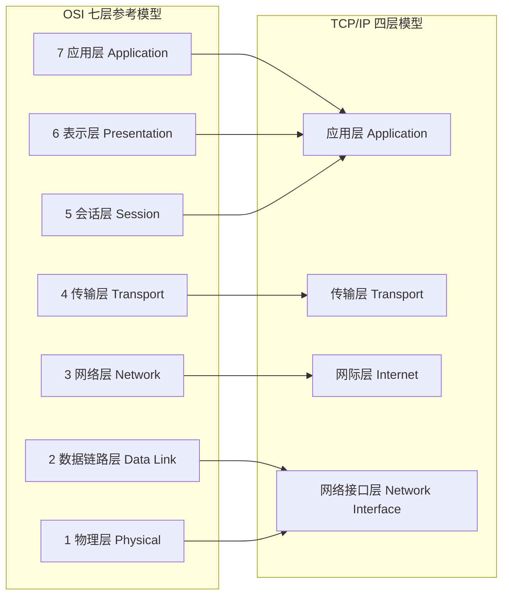

### 1.2 每层的载体、设备与排查工具

| 层 | 数据单元 PDU | 典型协议 | 典型设备 | 排查工具与抓手 |
| --- | --- | --- | --- | --- |
| 应用层 | 报文 Message | HTTP/1.1、HTTP/2、HTTP/3、DNS、SMTP、SSH、Redis RESP | 网关、WAF、Nginx | curl、dig、wrk、jstack 看线程栈 |
| 表示层 / 会话层 | - | TLS、JSON、Protobuf、Session、Cookie | - | openssl s_client、浏览器 DevTools |
| 传输层 | 段 Segment（TCP）/ 数据报 Datagram（UDP） | TCP、UDP、QUIC | 四层负载均衡 LVS | ss、netstat、tcpdump、net.ipv4.* 内核参数 |
| 网络层 | 包 Packet | IP、ICMP、ARP（严格说 ARP 横跨 2/3 层）、OSPF、BGP | 路由器 | ping、traceroute、mtr、ip route |
| 数据链路层 | 帧 Frame | Ethernet、VLAN 802.1Q、PPP | 交换机、网卡 | ip link、ethtool -S、ifconfig 的 errors/dropped |
| 物理层 | 比特 Bit | 1000BASE-T、光纤 | 中继器、Hub | ethtool、dmesg 里的 link up/down |

记住这条链路对应的封装动作：应用数据加 TCP 头成段，加 IP 头成包，加以太网头成帧，出网卡。**MTU（Maximum Transmission Unit）默认 1500 字节**，减去 IP 头 20 字节和 TCP 头 20 字节，TCP 的 **MSS（Maximum Segment Size）就是 1460 字节**。这是后面解释粘包、分片、PMTU 的基础数字。

### 1.3 几个高频细节

- **ARP 属于哪层**：ARP 报文直接封装在以太网帧里（EtherType 0x0806），所以严格说它在链路层与网络层之间。面试答"二层半，为三层服务"最稳。
- **ICMP 属于哪层**：封装在 IP 包里（Protocol = 1），属于网络层。ping、traceroute 都用它。
- **TLS 属于哪层**：位于传输层之上、应用层之下，常被称为"会话层/表示层"的现代替身。工程上直接叫"安全传输层"。
- **IPv6 头固定 40 字节**，没有校验和、没有分片字段（分片由发送方用扩展头完成），所以 MSS 计算方式不同：IPv6 下默认 MSS 通常是 1440。

## 二、一次 HTTP 请求的完整链路

### 2.1 从输入 URL 到 TCP 建连

以 `https://api.example.com/order/1001` 为例，客户端侧的动作顺序是固定的：

1. **URL 解析**：拆出 scheme（https）、host（api.example.com）、port（默认 443）、path（/order/1001）。
2. **查缓存**：按 浏览器内存缓存 → 磁盘缓存 → Service Worker 的顺序查，命中强缓存直接返回，不进网络。
3. **DNS 解析**：依次查 浏览器 DNS 缓存、操作系统 hosts、本地 DNS 缓存、`/etc/resolv.conf` 指定的 Local DNS，然后走 根域名服务器 → 顶级域（.com）→ 权威域名服务器 的递归+迭代查询。Java 侧对应 `InetAddress#getByName`，受 `networkaddress.cache.ttl` 影响：该 java.security 属性没设时先读系统属性 `sun.net.inetaddr.ttl`；两者都没设时，装了 SecurityManager 默认永久缓存（-1），**未装 SecurityManager 默认只缓存 30 秒**（`sun.net.InetAddressCachePolicy.DEFAULT_POSITIVE`）。
4. **ARP 解析**：如果目标 IP 与自己在同一网段，用 ARP 广播拿到对方 MAC；否则拿**默认网关**的 MAC。ARP 结果进 `ip neigh` 邻居表。
5. **TCP 三次握手**：SYN → SYN+ACK → ACK。
6. **TLS 握手**：TLS 1.2 需 2-RTT，TLS 1.3 需 1-RTT（会话复用可 0-RTT）。
7. **发送 HTTP 请求**：GET + headers，收到响应，Content-Encoding 解压、Transfer-Encoding 处理。
8. **渲染**：解析 HTML → 构建 DOM → 构建 CSSOM → Render Tree → Layout → Paint → Composite。

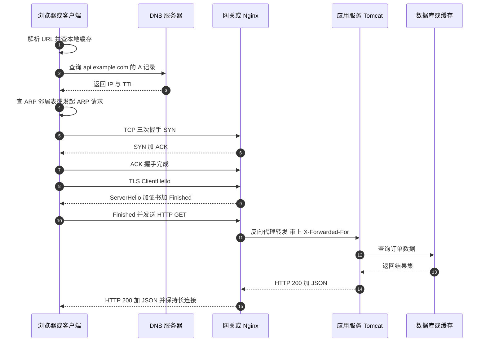

### 2.2 各阶段耗时如何量化

面试被问"这个页面加载慢，你怎么定位"，正确答案是**先把链路拆成可测量的段**，而不是猜。

| 阶段 | 典型量级 | 观测手段 |
| --- | --- | --- |
| DNS | 0.1ms（命中缓存）~ 100ms（冷启动递归） | `dig +stats`、Chrome DevTools 的 DNS Lookup 段 |
| TCP 握手 | 0.1~1ms（同机房）/ 同城 1~3ms / 跨国 100~200ms | curl 的 `time_connect` |
| TLS 握手 | TLS 1.3 约 1 RTT，TLS 1.2 约 2 RTT，会话复用 0~1 RTT | curl 的 `time_appconnect` |
| 服务端处理 | 由业务决定，看 APM 的 span | skywalking / pinpoint / 日志打点 |
| 首字节 TTFB | `time_starttransfer` | curl -w 输出 |
| 内容传输 | 与带宽、丢包、RTT 有关 | curl 的 `time_total` - `time_starttransfer` |

`curl -w` 的标准写法（这是最能直接拿出去说的话）：

```bash
curl -o /dev/null -s -w "dns=%{time_namelookup} connect=%{time_connect} tls=%{time_appconnect} ttfb=%{time_starttransfer} total=%{time_total} size=%{size_download}\n" https://api.example.com/health
```

## 三、TCP 三次握手与四次挥手

### 3.1 报文头里必须记住的字段

TCP 头**固定 20 字节，带选项最多 60 字节**。字段逐个说：

| 字段 | 长度 | 说明 |
| --- | --- | --- |
| 源端口 / 目的端口 | 各 16 位 | 与源 IP、目的 IP 一起构成四元组，唯一定位一条连接 |
| 序号 Sequence Number | 32 位 | 本报文段数据的第一个字节的编号；SYN 报文中是初始序号 ISN |
| 确认号 Acknowledgment Number | 32 位 | 期望收到的下一个字节编号；仅当 ACK 标志为 1 时有效 |
| 数据偏移 Data Offset | 4 位 | 首部长度，单位是 4 字节；5 表示无选项的 20 字节 |
| 标志位 | 8 位 | CWR、ECE、URG、ACK、PSH、RST、SYN、FIN |
| 窗口 Window | 16 位 | 接收窗口 rwnd，最大 65535 字节，需要 Window Scale 选项放大 |
| 校验和 Checksum | 16 位 | 覆盖伪首部 + TCP 头 + 数据 |
| 紧急指针 | 16 位 | 配合 URG 使用，现代很少用 |

**关键选项**：MSS（握手时通告，双方取小值）、Window Scale（移位因子 0~14，最大把窗口放大到 2^30 即约 1GB）、SACK Permitted（RFC 2018）、Timestamps（用于 RTT 测量与 PAWS 防止序号回绕）。

### 3.2 三次握手：为什么是三次

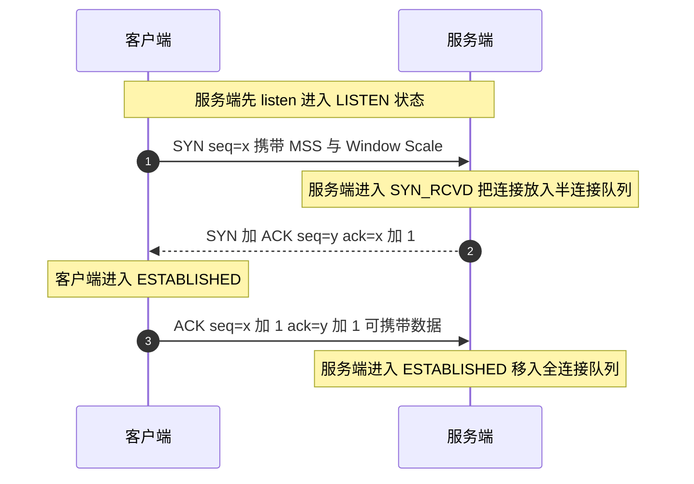

**为什么必须是三次，不是两次也不是四次**：

1. **同步双方的初始序号（ISN）**，而 ISN 是双向的。两次握手（SYN、SYN+ACK）只能让**客户端**确认自己的 ISN 已被服务端收到、并得知服务端的 ISN；但**服务端无法确认自己发出的 SYN 客户端收到了**——收不到第三个 ACK，服务端就是"盲发"。
2. **阻止历史重复连接**。若旧连接的 SYN 因网络滞留而在连接关闭后到达，两次握手会让服务端直接建连并等待数据，白白占用资源；三次握手下客户端会用 RST 拒绝。
3. **确认双方的收发能力**。第三次 ACK 同时证明"客户端能收、客户端能发、服务端能收、服务端能发"。
4. **不需要四次**：服务端的 SYN 和 ACK 可以合并成一个报文，因为它们是同一时刻的两个动作，没有因果关系需要分开。

**ISN 为什么随机**：RFC 793 规定 ISN 与时钟相关，每 4 微秒加 1；现代内核用加密安全的伪随机数并加时间偏移。如果可预测，攻击者可以伪造序列号注入数据（TCP 序列号预测攻击）。

### 3.3 半连接队列与全连接队列

这是 SYN Flood 与"连接建立失败"排查的核心：

- **半连接队列（SYN Queue）**：收到 SYN 并回了 SYN+ACK，等待第三次 ACK 的连接。队列长度由 `net.ipv4.tcp_max_syn_backlog` 决定（现代内核该值实际由 `somaxconn` 共同约束）。
- **全连接队列（Accept Queue）**：三次握手完成，等待应用调用 `accept()` 的连接。长度 = `min(backlog, net.core.somaxconn)`。`backlog` 就是 Java 中 `new ServerSocket(port, backlog)` 或 Tomcat 的 `acceptCount`。`net.core.somaxconn` 在 **Linux 5.4 之前默认 128，5.4 起默认 4096**。
- 队列满时的行为由 `net.ipv4.tcp_abort_on_overflow` 决定：`0`（默认）静默丢弃 ACK，客户端会重传，表现为"连接创建偶发超时"；`1` 直接回 RST，客户端立刻报 connection reset。

排查命令：

```bash
# Recv-Q 是当前已完成握手但未被 accept 的连接数，Send-Q 是全连接队列上限
ss -lnt

# 因全连接队列溢出而丢弃的计数
nstat -az TcpExtListenOverflows TcpExtListenDrops
netstat -s | grep -i -E "listen|overflow|SYN"
```

### 3.4 四次挥手：为什么是四次

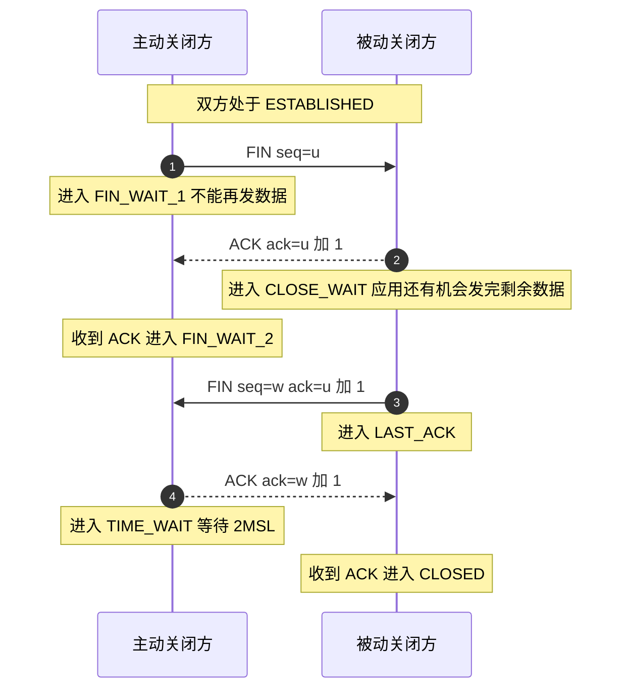

**为什么是四次**：TCP 是全双工，`FIN` 只表示"我没有数据要发了"，即**半关闭（half-close）**。被动方收到 FIN 后必须先回 ACK（这是内核立刻做的），但应用层可能还有数据要发完，所以它自己的 FIN 只能延后单独发。这两件事不能合并，于是成了四次。如果被动方正好也没有数据要发，Linux 会把 ACK 与 FIN 合并（表现为三次报文），但这不是协议保证。

### 3.5 TCP 完整状态机

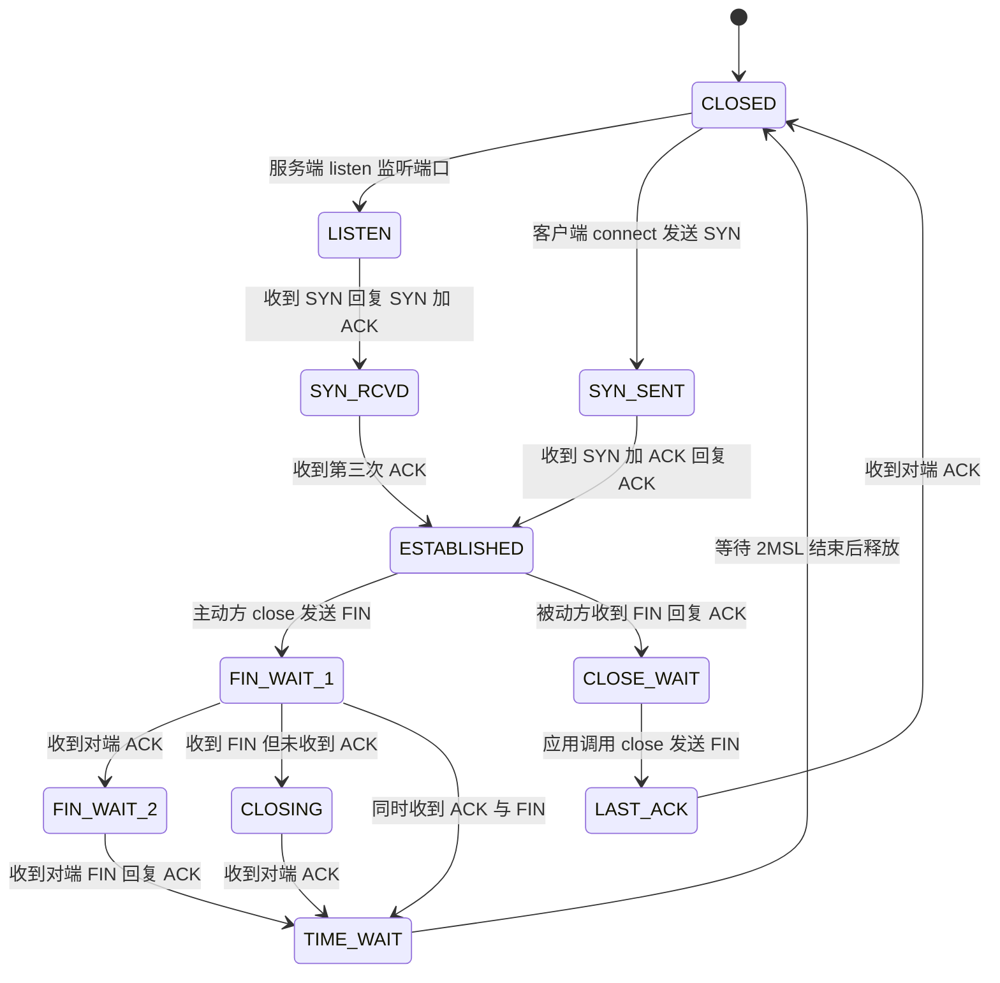

## 四、TIME_WAIT 与 CLOSE_WAIT

### 4.1 TIME_WAIT 的意义

**TIME_WAIT 只出现在主动关闭方**。它的存在有两个不可省略的理由：

1. **保证最后一个 ACK 能到达对端**。如果这个 ACK 丢了，对端会重传 FIN；处在 TIME_WAIT 的一方还能重新回 ACK。若直接进入 CLOSED，对端收到的就是 RST，表现为"连接被重置"。
2. **让旧连接的残余报文在网络中消散**。同一条四元组（源 IP、源端口、目的 IP、目的端口）可能被新连接复用，如果旧连接的延迟报文还在路上，会被新连接误收，造成数据错乱。等待 2MSL 可保证旧报文已全部超时消失。

### 4.2 2MSL 到底是多少

理论上 2MSL = 2 × Maximum Segment Lifetime。**Linux 内核并不按 MSL 计算，而是把它硬编码为固定 60 秒**：`include/net/tcp.h` 中的 `TCP_TIMEWAIT_LEN` 定义为 `(60*HZ)`。所以：

- Linux 上 TIME_WAIT 状态的连接**固定存活 60 秒**，`net.ipv4.tcp_fin_timeout` **不影响 TIME_WAIT**（它影响的是 FIN_WAIT_2 的超时，默认 60 秒）。
- Windows 默认为 2MSL = 240 秒（MSL 默认 120 秒）。
- 因此"改 tcp_fin_timeout 来减少 TIME_WAIT"是错的，这是高频陷阱题。

### 4.3 大量 TIME_WAIT 的成因与优化

**成因**：短连接 + 主动关闭。典型场景是 Java 应用通过 HttpClient / OkHttp / Feign 调下游，每次新建连接又不复用，或者 Nginx 做反向代理时 `proxy_http_version 1.0` 导致对上游用短连接。

**先把数量算清楚**：TIME_WAIT 峰值 ≈ QPS × 60 秒。单机 500 QPS 的短连接就会稳定堆 30000 个 TIME_WAIT。这个公式比任何调参都重要——**如果 QPS×60 超过 `net.ipv4.ip_local_port_range` 的可用端口数，就一定会出现 connect 失败**。

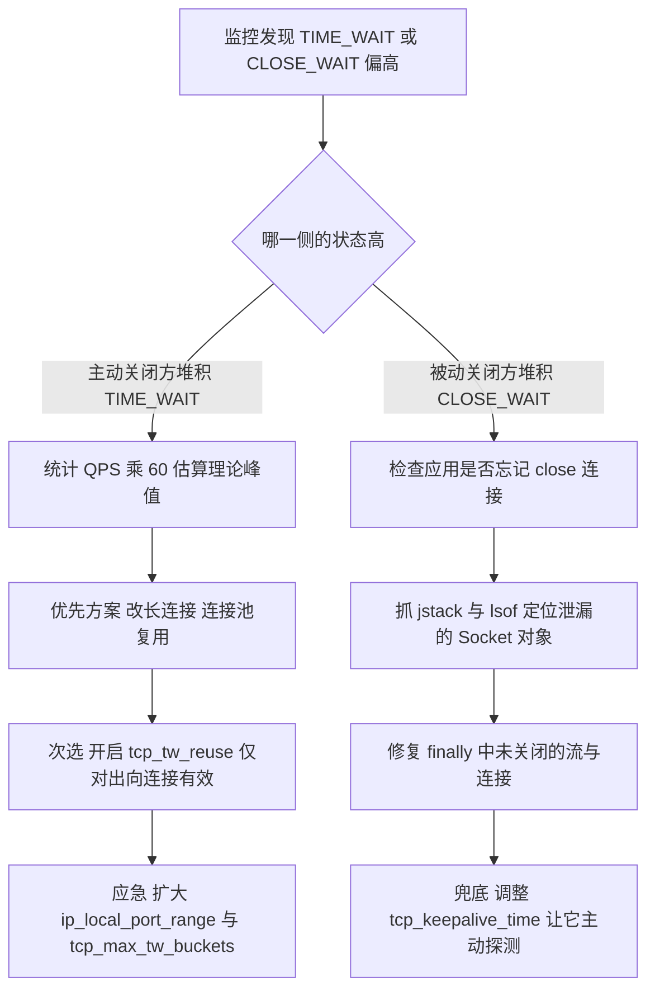

| 手段 | 配置 | 生效条件 | 代价 / 风险 |
| --- | --- | --- | --- |
| 改长连接 | HttpClient 连接池、OkHttp `ConnectionPool`、Nginx `keepalive 32` | 无 | **首选**，同时降低握手开销 |
| 开启 tw_reuse | `net.ipv4.tcp_tw_reuse=1` | 仅对**主动发起连接**的一方有效；且需 `net.ipv4.tcp_timestamps=1`（默认开） | RFC 1323 允许，安全；只对出向连接有效 |
| 缩小端口范围影响 | `net.ipv4.ip_local_port_range="10000 65000"` | 无 | 扩大可用端口，缓解 connect 失败 |
| 限制总量 | `net.ipv4.tcp_max_tw_buckets=262144` | 无 | 超过上限的 TIME_WAIT 会被直接销毁并打日志 |
| `tcp_tw_recycle` | **已于 Linux 4.12 移除** | - | 曾经在 NAT 环境下导致大量丢包，**不要再提** |

### 4.4 大量 CLOSE_WAIT 的成因

**CLOSE_WAIT 只出现在被动关闭方**。它表示"我已收到对方 FIN 并回了 ACK，但我的应用还没调用 close()"。所以 **CLOSE_WAIT 堆积 100% 是应用代码问题**，不是内核参数问题。

典型根因：

1. `InputStream` / `OutputStream` / `Socket` 未在 finally 里关闭，异常路径上跳过关闭逻辑。
2. HTTP 客户端拿到响应后没有消费完 body 就丢弃对象，底层连接无法回到池里。
3. 连接池 `maxConnections` 配得比下游能承受的大，下游先关，本端线程阻塞在业务逻辑上迟迟不 close。
4. 线程池打满，回调里没人执行关闭。

排查手法：

```bash
# 1 看 CLOSE_WAIT 数量与对端地址分布
ss -tan state close-wait | awk 'NR>1{print $5}' | cut -d: -f1 | sort | uniq -c | sort -rn | head

# 2 找到持有这些 fd 的进程
lsof -p <pid> | grep -c CLOSE_WAIT

# 3 确认是哪个连接池或哪段代码
jstack <pid> > /tmp/stack.txt
grep -A 30 "http-nio" /tmp/stack.txt
```

**结论口径**：TIME_WAIT 是**正常且必要**的状态，量大有阈值；CLOSE_WAIT 是**代码 bug 的信号**，只要持续存在就应该改代码。

## 五、TCP 可靠传输机制

### 5.1 可靠传输的四个支柱

| 机制 | 解决的问题 | 具体实现 |
| --- | --- | --- |
| 序号 + 确认 | 乱序、重复 | 每个字节都有 32 位序号；累积确认 ACK=n 表示"n 之前的全部收到" |
| 校验和 | 比特错误 | 16 位反码求和校验 |
| 超时重传 | 报文丢失 | RTO 定时器，超时后重传未被确认的最早报文 |
| 快速重传 | 单个报文丢失时不必等超时 | 收到 3 个重复 ACK（dup ACK）立即重传 |
| SACK | 一次重传多个空洞 | RFC 2018，`net.ipv4.tcp_sack=1` 默认开启 |

### 5.2 RTO 是怎么算出来的

RTO 不能是固定值：固定 1 秒在局域网太慢，在跨洋链路又太快导致无谓重传。RFC 6298 定义的算法（Jacobson / Karels）：

1. 首次测量：`SRTT = R`，`RTTVAR = R / 2`，`RTO = SRTT + max(G, K × RTTVAR)`，K = 4，G 是时钟粒度。
2. 后续测量，α = 1/8，β = 1/4：
   - `RTTVAR = (1 - β) × RTTVAR + β × |SRTT - R|`
   - `SRTT = (1 - α) × SRTT + α × R`
   - `RTO = SRTT + max(G, 4 × RTTVAR)`
3. Karn 算法：**重传过的报文不参与 RTT 采样**，否则会把 RTT 算成"原包+重传包"的往返，导致 RTO 越来越大。

Linux 中的边界值：**`TCP_RTO_MIN` = 200ms**（`HZ/5`），**`TCP_RTO_MAX` = 120 秒**（`120*HZ`）。这就是为什么 tcpdump 里经常看到重传间隔是 200ms、400ms、800ms 的指数退避。

### 5.3 快速重传与 SACK

- **快速重传（Fast Retransmit）**：接收方收到乱序报文时，会重复发送当前期望的 ACK。发送方连续收到 **3 个** dup ACK 就认为该报文丢失，立刻重传，不必等 RTO。
- **SACK（Selective ACK）**：接收方在 TCP 选项里告诉发送方"我收到了 1000-2000、3000-4000，缺 2000-3000"，发送方一次只重传真正缺失的段。没有 SACK 时，累积确认会导致"要么重传全部，要么重传一大段"。
- **DSACK（Duplicate SACK，RFC 2883）**：告知发送方"我收到了重复报文"，用于判断是网络重复还是伪重传（spurious retransmission）。
- **FACK / RACK**：Linux 的 `tcp_recovery` 机制，RACK（Recent ACK）用时间而非序号判断丢包，在乱序严重的链路比 dup ACK 更准。

### 5.4 重传相关的可观测指标

```bash
# 全局重传率
nstat -az TcpRetransSegs TcpOutSegs
# 重传率 = TcpRetransSegs / TcpOutSegs，健康值小于 0.1%，超过 1% 要查

# 单连接的细节，含 rtt、retrans、cwnd、snd_wnd
ss -tin state established

# 内核丢包统计
nstat -az | grep -i -E "drop|retrans|overflow"
```

`ss -tin` 的关键字段含义：

| 字段 | 含义 |
| --- | --- |
| `rtt` / `rttvar` | 平滑 RTT 与 RTT 方差 |
| `retrans` | 该连接的重传计数 |
| `cwnd` | 拥塞窗口；**单位是 MSS 段数**：`cwnd:10` 表示 10 个 MSS，不是 10 字节 |
| `ssthresh` | 慢启动阈值 |
| `rwnd_limited` / `sndbuf_limited` | 是否被接收窗口 / 发送缓冲区限制，是判断瓶颈的关键 |
| `unacked` | 已发出未确认的字节数 |
| `bytes_retrans` | 重传字节数 |
| `pacing_rate` | 内核 pacing 速率 |

## 六、滑动窗口与流量控制

### 6.1 发送窗口的四段结构

TCP 的发送缓冲区被窗口切成四段：**已发送已确认 | 已发送未确认 | 可发送未发送 | 不可发送（窗口外）**。窗口向前滑动依赖 ACK 推进左边界。

- **发送窗口 = min(cwnd, rwnd)**。cwnd 是拥塞窗口（网络能力），rwnd 是对端通告的接收窗口（对端处理能力）。经典面试考点：**当 `sndbuf_limited` 成为瓶颈时，再扩大带宽也没用，得调 `net.ipv4.tcp_wmem`**。
- **接收窗口**受 `net.ipv4.tcp_rmem`（默认 `4096 131072 6291456`）约束，同时受 `net.core.rmem_max` 上限约束。
- **Window Scale 选项**把 16 位窗口放大到最大 2^30 字节。若没有它，最大窗口 65535 字节，在 100ms RTT 下吞吐上限只有 `65535 / 0.1 ≈ 655 KB/s`——**这是"带宽再大也跑不动"的经典原因**。

带宽时延积（BDP）= 带宽 × RTT。1 Gbps × 100 ms = 12.5 MB，即至少要 12.5 MB 的在途数据才能打满带宽。

### 6.2 零窗口与坚持定时器

接收方缓冲区满时通告 `rwnd = 0`，发送方停止发送并启动<strong>坚持定时器（Persist Timer）</strong>，定期发送<strong>窗口探测（Zero Window Probe）</strong>报文（1 字节），直到对端窗口恢复。这个定时器采用指数退避但会封顶（Linux 上限约 120 秒），否则会死锁。

### 6.3 糊涂窗口综合症与延迟确认

- **SWS（Silly Window Syndrome）**：接收方每次只腾出几个字节就通告窗口，发送方就发一个几字节的小包，头部开销远大于数据。缓解手段：**接收方等窗口达到 min(MSS, 缓冲区一半) 再通告**；**发送方用 Nagle 算法攒包**。
- **延迟确认（Delayed ACK）**：Linux 默认不立即回 ACK，而是等待最多 **40ms**（`TCP_DELACK_MIN` = `HZ/25`），期望把 ACK 与反方向的数据捎带出去。
- **Nagle + 延迟确认的经典 40ms 延迟**：客户端用 Nagle 攒着等 ACK，服务端用延迟确认等着捎带数据，双方互等，导致每个小请求多 40ms。**解决：客户端 `TCP_NODELAY = true`**。

## 七、拥塞控制四阶段与 BBR

### 7.1 四个窗口变量

| 变量 | 含义 | 初值 |
| --- | --- | --- |
| cwnd | 拥塞窗口，发送方维护 | RFC 6928 起 **10 MSS**（Linux 3.0 起 `initcwnd=10`） |
| rwnd | 接收窗口，接收方通告 | 由 `tcp_rmem` 决定 |
| ssthresh | 慢启动阈值 | 初始为无穷大（不丢包就一直处于慢启动），首次丢包时才被赋值 |
| FlightSize | 已发出未确认的数据量 | 0 |

### 7.2 四阶段流程

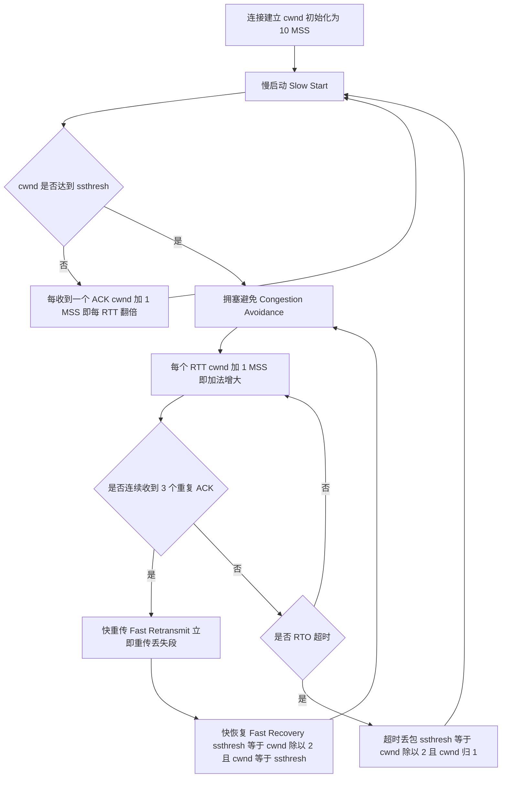

### 7.3 每个阶段的准确描述

- **慢启动（Slow Start）**：cwnd 从 10 MSS 起步，**每收到一个 ACK 就把 cwnd 加 1 MSS**，由于一个 RTT 内会收到 cwnd 个 ACK，效果是**每个 RTT 翻倍**，指数增长。名字叫"慢"是因为起点小，增长其实很快。
- **拥塞避免（Congestion Avoidance）**：cwnd ≥ ssthresh 后进入。**每个 RTT cwnd 加 1 MSS**，实现上通常是 `cwnd += MSS × MSS / cwnd`（每个 ACK 加一点点），即加法增大（AI）。
- **快重传（Fast Retransmit）**：3 个 dup ACK 触发，不等待 RTO。
- **快恢复（Fast Recovery）**：Tahoe 版本直接回到慢启动；**Reno 版本**设 `ssthresh = cwnd / 2`，`cwnd = ssthresh`，然后进入拥塞避免，避免吞吐量雪崩。
- **超时的惩罚最重**：`ssthresh = cwnd / 2`，**cwnd 直接归 1（或 10）**，回到慢启动。所以 RTO 超时的代价远大于快速重传——这是"为什么丢包率 1% 能把吞吐打掉 50%"的答案。

### 7.4 CUBIC 与 BBR

**Linux 默认算法是 CUBIC**（自 2.6.19 起），配置项 `net.ipv4.tcp_congestion_control`，可选值通过 `sysctl net.ipv4.tcp_available_congestion_control` 查看。

CUBIC 用三次函数替代线性增长：`W(t) = C × (t - K)^3 + W_max`，其中 `C = 0.4`，`K = ((W_max × (1 - β)) / C)^(1/3)`，**β = 0.7**（丢包后窗口降到 β × W_max，要再过 K 时间才回到 W_max，比 Reno 的 0.5 温和）。它的窗口增长只与**距上次丢包的时间**有关，与 RTT 无关，因此在长肥管道（LFN）上比 Reno 公平性更好。

**BBR（Bottleneck Bandwidth and Round-trip propagation time）**：Google 2016 年提出，**Linux 4.9 合入**。它不再把丢包当作拥塞信号，而是持续测量两个量：

- `BtlBw`：瓶颈带宽，用 **delivery rate**（一段时间内被 ACK 确认的字节数 / 时间）的最大值估计。
- `RTprop`：最小 RTT 的滑动窗口估计（窗口 10 秒）。

发送速率控制在其乘积附近（BDP），并在四个状态间流转：

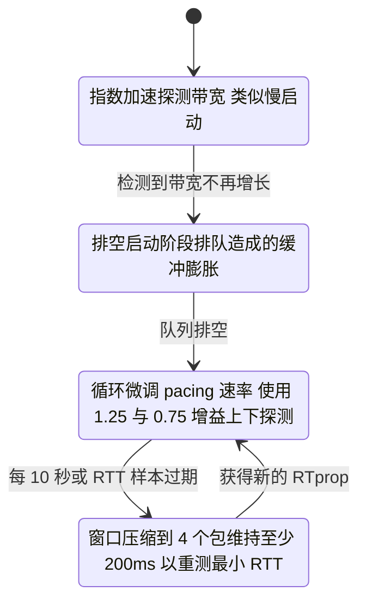

启用方式：

```bash
sysctl -w net.ipv4.tcp_congestion_control=bbr
sysctl -w net.core.default_qdisc=fq    # BBR 需要 fq 或 fq_codel 做 pacing
sysctl net.ipv4.tcp_congestion_control
```

**BBR 与 CUBIC 的取舍**：

| 维度 | CUBIC | BBR |
| --- | --- | --- |
| 拥塞信号 | 丢包 | 带宽与 RTT 建模 |
| 高丢包链路（跨国、无线） | 吞吐骤降 | 优势明显 |
| 浅缓冲区（shallow buffer） | 靠丢包找平衡，利用率低 | 能打满带宽 |
| 深缓冲区 | 会填满 buffer 造成 bufferbloat | 主动排空，延迟更低 |
| 公平性 | 成熟稳定 | v1 在多流共存时公平性差，v2 做改进 |
| 内核要求 | 所有版本 | Linux 4.9 起（BBR v1），5.x 后持续改进 |

## 八、粘包与 Nagle 算法

### 8.1 粘包的本质

**TCP 是面向字节流的协议，没有消息边界**。发送方调用两次 `write("hello")`、`write("world")`，接收方可能一次 `read` 到 `helloworld`，也可能分三次读到 `hel`、`lowo`、`rld`。这不是 bug，而是 TCP 的设计前提。

粘包/拆包产生的三个原因：

1. **发送方 Nagle 算法**把多个小包合并。
2. **接收方应用读取不及时**，内核缓冲区里攒了多个报文段。
3. **MSS 限制**导致大包被拆成多个段。

**UDP 不存在粘包**：UDP 保留消息边界，一次 `sendto` 对应一次 `recvfrom`（但可能丢、可能乱序、可能重复）。

### 8.2 三种解决粘包的标准方案

| 方案 | 做法 | 优点 | 缺点 | 典型协议 |
| --- | --- | --- | --- | --- |
| 固定长度 | 每个消息定长，不足补位 | 实现最简单 | 浪费带宽，长度不能变 | 部分硬件协议 |
| 分隔符 | 用 `\r\n`、`\0` 等特殊字符切分 | 可读性好 | 需转义，长度不可预知 | HTTP/1.1 头、Redis RESP 的 `\r\n`、SIP |
| 长度字段 | 头部固定字节存长度，先读头再读体 | 高效、支持变长 | 需处理半包状态机 | 自定义 RPC、Kafka 协议、HTTP/2 帧 |

Netty 对应实现：

- `LengthFieldBasedFrameDecoder`：最常用，参数是 `maxFrameLength`、`lengthFieldOffset`、`lengthFieldLength`、`lengthAdjustment`、`initialBytesToStrip`。
- `DelimiterBasedFrameDecoder`：按分隔符拆。
- `LineBasedFrameDecoder`：按 `\n` 或 `\r\n` 拆。
- `FixedLengthFrameDecoder`：定长拆。

**关键点：粘包只能由应用层协议解决，TCP 层面没有"关闭粘包"的开关。**

### 8.3 Nagle 算法

Nagle 算法（RFC 896）规则：**同一连接上最多只能有一个未被确认的小报文段（小于 MSS）**。攒够一个 MSS 或收到前一个的 ACK 才能继续发。

- 好处：减少小包数量，提升网络利用率。
- 坏处：与延迟确认叠加产生 40ms 级延迟；对延迟敏感的交互式协议（Redis、MySQL、RPC）必须关闭。

Java 侧关闭方式：

```java
Socket socket = new Socket();
socket.setTcpNoDelay(true);   // 对应 TCP_NODELAY，必须在连接建立前后正确设置
socket.setKeepAlive(true);    // 对应 SO_KEEPALIVE，默认 7200 秒才开始探测
socket.setSoTimeout(3000);    // 注意 这是 read 超时 不是 connect 超时
```

| 参数 | Java API | 对应内核参数 | 默认值 |
| --- | --- | --- | --- |
| TCP_NODELAY | `Socket#setTcpNoDelay(true)` | - | JDK 默认 false（即启用 Nagle）；Netty 默认设为 true |
| SO_KEEPALIVE | `Socket#setKeepAlive(true)` | `tcp_keepalive_time` | 7200 秒；`tcp_keepalive_intvl=75`，`tcp_keepalive_probes=9` |
| SO_TIMEOUT | `Socket#setSoTimeout(ms)` | - | 0 表示无限等待（**线上必须设**） |
| SO_BACKLOG | `ServerSocket(int port, int backlog)` | `net.core.somaxconn` | 取两者较小值 |
| SO_REUSEADDR | `ServerSocket#setReuseAddress(true)` | - | Tomcat 默认开启 |
| SO_LINGER | `Socket#setSoLinger(on, seconds)` | - | 默认关闭（`getSoLinger()` 返回 -1）；设成 `setSoLinger(true, 0)` 时 close 会直接发 RST 而不走四次挥手，对端看到 `Connection reset` |

**注意区别**：`TCP_NODELAY` 关闭 Nagle 只影响该连接；如果你用连接池，必须在每个新建的 Socket 上都设，或在客户端全局配置（例如 OkHttp 的 `ConnectionPool` 底层已禁用 Nagle，HTTP/2 更是完全不用 Nagle）。

## 九、UDP 与 QUIC

### 9.1 UDP 的报文结构

UDP 头只有 **8 字节**：源端口（16 位）、目的端口（16 位）、长度（16 位）、校验和（16 位）。没有序号、没有确认、没有窗口、没有拥塞控制。

| 维度 | TCP | UDP |
| --- | --- | --- |
| 连接 | 面向连接，三次握手 | 无连接 |
| 可靠性 | 可靠，重传+确认 | 不可靠，丢包即丢 |
| 顺序 | 有序 | 可能乱序 |
| 头部开销 | 20~60 字节 | 8 字节 |
| 传输方式 | 字节流 | 数据报，保留边界 |
| 拥塞控制 | 有 | 无（QUIC 在用户态自己实现） |
| 一对多 | 不支持 | 支持广播/组播 |
| 典型场景 | HTTP/1.1、HTTP/2、数据库、RPC | DNS(53)、DHCP(67/68)、SNMP(161)、RTP、QUIC、游戏 |

### 9.2 QUIC 的核心设计

QUIC 由 Google 设计，2021 年 5 月成为 RFC 9000（传输）、RFC 9001（TLS 1.3）、RFC 9002（丢包检测与拥塞控制）。

| 特性 | 实现方式 | 带来的收益 |
| --- | --- | --- |
| 建连快 | 传输握手与 TLS 1.3 握手合并，1-RTT 建连；恢复连接可 0-RTT | 首字节时间降低 1~3 个 RTT |
| 无队头阻塞 | 在 UDP 之上做**独立流（Stream）**，每条流单独排序与重传 | 一条流丢包不阻塞其他流 |
| 连接迁移 | 用 **Connection ID** 标识连接而非四元组 | 手机从 Wi-Fi 切 4G 不断连 |
| 用户态实现 | 拥塞控制、丢包恢复都在应用层 | 迭代不受内核版本限制，可灰度 |
| 强制加密 | 除少数公开头外全部加密 | 防中间盒篡改，但也让运营商难以做 QoE |

**注意：QUIC 在用户态重造了 TCP 的可靠传输（序号、ACK、重传、流控、拥塞控制），本质是把"内核里改不动的 TCP"搬到用户态**。这是理解 QUIC 最好的表述。

## 十、HTTP 1.0 到 3 的演进

### 10.1 四个版本的对照

| 维度 | HTTP/1.0 | HTTP/1.1 | HTTP/2 | HTTP/3 |
| --- | --- | --- | --- | --- |
| 规范 | RFC 1945 | RFC 7230~7235（2014），后由 RFC 9110~9112 取代 | RFC 7540（2015），后由 RFC 9113 取代 | RFC 9114（2022-06） |
| 传输层 | TCP | TCP | TCP | QUIC over UDP |
| 连接模型 | 默认短连接，`Connection: keep-alive` 手动开启 | 默认长连接（`keep-alive`），需 `Connection: close` 关闭 | 单连接多路复用 | 单连接多路复用 |
| 报文格式 | 文本 | 文本 | 二进制分帧 | 二进制分帧 |
| 并发 | 无，靠浏览器每域 6 个连接 | 管道化（pipelining），实际禁用 | Stream 多路复用，理论无上限（受 SETTINGS_MAX_CONCURRENT_STREAMS 限制，默认常配 100） | 同 HTTP/2，且不受 TCP 层队头阻塞 |
| 头部压缩 | 无 | 无 | HPACK（静态表 61 项 + 动态表） | QPACK |
| 服务端推送 | 无 | 无 | Server Push（Chrome 106 已移除支持） | RFC 9114 仍定义了 Push，但浏览器已不支持，实践中改用 103 Early Hints |
| 队头阻塞 | 有（连接级） | 有（连接级，管道化加剧） | 应用层解决，**TCP 层仍有** | 基本消除 |
| 明文/加密 | 明文 | 明文 | 实际部署几乎都是 h2 over TLS | 强制加密 |

### 10.2 队头阻塞的两层含义

这是最容易答错的点，必须分层：

1. **应用层队头阻塞（HTTP 层）**：HTTP/1.1 在一个连接上必须按序返回响应，前一个慢请求会卡住后面的。HTTP/2 用 Stream 解决：同一连接上多个 Stream 的帧可以交错发送。
2. **传输层队头阻塞（TCP 层）**：TCP 保证字节流有序交付，一个报文段丢失后，后面所有已到达的数据都要在内核缓冲区等它重传，**HTTP/2 的所有 Stream 共享这一条 TCP 连接，于是全部被牵连**。HTTP/3 用 QUIC 的独立流彻底解决。

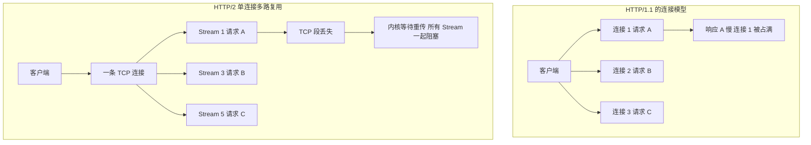

### 10.3 HTTP/2 的二进制分帧

HTTP/2 把报文切成帧（Frame），每条消息由 HEADERS 帧 + 若干 DATA 帧组成，所有帧都有 9 字节头：Length（24 位）、Type（8 位）、Flags（8 位）、R + Stream Identifier（31 位）。常见帧类型：

| 帧类型 | 作用 |
| --- | --- |
| HEADERS | 携带请求或响应头，含 HPACK 压缩块 |
| DATA | 携带 body |
| SETTINGS | 协商参数，如 `SETTINGS_MAX_CONCURRENT_STREAMS`、`SETTINGS_INITIAL_WINDOW_SIZE` |
| WINDOW_UPDATE | 流控窗口更新，**HTTP/2 有自己的流与连接两级流控** |
| RST_STREAM | 单条流被取消，**不再需要断整个连接** |
| GOAWAY | 优雅关闭连接 |
| PING | 探活与 RTT 测量 |

### 10.4 Java 侧怎么用

```java
// JDK 11 起支持 HTTP/2 的 java.net.http.HttpClient
HttpClient client = HttpClient.newBuilder()
    .version(HttpClient.Version.HTTP_2)      // 协商失败会自动降级到 HTTP_1_1
    .connectTimeout(Duration.ofSeconds(2))
    .build();
```

Spring Boot 侧开启 h2：`server.http2.enabled=true`（需要 TLS 或前置 h2c）；Nginx 侧对应 `listen 443 ssl http2;` 与上游的 `proxy_http_version 1.1`。

**注意坑**：Nginx 到上游默认用 HTTP/1.0，必须显式 `proxy_http_version 1.1;` 并配置 `proxy_set_header Connection "";` 才能让上游长连接生效，否则每个请求都新建 TCP。

## 十一、HTTP 状态码与缓存机制

### 11.1 状态码分类与高频码

| 码 | 短语 | 语义与常见误用 |
| --- | --- | --- |
| 100 | Continue | 客户端发 `Expect: 100-continue` 后服务端同意发送 body |
| 101 | Switching Protocols | 协议升级，WebSocket 握手成功 |
| 200 | OK | 成功 |
| 201 | Created | 资源创建成功，应带 Location |
| 204 | No Content | 成功但无 body，常用于 DELETE、PUT |
| 206 | Partial Content | 断点续传、视频拖动，配合 `Range` 与 `Content-Range` |
| 301 | Moved Permanently | 永久重定向，**浏览器会缓存，POST 会变成 GET** |
| 302 | Found | 临时重定向，**历史实现会把 POST 变 GET** |
| 303 | See Other | 明确要求用 GET 访问新地址 |
| 304 | Not Modified | 协商缓存命中，**不能带 body** |
| 307 | Temporary Redirect | 临时重定向且**保持原方法与 body** |
| 308 | Permanent Redirect | 永久重定向且**保持原方法** |
| 400 | Bad Request | 请求语义错误，参数校验失败 |
| 401 | Unauthorized | **未认证**（名字有误导性），应带 `WWW-Authenticate` |
| 403 | Forbidden | **已认证但无权限** |
| 404 | Not Found | 资源不存在；网关也可能用它掩盖上游 5xx |
| 405 | Method Not Allowed | 方法不支持，应带 `Allow` |
| 408 | Request Timeout | 服务端等待请求超时（对应 Tomcat `connectionTimeout`，默认 20 秒） |
| 409 | Conflict | 资源状态冲突，如乐观锁版本不一致 |
| 413 | Payload Too Large | body 超限，对应 Nginx `client_max_body_size` 默认 1m |
| 429 | Too Many Requests | 限流，应带 `Retry-After` |
| 499 | Client Closed Request | **Nginx 自定义**，客户端主动断开 |
| 500 | Internal Server Error | 未捕获异常 |
| 501 | Not Implemented | 方法不被支持 |
| 502 | Bad Gateway | 网关拿到上游的非法响应或上游不可达 |
| 503 | Service Unavailable | 服务不可用（限流、发布中），应带 `Retry-After` |
| 504 | Gateway Timeout | 网关等上游超时，对应 Nginx `proxy_read_timeout` 默认 60 秒 |

### 11.2 强缓存与协商缓存

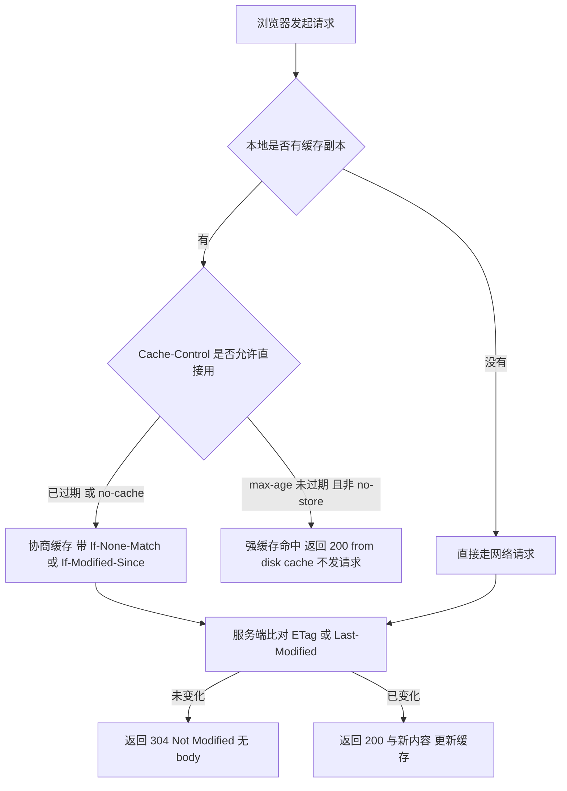

| 维度 | 强缓存 | 协商缓存 |
| --- | --- | --- |
| 是否发请求 | 不发 | 发，但可能只回 304 |
| 响应头 | `Cache-Control: max-age`、`s-maxage`、`immutable`、`Expires` | `ETag` / `Last-Modified` |
| 请求头 | - | `If-None-Match` / `If-Modified-Since` |
| 状态码 | 200（from cache） | 304 |
| 优先级 | `Cache-Control` **高于** `Expires` | `ETag` **优先于** `Last-Modified` |
| 精度 | 秒 | ETag 内容级精确；Last-Modified 秒级 |

**Cache-Control 关键指令**：

- `max-age=31536000`：浏览器缓存一年（静态资源带 hash 时的标准做法）。
- `s-maxage=600`：只对共享缓存（CDN、代理）生效，优先于 `max-age`。
- `no-cache`：**可以缓存，但每次必须回源校验**（很多人误以为是"不缓存"）。
- `no-store`：**完全不缓存**，任何副本都不许留。
- `private` / `public`：是否允许共享缓存存储。
- `must-revalidate`：过期后必须回源，不许用陈旧副本。

**ETag 的强校验与弱校验**：`ETag: "abc"` 是强校验，字节级相同；`ETag: W/"abc"` 是弱校验，语义等效即可。Nginx 默认对静态文件用 `Last-Modified` + 内容长度生成 ETag；如果用多台机器做负载均衡且文件 mtime 不一致，会导致 ETag 抖动、缓存反复失效——**这是线上"静态资源反复回源"的常见原因**。

**为什么 Last-Modified 不够**：精度只到秒（1 秒内多次修改识别不出）；文件内容没变但被重新生成时 mtime 变化会误判为已修改；分布式环境下各机器时钟不一致。

## 十二、HTTPS 与 TLS 握手

### 12.1 对称、非对称与摘要的分工

| 类型 | 算法 | 密钥 | 用途 | 性能量级 |
| --- | --- | --- | --- | --- |
| 对称加密 | AES-128-GCM、AES-256-GCM、ChaCha20-Poly1305 | 同一把 | 加密应用数据 | 极快，AES-NI 下可达 GB/s |
| 非对称加密 | RSA-2048/4096、ECDHE（X25519、secp256r1） | 公钥/私钥 | 密钥交换、签名 | 慢，比对称慢 2~3 个数量级 |
| 摘要 / MAC | SHA-256、HMAC-SHA256、AEAD 的认证标签 | - | 完整性校验 | 快 |

**HTTPS 的本质**：用非对称算法（或 DH 类算法）**协商出一把对称密钥**，之后全部用对称加密传数据。非对称只做"钥匙交换"和"身份证明"，不做数据加密。

### 12.2 证书链与信任锚

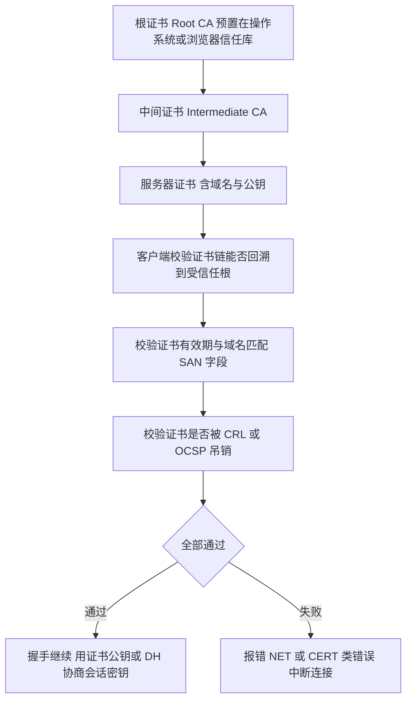

服务端部署时必须配置**完整的证书链**（`ssl_certificate` 要包含叶证书 + 中间证书，顺序为叶在前）。只配叶证书时，浏览器通常能靠 AIA 自动补链，但移动端 App、Java 客户端、`curl` 常常直接报 `unable to get local issuer certificate`——**这是"浏览器能打开但 Java 报错"的头号原因**。

### 12.3 TLS 1.2 与 TLS 1.3 握手对比

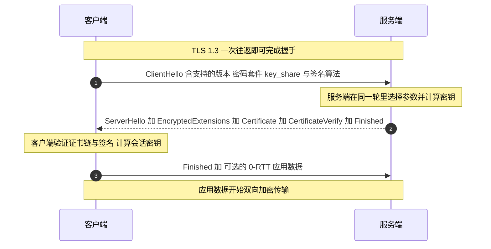

TLS 1.2（RFC 5246）与 TLS 1.3（RFC 8446，2018 年 8 月）的关键差异：

| 维度 | TLS 1.2 | TLS 1.3 |
| --- | --- | --- |
| 握手往返 | 2-RTT | 1-RTT（会话恢复 0-RTT） |
| 密钥交换 | RSA 静态、DHE、ECDHE | **只保留 (EC)DHE**，强制前向安全 |
| 对称套件 | 含 RC4、CBC 系列、3DES | 只保留 AEAD：AES-GCM、ChaCha20-Poly1305、AES-CCM |
| 压缩 | 有（已废弃，CRIME 攻击） | 移除 |
| 重协商 | 支持 | 移除，改用 KeyUpdate |
| 会话恢复 | Session ID / Session Ticket | PSK（Pre-Shared Key）与 0-RTT |
| 加密起点 | 在 ChangeCipherSpec 之后 | ServerHello 之后（证书报文也已加密） |
| 前向安全 | 需显式选 ECDHE | 默认具备 |

**前向安全（Forward Secrecy）**：即使服务器私钥将来泄露，攻击者也无法解密历史上抓到的流量，因为每次会话密钥由临时 DH 参数生成，用完即弃。RSA 密钥交换不具备前向安全，这是 TLS 1.3 废弃它的原因。

**0-RTT 的风险**：早期数据没有重放保护，攻击者可以重放。所以只应用于幂等的 GET；如果 API 有非幂等操作（下单、支付），服务端应拒绝 0-RTT（Nginx 用 `ssl_early_data on` 时要配合应用层防重放）。

### 12.4 中间人攻击（MITM）怎么发生的

前提是攻击者能让客户端相信一个伪造证书，途径有三：

1. **客户端信任了攻击者的根证书**：企业内网抓包工具（Charles、Fiddler）装根证书、用户点了"继续访问不安全网站"。
2. **CA 被攻破或签发错误**：历史上 DigiNotar、WoSign 事件。
3. **服务端私钥泄露**：攻击者可对任意客户端冒充该域名。

防护：开启 HSTS（`Strict-Transport-Security: max-age=31536000; includeSubDomains; preload`）、证书透明度（Certificate Transparency）、证书固定（Certificate Pinning，App 端常用 HPKP 已废弃，改用配置校验公钥 SHA-256）、OCSP Stapling。

### 12.5 TLS 握手对性能的影响

| 优化项 | 做法 | 收益 |
| --- | --- | --- |
| 会话复用 | TLS 1.2 Session Ticket，TLS 1.3 PSK | 省一次完整握手 |
| 开启 TLS 1.3 | Nginx `ssl_protocols TLSv1.2 TLSv1.3;` | 省 1 个 RTT |
| OCSP Stapling | `ssl_stapling on; ssl_stapling_verify on;` | 避免客户端去 CA 查吊销状态 |
| 证书链精简 | 只带必要中间证书 | 减小 Certificate 报文 |
| 会话密钥缓存 | `ssl_session_cache shared:SSL:10m; ssl_session_timeout 1h;` | 复用率可达 90%+ |
| 硬件加速 | AES-NI、QAT 卡 | 卸载加解密 CPU |

## 十三、Cookie / Session / Token / JWT

### 13.1 四者的定位差异

| 维度 | Cookie | Session | Token（不透明） | JWT |
| --- | --- | --- | --- | --- |
| 存储位置 | 客户端浏览器 | 服务端内存/Redis | 客户端（LocalStorage/Header） | 客户端 |
| 服务端状态 | 无状态（就是个容器） | **有状态** | 通常有状态（Redis 存映射） | **无状态** |
| 传递方式 | 浏览器自动带 `Cookie` 头 | 靠 Cookie 里的 `JSESSIONID` | 手动放 `Authorization` 头 | 手动放 `Authorization` 头 |
| 跨域 | 受同源策略与 SameSite 限制 | 同上 | 天然跨域 | 天然跨域 |
| 可撤销 | - | 删 Session 即可 | 删 Redis Key 即可 | **难**，需要黑名单或短过期 |
| 体积 | 单域名约 4KB | 只传 ID，很小 | 小 | 较大（claims 全在 token 里） |
| 移动端友好 | 一般 | 一般 | 好 | 好 |
| 签名/加密 | 无 | 无 | 无 | 有签名，可选加密 |

### 13.2 Cookie 的关键属性

| 属性 | 作用 | 线上注意 |
| --- | --- | --- |
| `Domain` | 生效域名，含子域 | 不设则只对当前域生效（不含子域） |
| `Path` | 生效路径 | 默认为当前目录 |
| `Expires` / `Max-Age` | 过期时间；`Max-Age` 优先级更高 | 不设即会话 Cookie，关浏览器即失效 |
| `HttpOnly` | 禁止 JS 通过 `document.cookie` 读取 | **防 XSS 窃取 Session 的必备项** |
| `Secure` | 只在 HTTPS 下发送 | 生产必须开 |
| `SameSite=Strict` | 跨站请求完全不带 | 从外部链接进入会丢失登录态 |
| `SameSite=Lax` | 顶层导航的 GET 带，POST/iframe 不带 | **Chrome 80 起的默认值**，兼顾安全与体验 |
| `SameSite=None` | 总是带 | **必须同时加 `Secure`**，否则被浏览器拒绝 |
| `__Host-` / `__Secure-` 前缀 | `__Host-` 要求 Secure + `Path=/` + 不能设 Domain；`__Secure-` 只要求 Secure | 防子域 Cookie 注入 |

Spring Boot 侧配置：

```yaml
server:
  servlet:
    session:
      cookie:
        http-only: true
        secure: true
        same-site: lax
      timeout: 30m          # 默认 30 分钟
```

### 13.3 JWT 的结构与坑

JWT（RFC 7519）是三段 Base64URL 用 `.` 连接：`Header.Payload.Signature`。

- **Header**：`{"alg":"RS256","typ":"JWT"}`。`alg` 是签名算法。
- **Payload**：标准声明 `iss`（签发者）、`sub`（主体）、`aud`（受众）、`exp`（过期时间）、`nbf`（生效时间）、`iat`（签发时间）、`jti`（唯一 ID）；其余为自定义 claim。
- **Signature**：`HMACSHA256(base64Url(header) + "." + base64Url(payload), secret)` 或 RSA/ECDSA 签名。

| JWT 常见问题 | 原因 | 正确做法 |
| --- | --- | --- |
| `alg: none` 攻击 | 库把 `none` 当合法算法，不验签 | 服务端**强制白名单算法**，禁止 `none` |
| HS256 与 RS256 混淆 | 库用公钥当 HMAC 密钥验签 | 显式指定算法，不信任 header 里的 `alg` |
| 无法撤销 | 无状态，签发即有效 | 短 `exp` + Redis 黑名单（存 `jti`）+ Refresh Token |
| Payload 被当成密文 | 只是 Base64，不是加密 | 不放敏感信息；需要保密用 JWE（RFC 7516） |
| Token 过大 | claims 塞太多 | 只放 `sub`、`exp`、`jti`，权限查缓存 |
| 时钟偏差导致误判 | 多机时钟不同步 | 允许 30~60 秒 leeway |

**Refresh Token 的标准设计**：Access Token 有效期 15~30 分钟，Refresh Token 7~30 天且一次性轮换（refresh token rotation）。Refresh Token 存入 HttpOnly Cookie 或安全存储，泄露检测靠"同一次 refresh 被用两次则吊销整条链"。

## 十四、Nginx 反向代理与 CDN

### 14.1 正反向代理的区别

- **正向代理**：代理客户端。客户端知道自己在用代理，服务端不知道真实客户端（科学上网、企业出口代理）。
- **反向代理**：代理服务端。客户端以为在直连，实际由 Nginx 转发（负载均衡、TLS 卸载、静态资源）。

### 14.2 Nginx 关键配置与默认值

```nginx
upstream order_service {
    least_conn;                          # 默认是 round-robin；其他 least_conn、ip_hash、hash $arg_uid consistent
    server 10.0.0.1:8080 weight=1 max_fails=2 fail_timeout=10s;
    server 10.0.0.2:8080 weight=1;
    keepalive 64;                        # 到上游保持 64 个空闲长连接
    keepalive_timeout 60s;
    keepalive_requests 1000;
}

server {
    listen 443 ssl http2;
    server_name api.example.com;

    ssl_certificate     /etc/nginx/ssl/fullchain.pem;   # 必须含中间证书
    ssl_certificate_key /etc/nginx/ssl/privkey.pem;
    ssl_protocols TLSv1.2 TLSv1.3;
    ssl_session_cache shared:SSL:10m;
    ssl_session_timeout 1h;

    client_max_body_size 10m;            # 默认 1m
    client_body_timeout  60s;
    keepalive_timeout    75s;            # 默认 75 秒
    send_timeout         60s;

    location /api/ {
        proxy_pass http://order_service/;
        proxy_http_version 1.1;
        proxy_set_header Connection "";
        proxy_set_header Host $host;
        proxy_set_header X-Real-IP $remote_addr;
        proxy_set_header X-Forwarded-For $proxy_add_x_forwarded_for;
        proxy_set_header X-Forwarded-Proto $scheme;
        proxy_connect_timeout 3s;        # 默认 60s
        proxy_send_timeout    30s;       # 默认 60s
        proxy_read_timeout    30s;       # 默认 60s
        proxy_next_upstream error timeout http_502 http_503 http_504;
        proxy_buffering on;              # 默认 on
    }
}
```

**`proxy_buffering` 的坑（默认 on）**：Nginx 会先把上游响应整体缓冲再发给客户端，SSE、大文件下载、chunked 流式接口会被"攒住"，表现为前端迟迟收不到数据、`curl` 不分块输出。流式接口要在该 location 下写 `proxy_buffering off;`，或由上游响应头返回 `X-Accel-Buffering: no`，让 Nginx 逐块转发。

**502 与 504 的区分**（高频排查题）：

| 现象 | 含义 | 常见原因 |
| --- | --- | --- |
| 502 Bad Gateway | Nginx 无法从上游拿到合法响应 | 上游进程挂了、上游主动 RST、上游返回非法响应头、连接池已满被拒绝 |
| 504 Gateway Timeout | 上游处理超时 | `proxy_read_timeout` 太短、上游慢 SQL、下游依赖超时 |
| 499 Client Closed | 客户端先断开 | 用户刷新/关闭页面、上游太慢客户端等不及 |

### 14.3 CDN 原理

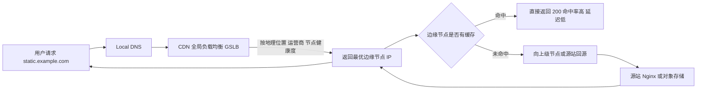

关键机制：

- **调度**：用户请求 `static.example.com`，DNS 返回时用 CNAME 指向 CDN 域名，由 CDN 的 GSLB 按就近性与负载返回边缘节点 IP。
- **缓存key**：默认是 URL（含 query string，可配置忽略部分参数）。**带随机参数的 URL 会导致缓存命中率为 0，这是"CDN 命中率低"的头号原因**。
- **回源**：未命中时回源站拉取；`Cache-Control: s-maxage` 控制 CDN 缓存时长，`no-cache` 会强制每次回源校验。
- **刷新与预热**：发布新版本后用 CDN 的刷新接口清缓存，或对静态资源用内容 hash 文件名实现"永久缓存 + 不刷新"。
- **常见坑**：源站返回 `Set-Cookie` 会让 CDN 不缓存；源站 `Vary` 头设置不当会放大缓存条目；HTTPS 证书需要上传到 CDN。

## 十五、网络排查命令与内核参数

### 15.1 命令速查表

| 命令 | 用途 | 关键用法 |
| --- | --- | --- |
| `ping` | 测 ICMP 连通与 RTT | `ping -c 10 -s 1472 -M do host`（1472 + 28 = 1500，测 PMTU） |
| `traceroute` / `mtr` | 逐跳路径与丢包 | `mtr -rwzc 100 host` 生成报告，区分"中间跳丢包"与"终点丢包" |
| `telnet` / `nc` | 测端口连通 | `nc -vz -w 3 host 443`；`telnet` 需要交互退出，脚本里用 `nc` |
| `curl` | 端到端 HTTP 诊断 | `curl -v --resolve api.example.com:443:10.0.0.1 https://...`（绕过 DNS 直连指定 IP） |
| `dig` | DNS 查询 | `dig +trace example.com`、`dig @8.8.8.8 example.com A +short` |
| `tcpdump` | 抓包 | `tcpdump -i any -nn -s0 -w /tmp/a.pcap 'host 10.0.0.1 and port 8080'` |
| `netstat` | 连接与统计（老） | `netstat -anp`、`netstat -s`（按协议统计） |
| `ss` | 连接与统计（新，更快） | `ss -s`、`ss -lntp`、`ss -tan state time-wait`、`ss -tin` |
| `nstat` | 增量内核统计 | `nstat -az TcpRetransSegs TcpExtListenOverflows` |
| `lsof` | 进程 fd | `lsof -p <pid> -i`、`lsof -i :8080` |
| `ethtool -S` | 网卡级丢包 | 看 `rx_dropped`、`tx_dropped`、`rx_missed_errors` |
| `iperf3` | 带宽压测 | `iperf3 -c host -t 30 -P 4` |
| `sar -n DEV 1` | 网卡吞吐 | 判断是否打满带宽 |

### 15.2 排查决策树

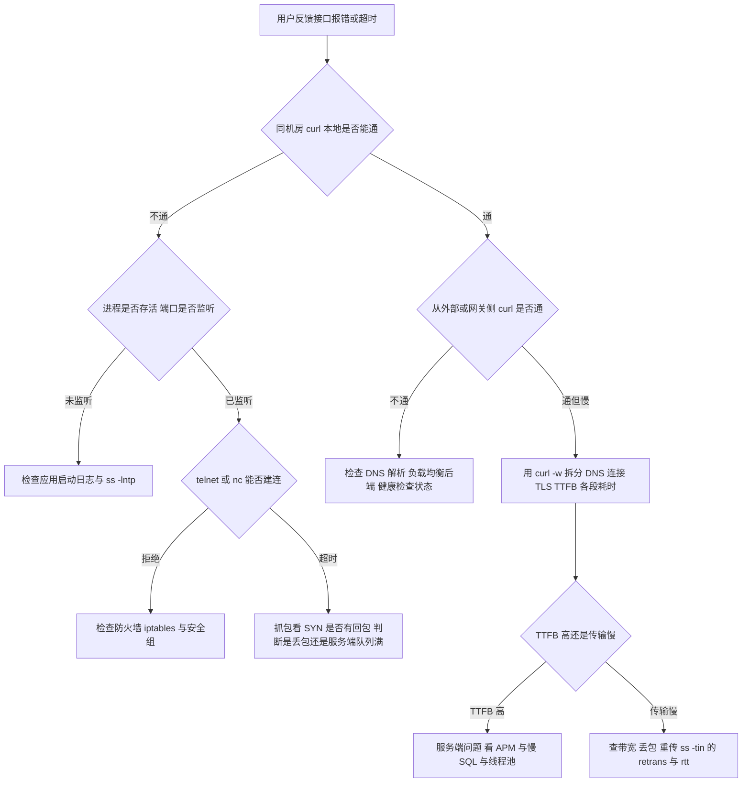

### 15.3 必须掌握的内核参数

| 参数 | 默认值 | 作用与调整建议 |
| --- | --- | --- |
| `net.core.somaxconn` | Linux 5.4 起 4096（更早 128） | 全连接队列上限，与 backlog 取小 |
| `net.ipv4.tcp_max_syn_backlog` | 与内存相关，常见 1024~4096 | 半连接队列，抗 SYN Flood |
| `net.ipv4.tcp_syncookies` | 1（主流发行版默认开） | SYN 队列满时用 cookie 建连，防 SYN Flood |
| `net.ipv4.tcp_tw_reuse` | 0 | 允许复用 TIME_WAIT 连接（仅出向），需 timestamps |
| `net.ipv4.tcp_max_tw_buckets` | 与内存相关，常为 262144 | TIME_WAIT 上限，超出即销毁 |
| `net.ipv4.tcp_fin_timeout` | 60 | FIN_WAIT_2 超时，**不影响 TIME_WAIT** |
| `net.ipv4.ip_local_port_range` | `32768 60999` | 临时端口范围，短连接多时要扩大 |
| `net.ipv4.tcp_rmem` | `4096 131072 6291456` | 接收缓冲区 最小/默认/最大 |
| `net.ipv4.tcp_wmem` | `4096 16384 4194304` | 发送缓冲区 最小/默认/最大 |
| `net.core.rmem_max` / `wmem_max` | 212992 | 缓冲区硬上限 |
| `net.ipv4.tcp_keepalive_time` | 7200 秒 | 空闲多久开始探测，建议降到 600 |
| `net.ipv4.tcp_keepalive_intvl` | 75 秒 | 探测间隔 |
| `net.ipv4.tcp_keepalive_probes` | 9 | 探测次数，失败即断连 |
| `net.ipv4.tcp_congestion_control` | cubic | 拥塞控制算法，跨国链路可换 bbr |
| `net.ipv4.tcp_slow_start_after_idle` | 1 | 空闲后重置 cwnd，长连接低频场景建议关 |
| `net.ipv4.tcp_sack` | 1 | 选择性确认 |
| `net.ipv4.tcp_timestamps` | 1 | 时间戳，RTT 测量与 PAWS |

### 15.4 抓包三板斧

```bash
# 1 抓指定连接，只抓 SYN 与 FIN，判断握手与挥手是否完整
tcpdump -i any -nn 'tcp port 8080 and (tcp[tcpflags] & (tcp-syn|tcp-fin) != 0)'

# 2 抓 HTTP 明文内容，-A 按 ASCII 显示
tcpdump -i any -nn -A -s0 'tcp port 8080 and host 10.0.0.1'

# 3 落盘后用 Wireshark 分析，重点看这几个过滤条件
tcpdump -i any -nn -s0 -w /tmp/api.pcap 'host 10.0.0.1 and port 8080'
# Wireshark 过滤器 tcp.analysis.retransmission     重传
# Wireshark 过滤器 tcp.analysis.duplicate_ack      重复 ACK
# Wireshark 过滤器 tcp.analysis.zero_window        零窗口
# Wireshark 过滤器 tcp.analysis.flags               各类异常
```

注意：生产抓包必须限制 `-s` 与过滤器，全量抓包会瞬间打满磁盘并把 CPU 拉高，**务必加 `-c` 限制包数或 `-w` 落盘后立刻停止**。

**本机抓到的"超大包"多半是假的**：发送方向网卡 offload（TSO/GSO）把大块数据交给网卡再分片，接收方向 GRO/LRO 又把多个段合并后才交给协议栈，所以在本机 `tcpdump` 能看到远超 MTU（甚至 64KB）的报文。要看到链路上的真实报文，应临时 `ethtool -K eth0 tso off gso off gro off`，或者在链路中间的另一台机器上抓——**不要把这种假大包当成"MTU 配置错误"**。

## 十六、高级岗三问

### 16.1 为什么这么设计

| 设计 | 替代方案 | 为什么选它 | 代价 |
| --- | --- | --- | --- |
| TCP 三次握手 | 两次握手 | 必须双向确认 ISN | 多一个 RTT |
| 四次挥手 | 合并为三次 | 全双工，被动方可能还有数据 | 多一个报文 |
| TIME_WAIT 60 秒 | 直接关闭 | 保证最后一个 ACK 可达 + 消化旧报文 | 端口占用 |
| HTTP/2 多路复用 | 多开 TCP 连接 | 省握手、省连接数、头部压缩 | TCP 层队头阻塞 |
| HTTP/3 over QUIC | 改造内核 TCP | 用户态可迭代、无队头阻塞、连接迁移 | UDP 被中间盒限速、CPU 开销高 |
| TLS 1.3 只留 ECDHE | 保留 RSA 密钥交换 | 前向安全 + 1-RTT | 兼容老客户端需保留 1.2 |
| Session 改 JWT | 服务端 Session | 无状态、易水平扩展 | 撤销困难、token 变大 |

### 16.2 线上出问题怎么定位

按"分层收敛"的方法论，每一层给出确定性的命令：

1. **应用层**：`curl -w` 拆分耗时；看 APM 的 span 与慢日志。
2. **传输层**：`ss -s` 看状态分布；`ss -tin` 看 retrans、rtt、cwnd、rwnd_limited；`nstat -az` 看重传率与队列溢出。
3. **网络层**：`mtr -rwzc 100` 看丢包在哪一跳；`ping -M do` 测 PMTU。
4. **链路层**：`ethtool -S eth0` 看 `rx_dropped`、`rx_missed_errors`；`ip -s link` 看 errors。
5. **抓包**：`tcpdump` 落盘，Wireshark 按 `tcp.analysis.*` 过滤器看异常。

### 16.3 规模变大后会怎样

- **连接数**：单机 6 万临时端口是硬上限，QPS×60 超过它就必然出现 `Cannot assign requested address`。解法是长连接 + 连接池 + 扩大 `ip_local_port_range`。
- **TIME_WAIT**：随 QPS 线性增长，不随机器数自动下降。
- **带宽时延积**：跨机房调用时，`rwnd` 与 `cwnd` 都可能成为瓶颈，必须开 Window Scale 并把 `tcp_rmem`/`tcp_wmem` 上限提上去。
- **HTTP/2 单连接**：所有请求挤一条 TCP，丢包时全体阻塞，且 `SETTINGS_MAX_CONCURRENT_STREAMS` 会限制并发流数；需要多连接或升级 HTTP/3。
- **CDN 回源**：缓存击穿时源站流量瞬间翻倍，需要源站限流 + 多级缓存 + 预热。
- **证书与域名**：SNI 数量增长后需要按域名拆分证书或上通配符/多域名证书。

## 高频面试题

### Q1. TCP 为什么是三次握手、四次挥手？能不能是两次或五次？

**答题框架（30 秒版）**：三次是因为 ISN 必须双向同步，且要防止历史重复连接；四次是因为 TCP 全双工，`FIN` 只表示半关闭，被动方的 ACK 与 FIN 之间有"应用可能还要发数据"的间隙，不能合并。五次没有必要，因为服务端的 SYN 与 ACK 是同一时刻的动作。

**展开（2 分钟版）**：

1. 两次握手的问题：服务端发出 SYN+ACK 后立刻进入 ESTABLISHED 并分配资源，但它不知道自己的 SYN 是否被收到；若客户端早已关闭或该 SYN 是历史滞留包，服务端会挂着一个死连接等待。
2. 三次握手的第三个 ACK 同时完成了"客户端确认服务端序列号"与"服务端确认客户端已就绪"。
3. 四次挥手：主动方 FIN 后进入 FIN_WAIT_1，被动方回 ACK 进入 CLOSE_WAIT，此时是**半关闭**状态，数据仍可从被动方流向主动方。等被动方应用调用 `close()` 才发 FIN。
4. 如果被动方恰好也无数据可发，Linux 会把 ACK 与 FIN 合并在一个报文里，抓包看是三次——这不是协议退化，而是实现优化。

**追问**：为什么 SYN 的序号要随机？答：防止序列号预测攻击，攻击者若能猜到 ISN 就能伪造报文注入数据或 RST 掉连接；RFC 793 规定 ISN 与时钟相关递增，现代内核用加密安全随机数加时间偏移。

### Q2. TIME_WAIT 有什么用？为什么会堆积？怎么优化？

**答题框架（30 秒版）**：两个作用——保证最后一个 ACK 可达、让旧连接报文在网络中消散。Linux 上**固定 60 秒**（`TCP_TIMEWAIT_LEN`），只出现在主动关闭方。堆积量约等于 QPS × 60。首选优化是改长连接和连接池，其次才是内核参数。

**展开（2 分钟版）**：

1. 用 `ss -tan state time-wait | wc -l` 确认量级。
2. 用 `ss -tan state time-wait | awk 'NR>1{print $5}' | cut -d: -f1 | sort | uniq -c | sort -rn` 看对端分布，判断是打哪个下游。
3. 计算公式：峰值 TIME_WAIT ≈ 短连接 QPS × 60。若超过 `ip_local_port_range` 的范围会报 `Cannot assign requested address`。
4. 优化顺序：**连接池长连接** → `tcp_tw_reuse=1`（仅出向）→ 扩大 `ip_local_port_range` → 提高 `tcp_max_tw_buckets`。
5. 明确否认两个错误做法：`tcp_tw_recycle` 已在 Linux 4.12 移除；`tcp_fin_timeout` 不影响 TIME_WAIT 时长。

**追问**：`tcp_tw_reuse` 为什么只对出向连接有效？答：出向连接由本机选择源端口，本机可以在内核里判断该四元组上的旧连接序列号是否安全（靠 timestamps 比较）；入向连接由对端选端口，本机无法控制，只能等。

### Q3. 大量 CLOSE_WAIT 说明什么？怎么排查？

**答题框架（30 秒版）**：CLOSE_WAIT 是**被动关闭方**的状态，表示对端已发 FIN、本端回了 ACK，但应用没有调用 `close()`。**这一定是代码问题**，不是内核参数问题。

**展开（2 分钟版）**：

1. 定位进程：`ss -tanp state close-wait`，或 `lsof -p <pid> | grep -c CLOSE_WAIT`。
2. 看对端：统计对端 IP 分布，锁定是哪个下游或哪个客户端。
3. 看线程栈：`jstack <pid>` 找卡在业务逻辑里的线程；若是 HttpClient，检查是否在 finally 里关闭了 response。
4. 常见根因：流未关闭、响应 body 未消费、连接池上限设置不当导致业务阻塞、异步回调里没关连接。
5. 修复：用 try-with-resources、连接池配置 `maxConnections` 与 `evictIdleConnections`、设置 socket 读超时。

**追问**：为什么设置了 `SO_TIMEOUT` 还会堆积？答：`SO_TIMEOUT` 只保证读操作超时抛 `SocketTimeoutException`，如果异常路径上没有关闭流，连接依然处于 CLOSE_WAIT。

### Q4. TCP 怎么保证可靠传输？重传有哪几种触发方式？

**答题框架（30 秒版）**：序号与累积确认、校验和、超时重传（RTO）、快速重传（3 个 dup ACK）、SACK 选择性重传。RTO 按 RFC 6298 用 SRTT 与 RTTVAR 平滑计算，Linux 下 RTO 最小 200ms、最大 120 秒。

**展开（2 分钟版）**：

1. `SRTT = (1 - 1/8) × SRTT + 1/8 × R`；`RTTVAR = (1 - 1/4) × RTTVAR + 1/4 × |SRTT - R|`；`RTO = SRTT + 4 × RTTVAR`。
2. Karn 算法：重传过的段不做 RTT 采样，避免 RTO 被错误放大。
3. 快速重传阈值是 3 个 dup ACK；SACK（RFC 2018）让接收方明确告知收到的区间，避免"要么全重传要么重传一段"。
4. 观测：`ss -tin` 的 `retrans` 与 `bytes_retrans`，`nstat -az TcpRetransSegs TcpOutSegs` 算重传率，健康值小于 0.1%。
5. 重传代价：超时重传会把 cwnd 归 1 回到慢启动，快速重传只减半，所以**丢包位置靠后的连接恢复更慢**。

**追问**：为什么不能收到乱序包就立刻重传？答：乱序不等于丢包。若把乱序当丢包会触发伪重传（spurious retransmission），浪费带宽并可能触发不必要的降窗，所以需要 3 个 dup ACK 或 RACK 的时间判据。

### Q5. TCP 拥塞控制的四个阶段是什么？Reno 和 CUBIC、BBR 有什么区别？

**答题框架（30 秒版）**：慢启动（每 RTT 翻倍）、拥塞避免（每 RTT 加 1 MSS）、快重传（3 dup ACK）、快恢复（ssthresh 减半、cwnd = ssthresh）。CUBIC 用三次函数增长，Linux 默认；BBR 用带宽与最小 RTT 建模，不依赖丢包。

**展开（2 分钟版）**：

1. 初始 cwnd 为 10 MSS（RFC 6928）；ssthresh 初始很大，第一次丢包才被赋值。
2. Reno 丢包后 cwnd 减半（快恢复）或归 1（超时）；CUBIC 的 β = 0.7，退让更温和，且窗口增长只与距上次丢包的时间有关，因此 RTT 公平性更好。
3. BBR 测 `BtlBw`（最大交付速率）与 `RTprop`（最小 RTT 的 10 秒窗口估计），在 Startup、Drain、ProbeBW、ProbeRTT 四态流转，需要 `fq` 队列做 pacing。
4. 选型：跨国高丢包链路用 BBR；纯内网低丢包用 CUBIC 更稳；多流共存且对公平性敏感时慎用 BBR v1。

**追问**：为什么"丢包率 1% 能把吞吐打到一半"？答：一次超时就把 cwnd 归 1，重新慢启动；即使只触发快重传，cwnd 也减半。丢包率越高，cwnd 到达高位的概率越低，平均吞吐随之下降。

### Q6. 设计一个跨机房 RPC 通信层，你会怎么选协议并应对网络抖动？（场景设计类）

**答题框架（30 秒版）**：先定性——内网可信、低延迟、需要多语言。选 gRPC over HTTP/2（多路复用、头部压缩、流控）或 Dubbo 私有协议；用连接池复用长连接；开启 `TCP_NODELAY`；配置合理的超时与重试（带退避与熔断）；跨机房启用 BBR。

**展开（2 分钟版）**：

1. **协议层**：gRPC 用 HTTP/2 的 Stream，一条连接承载并发请求，头部 HPACK 压缩显著降低小包开销；缺点是 TCP 层队头阻塞，若跨机房丢包高，可考虑 HTTP/3（QUIC）。
2. **连接层**：客户端连接池保活，`keepalive` 心跳设为 30 秒级（远小于内核 `tcp_keepalive_time` 的 7200 秒），避免中间 NAT 静默丢弃映射。设置 `TCP_NODELAY=true` 关闭 Nagle。
3. **超时设计**：connect timeout 与 read timeout 分开（如 200ms / 800ms），全链路超时预算递减（deadline propagation）。
4. **重试**：只对幂等方法重试，指数退避 + 抖动，重试次数上限 2；配合熔断（Sentinel / Resilience4j）避免重试风暴。
5. **内核调优**：`tcp_congestion_control=bbr`、`default_qdisc=fq`、调大 `tcp_rmem`/`tcp_wmem` 上限以匹配 BDP。
6. **容量**：单连接 QPS 有上限，压测确认单连接吞吐后再决定连接池大小；`SETTINGS_MAX_CONCURRENT_STREAMS` 决定单连接并发流上限。

**追问**：如果出现了请求成功率 99% 但 P99 延迟 2 秒，你会查什么？答：先看是不是队头阻塞（`ss -tin` 的 retrans、rtt 分布）、再看客户端连接池是否打满（等待获取连接的耗时）、最后看服务端线程池队列与 GC 停顿。

### Q7. 线上网关出现大量 502，如何定位？（线上排查类）

**答题框架（30 秒版）**：502 是网关拿不到上游的合法响应。先看是全局还是单实例，再按"上游进程 → 连接建立 → 响应读取"三层收敛：`ss -lntp` 看端口、`nstat -az TcpExtListenOverflows` 看队列溢出、看 Nginx error.log 的关键字、抓包看是否收到 RST。

**展开（2 分钟版）**：

1. **确认范围**：`tail -f error.log | grep 502`，看是某个 upstream 还是全部。
2. **上游存活**：`ss -lntp | grep 8080`，看进程是否监听；`curl -v http://10.0.0.1:8080/health` 直连测试。
3. **队列溢出**：`nstat -az TcpExtListenOverflows TcpExtListenDrops`，若持续增长说明全连接队列满，需要提高 `backlog`（Tomcat `acceptCount`）与 `net.core.somaxconn`，同时排查上游处理变慢。
4. **连接被拒**：error.log 里 `connect() failed (111: Connection refused)` 说明上游端口没监听；`(110: Connection timed out)` 说明网络不通或被防火墙丢包。
5. **收到 RST**：抓包 `tcpdump -i any -nn 'tcp port 8080 and (tcp[tcpflags] & tcp-rst != 0)'`，若是应用主动 RST，多半是请求头非法或 body 超限。
6. **非法响应**：`upstream sent invalid header`、`upstream prematurely closed connection`，多为上游崩溃、OOM Killer、或返回了非 HTTP 内容。

**追问**：为什么提高 `somaxconn` 后 502 依然存在？答：还要看应用 `backlog`（Tomcat `acceptCount` 默认 100），实际队列长度是二者取小；更根本的是上游处理速度跟不上，必须扩容或优化。

### Q8. 服务端接口 TTFB 正常，但客户端下载大文件很慢，怎么定位？（线上排查类）

**答题框架（30 秒版）**：TTFB 快说明服务端首字节及时，慢在传输阶段。按"带宽 → 丢包重传 → 窗口限制 → 缓冲区"四步收敛。

**展开（2 分钟版）**：

1. **算 BDP**：`带宽 × RTT`。1 Gbps × 100 ms = 12.5 MB，若 `rwnd` 只有 65535 字节，吞吐上限约 655 KB/s，必然是瓶颈。用 `ss -tin` 看 `rwnd_limited`。
2. **看是否窗口受限**：`ss -tin` 里出现 `rwnd_limited` 说明接收方来不及消费；出现 `sndbuf_limited` 说明发送缓冲区不够，调 `net.ipv4.tcp_wmem` 与 `net.core.wmem_max`。
3. **看丢包与重传**：`nstat -az TcpRetransSegs TcpOutSegs`，重传率超过 1% 就要查链路；`mtr -rwzc 100` 看丢包在哪一跳。
4. **看带宽是否打满**：`sar -n DEV 1` 或 `iperf3` 对照，确认是应用限速还是链路瓶颈。
5. **应用层**：检查是否用了 `Transfer-Encoding: chunked` 的小块写入、是否被 Nginx `proxy_buffering` 或 `sendfile` 配置影响、是否开了 gzip 反而增加 CPU。

**追问**：`sendfile` 为什么能加速大文件下发？答：`sendfile` 让内核直接把文件页缓存数据送入 socket 缓冲区（零拷贝），省去了数据在用户态与内核态之间的两次拷贝与上下文切换。注意 Nginx 的 `sendfile` 指令**默认是 `off`**，发行版自带的 nginx.conf 通常显式写成 `sendfile on;`。

### Q9. 设计一个安全的登录态方案，Cookie / Session / JWT 怎么选？（场景设计类）

**答题框架（30 秒版）**：Web 同域场景优先 `HttpOnly + Secure + SameSite=Lax` 的 Session Cookie；需要跨端、跨域、无状态水平扩展时用 JWT + Refresh Token。核心是把"身份凭证"与"可撤销"两个诉求拆开。

**展开（2 分钟版）**：

1. **凭证载体**：Access Token 用 JWT，`exp` 设 15 分钟，只放 `sub`、`jti`、`exp`，权限走缓存查；Refresh Token 用不透明随机串存 Redis，7~30 天，一次性轮换。
2. **存储**：Web 端把 Refresh Token 放 `HttpOnly` Cookie 防 XSS；移动端放 Keychain / Keystore。
3. **防 CSRF**：SameSite=Lax 已挡住大部分跨站 POST；对 Cookie 方案再加 CSRF Token 或校验 `Origin`。
4. **撤销**：JWT 无法撤销，用黑名单（Redis 存 `jti`，TTL 等于剩余 `exp`）+ 短过期来缓解；高风险操作要求二次验证。
5. **签名算法**：`RS256` 或 `ES256` 便于多服务验签；**禁止 `none`**，服务端固定算法白名单。密钥轮换用 `kid` 头标识。
6. **防爆破**：登录失败计数 + 图形验证码 + IP 维度限流 + 账号锁定。

**追问**：JWT 的 payload 能放手机号吗？答：不能当作保密数据。JWT 的 payload 只是 Base64URL 编码，任何人可解；需要保密就用 JWE，或者只放 `sub` 再查库。

### Q10. 应用偶发 `Connection reset by peer` 和 `SocketTimeoutException`，怎么查？（线上排查类）

**答题框架（30 秒版）**：`Connection reset by peer` 是对端发了 RST；`SocketTimeoutException` 是本地读超时。两者要分别定位：RST 看对端为什么关（超时、队列满、进程重启），超时看是本端设太短还是对端真慢。

**展开（2 分钟版）**：

1. **确认偶发比例**：统计异常日志的频次与时间分布，看是否与发布、扩容、定时任务重合。
2. **RST 的四种来源**：对端应用主动 close 后仍收到数据（内核直接回 RST）、全连接队列溢出且 `tcp_abort_on_overflow=1`、对端进程重启导致连接消失、中间设备（防火墙、LB）空闲超时清理映射。
3. **抓包定性**：`tcpdump -i any -nn 'tcp port 8080 and (tcp[tcpflags] & tcp-rst != 0)' -c 50`，看 RST 是从哪一侧、在第几个包之后发出。
4. **超时来源**：比较本端 `SO_TIMEOUT` 与对端 P99 耗时；若 `SO_TIMEOUT` 是 3 秒而对端 P99 是 5 秒，超时是必然的。
5. **中间设备空闲超时**：NAT/LB 常在 60~350 秒清理空闲连接。客户端心跳（30 秒）或服务端主动关闭可以规避。
6. **连接池配置**：OkHttp `ConnectionPool` 的 `maxIdleConnections` 与 `keepAliveDuration`、HttpClient 的 `evictIdleConnections` 要小于中间设备的空闲超时。

**追问**：为什么服务端 `keepAliveTimeout` 要小于 LB 的空闲超时？答：避免"服务端还认为连接可用、LB 已经清理映射"的竞态——如果服务端先关闭，客户端能收到 FIN 并正确重建；反之客户端拿到的是已被 LB 丢弃的连接，写入时才报错。

### Q11. HTTP/2 解决了什么，又没解决什么？HTTP/3 为什么换成 UDP？

**答题框架（30 秒版）**：HTTP/2 用二进制分帧和多路复用解决了 HTTP/1.1 的应用层队头阻塞，用 HPACK 压缩头部，用 Stream 优先级调度。但所有 Stream 共享一条 TCP 连接，**TCP 层的队头阻塞仍在**。HTTP/3 把可靠传输搬到 QUIC（基于 UDP），让每条流独立排序与重传，从而消除传输层队头阻塞。

**展开（2 分钟版）**：

1. HTTP/1.1 的并发靠"每域名 6 条 TCP"，连接数多、握手多、慢启动反复。
2. HTTP/2 的 Stream 让一个连接并发承载上百个请求；`RST_STREAM` 可以取消单条流而不影响其他流。
3. `SETTINGS_MAX_CONCURRENT_STREAMS` 限制并发流数，若配得小，并发会被压制。
4. TCP 层若丢一个段，内核必须等它重传，后续所有流的数据都被卡住——这就是 HTTP/2 的"TCP 层队头阻塞"。
5. HTTP/3 用 QUIC 的流级重传解决该问题；同时 0-RTT 建连降低握手成本；Connection ID 支持连接迁移。

**追问**：为什么 HTTP/3 在建连上比 HTTP/2 快一个 RTT？答：HTTP/2 需要先 TCP 三次握手（1 RTT）再 TLS 握手（1~2 RTT）；HTTP/3 把 QUIC 传输握手与 TLS 1.3 握手合并，首次建连只需 1 RTT，恢复会话可 0 RTT。

### Q12. HTTPS 握手里对称与非对称加密各起什么作用？中间人攻击怎么防？

**答题框架（30 秒版）**：非对称加密（或 ECDHE）负责**身份认证与密钥协商**，对称加密负责**数据加密**，因为对称算法快 2~3 个数量级。防中间人靠证书链校验到受信任根 + 前向安全 + HSTS。

**展开（2 分钟版）**：

1. TLS 1.3 里服务端用证书私钥对握手摘要签名（CertificateVerify），客户端用证书公钥验签，确认"对面确实是域名持有者"。
2. 密钥协商用 ECDHE（X25519 或 secp256r1），双方各自生成临时密钥对，协商出共享密钥，再用 HKDF 派生出会话密钥。临时私钥用完即弃，因此具备前向安全。
3. 数据加密用 AEAD（AES-128-GCM 或 ChaCha20-Poly1305），同时提供机密性与完整性。
4. 中间人攻击的唯一入口是"客户端信任了伪造根证书"，因此要教育用户不装来源不明的根证书、开启 HSTS 防止降级、App 端做证书/公钥固定。

**追问**：为什么要区分 TLS 1.2 与 1.3 的握手轮次？答：TLS 1.2 的 ServerHello、Certificate、ServerKeyExchange、ServerHelloDone 之后客户端才能算出密钥并发送 ClientKeyExchange + Finished，共 2-RTT；TLS 1.3 把密钥协商所需参数（key_share）放在 ClientHello 里，ServerHello 后即可算出密钥并加密后续消息，压缩到 1-RTT。

## 易错点与踩坑

| 易错点 | 正确理解 |
| --- | --- |
| 以为 `tcp_fin_timeout` 能缩短 TIME_WAIT | 该参数控制 **FIN_WAIT_2** 超时；TIME_WAIT 在 Linux 上固定 60 秒（`TCP_TIMEWAIT_LEN`） |
| 推荐 `tcp_tw_recycle` | 该参数**已在 Linux 4.12 移除**，且在 NAT 下会导致大量丢包，禁止提及 |
| `tcp_tw_reuse` 能解决所有 TIME_WAIT | 只对**主动发起连接**的出向方向有效，且依赖 timestamps |
| 把 CLOSE_WAIT 归因为内核参数问题 | CLOSE_WAIT 是应用未调用 `close()`，**只能改代码** |
| 认为 TCP 有"关闭粘包"的开关 | TCP 是字节流，消息边界只能由应用层协议定义；`TCP_NODELAY` 只影响 Nagle，不保证边界 |
| 认为 HTTP/2 没有队头阻塞 | HTTP/2 解决的是**应用层**队头阻塞，TCP 层仍有；HTTP/3 才基本消除 |
| 认为 `no-cache` 是不缓存 | `no-cache` 是可以缓存但每次必须回源校验；`no-store` 才是完全不缓存 |
| 认为 `Cache-Control` 与 `Expires` 同时存在时前者无效 | `Cache-Control` 优先级**高于** `Expires` |
| 401 当成"没权限" | 401 是**未认证**，403 才是已认证但无权限 |
| 301 与 302 混用 | 301 会被浏览器长期缓存且可能把 POST 变 GET；需保持方法时用 307/308 |
| 认为 HTTPS 全程用非对称加密 | 非对称只用于握手阶段的认证与密钥协商，数据用对称加密 |
| 认为 JWT 是加密的 | JWT 的 payload 只是 Base64URL 编码，**任何人可读** |
| 只上传叶证书 | 必须配置完整证书链，否则 Java 客户端、curl、App 常报 `unable to get local issuer certificate` |
| Nginx 到上游默认用长连接 | 默认 `proxy_http_version 1.0` 是短连接，必须显式设为 1.1 并清空 `Connection` 头 |
| 认为 `SO_TIMEOUT` 是连接超时 | 它是**读超时**；连接超时由客户端 API（如 `connectTimeout`）或 `TCP_SYNCNT` 控制 |
| 认为 `net.core.somaxconn` 是唯一队列上限 | 实际取 `min(backlog, somaxconn)`，Tomcat 侧是 `acceptCount` |
| 抓包时不加过滤条件 | 生产全量抓包会打满磁盘并拉高 CPU，必须加 `host/port` 过滤与 `-c` 限制 |

## 一句话速记

- 三次握手为同步双向 ISN，四次挥手因全双工半关闭；被动方无数据可发时 Linux 会合并成三次。
- TIME_WAIT = 主动关闭方 + 固定 60 秒 + 峰值约 QPS×60；CLOSE_WAIT = 被动关闭方 + 代码没 close。
- RTO 由 SRTT 与 4×RTTVAR 决定，Linux 下最小 200ms、最大 120 秒；3 个 dup ACK 触发快速重传，SACK 精确重传空洞。
- 发送窗口 = min(cwnd, rwnd)；拥塞控制是"慢启动指数涨、拥塞避免线性涨、丢包减半或归 1"。
- Linux 默认拥塞控制是 CUBIC（β=0.7），BBR 用 BtlBw × RTprop 建模，Linux 4.9 起支持，需要 fq。
- 粘包只能靠应用层协议（定长 / 分隔符 / 长度字段）解决；Nagle 与延迟确认叠加会产生 40ms 延迟，用 `TCP_NODELAY` 关掉 Nagle。
- HTTP/1.1 长连接与管道化、HTTP/2 二进制分帧 + 多路复用 + HPACK、HTTP/3 基于 QUIC 消除传输层队头阻塞。
- 强缓存看 `Cache-Control: max-age`，协商缓存看 `ETag` / `If-None-Match`，命中返回 304。
- TLS 1.2 需 2-RTT，TLS 1.3 需 1-RTT（可 0-RTT），后者强制 (EC)DHE 从而默认具备前向安全。
- Session 有状态易撤销，JWT 无状态难撤销；生产用短 `exp` + Refresh Token 轮换 + `jti` 黑名单。
- Nginx 502 是拿不到合法响应，504 是上游超时；调 `somaxconn` 时别忘了 Tomcat 的 `acceptCount`。
- 排查顺序永远是：应用层 curl -w 拆段 → 传输层 ss -tin 看 retrans/rwnd → 网络层 mtr 看丢包跳 → 链路层 ethtool 看 dropped → 抓包定论。
