# 02 操作系统

> 从 Java 视角看内核：状态切换、调度、内存、IO、容器隔离 ｜ 面试权重 ★★★★★ ｜ 建议复习 60 分钟

## 本章大纲

- [一、用户态与内核态](#一用户态与内核态)
- [二、系统调用与中断](#二系统调用与中断)
- [三、进程与线程的本质区别](#三进程与线程的本质区别)
- [四、线程实现模型](#四线程实现模型)
- [五、进程调度算法与上下文切换](#五进程调度算法与上下文切换)
- [六、进程通信方式对比](#六进程通信方式对比)
- [七、线程同步机制与死锁](#七线程同步机制与死锁)
- [八、虚拟内存、分页与 TLB](#八虚拟内存分页与-tlb)
- [九、缺页中断与页面置换](#九缺页中断与页面置换)
- [十、写时复制与内存分配](#十写时复制与内存分配)
- [十一、零拷贝与 IO 模型](#十一零拷贝与-io-模型)
- [十二、文件系统、inode 与 page cache](#十二文件系统inode-与-page-cache)
- [十三、Linux 性能排查命令](#十三linux-性能排查命令)
- [十四、容器的本质与隔离边界](#十四容器的本质与隔离边界)
- [十五、高级岗三问](#十五高级岗三问)
- [高频面试题](#高频面试题)
- [易错点与踩坑](#易错点与踩坑)
- [一句话速记](#一句话速记)

---

## 一、用户态与内核态

### 1.1 为什么要分两个态

CPU 在 x86-64 上提供 4 个特权级 Ring0~Ring3，Linux 只用了两个：

- **Ring0 = 内核态**：可以执行特权指令（`cli`/`sti` 关开中断、`lgdt` 加载 GDT、读写 `cr0`~`cr4`、访问任意物理内存映射）。
- **Ring3 = 用户态**：只能访问自己的虚拟地址空间，触碰特权指令会触发 `#GP`（General Protection Fault），内核给进程发 `SIGSEGV`。

根本原因是**保护**，不是"性能分层"：

1. 用户程序写坏 `cr3` 会把页表指向垃圾，整个机器崩。
2. 用户程序直接读别人的物理内存，多租户模型直接失效。
3. 如果所有代码都能关中断，实时性和一致性无从保证。

代价是：任何"想干正事"的操作（读文件、发包、申请内存）都必须**切换进内核**，这就是系统调用存在的理由。

### 1.2 用户态与内核态的边界到底在哪里

关键在于：**地址空间是共享的，权限是切换的**。以 x86-64 4 级页表为例（Linux 5.x 默认 48 位虚拟地址，开启 LA57 后 57 位）：

| 区域 | 典型虚拟地址范围 | 用户态可访问 | 说明 |
| --- | --- | --- | --- |
| 用户空间 | `0x0000_0000_0000_0000` ~ `0x0000_7fff_ffff_ffff` | 是 | 128 TB，进程各自的页表 |
| 非规范地址空洞 | `0x0000_8000_0000_0000` 附近 | 否 | 访问触发 `#GP` |
| 内核空间 | `0xffff_8000_0000_0000` 以上 | 否 | 页表项 U/S 位为 0，用户态访问直接缺页 |
| vDSO/vvar | 由内核映射到用户空间 | 是 | 绕过系统调用读时间，见下文 |

内核空间**映射进每个进程的页表**（`0xffff_8000_0000_0000` 起），但页表项的 U/S（User/Supervisor）位是 0。所以从用户态切到内核态**不需要切换 `cr3`，只需要换栈和权限级别**（例外是开启了 KPTI 缓解 Meltdown 的机器，内核入口会切到独立的内核页表，见 Q11），这是系统调用比进程切换便宜两个数量级的原因。

### 1.3 从 Java 代码到 Ring0 的一条完整路径

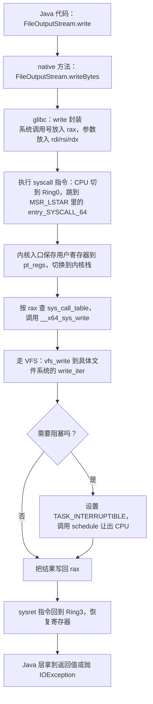

图中每个环节都有可观测的成本，面试时可以逐条说：

1. `syscall` 指令本身：保存 `RIP/RFLAGS/RSP`，约 10~50 个周期的流水线冲刷。
2. 内核入口的 `pt_regs` 保存与恢复：写约 20 个寄存器。
3. 内核逻辑本身：一次 `write` 到 page cache 可能只花几百纳秒，但如果触发磁盘 IO 就是毫秒级。
4. `schedule()` 阻塞：这才是大头，一次上下文切换 1~5 μs，还要加上 cache/TLB 冷启动。

## 二、系统调用与中断

### 2.1 系统调用：主动进内核

- 入口：x86-64 用 `syscall`/`sysret`（64 位）；32 位兼容路径用 `int 0x80`，走软件中断、开销更高。
- 系统调用号在 `/usr/include/asm/unistd_64.h` 里定义，x86-64 上数量随版本增长，Linux 5.x 已到 330+ 个。
- 用户态可见的三类：`syscall`（直接）、`strace` 追踪、`/proc/<pid>/syscall` 查看当前阻塞在哪个系统调用。

### 2.2 中断、异常、陷阱三者的区别

| 类型 | 触发者 | 是否可屏蔽 | 典型例子 |
| --- | --- | --- | --- |
| 外部中断 | 硬件设备 | 可屏蔽 / NMI 不可屏蔽 | 网卡收包、磁盘完成、时钟中断 |
| 异常 | CPU 执行指令出错 | 不可屏蔽 | 缺页 `#PF`、除零 `#DE`、非法指令 `#UD` |
| 陷阱 / 系统调用 | 指令主动触发 | 不可屏蔽 | `syscall`、`int3` 调试断点 |

Linux 把中断处理拆成两半：

- **上半部（hardirq）**：关中断上下文执行，只做最紧急的事（应答中断控制器、把数据塞队列），不能睡眠。
- **下半部（softirq / tasklet / workqueue）**：`softirq` 有 10 个类型，`NET_RX_SOFTIRQ`、`NET_TX_SOFTIRQ`、`BLOCK_SOFTIRQ` 等，在 `ksoftirqd/N` 内核线程或中断返回路径上执行。

**生产价值**：`top` 里的 `%si`（softirq）偏高 + 网卡中断集中在 CPU0，是典型的**网络小包高 PPS 场景**，对应 Java 侧现象就是延迟毛刺大、吞吐上不去。处理手段：

```bash
# 看每个 CPU 的中断分布
mpstat -P ALL 1
# 看软中断累计值（NET_RX 增长快说明网络包量大）
cat /proc/softirqs
# 看网卡队列与中断绑核
cat /proc/interrupts | grep -i eth
```

### 2.3 系统调用不是必须的：vDSO 与 vvar

`clock_gettime`、`gettimeofday`、`time`、`getcpu` 这几个调用，内核在进程地址空间里映射了一段只读代码（vDSO）和数据（vvar），用户态**直接读共享内存里的时间**，完全不进内核。

**为什么重要**：`System.nanoTime()` 在 Linux 上走 `clock_gettime(CLOCK_MONOTONIC)`，绝大部分调用被 vDSO 拦截。真正贵的是 `System.currentTimeMillis()` 在旧 JDK 上的实现路径（JDK 9 起也走 `clock_gettime`）。

### 2.4 系统调用开销的量化与优化

| 手法 | 原理 | Java 里的落点 |
| --- | --- | --- |
| 批量化 | 一次调用处理多条数据 | `FileChannel.write(ByteBuffer[])`、`EpollSelectorImpl` 一次 `epoll_wait` 拿回一批事件 |
| 缓冲 | 用户态攒够再进内核 | `BufferedOutputStream` 默认 8192 字节 |
| 异步化 | 提交后立刻返回 | `AsynchronousFileChannel`、`io_uring` |
| 绕过内核 | 用户态直接操作硬件 | DPDK、RDMA，Java 生态里少见 |
| 减少调用 | 缓存结果 | 缓存 `File.exists()`、避免循环里 `File.length()` |

统计系统调用次数：

```bash
strace -c -f -p <pid>            # 按系统调用聚合次数与耗时
strace -T -e trace=read,write -p <pid>   # 打印每个调用的耗时
```

## 三、进程与线程的本质区别

### 3.1 一句话结论

**进程是资源分配与保护的单位，线程是 CPU 调度的单位。** 这句话要在面试里给出"资源"和"调度"两条证据链。

### 3.2 Linux 视角：两者都是 task_struct

Linux 内核**没有独立的线程结构体**。`include/linux/sched.h` 里的 `struct task_struct` 同时表示进程和线程，区别只在于创建时 `clone()` 传的标志位不同：

| clone 标志 | 含义 | 进程（fork） | 线程（pthread_create） |
| --- | --- | --- | --- |
| `CLONE_VM` | 共享地址空间 `mm_struct` | 否 | 是 |
| `CLONE_FS` | 共享根目录与 `umask` | 否 | 是 |
| `CLONE_FILES` | 共享打开文件表 `files_struct` | 否 | 是 |
| `CLONE_SIGHAND` | 共享信号处理函数表 | 否 | 是 |
| `CLONE_THREAD` | 放进同一个线程组，共享 `tgid` | 否 | 是 |
| `CLONE_SYSVSEM` | 共享 SysV 信号量的 `undo_list` | 否 | 是 |
| `CLONE_SETTLS` | 设置线程本地存储 | 否 | 是 |
| `CLONE_NEWPID` | 新建 PID namespace | 容器才用 | 否 |

所以：

- `fork()` ≈ `clone(SIGCHLD)`，只共享页表之外几乎不共享。
- `pthread_create()` ≈ `clone(CLONE_VM | CLONE_FS | CLONE_FILES | CLONE_SIGHAND | CLONE_THREAD | CLONE_SYSVSEM | CLONE_SETTLS)`。

线程组内的每个 task 有独立的 `pid`（内核叫 tid）和自己的 `task_struct`，但共享同一个 `tgid`。`getpid()` 返回的是 `tgid`，`gettid()` 返回 tid。**Java 里 `Thread.getId()` 是 JVM 自己维护的序号，跟内核 tid 没有必然关系**；`jstack` 打印的 `nid=0x1a2b` 才是十六进制 tid，可以和 `top -H -p <pid>` 对齐。

### 3.3 进程与线程的全维度对比

| 维度 | 进程 | 线程 |
| --- | --- | --- |
| 地址空间 | 独立 `mm_struct`，隔离 | 共享，一个线程段错误全进程死 |
| 创建开销 | 微秒到毫秒级，需复制页表并做 COW | 约 10 μs 量级，只建 task_struct + 栈 |
| 上下文切换 | 需切换 CR3，TLB 全刷（PCID 可缓解） | 同进程内不切 CR3，TLB 基本保留 |
| 通信方式 | 管道、消息队列、共享内存、Socket | 共享变量 + 同步原语，天然零拷贝 |
| 崩溃影响 | 一进程崩不影响他人 | 一线程未捕获异常会导致整个 JVM 退出 |
| 资源统计 | 独立 `/proc/<pid>` | 只有 tgid 目录，线程在 `/proc/<tgid>/task/<tid>` |
| 调度单位 | 是（CFS 调度的就是 task） | 是，与进程在调度器眼里无差别 |
| Java 对应 | `ProcessBuilder.start()`，`Runtime.exec()` | `new Thread()`，JDK 21 前 1:1 映射内核线程 |

### 3.4 Java 进程里到底有多少线程

一个最简的 `public static void main` 在 JDK 17 上启动后 `jstack` 大约有这些：

| 线程名 | 作用 |
| --- | --- |
| `main` | 主线程 |
| `Reference Handler` | 处理 `Reference` 队列，调用 `Cleaner` |
| `Finalizer` | 仅当有类覆写并实例化 `finalize()` 时才出现（`java.lang.ref.Finalizer` 类初始化即建线程，JDK 17 仍是这套机制）；JDK 9 起 `Object.finalize()` 标记 `@Deprecated(since="9")`，JDK 18 起标记为待移除 |
| `Signal Dispatcher` | 接收 JVM 信号，转发到 Java 层 |
| `Common-Cleaner` | JDK 9 引入，替代 `Finalizer` 大部分职责 |
| `Attach Listener` | `jstack`/`jcmd` 连接时按需创建 |
| `Notification Thread` | JMX |
| `VM Thread` | 执行 VM 级操作，是 Stop-The-World 的执行者 |
| `C1 CompilerThread*` / `C2 CompilerThread*` | JIT 编译线程 |
| `GC Thread#*` / `G1 Young RemSet Sampling` | GC 线程 |

面试点：**`-XX:ActiveProcessorCount` 会影响这些线程的数量**，容器里如果 JVM 误判 CPU 数，会创建过多 GC/编译线程，反而拖慢。

## 四、线程实现模型

### 4.1 三种映射模型

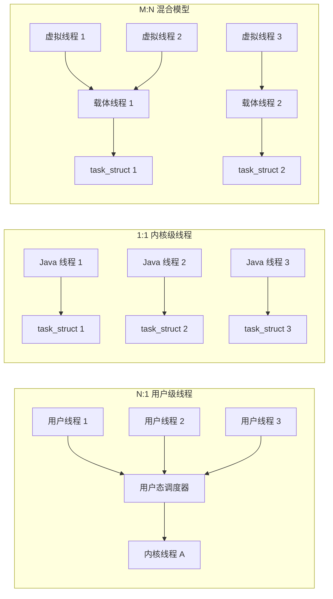

| 模型 | 代表 | 并发比 | 阻塞代价 | 缺陷 |
| --- | --- | --- | --- | --- |
| N:1 | 早期 Java 绿线程、GNU Pth | 高 | 一个用户线程阻塞会卡死整个进程 | 无法利用多核；一条 `read` 阻塞全部停摆 |
| 1:1 | Linux NPTL、Windows、JDK 1.2 ~ JDK 20 | 1 线程 = 1 内核线程 | 阻塞只影响自己 | 内存成本高（默认栈 1MB），上下文切换贵 |
| N:M | Go goroutine、Erlang process、JDK 21 虚拟线程 | 数百倍 | 阻塞时把载体线程让出去 | 调度复杂；synchronized 阻塞会 pin 住载体线程 |

### 4.2 JDK 21 虚拟线程的具体参数

JDK 19 JEP 425 预览、JDK 20 JEP 436 二次预览、**JDK 21 JEP 444 正式**。

- 创建：`Thread.ofVirtual().name("vt-", 0).start(task)`、`Executors.newVirtualThreadPerTaskExecutor()`。
- 每个虚拟线程栈初始**只有几百字节**，按需从堆上申请 `StackChunk`，所以能开百万级。
- 调度器默认是 `ForkJoinPool`，载体线程数 = `Runtime.getRuntime().availableProcessors()`。
- 可通过系统属性调整：`jdk.virtualThreadScheduler.parallelism`、`jdk.virtualThreadScheduler.maxPoolSize`（默认 256）、`jdk.virtualThreadScheduler.minRunnable`（默认 16）。
- **Pinning（钉住）**：以下三种情况虚拟线程无法卸载，会占住载体线程：`synchronized` 块内阻塞、调用 native 方法/JNI、`Object.wait()`。排查用 `-Djdk.tracePinnedThreads=full`。
- JDK 24 起 JEP 491 让 `synchronized` 内阻塞也能卸载，但 JDK 21 上必须用 `ReentrantLock` 替代 `synchronized` 才是安全的。

### 4.3 线程栈大小

- 内核线程栈：x86-64 默认 `THREAD_SIZE = 16KB`（`CONFIG_THREAD_INFO_IN_TASK` 后线程栈 16KB），内核栈溢出会直接 panic。
- 用户线程栈：glibc `pthread_create` 默认 8MB 虚拟地址（`RLIMIT_STACK`，`ulimit -s` 通常 8192），实际按需分配物理页。
- **JVM 线程栈**：`-Xss`，JDK 17 x86-64 默认 **1MB**，早期 JDK 8 也是 1MB（Linux x86-64）。这也是"创建 1 万个线程就 OOM 或卡死"的原因：

```
10000 线程 × 1MB 栈 = 10GB 虚拟地址 + 内核 task_struct(约 1.7KB~10KB) 开销
```

所以高并发场景要么用线程池控制线程数，要么上 JDK 21 虚拟线程。

## 五、进程调度算法与上下文切换

### 5.1 调度器演进

| 内核版本 | 调度器 | 特点 |
| --- | --- | --- |
| 2.4 | O(n) 调度器 | 每次选进程遍历全部就绪队列 |
| 2.6.0 | O(1) 调度器 | 140 个优先级数组 + 位图，常数时间选进程，交互性差 |
| 2.6.23 | **CFS** | 完全公平，vruntime + 红黑树 |
| 3.14 | CFS 补充 deadline | 加入 `SCHED_DEADLINE` |
| 6.6 | **EEVDF** | CFS 被 EEVDF 取代，仍在 `kernel/sched/fair.c`，用"资格时间 + 虚拟截止时间"替代纯 vruntime |

### 5.2 CFS 的核心机制

CFS（Completely Fair Scheduler）的目标是"让每个任务拿到与权重成比例的 CPU 时间"，实现手段是**虚拟运行时间**：

```
vruntime += 实际运行时间 × (NICE_0_LOAD / weight)
```

- `NICE_0_LOAD = 1024`，nice 每降 1，权重约乘 1.25；nice 0 权重 1024，nice -20 权重 88761，nice 19 权重 15。
- 所有就绪任务按 `vruntime` 挂在红黑树上，`pick_next_task_fair` 取**最左节点**，即 `vruntime` 最小者。
- 为了防止睡眠很久的任务醒来后抢走大量 CPU，入队时会做 `vruntime = max(vruntime, cfs_rq->min_vruntime - sysctl_sched_latency)` 的补偿。
- 关键默认值（`/proc/sys/kernel/` 下）：

| 参数 | 默认值 | 含义 |
| --- | --- | --- |
| `sched_latency_ns` | 6000000（6 ms） | 一轮调度周期目标长度 |
| `sched_min_granularity_ns` | 750000（0.75 ms） | 单次最小运行时间，任务数超过 `sched_latency/min_granularity = 8` 后周期被拉长 |
| `sched_wakeup_granularity_ns` | 1000000（1 ms） | 抢占唤醒任务的阈值，防止频繁抢占 |
| `sched_child_runs_first` | 0 | 是否让 fork 出的子进程先跑 |

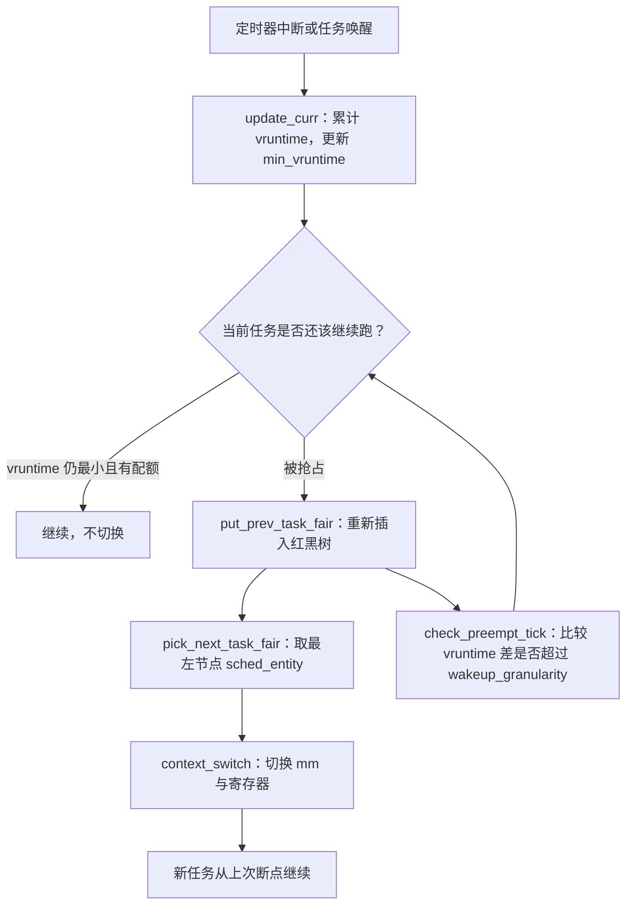

### 5.3 其他调度类与优先级

Linux 用 `struct sched_class` 串联多个调度类，优先级从高到低：

```
stop_sched_class > dl_sched_class(SCHED_DEADLINE) > rt_sched_class(SCHED_FIFO/SCHED_RR) > fair_sched_class(CFS) > idle_sched_class
```

| 调度策略 | 优先级范围 | 行为 |
| --- | --- | --- |
| `SCHED_DEADLINE` | 无 nice | 指定 runtime/deadline/period，最优先 |
| `SCHED_FIFO` | 1~99（实时优先级） | 一直跑到主动让出或被更高优先级抢占 |
| `SCHED_RR` | 1~99 | FIFO 加时间片轮转 |
| `SCHED_NORMAL`（CFS） | nice -20~19 | 默认策略 |
| `SCHED_BATCH` | 同 nice | 非交互批处理，减少唤醒抢占 |
| `SCHED_IDLE` | 最低（权重最低） | 只在 CPU 空闲时跑，仍属 fair_sched_class，可被任何普通任务抢占 |

**多级反馈队列（MLFQ）** 是经典教科书调度算法，Linux 没有直接采用，但思想处处可见：优先级按行为动态调整、时间片越用越短、防止长任务饿死靠老化。面试如果被问 MLFQ，要能说出它的五条规则（新任务入最高优先级、用完时间片降级、时间片到期前主动让出保持优先级、周期性地把所有任务提升到最高优先级防饿死、优先级高的先跑）。

### 5.4 上下文切换的成本与观测

上下文切换的直接成本与间接成本：

1. **直接**：保存/恢复 `pt_regs`、切换内核栈、切换 `task_struct`、更新 `mm` 的引用（同进程不换 CR3）。
2. **间接**：CPU cache 冷掉、TLB 失效、分支预测器污染。间接成本往往比直接成本高一个数量级。

经验数字：一次上下文切换典型 **1~5 μs**，冷 cache 场景可达数十微秒。按 3 μs 算，每秒 10 万次切换就烧掉 30% 的单核 CPU。

观测命令：

```bash
vmstat 1                 # cs 列 = 每秒上下文切换次数；r 列 = 运行队列长度
pidstat -w 1 -p <pid>    # cswch/s 主动切换（等 IO），nvcswch/s 被动切换（被抢占）
cat /proc/<pid>/status | grep ctxt_switches
cat /proc/<pid>/schedstat   # 第三个字段是等待在运行队列上的时间(ns)
perf sched record -a sleep 5 && perf sched latency
```

**判读规则**：

- `cswch/s` 高 + `%wa` 高 → 大量线程在等 IO，是 IO 瓶颈而非 CPU 瓶颈。
- `nvcswch/s` 高 + `r` 列大于 CPU 核数 → CPU 争抢，可能是线程数开太多或锁竞争。
- Java 场景：线程池 `corePoolSize` 远大于核数 + 大量 `synchronized` 竞争，就会看到 `nvcswch/s` 飙升、`%sy` 变高。

## 六、进程通信方式对比

### 6.1 六种 IPC 全维度对比

| 维度 | 匿名管道 pipe | 命名管道 FIFO | 消息队列 | 共享内存 | 信号量 | Socket |
| --- | --- | --- | --- | --- | --- | --- |
| 数据拷贝次数 | 2（写端 → 内核 → 读端） | 2 | 2 | **0**（内核只做映射） | 不传数据 | 2 及以上 |
| 是否内核持久 | 进程退出即消失 | 文件系统里有名字 | 随内核，重启消失 | 随内核 | 随内核 | 随内核 |
| 通信方向 | 单向（半双工），需两条 | 单向 | 双向 | 双向 | 只做同步 | 双向 |
| 是否可跨主机 | 否 | 否 | 否 | 否 | 否 | **是** |
| 容量限制 | 内核缓冲区默认 64KB（`/proc/sys/fs/pipe-max-size` 上限 1MB） | 同 pipe | `msgmax`/`msgmnb` | 受物理内存 | 无 | 受 socket 缓冲区 |
| 同步能力 | 自带（满则阻塞） | 自带 | 自带 | **无，必须配信号量** | 就是同步原语 | 自带 |
| Java 可用性 | `Process.getInputStream()` | 少见 | 无标准 API | `MappedByteBuffer` | 无标准 API | `SocketChannel`、`ServerSocket` |
| 典型场景 | Shell 管道、父子进程 | 多进程日志汇聚 | 低频控制指令 | 大数据量高频传输 | 共享内存的护栏 | 跨机 RPC |

### 6.2 共享内存 + 信号量的经典组合

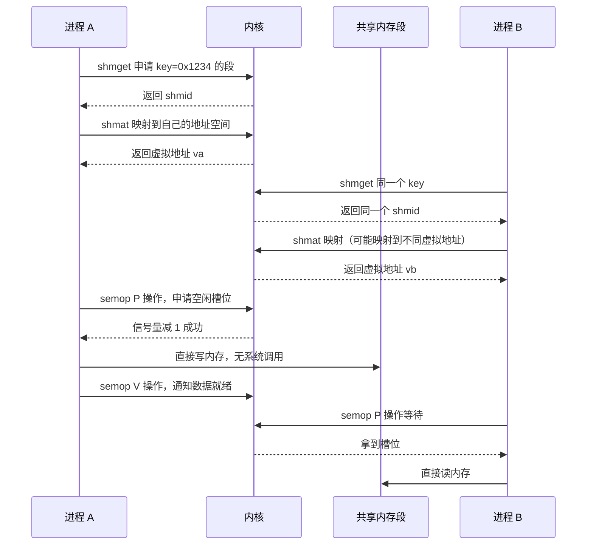

要点：

1. 共享内存**本身不提供任何同步**，两个进程同时写同一地址会写出脏数据。必须配信号量或 futex。
2. `shmat` 在不同进程里映射到的**虚拟地址可能不同**，所以共享内存里**不能存裸指针**，只能存偏移量或数组下标。这是最常见的线上 bug。
3. 进程异常退出不会自动释放共享内存，需要 `ipcs -m` 排查、`ipcrm -m <shmid>` 清理。

### 6.3 为什么 Java 里很少直接用 IPC

| 需求 | Java 主流做法 | 底层实际上是什么 |
| --- | --- | --- |
| 父子进程通信 | `ProcessBuilder` + `getInputStream()` | 匿名管道 |
| 进程间大数据共享 | 不用共享内存，改用 Redis / 本地缓存 | 网络 Socket |
| 同机高频通信 | gRPC over UDS / Netty over Epoll | Unix Domain Socket |
| 进程内通信 | `BlockingQueue`、`Disruptor` | 无内核参与 |
| 跨语言共享大内存 | `FileChannel.map` + `MappedByteBuffer` | mmap 同一文件，等价于共享内存 |

`MappedByteBuffer` 是把共享内存"伪装成文件"的最实用手段：多个 JVM 进程 `map` 同一个文件就能零拷贝互读，代价是**页面对齐**和**必须自己处理可见性**（`MappedByteBuffer.force()` 刷盘，普通字段读写要靠 `VarHandle` 的 `acquire/release` 语义，因为跨进程不享受 JMM 的 happens-before 保证）。

## 七、线程同步机制与死锁

### 7.1 五种锁机制对比

| 机制 | 底层实现 | 等待时是否睡眠 | 适用场景 | Java 对应 |
| --- | --- | --- | --- | --- |
| 互斥锁 mutex | `futex(FUTEX_WAIT/FUTEX_WAKE)` | 是 | 临界区较长 | `synchronized`、`ReentrantLock` |
| 自旋锁 spinlock | 原子 CAS 循环 | 否，忙等烧 CPU | 临界区极短（几十条指令）、不可睡眠上下文 | `AtomicInteger` 的 CAS 循环、`Thread.onSpinWait()` |
| 读写锁 rwlock | 计数器 + 等待队列 | 是 | 读多写少 | `ReentrantReadWriteLock`、`StampedLock` |
| 条件变量 condvar | `futex` + 等待队列 | 是 | 等待某个条件成立 | `Condition.await/signal`、`Object.wait/notify` |
| 信号量 semaphore | 计数器 + `futex` | 是 | 限流、资源池计数 | `Semaphore` |

### 7.2 futex：Java 锁的真正底座

futex（Fast Userspace muTEX）的设计思想是"**无竞争不进内核**"：

1. 线程先在一个用户态 32 位整数上做 CAS 尝试加锁（`Unsafe.compareAndSwapInt` / `VarHandle.compareAndSet`），成功就直接返回，**零系统调用**。
2. 失败时调用 `futex(FUTEX_WAIT, addr, expected)` 进内核睡眠，挂到以物理地址为 key 的等待队列上。
3. 解锁时用 `FUTEX_WAKE` 唤醒一个或多个等待者（`FUTEX_WAKE_PRIVATE` 表示只在本进程内唤醒，是 JVM 的默认选择）。

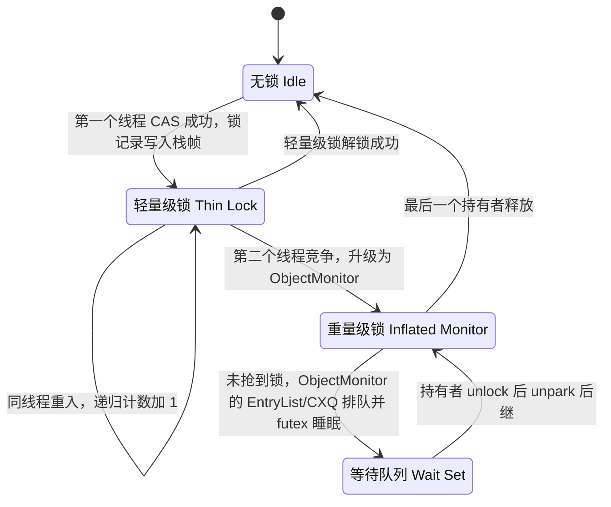

说明：JDK 6~14 还有"偏向锁"状态（JEP 374 在 JDK 15 废弃并默认关闭），JDK 21 上只剩无锁 → 轻量级锁 → 重量级锁三级。

### 7.3 AQS：Java 层的等待队列

`AbstractQueuedSynchronizer` 是 `ReentrantLock`、`Semaphore`、`CountDownLatch`、`ReentrantReadWriteLock` 的共同底座：

- 状态字段 `private volatile int state`，由子类定义语义（`ReentrantLock` 里是重入次数）。
- 等待队列是**双向链表** `Node`，`head` 是哨兵节点，`prev`/`next` 指针，`waitStatus` 有 `CANCELLED(1)`、`SIGNAL(-1)`、`CONDITION(-2)`、`PROPAGATE(-3)`。
- 节点入队用 `compareAndSetTail`，唤醒用 `LockSupport.unpark`（底层 `Unsafe.unpark` → `pthread_cond_signal` 或 futex wake）。
- 非公平锁在 `tryAcquire` 里直接 CAS，不检查队列，所以有**插队**可能；公平锁会先 `hasQueuedPredecessors()`。

### 7.4 自旋锁与自适应自旋

- 内核里的 `spinlock_t` 在获取失败时 `cpu_relax()` 忙等；持有自旋锁时**禁止睡眠**，否则死锁。
- JVM 侧没有显式自旋锁 API，但自旋在 JDK 内部用得很多：轻量级锁 CAS 失败后先自旋，自旋次数由上次在同一锁上的成功率动态决定（JDK 6 引入自适应自旋，当时由 `-XX:+UseSpinning` 控制，该参数在 JDK 7 被移除）。
- JDK 9 起自己写自旋循环应该用 `Thread.onSpinWait()` 发提示（x86 上编译为 `PAUSE` 指令）。
- 手写自旋的正确姿势（JDK 9+）：

```java
while (!state.compareAndSet(expected, desired)) {
    Thread.onSpinWait();   // 在 x86 上编译为 PAUSE 指令，减少流水线冲刷和功耗
}
```

### 7.5 死锁：四个必要条件与排查

**四个必要条件**（缺一不可，破坏任意一个即可解死锁）：

1. 互斥：资源同一时刻只能被一个线程持有。
2. 占有并等待：持有资源的同时等待其他资源。
3. 不可抢占：已持有的资源不能被强行夺走。
4. 循环等待：存在 `T1 → T2 → ... → Tn → T1` 的等待环。

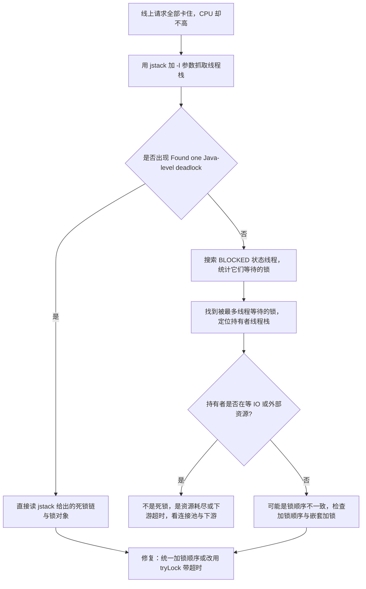

排查命令与工具：

```bash
jstack -l <pid> > /tmp/stack.txt           # -l 会额外打印 java.util.concurrent 的 ownable synchronizers
jcmd <pid> Thread.print -l > /tmp/stack.txt
# 编程式检测
```

```java
ThreadMXBean mxBean = ManagementFactory.getThreadMXBean();
long[] deadlocked = mxBean.findDeadlockedThreads();   // @since 1.6，同时覆盖 ObjectMonitor 与 AQS 这类 OwnableSynchronizer
```

注意：`findDeadlockedThreads()` 能检测 `ObjectMonitor` 和 `OwnableSynchronizer`（`findMonitorDeadlockedThreads()` 只检测前者，已废弃）。

**避免死锁的工程手段**：

1. 统一加锁顺序（例如按账户 id 升序）。
2. 用 `ReentrantLock.tryLock(long, TimeUnit)` 替代无限等待。
3. 用无锁数据结构（`ConcurrentHashMap`、`LongAdder`、`AtomicReference`）。
4. 缩小锁粒度，别在一个大 `synchronized` 里调 RPC。

## 八、虚拟内存、分页与 TLB

### 8.1 虚拟内存解决的三个问题

1. **隔离**：进程只能看到自己的地址空间，无法越界访问他人。
2. **超卖**：32 位进程可以有 4GB 虚拟地址但只用几十 MB 物理内存。
3. **简化链接与加载**：每个进程都可以假设自己从固定地址开始，ELF 直接按虚拟地址加载。

### 8.2 地址翻译链路

x86-64 四级分页（Linux 默认 48 位虚拟地址）：

```
虚拟地址 47..39 → PGD → 46..30 → PUD → 29..21 → PMD → 20..12 → PTE → 物理页框号
页内偏移 11..0（4KB 页 = 12 位）
```

| 层级 | 名称 | 覆盖范围 | 表项数 |
| --- | --- | --- | --- |
| PGD | 页全局目录 | 512GB | 512 |
| PUD | 页上级目录 | 1GB | 512 |
| PMD | 页中间目录 | 2MB | 512 |
| PTE | 页表项 | 4KB | 512 |

一级页表覆盖 4KB，四级共覆盖 `512^4 × 4KB = 256TB`，但要覆盖 48 位（256TB）地址空间，**如果只有一级页表需要 2^36 个表项 = 512GB 内存**，这显然不可行。多级页表的本质是**稀疏存储**：没有映射的区域上层目录项直接为空，不分配下一级表。

每个 PTE 8 字节，字段包括 `Present(P)`、`Read/Write(W)`、`User/Supervisor(U/S)`、`Accessed(A)`、`Dirty(D)`、`NX`、`PFN`。

### 8.3 TLB：把四级查找压成一次

四级遍历要访问 4 次内存（虽然 PGD/PUD 通常被 cache 命中），太慢。TLB（Translation Lookaside Buffer）是 MMU 里的页表项缓存：

| 层级 | 典型条目数 | 命中延迟 | 未命中延迟 |
| --- | --- | --- | --- |
| L1 dTLB（4KB 页） | 64 | 约 1 个周期 | - |
| L2 sTLB（统一） | 约 1536（Skylake 起） | 约 7 个周期 | - |
| 页表遍历 | - | - | 10~100 个周期 |

**大页（Huge Page）的价值**：一个 2MB 页只需要 1 个 TLB 项就覆盖 2MB 地址空间，是 4KB 页的 512 倍。所以：

- 透明大页 THP（`/sys/kernel/mm/transparent_hugepage/enabled`，典型值 `[always] madvise never`）对数据库类工作负载有争议：开启后 `khugepaged` 折叠页会引入延迟毛刺，很多 Java 服务生产上改成 `madvise` 或 `never`。
- JVM 参数 `-XX:+UseLargePages` 需要预先 `echo 1024 > /proc/sys/vm/nr_hugepages` 配置 HugeTLB，通常只在低延迟交易系统用。

### 8.4 虚拟内存的观测

```bash
cat /proc/<pid>/maps      # 每个 VMA 的起止地址、权限、映射文件
cat /proc/<pid>/smaps     # 多了 Rss/Pss/Shared_Clean/Dirty 等统计
cat /proc/<pid>/statm     # 7 个数字：size resident shared text lib data dt
pmap -x <pid> | tail -5   # 汇总
```

**VSZ 与 RSS 的区别**是必问点：

| 指标 | 全称 | 含义 | 为什么可能很大 |
| --- | --- | --- | --- |
| VSZ / VIRT | Virtual Set Size | 虚拟地址空间总量 | JVM 预留的堆、线程栈、mmap 文件都算 |
| RSS / RES | Resident Set Size | 实际驻留物理内存 | 包含共享库和共享内存，多个进程重复计算 |
| PSS | Proportional Set Size | 共享页按进程数均摊 | 最准确，但需要遍历 smaps 累加 |

Java 服务常见现象：`-Xmx8g` 但 `VSZ` 显示 30GB，是因为堆预留 + 元空间 + 代码缓存 + 线程栈 + `MappedByteBuffer` 全部计入虚拟空间，**这不等于内存泄漏**。

## 九、缺页中断与页面置换

### 9.1 缺页中断的完整路径

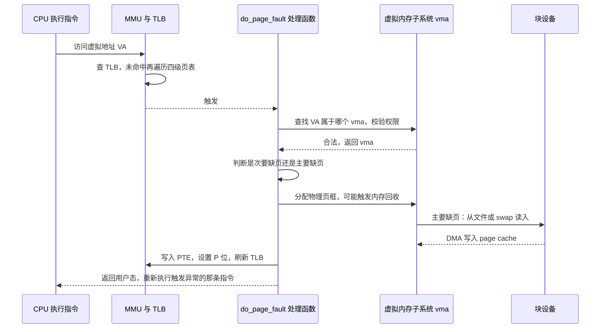

两类缺页必须分清：

| 类型 | 触发条件 | 是否需要磁盘 IO | 统计字段 |
| --- | --- | --- | --- |
| 次要缺页 minor fault | 页已在 page cache，只差映射 | 否 | `/proc/vmstat` 的 `pgfault` |
| 主要缺页 major fault | 页不在内存，必须读磁盘或换入 | 是 | `/proc/vmstat` 的 `pgmajfault` |
| 写保护缺页 | COW 场景，页存在但只读 | 否 | 计入 `pgfault` |

观测：

```bash
ps -o maj_flt,min_flt -p <pid>
/usr/bin/time -v java -jar app.jar     # 会输出 Major/Minor page faults
vmstat -s | grep -i fault
```

**Java 场景**：JVM 启动后第一次访问堆、第一次加载类、第一次读 `MappedByteBuffer` 都会触发大量 major fault，这就是"预热"的一部分。生产上 `-XX:+AlwaysPreTouch` 会在启动时把所有堆页预触一遍，代价是启动变慢，收益是运行时不再有分配页的毛刺。

### 9.2 页面置换算法对比

| 算法 | 规则 | 优点 | 缺点 |
| --- | --- | --- | --- |
| OPT（Belady 最优） | 淘汰未来最久不用的页 | 缺页率理论下界 | 需要预知未来，只作标尺 |
| FIFO | 淘汰最早进入的页 | 实现最简单 | 会出现 Belady 异常（加内存反而更多缺页） |
| LRU | 淘汰最久未使用的页 | 符合局部性，效果好 | 需要精确记录访问时间，硬件成本高 |
| Clock / 二次机会 | 环形队列 + 引用位，位为 1 则清零并跳过 | 用一位近似 LRU，开销低 | 精度不如 LRU |
| LFU | 淘汰访问次数最少的页 | 抗突发扫描 | 历史计数会老化失效 |
| Linux 双链表 | active/inactive 两个 LRU 链表，配合 refault distance 决策 | 抗扫描、区分一次性访问 | 参数多，调优复杂 |

**Belady 异常**只出现在 FIFO 类算法上（LRU 是栈算法，不会出现），这是常考细节。

### 9.3 Linux 实际的内存回收

Linux 的页回收不是"全局 LRU"，而是：

1. 每个 zone 有 `min`、`low`、`high` 三个水位线，由 `min_free_kbytes` 推导。
2. 页分 active / inactive 两条链表，页被访问第二次（PTE 的 `A` 位被设置）才从 inactive 提升到 active 之后。
3. 水位低于 `low` 时唤醒 `kswapd`，低于 `min` 时触发**直接回收**（direct reclaim），此时分配内存的线程自己去做回收，表现为**业务线程被拖住**。
4. 回收不掉的页才写 swap 或丢文件页（脏页需先回写）。

关键参数：

| 参数 | 默认值 | 说明 |
| --- | --- | --- |
| `vm.swappiness` | 60 | 越大越倾向回收匿名页（换出）；数据库场景常设 1~10 |
| `vm.vfs_cache_pressure` | 100 | 回收 dentry/inode 缓存的倾向 |
| `vm.min_free_kbytes` | 依内存自动计算 | 水位线基础，改大到 5%~10% 物理内存可减少直接回收 |
| `vm.dirty_ratio` | 20 | 脏页占内存超过此比例，写进程自己回写（阻塞） |
| `vm.dirty_background_ratio` | 10 | 超过则后台 `flusher` 线程开始回写 |
| `vm.dirty_expire_centisecs` | 3000（30 秒） | 脏页最长驻留时间 |
| `vm.dirty_writeback_centisecs` | 500（5 秒） | 回写线程唤醒间隔 |
| `vm.overcommit_memory` | 0 | 0 启发式，1 总是允许，2 严格不允许超卖 |

## 十、写时复制与内存分配

### 10.1 写时复制（Copy-On-Write）

`fork()` 不复制物理内存，而是：

1. 复制父进程的页表，父子双方的 PTE 都指向**同一批物理页**，并把 `W` 位清 0。
2. 任何一方写这些页都会触发写保护缺页。
3. 内核此时才分配新页、复制内容、更新 PTE、恢复可写。

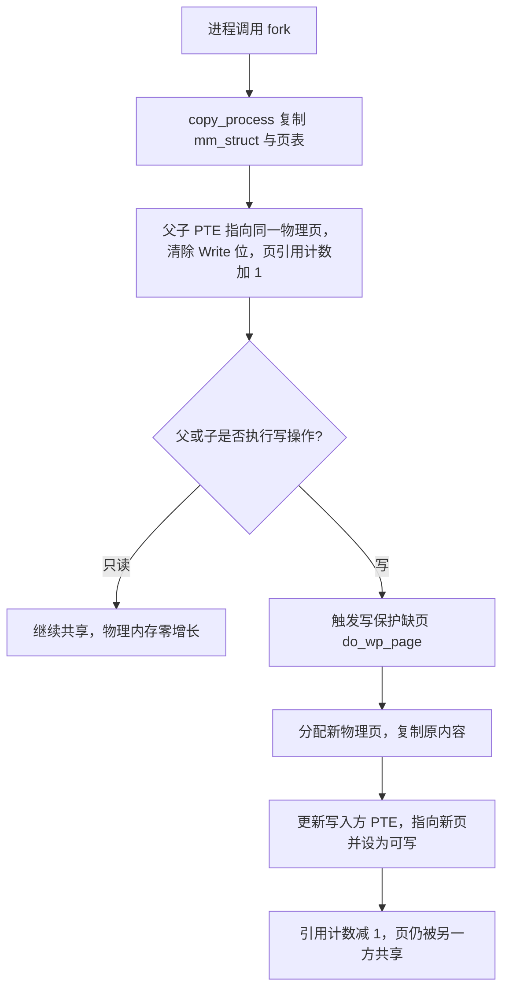

**Redis 的 BGSAVE 就是典型 COW 用户**：`fork()` 出子进程写 RDB，父进程继续服务；如果此时有大量写请求，会触发大量 COW 复制，内存可能**接近翻倍**，这就是 Redis 需要预留一半内存的原因。

**Java 场景**：JVM 本身不用 `fork` 做 GC，但 `ProcessBuilder` 启动子进程时 Linux 也是 `fork + exec`，`fork` 阶段会产生一次页表复制开销，大堆进程 fork 会有明显卡顿（`/proc/sys/vm/overcommit_memory` 和 `-XX:+AlwaysPreTouch` 都会放大这个开销）。

其他 COW 的应用：`vm.fork` 的 `CopyOnWriteArrayList`（Java 层的写时复制数组）、`-XX:+UseCopyOnWrite` 不存在的参数不要编。

### 10.2 brk 与 mmap：glibc malloc 的两条路

| 维度 | brk | mmap |
| --- | --- | --- |
| 系统调用 | `brk`/`sbrk` | `mmap(MAP_PRIVATE\|MAP_ANONYMOUS)` |
| 增长的地址 | 堆顶 `program break` 连续增长 | 在 mmap 区任意找空隙 |
| 归还内存 | 只能从堆顶收缩，中间的空洞无法归还 | `munmap` 可以任意归还 |
| 是否清零 | 否 | 是（匿名页保证零页） |
| 主要缺页 | 首次触碰时触发 | 首次触碰时触发 |
| 适用大小 | 小对象，默认 < 128KB | 大对象 |

glibc malloc 的关键默认值：

| 宏 | 默认值 | 含义 |
| --- | --- | --- |
| `M_MMAP_THRESHOLD` | 128KB，动态上限 `DEFAULT_MMAP_THRESHOLD_MAX` 在 64 位为 **32MB** | 超过就用 mmap 而非 brk |
| `M_TRIM_THRESHOLD` | 128KB | 堆顶空闲超过此值触发 `malloc_trim` 归还 |
| `M_TOP_PAD` | 0（可设） | 每次 sbrk 额外多申请的字节 |
| `M_ARENA_MAX` | `8 × 核数` | 多线程 arena 数量上限 |

调优环境变量：`MALLOC_ARENA_MAX=2`（容器里防内存膨胀的经典手段）、`MALLOC_TRIM_THRESHOLD_`、`MALLOC_MMAP_THRESHOLD_`。

glibc 2.26 引入的 **tcache**：每个线程 64 个 bin，每 bin 最多缓存 7 个 chunk，分配释放完全不碰 arena 锁，显著提升小对象吞吐，但也让 `free` 后的内存不易归还给操作系统。

**为什么 Java 进程也会关心这些**：JVM 自己用 `mmap` 分配堆（`-Xmx` 通过 `os::reserve_memory` → `mmap` 预留），但 NIO 直接内存 `-XX:MaxDirectMemorySize` 也是 mmap，JIT 编译的代码缓存 `-XX:ReservedCodeCacheSize`（默认 240MB）同样是。所以 `/proc/<pid>/maps` 里能看到几十个匿名映射，对应不同子系统。

### 10.3 伙伴系统与 slab

**伙伴系统（Buddy System）** 管理物理页，解决外部碎片：

- 空闲块按 `order` 组织，order N 表示 `2^N` 个连续页。
- 需要 order N 的块而只有更大的块时，把大块**对半分裂**；释放时若"伙伴"也空闲则**合并回上一级**。
- `MAX_ORDER` 默认 11，数组下标到 `MAX_ORDER - 1 = 10`，即最大块 1024 页 = **4MB**（4KB 页）。

观测：

```bash
cat /proc/buddyinfo
# Node 0, zone   Normal  1024  512  200  30  4  0  0  0  0  0  1
#                         o0    o1   o2  o3 o4 ...
# order 0(1页) 有 1024 个，order 1(2页) 有 512 个……
# order 大于等于 6 的块很少 = 存在外部碎片，难以分配大页
```

**slab / slub 分配器** 解决内核小对象频繁分配的问题：

- 内核对象（`task_struct`、`dentry`、`inode`、socket buffer）预先建好对象缓存，`kmem_cache_alloc` 直接从缓存取，避免每次走伙伴系统。
- 三个变体：SLAB（最老）、SLUB（Linux 2.6.23 起默认）、SLOB（嵌入式）。
- 关键指标：`active_objs` / `num_objs` 得到缓存利用率。

```bash
slabtop -s c            # 按缓存总大小排序，看谁在吃内核内存
cat /proc/slabinfo | sort -k 3 -n -r | head -20
cat /proc/meminfo | grep -E 'Slab|SReclaimable|SUnreclaim'
```

**线上经典案例**：`SUnreclaim`（不可回收 slab）持续增长，通常是内核对象泄漏，常见嫌疑是 `dentry`、`TCP`、`ext4_inode_cache`。`dentry` 泄漏常伴随文件系统遍历或容器内大量临时文件操作。

### 10.4 内存碎片的两种类型

| 类型 | 定义 | 观测 | 缓解 |
| --- | --- | --- | --- |
| 内部碎片 | 分配了但没用完的部分 | 分配器统计 | 调整 size class、对象池 |
| 外部碎片 | 空闲内存总量够但没有足够大的连续块 | `/proc/buddyinfo` 大 order 为空 | 内存规整 `echo 1 > /proc/sys/vm/compact_memory`、NUMA 本地化 |

Java 侧的"碎片"是另一回事：G1 的 **region 碎片**导致 Humongous 对象（超过 region 一半）分配失败，触发并发周期或 Full GC；CMS 的**并发模式失败**（concurrent mode failure）也是碎片导致晋升失败。

## 十一、零拷贝与 IO 模型

### 11.1 五种 IO 模型

| 模型 | 两个阶段的行为 | 阻塞点 | Java API |
| --- | --- | --- | --- |
| 阻塞 IO | 数据就绪阻塞 + 数据拷贝阻塞 | 两个阶段都阻塞 | `InputStream.read()`、`Socket` 老 IO |
| 非阻塞 IO | 立即返回 EAGAIN，需轮询 | 拷贝阶段阻塞 | `SocketChannel.configureBlocking(false)` |
| IO 多路复用 | `select/poll/epoll` 阻塞等事件，就绪后拷贝 | `epoll_wait` 与拷贝 | `Selector`、Netty |
| 信号驱动 IO | 注册 `SIGIO`，就绪时信号通知 | 拷贝阶段阻塞 | Java 无标准 API |
| 异步 IO | 提交后完全不管，内核完成再通知 | 不阻塞 | `AsynchronousSocketChannel`、Linux 5.1+ `io_uring` |

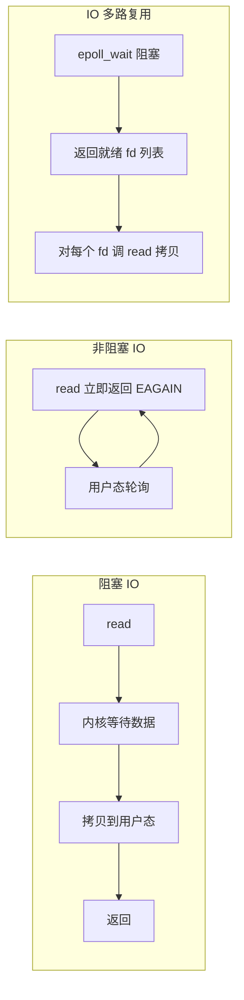

**两种"非阻塞"经常被混淆**：

- Java NIO 的 `configureBlocking(false)` 是**内核级非阻塞**，只是第一阶段不阻塞。
- Java NIO 的 `AsynchronousFileChannel` 在 Linux 上**历史上是用线程池模拟的**（`sun.nio.ch.SimpleAsynchronousFileChannelImpl` 使用 `ThreadPool`），并不是真正的内核异步 IO。JDK 本身没有 `io_uring` 支持（截至 JDK 24 都还没有正式落地）。

### 11.2 select / poll / epoll 的差异

| 维度 | select | poll | epoll |
| --- | --- | --- | --- |
| fd 上限 | `FD_SETSIZE = 1024` | 无硬上限（受 `ulimit -n`） | 无硬上限 |
| 数据结构 | 位图 fd_set | `pollfd` 数组 | 红黑树 + 就绪链表 |
| 每次调用开销 | O(n) 拷贝 + O(n) 遍历 | O(n) 拷贝 + O(n) 遍历 | `epoll_wait` O(就绪数) |
| 内核是否重复注册 | 每次都要重传 fd 集合 | 每次都要重传 | `epoll_ctl` 注册一次 |
| 触发模式 | 只有水平触发 | 只有水平触发 | LT 与 ET 都支持 |
| 适用连接数 | 几百 | 几千 | 十万级 |

**LT 与 ET**：

- LT（水平触发，默认）：只要 fd 还有数据，`epoll_wait` 每次都会返回它。编程简单，但可能重复唤醒。
- ET（边缘触发，`EPOLLET`）：只在状态变化时通知一次，**必须循环读到 `EAGAIN`**，否则数据会滞留。Netty 的 `EpollChannelOption` 支持 ET，但 Netty 默认仍用 LT，因为 ET 对写事件和半包处理要求更高。

**Java 里的实现**：`sun.nio.ch.EPollSelectorImpl`，底层 `EPoll.epollCreate/epollCtl/epollWait`。Netty 的 `netty-transport-native-epoll` 提供了 JNI 直通的 `EpollEventLoopGroup`，能拿到 `EPOLLET`、`SO_REUSEPORT`、`TCP_CORK` 这些 JDK 不暴露的选项。

### 11.3 零拷贝的实现与真实拷贝次数

以"把磁盘文件通过 socket 发出去"为例：

```mermaid
flowchart TD
  subgraph T["传统 read + write：4 次拷贝，4 次上下文切换"]
    T1["磁盘"] -->|"1 DMA 拷贝"| T2["内核 page cache"]
    T2 -->|"2 CPU 拷贝"| T3["用户态缓冲区"]
    T3 -->|"3 CPU 拷贝"| T4["socket 缓冲区"]
    T4 -->|"4 DMA 拷贝"| T5["网卡"]
  end
  subgraph S["sendfile：3 次拷贝，2 次上下文切换"]
    S1["磁盘"] -->|"1 DMA 拷贝"| S2["内核 page cache"]
    S2 -->|"2 CPU 拷贝"| S3["socket 缓冲区"]
    S3 -->|"3 DMA 拷贝"| S4["网卡"]
  end
  subgraph G["sendfile + 网卡 SG-DMA：2 次 DMA，0 次 CPU 拷贝"]
    G1["磁盘"] -->|"1 DMA 拷贝"| G2["内核 page cache"]
    G2 -->|"2 SG-DMA 只传描述符"| G3["网卡"]
  end
```

| 方案 | CPU 拷贝次数 | DMA 拷贝次数 | 上下文切换 | 限制 |
| --- | --- | --- | --- | --- |
| read + write | 2 | 2 | 4 | 无 |
| mmap + write | 1 | 2 | 4 | 只能传文件；写时缺页会 SIGBUS |
| sendfile | 1 | 2 | 2 | 不能修改数据，只能原样发送 |
| sendfile + SG-DMA | 0 | 2 | 2 | 需要网卡支持 scatter-gather |
| splice | 0 | 2 | 2 | 需要至少一端是管道 |

**Java 落点**：

- `FileChannel.transferTo(position, count, target)` → Linux 上走 `sendfile`（`sun.nio.ch.FileChannelImpl#transferTo` 判断目标是否是 `SocketChannel`）。
- `FileChannel.transferFrom` → 源码里没有走 `splice` 的分支，源是 `SocketChannel` 这类非 `FileChannel` 时退化为 8KB 一轮的 read/write 循环（`transferFromArbitraryChannel`，JDK 8~17 都是这个实现）。
- `FileChannel.map` → `mmap`。
- **Kafka** 就是靠 `transferTo` + page cache 实现高吞吐：生产者写页缓存，消费者直接 `sendfile` 走网卡，Broker 进程几乎不碰数据。
- **RocketMQ** 用 `MappedByteBuffer` 做 CommitLog 写，读时用 `transferTo`（`DefaultMessageStore` 的 `selectByConsumeQueue`）。

## 十二、文件系统、inode 与 page cache

### 12.1 文件系统的四个核心对象

| 对象 | 结构 | 作用 | ext4 里的具体形态 |
| --- | --- | --- | --- |
| superblock | `struct super_block` | 整个文件系统的元信息（块大小、inode 总数、挂载状态） | 块组 0 里的超级块，有备份 |
| inode | `struct inode` | 一个文件的全部元数据 + 数据块指针 | ext4 默认 **256 字节**，含 `i_size`、`i_mode`、`i_uid`、`i_blocks`、时间戳 |
| dentry | `struct dentry` | 目录项，把名字映射到 inode | 目录文件里是哈希树（htree）组织 |
| file | `struct file` | 一次打开的文件实例，含偏移量 `f_pos` 与 `f_flags` | `open()` 的返回值对应的内核对象 |

**inode 里没有文件名字**。名字在目录项里，所以硬链接可以让多个名字指向同一个 inode，而 inode 完全不感知。

关键点：

- ext4 默认块大小 4KB（`mke2fs -b 4096`）。
- 每个块组固定 inode 数量，`df -i` 看的 `IUse%` 到 100% 时，**磁盘还有空间也写不进新文件**，这是很容易踩的坑（小文件海量场景）。
- ext4 的 `i_blocks` 以 512 字节为单位计数，不是块大小。

### 12.2 软链接与硬链接

| 维度 | 硬链接 | 软链接（符号链接） |
| --- | --- | --- |
| 本质 | 目录项直接指向同一 inode | 独立 inode，内容是目标路径字符串 |
| 创建命令 | `ln target link` | `ln -s target link` |
| 是否跨文件系统 | 否 | 是 |
| 是否可指向目录 | 否（除 `.` `..`） | 是 |
| 原文件删除后 | 仍可用，`i_nlink` 减 1 | 变成断链 `dangling` |
| inode 号 | 与原文件相同 | 不同 |
| 大小 | 与原文件相同 | 等于路径字符串长度 |
| Java 检测 | `Files.getAttribute(p, "unix:nlink")` | `Files.isSymbolicLink(p)` |

`i_nlink` 归零时数据块才被真正释放，这是"删除打开中的文件不释放空间"的原因——进程还持有 `struct file`，`df` 显示已满而 `du` 找不到那个文件：

```bash
lsof +L1                    # 找出已被删除但仍被进程持有的文件
lsof -nP | grep deleted
```

### 12.3 page cache 与回写

所有 `read`/`write` 默认都走 page cache：

1. `write` 只写进 page cache 并标记页为脏，返回即"成功"。
2. `flusher` 内核线程按 `dirty_expire_centisecs`(30s) / `dirty_writeback_centisecs`(5s) 周期回写。
3. 脏页比例超过 `dirty_background_ratio`(10%) 唤醒后台回写；超过 `dirty_ratio`(20%) 写进程自己阻塞回写（这是**写延迟毛刺的常见来源**）。

| 语义 | 系统调用 | Java API | 保证 |
| --- | --- | --- | --- |
| 只写页缓存 | `write` | `FileOutputStream.write` | 只是进入内存 |
| 刷数据与元数据 | `fsync` | `FileChannel.force(true)` | 数据与元数据落盘 |
| 只刷数据 | `fdatasync` | 无直接 API，`force(false)` 接近 | 数据落盘，不一定刷 mtime |
| 刷一个目录 | `fsync` 目录 fd | Java 无标准 API | 保证新文件的名字可见 |
| 全局刷 | `sync` | 无 | 刷新所有脏页 |

**`force(false)` 与 `force(true)` 的区别**在 MySQL、Kafka 这类写日志场景是性能关键：`force(false)` 只保证文件内容，不保证元数据（如文件大小更新），所以**追加写场景下断电可能丢最后一段**。

`O_DIRECT` 绕过 page cache，Java 里对应 `FileChannel.open(path, StandardOpenOption.READ)` 不行，需要 `ExtendedOpenOption.DIRECT`（**JDK 10 起**，`com.sun.nio.file.ExtendedOpenOption.DIRECT`）——注意这是 `jdk.unsupported` 之外的 `com.sun.nio.file` 包，属于 JDK 内部 API。

清理 page cache（**生产慎用，会导致后续大量 major fault**）：

```bash
sync
echo 3 > /proc/sys/vm/drop_caches
```

### 12.4 磁盘 IO 的关键指标

```bash
iostat -x 1
# r/s w/s：每秒读写次数（IOPS）
# rkB/s wkB/s：吞吐
# await：平均等待时间（含排队），单位毫秒
# r_await / w_await：分开看读和写
# %util：设备忙碌百分比，接近 100% 说明设备饱和
# aqu-sz：平均请求队列长度
```

**判读**：`%util` 接近 100% 且 `await` 高 = 磁盘打满；`aqu-sz` 大而 `%util` 不高 = 请求被上层拖住（可能是文件系统锁或 page cache 回写）。SSD 上 `%util` 不一定是可靠指标，要看 `await` 和 IOPS 是否触及设备上限。

## 十三、Linux 性能排查命令

### 13.1 命令速查表

| 命令 | 核心字段 | 回答什么问题 | Java 场景 |
| --- | --- | --- | --- |
| `top` / `htop` | `%us` `%sy` `%wa` `%si` `%st`、load average | CPU 花在哪 | `%sy` 高看锁与系统调用，`%wa` 高看 IO |
| `top -H -p <pid>` | 线程级 CPU，显示 TID | 哪个线程吃 CPU | 把 TID 转十六进制对齐 `jstack` 的 `nid` |
| `vmstat 1` | `r` `b` `si` `so` `bi` `bo` `in` `cs` | 全局概览：调度、内存、IO、中断 | `so/si` 非 0 说明在换页 |
| `pidstat -u -d -w -r 1 -p <pid>` | 分别看 CPU、磁盘、上下文切换、内存 | 单进程细化 | `nvcswch/s` 高 → 锁竞争或线程过多 |
| `iostat -x 1` | `await` `%util` `aqu-sz` | 磁盘是否瓶颈 | 日志盘与数据盘是否分离 |
| `free -h` | `available` `buff/cache` | 还有多少可用内存 | 只看 `free` 会误判，必须看 `available` |
| `sar -n DEV 1` | 网卡吞吐、丢包 | 网络瓶颈 | 配合 `ss -s` 看连接数 |
| `perf top -p <pid>` | 实时热点符号 | 到底哪行代码热 | Java 需要 `-XX:+PreserveFramePointer` 与 perf-map-agent 才能看到 Java 符号 |
| `perf record -g -F 999 -p <pid>` + `perf report` | 火焰图/调用栈 | 热点调用链 | 生成 `perf.data` 后交给 FlameGraph 出火焰图 |
| `strace -c -p <pid>` | 系统调用次数与耗时 | 是不是系统调用太密 | 定位"每秒几十万次 read"这类问题 |
| `slabtop -s c` | 内核 slab 排行 | 内核内存去哪了 | `SUnreclaim` 增长要找泄漏对象 |
| `ss -s` / `ss -tnp` | 连接状态统计 | 连接数、TIME_WAIT | 端口耗尽的常见根因 |
| `dmesg -T` | 内核日志 | OOM Killer、段错误、磁盘错误 | 容器被 Kill 第一站 |

**load average 的正确读法**（最容易被误用的指标）：

- 三个数字分别是 1、5、15 分钟的平均值，统计的是<strong>正在运行（R）+ 不可中断睡眠（D）</strong>的任务数，不只是 runnable。
- 判断标准是 **load 与核数的比值**，不是绝对值：单核 load 1.0 就是跑满，8 核 load 8.0 才是跑满。
- **load 高但 `%us` 不高**，说明任务堵在 D 状态——典型是磁盘 IO、NFS、网络文件系统，或内核里的锁等待；**load 不高但延迟高**则要往 GC、下游 RT、cgroup 限流方向查。

### 13.2 内存相关字段的正确读法

```bash
free -h
#                total        used        free      shared  buff/cache   available
# Mem:            62Gi        30Gi       1.2Gi       256Mi        31Gi        31Gi
```

- `free` 很小**不代表内存不足**，`buff/cache` 本来就是可回收的。
- 唯一可信的是 `available`（`/proc/meminfo` 的 `MemAvailable`），它是内核估算的"再分配这么多内存不会触发换页"。
- `MemAvailable` 的估算逻辑从 Linux 3.14 引入，比 3.14 之前的 `free + buff/cache` 精确得多。

Java 侧对齐：

- 进程 RSS 增长但堆稳定 → 看直接内存（`-XX:MaxDirectMemorySize`）、线程数（`Thread.activeCount()`）、`MappedByteBuffer`。
- `Metaspace` 增长 → 类加载器泄漏，常见于热部署、CGLIB 动态代理、脚本引擎。
- 用 `jcmd <pid> VM.native_memory summary`（需 `-XX:NativeMemoryTracking=summary` 启动）拆分原生内存。

### 13.3 USE 方法与 Java 服务的排查顺序

**USE**：对每个资源检查 Utilization（使用率）、Saturation（饱和度）、Errors（错误）。

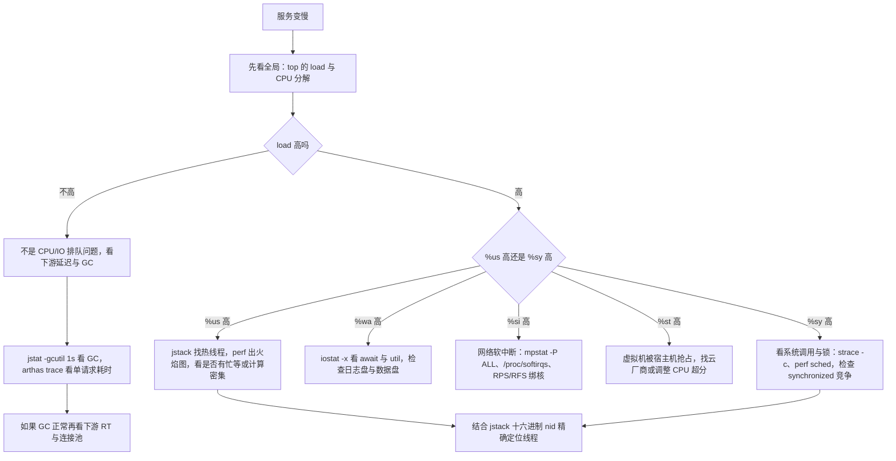

**Java 服务标准排查清单**（顺序很重要，从便宜的检查开始）：

1. `top` → CPU、load、内存概览。
2. `jstat -gcutil <pid> 1000` → GC 频率与耗时，`GCT` 累计时间增长快说明 GC 有问题。
3. `jstack <pid> | grep -A 30 "BLOCKED"` → 锁竞争。
4. `jcmd <pid> Thread.print -l` + `top -H` → 热线程定位。
5. `vmstat 1` → 是否在换页、上下文切换是否异常。
6. `iostat -x 1` → 磁盘。
7. `ss -s` → 连接与 TIME_WAIT。
8. `dmesg -T | tail -50` → OOM Killer。

## 十四、容器的本质与隔离边界

### 14.1 一句话：容器 = 被限制视野与配额的普通进程

容器没有自己的内核，就是**宿主机上加了 namespace 隔离和 cgroup 限额的普通进程**。`docker run` 最终调用 `runc`（早期 `libcontainer`），`runc` 通过 `clone()` 带上一堆 `CLONE_NEW*` 标志创建容器首进程。

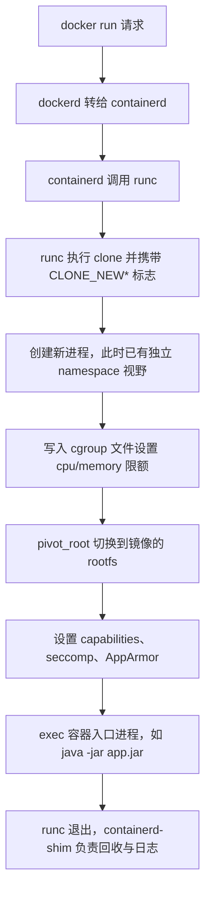

### 14.2 namespace 类型与版本

| namespace | `CLONE_` 标志 | 隔离内容 | 内核版本 | 容器里的直观效果 |
| --- | --- | --- | --- | --- |
| Mount | `CLONE_NEWNS` | 挂载点 | 2.4.19 | 容器有自己的 rootfs |
| UTS | `CLONE_NEWUTS` | hostname、domainname | 2.6.19 | `hostname` 与宿主机不同 |
| IPC | `CLONE_NEWIPC` | SysV IPC、POSIX 消息队列 | 2.6.19 | 共享内存段不串 |
| PID | `CLONE_NEWPID` | 进程号 | 2.6.24 | 容器内第一个进程 PID = 1 |
| Network | `CLONE_NEWNET` | 网卡、路由表、iptables、端口 | 2.6.29 | 容器有自己的 `eth0` 与 `lo` |
| User | `CLONE_NEWUSER` | UID/GID 映射 | 3.8 | rootless 容器的基础 |
| Cgroup | `CLONE_NEWCGROUP` | cgroup 视图 | 4.6 | 容器内看不到宿主机层级 |
| Time | `CLONE_NEWTIME` | `CLOCK_MONOTONIC`/`BOOTTIME` 偏移 | 5.6 | 容器可独立设置时间偏移 |

查看：

```bash
ls -l /proc/<pid>/ns/          # 每个 namespace 的 inode 号
readlink /proc/<pid>/ns/net    # net:[4026531956]
lsns                           # 列出所有 namespace
```

**关键遗漏**：`/proc` 的很多内容是**宿主机视角**的。`/proc/meminfo`、`/proc/cpuinfo`、`/proc/stat` 没有做 namespace 隔离（PID namespace 只隔离进程列表），所以容器里 `free -h` 看到的是宿主机的内存。这直接导致**老版本 JVM 误判内存**，是 `-Xmx` 配了 2G 却 OOM 的根因。想修正一般用 lxcfs 挂载覆盖，或者直接依赖 JVM 的容器感知。

### 14.3 cgroups v1 与 v2

| 维度 | cgroups v1 | cgroups v2 |
| --- | --- | --- |
| 层级 | 每个控制器一棵独立树 | 单棵统一树 |
| 挂载点 | `/sys/fs/cgroup/<controller>/` | `/sys/fs/cgroup/` |
| 进程规则 | 一个进程可属于多个层级 | **no internal process**：只有叶子节点能放进程 |
| 内存文件 | `memory.limit_in_bytes`、`memory.usage_in_bytes` | `memory.max`、`memory.current`、`memory.high` |
| CPU 配额 | `cpu.cfs_period_us`、`cpu.cfs_quota_us` | `cpu.max`（格式 `quota period`） |
| CPU 权重 | `cpu.shares`（默认 1024） | `cpu.weight`（范围 1~10000，默认 100） |
| 主要控制器 | cpu, cpuacct, memory, blkio, pids, devices, freezer, net_cls | cpu, memory, io, pids, hugetlb, rdma, cpuset |

常用限额文件：

```bash
cat /sys/fs/cgroup/cpu.max            # 200000 100000 → 相当于 2 核
cat /sys/fs/cgroup/memory.max         # 1073741824 → 1GiB
cat /sys/fs/cgroup/memory.current
cat /sys/fs/cgroup/cpu.stat           # nr_throttled / throttled_usec 是关键
cat /sys/fs/cgroup/pids.max
```

**`cpu.stat` 的 `nr_throttled` 与 `throttled_usec` 是容器里最容易被忽略的延迟根因**：CPU 配额在 100ms 周期内用完，剩余时间整个 cgroup 的所有线程都被**强制冻结**，表现为"CPU 使用率不高但 P99 延迟抖动巨大"。Java 服务的典型症状是周期性毛刺，周期正好是 100ms 的整数倍。

### 14.4 Docker 的隔离边界（面试重点）

容器**不是**虚拟机，以下都是共享的：

| 共享对象 | 后果 | 缓解手段 |
| --- | --- | --- |
| 同一个内核 | 内核提权漏洞可逃逸（Dirty COW CVE-2016-5195、runc CVE-2019-5736、cgroups release_agent CVE-2022-0492） | 及时打内核补丁；用 gVisor/Kata 加一层 |
| 系统调用表 | 内核攻击面全暴露 | seccomp 默认 profile 禁掉约 44 个危险调用；`--security-opt seccomp=...` |
| capabilities | 默认赋予部分能力（如 `NET_RAW`） | `--cap-drop=ALL --cap-add=NET_BIND_SERVICE` |
| 时钟与 `sysctl` | 部分 `sysctl` 是全局的 | 只能改被 namespaced 的那部分（如 `net.*`） |
| `/proc`、`/sys` | 泄露宿主机信息 | 只读挂载；lxcfs |
| 磁盘 IO 与 page cache | 邻居噪声 | blkio/io 控制器限速；page cache 在 cgroup v1 就按 cgroup 计费（`memory.usage_in_bytes`、`memory.stat` 的 `cache`，v2 对应 `memory.current`），但计费不等于隔离，未设内存限额时容器仍能吃光宿主 page cache |
| 内核锁与调度 | 一个容器的 spinlock 争抢影响全局 | 无法隔离 |

**`--privileged` 等价于放弃几乎所有隔离**，生产禁止。`--pid=host`、`--net=host`、挂载 `/var/run/docker.sock` 同样是高危操作，后者等于给了宿主 root。

### 14.5 JVM 的容器感知

| JDK 版本 | 行为 |
| --- | --- |
| JDK 8u131 / JDK 9 | 需 `-XX:+UnlockExperimentalVMOptions -XX:+UseCGroupMemoryLimitForHeap` |
| **JDK 8u191 / JDK 10 起** | `-XX:+UseContainerSupport` **默认开启**，自动读 cgroup 内存限额与 CPU 配额 |
| JDK 10+ | `-XX:ActiveProcessorCount` 可显式覆盖 CPU 数 |
| JDK 8u191+ | 同样支持 `ActiveProcessorCount` |

默认百分比（基于容器内存限额，不是宿主机内存）：

| 参数 | 默认值 | 含义 |
| --- | --- | --- |
| `MaxRAMPercentage` | 25.0 | 最大堆 = 限额 × 25% |
| `InitialRAMPercentage` | 1.5625 | 初始堆 = 限额 × 1.5625% |
| `MinRAMPercentage` | 50.0 | 小内存机器（限额小于约 250MB 时）的最大堆比例 |

**踩坑**：容器限额 4GiB，默认 `-Xmx` 只有 1GiB；剩下 3GiB 要留给元空间、线程栈、直接内存、JIT 代码缓存、GC 结构。生产上常见做法是显式 `-XX:MaxRAMPercentage=70.0` 到 `75.0`，并同时设 `-XX:MaxDirectMemorySize` 与 `-Xss`。

CPU 感知：`Runtime.getRuntime().availableProcessors()` 在 JDK 8u191+/10+ 会按 `cpu.max` 计算，但**在 8u191 之前返回的是宿主机核数**，导致线程池、GC 线程、ForkJoinPool 全部开多。

## 十五、高级岗三问

### 15.1 为什么这么设计？

| 设计 | 替代方案 | 选它的原因 | 代价 |
| --- | --- | --- | --- |
| 用户态/内核态分离 | 全在内核态运行 | 保护与稳定 | 每次系统调用都要切换 |
| 线程 1:1 映射 | N:1 用户级线程 | 能利用多核、单线程阻塞不影响他人 | 每线程 1MB 栈与内核对象开销 |
| 虚拟内存 + 多级页表 | 直接物理地址 | 隔离、超卖、地址空间连续 | TLB 未命中时多级遍历 |
| page cache | 全走 O_DIRECT | 顺序读写性能极佳、文件系统透明 | 脏页回写不可控的延迟毛刺、内存看起来"被吃了" |
| epoll 红黑树 + 就绪链表 | select 轮询 | 十万连接下仍 O(1) | 编程模型复杂（LT/ET、惊群） |
| CFS/EEVDF | O(1) 调度器 | 公平性与交互性兼顾，权重可调 | 红黑树操作 O(log n)，n 大时开销上升 |
| namespace + cgroups | 每个容器一个内核（虚拟机） | 启动快、密度高、开销小 | 内核共享，安全边界弱 |

### 15.2 线上出问题怎么定位？

按"从全局到局部、从便宜到昂贵"的四步：

1. **定位资源类型**：`top` + `vmstat 1` 判断是 CPU、内存、IO 还是网络。
2. **定位到进程**：`pidstat -u -d -r -w 1`，Java 进程直接用 `jcmd`/`jstat`。
3. **定位到线程/代码**：`top -H` → 十六进制 TID → `jstack` 的 `nid`；或 `perf top -p` + 火焰图。
4. **定位到系统层**：`strace -c` 看系统调用分布，`/proc/<pid>/status` 看 `VmRSS`/`Threads`/上下文切换，`dmesg` 看内核报错。

### 15.3 规模变大后会怎样？

| 维度 | 小规模 | 规模变大后的失效模式 | 对策 |
| --- | --- | --- | --- |
| 线程数 | 几百 | `Threads` 上万，每次上下文切换吃满 CPU，`nvcswch/s` 飙升 | 线程池化、JDK 21 虚拟线程、改异步 |
| 连接数 | 几千 | fd 耗尽（`ulimit -n` 默认 1024 或 65535）、端口耗尽 | 调 `nofile`、连接池、`SO_REUSEPORT` |
| 内存 | 堆稳定 | page cache 与 RSS 争抢，触发直接回收，业务线程被拖住 | 调 `min_free_kbytes`、分离日志盘、`vm.swappiness=1` |
| 文件数 | 几千 | inode 耗尽（`df -i` 100%）、`dentry` slab 膨胀 | 合并小文件、清理临时文件、监控 `SUnreclaim` |
| 容器密度 | 几台 | CPU 限流节流（`nr_throttled` 上升）、邻居噪声、page cache 不隔离 | 设置合理的 `cpu.max`、`requests/limits` 匹配、`--cpu-shares` |
| 中断 | 低 PPS | 单 CPU 软中断打满，`%si` 高 | RPS/RFS、多队列网卡、`irqbalance` |

---

## 高频面试题

### Q1. 进程和线程的本质区别是什么？为什么 Linux 说"线程只是共享资源的进程"？

**答题框架（30 秒版）**：进程是资源分配与保护的单位，线程是 CPU 调度的单位。Linux 内核里两者都是 `struct task_struct`，差异只在 `clone()` 的标志位：线程多了 `CLONE_VM`、`CLONE_FILES`、`CLONE_SIGHAND`、`CLONE_THREAD` 等共享标志，所以线程共享地址空间、文件表、信号处理，而进程各有独立副本。

**展开（2 分钟版）**：

1. 说清楚"共享了什么"：`mm_struct`（地址空间）、`files_struct`（fd 表）、`sighand_struct`（信号处理）、`fs_struct`（cwd 与 umask）、`CLONE_THREAD` 决定的 `tgid`。
2. 说清楚"没共享什么"：每个 task 有自己的 `task_struct`、内核栈、`pid`（tid）、寄存器上下文、调度实体 `sched_entity`。
3. 落到开销：进程创建要复制页表（即使 COW 也要复制页表本身），线程创建只建 task + 栈；进程切换要换 CR3 刷 TLB，线程切换不用。
4. 落到 Java：`new Thread()` 在 JDK 21 前是 1:1 内核线程，`jstack` 的 `nid` 就是内核 tid。

**追问**：那 `Thread.getId()` 和内核 tid 是一回事吗？答：不是。`Thread.getId()` 是 JVM 分配的 `long`，在 JDK 19 起被标记为废弃（`@Deprecated(since="19")`，因为虚拟线程下没有意义），只有 `jstack` 里的 `nid=0x...` 才是十六进制内核 tid。

### Q2. 一次系统调用的开销在哪？怎么减少？

**答题框架（30 秒版）**：开销分四块：`syscall` 指令本身（约 10~50 周期）、内核入口保存/恢复寄存器、内核逻辑本身、以及阻塞时的 `schedule()` 上下文切换。前三块是纳秒级，第四块是微秒级。减少手段是批量化、缓冲、异步化、用 vDSO 绕开。

**展开（2 分钟版）**：

1. `syscall`/`sysret` 与 32 位的 `int 0x80` 对比：后者走中断门，开销更高。
2. 用 `strace -c -p <pid>` 量化：能直接看到每个系统调用的调用次数与总耗时占比。
3. 优化手段表格：`BufferedOutputStream` 默认 8192 字节、`FileChannel.write(ByteBuffer[])` 的 writev、`epoll_wait` 一次批量返回、`io_uring` 批量提交。
4. vDSO：`clock_gettime`/`gettimeofday`/`getcpu`/`time` 完全在用户态完成，`System.nanoTime()` 受益于此。

**追问**：怎么确认一个 Java 方法在频繁进内核？答：`strace -c -f -p <pid>` 看 `read`/`write`/`futex` 的次数，或者 `perf` 看 `entry_SYSCALL_64` 的占比。

### Q3. 上下文切换的开销有多大？怎么判断线上切换次数是否异常？

**答题框架（30 秒版）**：直接成本（寄存器、栈、CR3）+ 间接成本（cache/TLB 冷掉），典型 1~5 μs。用 `vmstat 1` 看 `cs` 列、`pidstat -w` 区分主动/被动切换。判据不是绝对次数，而是"切换次数 × 单次成本"是否吃掉了可观的 CPU，以及 `r` 列是否大于核数。

**展开（2 分钟版）**：

1. `cswch/s` 是主动切换（等 IO、等锁、`sleep`），`nvcswch/s` 是被动切换（时间片用完被抢占）。
2. `cswch/s` 高 + `%wa` 高 → IO 瓶颈；`nvcswch/s` 高 + `r` 列大 → CPU 争抢。
3. 按 3 μs 算，10 万次/秒 = 0.3 秒 CPU，单核 30%。要注意 `cs` 是**全系统**的数字，要看目标进程的占比。
4. Java 侧典型根因：线程数远超核数（如 200 核机器开 2000 个线程）、`synchronized` 热点锁、`Thread.sleep(1)` 轮询。

**追问**：为什么 `cswch/s` 高但 CPU 不高也可能是问题？答：如果线程频繁在锁上唤醒-阻塞，说明是锁竞争导致的有效工作时间被切碎，`%sy` 会同步升高，吞吐上不去。

### Q4. 虚拟内存是怎么把 4 级页表的开销压下去的？TLB 和缺页中断各起什么作用？

**答题框架（30 秒版）**：多级页表靠稀疏存储避免为整个地址空间建表；TLB 缓存最近翻译过的页表项，把四次内存访问压成一次；缺页中断在页不在内存时才触发，负责补上映射并发起 IO。三者是"空间效率、时间效率、按需加载"的三角。

**展开（2 分钟版）**：

1. 位划分：x86-64 48 位虚拟地址 → PGD 9 位、PUD 9 位、PMD 9 位、PTE 9 位、页内偏移 12 位；每张表 512 项、每项 8 字节。
2. 稀疏性：没有映射的 512GB 区域，PGD 对应项直接为空，不为它分配下属三层表。
3. TLB 层级与条目数：L1 dTLB 约 64 项，L2 统一 TLB 约 1536 项（Skylake 起）。
4. 大页的收益：一个 2MB 页的 TLB 项覆盖 512 倍地址空间，所以大页能把 TLB miss 降低一到两个数量级。

**追问**：为什么有人说 THP 对 Java 服务不好？答：THP 的 `khugepaged` 后台合并与 `always` 模式下的即时分配会引起延迟毛刺和内存放大，很多低延迟服务把 `/sys/kernel/mm/transparent_hugepage/enabled` 设为 `madvise` 或 `never`。

### Q5. 页面置换算法有哪些？Linux 实际用的是哪个？

**答题框架（30 秒版）**：OPT、FIFO、LRU、Clock、LFU。Linux 用的是"双链表 LRU + refault distance"，不是教科书 LRU，也不是 Clock。活跃链表与不活跃链表分离，配合 `swappiness`、`min_free_kbytes` 水位线做决策。

**展开（2 分钟版）**：

1. FIFO 的 Belady 异常：加物理内存反而缺页更多，LRU 作为栈算法不会。
2. Clock：一个引用位近似 LRU，硬件成本低，是很多教科书说的"实际实现"，但 Linux 走得比它更远。
3. Linux 的两条链表：新页进 inactive，被第二次访问（`A` 位置位）后提升到 active 头部；淘汰从 inactive 尾部开始。
4. refault distance：页被淘汰后若很快又被访问（重新缺页），说明 inactive 链表太短，内核会动态调整两条链表的比例。

**追问**：那 `/proc/vmstat` 里该看什么？答：`pgfault`（次要缺页）、`pgmajfault`（主要缺页）、`pgscan_direct`/`pgsteal_direct`（直接回收）以及 `allocstall` 累计值。`allocstall` 持续增长说明分配内存时被直接回收拖住了，这是业务延迟毛刺的直接证据。

### Q6. 零拷贝到底是什么？`FileChannel.transferTo` 底下发生了什么？

**答题框架（30 秒版）**：零拷贝指**消除 CPU 参与的拷贝**，DMA 拷贝仍然存在。传统 `read + write` 是 4 次拷贝（2 次 DMA + 2 次 CPU）、4 次上下文切换；`sendfile` 降到 3 次拷贝、2 次切换；`sendfile` 配合网卡 scatter-gather 则 0 次 CPU 拷贝。

**展开（2 分钟版）**：

1. `FileChannel.transferTo` → `sun.nio.ch.FileChannelImpl#transferTo` 判断目标是 `SocketChannel` 子类时走 `sendfile0` 的 native 实现，否则退化成 `mmap` + 循环写。
2. 对比表：read+write、mmap+write、sendfile、sendfile+SG-DMA、splice 的拷贝次数与限制。
3. 生产落点：Kafka 的 `FileRecords#writeTo` 调 `transferTo`，RocketMQ 读消息用 `MappedByteBuffer`。
4. 限制：`sendfile` 不能改数据（不能加密、不能压缩），所以 HTTPS 场景下零拷贝收益打折；`mmap` 传文件受 SIGBUS 风险影响（文件被截断时访问越界会收到 `SIGBUS`）。

**追问**：Java 有没有真正的异步 IO？答：Linux 上 `AsynchronousFileChannel` 的默认实现 `SimpleAsynchronousFileChannelImpl` 是用线程池模拟的；JDK 目前没有 `io_uring` 支持，Netty 也没有。想要真异步要么用 native 库，要么等 JDK 落地。

### Q7. 请设计一个"每秒 10 万次读写小文件"的日志系统，你会怎么处理 IPC、IO 模型和文件系统？

**类型**：场景设计题。

**答题框架（30 秒版）**：先否定"每秒 10 万次独立文件 IO"这个前提，改成"追加写单一大文件 + 索引 + 定期滚动"，把随机写变顺序写；IO 用 `mmap` 或 `FileChannel.append`，消费端用 `transferTo` 零拷贝；进程间用共享内存或 UDS，不要用文件当队列。

**展开（2 分钟版）**：

1. **写入模型**：单文件顺序追加（Append Only Log），避免小文件导致的 inode 与 dentry 膨胀。参考 Kafka 的 Segment 滚动策略，按大小或时间滚动。
2. **落盘策略**：不要每条都 `fsync`。用组提交（group commit）：攒 10ms 或 64KB 再 `force(false)`，因为 `force(true)` 会连元数据一起刷，追加写场景 `force(false)` 足够。
3. **进程间通信**：生产者与消费者不要走管道（64KB 缓冲会成为瓶颈），用 `MappedByteBuffer` 映射同一个索引文件做共享内存，配合 `VarHandle` 的 `acquire/release` 做可见性。跨机则用 UDS 或直接网络。
4. **IO 模型**：写用 `FileChannel` 阻塞写（顺序写本来就快），读用 `transferTo` 走 `sendfile`。如果用 `AsynchronousFileChannel` 性能反而更差，因为那是线程池模拟的。
5. **文件系统层**：确认 `df -i` 有余量；确认 `vm.dirty_ratio=20` 与写速率匹配，否则会出现"写进程自己阻塞回写"的毛刺；条件允许时把日志盘与数据盘分离，避免 `%util` 互相干扰。
6. **可观测**：`iostat -x 1` 看日志盘的 `w_await` 与 `%util`，`/proc/vmstat` 看 `nr_dirty`。

**追问**：如果必须"一个请求一个文件"（比如对接遗留系统）呢？答：那就把文件写到 tmpfs，用异步批量归档到磁盘；监控 `df -i` 与 `/proc/meminfo` 的 `SUnreclaim`（dentry 会膨胀）。

### Q8. 线上某个 Java 服务 P99 延迟周期性抖动，CPU 使用率却只有 30%，你会怎么排查？

**类型**：线上排查题。

**答题框架（30 秒版）**：CPU 不高但有周期性毛刺，第一嫌疑是 **cgroup CPU 限流**（`cpu.stat` 的 `nr_throttled`），第二是 **GC**（`jstat -gcutil`），第三是 **page cache 回写/直接回收**（`allocstall`、`%wa`），第四是**邻居噪声与宿主机抢占**（`%st`）。先量周期，再对齐嫌疑。

**展开（2 分钟版）**：

1. **量周期**：如果毛刺周期是 100ms 的整数倍，直接查 `/sys/fs/cgroup/cpu.stat` 的 `nr_throttled` 和 `throttled_usec`。CPU cgroup 的默认周期是 `cpu.cfs_period_us = 100000`（100ms），配额用完则整个 cgroup 冻结到下一个周期。
2. **GC 对齐**：`jstat -gcutil <pid> 1000` 看 `GCT` 的增量，或开 `-Xlog:gc*:file=/tmp/gc.log:time,uptime:filecount=5,filesize=50M`（JDK 9+ 统一日志），把 GC 停顿时间戳和业务毛刺时间戳对齐。
3. **内存回收对齐**：`vmstat 1` 看 `si`/`so` 是否非 0，`/proc/vmstat` 看 `allocstall` 与 `pgscan_direct` 的增速。direct reclaim 会让业务线程自己去回收内存，表现就是几十到几百毫秒的毛刺。
4. **抢占比对**：`top` 的 `%st` 非 0 说明虚拟化层被抢占。
5. **线程定位**：`perf sched latency` 看调度延迟最大的线程，或 `perf record -g -F 999 -p <pid>` 出火焰图看毛刺期间的栈。

**追问**：`nr_throttled` 一直是 0，还有其他可能吗？答：看 `memory.high`（cgroup v2 的软限）是否被触发导致内核直接回收，以及 `memory.events` 的 `high`/`max` 计数；还有网络侧的 `%si` 抖动与 TCP 重传。

### Q9. 死锁和"看起来像死锁"的现象怎么区分？给一套排查流程。

**类型**：线上排查题。

**答题框架（30 秒版）**：死锁必须是四个条件同时成立且形成循环等待。先用 `jstack -l` 看有没有 `Found one Java-level deadlock`；没有就统计 `BLOCKED` 线程等待的锁对象，找到持有者；如果持有者卡在 IO 或 RPC 上，那不是死锁，是资源耗尽或下游拖慢。

**展开（2 分钟版）**：

1. `jstack -l <pid>` 的 `-l` 会打印 `Ownable synchronizers`，能覆盖 `ReentrantLock`；不加 `-l` 只看 `ObjectMonitor`。
2. `ThreadMXBean.findDeadlockedThreads()` 可以编程检测，`findMonitorDeadlockedThreads()` 已废弃。
3. **真正死锁**的特征：两个以上线程互相持有对方需要的锁，状态是 `BLOCKED`（`synchronized`）或 `WAITING (parking)`（AQS），栈上能看到 `- waiting to lock <0x...>` 与 `- locked <0x...>` 形成环。
4. **伪死锁**的几种：
   - 线程池打满 + 任务里又提交任务到同一个池（线程饥饿死锁，`ThreadPoolExecutor` 的经典坑）。
   - 连接池耗尽 + 事务里等待另一个连接。
   - 持有锁调 RPC，下游超时时间远大于上游，表现为"锁住很久"。
5. 修复手段：统一加锁顺序、`tryLock(timeout)`、把 RPC 移出锁外、用 `ThreadPoolExecutor` 时避免任务间的相互依赖。

**追问**：`ReentrantLock` 死锁 `jstack` 能自动检测吗？答：JDK 6 之后 `jstack -l` 也能检测 AQS 的死锁并打印 `Found one Java-level deadlock`，但更可靠的是 `jcmd <pid> Thread.print -l`。

### Q10. 容器里 JVM 的 `-Xmx` 应该怎么设？为什么经常出现容器被 OOM Kill？

**类型**：场景设计题。

**答题框架（30 秒版）**：不要用 `-Xmx` 写死绝对值，用 `-XX:MaxRAMPercentage`，但要算上堆外。容器内存 = 堆 + 元空间 + 线程栈 × 线程数 + 直接内存 + 代码缓存 + GC 结构 + JVM 自身开销。JDK 8u191+/10+ 有 `UseContainerSupport`，但只按 cgroup 内存限额算堆。

**展开（2 分钟版）**：

1. 默认值：`MaxRAMPercentage=25.0`、`InitialRAMPercentage=1.5625`、`MinRAMPercentage=50.0`。限额 4GiB 时默认堆只有 1GiB。
2. 堆外清单与默认值：
   - 元空间 `-XX:MaxMetaspaceSize` 默认不限（只受本机内存约束），生产必须设。
   - 线程栈 `-Xss` 默认 1MB，1000 个线程就是 1GB 虚拟地址（物理按需）。
   - 直接内存 `-XX:MaxDirectMemorySize` 默认等于 `-Xmx`，Netty 服务必须显式设。
   - 代码缓存 `-XX:ReservedCodeCacheSize` 默认 240MB。
   - GC 结构：G1 的 `G1RemSet`、`marking` 位图等大约占堆的 2%~5%。
3. 排查顺序：
   - `dmesg -T | grep -i "killed process"` 确认是 cgroup OOM 还是内核 OOM。
   - `cat /sys/fs/cgroup/memory.events`（v2）看 `oom`/`oom_kill` 计数。
   - `jcmd <pid> VM.native_memory summary`（需 `-XX:NativeMemoryTracking=summary`）拆分原生内存。
   - `/proc/<pid>/status` 的 `VmRSS` 与 `VmHWM`，看峰值。
4. 结论：容器限额设 4GiB 时，`-XX:MaxRAMPercentage=70.0` 给 2.8GiB 堆，留 1.2GiB 给堆外，再显式设 `MaxMetaspaceSize=256m`、`MaxDirectMemorySize=256m`、`ReservedCodeCacheSize=128m`。

**追问**：`Runtime.availableProcessors()` 在容器里准吗？答：JDK 8u191+/10+ 会按 cgroup CPU 配额算；更老的版本返回宿主机核数，导致 GC 线程、ForkJoinPool 通用池、Netty 的 `EventLoopGroup` 线程数全部超配，要用 `-XX:ActiveProcessorCount=N` 修正。

### Q11. 用户态和内核态切换为什么比进程切换便宜？进程切换到底贵在哪？

**答题框架（30 秒版）**：用户态到内核态**不换地址空间**，只换栈和特权级，`cr3` 不变，TLB 大部分有效。进程切换要换 `mm_struct` 和 `cr3`（有 PCID 可缓解），还会污染 cache，同时要做调度决策、更新统计。

**展开（2 分钟版）**：

1. 特权切换成本项：`syscall` 指令、`pt_regs` 保存、内核栈切换、`sysret` 返回。
2. 进程切换成本项：上面的全部 + `switch_mm`（切 `cr3`）+ TLB 失效 + 调度器 `pick_next_task` + `sched_entity` 统计更新 + cache 缺失增加。
3. PCID（Process Context Identifier）：CR4.PCIDE 开启后 TLB 项带进程 ID，切换不必全刷，Linux 从 4.14 起使用，明显降低了进程切换成本。
4. 数量级：系统调用 100ns 级，上下文切换 1~5 μs，差 10~50 倍。

**追问**：什么时候线程切换也会刷 TLB？答：如果两个线程属于不同进程（跨进程），或者内核启用了 KPTI（Meltdown 缓解，CVE-2017-5754）后每次进内核都要切页表，会显著增加系统调用成本。KPTI 在受影响的 Intel 机型上默认开启，可用 `kpti=off` 关闭（有安全代价）。

---

## 易错点与踩坑

| 易错点 | 正确理解 |
| --- | --- |
| `free` 显示内存快没了就是内存不足 | 必须看 `available`。`buff/cache` 是可回收的，`free` 小是正常的 |
| `-Xmx8g` 但 VSZ 显示 30GB 是内存泄漏 | VSZ 是虚拟地址空间，堆预留、线程栈、mmap 文件都算，不代表物理占用 |
| 线程越多并发越高 | 线程数超过核数后，收益递减、上下文切换成本上升。CPU 密集任务线程数 ≈ 核数，IO 密集才放大 |
| `synchronized` 一定比 `ReentrantLock` 慢 | 无竞争时两者都是 CAS，差距很小；`ReentrantLock` 的优势是 `tryLock`、超时、多条件变量 |
| 自旋锁在任何场景都比互斥锁快 | 只在临界区极短且线程数少于核数时成立，否则纯烧 CPU。内核里持有自旋锁禁止睡眠 |
| 一次 `write` 返回成功数据就落盘了 | 只进了 page cache，必须 `fsync`/`force(true)` 才保证落盘 |
| `force(false)` 和 `force(true)` 差不多 | `force(false)` 不刷元数据，追加写断电可能丢尾部，日志场景要清楚取舍 |
| 硬链接和软链接差不多 | 硬链接共享 inode、不能跨文件系统、不能指向目录；软链接是独立 inode、可跨 FS、会断链 |
| 磁盘满了删文件就能释放空间 | 如果文件被进程打开着，`i_nlink` 已为 0 但数据块不释放。要 `lsof +L1` 找出来并重启/关闭持有者 |
| `df -h` 还有空间就能写文件 | 还要看 `df -i`。inode 耗尽时同样 `No space left on device` |
| 容器里的 `free` 反映容器限额 | `/proc/meminfo` 没有 namespace 隔离，看到的是宿主机内存，靠 `MaxRAMPercentage` 与 cgroup 文件判断 |
| CPU 使用率不高就不会有延迟问题 | cgroup CPU 限流会把整个 cgroup 冻结，表现为 CPU 低但 P99 抖动，查 `cpu.stat` 的 `nr_throttled` |
| `findDeadlockedThreads` 能检测所有死锁 | 它检测 `ObjectMonitor` 与 `OwnableSynchronizer`；线程饥饿型死锁（线程池互相等待）检测不到 |
| Java 的 `AsynchronousFileChannel` 是真异步 IO | Linux 上用 `SimpleAsynchronousFileChannelImpl` 线程池模拟；真内核异步要 `io_uring`，JDK 尚未支持 |
| 虚拟线程能替代所有线程池 | 虚拟线程不适合 CPU 密集任务；`synchronized` 内阻塞会 pin 住载体线程（JDK 21 上要换 `ReentrantLock`） |
| THP 开着一定更好 | `always` 模式会引入延迟毛刺与内存放大，低延迟服务常设 `madvise` 或 `never` |
| select 和 epoll 只是性能差异 | select 有 `FD_SETSIZE=1024` 的硬上限且每次要重传 fd 集合，是能力差异 |
| 使用 ET 模式一定比 LT 快 | ET 必须循环读到 `EAGAIN`，实现不当会丢事件；Netty 默认仍是 LT |

## 一句话速记

- 进程是资源分配与保护的单位，线程是调度单位；Linux 里都是 `task_struct`，差别在 `clone` 的 `CLONE_VM/CLONE_FILES/CLONE_THREAD` 标志位。
- 用户态到内核态不换 `cr3`，所以系统调用比进程切换便宜一到两个数量级（100ns vs 1~5μs）。
- CFS 用 `vruntime = 实际时间 × (1024 / weight)` 挂红黑树，取最左节点；`sched_latency_ns=6ms`、`sched_min_granularity_ns=0.75ms`；Linux 6.6 起被 EEVDF 取代。
- `vmstat` 的 `cs` 是全局上下文切换次数，用 `pidstat -w` 区分主动 `cswch/s` 与被动 `nvcswch/s`。
- IPC 六件套里，共享内存拷贝 0 次但不带同步，必须配信号量；共享内存里不能存裸指针。
- `synchronized` 的底座是 futex：无竞争纯用户态 CAS，有竞争才 `FUTEX_WAIT` 进内核睡眠。
- 死锁四条件：互斥、占有并等待、不可抢占、循环等待；`jstack -l` 能自动识别 Java 级死锁。
- 多级页表靠稀疏存储省空间，TLB 靠缓存省时间，缺页中断靠按需加载省内存；三者缺一不可。
- x86-64 四级分页把 48 位虚拟地址切成 9+9+9+9+12；TLB L1 约 64 项、L2 约 1536 项；2MB 大页把 TLB 覆盖提升 512 倍。
- Linux 页回收是 active/inactive 双链表 + refault distance，不是纯 LRU 也不是 Clock；`allocstall` 增长说明业务线程被直接回收拖住。
- COW 让 `fork` 近乎免费，但写入会复制页；Redis BGSAVE 期间写入多会内存翻倍。
- glibc malloc 小对象走 `brk`，超过 `M_MMAP_THRESHOLD`（默认 128KB）走 `mmap`；容器里 `MALLOC_ARENA_MAX=2` 防膨胀。
- 伙伴系统按 order 分裂合并，`MAX_ORDER=11` 最大块 4MB；`/proc/buddyinfo` 大 order 为空即外部碎片。
- 零拷贝消除的是 CPU 拷贝，不是 DMA：read+write 是 2 CPU + 2 DMA，`sendfile` 是 1 CPU + 2 DMA，SG-DMA 后 0 CPU。
- Java NIO 的 `Selector` 在 Linux 上是 `sun.nio.ch.EPollSelectorImpl`，底层 `epoll_create/epoll_ctl/epoll_wait`。
- inode 不含文件名，硬链接共享 inode；`i_nlink` 归零才回收数据块，`lsof +L1` 找被删除但被占用的文件。
- `fsync` 刷数据与元数据，`fdatasync` 只刷数据；Java 对应 `FileChannel.force(true/false)`。
- 容器 = namespace 隔离视野 + cgroup 限制配额 + 共享内核；`/proc/meminfo` 不隔离，是 JVM 误判内存的根因。
- JDK 8u191+/10+ 默认 `-XX:+UseContainerSupport`；`MaxRAMPercentage=25.0`、`InitialRAMPercentage=1.5625`、`MinRAMPercentage=50.0`。
- 容器 CPU 限流看 `cpu.stat` 的 `nr_throttled` / `throttled_usec`，默认周期 `cpu.cfs_period_us=100000`，抖动周期常是 100ms 的整数倍。
- 排查顺序：`top` → `jstat/jstack` → `vmstat`/`pidstat -w` → `iostat -x` → `ss`/`dmesg`，从全局到局部、从便宜到昂贵。
