# 03 数据结构与算法

> 一句话定位：高级岗的算法面试不是刷题量比赛，而是问"你这套结构在 QPS 上来 / 数据量涨 100 倍后还成立吗"——为什么 `Arrays.sort(int[])` 和 `Arrays.sort(Object[])` 用两套算法、为什么 MySQL 用 B+ 树不用红黑树、为什么缓存节点扩缩容必须一致性哈希、深分页为什么会打爆数据库；本章按"原理 → JDK 源码落点 → 复杂度权衡 → 生产故障 → 编码模板"把数据结构与算法讲透 ｜ 面试权重 ★★★★★ ｜ 建议复习 90 分钟

## 本章大纲

- [一、复杂度分析与排序算法](#一复杂度分析与排序算法)
- [二、线性结构：数组、链表、栈、队列](#二线性结构数组链表栈队列)
- [三、哈希表与一致性哈希](#三哈希表与一致性哈希)
- [四、树](#四树)
- [五、图](#五图)
- [六、高级算法思想](#六高级算法思想)
- [七、高频算法题清单与解题模板](#七高频算法题清单与解题模板)
- [八、刷题路线与面试现场编码](#八刷题路线与面试现场编码)
- [九、高级岗三问](#九高级岗三问)
- [高频面试题](#高频面试题)
- [易错点与踩坑](#易错点与踩坑)
- [一句话速记](#一句话速记)

## 一、复杂度分析与排序算法

### 1.1 复杂度的四项口径

面试说"O(n log n)"时，必须能补齐四个限定词，否则就是背结论：

| 口径 | 含义 | 典型例子 |
| --- | --- | --- |
| 时间 vs 空间 | 时间复杂度与额外空间复杂度要分开说 | 归并排序 O(n log n) 时间、O(n) 空间；堆排序 O(n log n) 时间、O(1) 空间 |
| 最好 / 平均 / 最坏 | 三者的输入分布假设不同 | 快排平均 O(n log n)，最坏 O(n²)（每次划分极不均衡）；插入排序最好 O(n)（已有序） |
| 均摊 vs 单次 | 单次操作可能很贵，但一串操作摊下来便宜 | `ArrayList#add` 触发扩容单次 O(n)，均摊 O(1)；HashMap 扩容同理 |
| 上界 O / 下界 Ω / 紧确 Θ | 面试口语里的"O"通常就是 Θ | 说"快排是 O(n log n)"严格讲是平均 Θ(n log n) |

一个容易答错的点：**均摊分析（amortized）不是平均分析（average-case）**。均摊是对"操作序列"的确定性摊派，和输入概率无关；平均是对输入分布的期望。`ArrayList` 扩容是均摊分析，快排的 O(n log n) 是平均分析。

对数复杂度底数在 O 记号里可以省略（换底只差常数），但**树高必须写清楚是 log₂**：100 万节点的平衡二叉树高度约 20 层（2²⁰ ≈ 104 万），这是"为什么索引树只要 3 层就能覆盖 2000 万行"的计算基础。

### 1.2 主定理与递归复杂度速算

分治递归 `T(n) = a·T(n/b) + f(n)`，比较 `f(n)` 与 `n^(log_b a)`：

| 关系 | 结果 | 例子 |
| --- | --- | --- |
| f(n) 更小 | Θ(n^(log_b a)) | `T(n) = 2T(n/2) + O(1)`：n^(log₂2)=n 占主导，得 Θ(n) |
| 同阶且带 log | Θ(n^(log_b a) · log n) | 归并排序 a=2,b=2：n^(log₂2)=n 与 f(n)=Θ(n) 同阶，得 Θ(n log n)；二分查找 a=1,b=2：n^0=1 与 f(n)=O(1) 同阶，得 O(log n) |
| f(n) 更大 | Θ(f(n)) | `T(n) = 2T(n/2) + Θ(n²)`：f(n) 占主导，得 Θ(n²) |

裂项法（不背主定理也能推）：`T(n)=2T(n/2)+n`，展开 log n 层，每层代价 n，共 n log n。现场手推比背公式更能说服面试官。

### 1.3 排序算法对比表

| 算法 | 平均 | 最坏 | 最好 | 额外空间 | 稳定性 | 原地 | 适用场景 |
| --- | --- | --- | --- | --- | --- | --- | --- |
| 冒泡排序 | O(n²) | O(n²) | O(n) | O(1) | 稳定 | 是 | 教学；加 swapped 标志后对近乎有序数组接近 O(n) |
| 插入排序 | O(n²) | O(n²) | O(n) | O(1) | 稳定 | 是 | 小数组（JDK 阈值 47）、近乎有序数据、快排的小区间收尾 |
| 选择排序 | O(n²) | O(n²) | O(n²) | O(1) | 不稳定 | 是 | 交换次数最少（n-1 次），适合写代价极高的介质 |
| 希尔排序 | 与增量序列有关 | O(n^1.5) 附近 | O(n log n) | O(1) | 不稳定 | 是 | 嵌入式；增量序列 Hibbard 等，工程上已被快排替代 |
| 归并排序 | O(n log n) | O(n log n) | O(n log n) | O(n) | 稳定 | 否 | 要求稳定、外部排序、链表排序、求逆序对 |
| 快速排序 | O(n log n) | O(n²) | O(n log n) | O(log n) 栈深 | 不稳定 | 是 | 通用内存排序，常数最小；基本类型首选 |
| 堆排序 | O(n log n) | O(n log n) | O(n log n) | O(1) | 不稳定 | 是 | 空间受限、只要 TopK、实时性要求最坏可预期 |
| 计数排序 | O(n + k) | O(n + k) | O(n + k) | O(k) | 稳定 | 否 | 值域 k 很小，如年龄、分数、状态码 |
| 基数排序 | O(d · (n + k)) | O(d · (n + k)) | O(d · (n + k)) | O(n + k) | 稳定 | 否 | 定长整数、手机号、IP 排序 |
| 桶排序 | O(n + k) | O(n²) | O(n + k) | O(n + k) | 稳定 | 否 | 数据均匀分布，如按分数段分桶后桶内快排 |

三个必须记住的结论：

1. **比较排序的下界是 Ω(n log n)**，因为 n 个元素有 n! 种排列，每次比较最多消掉一半可能，需要 ⌈log₂(n!)⌉ ≈ n log n 次比较。想突破就必须用非比较排序（计数/基数/桶），代价是依赖值域或分布。
2. **稳定性只在多关键字排序时有意义**：先按成绩排、再按班级排（稳定排序），班级内成绩序仍保持。
3. **不存在"平均最快"的通解**：n 小于约 47 时插入排序比快排快（递归与函数调用开销占主导），这也是 JDK 在小数组上切换插入排序的原因。

### 1.4 JDK 的排序实现：两套算法、四个常量

Java 8 到 Java 11 的行为（`java.util.Arrays`）：

- `Arrays.sort(int[]/long[]/short[]/char[]/byte[]/float[]/double[])` → `DualPivotQuicksort.sort`，**不稳定**，引入自 JDK 7（JDK-6430675）。双轴快排选两个 pivot，把数组分成三段（< p1、p1 ≤ x ≤ p2、> p2），比经典单轴少约 20% 的比较次数。
- `Arrays.sort(Object[])` → `TimSort.sort`，**稳定**，引入自 JDK 7（JDK-6804124），是"归并 + 插入"的混合算法。
- `Collections.sort(List)` → `List#sort` → `Arrays.sort(Object[])`，所以 `Collections.sort` 也是稳定的。
- `Arrays.parallelSort`（JDK 8）→ 基于 `ForkJoinPool.commonPool()` 的并行归并，阈值常量是 `Arrays` 里的私有常量 `MIN_ARRAY_SORT_GRAN = 1 << 13`（8192），数组长度不超过 8192（`n <= MIN_ARRAY_SORT_GRAN`）或公共池并行度为 1 时退化为串行 `Arrays.sort`。

`DualPivotQuicksort` 里的关键常量（JDK 8 / JDK 11 该类）：

| 常量 | 值 | 作用 |
| --- | --- | --- |
| `QUICKSORT_THRESHOLD` | 286 | `right - left` 小于它直接走双轴快排（内部 `length < 47` 时改用插入排序），不做 run 扫描 |
| `INSERTION_SORT_THRESHOLD` | 47 | 区间长度（`length = right - left + 1`）**小于**它就用插入排序，即 `length <= 46` |
| `MAX_RUN_COUNT` | 67 | 扫描到的 run 数达到它就认为不是"近乎有序"，转双轴快排 |
| `MAX_RUN_LENGTH` | 33 | 单个连续相等 run 过长也放弃归并路径 |

`TimSort.MIN_MERGE = 32`：数组长度小于 32 直接二分插入排序；否则把数组切成若干个升/降 run，不足 `minRunLength(n)` 的补齐后再归并，`minRunLength` 的取值落在 `MIN_MERGE / 2 = 16` 到 `MIN_MERGE = 32` 之间，归并用一个最大长度不超过 49 的 run 栈，`runLen` 需满足 `runLen[i-2] > runLen[i-1] + runLen[i]` 的不变式。TimSort 最好情况是 O(n)（输入已有序，只扫一遍）。

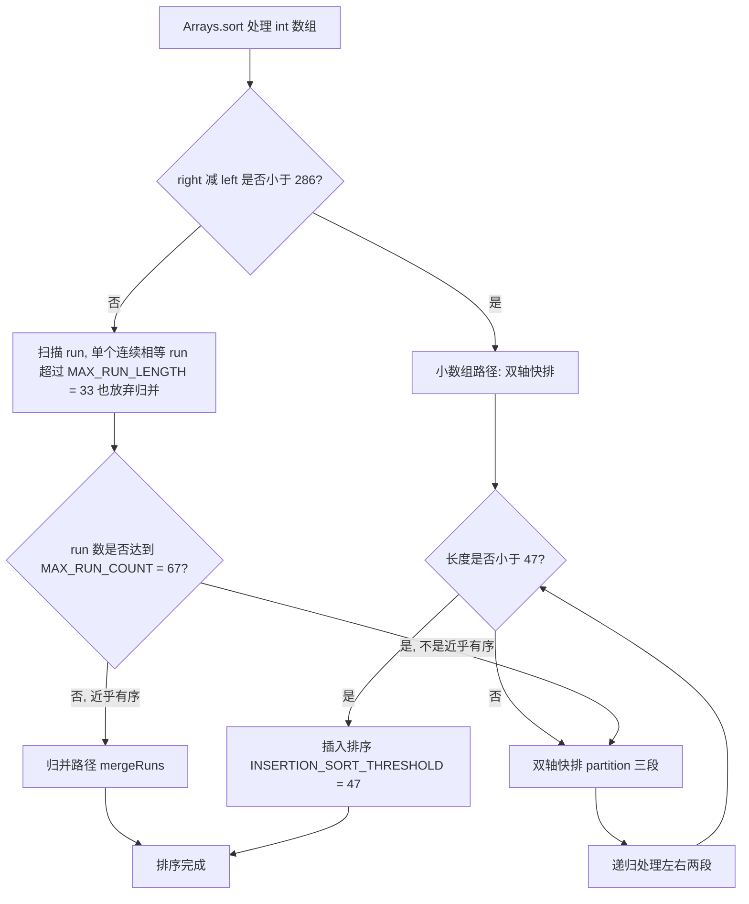

JDK 14 起 `DualPivotQuicksort` 被重写（JDK-8231765）：用更严格的 run 检测（`runLength` 阈值 `MAX_RUN_LENGTH` 之外新增结构化数组归并），对"局部有序"的输入更快。面试若被追问"你们用的 JDK 版本排序行为有差异吗"，答"JDK 14 前后 `DualPivotQuicksort` 的 run 处理逻辑不同，但对大随机数组都是 O(n log n)，基本类型不稳定这一点不变"最稳。

### 1.5 快排的实现要点与优化

Lomuto 划分（单指针，写法简单，交换次数多）与 Hoare 划分（双指针相向，交换次数少）是两种基础写法。工业级实现走三路快排或双轴快排。

```java
// 三路快排核心：把 [lo, hi] 分成 < v、== v、> v 三段，天然处理大量重复元素
// 返回等于区的左右边界，递归只处理左右两段
private static void sort3Way(int[] a, int lo, int hi) {
    if (lo >= hi) return;
    int v = a[lo + (hi - lo) / 2];   // 取中值，避免在有序输入上取到极值
    int lt = lo, i = lo, gt = hi;
    while (i <= gt) {
        if (a[i] < v)      swap(a, lt++, i++);
        else if (a[i] > v) swap(a, i, gt--);
        else               i++;
    }
    sort3Way(a, lo, lt - 1);
    sort3Way(a, gt + 1, hi);
}
```

四个优化点，面试要求能说出"为什么"：

| 优化 | 做法 | 解决的问题 | 代价 |
| --- | --- | --- | --- |
| 随机化 / 三数取中 | `median(a[lo], a[mid], a[hi])` 或随机下标作 pivot | 有序数组退化为 O(n²) 与栈深 O(n) | 多几次比较，可忽略 |
| 小区间插排 | 长度 < 47（JDK 的 `INSERTION_SORT_THRESHOLD`）时插入排序 | 递归到小数组时函数调用开销占比过高 | 无 |
| 三路划分 | 分出 `== pivot` 的整段 | 大量重复元素时经典快排仍退化 O(n²) | 多维护两个指针 |
| 尾递归消除 | 先递归较短的一侧，长的一侧用 while 循环 | 最坏栈深从 O(n) 降到 O(log n) | 无 |

排序最坏情况为什么会打挂线上服务：

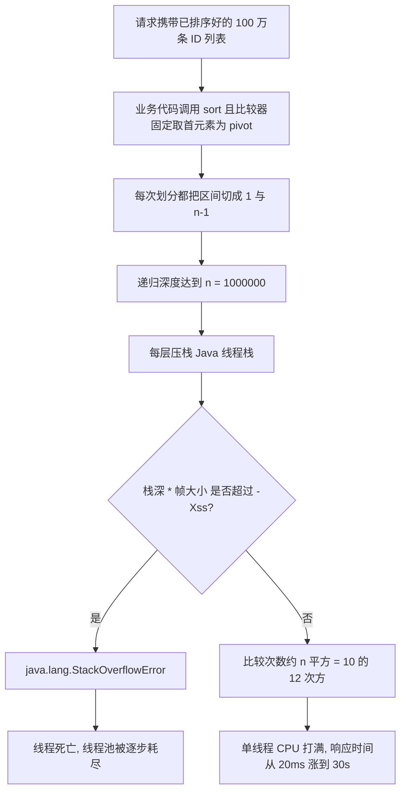

生产定位路径：`top -Hp <pid>` 找高 CPU 线程 → `printf '%x\n' <tid>` 转十六进制 → `jstack <pid> | grep -A 30 'nid=0x<hex>'` 看栈顶是不是排序帧。修复手段很简单：改用 `Arrays.sort`（JDK 已做三数取中 + 双轴），或者根本不要在请求链路里对百万级数据做比较排序——这是设计问题，不是算法问题。

### 1.6 归并的实现要点与优化

```java
// 归并排序：稳定、O(n log n) 上界有保证，JDK 里用于对象数组（TimSort）
// 优化点：小数组切插入排序、merge 前判断 a[mid] <= a[mid+1] 直接跳过、复用 temp 数组
private static void sort(int[] a, int lo, int hi, int[] tmp) {
    if (hi - lo <= 47) { insertionSort(a, lo, hi); return; }
    int mid = lo + ((hi - lo) >>> 1);
    sort(a, lo, mid, tmp);
    sort(a, mid + 1, hi, tmp);
    if (a[mid] <= a[mid + 1]) return;      // 已经整体有序，跳过 merge
    merge(a, lo, mid, hi, tmp);
}
```

归并的两个"只有它能干"的活：

1. **求逆序对**：merge 时右半元素先出队，说明它比左半剩余所有元素都小，逆序对数加上 `mid - i + 1`。复杂度 O(n log n)，比树状数组写法更直观。
2. **链表排序**：链表归并不需要 O(n) 额外空间（只改 next 指针），快排对链表不友好（无法随机访问 pivot）。LeetCode 148 的标准解是快慢指针找中点 + 归并。

一行结论：**要稳定、要上界保证、要外部排序（多路归并），选归并；要常数小、要原地、只排基本类型，选快排。**

## 二、线性结构：数组、链表、栈、队列

### 2.1 数组与 ArrayList

`java.util.ArrayList` 的关键实现（JDK 8）：

| 字段/方法 | 值/行为 |
| --- | --- |
| `DEFAULT_CAPACITY` | 10，注意是 `new ArrayList<>()` 时懒惰初始化，首次 `add` 才分配 |
| `EMPTY_ELEMENTDATA` / `DEFAULTCAPACITY_EMPTY_ELEMENTDATA` | 无参构造共享空数组，用于区分"未指定容量"和"指定容量为 0" |
| `grow(int minCapacity)` | `newCapacity = oldCapacity + (oldCapacity >> 1)`，即 1.5 倍 |
| `MAX_ARRAY_SIZE` | `Integer.MAX_VALUE - 8`，预留 8 个位置给数组对象头，避免 `OutOfMemoryError: Requested array size exceeds VM limit` |
| `System.arraycopy` | 扩容是整块拷贝，复杂度 O(n)，均摊 O(1) |

三个高频细节：

- **1.5 倍而不是 2 倍**：2 倍膨胀更快但仍能均摊 O(1)，选 1.5 倍是为了在"扩容次数"和"内存浪费"之间折中，且 1.5 倍更容易在后续扩容时复用已释放的连续空间（`oldCapacity + oldCapacity/2` 的增长序列在多数分配器下碎片更小）。
- **`ArrayList` 的 `remove(int)` 是 O(n)**：删除中间元素要整体左移。频繁头部删除要用 `ArrayDeque` 或 `LinkedList`。
- **`Arrays.asList` 返回的是 `java.util.Arrays$ArrayList`**，长度固定，`add`/`remove` 抛 `UnsupportedOperationException`；`List.of`（JDK 9 起）完全不可变，连 `set` 都不允许，且不允许 null。

### 2.2 链表

| 维度 | 数组 | 链表（双向 LinkedList） |
| --- | --- | --- |
| 随机访问 | O(1) | O(n) |
| 头部插入/删除 | O(n) | O(1) |
| 尾部插入 | 均摊 O(1) | O(1)（维护 last 指针） |
| 内存开销 | 紧凑，无额外指针 | 每节点多 2 个引用 + 对象头，约 24~40 字节/节点 |
| CPU 缓存友好度 | 高（连续内存，预取生效） | 低（指针跳转，cache miss 高） |
| 扩容 | 需要整块复制 | 无需扩容 |
| 典型 JDK 实现 | `ArrayList`、`ArrayDeque` | `LinkedList`、`LinkedHashMap.Entry` |

实测结论（面试可以直说）：**在 1 万~100 万量级上，`ArrayDeque` 作为队列/栈几乎总是快于 `LinkedList`**，因为 `LinkedList` 每个节点一次 cache miss 的代价远超 `System.arraycopy` 的连续拷贝。JDK 官方注释也建议优先 `ArrayDeque`。

链表题的四个必备模板（详见第七章）：反转（迭代三指针 / 递归）、快慢指针（找中点、判环、找环入口）、合并有序链表、K 个一组反转。判环的数学依据：设环外长度 a、环长 b，快指针走 2 步慢指针走 1 步，相遇时 `2(a + x) = a + x + nb`，得 `a = nb - x`，所以从头结点与相遇点同速出发必在环入口相遇。

### 2.3 栈、队列、双端队列与单调结构

| 结构 | 语义 | JDK 实现 | 关键点 |
| --- | --- | --- | --- |
| 栈 LIFO | 后进先出 | `ArrayDeque#push/pop`（推荐）、`Stack`（遗留，继承 `Vector`，方法全 `synchronized`） | 官方文档明确建议用 `Deque` 替代 `Stack` |
| 队列 FIFO | 先进先出 | `ArrayDeque#offer/poll`、`LinkedList` | `ArrayDeque` 不允许 null（null 被用作空标记） |
| 双端队列 | 两端进出 | `ArrayDeque` | 环形数组，`head`/`tail` 下标，初始容量 16，扩容翻倍 |
| 优先队列 | 按优先级出队 | `PriorityQueue` | 二叉小顶堆，`DEFAULT_INITIAL_CAPACITY = 11`，非线程安全 |
| 阻塞队列 | 队列 + 阻塞/超时 | `ArrayBlockingQueue`、`LinkedBlockingQueue`、`SynchronousQueue`、`DelayQueue` | 线程池的载体，见并发章节 |

`ArrayDeque` 的环形数组扩容细节：`head = (head - 1) & (elements.length - 1)`、`tail = (tail + 1) & (elements.length - 1)`，用位与代替取模，所以容量必须是 2 的幂（`allocateElements` 把请求容量向上取整到 2 的幂）。`doubleCapacity()` 把容量翻倍并保证元素连续。

**单调栈**：栈内元素保持单调（递增或递减），每个元素最多入栈一次、出栈一次，所以 O(n)。适用"下一个更大/更小元素、柱状图最大矩形、接雨水、每日温度"。

```mermaid
flowchart LR
  A["数组 2 1 4 3"] --> B["i=0, v=2: 栈空, 下标 0 入栈"]
  B --> C["i=1, v=1: 1 小于栈顶 2, 不出栈, 下标 1 入栈"]
  C --> D["栈中下标 0 与 1, 对应值为 2 与 1"]
  D --> E["i=2, v=4: 4 大于栈顶 1, 弹出 1, 下标 1 的答案记为 4"]
  E --> F["继续比较 4 大于 2, 弹出 2, 下标 0 的答案记为 4"]
  F --> G["栈空, 下标 2 入栈"]
  G --> H["i=3, v=3: 3 小于 4, 下标 3 入栈"]
  H --> I["遍历结束, 栈内剩 2 与 3, 答案均为 -1"]
  I --> J["结果序列为 4 4 -1 -1"]
```

关键实现（求"下一个更大元素"）：

```java
// 单调递减栈存下标，保证栈内对应的值从栈底到栈顶递减
public int[] nextGreater(int[] nums) {
    int n = nums.length;
    int[] res = new int[n];
    Arrays.fill(res, -1);
    Deque<Integer> stack = new ArrayDeque<>();   // 存下标
    for (int i = 0; i < n; i++) {
        while (!stack.isEmpty() && nums[stack.peek()] < nums[i]) {
            res[stack.pop()] = nums[i];          // 找到了右侧第一个更大值
        }
        stack.push(i);
    }
    return res;
}
```

**单调队列**：典型题"滑动窗口最大值"，用 `ArrayDeque` 存下标，队首始终是窗口内最大值；入队前把队尾所有小于等于当前值的下标弹出。复杂度 O(n)，因为每个下标最多进出一次。

```java
public int[] maxSlidingWindow(int[] nums, int k) {
    int n = nums.length;
    int[] res = new int[n - k + 1];
    Deque<Integer> dq = new ArrayDeque<>();      // 存下标, 对应值单调递减
    for (int i = 0; i < n; i++) {
        while (!dq.isEmpty() && nums[dq.peekLast()] <= nums[i]) dq.pollLast();
        dq.offerLast(i);
        if (dq.peekFirst() <= i - k) dq.pollFirst();   // 队首滑出窗口
        if (i >= k - 1) res[i - k + 1] = nums[dq.peekFirst()];
    }
    return res;
}
```

**栈的工程用途**（高级岗爱问）：函数调用栈（`StackOverflowError` 与 `-Xss`）、表达式求值与括号匹配、JVM 操作数栈、浏览器前进后退、编辑器撤销重做、DFS 的显式栈替代递归、方法调用链的链路追踪（Trace 的 span 栈）。

### 2.4 LRU 缓存的标准实现

`LinkedHashMap` 天生适合做 LRU（JDK 1.4 起）：

- 构造参数 `accessOrder = true` 时，每次 `get`/`put` 命中的节点会被 `afterNodeAccess` 移到双向链表尾（尾部是最近使用）。
- 覆写 `protected boolean removeEldestEntry(Map.Entry<K,V> eldest)`，返回 true 时在 `put` 后驱逐链表头节点，默认实现返回 false。

```java
public class LruCache<K, V> extends LinkedHashMap<K, V> {
    private final int capacity;
    public LruCache(int capacity) {
        super(capacity, 0.75f, true);   // accessOrder = true 是 LRU 的关键开关
        this.capacity = capacity;
    }
    @Override
    protected boolean removeEldestEntry(Map.Entry<K, V> eldest) {
        return size() > capacity;
    }
}
```

手写版本（面试要求 O(1)）：`HashMap<K, Node>` 做定位 + 自定义双向链表（带 `head`/`tail` 哨兵节点）做顺序，`get` 命中后把节点摘下来挂到尾部，`put` 时若超容就删 `head.next`。哨兵节点能把"删头、删尾、删中间"三种情况合并成一套指针操作，少写一半边界判断。并发场景不能用上面这个类（`LinkedHashMap` 非线程安全，`get` 还会修改链表结构），要用 `Collections.synchronizedMap` 或者按 `ConcurrentHashMap` + 分段 LRU 自己实现，参考 Caffeine 的 W-TinyLFU。

LFU 与 LRU 的区别见下表（第八章有完整模板）：

| 维度 | LRU | LFU |
| --- | --- | --- |
| 驱逐依据 | 最近使用时间 | 使用频率（通常再加 LRU 兜底） |
| 数据结构 | HashMap + 双向链表 | 频率桶：`freq -> 双向链表` + `minFreq` 指针 |
| `get`/`put` | O(1) | O(1)（多一个频率迁移） |
| 弱点 | 偶发批量扫描会污染缓存 | 老热点长期霸占（需要衰减机制） |
| 适用 | 通用、访问有局部性 | 热点集中且稳定，如 CDN 静态资源 |

## 三、哈希表与一致性哈希

### 3.1 哈希函数与 JDK 的扰动

`String#hashCode`（JDK 1.0 起未变，规范里写死）：`s[0]*31^(n-1) + s[1]*31^(n-2) + ... + s[n-1]`，用 31 的理由是 `31 * i == (i << 5) - i`，JIT 能优化成移位减法。

`HashMap#hash`（JDK 8）：

```java
static final int hash(Object key) {
    int h;
    return (key == null) ? 0 : (h = key.hashCode()) ^ (h >>> 16);
}
```

`h >>> 16` 把高 16 位异或到低 16 位，原因是**数组下标只取低位**（`(n - 1) & hash`，n 是 2 的幂），若不做扰动，`hashCode` 高位差异全部丢失。JDK 7 的扰动更狠（4 次移位异或），JDK 8 简化成一次，因为实测收益递减而 JDK 8 引入了红黑树兜底。

`HashMap#tableSizeFor`（JDK 8）用位运算把容量向上取整到 2 的幂：先 `int n = cap - 1`（这样传入的容量本身已是 2 的幂时结果不会翻倍），连续 5 次 `n |= n >>> 1/2/4/8/16` 把最高位 1 之后全部填成 1，最后 `(n < 0) ? 1 : (n >= MAXIMUM_CAPACITY) ? MAXIMUM_CAPACITY : n + 1`。

### 3.2 冲突解决与负载因子

| 策略 | 做法 | 代表实现 | 优点 | 缺点 |
| --- | --- | --- | --- | --- |
| 链地址法 | 同槽元素挂链表/红黑树 | HashMap、ConcurrentHashMap、Redis dict | 实现简单，容忍高负载因子 | 链表长时退化 |
| 开放寻址-线性探测 | 冲突就往后逐格找空位 | ThreadLocalMap（步长 1）、Python dict（扰动式探测，同为开放寻址） | 无指针、缓存友好 | 易聚集，删除需墓碑标记 |
| 开放寻址-二次探测 | 步长 i² | 早期实现 | 缓解一次聚集 | 仍有二次聚集 |
| 再哈希法 | 换第二个哈希函数 | 布隆过滤器、布谷鸟哈希（两个哈希函数 + 踢出重定位，不是线性探测） | 减少探测 | 计算开销翻倍 |
| 公共溢出区 | 溢出元素放另一张表 | 少见 | 主表干净 | 空间浪费 |

`HashMap` 的关键默认值（JDK 8）：

| 常量 | 值 | 说明 |
| --- | --- | --- |
| `DEFAULT_INITIAL_CAPACITY` | `1 << 4` = 16 | 首次 put 时才分配（JDK 8 起懒初始化） |
| `MAXIMUM_CAPACITY` | `1 << 30` | 约 10.7 亿，再大也必须是 2 的幂 |
| `DEFAULT_LOAD_FACTOR` | 0.75 | 空间与冲突概率的折中 |
| `TREEIFY_THRESHOLD` | 8 | 往**已有 8 个节点**的桶里再插入时才调 `treeifyBin`（判据 `binCount >= TREEIFY_THRESHOLD - 1`，`binCount` 不含桶首节点，所以插入后链表长度为 9 才树化） |
| `UNTREEIFY_THRESHOLD` | 6 | 树节点数回落到 6 退化成链表 |
| `MIN_TREEIFY_CAPACITY` | 64 | 表容量小于 64 时优先 `resize()` 而不是树化 |

为什么是 0.75：官方注释给了泊松分布依据——在理想随机哈希下，一个桶中元素个数服从参数 λ = 0.5 的泊松分布，恰好 8 个元素的概率约 0.00000006（6e-8），树化几乎不会发生，所以链表长度 8 只是"兜底阈值"。0.75 则在"桶占用率"和"resize 频率"之间取平衡（0.5 浪费一半空间，1.0 冲突陡增）。

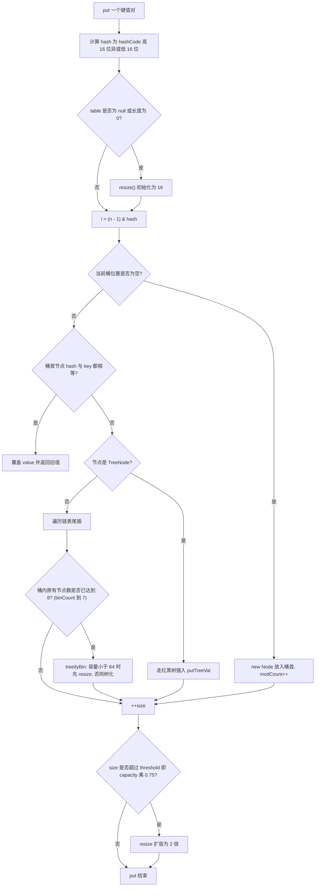

`resize()` 在 JDK 8 的巧妙之处：容量翻倍后，元素要么留在原下标 `i`，要么搬到 `i + oldCap`，判断依据只有一位——`(e.hash & oldCap) == 0`。所以不需要像 JDK 7 那样对每个元素重新计算 `indexFor`，直接拆成 lo、hi 两条链挂到 `newTab[j]` 和 `newTab[j + oldCap]`，并保持相对顺序（JDK 8 用尾插，避免 JDK 7 头插在并发扩容下形成环导致 `get` 死循环、CPU 100%）。

并发下 `HashMap` 还会**丢数据**：两个线程同时 `put` 到同一个空桶，后写的覆盖先写的；`++size` 不是原子操作。所以正确结论是"JDK 8 不会成环，但会丢数据、`size` 不准，依然不能用"。

### 3.3 通用哈希表的工程权衡

| 维度 | 链地址法（HashMap） | 开放寻址（ThreadLocalMap） |
| --- | --- | --- |
| 负载因子容忍度 | 可到 0.75 甚至更高 | 一般不超过 0.5~0.67（否则探测链暴涨） |
| 删除操作 | 直接摘链 | 需要清理或墓碑标记 `staleSlot`，否则会截断探测链 |
| 内存局部性 | 差（节点分散在堆上） | 好（Entry 数组连续） |
| 迭代顺序 | 与插入顺序无关（JDK 8 扩容后顺序会变） | 底层数组顺序 |
| 扩容代价 | 需要重建链表/树 | 全量 rehash |

`ThreadLocalMap`（`java.lang.ThreadLocal` 内部类）是开放寻址 + 线性探测的典型：`INITIAL_CAPACITY = 16`，容量 `len` 对应 `threshold = len * 2 / 3`，`sz >= threshold` 时 `rehash()`，`Entry extends WeakReference<ThreadLocal<?>>` 让 key 在无强引用时可被回收，value 只能靠 `expungeStaleEntry` 在后续操作时清理——这就是"线程池里 `ThreadLocal` 不 `remove` 会内存泄漏"的根因。

### 3.4 一致性哈希

**取模哈希的失效模式**：`node = hash(key) % N`，N 从 3 变 4 时，理论上约 75% 的 key 会映射到不同节点。缓存系统里这等于"节点扩一个，缓存雪崩一次"。一致性哈希把节点和 key 都映射到 `[0, 2^32 - 1]` 的环上，key 顺时针找到的第一个节点即归属；加节点只影响该节点逆时针到前一个节点之间的区间，平均只有 1/N 的 key 需要迁移。

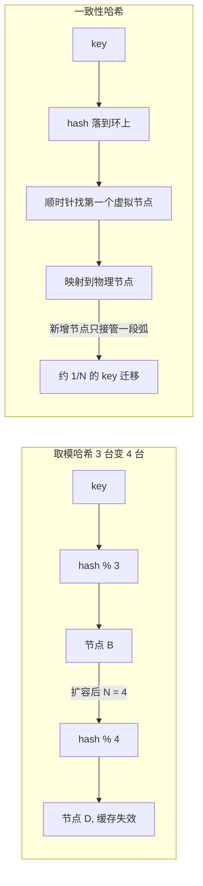

两个必须说的工程细节：

1. **数据倾斜与虚拟节点**：物理节点少时在环上分布不均，可能出现某节点承担 70% 流量。解法是每个物理节点生成 150~200 个虚拟节点（`hash(nodeName + "#" + i)`），把环切细。这个数字是 Redis Cluster / Nginx 一致哈希模块的常见实践区间，谈"通常取 100~200"即可。
2. **一致性哈希不解决"热点 key"**：如果某个 key 本身访问量极高，无论哈希多均匀，它都只落在一个节点上，需要本地缓存、key 拆分（`key#0..key#9`）、或者读写分离来缓解。

Redis 的选择值得强调：**Redis Cluster 用的是 16384 个哈希槽（hash slot）而不是一致性哈希**，`slot = CRC16(key) % 16384`。原因（作者 antirez 在官方文档解释过）：槽位固定便于用位图（16384 bit = 2KB）维护节点与槽的映射并高效做 gossip 传播；槽数量远大于节点数时，扩缩容只需迁移槽，粒度可控；且 CRC16 计算比一致性哈希的环查找更快。`CLUSTER COUNTKEYSINSLOT`、`CLUSTER GETKEYSINSLOT` 可查看槽归属。

## 四、树

### 4.1 二叉树遍历

| 遍历 | 顺序 | 递归 | 迭代 | 用途 |
| --- | --- | --- | --- | --- |
| 前序 Preorder | 根 → 左 → 右 | 简单 | 显式栈（先压右再压左） | 序列化/反序列化、复制树、打印目录 |
| 中序 Inorder | 左 → 根 → 右 | 简单 | 一路压左子节点再弹栈 | BST 得到有序序列、验证 BST、第 K 小 |
| 后序 Postorder | 左 → 右 → 根 | 简单 | 双栈或"根右左"翻转 | 释放资源、计算子树聚合值（树形 DP） |
| 层序 Level | 逐层 | 递归需带深度 | `ArrayDeque` 做 BFS | 最短路径层数、右视图、按层聚合 |

**Morris 遍历**（O(1) 空间、O(n) 时间）：利用叶子节点的空右指针建立"线索"指回中序后继，遍历后还原。面试若被问"不用栈不用递归怎么中序遍历"，答 Morris，并说清"代价是遍历过程中会临时改树结构，多线程场景不安全"。

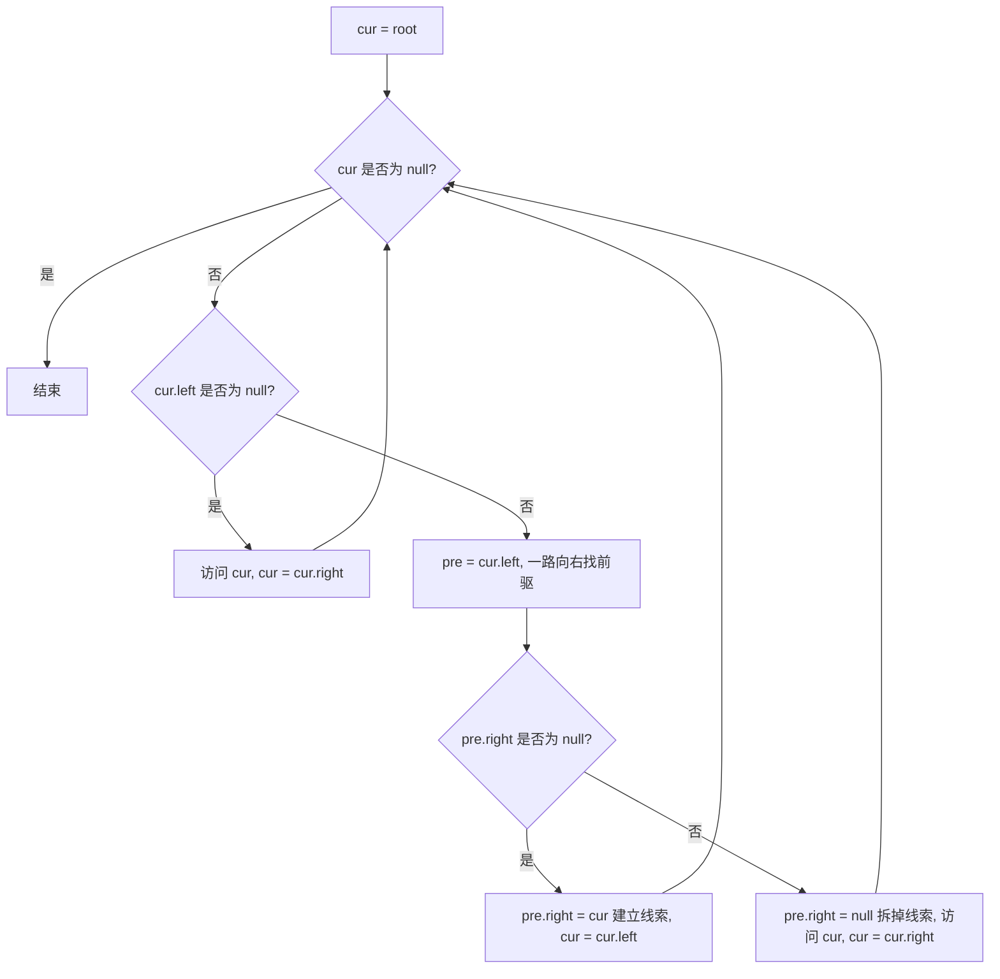

### 4.2 二叉搜索树与平衡树

BST 性质：左子树所有值 < 根 < 右子树所有值。查找/插入/删除平均 O(log n)，但**退化成链表时是 O(n)**（按升序插入 1,2,3,...,n 就会退化成右斜链）。工程上不能容忍这种最坏情况，于是有了自平衡树。

| 维度 | AVL 树 | 红黑树 | 跳表 SkipList |
| --- | --- | --- | --- |
| 平衡条件 | 任意节点左右子树高度差 <= 1（严格） | 最长路径 <= 2 * 最短路径（近似） | 概率平衡，层数期望 O(log n) |
| 树高上界 | 约 1.44 log₂(n+2) | 约 2 log₂(n+1) | 期望 O(log n)，最坏 O(n) |
| 查找性能 | 略优（树更矮） | 略差（树略高） | 接近红黑树 |
| 插入旋转 | 最多 2 次（含双旋） | 最多 2 次旋转 + 变色 | 无需旋转，改指针 + 随机层数 |
| 删除旋转 | 可能 O(log n) 次 | 最多 3 次旋转 | 改指针 |
| 实现复杂度 | 中 | 高（`fixAfterInsertion`/`fixAfterDeletion`） | 中 |
| 代表 | 早期 Java 集合、部分数据库内存索引 | `TreeMap`、`TreeSet`、`HashMap` 桶、Linux CFS、epoll | Redis `zset`、`LevelDB` MemTable |
| 适用 | 读远多于写、查询极频繁 | 读写混合、要求最坏可控 | 并发写多、实现简单、范围查询友好 |

**红黑树五条性质**（必须能背）：

1. 每个节点是红色或黑色。
2. 根节点是黑色。
3. 每个叶子节点（NIL 空节点）是黑色。
4. 红色节点的两个子节点必须是黑色（即不存在两个连续的红节点）。
5. 从任一节点出发到其所有后代 NIL 叶子的路径上，黑节点数目相同（黑高相同）。

由 4、5 可推出"最长路径不超过最短路径的两倍"，这就是 O(log n) 的来源。插入的新节点默认染红（染黑必然破坏性质 5），再按父节点颜色分情况修复：

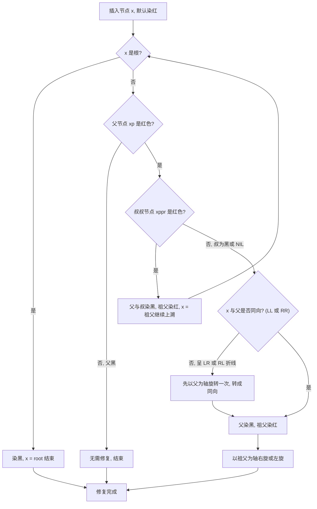

删除比插入复杂，因为删黑节点会破坏性质 5，需要引入"双重黑"并借助兄弟节点的颜色与子节点颜色分四种情况处理，最多 3 次旋转。`TreeMap#deleteEntry` + `fixAfterDeletion` 就是这套逻辑。

**`TreeMap` 的工程要点**：`put`/`get`/`remove`/`ceilingKey`/`floorKey`/`subMap` 全部 O(log n)；`NavigableMap` 接口支持范围查询，这是 `HashMap` 做不到的；自然排序下不允许 `null` key（会 `NullPointerException`，因为要调用 `compareTo`），但允许 `null` value；非线程安全，并发场景用 `ConcurrentSkipListMap`（跳表，`size()` 是 O(n) 估算，但并发插入不阻塞）。

### 4.3 B 树、B+ 树与磁盘友好性

| 维度 | 平衡二叉树（红黑树/AVL） | B 树 | B+ 树 |
| --- | --- | --- | --- |
| 一个节点存多少 key | 1 个 | 多个（与阶数 m 有关） | 多个 |
| 数据存放位置 | 所有节点 | 所有节点（含内部节点） | 只在叶子节点 |
| 树高（100 万数据） | 约 20 层 | 约 3~4 层 | 约 3~4 层 |
| 一次磁盘 IO 读多少 | 通常 1 个节点，利用率低 | 一整个页（16KB） | 一整个页（16KB） |
| 范围查询 | 需要中序遍历回溯 | 需要中序遍历回溯 | 叶子链表顺序扫描，最优 |
| 典型用途 | 内存索引 | MongoDB 索引（WiredTiger 实际用 B+ 树变体）、文件系统 | MySQL InnoDB、Oracle、PostgreSQL |

核心数字推导（面试高频）：InnoDB 页大小 `innodb_page_size` 默认 **16KB**。假设主键是 `BIGINT`（8 字节），InnoDB 的页指针 6 字节，加上记录头等开销约 13~16 字节一条非叶子记录，则一个非叶子页可放约 `16384 / 16 ≈ 1024` 个指针。三层 B+ 树可索引 `1024 × 1024 × 16 ≈ 1600 万`行（叶子页按每页 16 条记录粗算）。这意味着**查任意一行最多 3 次磁盘 IO**，前两层常驻 Buffer Pool 时实际只有 1 次。这是"为什么 MySQL 不用红黑树"的标准答案：20 层树高意味着 20 次随机 IO，机械盘上是 20 × 10ms = 200ms。

B+ 树的顺序索引也解释了聚簇索引与二级索引的差异：InnoDB 聚簇索引叶子存整行数据，二级索引叶子存主键值，因此二级索引查非索引列要"回表"；覆盖索引（查询列全在索引里）可以避免回表。

### 4.4 堆与优先队列

堆是完全二叉树，用数组存储（下标从 0 开始）：

- 父节点：`(i - 1) >>> 1`
- 左子：`2 * i + 1`
- 右子：`2 * i + 2`

`PriorityQueue`（JDK 8）关键实现：

| 项 | 值/行为 |
| --- | --- |
| `DEFAULT_INITIAL_CAPACITY` | 11 |
| 扩容 | `newCapacity = oldCapacity + ((oldCapacity < 64) ? (oldCapacity + 2) : (oldCapacity >> 1))` |
| 上浮 | `siftUpComparable` / `siftUpUsingComparator` |
| 下沉 | `siftDownComparable` / `siftDownUsingComparator` |
| 建堆 | `heapify()` 从 `(size >>> 1) - 1` 开始向前下滤，复杂度 **O(n)** 而不是 O(n log n) |
| 线程安全 | 否；并发用 `PriorityBlockingQueue`（无界，内部 `ReentrantLock`） |
| 迭代顺序 | `iterator()` 不保证有序，只有 `poll()` 才逐个弹出有序 |

建堆 O(n) 的证明思路：大多数节点在底层，下滤距离短；总代价 Σ (n / 2^(h+1)) · h 收敛到 O(n)。

堆的三个高频用途：TopK（求最大 K 个用小顶堆，堆大小 K，遍历 n 个元素 O(n log K)）、合并 K 个有序链表（堆里放 K 个链表头）、数据流中位数（双堆：大顶堆存较小一半，小顶堆存较大一半，插入 O(log n)，取中位数 O(1)）。

### 4.5 Trie 与前缀结构

`Trie`（前缀树 / 字典树）：每个节点对应一个字符，从根到某节点的路径构成一个前缀，节点上的 `isEnd` 标记是否有词在此结束。

```java
class TrieNode {
    TrieNode[] children = new TrieNode[26];   // 只含小写字母时；字符集大则用 Map<Character, TrieNode>
    boolean isEnd;
}
```

| 操作 | 复杂度 | 说明 |
| --- | --- | --- |
| 插入 | O(L) | L 为词长，与词表规模无关 |
| 精确查找 | O(L) | 走到 `isEnd == true` |
| 前缀查找 | O(L) | 不需要 `isEnd` |
| 空间 | O(总字符数 × 字符集) | 26 叉数组很浪费，可用双数组 Trie 或压缩 Trie（Radix Tree）优化 |

工程用途：搜索框自动补全与联想词、输入法词库、IP 路由表的最长前缀匹配（Linux 的 FIB 用 LC-trie）、敏感词过滤（Trie + 失败指针 = AC 自动机，O(n) 扫描文本）。AC 自动机就是在 Trie 上加 `fail` 指针，`fail` 指向"当前前缀的最长真后缀对应的节点"，构建用 BFS，匹配时沿 `fail` 跳转避免回溯。

## 五、图

### 5.1 存储方式

| 存储 | 空间 | 判断 (u,v) 有边 | 遍历邻居 | 适用 |
| --- | --- | --- | --- | --- |
| 邻接矩阵 | O(V²) | O(1) | O(V) | 稠密图，V 小（如 Floyd 求解全源最短路） |
| 邻接表 | O(V + E) | O(degree) | O(degree) | 稀疏图，绝大多数工程场景 |
| 边集数组 | O(E) | O(E) | 不便 | Kruskal 算法、Bellman-Ford |
| 链式前向星 | O(V + E) | O(degree) | O(degree) | 竞赛常用，数组模拟链表，常数小 |

关系型数据库里的"好友关系""组织架构""知识图谱"都是稀疏图，邻接表（`Map<Long, List<Long>>`）是标准选择。千万级边时用邻接表 + 数组代替 `HashMap` 可省下大量内存。

### 5.2 DFS 与 BFS

| 维度 | DFS | BFS |
| --- | --- | --- |
| 实现 | 递归或显式栈 | `ArrayDeque` 队列 |
| 空间 | O(h)，h 为深度；最坏 O(V) | O(w)，w 为最大层宽；最坏 O(V) |
| 能否求最短路 | 无权图不能（不保证首次到达最短） | **能**，无权图首次到达即最短 |
| 典型题 | 岛屿数量、路径存在性、连通分量、拓扑排序（后序逆序） | 层序、单词接龙、走迷宫最短路、多源 BFS |
| 风险 | 深度大时 `StackOverflowError`（可用 `-Xss` 调大或改迭代） | 层宽大时队列内存暴涨 |

DFS 的非递归写法要不就是"入栈时标记访问"，要不就是"出栈时标记"（后者会重复入栈）。面试写迭代版要特别注意标记时机，否则会写出指数级重复的代码。

### 5.3 拓扑排序

应用：编译依赖、Maven/Gradle 构建顺序、Spring Bean 依赖注入顺序、任务调度 DAG、循环依赖检测。

两种实现：

1. **Kahn 算法（BFS + 入度）**：统计所有节点入度，入度为 0 的入队；出队时把邻居入度减 1，减到 0 就入队；最终输出节点数 < V 说明**存在环**（即循环依赖）。
2. **DFS 后序逆序**：DFS 完成时把节点压栈，最后依次弹出；同时用"灰色标记"检测环（访问到灰色节点说明有环）。

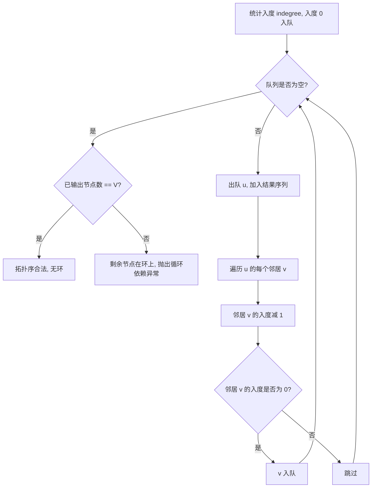

Spring 的循环依赖：单例的 setter/字段注入靠三级缓存（`singletonObjects`、`earlySingletonObjects`、`singletonFactories`）提前暴露引用绕过；构造器注入形成的环无法绕过，直接抛 `BeanCurrentlyInCreationException`。这等价于拓扑排序发现环。

### 5.4 并查集

两个优化缺一不可：

- **路径压缩**：`find` 时把路径上所有节点直接挂到根上，`parent[x] = find(parent[x])`。
- **按秩/按大小合并**：`union` 时把浅树挂到深树下，`rank` 小的接到 `rank` 大的上。

```java
class DSU {
    int[] parent, rank;
    DSU(int n) {
        parent = new int[n];
        rank = new int[n];
        for (int i = 0; i < n; i++) parent[i] = i;   // 初始化自己是自己的父节点
    }
    int find(int x) {
        while (parent[x] != x) {          // 迭代式路径压缩, 避免递归深度问题
            parent[x] = parent[parent[x]]; // 路径减半
            x = parent[x];
        }
        return x;
    }
    boolean union(int a, int b) {
        int ra = find(a), rb = find(b);
        if (ra == rb) return false;       // 已在同一集合, 说明这条边会成环
        if (rank[ra] < rank[rb]) { int t = ra; ra = rb; rb = t; }
        parent[rb] = ra;
        if (rank[ra] == rank[rb]) rank[ra]++;
        return true;
    }
}
```

复杂度：只用路径压缩是 O(log n) 均摊；路径压缩 + 按秩合并是 **O(α(n))**，α 是阿克曼函数的反函数，n 在 10^80 以内 α(n) 都不超过 4，所以可以视作常数。

`DSU` 的经典用途：Kruskal 求 MST、判断无向图环（`union` 返回 false 即成环）、朋友圈/岛屿合并、账号去重（把同手机号/同邮箱的账号 merge）、网络延迟时间。

### 5.5 最短路径

| 算法 | 适用 | 复杂度 | 负权 | 负环 | 思想 |
| --- | --- | --- | --- | --- | --- |
| BFS | 无权图单源 | O(V + E) | 不适用 | 不适用 | 层数即距离 |
| Dijkstra（朴素） | 非负权单源 | O(V²) | 不允许 | 不适用 | 每次取未访问中 dist 最小者 |
| Dijkstra（堆优化） | 非负权单源 | O((V + E) log V) | 不允许 | 不适用 | `PriorityQueue` 替代线性找最小 |
| Bellman-Ford | 单源，可负权 | O(V · E) | 允许 | 可检测（第 V 次仍能松弛） | 对所有边松弛 V-1 轮 |
| SPFA | 单源，可负权 | 平均 O(kE)，最坏 O(VE) | 允许 | 可检测（入队 > V-1 次） | 队列优化 Bellman-Ford |
| Floyd-Warshall | 全源 | O(V³) 时间、O(V²) 空间 | 允许 | 可检测（`d[i][i] < 0`） | 区间 DP：`d[i][j] = min(d[i][j], d[i][k] + d[k][j])` |

Dijkstra 状态图（堆优化版）：

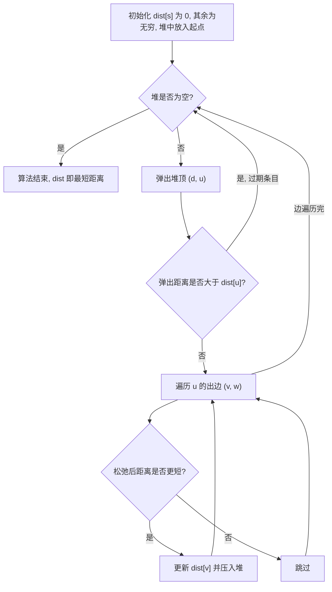

关键点：Dijkstra 因为"已确定的最短距离不会再被更短路径更新"而要求边权非负；有负权必须换 Bellman-Ford 或 SPFA。Floyd 的核心三重循环**必须把 k 放最外层**，否则状态转移不成立（这是最高频的现场纠错点）。

工程对应：RIP 用距离向量（Bellman-Ford 思想），OSPF 用 Dijkstra（链路状态），地图导航在非负权 DAG 上用 Dijkstra 的变体（A*、双向 Dijkstra、Contraction Hierarchies）。车载导航的图有几十亿节点，靠的是分层收缩预处理，不是裸 Dijkstra。

### 5.6 最小生成树

| 算法 | 复杂度 | 数据结构 | 适用 | 关键步骤 |
| --- | --- | --- | --- | --- |
| Kruskal | O(E log E) | 并查集 + 边排序 | 稀疏图 | 边按权重升序，能合并不成环就选，选够 V-1 条停 |
| Prim（朴素） | O(V²) | 距离数组 | 稠密图 | 每次选距离生成树最近的未访问点加入 |
| Prim（堆优化） | O(E log V) | `PriorityQueue` | 稀疏图 | 同上，用堆找最近点 |

MST 的两个性质：**切分定理**（最小横切边一定属于某棵 MST）与**环性质**（环上权重**严格**最大的边一定不在任何 MST 中；存在等权边时只能说"存在不含它的 MST"）。Kruskal 的"加边不成环"依据的是环性质（也有基于切分定理的证明），Prim 每次选最小横切边，依据切分定理。若边权全不同，MST 唯一。

## 六、高级算法思想

### 6.1 二分查找与边界

`java.util.Arrays#binarySearch` 的契约（必须记住）：数组必须已排序；找到返回下标（多个相等元素时**不保证返回哪一个**）；找不到返回 `-(insertion point) - 1`，所以真实插入位置是 `-(ret + 1)`。

手写模板（左闭右开 `[lo, hi)` 是最好用的形态）：

```java
// 查找第一个 >= target 的位置 (lower_bound)
int lowerBound(int[] a, int target) {
    int lo = 0, hi = a.length;          // 区间 [lo, hi)
    while (lo < hi) {
        int mid = lo + ((hi - lo) >>> 1);   // 防溢出, 等价于 (lo + hi) / 2
        if (a[mid] < target) lo = mid + 1;
        else hi = mid;
    }
    return lo;                          // lo 即第一个 >= target 的下标, 可能等于 a.length
}
```

四个致命的边界坑：

1. **中点溢出**：`(lo + hi) / 2` 在 lo、hi 都接近 `Integer.MAX_VALUE` 时溢出为负；必须写 `lo + (hi - lo) / 2`。JDK 的 `binarySearch` 用的是 `(low + high) >>> 1`，同样规避了溢出。
2. **死循环**：`while (lo <= hi)` 配 `lo = mid` 会死循环（当 `hi = lo + 1` 时 mid 恒等于 lo）；要么用 `lo < hi` 配 `hi = mid`，要么保证收缩。
3. **二分的适用前提**：待查区间有单调性/二段性（"左半满足、右半不满足"），不一定是"数组有序"。很多"二分答案"题（如求最小可行容量）数组本身无序，二分的对象是答案空间。
4. **浮点二分**：用固定迭代次数（如 100 次）而不是 `while (hi - lo > 1e-6)`，避免精度死循环。

二分答案的三要素：**答案的上下界、`check(mid)` 的单调性、返回的是最小可行还是最大可行**。

### 6.2 双指针与滑动窗口

双指针的三种形态：**对撞指针**（有序数组两数之和、容器接水）、**快慢指针**（去重、判环、找中点）、**同向快慢 + 窗口**（滑动窗口）。

滑动窗口万能模板（求"最长/最短满足条件的子数组"）：

```java
int left = 0;
for (int right = 0; right < n; right++) {
    // 1. 右边界扩张, 把 a[right] 加入窗口
    add(a[right]);
    // 2. 窗口不合法时收缩左边界
    while (!valid()) {
        remove(a[left]);
        left++;
    }
    // 3. 此时窗口合法, 更新答案
    ans = Math.max(ans, right - left + 1);
}
```

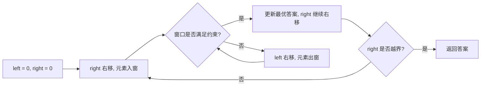

复杂度分析：`left` 和 `right` 各最多移动 n 次，所以是 O(n)。前提是"窗口约束具有单调性"——右边界扩张使约束变紧、左边界收缩使其变松。**遇到数组含负数的"和 >= target 的最短子数组"，滑动窗口失效**，必须用前缀和 + 单调队列，这是高频陷阱。

### 6.3 前缀和与差分

一维前缀和：`pre[i] = pre[i-1] + a[i-1]`（长度 n+1，`pre[0] = 0`），`sum(l, r) = pre[r+1] - pre[l]`。

二维前缀和（图片/矩阵区域和）：

```java
// sum = pre[x2+1][y2+1] - pre[x1][y2+1] - pre[x2+1][y1] + pre[x1][y1]
```

差分（区间加、单点查）：区间 `[l, r]` 全体加 v → `diff[l] += v; diff[r+1] -= v;`，最后做一次前缀和还原。差分把 O(n) 的区间更新降到 O(1)，适合"多次区间加、最后一次整体求值"。二维差分用于矩形区域加。

前缀和 + 哈希表的经典组合："求和为 K 的最长子数组"（数组含负数）——遍历时记录 `pre[i]` 首次出现的下标，若 `pre[i] - K` 出现过就得到一个候选长度。**注意是"首次出现"**：要最长，所以只记第一次，不能覆盖。

### 6.4 回溯与剪枝

回溯模板（子集/排列/组合）：

```java
void backtrack(int start, List<Integer> path) {
    if (满足结束条件) { res.add(new ArrayList<>(path)); return; }   // 必须拷贝, 否则后续修改会影响结果
    for (int i = start; i < n; i++) {
        if (!isValid(i)) continue;          // 剪枝
        path.add(a[i]);
        backtrack(i + 1, path);             // 组合/子集用 i + 1; 排列用 0 且配合 used 数组
        path.remove(path.size() - 1);       // 撤销选择
    }
}
```

四类剪枝手段：

| 剪枝 | 做法 | 例子 |
| --- | --- | --- |
| 可行性剪枝 | 当前路径已不可能到达合法解 | N 皇后：同列/同对角线直接跳过 |
| 最优性剪枝 | 当前代价已超过已知最优 | 旅行商问题：`cost >= best` 直接返回 |
| 排序去重剪枝 | 排序后跳过同层重复元素 | 组合总和 II：`i > start && a[i] == a[i-1]` 跳过 |
| 记忆化剪枝 | 相同状态已经算过 | 状态压缩 DP、`memo` 数组 |

### 6.5 贪心、分治

**贪心**：每步取局部最优，且能证明全局最优。证明手段是"交换论证"或"拟阵"。典型可贪心：区间调度（按右端点升序排）、跳跃游戏、分发饼干、无重叠区间、哈夫曼编码。**0-1 背包不能贪心**（按单位价值排序会得到次优解），但分数背包可以——这是最经典的反例对照。

**分治**：分解 → 解决 → 合并。应用：归并排序、快速排序、快选（QuickSelect）、大整数乘法（Karatsuba，O(n^1.585)）、最近点对、`ForkJoinPool` 的 `RecursiveTask`。分治能并行的原因就是子问题独立；`Arrays.parallelSort` 与 `ForkJoin` 的计算流框架都建立在这个前提上。

### 6.6 动态规划

DP 的解题四步：**定义状态 → 写转移方程 → 确定初始化与边界 → 确定遍历顺序（保证依赖先算）**。

分类与代表题：

| 类型 | 状态定义 | 代表题 | 关键点 |
| --- | --- | --- | --- |
| 线性 DP | `dp[i]` 前 i 个的最优值 | 爬楼梯、打家劫舍、LIS | LIS 有 O(n²) 与 O(n log n)（贪心 + 二分）两解 |
| 区间 DP | `dp[i][j]` 区间 [i,j] 的最优值 | 最长回文子序列、石子合并、戳气球 | 按区间长度从小到大枚举 |
| 背包 DP | `dp[i][j]` 前 i 个物品容量 j | 0-1 背包、完全背包、零钱兑换 | 0-1 倒序遍历容量，完全背包正序遍历 |
| 序列 DP | 双序列下标 | LCS、编辑距离 | `dp[i][j]` 对应 `s1[0..i-1]` 与 `s2[0..j-1]` |
| 树形 DP | 以节点 u 为根的子树 | 打家劫舍 III、二叉树最大路径和、树的直径 | 后序遍历，返回多个维度的值 |
| 状态压缩 DP | 二进制 mask 表示集合 | 旅行商、状压铺砖、`dp[mask][i]` | 枚举子集 `for (s = mask; s > 0; s = (s - 1) & mask)` |
| 数位 DP | `dp[pos][state]` 逐位决策 | 统计不含连续 1 的数的个数 | 记忆化 + 是否贴上界 `limit` |
| 概率 DP | 期望值 | 抛硬币、掷骰子 | 期望的线性性质，逆推更常见 |

背包的两个致命细节：

```java
// 0-1 背包: 一维数组必须倒序, 保证每个物品只用一次
for (int i = 0; i < n; i++)
    for (int j = W; j >= w[i]; j--)          // 倒序
        dp[j] = Math.max(dp[j], dp[j - w[i]] + v[i]);

// 完全背包: 正序, 允许同一物品重复使用
for (int i = 0; i < n; i++)
    for (int j = w[i]; j <= W; j++)          // 正序
        dp[j] = Math.max(dp[j], dp[j - w[i]] + v[i]);
```

为什么倒序：`dp[j - w[i]]` 若已被本轮更新过（正序），就等于用了两次物品 i。组合数 vs 排列数的区别也在于此——外层物品、内层容量得组合数（零钱兑换 II），外层容量、内层物品得排列数（组合总和 IV）。

股票系列统一成状态机 DP（`stateDiagram-v2` 解释买卖与冷冻期）：

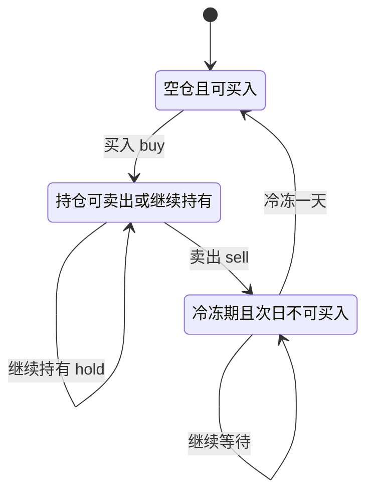

状态定义统一为 `dp[i][k][0/1]`：第 i 天、最多交易 k 次、是否持股的最大收益。转移：

- `dp[i][k][0] = max(dp[i-1][k][0], dp[i-1][k][1] + prices[i])`
- `dp[i][k][1] = max(dp[i-1][k][1], dp[i-1][k-1][0] - prices[i])`

含冷冻期只需把买入的来源改成 `dp[i-2][k][0]`；含手续费把卖出时减 `fee`。这正是"状态设计决定一切"的范例：6 道股票题只差一个状态维度。

### 6.7 位运算技巧

| 技巧 | 表达式 | 说明 |
| --- | --- | --- |
| 取最低位的 1 | `x & -x` | 树状数组 lowbit；`-x` 即 `~x + 1`（补码） |
| 消掉最低位的 1 | `x & (x - 1)` | 统计 1 的个数（Brian Kernighan）、判断 2 的幂 |
| 判断 2 的幂 | `x > 0 && (x & (x - 1)) == 0` | 2 的幂的二进制只有一个 1 |
| 交换两数 | `a ^= b; b ^= a; a ^= b;` | 面试可写，工程不写（可读性差） |
| 判断奇偶 | `(x & 1) == 1` | 比 `% 2` 快，但对负数 `%` 结果为 -1，注意 |
| 取平均（防溢出） | `(a & b) + ((a ^ b) >> 1)` | 或直接 `a + (b - a) / 2` |
| 枚举子集 | `for (int s = m; s > 0; s = (s - 1) & m)` | 状压 DP 遍历 mask 的所有子集，总复杂度 O(3^n) |
| 统计 1 的个数 | `Integer.bitCount(x)` | JDK 内置，底层用 SWAR 并行计数 |
| 最高位 1 的位置 | `31 - Integer.numberOfLeadingZeros(x)` | `HashMap#tableSizeFor` 没调它，用的是 `n \|= n >>> 1/2/4/8/16` 的移位写法 |

`HashMap` 用位运算替代取模（`(n - 1) & hash`）的前提是 n 为 2 的幂，这也解释了为什么 `tableSizeFor` 一定要向上取整到 2 的幂，以及为什么 `ArrayDeque` 的容量必须是 2 的幂。

## 七、高频算法题清单与解题模板

### 7.1 链表

```java
// 迭代反转: 三指针, 时间 O(n), 空间 O(1)
public ListNode reverse(ListNode head) {
    ListNode prev = null, cur = head;
    while (cur != null) {
        ListNode next = cur.next;
        cur.next = prev;
        prev = cur;
        cur = next;
    }
    return prev;
}

// 快慢指针: 找中点、判环、找环入口
public ListNode detectCycle(ListNode head) {
    ListNode slow = head, fast = head;
    while (fast != null && fast.next != null) {
        slow = slow.next;
        fast = fast.next.next;
        if (slow == fast) {                 // 相遇说明有环
            ListNode p = head;
            while (p != slow) { p = p.next; slow = slow.next; }   // 同速走必在入口相遇
            return p;
        }
    }
    return null;
}
```

| 题目类型 | 模板要点 |
| --- | --- |
| 反转链表 II（区间反转） | 加 `dummy` 哨兵，定位到 `left-1` 节点，头插法反转 `right-left+1` 个节点 |
| K 个一组反转 | 先数够不够 k 个，再翻转，递归处理剩余；不足 k 个保持原样 |
| 合并两个有序链表 | `dummy` + 尾指针，遍历时取小的接上，最后接剩余部分 |
| 相交链表 | 双指针各走 a+b，走到 null 就换到另一条头，最终相遇于交点 |
| 回文链表 | 快慢指针找中点 + 反转后半 + 逐一比较（可再反转恢复） |
| 排序链表 | 快慢指针找中点 + 归并（链表归并不需额外数组空间） |

### 7.2 LRU 与 LFU

LRU 的手写 O(1) 结构就是"`HashMap` + 双向链表 + 哨兵"，第 2.4 节已给思路。LFU 的 O(1) 实现：

- `Map<Integer, Node> keyMap`：key 到节点。
- `Map<Integer, DoublyLinkedList> freqMap`：频率到"该频率的双向链表"，链表内部按最近使用排序。
- `int minFreq`：当前最小频率，用于 O(1) 找到待淘汰链表。
- `get(key)`：频率 +1，从旧链表摘下插入 `freq + 1` 链表头，若旧链表空了且 `minFreq == 旧频率` 则 `minFreq++`。
- `put(key, value)`：存在则更新值并 `get` 逻辑；不存在则新建频率 1 的节点；若超容则淘汰 `freqMap.get(minFreq)` 的尾节点；新节点插入后 `minFreq = 1`。

`LinkedHashSet`（JDK 1.4 起）也可用于 LFU 里的"同频率集合"：它基于 `LinkedHashMap`，能 O(1) 拿到迭代顺序的第一个元素，省去自己写双向链表。

### 7.3 TopK

| 方案 | 时间 | 空间 | 适用 |
| --- | --- | --- | --- |
| 全排序 | O(n log n) | O(log n) | n 很小，代码最短 |
| 小顶堆（求最大 K 个） | O(n log K) | O(K) | 单机内存放不下全量，流式数据 |
| QuickSelect（快选） | 平均 O(n)，最坏 O(n²) | O(1) | 内存能放全量，想要更快 |
| 桶排序 / 计数 | O(n) | O(值域) | 值域小，如"出现频率前 K 高" |
| 分治 + 多路归并 | O(n log K) | O(K) | 海量数据，先按 hash 分片再各取 TopK 再归并 |

```java
// 求最大的 K 个数: 维护大小为 K 的小顶堆, 堆顶是当前 K 个里最小的
public int[] topK(int[] nums, int k) {
    PriorityQueue<Integer> heap = new PriorityQueue<>(k);   // 默认小顶堆
    for (int x : nums) {
        if (heap.size() < k) heap.offer(x);
        else if (x > heap.peek()) { heap.poll(); heap.offer(x); }
    }
    int[] res = new int[heap.size()];
    for (int i = res.length - 1; i >= 0; i--) res[i] = heap.poll();
    return res;
}
```

QuickSelect 的平均 O(n) 证明：`n + n/2 + n/4 + ... = 2n`。

### 7.4 字符串

| 算法 | 复杂度 | 用途 | 核心 |
| --- | --- | --- | --- |
| BF 暴力 | O(n·m) | 短文本 | 逐位比较 |
| KMP | O(n + m) | 单模式匹配 | `next` 数组记录最长公共前后缀，失配时模式串跳转不回退主串 |
| Rabin-Karp | 平均 O(n + m) | 多模式/滚动哈希 | 滑动窗口哈希，注意用 `long` 或双模防碰撞 |
| Manacher | O(n) | 最长回文子串 | 插入分隔符统一奇偶，维护最右回文边界 |
| AC 自动机 | O(n + 总模式长) | 多模式匹配、敏感词 | Trie + fail 指针 |
| 后缀数组/自动机 | O(n log n) / O(n) | 重复子串、多模式 | 竞赛级别，面试答"了解"即可 |

KMP 的 `next` 数组这里采用"`next[i]` 表示 `pattern[0..i-1]` 的最长相等真前后缀长度"的定义（不同教材下标偏移不同，答题时先声明自己的定义，避免与面试官对不上）。构建过程本身就是一个 KMP 匹配过程，`next[i+1] = (p[i] == p[j]) ? ++j : next[j]`。

字符串高频题模板：

- **最长无重复子串**：滑动窗口 + `int[128]` 或者 `HashMap<Character, Integer>` 记录字符最近位置；遇到已存在字符时 `left = max(left, lastIndex + 1)`（取 max 是为了防止 left 回退）。
- **最长有效括号**：栈存下标，栈底放 `-1` 作为基准；或 DP。
- **字符串变形（按单词反转）**：先整体反转再逐词反转，或直接 `split` + 逆序拼接。

### 7.5 二叉树

递归是二叉树的"第一语言"，模板统一为：

```java
// 后序式递归: 先拿左右子树结果, 再决定当前返回什么
public int dfs(TreeNode node) {
    if (node == null) return 0;            // 1. 出口
    int l = dfs(node.left);                // 2. 左
    int r = dfs(node.right);               // 3. 右
    return 1 + Math.max(l, r);             // 4. 当前节点返回什么
}
```

| 题目 | 递归返回值含义 | 易错点 |
| --- | --- | --- |
| 最大深度 | 子树深度 | 空节点返回 0 |
| 判断平衡二叉树 | 子树高度（用 -1 表示不平衡剪枝） | 不要每次重复求高度，会退化成 O(n²) |
| 二叉树最大路径和 | 向上贡献的最大单边和 | 全局答案要单独用成员变量记录 `left + right + node.val` |
| 最近公共祖先 LCA | 找到目标就返回目标节点 | 巧妙之处：左右都非空则当前即 LCA |
| 验证 BST | 上下界区间 | 只比较父子会错，必须传 `(low, high)` 或中序判断递增 |
| 序列化/反序列化 | 前序 + 空标记 | 用 `null` 占位才能唯一还原 |
| 层序 / 右视图 | BFS 队列按层处理 | 记录每层 `size` 再循环 |

### 7.6 股票系列一图流

| 题号 | 限制 | 变化点 |
| --- | --- | --- |
| 121 买卖股票的最佳时机 | 只能交易 1 次 | 维护历史最低价 |
| 122 可以交易多次 | 不限次数 | 贪心：所有上涨段求和 |
| 123 最多 2 次 | k = 2 | 状态 `dp[i][k][0/1]` |
| 188 最多 k 次 | 通用 k | 同上，k 大时退化为 122 |
| 309 含冷冻期 | 卖出后隔一天 | 买入来源改为 `dp[i-2][0]` |
| 714 含手续费 | 卖出扣 fee | 卖出减 fee |

### 7.7 背包问题

| 变体 | 转移 | 遍历顺序 |
| --- | --- | --- |
| 0-1 背包（最大价值） | `dp[j] = max(dp[j], dp[j-w] + v)` | 容量倒序 |
| 完全背包（最大价值） | 同上 | 容量正序 |
| 恰好装满 | 初始化 `dp[0]=0`，其余 `-inf` | 看题目 |
| 至多容量 | 初始化全 0 | 看题目 |
| 组合数（零钱兑换 II） | `dp[j] += dp[j-w]` | 外层物品，内层容量 |
| 排列数（组合总和 IV） | `dp[j] += dp[j-w]` | 外层容量，内层物品 |

## 八、刷题路线与面试现场编码

### 8.1 LeetCode 分类刷题路线

按"先模板、后变形、最后限时"的节奏走，总量控制在 200~300 题（高级岗不会靠题量取胜）：

| 阶段 | 目标 | 题目范围 | 建议题量 | 检验标准 |
| --- | --- | --- | --- | --- |
| 第一阶段（1~2 周） | 手写高频模板不卡壳 | 数组双指针、二分、链表、栈队列、哈希、二叉树遍历、排序 | 50 题 | 20 分钟内白板写出反转链表、二分 lower_bound、层序遍历 |
| 第二阶段（2~3 周） | 掌握 DP 与图 | 背包、LIS/LCS、股票、区间 DP、DFS/BFS、拓扑排序、并查集、Dijkstra | 80 题 | 能独立写出状态定义与转移方程并解释遍历顺序 |
| 第三阶段（2 周） | 设计类与硬骨头 | LRU、LFU、Trie、堆 TopK、单调栈、滑动窗口、设计题 | 50 题 | 45 分钟内写出 LRU 的 O(1) 全部操作并自测边界 |
| 第四阶段（持续） | 限时 + 讲题 | `Hot 100`、`剑指 Offer`、公司高频题 | 50 题 | 边写边讲，15 分钟出可运行版本，主动给出复杂度与测试用例 |

优先级排序（时间不够就按这个砍）：**数组/字符串/哈希 > 链表/二叉树 > 二分/滑动窗口/双指针 > DP > 图 > 设计题 > 位运算/数学**。

### 8.2 面试现场编码的七条纪律

1. **先澄清，再动手**。问清输入规模（n 到多少、能否为 0、是否有重复）、返回值定义（下标还是值、0-based 还是 1-based）、是否允许修改输入。这一步能挡掉一半的边界失败。
2. **先讲暴力解，再讲优化**。面试官要的是你的推导路径，不是答案。标准句式："暴力是 O(n²)，我想用哈希表把内层查找降到 O(1)，整体 O(n)，代价是 O(n) 额外空间。"
3. **写出函数签名和测试用例再写实现**。至少给一个正常用例、一个边界用例（空、单元素、全相同）、一个极端用例（全有序、超大）。
4. **命名规范、不留魔法数字**。用 `left/right/mid`、`prev/cur/next`，不要用 `i1/i2/jj`。JDK 风格是变量小驼峰、常量全大写。
5. **边界条件单独写一行**。`if (nums == null || nums.length == 0) return ...` 放在函数第一行，面试官会记这一分。
6. **边写边说，写错了直接改**。沉默是负分项；卡壳时说出"这里我想用二分，但需要先确认单调性"，把思考过程外化。
7. **收尾主动给复杂度和优化方向**。写完必须说"时间 O(n)，空间 O(1)"，并补一句"如果要处理数据流，可以换成 XX 结构"。

### 8.3 线上排查的算法视角

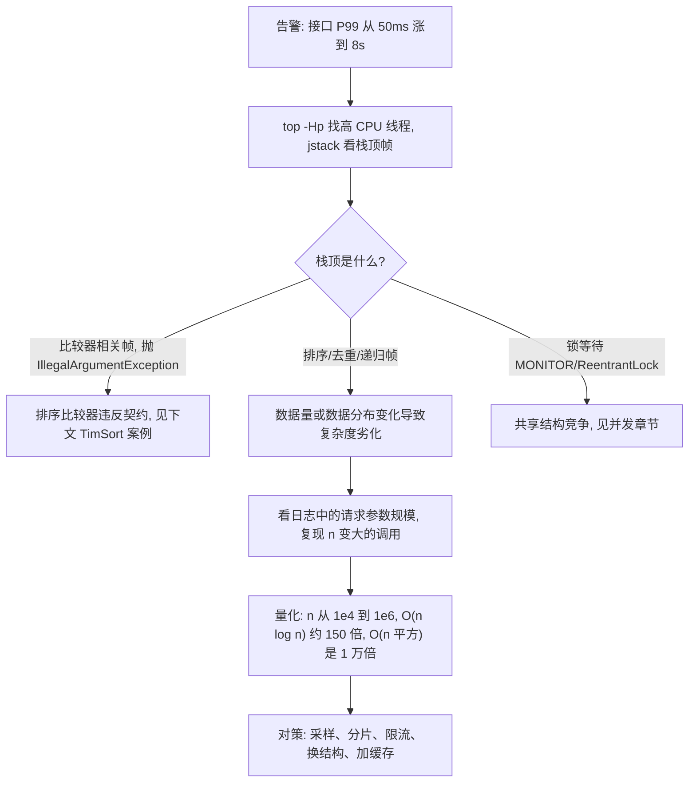

真实案例：JDK 7 起 `TimSort` 会在检测到比较器不满足自反性/传递性时抛出 `IllegalArgumentException: Comparison method violates its general contract!`（JDK-6804124 引入该检测）。触发写法通常是：

```java
// 反例: 用减法做比较, 差值溢出导致比较结果违反传递性
list.sort((a, b) -> a.getCount() - b.getCount());
// 正确: 用 Integer.compare / Comparator.comparingInt
list.sort(Comparator.comparingInt(Item::getCount));
```

当 `a.getCount()` 与 `b.getCount()` 差值超过 `Integer.MAX_VALUE`（例如 -2e9 与 +2e9 相减）时符号翻转，比较器不再满足传递性，TimSort 在归并阶段（`mergeCollapse` → `mergeAt` → `mergeLo`/`mergeHi`）检测到并抛异常。**这个异常只在特定数据分布下偶发**，单测覆盖不到，线上表现为"某个接口偶发 500，重试又好了"。排查手段：搜日志关键词 `Comparison method violates its general contract`，然后全局排查 `->` 比较器里的减法。JDK 7 之前不抛异常，但会静默产生错误排序结果——更危险。

第二个案例：**深分页**。`SELECT * FROM t ORDER BY id LIMIT 1000000, 20` 在 InnoDB 上会先扫描 1000020 行再丢弃前 100 万行（若排序走的是二级索引，这 1000020 行还要逐行回表），P99 直接爆炸。这不是"SQL 优化小技巧"而是 B+ 树索引的代价模型问题：`LIMIT` 的偏移量不能走索引跳过。对策：

- **游标分页（keyset pagination）**：`WHERE id > :lastId ORDER BY id LIMIT 20`，复杂度从 O(offset) 降到 O(log n) 定位 + O(20)。
- **延迟关联**：`SELECT t.* FROM t JOIN (SELECT id FROM t ORDER BY id LIMIT 1000000, 20) x ON t.id = x.id`，让子查询走覆盖索引避免大量回表。
- 前提是排序列有索引且唯一（有不唯一列时要加 tie-breaker，如 `ORDER BY create_time, id`）。

第三个案例：**缓存节点扩缩容导致命中率坍塌**。3 个 Redis 节点扩到 4 个，如果客户端用取模，约 75% 的 key 映射改变，瞬间全部回源，数据库被打穿。解法是客户端一致性哈希（带虚拟节点）或直接用 Redis Cluster 的 hash slot。上线动作：扩容时分批迁移槽并预热，禁止在流量高峰做 `CLUSTER RESHARD`。

### 8.4 海量数据的算法选型

| 场景 | 约束 | 方案 | 关键数字 |
| --- | --- | --- | --- |
| 10 亿整数求 Top 100 | 内存放不下 | 分片（hash 到 100 个文件）+ 每片小顶堆取 Top100 + 归并 | 每片约 1000 万个数，堆大小 100 |
| 10 亿整数去重 | 内存放不下 | `BitSet`（值域已知）或布隆过滤器（可容忍误判） | `BitSet` 10 亿位 = 125MB；布隆误判率公式 `(1 - e^(-kn/m))^k` |
| 判断 URL 是否爬取过 | 海量、允许 1% 误判 | 布隆过滤器 | 最优哈希个数 `k = (m/n) ln2`，m/n = 10 时 k ≈ 7，误判率约 0.8% |
| 40 亿不重复整数中找缺失值 | 内存 1GB | 位图 | 40 亿位 = 500MB，正好放下 |
| 大文件外部排序 | 内存装不下 | 分块排序 + 多路归并（败者树优化比较次数） | 归并路数 k 越大 IO 越少，但内存中要维护 k 个缓冲 |
| 海量日志求 UV | 精确计数不可行 | HyperLogLog（概率计数） | Redis `PFADD`，标准误差 0.81%，12KB/键 |

## 九、高级岗三问

### 9.1 为什么这么设计（替代方案与代价）

| 设计 | 替代方案 | 选它的理由 | 代价 |
| --- | --- | --- | --- |
| `HashMap` 用链地址 + 红黑树 | 开放寻址 | 容忍 0.75 负载因子，删除简单，防哈希碰撞攻击 | 指针跳转 cache 不友好，内存开销大 |
| 对象排序用 TimSort | 双轴快排 | 稳定 + 最坏 O(n log n) 保证，多字段排序需要稳定 | O(n) 额外空间 |
| InnoDB 用 B+ 树 | 红黑树 / 哈希索引 | 树高 3 层 vs 20 层，叶子链表支持范围查询 | 写入需分裂合并，随机写放大 |
| Redis Cluster 用 16384 槽 | 一致性哈希 | 槽位图 2KB 便于 gossip 传播，迁移粒度可控 | 需要客户端支持 MOVED/ASK 重定向 |
| `ConcurrentHashMap` 用 CAS + synchronized 头节点 | 分段锁（JDK 7） | 锁粒度到桶，并发度随容量增长 | 实现复杂，`size()` 只能是估算值 |
| `Redis` 的 ZSet 用跳表 | 红黑树 | 实现简单、范围查询天然友好、并发实现容易 | 内存略高（平均 1.33 个指针/层） |

### 9.2 线上出问题怎么定位

统一套路：**指标（P99/CPU/内存）→ 线程栈（jstack）→ 堆快照（jmap + MAT）→ 复现（参数规模 + 数据分布）**。

| 现象 | 可疑结构 | 命令 / 抓手 |
| --- | --- | --- |
| CPU 100% 且栈顶在排序 | 排序算法退化、比较器违约 | `top -Hp`、`printf '%x\n'`、`jstack`、搜 `Comparison method violates` |
| `StackOverflowError` | 递归深度（快排最坏、DFS） | `jstack` 看递归帧，`-Xss` 当前值，`jcmd <pid> VM.flags` |
| 内存持续上涨不回收 | 缓存结构（`HashMap` 无界、`ThreadLocal`） | `jmap -histo:live`、`jmap -dump` + MAT 支配树 |
| 单接口偶发超时 | 哈希冲突集中、桶退化 | 检查 key 的 `hashCode` 分布（如 `Float` 连续整数、以 2^k 为步长的序列号——它们的**低位相同、差异全在高位**） |
| 数据库 P99 爆炸 | 深分页、回表 | `EXPLAIN` 看 `rows` 与 `Extra`，慢日志 `long_query_time` |

### 9.3 规模变大后会怎样

- **数据量 ×100**：内存结构放不下 → 必须外部化（分片、B+ 树、多路归并）；O(n log n) 与 O(n²) 的差距从"能忍"变成"不能上线"。
- **QPS ×100**：无锁结构优于加锁结构（`ConcurrentHashMap` > `Collections.synchronizedMap`）；共享可变结构的竞争成为瓶颈。
- **节点数 ×10**：一致性哈希的虚拟节点数量必须同步增加；Redis Cluster 的槽迁移成为运维常态；跨分片的排序/聚合需要引入归并层。
- **哈希分布变差**：如果 key 的 `hashCode` **低位相同、差异全在高位**（`Float` 连续整数、以 2^k 为步长的序列号、`0x00010000` 这类值），用 `(n-1) & hash` 算下标会把它们全部映射到同一个桶。对策是做位扰动（`HashMap#hash`）或换强哈希（MurmurHash、FNV）。
- **别把自增主键算进上一条**：`id % n` 对 1,2,3… 是均匀轮转的，自增 ID 不会导致哈希分布变差。它真正的麻烦在别处——B+ 树右端插入的热点竞争，以及分片数变化时 `id % n` 几乎全量迁移。

## 高频面试题

### Q1. `HashMap` 的 put 全过程？JDK 8 相对 JDK 7 改了什么？

**答题框架（30 秒版）**：JDK 8 是"数组 + 链表 + 红黑树"，`hash` 做高低位异或扰动，下标 `(n-1) & hash`；桶空直接放，冲突尾插，往已有 8 个节点的桶里再插入（链表长到 9）且容量 ≥ 64 才树化，`size > capacity * 0.75` 翻倍扩容，扩容时按 `hash & oldCap` 拆成高低位两条链。

**展开（2 分钟版）**：
1. 关键常量：`DEFAULT_INITIAL_CAPACITY=16`、`MAXIMUM_CAPACITY=1<<30`、`DEFAULT_LOAD_FACTOR=0.75`、`TREEIFY_THRESHOLD=8`、`UNTREEIFY_THRESHOLD=6`、`MIN_TREEIFY_CAPACITY=64`。
2. `tableSizeFor` 保证容量是 2 的幂，这样取模可以用位与；`hash = h ^ (h >>> 16)` 让高位参与运算。
3. JDK 7 → JDK 8 的四个变化：头插改尾插（消除并发扩容成环）、引入红黑树（最坏 O(n) → O(log n)）、扩容时不再重新计算 hash（用 `e.hash & oldCap` 判高低位）、懒初始化（首次 put 才分配数组）。
4. JDK 8 依然线程不安全：并发 put 会丢数据，`++size` 非原子，`resize` 会覆盖。

**追问**：那 JDK 8 还会成环吗？答：不会成环（尾插 + 高低位拆分不改变相对顺序），但会丢数据，所以"线程不安全"的结论不变；要并发就 `ConcurrentHashMap` 或 `Collections.synchronizedMap`。

### Q2. 为什么 `HashMap` 负载因子是 0.75、树化阈值是 8？

**答题框架（30 秒版）**：0.75 是空间与冲突概率的折中；8 来自泊松分布——理想哈希下桶内节点数服从 λ=0.5 的泊松分布，一个桶达到 8 个元素的概率约 6e-8，所以树化是极小概率的兜底。

**展开**：负载因子 0.75 时，桶的期望占用率约 0.75，链表平均长度仍在常数级；0.5 浪费空间，1.0 冲突概率显著上升且扩容前性能抖动。8 与 6 之间留 1 个缓冲，是为了避免"树化-退化"抖动反复触发（若同为 8 会在边界反复转换）。

**追问**：为什么 `MIN_TREEIFY_CAPACITY` 是 64？答：容量小时冲突往往是因为数组太短而不是哈希函数差，扩容比树化更划算；容量小于 64 时 `treeifyBin` 会先 `resize()`。

### Q3. 红黑树和 AVL 树的区别？`TreeMap` 为什么用红黑树？

**答题框架（30 秒版）**：AVL 严格平衡（高度差 <= 1），查找更快但插入删除旋转更多；红黑树近似平衡（最长路径 <= 2 倍最短路径），插入最多 2 次旋转、删除最多 3 次，写多读少或读写混合场景综合更优。`TreeMap` 是读写混合的通用容器，所以选红黑树。

**展开**：给出红黑树五条性质，说明"黑高相同 + 无连续红节点"如何推出树高上界 2log₂(n+1)。AVL 适合"读远多于写、且要求最坏查找时间极短"的场景（如静态索引）；红黑树适合通用容器与内核结构（Linux CFS、epoll 的红黑树、Java 的 `TreeMap`）。

**追问**：那为什么 Redis 的 ZSet 用跳表而不是红黑树？答：跳表实现更简单、范围查询天然友好（底层有序链表）、并发插入只需改局部指针；红黑树在并发下需要更复杂的平衡策略。

### Q4. B+ 树为什么比 B 树和红黑树更适合做数据库索引？

**答题框架（30 秒版）**：磁盘按页（InnoDB 16KB）读取，B+ 树非叶子节点只存键和指针，扇出大，1000 万行只要 3 层，3 次 IO；叶子节点用链表串联，范围查询顺序扫描最优；红黑树 20 层 = 20 次随机 IO。

**展开**：给出 16KB 页 / BIGINT 主键 / 6 字节页指针 / 约 16 字节一条非叶记录的估算，得单页约 1024 个指针，三层约 1600 万行。B 树内部节点也存数据，扇出小、树更高；B+ 树数据只在叶子，非叶节点能放更多指针，且天然支持 `ORDER BY`、`BETWEEN`、`JOIN` 的有序扫描。

**追问**：为什么哈希索引不能替代 B+ 树？答：哈希索引只能等值查询，不支持范围查询和排序，也无法利用最左前缀；InnoDB 的自适应哈希索引（AHI）只是对热点页的内部加速，顶层仍是 B+ 树。

### Q5. 数组和链表怎么选？

**答题框架（30 秒版）**：算三个账——随机访问、插入删除位置、内存局部性。数组随机访问 O(1)、扩容 O(n) 均摊、cache 友好；链表头部插入 O(1)、随机访问 O(n)、每节点多两指针且 cache 不友好。

**展开**：举例说明"链表在 CPU 上不一定比数组快"——`LinkedList` 每个节点一次指针跳转，cache miss 代价约 100 个时钟周期，远超 `System.arraycopy` 的连续拷贝。所以 JDK 里 `ArrayDeque` 取代 `LinkedList` 做队列，`ArrayList` 是事实标准。链表真正不可替代的场景是"O(1) 任意位置摘除"（LRU 的双向链表）、"无需连续内存"（大对象）、"并发无锁栈/队列"（`ConcurrentLinkedQueue`）。

**追问**：`ArrayList` 扩容为什么是 1.5 倍？答：兼顾均摊 O(1) 与内存浪费，且增长序列 `1, 1.5, 2.25, ...` 更容易复用已释放的连续空间；2 倍增长浪费更明显。

### Q6. 单调栈解决什么问题？举一个你实际用过的例子？

**答题框架（30 秒版）**：单调栈用于"找每个元素左右第一个更大/更小元素"，每个元素进出栈一次，O(n)。典型题：每日温度、柱状图最大矩形、接雨水。

**展开**：给第 2.3 节的 `nextGreater` 实现，说明"栈里存下标、栈内值单调递减，遇到比栈顶更大的元素时，它就是被弹出下标的答案（右侧第一个更大值）"。工程例子：监控系统里求"每个采样点的下一个更高水位"用于触发扩容；或时间序列找最近一次"指标跌破阈值"的位置。

**追问**：为什么单调栈是 O(n)？答：每个下标最多入栈一次、出栈一次，总操作数 2n，均摊 O(1)。滑动窗口最大值为什么不用堆？答：堆是 O(n log n) 且需要懒删除过期下标，单调队列 O(n) 更优。

### Q7. 一致性哈希的原理？虚拟节点解决什么问题？

**答题框架（30 秒版）**：节点与 key 都哈希到 `[0, 2^32-1]` 环上，key 顺时针找到第一个节点；扩容时平均只有 1/N 的 key 迁移，而取模哈希会有约 (N-1)/N 的 key 失效。虚拟节点解决数据倾斜。

**展开**：讲取模的失效数学（3 → 4 时约 75% 的 key 映射改变），再讲虚拟节点的做法（每个物理节点生成 100~200 个虚拟节点，用 `hash(node + "#" + i)`），最后补充"一致性哈希不解决热点 key"。对比 Redis Cluster 用 16384 个 hash slot 而非一致性哈希的原因：槽位图只有 2KB 便于 gossip、迁移粒度可控、CRC16 计算更快。

**追问**：你们扩容 Redis 集群的具体步骤？答：低峰期 `CLUSTER SETSLOT` 逐槽迁移 + `MIGRATE`，客户端按 `MOVED`/`ASK` 重定向；提前预热热点 key；监控 `cluster_state` 与槽覆盖率；禁止一次迁移大量槽导致网络与 CPU 抖动。

### Q8. 快排和归并的区别？JDK 为什么对基本类型用双轴快排、对对象用 TimSort？

**答题框架（30 秒版）**：快排原地、常数小、不稳定、最坏 O(n²)；归并稳定、最坏 O(n log n)、需要 O(n) 空间。基本类型没有"相等元素顺序"的语义，稳定性无意义，所以用更快的双轴快排；对象数组的稳定性有语义价值（多关键字排序），所以用稳定的 TimSort，且 TimSort 会对违反传递性的比较器直接抛 `IllegalArgumentException`，问题能尽早暴露而不是静默排出错误顺序。

**展开**：给 JDK 常量表（286 / 47 / 67 / 33、`TimSort.MIN_MERGE=32`），说明 `Arrays.sort(int[])` 与 `Arrays.sort(Object[])` 的两条路径，说明 `Collections.sort` 走 stable 路径。补充 `Arrays.parallelSort` 的 8192 阈值。

**追问**：JDK 7 的 TimSort 抛 `Comparison method violates its general contract` 是什么原因？答：比较器不满足传递性/自反性，常见写法是 `(a, b) -> a - b` 溢出；TimSort 在归并两个 run 的过程中（`mergeLo`/`mergeHi` 发现一侧提前耗尽）检测到并抛异常，改用 `Comparator.comparingInt` 即可。

### Q9.（场景设计）设计一个支持 O(1) 的 LRU，容量 10 万，并发 QPS 5 万，你怎么做？

**答题框架（30 秒版）**：单机版用 `HashMap` + 双向链表（哨兵）做到 O(1)；并发版不能直接用 `LinkedHashMap`，改为 `ConcurrentHashMap` + 分段 LRU（按 key 哈希分段，每段独立锁），或者直接用 Caffeine（W-TinyLFU）。

**展开**：
1. `get`：`map.get(key)` 命中后把节点移到链表尾。并发下移链表必须加锁，所以按 16~64 段分片，段内串行、段间并行。
2. 容量 10 万，每节点约 40 字节（对象头 + key/value 引用 + 两个指针），总内存约 4~8MB，可控。
3. 用 `ConcurrentHashMap` 做索引、`LinkedHashMap(accessOrder=true)` 做每段的顺序，段容量 = 总容量 / 段数。
4. 若要更强的一致性，用 Caffeine；它的 W-TinyLFU 在扫描型负载下命中率明显优于纯 LRU。
5. 淘汰时注意避免长时间持锁做业务回调。

**追问**：如果 QPS 再涨到 50 万？答：本地缓存扛不住多实例一致性问题，需要 Redis 集群 + 本地二级缓存；本地缓存用 Caffeine + 短 TTL + 主动失效广播（Redis Pub/Sub 或 MQ）；注意缓存击穿（互斥重建）、穿透（布隆过滤器 + 空值缓存）、雪崩（过期时间加随机抖动）。

### Q10.（线上排查）某接口每天凌晨偶发 500，日志有 `Comparison method violates its general contract`，怎么定位和修复？

**答题框架（30 秒版）**：这是比较器违反传递性。查全代码里 `sort`/`Comparator` 中用了减法或非确定性字段的地方，改成 `Comparator.comparingInt`，并补一个随机大数据量的单测。

**展开**：
1. 定位：`grep -rn "sort(" --include=*.java | grep "\->"`，重点看 `a.getX() - b.getX()` 这种写法；同时看凌晨触发是否与"数据量变大"或"出现特殊值（如超过 int 范围的差值、含 null 的字段）"相关。
2. 根因：差值溢出或比较器读取了会变化的状态（比如比较器里调用了可能为 null 的字段、或者用了随机数/时间戳）。
3. 修复：`Comparator.comparingInt(a -> a.getCount()).thenComparing(a -> a.getId())`；null 用 `Comparator.nullsLast` 显式处理；比较器必须满足自反、反对称、传递。
4. 验证：写单测造 `Integer.MIN_VALUE` 与 `Integer.MAX_VALUE` 两级数据，并跑 `list.sort` 断言不抛异常且顺序正确。
5. 加固：在代码规范里禁止比较器使用减法；静态检查（SpotBugs/Error Prone）加规则。

**追问**：为什么这个 bug 单测测不出来？答：需要"差值溢出"这种特定数据分布，日常测试数据量小、值域窄；且 TimSort 只在 run 归并时校验，触发点与数据排列有关。上线后表现为偶发，天然难复现。

### Q11.（场景设计）1 亿条日志求出现次数最多的 10 个 IP，机器 8 核 16GB，你怎么设计？

**答题框架（30 秒版）**：数据放不下内存，走"分片 + 局部 TopK + 归并"。先按 `hash(ip) % 分片数` 把日志分到 N 个文件（保证同一 IP 落同一片），每片用 `HashMap<String, Integer>` 统计后取局部 Top10，最后对 N×10 个候选归并求全局 Top10。

**展开**：
1. 分片数按内存算：假设 IP 去重后约 2000 万、每条约 50 字节，`HashMap` 装载因子 0.75 下约需 1.3GB；16GB 内存给 JVM 8GB，可以一次处理，也可分 16 片更稳。
2. 每片局部 TopK 用**小顶堆**（第 7.3 节代码），O(n log 10)。
3. 归并阶段候选只有 160 个，直接全排序。
4. 若 IP 基数更大（10 亿），用 Count-Min Sketch 做近似统计 + 堆取 TopK，精度损失可控；或者用 Redis `PFADD`/`ZINCRBY` 分流。
5. 工程注意：分片读写用 `BufferedReader`（默认 8KB 缓冲）或 `Files.lines`；避免 `String.split` 产生海量临时对象（可用 `indexOf` 手动切）；`HashMap` 预设初始容量避免多次扩容。

**追问**：为什么不能用 `HashMap<String, Integer>` 直接统计？答：1 亿条日志的 IP 去重后可能有几千万，`HashMap` 的 key 是 `String`（对象头 16 + hash 4 + char[] 引用 4 ≈ 24 字节起）加上 `Node`（约 32 字节），内存放大数倍，极易 OOM。分片后单片数据量可控，且天然并行。

### Q12.（场景设计）设计一个短链系统，如何保证 ID 不重复且尽量短？

**答题框架（30 秒版）**：短链的核心是"长链到短码的映射 + 短码到长链的索引"。ID 生成可选号段模式（DB 批量取号）或雪花算法（`Snowflake`，64 位 = 1 符号 + 41 时间戳 + 10 机器 + 12 序列），再把 10 进制的 ID 转成字符集为 `0-9a-zA-Z` 的 62 进制字符串，6 位可表示 62^6 ≈ 568 亿个。

**展开**：
1. 唯一性：号段模式靠 DB 的 `UPDATE ... SET max_id = max_id + step` 原子性；Snowflake 靠机器位 + 序列位，需解决时钟回拨（拒绝服务或等时钟追上，或改用 Leaf 的号段 + 雪花双模式）。
2. 短码映射：base62 编码后 6 位足够；不想暴露自增规律就用哈希（MurmurHash）+ 冲突重试，或者对一个随机种子做可逆混淆（如异或 + 洗牌）。
3. 存储：`MySQL(short_code -> long_url)` 加唯一索引 + `Redis` 做读缓存（读多写少，命中率极高）。短码取模分库分表，避免单表过大。
4. 缓存穿透：不存在的短码会击穿到 DB，加布隆过滤器或缓存空值（TTL 30~60 秒）。
5. 跳转用 302 还是 301：需要统计点击就用 302（每次都回到服务端），不在乎统计可用 301 让浏览器缓存。

**追问**：为什么不用 UUID？答：UUID 36 字符太长，且随机分布会导致 B+ 树索引随机插入（页分裂、写放大），自增或趋势递增的 ID 对 InnoDB 聚簇索引更友好。

### Q13. 动态规划的状态怎么设计？以背包和股票为例。

**答题框架（30 秒版）**：DP 的难点在状态定义，判定标准是"状态是否包含做出下一步决策所需的全部信息"。背包的状态是 `(前 i 个物品, 剩余容量 j)`；股票的状态是 `(第 i 天, 已交易次数 k, 是否持股)`。

**展开**：
1. 状态必须"无后效性"——未来只依赖当前状态，不依赖到达路径。若路径相关，就要把路径信息编进状态（如状压 DP 的 mask）。
2. 背包的关键是遍历顺序：0-1 背包容量倒序（防重复选），完全背包容量正序（允许重复选）。
3. 股票的关键是维度：`dp[i][k][0/1]`，冷冻期改买入来源为 `dp[i-2][0]`，手续费在卖出时减 fee。121 到 714 六题只差状态维度。
4. 空间优化：一维滚动数组（背包）、常量个变量（股票只需保存前一天的两个值）。

**追问**：什么题不能用 DP？答：状态空间爆炸或不存在最优子结构的（如求所有方案、需要记录路径且状态无法压缩），以及有后效性的问题（如带约束的路径计数需要额外维度）。

### Q14. 二分查找的返回值为什么是 `-(low + 1)`？二分的常见坑有哪些？

**答题框架（30 秒版）**：`Arrays.binarySearch` 约定"找不到时返回 `-(insertion point) - 1`"，这样 `-1` 表示应插在 0 号位（因为 0 取负还是 0，无法与"找到下标 0"区分），必须偏移 1。

**展开**：
1. 四个坑：中点溢出（用 `lo + (hi - lo) / 2`）；死循环（`lo = mid` 配 `lo <= hi`）；区间开闭不一致（左闭右开就全用左闭右开）；浮点二分的精度死循环（改用固定迭代次数）。
2. lower_bound / upper_bound 的差异只在 `a[mid] < target` 还是 `<= target`，以及返回的是第一个 >= 还是第一个 >。
3. 二分的本质是"二段性"而不是"有序"——二分答案题（最小化最大值、最大化最小值）才是面试真正想考的。

**追问**：`Arrays.binarySearch` 对重复元素返回哪个下标？答：**不保证**，可能返回其中任意一个（JDK 实现是标准折半，具体位置取决于数组长度与命中路径）。需要第一个/最后一个必须自己写 lower_bound / upper_bound。

## 易错点与踩坑

| 易错点 | 正确理解 |
| --- | --- |
| `Arrays.sort(int[])` 是稳定排序 | 不稳定，用的是 `DualPivotQuicksort`；只有 `Arrays.sort(Object[])`（TimSort）稳定 |
| `Arrays.asList` 返回的 List 可以 add | 返回 `Arrays$ArrayList`，长度固定，`add` 抛 `UnsupportedOperationException` |
| `LinkedList` 插入删除总是比 `ArrayList` 快 | 只有在已定位到节点时才是 O(1)；按下标插入仍需 O(n) 遍历，且 cache 不友好 |
| `HashMap` 线程不安全只是"可能丢数据" | JDK 7 头插在并发扩容下会成环，`get` 死循环导致 CPU 100%；JDK 8 改尾插不会成环但仍会丢数据 |
| `HashMap` 扩容后元素顺序不变 | JDK 8 扩容会把同桶元素拆成高低位两条链，相对顺序保持但整体顺序会变；任何版本都不保证迭代顺序 |
| `HashMap` 链表长度到 8 就树化 | 判据是 `binCount >= TREEIFY_THRESHOLD - 1`（`binCount` 不含桶首节点）：往**已有 8 个节点**的桶里再插入、链表长到 9 时才调 `treeifyBin`，且表容量必须 ≥ 64 |
| `HashMap` 的 `size()` 能当并发计数 | `ConcurrentHashMap#size()` 返回的是 `sumCount()` 估算值，高并发下不精确；`mappingCount()` 只是用 long 返回同一个估算值（避免 int 溢出），同样不精确；真要精确计数得在外层用 `LongAdder` |
| 红黑树插入后需要旋转 | 父节点为黑时不需要任何修复；只有父红才进入修复流程，且叔叔为红时只变色不旋转 |
| `PriorityQueue` 迭代是有序的 | `iterator()` 按数组顺序，只有连续 `poll()` 才有序；`toString()` 也是乱序的 |
| 建堆是 O(n log n) | `n` 次插入是 O(n log n)，但自底向上 `heapify` 是 O(n) |
| 快排最坏 O(n²) 只出现在"随机运气差" | 有序/逆序且固定取端点为 pivot 时**必然**退化，是确定性的，必须随机化或三数取中 |
| 归并排序空间一定是 O(n) | 数组归并是 O(n)；链表归并只需改指针，额外空间 O(log n)（递归栈） |
| 滑动窗口能解所有"子数组和"问题 | 数组含负数时不满足单调性，`和 >= target 的最短子数组` 必须用前缀和 + 单调队列 |
| 二分只能用于有序数组 | 本质是二段性；二分答案（最小化最大容量等）数组可以无序 |
| `mid = (lo + hi) / 2` 是安全写法 | 会溢出为负导致 `ArrayIndexOutOfBoundsException`，必须写 `lo + (hi - lo) / 2` 或 `(lo + hi) >>> 1` |
| Floyd 三重循环的 k 可以放最内层 | k 必须在最外层，否则状态转移用的是"未定型"的中间结果，答案错误 |
| 0-1 背包一维数组正序遍历 | 必须倒序，正序会让同一物品被选多次，退化成完全背包 |
| 并查集只做路径压缩就够了 | 路径压缩 + 按秩合并才有 O(α(n))；只用其中一个退化到 O(log n) |
| `String#hashCode` 是随机化的 | 规范里写死 `s[0]*31^(n-1) + ...`，可被构造哈希碰撞攻击（HashMap 红黑树就是缓解手段之一） |
| `Trie` 的复杂度与词表规模有关 | 插入/查找只与词长 L 有关，O(L)，与词表大小无关 |
| DFS 一定能求无权图最短路 | 不能，DFS 不保证首次到达最短；无权图最短路必须 BFS |
| `P99` 上去了就是算法问题 | 优先看数据规模与数据分布是否变化（n 从 1e4 到 1e6，O(n²) 放大 1 万倍），算法本身很少"突然变慢" |
| 深分页只是 SQL 写法问题 | 本质是 B+ 树 `LIMIT offset` 无法跳过扫描的代价模型问题，必须改游标分页或延迟关联 |

## 一句话速记

- 复杂度四件套：时间/空间、最好/平均/最坏、均摊 vs 平均、O 上界 vs Θ 紧确；均摊是确定性摊派，平均是期望。
- 比较排序下界 Ω(n log n)；想突破就用计数/基数/桶，代价是依赖值域。
- `Arrays.sort(int[])` 走 `DualPivotQuicksort`（286/47/67/33，不稳定）；`Arrays.sort(Object[])` 走 `TimSort`（`MIN_MERGE=32`，稳定）；`parallelSort` 阈值 8192。
- 快排四优化：随机化 pivot、小区间插排、三路划分、先递归短边；固定取端点做 pivot 时，有序/逆序数据必然退化成 O(n²) + 深递归。
- `ArrayList` 默认 10、1.5 倍扩容、`MAX_ARRAY_SIZE = Integer.MAX_VALUE - 8`；队列/栈优先 `ArrayDeque` 而不是 `LinkedList`。
- `HashMap`：16 / 0.75 / 8 / 6 / 64，`hash = h ^ (h >>> 16)`，下标 `(n-1) & hash`，JDK 8 尾插 + 红黑树 + 高低位拆分扩容；并发用 `ConcurrentHashMap`（CAS + synchronized 头节点）。
- 红黑树五性质的核心是"无连续红 + 黑高相同"，推出树高 <= 2log₂(n+1)；AVL 更平衡、旋转更多，红黑树写多的场景更优。
- B+ 树：InnoDB 页 16KB，非叶节点约 1024 个指针，三层覆盖约 1600 万行，3 次 IO；叶子链表让范围查询最优。
- 一致性哈希把 key 空间变成环，扩缩容只迁移约 1/N 数据；虚拟节点 100~200 个解决倾斜；Redis Cluster 用 16384 个槽而非一致性哈希。
- 单调栈/单调队列都是"每个元素最多进出一次"的 O(n) 结构；滑动窗口要求约束单调，负数场景失效。
- Dijkstra 不能有负权，负权换 Bellman-Ford/SPFA；Floyd 的 k 必须在最外层；并查集 = 路径压缩 + 按秩合并 = O(α(n))。
- DP 四步：定义状态 → 转移方程 → 初始化边界 → 遍历顺序；0-1 背包倒序、完全背包正序；股票系列统一成 `dp[i][k][0/1]`。
- 位运算三板斧：`x & (x-1)` 消最低位 1、`x & -x` 取 lowbit、`(n-1) & hash` 替代取模（前提 n 是 2 的幂）。
- 面试现场七纪律：先澄清、先暴力、先签名与用例、命名规范、边界单列、边写边说、收尾给复杂度。
- 排查排序类线上问题：`top -Hp` 找高 CPU 线程 → `jstack` 看栈顶 → 搜 `Comparison method violates its general contract` → 全局排查比较器里的减法溢出。
