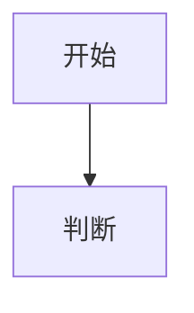

# 写作规范（所有章节必须遵守）

> 这是给内容生成方看的统一规范。每写一个文件前先读本文件。

## 0. 定位

- 读者：**3~8 年经验的 Java 工程师，冲刺高级 / 架构师岗位**。
- 目标：**能直接拿去过面试**。不是入门教程，不要解释"什么是变量"。
- 每个知识点的落点是：**原理 → 源码/底层 → 设计权衡 → 生产实战 → 面试怎么答**。
- 不能停留在背诵结论。例如不要只写"HashMap 线程不安全"，要写清楚 **为什么**（扩容时链表成环/数据覆盖的具体步骤）、**JDK7 与 JDK8 的差异**、**ConcurrentHashMap 怎么解决的**。

## 1. 深度基线

必须做到：

1. **标明 JDK / 框架版本**：如「JDK 8 起」「JDK 17 移除」「Spring 5.3.x」「MySQL 8.0 InnoDB」。写错版本比不写更糟。
2. **给具体类名、方法名、字段名**：如 `AbstractQueuedSynchronizer#acquire`、`ThreadPoolExecutor#getTask`、`HashMap#treeifyBin`。
3. **给数字/默认值**：如 `LOAD_FACTOR=0.75`、`TREEIFY_THRESHOLD=8`、`SurvivorRatio=8`、`InnoDB page=16KB`、`maxWait`、`G1 Mixed GC 默认占堆 8%~-XX:G1HeapWastePercent`。
4. **给对照表格**：凡是"XX 与 YY 的区别"一律用 Markdown 表格，列出 5~8 个维度。
5. **给权衡**：写明"什么时候用 A，什么时候用 B，代价是什么"。
6. **给生产现象**：CPU 100%、频繁 Full GC、连接池打满、缓存击穿……要给出**排查命令 / 日志特征 / 定位步骤**。

## 2. 文件结构模板

每个文件严格按下面骨架写（标题层级不要乱）：

````markdown
# NN 章节标题

> 一句话定位 ｜ 面试权重 ★★★★☆ ｜ 建议复习 40 分钟

## 本章大纲

- [一、xxx](#一xxx)
- [二、xxx](#二xxx)
- [高频面试题](#高频面试题)
- [易错点与踩坑](#易错点与踩坑)
- [一句话速记](#一句话速记)

## 一、xxx

### 1.1 xxx

正文……（可用 Markdown 表格）



### 1.2 xxx

……

## 二、xxx

……

## 高频面试题

### Q1. xxxx？

**答题框架（30 秒版）**：……

**展开（2 分钟版）**：
1. ……
2. ……

**追问**：面试官常接着问 xxx，答：……

### Q2. ……

## 易错点与踩坑

| 易错点 | 正确理解 |
| --- | --- |
| …… | …… |

## 一句话速记

- ……
- ……
````

要求：

- **正文主体的篇幅占全文 60% 以上**，面试题部分用简练的答题框架，不要重复正文。
- 每个文件 **至少 3 张 Mermaid 图**，且图要真正能解释机制（不是装饰）。
- 每个文件 **至少 8 道高频面试题**（高级岗：至少含 3 道"场景设计 / 排查类"题）。
- 每个文件正文 **不少于 600 行**（不含代码块以外的空行也要尽量充实）。宁深勿浅。

## 3. Mermaid 规范（重要，语法错误会导致图渲染失败）

- 代码块语言标记固定为 `mermaid`。
- 支持的图类型：`flowchart`、`sequenceDiagram`、`classDiagram`、`stateDiagram-v2`、`erDiagram`、`graph`。
- **节点标签里含中文、空格、括号、冒号、逗号、斜杠时，必须用双引号包起来**：
  - ✅ `A["年轻代 (Young Gen)"]`、`B{"是否超过阈值?"}`
  - ❌ `A[年轻代 (Young Gen)]`
- 节点 id 只用英文字母数字下划线：`A1`、`GC`、`Node1`。
- `flowchart` 方向：纵向用 `flowchart TD`，横向用 `flowchart LR`。
- 箭头上的文字：`A -->|"是"| B`。
- `subgraph` 写法：
  ```
  subgraph 堆内存
    E["Eden"]
    S0["Survivor 0"]
  end
  ```
  subgraph 标题含空格时用 `subgraph Heap["堆内存"]` 形式。
- 时序图：
  ```
  sequenceDiagram
    participant C as 客户端
    participant G as 网关
    C->>G: 发起请求
    G-->>C: 返回结果
  ```
- 类图：
  ```
  classDiagram
    class ThreadPoolExecutor {
      +int corePoolSize
      +execute(Runnable r)
    }
    ExecutorService <|-- ThreadPoolExecutor
  ```
- 状态图：`stateDiagram-v2`，状态名中文要写成 `s1 : 空闲` 这种"id : 描述"形式。
- **禁止**：在 mermaid 里使用 HTML 标签、emoji、`<br/>`（用 `\n` 或在标签里拆成多个节点）、中文全角括号当作语法符号。
- 生成后自查：括号是否成对、引号是否成对、每个 `subgraph` 是否有 `end`、`sequenceDiagram` 里 `participant` 是否先声明。

## 4. 语言风格

- 中文，技术名词保留英文原词（如 happens-before、CAS、MVCC、Raft）。
- 短句、结论先行，多用表格和列表，避免大段散文。
- 不要写"众所周知""简单来说就是"这类口水话。
- 不要写"由于篇幅原因略"，不要留 TODO。
- 不要虚构 API、参数或规范条款。不确定的数字宁可不写。
- 涉及公司实现（如 JDK 内部、Spring 源码）时，指明是哪个类/哪个版本的行为。

## 5. 每章必须回答的"高级岗三问"

在正文里以显式小节或面试题形式覆盖：

1. **为什么这么设计？**（替代方案是什么，代价是什么）
2. **线上出问题怎么定位？**（命令、指标、日志、火焰图、dump）
3. **规模变大后会怎样？**（QPS 上来、数据量上来、节点变多后的失效模式）
